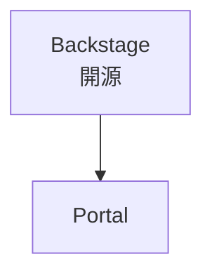

# quidproquo 寫作風格指南

## 核心原則

寫給「一週後的自己」看，也寫給遇到同樣事情的人看。具體 > 抽象，可驗證 > 模糊聲明。

## 各分類風格

**tech（問題解決型 / `type: debug`）**：直接、具體，程式碼要完整，含可複製的命令。標題包含關鍵錯誤或技術名稱。結構固定：情境 → 問題 → 嘗試 → 解法 → 原因 → 學到的事。篇幅精簡，不需要鋪墊。

**tech / ai（專文介紹型 / `type: deep-dive`）**：適合介紹工具、技術堆疊、架構設計。目標長度 1000-2000 字。不需要大量第一人稱經驗，介紹文的價值在於讓讀者理解工具、做出選擇。每個段落至少展開：設計哲學 / 跟常見替代方案的比較 / 適合與不適合的情境 / 具體用法 / 限制。有程式碼範例就加；架構圖與流程用 mermaid 畫（見「圖解（mermaid）」），畫不出來才退回 ASCII。標題直接點主題，不要加「的解法」。寫新標準 / 新工具 / 新規格的 deep-dive 時，必須遵守「增量歸因原則」（見下方§增量歸因）。

**guide / `type: guide`**：是 how-to，讀者期望照著做能複製結果。每步寫前置條件、可貼可跑的命令、預期輸出、常見錯誤。

**project / `type: project`**：自己做的東西。從問題出發，說清楚為什麼做、怎麼做、做出來之後呢、現在還活著嗎。

**climbing**：臨場感。路線名稱、岩場地點、身體感受要寫出來。
**surf**：狀態、浪況、感受。不需要技術術語，但要有畫面。
**film**：不劇透開頭，說清楚為什麼值得看（或不值得）。
**coffee**：豆子來源、風味描述、沖煮參數（有的話）。
**career**：誠實，包含猶豫和失敗的部分，對讀者最有用。
**life**：隨意，不需要結構。

## Title 原則

- 具體 > 抽象
- `tech` debug 類：包含錯誤關鍵字，結尾常加「的解法」「踩坑記錄」
- 其他：直接說這篇在講什麼，配一句點題副標（用全形冒號連接）
- 站上的主流格式是「**主題怎麼做：具體名詞列舉**」——冒號前是讀者的問題，冒號後是實體（工具名、步驟、維度）。例：「免費搜尋與爬取工具怎麼選：月度額度、試用與自架成本」「需要登入的網站怎麼交給 Agent：Session、權限與自動化邊界」。寫完先跟同分類最近幾篇並排看一眼，格式不同就改
- 冒號後面不要放後設字眼：「三輪修正的紀錄」「從…說起」「的教訓」「我的經驗」都是在描述文章本身，不是讀者要找的東西。把它們換成文章實際涵蓋的名詞。本站踩過：一篇 skill 設計文連改兩次標題，「它自己先變肥：三輪修正的紀錄」→「四個陷阱：從…的三輪修正說起」都被退，直到換成「怎麼寫才不吃 context：入口、門檻、成本、來源」才對齊站上慣例
- 反諷、擬人（「它自己先變肥」）留給內文，不進標題
- 避免賣弄詞或網路梗，標題會留很久

## tldr / description 原則

- `tldr`：1-2 句、含名詞與數字，讀者用來決定要不要點進來。數字必須跟讀者的決策有關（規模、版本、價格、時數），不是審查工作量（讀了幾堂、跑了幾支、覆核幾條）
- `description`：SEO meta，1-2 句，描述「這篇講什麼」而不是「這篇有多好」
- 不要兩個欄位寫一樣

## 研究過程不進門面

研究與審查的過程是作者的工作，不是讀者的問題。

- 「讀了幾堂、跑了幾支、覆核幾條」這類工作量數字，不放標題與 tldr，除非讀者的決定取決於它（例如「完整審過」是選這份評測的理由）
- 評測發現（錯誤、落差、爭議）合併成一節，約占全文 15–20%，不分散成多個「判決」章節
- 方法論一段帶過；要保留證據就連到附錄或另一篇，不在正文展開
- 檢法：只看標題與 tldr，讀者能說出這篇在講什麼對象嗎？只能說出「作者查了多少」就是失敗

### 查證過程不寫進正文

本站要求查證的規則很多（引用前查一手來源、讀過正文才列來源、讀不到要試完工具鏈），但查證是作者的工作，查完的結果才是讀者要的。誠實指的是正文的說法正確、限制講清楚，不是把查證過程寫出來。查證的產物分三層，各放一個地方：

| 層 | 內容 | 放哪裡 |
|---|---|---|
| 事實 | 查證後確認的說法 | 正文直接陳述，不加「經查證」「打開核對」 |
| 會改變讀者做法的限制 | 材料鎖住、要付費、版本不同、某個說法不可靠、某段還沒有好來源 | 用到它的那一段，一兩句講完 |
| 過程 | 哪天打開、哪頁 404、試了哪些工具、逐頁核對清單、哪些沒查到 | `.work/<slug>/evidence.md`；正文只在「參考資料」列來源，查核日期放出處區 |

- 不寫「**本文依據**：……全部在 2026-09-30 打開核對」這種開頭段。來源放「參考資料」；版本基準會改變讀者做法時，寫成一句「本文以 Fall 2024 的作業為準」。
- 不開整節講查證：「仍待核對」「這一篇可以確認與不能確認的」「附錄：數字與查證方式」「逐頁核對清單」。沒查到的東西不教就好；它會影響讀者時，在那一段寫一句限制。
- 正文不寫「本系列沒有確認」「回傳 404」「查不到」。讀者用不到的拿掉；用得到的改成讀者的處境：「Kaggle 競賽頁已經不公開，期末專題只能自己做驗收」。
- 例外：查證本身就是文章主題（核對一則貼文、比對兩份規格），查證表就是內容。正文加一行 `<!-- process-leak: topic -->`。

`node scripts/check-process-leak.mjs <post.md>` 計算正文（出處區以前）的查證句型與查證型 H2，課程總覽另計查課型 H2（存取分級、版本基準、硬事實）。pre-commit 對每一篇被暫存的文章執行，所以舊文章只要被改到就要一起修好；全站模式只計數，因為既有文章還在回填。檢查器只抓已出現過的句型，換個說法寫流水帳一樣是失敗，要自己讀。

本站踩過：林軒田課程總覽 12 個 H2 沒有一個在講機器學習，正文寫滿「全部在 2026-09-30 打開核對」「打開是 404」「本系列沒有逐支核對」，使用者問「為啥內容看起來很查證」，接著指出「一般文章也會有類似問題」（2026-10-14）。當時全站掃到 223 篇有「本文依據」段、43 篇有「可以確認與不能確認」整節、英文口說系列每篇都有「仍待核對」。原因是查證規則都有檢查器，查證紀錄該放哪裡卻只寫在課程規格裡。

### 但書與歸因不堆疊

分清來源與作者主張是對的，但分法是**寫法**，不是逐句加標籤。查證報告指出「這句是作者概括，來源沒說」時，修法三選一：

1. **讀者用不到就刪。** 多數「來源沒說 X」的句子屬於這類。
2. **改寫成來源原意。** 把句子縮回來源支持的範圍，不加標籤。
3. **直接寫成作者主張。** 主詞是「我」或用判斷語氣（「我會先試 A」「這類洞貴，主要是因為做得到的人少」），整段只說一次，後面不再重申。

不要做的事：在句尾補「這是我的判斷，不是 Red Hat 的說法」「頁面沒有寫明」。修一輪多一層，幾輪之後讀者讀的是歸因，不是內容。整篇都是作者觀點的文章（評論、心得），開頭講一次立場就好。

`node scripts/check-process-leak.mjs <post.md>` 同時計算正文的歸因標籤（「我的判斷／推論／推測」「不是某某的說法」「原文沒有寫」與英文對應句型），超過 3 處就失敗。檢查器只抓常見句型，換個說法堆一樣是失敗。

本站踩過：「從零開始的資安獵人」第 7 篇（Hyper-V）累積了 9 處「我的判斷／推測」和 6 處「依 Learn／Red Hat」，第 10 篇有 19 處「未查證」。每處都是照 post-verify 的 🟡「作者概括未標示」補上的；每條單獨看都合理，疊在一起整篇讀不下去（2026-10-14）。

## 影片嵌入（YouTube）

來源是 YouTube 影片（直播、演講、課程）時，在「這是什麼」或第一次提到影片的段落旁嵌入，用固定的 `youtube` fence：

````markdown
```youtube
url: https://www.youtube.com/watch?v=MN9dGgmLyso
title: Matt Pocock × Lauren Tan 直播對談（2026-10-02）
start: 91
```
````

- `url`（必填）：watch、youtu.be、live、embed、shorts 都可以，會抽出 11 碼 ID。
- `title`（必填）：給 iframe 的無障礙名稱和下方 fallback 連結；寫「誰 × 誰／什麼場合（日期）」。
- `start`（選填）：起始秒數，只用整數秒，不要寫 `1:31`。
- 格式錯誤時 build 會直接失敗，不會悄悄漏掉。
- 每篇每支影片嵌一次，放在第一次提到的位置；中英兩版各嵌一次，`title` 各自翻譯。
- 課程文章的播放器位置另有規則：依影片的角色放導言、各節 H2 下或文末，不是一律「第一次提到的位置」，也不放進文末的「課程影片來源」區塊。見 `course-guide-contract.md`「影片與正文的搭配」。
- 嵌入不取代 `## 參考資料`：影片連結仍要列在文末，內文第一次提到也要有 inline 連結。
- 課程文章有嵌入就要把開頭「影片狀態」標成「已附影片」；`pnpm check:course-videos` 對所有課程系列檢查嵌入、狀態行、中英一致與查核日期（已逐講查證的系列另登錄在 `scripts/config/course-videos.json`）。
- 實作在 `src/plugins/remarkYoutubeEmbed.ts`，輸出 `youtube-nocookie.com`、`loading="lazy"`。

## 圖解（mermaid）

> 新圖先看 `../../diagram/SKILL.md` 選圖型：大多數圖用 ```` ```diagram ```` 手寫 SVG（顏色跟著深淺色、可逐步播放）。mermaid 留給節點超過 9 個、手排不划算的依賴圖或關係圖。

多步驟流程、分支決策、元件之間的依賴關係，優先用 mermaid 畫，不要全塞成文字段落。用 `mermaid` fence：

````markdown

````

**顏色：不要自己指定。**

- 站上在瀏覽器端渲染（`src/pages/posts/[...slug].astro` 的 mermaid script）：`base` 主題加一組寫死的淺色／深色色票（`lightThemeVariables`／`darkThemeVariables`），切換深淺色時重新渲染。
- 圖裡不要寫 `classDef`、`style`、`linkStyle` 的顏色，也避免用 `%%{init}%%` 另設主題；自訂顏色不會跟著深淺色切換。
- 色票要改，就改那個 script，並與 `src/styles/tokens.css` 的 `--brand-*`／`--info-*`／`--warning-*`／`--text-*`／`--bg-*`／`--border` 同步（mermaid 的 themeVariables 只收寫死的 hex，要手動對照；2026-10-11 已逐值核對，淺色與深色皆一致）。
- 結果是所有節點同色，所以**意義不能靠顏色表達**：用線型（實線＝來源寫明的依賴，虛線＝選配或未驗證）、`subgraph` 外框（分組）和節點文字區分。

**手機寬度：**

- 圖會縮到容器寬度。節點文字長、多欄並排時，手機上的字會縮到約 8px 而讀不了（本站實測）。
- 節點文字寫短（名稱加一個詞），細節放在圖下方的條列；方向用 `flowchart TB`，避免寬的多欄 `LR`。
- 節點與邊標籤用雙引號包起來，換行用 `<br/>`。

**每條線都要有來源：**

- 箭頭是一個主張。實線只畫來源明寫的關係；官方敘事但沒有技術文件支持的關係，用文字說明，或畫成虛線並在標籤註明未驗證，不要畫成實線。
- 中英兩版各一張圖，節點文字各自翻譯，結構一致。

**發文前驗證（不需要專案能 build）：**

- 語法與文字：在暫存目錄 `npm i @mermaid-js/mermaid-cli`，用環境內的 Chromium 渲染（`mmdc -p <puppeteer 設定> -i x.mmd -o x.png`，沙箱環境要加 `--no-sandbox`），看圖，不只看有沒有報錯。中英兩版分開抽出、分開跑，確認抽到的是各自的圖。
- 頁面：能起 dev server 時，用 Playwright 在淺色、深色、390px 手機寬度各截一次 `.mermaid-diagram`，確認沒有橫向捲動與 console 錯誤。

## 逐步動畫流程圖（flow-diagram）

> 只有方框和箭頭的逐步請求流程用這個（JSON 自動排線，寫起來最快）。其他圖型，或需要逐步播放但不只方框箭頭的圖，用 `../../diagram/SKILL.md` 的 `diagram` 區塊加 `step:`。驗證一律可用 `pnpm exec tsx scripts/diagram-preview.ts <文章.md>`。

讀者要「跟著資料走一遍」才看得懂的流程（請求怎麼流過各元件、迴圈在哪裡回頭、兩種架構的控制流差在哪），用 `flow-diagram` fence 畫成逐步亮起的 SVG。結構關係、分類、依賴圖仍用 mermaid；flow-diagram 只用在**步驟順序本身就是重點**的地方，一篇一到兩張就夠。

範例：`src/content/posts/ai/2026-03-12-naive-advanced-modular-rag-evolution.md` 的「三個世代之後：Agentic RAG」（RAG vs Agentic RAG 並排兩張）。

````markdown
```flow-diagram
{
  "title": "RAG：固定管線，從頭走到尾一次",
  "lang": "zh-TW",
  "width": 520,
  "height": 630,
  "nodes": [
    {"id": "user", "label": "使用者", "x": 110, "y": 50, "shape": "actor"},
    {"id": "app", "label": "LLM App", "x": 110, "y": 220, "w": 130}
  ],
  "edges": [
    {"from": "user", "to": "app", "step": 1, "label": "查詢", "offset": 16, "labelAt": [78, 135], "labelSide": "left"},
    {"from": "app", "to": "user", "step": 2, "label": "回應", "offset": 16, "labelAt": [142, 135]}
  ],
  "steps": ["使用者送出查詢", "回應回到使用者"]
}
```
````

**欄位：**

- 頂層：`title`、`lang`（`zh-TW`／`en`）、`width`／`height`（viewBox，100–2000）、`nodes`、`edges`、`steps` 必填；`caption` 選填。
- 節點：`x`／`y` 是**中心點**。`shape` 有 `box`（預設）、`actor`（人）、`db`（資料庫）、`chip`（模型）、`group`（虛線外框，畫在最底層）；`w`／`h` 不寫就用外形預設值。`tone: "accent"` 標出主角元件（綠框）。換行用 `\n`。
- 箭頭：`step` 對到 `steps` 的第幾項（從 1 起）；同一步可以有多條箭頭，但每一步至少要有一條。`via` 給轉折點畫直角線；`offset` 讓一去一回兩條直線並排（不能和 `via` 同時用）；`labelAt` 指定步驟編號的位置，`labelSide: "left"` 讓文字放在編號左側；`tone: "warn"` 畫成紅色，用在「失敗／重來」的回頭路。
- `steps`：每步一句，不會顯示在畫面上（畫面只有按鈕和「第 n / N 步」），是給螢幕閱讀器的文字版，要能脫離圖單獨讀懂。圖上的標籤要自己講得清楚，不能靠這份清單補充。
- 格式錯誤（JSON 壞掉、箭頭指到不存在的節點、某一步沒有箭頭）build 會直接失敗。

**版面（實測學到的）：**

- 寬度抓 520–640。圖在手機上會縮到約 0.6 倍，再寬字就讀不了；節點文字寫短，細節放進 `steps`。
- 盡量讓相連的節點在同一條水平或垂直線上（x 或 y 相同），箭頭才會是直的；斜線很難看。需要轉彎就用 `via`，轉折點與兩端節點的中心對齊。
- 一去一回（查詢／回應、搜尋／取回）用一對 `offset: 16` 的直線，不要用 `via` 繞。
- 編號預設放在最長那段線的中點，文字往右延伸，常會壓到旁邊的線或節點：用 `labelAt` 把編號移到線旁，文字會撞線就加 `labelSide: "left"`。邊標籤控制在 8 個中文字或兩行內。
- 中英版各一張，結構與座標相同，只換文字；英文較長，標籤和節點寬度要另外調。

**互動（不用寫，元件內建）：** 圖捲進畫面自動逐步播放，播完整張圖停一拍再重來；有上一步／播放・暫停／下一步按鈕和「第 n / N 步」；步驟說明只給螢幕閱讀器，不顯示在畫面上；`prefers-reduced-motion` 時不自動播放。文章內文可以提一句「捲到圖上會自動逐步播放，也可以用按鈕停在任一步」。

**每條線都要有來源：** 規則同 mermaid。箭頭代表「資料或控制權真的這樣流」，只畫文章正文已經寫明、有來源支撐的流程；圖是正文的視覺化，不是新增主張的地方。

**發文前驗證：**

- 先跑 `pnpm exec tsx scripts/diagram-preview.ts <文章.md> --out <暫存目錄>`：不需要 dev server，會截淺色、深色、375px 三張圖，並檢查文字重疊、線穿過文字、文字壓到框、手機字太小；有 ✗ 就修，全 ✓ 後打開截圖用眼睛看。
- 能起 dev server 時：淺色、深色、375px 手機寬度各截一次 `figure.flow-diagram`，並確認自動播放有前進（`data-flow-current` 會變）、沒有橫向捲動與 console 錯誤。
- 實作：`src/plugins/remarkFlowDiagram.ts`（解析與 SVG）、`src/lib/flowDiagram.ts`（播放）、`src/styles/flowDiagram.css`。SVG 裡的文字已排除在術語標註（`src/lib/glossary/mark.ts`）之外。

## tags 原則

- 全小寫 kebab-case：`claude-code` ✅、`Claude Code` ❌
- 用既有 tag 優先，避免同義詞分裂（`llm` vs `large-language-model`）
- 寫前先看附近文章用什麼 tag：
  ```bash
  grep -h "^tags:" src/content/posts/<category>/*.md | sort -u
  ```
- 一篇 3-7 個就好，**核心主題在前**

## 語氣

- 直接，不客套
- 可以有情緒、可以說「不推薦」、「踩到坑」
- 不需要介紹自己

## 台灣用語（`lang: zh-TW` 硬性）

繁體字不等於台灣用語。模型的中文語料以中國網路內容為大宗，**中國詞彙與翻譯腔會自動流進來**，寫完必須回頭掃一次。

**用語的對錯不是憑模型語感裁決的。** 表裡沒有的詞起了爭議（或不確定某個譯名台灣怎麼說）→ 查權威來源再下結論，查證優先序：**樂詞網 terms.naer.edu.tw**（國教院學術名詞，有「兩岸對照名詞」欄位可直接對照）＞ 教育部《重編國語辭典》＞ 台灣官方文件/教科書實際用法。查完把結論補進上表（含來源），讓下一次不用再查。事實類宣稱要查證、用語類判斷同樣要查證——這條規則本身就是被「憑語感答了台灣用語出處」的教訓寫進來的。

### 常見替換

| 寫成 | 不要寫 | 備註 |
|---|---|---|
| 類別 | 品類 | 中國行銷術語 |
| 貼上 X 的標籤 | 貼標成 X | |
| 組織記憶 | 機構記憶 | institutional memory；台灣管理學譯法 |
| 做十個人的事 | 幹十個人的活 | 北方口語 |
| 剛推出時 | 上市時 | 台灣「上市」易讀成 IPO |
| 影片 / 檔案 / 網路 / 訊號 / 介面 / 迴圈 | 視頻 / 文件（指 file）/ 網絡 / 信號 / 界面 / 循環 | |
| 踩地雷 | 掃雷 | Minesweeper 的台灣譯名；CS50 AI 第 1 週標題用過「掃雷」（2026-10-13 改） |
| 使用者 / 品質 / 專案 / 程式 / 預設 / 支援 | 用戶 / 質量 / 項目 / 程序 / 默認 / 支持 | |
| 技術堆疊 / 堆疊 | 技術棧 / 棧 | 樂詞網「電子計算機名詞」與「兩岸對照名詞」：stack＝堆疊；「棧/栈」是中國譯法 |
| 部落格 / 稽核 / 基本工資 / 保全 | 博客 / 審計 / 最低工資 / 保安 | |
| 說明 / 做法 / 成效 | 賦能 / 抓手 / 閉環 / 對標 / 復盤 / 顆粒度 | 中國商業黑話，一律不用 |

### 攀岩用語

攀岩器材的中文名稱兩岸差很多，中國的中文資料又比台灣多，所以寫攀岩文章時，中國叫法特別容易混進來。台灣的寫法以 [TOCC〈如何打造第一套傳攀裝備〉](https://www.tocc-climbing.org/post/%E5%A6%82%E4%BD%95%E6%89%93%E9%80%A0%E7%AC%AC%E4%B8%80%E5%A5%97%E5%82%B3%E6%94%80%E8%A3%9D%E5%82%99)、原岩／double8／Camp4 等岩館課程頁、Concordia 等台灣器材行為準；中國叫法以 Petzl 中國官網分類（主锁／锁扣／快挂）、xinlibrary 攀岩知識庫為對照（2026-10-19 查）。

| 寫成 | 不要寫 | 備註 |
|---|---|---|
| 活動岩楔、cam | 機械塞、凸輪（指整個器材時） | SLCD。台灣口語直接說 cam；cam 上的葉片寫「cam 片」。確保器裡的零件叫凸輪沒問題 |
| 岩楔、nut | 岩塞、岩石塞 | 被動保護 |
| nut tool | 岩楔起子、岩楔鉤 | 拆岩楔的鉤子。台灣岩友直接說 nut tool，不翻中文（器材行商品名偶見「岩械取出器」，口語不用） |
| 鉤環、有鎖鉤環 | 主鎖、鎖扣 | carabiner |
| 快扣 | 快掛 | quickdraw |
| 確保站、固定點 | 保護站 | belay station／anchor |
| 確保器、確保 | 保護器、保護（指 belay 時） | 「保護點」「放保護」「保護器材」台灣也用，不用改 |

台灣也用、不用改：`頂繩`、`上攀`、`先鋒`、`跟攀`、`繩伴`、`吊帶`、`抱石`、`岩點`、`錨栓`、`掛片`。

`check:tw` 會擋 `機械塞`、`岩塞`、`岩石塞`、`主鎖`、`岩楔起子`，提示 `凸輪`、`保護站`、`鎖扣`。`快掛` 和 `保護器` 不進自動掃描：「盡快掛號」「保護器材」會被誤抓，只能靠人看。

台灣本來就在用、不用改：`資料`、`數據`、`優化`、`部署`、`落地`、`視角`、`通過認證`、`文件`（指 document）、`補丁`（資安補丁、更新補丁）。

**看語境才決定的**：`項目` 在台灣是「品項」的意思（保障項目、檢查項目 ✅），只有指 project 時才要改成 `專案`。所以它不進自動掃描，要人看。

### 批次替換的地雷：專有名詞

**替換前一定先查專有名詞。** 實例：`博客 → 部落格` 會把 **博客來**（books.com.tw，台灣書店）改成「部落格來」，8 處全錯。

做法：

1. 先跑 `grep -o ".\{4\}<詞>.\{4\}"` 看完整語境，不要只看命中數
2. 專有名詞、外部引述原文、程式碼識別字都要排除
3. 替換後反向搜尋新詞（`grep -rn "部落格來"`），確認沒有生出怪字
4. 抽樣人工看 10 條 diff，不要只信計數

### 翻譯腔（比詞彙更難抓）

英文材料寫成的稿子最容易留下這四種痕跡，逐句掃：

1. **形容詞直譯**：「很不性感」（unglamorous）→「很不起眼」
2. **名詞化**：「國家層級的執法啟動」→「國家層級開始執法」
3. **英文語序**：「壞的 AI 部署的代表案例」→「AI 部署失敗的代表案例」
4. **術語硬譯**：framing →「框架」在中文常不通，多半該寫「說法」「詮釋」「講法」

### 其他慣例

- 金額用「4,000 萬美元」，不要「$4,000 萬」——幣別跟在單位後面
- 法條、報告名稱第一次出現給原文，不要自創中譯後就再也不附原文

### 兩層檢查

**每篇寫完跑**（快、零依賴、可以進 CI）：

```bash
pnpm check:tw src/content/posts/<category>/<file>.md
```

分兩級：**A 級**是台灣沒有正當用法的詞（用戶、視頻、激活、插件…），一定要改；**B 級**看語境（物理的「質量」、專有名詞裡的「智能」、控制理論的「反饋」），自己判斷。詞表刻意窄——寧可漏抓也不要有噪音，紅燈才能被信任。要加詞改 `scripts/check-tw-terms.mjs` 頂端的 `BLOCK` / `WARN` 兩張表。

**定期健檢**（廣度，找出清單漏掉的詞）：

```bash
zhtw-mcp lint src/content/posts/<category>/<file>.md
```

[zhtw-mcp](https://github.com/sysprog21/zhtw-mcp)（MIT，Rust）有 1,882 條規則，依教育部標點與國字標準字體。它**不進 CI**——噪音散在 187 個詞上，每篇平均報 2.7 次你不打算改的東西。

正確用法是**當候選詞來源**：定期跑一次，看它報的詞裡有哪些該進 A/B 級清單。本站的 `激活`、`插件`、`反饋`、`兼容` 就是這樣補進來的；`審計` 則是被它擋下才發現原本列錯（審計部是中華民國機關）。

安裝：

```bash
git clone https://github.com/sysprog21/zhtw-mcp.git && cd zhtw-mcp
python3 scripts/gen-s2t-tables.py   # 產生字元轉換表，會連 GitHub 抓 OpenCC 資料
cargo build --release
```

跑之前先在 `~/Library/Application Support/zhtw-mcp/overrides.json` 關掉本站刻意使用的詞，否則噪音蓋掉訊號：

```json
[
  {"from": "優化", "to": ["最佳化"], "type": "cross_strait", "disabled": true},
  {"from": "數據", "to": ["資料"], "type": "cross_strait", "disabled": true},
  {"from": "場景", "to": ["情境"], "type": "cross_strait", "disabled": true},
  {"from": "開源", "to": ["開放原始碼"], "type": "cross_strait", "disabled": true}
]
```

**不要跑 `--fix`**，除非已經讀完整份報告。實測數據見[繁中用語檢查工具比較](/posts/tech/2026-08-21-zh-tw-terminology-linters-tested)。

## 長文的體裁與語域（1500 字以上必讀）

長文最常見的失敗不是寫錯，是**讀者讀不下去**。以下七條在下筆前就決定，事後補救要重寫。

### 1. 先給對象，再給評價

只要文章在討論一個外部東西——課程、工具、論文、專案、產品——**前三段之內要讓沒接觸過的人知道它是什麼**。

失敗長這樣：研究時以「可被檢驗的主張」為單位，於是掛不上證據的部件整批落在網外，讀者拿到一份沒有對象的對帳單。本站踩過：寫一門課的拆解，只審了有 meta-analysis 的五個概念，課程四個模組的骨架全篇零次出現。

只審一部分是可以的，但**要明講範圍與略過的理由**。

### 2. 一條主脊，不要三套組織原則並行

決定文章按什麼排：按判決、按部件、按時間、按論證。**選一個。** 三套並行的症狀是打岔章節（跨項的但書卡在兩個並列項目中間）、同類被拆散、孤兒章節，以及最強的一段排在第九位。

長文可以用 `#` 分部、`##` 分節（本站既有慣例）。並列項目用統一格式，跨項議題升格成獨立部，不要以但書的形式插隊。

### 3. 每個「該做的事」都要有做得出來的動作

抽象建議不算交付。讀者要的是今晚就能照做的動作。

> ❌ 「用自我測驗取代重讀」
> ✅ 「讀完一節就闔上書，拿張白紙寫下你記得的，再翻回去對。寫不出來的地方，就是你剛才以為自己懂的地方。」

### 4. 正文每個主張最多一個數字

樣本數、信賴區間、I²、初篩筆數、SE、p 值**不進正文**——它們是方法學，不是給讀者做決定用的。挑那個「讀者會拿來做判斷」的數字留下，其餘全部收進文末附錄，附錄無上限。

這條跟下面 GEO 的「數字 > 形容詞」不衝突：GEO 要的是**具體**（「$30/M tokens」而不是「很貴」），不是**堆疊**。

### 5. 引述要通過一個測試

每個 blockquote 問：**作者原話比我的轉述更有力嗎？**

- 有力（留）：作者自承簡化、作者自己下的反直覺判斷、措辭本身有爭議
- 沒有（改成白話一句＋連結）：分類學句子、方法學描述、只是懶得翻譯

長文超過三個引述區塊就要重新檢查。

### 6. 但書換位置，不要堆疊

誠實是本站的識別，但「主張 → 但書 → 但書的但書」會讓每個結論剛成形就被收回，讀者拿不走完整的話。

做法是**換位置不是刪**：主張在正文落地，但書集中到該節末尾或附錄。含轉折詞（但／不過／然而／值得注意）的段落超過三成就過量了。

### 7. 不要替來源加上它沒有的主張

寫比較文時最容易犯的錯，是替某個來源打一個它沒報名的分數。兩種症狀：

**自立計分表**：拿一個來源沒宣稱的範圍去說它「蓋不住」「只做到一半」。本站踩過：文章自己歸納出七種答案，然後說 LangChain 的四分法「蓋得住前五種、蓋不住第六和第七」——但那篇談的是 harness 內的 context 管理，從未宣稱要涵蓋模型訓練或多 worktree。用自己的分類去扣別人的分，讀起來就是奇怪。

**推測動機**：「多半是為了支持自家產品發表的」是猜測，不是事實。而且一旦開始分「誰有立場」，就會不小心把某一方寫成中立。本站踩過：把 Chroma 排除在「廠商自家測量」之外，但 Chroma 賣的就是檢索基礎設施，同樣有商業立場。

做法：**只陳述來源主張了什麼、公開了什麼**。需要區分可信度時，用可驗證的軸——有沒有公開方法學、有沒有開源程式碼、能不能複現——不要用動機或評分。

改稿時注意：換個說法不算修好。把「它蓋不住」改成「如果你只是要詞彙」，仍然是同一個降級動作。要嘛拿掉評價只留事實，要嘛把評價的根據寫出來。

**轉引要在正文就標。** 從 B 讀到 B 引用 A 的數字，正文不能寫成「依 A 的報告」——那讀起來像你讀過 A。寫「B 轉引 A 的報告」。只在附錄標轉引不夠，讀者是在正文做判斷的。本站踩過：subagent 那節的「十五倍」出自 Anthropic，但實際是從 LangChain 那篇讀到的，正文卻寫成直接引用 Anthropic。

### 自我檢查

寫完跑：

```bash
bash .agents/skills/post-polish/scripts/register-scan.sh <post.md>
bash .agents/skills/writing-phrase-ledger/scripts/scan-ledger.sh <post.md>
```

七項指標與閾值見 `post-polish` skill。第二個掃描抓使用者已指出的慣性句型與不像台灣中文的用詞。機器抓不到第 1、2、3、7 條，那四條要自己讀。

## AI 搜尋友善（GEO）

依 Princeton / Georgia Tech / Allen AI / IIT Delhi 在 KDD 2024 發表的 GEO 論文（arxiv 2311.09735），這幾條會顯著影響 ChatGPT / Claude / Perplexity 引用你文章的機率：

| 規則 | 量化效果 | 怎麼做 |
|---|---|---|
| **Inline 直接引用權威原文** | Quotation Addition +41% | 不要只放連結；把官方文件 / release note / 論文段落 quote 出來，標明出處 |
| **數字 > 形容詞** | Statistics Addition +33%（Perplexity 上 +37%） | 「很貴」改「$30/M tokens」、「很多」改「5,000 stars in 3 days」 |
| **流暢度 > 術語密度** | Fluency Optimization +29% | 簡潔通順比堆技術詞或唯一字更被引用 |
| **Inline 標來源**（不是只在文末） | Cite Sources +28%（一般站）；對 SERP 第 5 名的網站 **+115.1%** | 引用就 inline 標：「依 Anthropic 文件...」、「KDD 2024 報告...」 |
| **不要關鍵字塞詞** | Keyword Stuffing **−9%**（懲罰） | 同一關鍵字硬塞會被 GEO 打分扣回去 |

### 在 quidproquo 怎麼落實

- 引述外部研究、官方文件 → 直接 quote 原文段（一兩句），標明出處
- 比較數字 → 用具體 metric 而非形容詞（速度差「快很多」→「快 3.2 倍 / TTFT 從 800ms 降到 250ms」）
- 第一段就帶 1-2 個關鍵數字或名詞，方便被當成 snippet 抽取
- 文末 `## 參考資料` 列完整來源清單**不能取代** inline 標來源
- 寫長文時，每個主要章節都要至少一個可引用的事實點（數字、quote、版本號）

## 引用查證規則（硬性）

引用模型名稱、版本號、定價、API 規格等有時效性的技術宣稱時：

1. **每條數字都要有一手來源**：直接 WebFetch 官方定價頁或文件頁確認。研究 agent 的輸出是「線索」不是「事實」，不能直接照搬。
2. **版本號 sanity check**：引用多個版本時，確認大小關係正確（3.8 > 3.5 > 3.1），不能把新版標成比舊版低級。
3. **跨供應商比較**：所有供應商的資料在同一天查證，避免時間差造成不對等。
4. **標明查詢時間**：定價有時效性，文中或表格旁標明「2026-0X 查詢」。
5. **促銷價標到期日**：如果定價是促銷/限時，必須標明到期時間。

## 參考資料規則（硬性）

**列進 `## 參考資料` 的每一條都必須完整讀過。搜尋摘要不算讀過。**

參考資料清單的意思是「我查證過這些」，不是「我知道有這些」。做不到就不要列——寧可清單短，也不要讓它看起來比實際查證的深。寫完對著清單逐條問：這篇我打開過嗎？

本站踩過：一篇比較文撈了上百個 URL、列了 17 條參考資料，但只有 11 條真的抓下來讀過，其餘是搜尋摘要。被抓到之後回頭補讀，發現其中兩篇有正文根本沒用到的關鍵數字和一個反駁——**該讀而沒讀，虧的不只是誠信，是內容**。

**沒有「這篇讀摘要就夠」這種例外。** 最常見的自我開脫是「我的主張只用到摘要裡的內容，所以沒有超出」。這句話永遠成立，因為你的主張本來就是照你讀到的東西寫的——沒讀的部分不會提醒你它該被寫進去。同一篇比較文的下一輪就是這樣：留了一篇論文只讀 abstract，理由正是這句；被要求補讀後，發現論文裡有摘要沒提的具體機制（動作是什麼、觀察是什麼），而且作者對結論的保留遠比摘要看起來的多——**原本那句話寫得過頭了**。

論文特別容易中招：abstract 是行銷，limitations 和 future work 才是分寸。只讀 abstract 幾乎一定會把作者的保留寫沒了。全文太長就挑相關章節讀完，並在附錄或交接時說明讀了哪些段落——這跟「只看摘要」是兩件事。

- 文章引用外部工具、框架、模型、官方文件、論文、版本資訊、數據比較、外部說法 → 文末必須有 `## 參考資料`
- 用 Markdown 清單，格式：`- [顯示名稱](URL)`
- 比較多個工具時，**每個主要對象都要有一條**對應連結，不要只放一條泛用首頁
- 站內連結用相對路徑：`[文章標題](/posts/<category>/<slug>)`
- `tech` / `ai` / `learning` / `education` / `policy` / `design` / `marketing` / `product` 類**預設都要有**參考資料
- 寫完跑：
  ```bash
  pnpm check:references
  ```
  有錯誤先修。

## Inline 連結規則（論文 / 工具 / 外部資源）

文末 `## 參考資料` 只是清單，**不能取代 inline 連結**。讀者在文章中間讀到名稱就想點，等到文末才有連結會流失。

- **論文**：名稱第一次出現時就設為超連結，指向 arXiv abstract 頁（`https://arxiv.org/abs/XXXX.XXXXX`）或 DOI。格式：`[PaperName](https://arxiv.org/abs/...)（arXiv:XXXX.XXXXX）`
- **工具 / 框架**：名稱第一次出現時連結到官方文件或 GitHub repo，後續提及不需重複連結
- **比較表**：表格第一欄的論文 / 工具名稱都要有連結，讓讀者能直接從表格跳轉
- arXiv ID 裸文字（`arXiv:2605.27366`）出現時，本身也要是可點擊連結，不是純文字

不需要每次提及都加連結——**同一篇文章中，第一次出現 + 比較表** 這兩處有連結即可。

## 增量歸因原則（寫新標準 / 新工具 / 新規格必讀）

寫「X 是什麼」的文章，最常犯的錯是**把既有能力說成 X 帶來的**。讀者讀完會以為沒有 X 就做不到那些事，但其實那些事本來就有人在做。

本站踩過的實例：Agent Plugins 1.0 那篇，初版把「skill 可以跨 client 使用」寫成 Agent Plugins 的價值——但 Agent Skills 規格本身就是跨 client 的，SKILL.md 不需要 Agent Plugins 就能在 Cursor / Copilot / Claude Code 之間互通。Agent Plugins 真正多做的事只有一件：**把 skill 跟它依賴的 MCP server 設定打包成一個可安裝的單位**。初版把分發層的價值混進了格式層，讀者看不出真正的增量在哪裡。

### 三步自檢

寫任何「X 是什麼」的文章前，照這三步走：

**1. 先列出 X 宣稱解決的每一件事。**

**2. 逐條問：沒有 X 的時候，這件事能不能做？**
   - 能做 → 這不是 X 的增量，不要歸功於 X
   - 能做但很麻煩 → X 的增量是「降低摩擦」，要說清楚以前怎麼做、X 之後怎麼做
   - 不能做 → 這才是 X 真正帶來的新能力

**3. 用讀者自己的經驗舉例。** 抽象分層圖（「USB-C 類比」「包裝紙類比」）不如一個讀者認得的具體案例。最好用讀者手上已經有的東西來區分「這個不需要 X」和「這個需要 X」。

本站做法：Agent Plugins 那篇用站上三個 skill 舉例——`post-review`（不需要 MCP → 不需要 Plugin）、`deep-research`（需要 Exa/Tavily MCP → 需要 Plugin 打包）、`post`（綁定站的結構 → 不適合分發）。讀者立刻知道自己手上的 skill 屬於哪種。

### 常見症狀

- 「X 讓 A 可以跨平台使用」——但 A 本來就跨平台，X 做的是 B
- 「有了 X，開發者只需要寫一次」——但寫一次的是 A，X 解決的是 A 的依賴怎麼一起帶走
- 開場情境描述了一個痛點，但那個痛點其實不是 X 解決的（或只是 X 解決的痛點的一部分）

### checklist 新增項

寫完後加一題自問：**如果把 X 拿掉，文章裡描述的哪些能力仍然存在？** 仍然存在的，就不能寫成 X 的功勞。

## 寫前 / 寫後 checklist

寫前：
- [ ] 已寫出一句「讀者想問什麼、看完能做什麼決定」（SKILL.md 步驟 0）
- [ ] category 是現有的（不要自己創）
- [ ] tags 看過附近文章，沒有同義詞分裂
- [ ] 要引用的模型/產品/定價已向官方來源查證為當前版本
- [ ] 1500 字以上：主脊決定了嗎（按什麼排？只能選一個）
- [ ] 有討論外部對象：前三段會讓沒接觸過的人知道它是什麼嗎

寫後：
- [ ] frontmatter 必填欄位齊全
- [ ] `lang: zh-TW` 的文章跑過 `pnpm check:tw`（A 級全清），翻譯腔四型也逐句看過
- [ ] tldr / description 有具體名詞與讀者決策相關的數字（非審查工作量）
- [ ] 標題與 tldr 沒有放工作量數字；評測發現合併一節、約 15–20%
- [ ] 引用的外部資源都在 `## 參考資料` 列出
- [ ] 論文 / 工具名稱**第一次出現**時是可點擊連結（inline，不是只在文末）；比較表第一欄的名稱都有連結
- [ ] 有 mermaid 圖：已渲染檢視過，節點文字短、沒有自訂顏色、每條實線都有來源
- [ ] `pnpm check:references` 全綠
- [ ] `pnpm lint` 全綠
- [ ] `pnpm astro check` 全綠
- [ ] 1500 字以上：跑過 `register-scan.sh` 與 `scan-ledger.sh`，七項指標在閾值內，已知高風險用詞逐句看過
- [ ] 每個「建議讀者照做」的主張都有一句做得出來的動作（機器抓不到，自己讀）
- [ ] 沒有替任何來源加上它沒有的主張——沒有自立計分表、沒有推測動機（長文第 7 條，自己讀）
- [ ] 寫新標準/工具/規格時：增量歸因自檢通過——沒有把既有能力說成新東西帶來的（§增量歸因）
- [ ] 已給使用者 review，得到明確 OK
