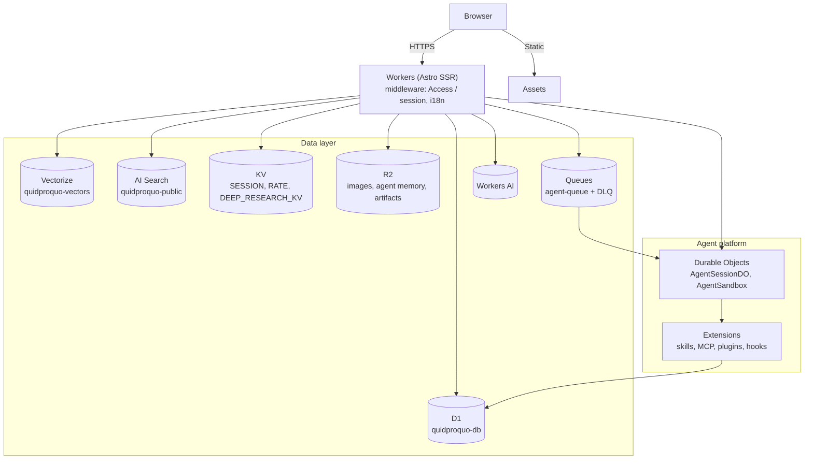

<div align="center">

# quidproquo

**A bilingual personal blog with a built-in AI content engine.**

[](https://github.com/vincentxuu/quidproquo/actions/workflows/deploy.yml)


[Quick start](#quick-start) · [Features](#features-at-a-glance) · [Architecture](#architecture) · [Deploy](#deploy-to-cloudflare) · [Admin & Agents](#admin-console-and-agent-platform) · [Docs](#documentation)

[English](README.md) · [繁體中文](README.zh-TW.md)

</div>

---

## Overview

quidproquo is the source of [quidproquo.cc](https://quidproquo.cc), a personal blog built with **Astro (SSR)** on **Cloudflare Workers**. Articles are written in Markdown, served bilingually (`zh-TW` default, `en` under `/en/`), and synced into D1. A retrieval layer (Vectorize, D1 keyword search, Cloudflare AI Search) powers hybrid search, related posts, and a chat endpoint. An admin console runs agent sessions, scheduled routines, and flows on top of the same platform.

> [!IMPORTANT]
> This is a personal project under active development. The D1 schema, API routes, and content pipelines may change without notice. It is not intended as a general-purpose blogging framework.

---

## Tech Stack

| Layer | Technology |
|-------|------------|
| **Framework** | Astro 7 (SSR, `output: server`), TypeScript, React islands, Tailwind CSS 4 |
| **Runtime** | Cloudflare Workers (`@astrojs/cloudflare`, Node.js compat), Durable Objects |
| **Database** | D1 (SQLite) — posts, chunks, glossary, vocabulary, agent sessions, skills / MCP / plugins |
| **Search** | Vectorize (Workers AI embeddings) + D1 keyword search + Cloudflare AI Search, fused with weighted RRF; Pagefind static index built post-build (used by the 404 page) |
| **AI** | Workers AI, LangChain / LangGraph adapters, Vercel AI SDK, Langfuse tracing |
| **Async** | Cloudflare Queues (agent runs, with DLQ), cron triggers |
| **Storage** | R2 (images, agent memory, artifacts), KV (sessions, rate limits, deep-research state) |
| **Auth** | Cloudflare Access (JWT verified in middleware) when configured; KV session cookie as fallback |
| **Quality** | oxlint, custom `scripts/check-*.mjs`, `pnpm verify` gate |
| **Testing** | Vitest, Playwright (visual baselines, axe accessibility) |
| **i18n** | `zh-TW` (default, no prefix) + `en` (`/en/...`), language-parity checks |

---

## Features at a Glance

| Area | What it does | Where it lives |
|------|--------------|----------------|
| **Bilingual blog** | Markdown/MDX posts with categories, tags, series, RSS, sitemap, `llms.txt`, generated OG images | `src/content/posts/`, `src/pages/` |
| **Search & chat** | Hybrid retrieval (vector + keyword + AI Search) with degradation fallback; related posts; chat API | `src/pages/api/search.ts`, `src/pages/api/chat.ts`, `src/lib/retrieval/` |
| **Deep research** | Multi-step research workflow with evidence tracking and queued agent runs | `src/pages/api/deep-research.ts`, `flows/` |
| **Learning sections** | Glossary, English vocabulary and speaking practice, daily digests, collection, projects | `src/pages/glossary/`, `vocabulary/`, `english.astro`, `daily/`, `collection/` |
| **Content pipelines** | Crawlers, media-to-post, translation, daily digest routines | `src/lib/crawl/`, `src/lib/digest/`, `scripts/` |
| **Admin console** | Home / Sessions / Routines / Flows / Settings, with extensions (skills, MCP servers, plugins, hooks, marketplace) | `src/pages/admin/`, `src/pages/api/admin/` |
| **Quality gates** | Lint, post references, terminology, language parity, glossary, series order, links, diagrams, skills sync | `scripts/check-*.mjs`, `pnpm verify` |

---

## Architecture



### Content flow

```text
src/content/posts/<category>/*.md
        │  type-checked by src/content.config.ts, validated by scripts/check-*.mjs
        ▼
pnpm build ──► Astro SSR bundle + OG images
        │
        ▼  (CI, on content changes)
scripts/sync-to-d1.ts ──► D1 posts / post_chunks
scripts/sync-embeddings-prod.mjs ──► Vectorize
        │
        ▼
/api/search · /api/chat · /api/related-posts · /api/deep-research
```

---

## Quick Start

**Requirements:** Node.js 22.12+ or 24 (`.nvmrc` pins 24), pnpm 10, Git. Playwright only for browser tests.

```bash
git clone https://github.com/vincentxuu/quidproquo.git
cd quidproquo
pnpm install
pnpm dev                 # http://localhost:4321, with Cloudflare platform proxy
```

`pnpm dev` runs through `scripts/dev.mjs`: it stops older dev servers from the same repo and shuts itself down after 3 idle hours (`DEV_IDLE_HOURS`); set `DEV_KEEP_ALIVE=1` to keep it running.

```bash
pnpm sync                # Sync posts to local D1
pnpm sync:prod           # Sync posts to production D1
```

### Everyday Commands

| Command | Purpose |
|---------|---------|
| `pnpm build` | Production build to `./dist/` (cron entry, rendered-post check, Pagefind index, OG images) |
| `pnpm preview` | Preview production build locally |
| `pnpm lint` | oxlint static analysis |
| `pnpm test` | Vitest test suite |
| `pnpm test:visual` | Playwright visual and accessibility tests |
| `pnpm verify` | **Full quality gate** (lint, references, quality, glossary, parity, skills sync, progress protocol) |
| `pnpm verify:staged` | Pre-commit gate: checks staged files only, falls back to full `verify` for code / config / script changes |
| `pnpm skills:sync` | Rebuild the `.claude/skills/` mirror from `.agents/skills/` |
| `pnpm eval:rag` | Run RAG baseline evaluation |
| `pnpm session:start` | Show latest commit and `progress.txt`, then run `verify` |

---

## Deploy to Cloudflare

Pushes to `main` trigger [`deploy.yml`](.github/workflows/deploy.yml): quality gate → build → `d1 migrations apply` → `wrangler deploy`. When post content changed, it then calls [`content-index.yml`](.github/workflows/content-index.yml) to sync D1 and embeddings and check search freshness.

**Required secrets:** `CLOUDFLARE_API_TOKEN` (build, migrations, deploy) and `INDEX_SYNC_SECRET` (protected content / embedding sync against the deployed Worker).

### Manual Deploy

```bash
pnpm exec wrangler login
pnpm run deploy
```

`pnpm run deploy` builds first, then deploys with the generated `dist/server/wrangler.json`. Cron triggers (crawlers, digests, retention) and a `preview` environment are defined in [`wrangler.jsonc`](wrangler.jsonc). See [`docs/cloudflare-deployment-runbook.md`](docs/cloudflare-deployment-runbook.md) for operations.

### Cloudflare Resources

| Binding | Type | Purpose |
|---------|------|---------|
| `ASSETS` | Assets | Static asset serving |
| `SESSION` | KV | Session storage |
| `RATE` | KV | Rate limiting |
| `DEEP_RESEARCH_KV` | KV | Deep-research state |
| `DB` | D1 | All relational data (`quidproquo-db`) |
| `VECTORIZE_INDEX` | Vectorize | Embedding search (`quidproquo-vectors`) |
| `AI_SEARCH` | AI Search | Managed search instance (`quidproquo-public`) |
| `AI` | Workers AI | Embeddings and inference |
| `AGENT_SESSION_DO` | Durable Object | Per-session agent state (`AgentSessionDO`) |
| `R2_IMAGES` | R2 | Image storage |
| `R2_AGENT_MEMORY` | R2 | Agent memory offload |
| `R2_AGENT_ARTIFACT` | R2 | Agent artifacts |
| `AGENT_QUEUE` | Queues | Queued agent runs (with DLQ) |

### Database Migrations

Located in [`migrations/`](migrations/) and applied automatically on deploy. Core tables include `posts`, `post_chunks`, `doc_chunks`, `glossary_terms`, agent session / evidence / artifact tables, `user_skills`, `mcp_servers`, `plugins`, and vocabulary / personal progress tables.

---

## Why quidproquo?

- **Content as data** — Every post is plain Markdown synced into D1; search, recommendations, and analytics query one source of truth.
- **RAG-native** — Chunking, embedding, hybrid fusion, evaluation (`pnpm eval:rag`), and trace retention are first-class.
- **Bilingual by construction** — Language-parity and Traditional-Chinese terminology checks keep editions consistent.
- **Quality gates before publish** — References, series order, glossary coverage, links, and diagram geometry are verified locally and in CI.
- **One platform** — Compute, storage, search, queues, Durable Objects, and AI all run on Cloudflare.
- **Feature-flagged** — Every advanced AI capability is individually toggleable via `wrangler.jsonc` vars.

---

## Admin Console and Agent Platform

The admin console lives at `/admin` (auth required; disabled entirely when `AGENT_CONSOLE_ENABLED` is off). It has five top-level tabs:

| Tab | What it does |
|-----|--------------|
| **Home** | Composer, items waiting on you, recent sessions, usage |
| **Sessions** | Agent sessions with event stream, steps, diffs, approvals, evidence, and artifacts |
| **Routines** | Scheduled agent jobs (create, edit, run history) |
| **Flows** | Declarative pipelines from `flows/` |
| **Settings** | Models, permissions, access, environments, GitHub, notifications, site, and **extensions** |

**Extensions** (`/admin/settings/extensions`) manage the agent's extensibility layer:

| Extension | Purpose | API |
|-----------|---------|-----|
| **Skills** | Reusable workflows in `SKILL.md` format. Project skills live in `.agents/skills/` (git); user skills in D1 / R2 | `/api/admin/settings/extensions/skills` (+ `export`, `import`) |
| **MCP Servers** | External tools via Model Context Protocol (`stdio`, `http`, `sse`) | `/api/admin/settings/extensions/mcp-servers` |
| **Plugins** | Packages bundling skills + MCP servers | `/api/admin/settings/extensions/plugins` (+ `install`) |
| **Hooks** | `PreToolUse` / `PostToolUse` / `SessionStart` / `Stop` hooks (command, HTTP, or inline handlers) | `/api/admin/settings/extensions/hooks` |
| **Marketplace** | Browse and install packages | `/api/admin/settings/extensions/marketplace` |

The full route table is in [`docs/admin-route-map.md`](docs/admin-route-map.md). Skill authoring is covered in [`docs/skill-package-development-guide.md`](docs/skill-package-development-guide.md).

---

## Environment Variables

Configured via `wrangler.jsonc` `vars` or the Cloudflare dashboard. All `AGENT_*` flags are booleans; see [`wrangler.jsonc`](wrangler.jsonc) for the full list and current defaults.

| Variable | Description |
|----------|-------------|
| `LLM_PROVIDER` | Default model provider (`openai` \| `anthropic` \| `gemini` \| `groq` \| `openrouter`) |
| `ACCESS_TEAM_DOMAIN`, `ACCESS_AUD` | Cloudflare Access team domain and application audience; once any `ACCESS_*` var is set, admin and private routes require a verified Access JWT (and fail with 503 if the config is incomplete) |
| `ACCESS_ALLOWED_EMAILS` | Comma-separated emails allowed through Access-protected routes |
| `AGENT_OS_*` | Agent OS kernel and roles (planner, research, writer, critic), external MCP tools, queue scheduler |
| `AGENT_CONSOLE_ENABLED` | Umbrella flag for `/admin` |
| `AGENT_EVIDENCE_ENABLED` | Evidence tracking |
| `AGENT_ARTIFACT_*` | Artifact outputs (CSV, PDF, PPTX, Notion, Slack, GitHub issue / PR, email) |
| `AGENT_PROVIDERS_*` | Provider router and per-provider toggles (LLM, search, reader, knowledge) |
| `ADMIN_PASSWORD` | Secret for session-cookie login when Access is not configured |
| `CRAWL_SECRET` | Secret for crawler webhooks |

---

## Documentation

- [Docs index](docs/README.md)
- [Operating charter](docs/governance/operating-charter.md)
- [Design system](docs/design-system.md)
- [Admin route map](docs/admin-route-map.md)
- [AI agent content system](docs/ai-agent-content-system.md)
- [Content pipeline roadmap](docs/content-pipeline-roadmap.md)
- [Translation pipeline](docs/translation-pipeline.md)
- [YT-to-post pipeline](docs/yt-to-post-pipeline.md)
- [RAG trace retention policy](docs/rag-trace-retention-policy.md)
- [Cloudflare deployment runbook](docs/cloudflare-deployment-runbook.md)
- [Skill package development guide](docs/skill-package-development-guide.md)
- [Architecture decisions](docs/adr/)

---

## Contributing and Support

This is a personal project, so there is no formal contribution process. Bug reports and suggestions are welcome via [GitHub Issues](https://github.com/vincentxuu/quidproquo/issues).

---

## License

MIT — see [`LICENSE`](LICENSE).
