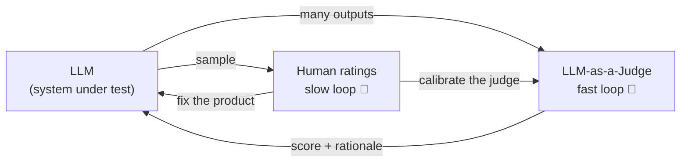
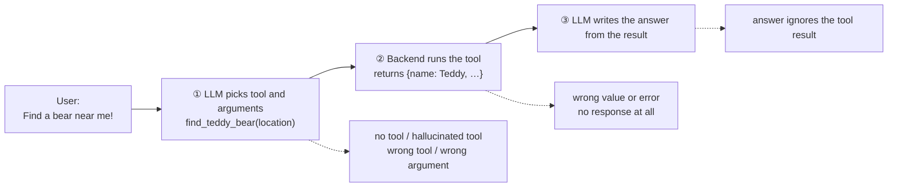

> :globe: [中文版](/posts/ai/2026-09-29-cme295-llm-evaluation)

**Video status: Videos included.** [Source details](#course-video-sources)

If you are following the 2026 edition, open the [Lecture 7 recording](https://www.youtube.com/watch?v=uoSynlTDyMs) and [slides](https://cme295.stanford.edu/slides/fall26-cme295-lecture7.pdf). The judge and agent parts are broadly the same as this post, but the factuality-scoring section is gone and the benchmark part is replaced entirely; this post keeps the content of 2025 Lecture 8, and the differences are covered in "What changes in 2026" at the end.

This post covers Lecture 8, "LLM evaluation," of the 2025 edition of Stanford [CME295](/posts/ai/2026-09-29-cme295-course-overview-en) (November 21, 2025). The main source is the [170-page slide deck](https://cme295.stanford.edu/slides/fall25-cme295-lecture8.pdf); the recording is on [YouTube](https://www.youtube.com/watch?v=8fNP4N46RRo). Everything below is based on what is on the slides.

You change one line of a system prompt and want to know whether answers got better. The model produces free-form text, so there is no answer key. Ask a colleague to rate them? Two people may score the same response differently, and rating a hundred examples takes a day. That is the question this lecture answers: how do you evaluate LLM output, and how far can each method be trusted?

The slides first scope the word. "Evaluation" can mean **output quality** (instruction following, coherence, factuality) or **system performance** (latency, pricing, reliability). This lecture is about the former.

## Human rating: closest to the truth, with three problems

The slides call human rating "closest to truth," then list three limitations:

1. **Subjectivity**: asked "What birthday gift should I get?", the model answers "A teddy bear is almost always a sweet gift." Is that useful? Two raters may disagree.
2. **Slow**
3. **Expensive**

Subjectivity can be measured. Two raters might agree purely by luck. [Cohen's kappa](https://en.wikipedia.org/wiki/Cohen%27s_kappa) asks: "How much better is our agreement than what we'd expect just by chance, given how the raters actually use the categories?" The slides also mention the multi-rater variants Fleiss' kappa and Krippendorff's alpha.

<details>
<summary>Formula: Cohen's kappa</summary>

```
κ = (p_o − p_e) / (1 − p_e)
```

- `p_o`: observed proportion of agreement
- `p_e`: agreement expected by chance, given how often each rater uses each category
- κ = 1 is perfect agreement; κ ≈ 0 is no better than chance

</details>

## Rule-based metrics: write the answer once, compare automatically

The first labor-saving idea: have humans write reference answers once, then compare every model output against them. The slides list three classic metrics:

| Metric | Full name | Originally for |
|---|---|---|
| [BLEU](https://aclanthology.org/P02-1040/) | BiLingual Evaluation Understudy | Machine translation |
| [ROUGE](https://aclanthology.org/W04-1013/) | Recall-Oriented Understudy for Gisting Evaluation | Summarization; variants include ROUGE-N and ROUGE-L |
| [METEOR](https://aclanthology.org/W05-0909/) | Metric for Evaluation of Translation with Explicit ORdering | Machine translation |

The slides show the problem with three sentences: "A plush teddy bear can comfort a child during bedtime." "Soft stuffed bears often help kids feel safe as they fall asleep." "Many youngsters rest more easily at night when they cuddle a gentle toy companion." They mean nearly the same thing but share almost no words, so an overlap metric scores them low. The slides list three drawbacks: no credit for stylistic variation, weak correlation with human ratings, and the fact that you **still need human-written references**.

## LLM-as-a-Judge: let another model grade

[Zheng et al. (2023)](https://arxiv.org/abs/2306.05685), the MT-Bench and Chatbot Arena paper, popularized the idea: ask an LLM to score the response against a criterion. The slide's example prompt is a few lines long:

```
Evaluate how relevant the model's answer is to the user's prompt.
Prompt: {prompt}
Model Response: {model_response}
Return:
- Rationale (1–2 sentences)
- Score: 1 if mostly relevant, 0 if mostly irrelevant.
```

The judge takes "user prompt + model response + criterion" and returns "rationale + score." To make the output machine-readable, the slides recommend the structured-output feature each provider offers: define the output shape as a class (`rationale: str`, `score: Literal[0, 1]`), then pass it in the API call. The technique first appeared in [Lecture 3](/posts/ai/2026-09-29-cme295-large-language-models-en).

Compared with the previous two methods, the slides list two benefits: **no reference or label needed**, and **interpretability through rationales**. There are two ways to ask the judge:

- **Pointwise**: show one response and ask for a score (e.g., "Very good")
- **Pairwise**: show two responses and ask "Which is better, A or B?"

## Three biases, each with a remedy

The judge is a model, so it has a model's preferences. The slides name three:

| Bias | Symptom | Remedy on the slides |
|---|---|---|
| Position bias | Swap A and B and the judge's pick follows the position, not the content | Evaluate both orders and average, or tweak position embeddings |
| Verbosity bias | Given a short correct answer and a long unhelpful one, the judge picks the long one | Explicit guidelines, few-shot examples, and/or a penalty on output length |
| Self-enhancement bias | Given a perfect human-written answer and one it generated itself, the judge picks its own | Don't use the same model as both contestant and judge |

Combining the biases with other lessons, the slides give six best practices:

1. Crisp guidelines
2. A binary scale (pass/fail) rather than something granular like 1–10
3. Write the rationale before outputting the score
4. Mitigate the biases above
5. Calibrate with human judgments
6. Low temperature for reproducibility

Rule 3 works for the same reason [chain-of-thought](/posts/ai/2026-09-29-cme295-large-language-models-en) does: reason first, conclude second. Rule 5 shows that the judge does not replace human rating; it moves human rating to a slower outer loop:



## Factuality: split a passage into individual facts

Which dimensions should a judge cover? The slides group them into **task performance** (usefulness, factuality, relevance) and **alignment** (tone, style, safety). Factuality is the hard one, because a passage is often partly right.

The slide's example: "Teddy bears, first created in the 1920s, were named after President Theodore Roosevelt after he proudly wanted to shoot a captured bear on a hunting trip." A single score can't express "partially correct." The approach from [Wei et al.'s long-form factuality paper (2024)](https://arxiv.org/abs/2403.18802) is to decompose the passage into standalone facts and check each one:

| Decomposed fact | Verdict on the slide | Weight |
|---|---|---|
| Teddy bears were first created in the 1920s | ✗ | 0.3 |
| Teddy bears were named after President Theodore Roosevelt | ✓ | 0.4 |
| Roosevelt was on a hunting trip where a bear was captured | ✓ | 0.2 |
| Roosevelt proudly wanted to shoot the captured bear | ✗ | 0.1 |

Summing the weights of the correct facts gives a score of 0.6.

<details>
<summary>Formula: weighted fact score</summary>

```
score = Σ_{i=1..n} α_i × score_i
```

- `α_i`: importance weight of fact i
- `score_i`: 1 if fact i is correct, 0 otherwise
- Slide example: 0.4 + 0.2 = 0.60

</details>

## When an agent fails, which step failed?

Grading a single answer is simple enough. The agents from [Lecture 7](/posts/ai/2026-09-29-cme295-agentic-llms-en) run many loops of [ReAct](https://arxiv.org/abs/2210.03629)'s act → observe → plan cycle. The slides break one tool call into three steps, using "Find a bear near me!" as the example, and each step has its own failure modes:



| Step | Symptom | Cause → remedy on the slides |
|---|---|---|
| ① Tool prediction | Replies "Sorry, I don't know where I can find one" | Tool router error → retrain the router; model doesn't know the tool → SFT, or improve the prompt for that API |
| | Calls a nonexistent `find_bear()` | Model too weak → upgrade; illogical API naming → revamp the API; unclear instructions → iterate on top-level instructions |
| | Uses `send_message()` to ask a local business instead | Model chose the wrong tool |
| | Passes `location = (0, 0)` | Argument can't be inferred → add a helper tool and/or make sure the context carries the information |
| ② Tool call | Returns a wrong value or a `ValueError` | Fix the tool implementation |
| | Returns nothing; the final answer is often hallucinated | Always return something, even an empty JSON; emit meaningful tool outputs |
| ③ Response generation | Tool found Teddy, model says "Didn't find any bear!" | Weak grounding → upgrade the synthesizing LLM; tool output floods the context → trim what the backend returns; output hard to interpret → make the output format descriptive |

The slides' takeaway sorts the causes into two groups. **Modeling**: weak reasoning or grounding, too much in the context window, tool modeling that isn't right. **Tool**: the tool itself has a problem, or its output isn't interpretable. The closing line: debugging these takes "special care and patience."

## Benchmarks: each score is one angle

The final section surveys common benchmarks, with an eye to what each measures and how it is scored:

| Axis | Example | Size and format (per the slides) | Scoring |
|---|---|---|---|
| Knowledge | [MMLU](https://arxiv.org/abs/2009.03300) | 4-way multiple choice over 57 tasks | Match the choice |
| Math reasoning | [AIME](https://maa.org/maa-invitational-competitions/) | ~30 problems, 3-digit answers | Match the answer |
| Common-sense reasoning | [PIQA](https://arxiv.org/abs/1911.11641) | ~20,000 everyday physics situations, 2-way choice | Match the choice |
| Coding | [SWE-bench](https://arxiv.org/abs/2310.06770) | 2,294 real GitHub issues from 12 Python repos | Generated PR passes all tests |
| Safety | [HarmBench](https://arxiv.org/abs/2402.04249) | 510 harmful behaviors (400 text, 110 multimodal) | Attack success rate (ASR), judged by a classifier |
| Agents | [τ-bench](https://arxiv.org/abs/2406.12045) | Airline and retail domains, ~10 tools each, 50 and 115 tasks | Reward and pass^k |

The slides describe SWE-bench as a "proxy for tool use abilities," and they label the scoring method clearly: the other five use a hardcoded match, while HarmBench relies on a classifier.

The pass^k metric used by τ-bench deserves its own look. It asks: if you run the same task k times, what is the probability that **every** run succeeds? The pass@k from [Lecture 6](/posts/ai/2026-09-29-cme295-llm-reasoning-en) asks whether **at least one** succeeds. pass@k suits settings where checking is easy and you can retry, such as running tests and keeping the code that passes. pass^k suits a customer-service agent that has to get it right every time.

<details>
<summary>Formulas: pass^k and pass@k</summary>

Run a task n times, with c successes:

```
pass^k = C(c, k) / C(n, k)          # all k draws succeed (slides, τ-bench)
pass@k = 1 − C(n−c, k) / C(n, k)    # at least one of k draws succeeds (Chen et al., 2021)
```

As k grows, pass^k falls and pass@k rises. The two numbers can be far apart.

</details>

Once you have a pile of scores, the slides suggest three ways to read them:

- **Read the profile, not a single rank**: a benchmark is a projection onto one axis, and different models are good at different things. The slides use the [Gemini 3 launch post](https://blog.google/products/gemini/gemini-3/) (published three days before the lecture) as an example, grouping its results into reasoning, coding, tool use, and knowledge.
- **Read the Pareto frontier**: quality vs. cost/latency, quality vs. safety, quality vs. context length. You are choosing a trade-off, not a champion.
- **Beware of data contamination**: clues to the test may already be in the training set. The slides list three precautions: put an identifiable canary string in benchmark files (as [BIG-bench](https://github.com/google/BIG-bench/blob/main/docs/doc.md) does), use a blocklist when the model has tools, and evaluate on newer test versions.

The slides end with Goodhart's law: "When a measure becomes a target, it ceases to be a good measure." The lesson they draw is not to over-index on benchmarks, to complement them with organic signals like [Chatbot Arena](https://lmarena.ai/), and to "just try a few models out yourself."

## Back to the models you use

Almost everything in this lecture carries straight into production work:

- The "evaluators" you configure in [Langfuse](/posts/ai/2026-03-26-langfuse-llm-observability-guide-en), [LangSmith](/posts/ai/2026-08-22-langsmith-observability-evaluation-en), or [Braintrust](/posts/ai/2026-08-22-braintrust-llm-evaluation-en) are LLM-as-a-Judge. The six best practices make a ready checklist: is the judge using a binary score? Does it write the rationale first? Is it the same model and version as the one being graded?
- For pairwise comparisons, always run both orders. With only one order, what you see may be position bias.
- When an agent fails, locate the step (①, ② or ③) before deciding whether to change the prompt, the tool, or the model. Many "the model is dumb" problems turn out to be a tool that returned nothing, or returned too much.
- When reading the benchmark table in a model launch post, ask three things: which axis does this score measure? Is it pass@1 or multiple samples? Is the test set recent enough?

## What changes in 2026

The 2026 counterpart of this lecture is Lecture 7, "LLM evaluation" (taught November 13, 2026), and both the [slides](https://cme295.stanford.edu/slides/fall26-cme295-lecture7.pdf) and the [recording](https://www.youtube.com/watch?v=uoSynlTDyMs) are now up. The deck is 170 pages, same as 2025, but reorganized into six parts: motivation, rule-based metrics, LLM-as-a-Judge, agent evaluation, benchmarks, and best practices. What follows compares the two decks page by page, with notes from the recording. In short: the judge and agent parts mostly carry over, the benchmark part is replaced wholesale, and a new closing part covers how to build evals for your own agent.

### Opening and rule-based metrics: pass@k moves in

- **A new framing up front.** The 2025 deck split "evaluation" into output quality and system performance and covered only the former. The 2026 deck instead lists three families of metrics (reliability, quality, and product, the last including user outcome, adoption and engagement), then four challenges: many kinds of tasks, quality with many dimensions, many good answers to the same prompt, and systems that keep getting more complex (an agent loops many times).
- **Cohen's kappa stays.** The recording adds a rule of thumb: agreement is good once kappa gets to around 0.8. The slides drop the mention of Krippendorff's alpha.
- **Rule-based metrics split into two kinds.** The new kind is "reasoning-based": run test cases for code, compare against the ground truth for math. pass@k, which 2025 covered in [Lecture 6](/posts/ai/2026-09-29-cme295-llm-reasoning-en), moves here, with the unbiased estimator from [Chen et al.](https://arxiv.org/abs/2107.03374) and three metrics side by side: pass@k when checking is easy and you can afford the latency, pass@1 when only a single generation matters, and cons@k, whether the majority vote over k attempts is right (cited from DeepSeek-R1), which the recording says is for when you can't verify answers at inference time. The recording also ties pass@k to temperature: at temperature 0 more attempts change nothing, raising it lets the model explore other solutions, and raising it too far makes answers sloppy, so there is a sweet spot.
- The other kind, "natural language-based," is BLEU, METEOR and ROUGE, with the same three limitations as in 2025.

### LLM-as-a-Judge: a tuning loop, and five practices instead of six

- **Four benefits instead of two**: no reference needed, paraphrase handled natively, a new task only needs a new prompt, and rationales make scores interpretable.
- **The pointwise/pairwise page is gone.** Pairwise comparison shows up later, in the benchmark and Arena parts.
- **New: "Tune LLM-as-a-Judge" in four steps.** Hand-label a small batch of outputs, set a baseline with a simple prompt, hill-climb the prompt (look at what the judge misses or wrongly flags, change the prompt, rerun), then freeze the final prompt. The recording is more concrete: label about 10 question–answer pairs to start, measure the judge against the labels with precision and recall, set a target (say, recall on failures above 90%), and hand the loop to a coding agent, since almost no one runs it by hand anymore. This turns the "calibrate with human ratings" practice into a procedure.
- **Six best practices become five.** "Crisp guidelines" is dropped, and "low temperature" becomes "make it reproducible": lower the temperature, or sample several times and take a majority vote (self-consistency). The three biases and their remedies are unchanged.
- **Factuality scoring is gone.** The 2025 list of evaluation dimensions (task performance and alignment) and the weighted decomposition in "Factuality: split a passage into individual facts" above do not appear in the 2026 deck.
- **One new direction.** The last page of the judge part mentions "decision models" and asks whether a decision really needs generated text. In the recording, these models skip text and output calibrated probabilities over the answer options, which could change the best practices above; details are left for the last lecture.

### Agent evaluation: same three failure stages, plus time horizon

The table in "When an agent fails, which step failed?" above carries over almost page for page, down to the bear-finding example. The one new page is METR's (Model Evaluation & Threat Research) "X% time horizon": how long a task, measured in human-expert time, an agent can complete with X% success. The recording looks at the 50% line and how it grows over time, a sign that models hold up better over long ReAct loops and recover from mistakes.

### Benchmarks: rewritten from scratch

This is the biggest change. MMLU, AIME, PIQA, SWE-bench, HarmBench, τ-bench, pass^k, the Gemini 3 score table and the three contamination precautions from 2025 are all gone from the 2026 deck. The new version is built around three ideas.

**1. Use a composite index as the map.** The deck uses the Artificial Analysis Intelligence Index v5.0.1 as its skeleton, splitting "intelligence" into four categories at 25% each:

| Category | Components (weight) | The one the deck examines |
|---|---|---|
| General | AA-Omniscience 15%, HLE-Diamond 10% | AA-Omniscience: 6,000 questions across 42 topics, only 10% public; no tools; a wrong answer costs 1 point, declining costs 0; an LLM judge grades against the gold answer |
| Knowledge (knowledge work) | AA-Briefcase 15%, AutomationBench-AA 5%, GDP.pdf 5% | AA-Briefcase: weeks-long white-collar scenarios (data science, product management, banking operations, and more) with piles of emails, Slack messages and reports that deliberately contradict each other; no internet, up to 500 turns; an LLM judge marks each rubric item pass or fail, and presentation quality is judged pairwise between two deliverables |
| Coding | FrontierCode 2.0 15%, Terminal-Bench 4.0 10% | Terminal-Bench 4.0: 66 terminal tasks with a Docker environment, internet access and 8 hours per task, graded by hidden tests with no LLM judge |
| Science | Terminal-Bench-Science 15%, CritPt v2 10% | Terminal-Bench-Science: 70 research tasks in the same setup; for example, recovering an asteroid's position and velocity from observations, accepted only within an error threshold |

The table ties the earlier parts together: knowledge questions use an LLM judge, the hard-to-define "good presentation" uses pairwise comparison, and code and science tasks that can be written as tests use deterministic checks. The recording is explicit: knowledge work is the hardest to evaluate and the LLM judge is only a proxy; when a deterministic check is possible, use it instead of a judge.

**2. Scores get gamed, and the index changes in response.** The deck calls the "great scores, disappointing in use" pattern "benchmaxxing" and lists three possible causes: optimizing for public metrics, a mismatch with what users expect, and losing good practices from traditional machine learning. The evidence is MaxxBench: tweak a coding benchmark's task statements slightly (a different timestamp format, lowercase file names) and every model's score drops sharply while the ranking reshuffles. The causes the deck lists include the model imagining constraints the task didn't ask for, betting that new rules won't be tested, reward hacking on the tests, and using network access to call other models. Remedies come in three forms: SWE-Bench Pro keeps part of its tasks private, companies build internal benchmarks they don't publish (the deck names Databricks, DoorDash and Ramp), or, the other way around, a company open-sources a benchmark for its own domain so model providers optimize for it (Harvey's legal agent benchmark). The index side responds to how users feel too: from v4.2 (September 2026) to v5.0.1 (November), some components were swapped and some kept, several were upgraded, and the weights were redistributed.

**3. Benchmarks need checking too.** 2025 talked about test items leaking into training data; in 2026 that concern folds into the benchmaxxing discussion above, and this part turns to the quality of the items themselves and about agents cheating. Items can have typos, contradict each other, or be unsolvable, and the deck introduces LLM-driven auditing of benchmarks (BenchGuard). Agents take shortcuts, which the deck lays out as symptom → remedy: digging through git history for the answer → a fresh repo each time; searching by task ID → randomized IDs; downloading answers from GitHub/GitLab → blocked addresses; any other suspicious pattern → scan the logs and seal the leak, marked "far from a solved problem." The deck also recommends METR's investigation of the OpenAI / Hugging Face hacking incident, which happened during an evaluation.

Cost and the Pareto frontier remain, with the trade-off axes now quality vs. cost, time, output tokens and context length. Goodhart's law remains too, with the same conclusion: don't over-index on benchmarks.

### Real-life feel: from rating scales to Elo

In 2025 the deck ended by recommending Chatbot Arena and trying a few models yourself. In 2026 it derives why Arena is designed the way it is: have people rate 1–5 and average (nuanced, but noisy and hard on an absolute scale) → a binary pass rate (easier, still absolute) → pairwise win rate (easiest, but depends on who you were compared against) → an Elo score that accounts for opponent strength. This derivation was not covered in class; it is only on the slides. The deck lists four limitations: expensive, slow, subjective, and converged scores can hide artifacts. The recording adds that ordinary users can't always tell which answer is correct, and some questions shouldn't be left to them.

### New closing part: building evals for your own agent

The last part is a practical guide with no 2025 counterpart. The recording calls the mindset eval-driven: build the eval first, then use the judge-tuning loop to hill-climb prompts, tools and design. The deck's steps:

- **Start from four questions**: Where is my agent strong or weak? Did it regress this week? Does it match what users want? How do I make progress?
- **Metrics**: break the system's objective into quantifiable dimensions, at the component level (what has to work for the design to hold) and the trajectory level (what the end user cares about); find failure modes first, then quantify them.
- **Data in three tiers**: P0, the crucial cases, about 10; P1, generally supported cases, about 100; P2, nice-to-haves, about 1,000. Sources are expert-written, user logs (which reflect the real distribution), and synthetic data ("usually not great," per the deck).
- **Three kinds of graders**: deterministic program logic, an LLM judge, and an agent judge (for cases that need their own investigation). The recording's advice is to use deterministic checks wherever you can, since LLM and agent judges are hard to tune.
- **Knobs once results are in**: swap the model or reasoning effort, hill-climb prompts, skills and tools, or fix the grader or the data; usually a combination.

Each question maps to a source: general evaluations for strengths and weaknesses, P0 cases for regressions, logs for alignment with users, and forward-looking benchmarks such as ARC Prize for direction.

## Self-check

These questions are adapted from Section IV, "LLM evaluation," of the [2025 final exam](https://cme295.stanford.edu/exams/fall25-cme295-final.pdf). Answers are in the [solutions PDF](https://cme295.stanford.edu/exams/fall25-cme295-final-solutions.pdf):

1. Why are n-gram metrics like BLEU and ROUGE a poor fit for open-ended chat LLMs? (Q8)
2. What is a "pairwise" evaluation, and how does it differ from pointwise? (Q4)
3. What does "position bias" in LLM-as-a-Judge refer to? (Q5)
4. Define "verbosity bias," and propose one concrete method to mitigate any LLM-judge bias. (Q9)
5. How is pass@k defined, and how does it differ from τ-bench's pass^k? (extends Q6)
6. What does SWE-bench evaluate? How do static benchmarks (like MMLU) differ from dynamic leaderboards (like Chatbot Arena)? (Q10)

## Going deeper

- Another take on the same topic, with more on benchmark lifecycles and contamination audits: [CS224N Lecture 11: Why Benchmarks and LLM Evaluation Expire](/posts/ai/2026-08-22-cs224n-benchmark-evaluation-en)
- From perplexity to agent and safety evaluation: [CS336 Lecture 12](/posts/ai/2026-08-22-cs336-evaluation-en)
- The practical side, with golden sets, blind judging and statistical tests: [How to rigorously compare an agent before and after a change](/posts/ai/2026-06-04-agent-change-rigorous-evaluation-en)
- Turning every agent tool call into a traceable span: [Agent observability: from OTel traces to catching hallucinations, tool misuse and infinite loops](/posts/ai/2026-06-04-agent-observability-failure-detection-en)

## Course video sources

The first video comes from Stanford Online’s official CME295 Autumn 2025 playlist (Lecture 8); on 2026-10-10 the lecture title and video ID were checked live and match. The second is the Autumn 2026 recording listed for Lecture 7, "LLM evaluation," on the official 2026 syllabus; on 2026-11-23 it was checked live against the syllabus link and matches.

```youtube
url: https://www.youtube.com/watch?v=8fNP4N46RRo
title: Stanford CME295 Transformers & LLMs | Autumn 2025 | Lecture 8 - LLM Evaluation
```

```youtube
url: https://www.youtube.com/watch?v=uoSynlTDyMs
title: Stanford CME295 Transformers & LLMs | Autumn 2026 | Lecture 7 - LLM Evaluation
```

Original videos: [Stanford CME295 Transformers & LLMs | Autumn 2025 | Lecture 8 - LLM Evaluation](https://www.youtube.com/watch?v=8fNP4N46RRo), [Stanford CME295 Transformers & LLMs | Autumn 2026 | Lecture 7 - LLM Evaluation](https://www.youtube.com/watch?v=uoSynlTDyMs)

Content check: verified against the video transcript (2026-10-10): sampled the beginning, middle and end of the transcript, searched keywords, and compared against the chapter list in the video description (not a word-by-word comparison). The video is Autumn 2025 Lecture 8, LLM Evaluation (page date 2025-11-21, length 1:49:25). Its chapters are inter-rater agreement, rule-based metrics (METEOR/BLEU/ROUGE), LLM-as-a-judge and its biases (position, verbosity, self-enhancement), factuality, agent evaluation, and benchmarks (MMLU, AIME/PIQA, SWE-bench, HarmBench, Tau-Bench), consistent with the post's topic. The body of the post cites only the 2025 slides and does not relay spoken remarks. uoSynlTDyMs is Autumn 2026 Lecture 7, LLM Evaluation (1:44:59); it has no human-made captions, so a machine transcript of the whole lecture was read and compared page by page with the 2026 slides. The spoken notes in "What changes in 2026" all come from this recording.

Course and recording entries:

- [Official course / lecture source](https://cme295.stanford.edu/syllabus/2025/)
- [2026 syllabus](https://cme295.stanford.edu/syllabus/)
- [CME295 Autumn 2025 playlist (Stanford Online, 9 videos)](https://www.youtube.com/playlist?list=PLoROMvodv4rOCXd21gf0CF4xr35yINeOy)

Checked: 2026-11-23.

## Update Log

- 2026-11-23: The 2026 Lecture 7 recording and slides are out. Rewrote "What changes in 2026" from a page-by-page comparison of the two decks and the recording: pass@k added to rule-based metrics, the judge-tuning loop, six best practices down to five, time horizon added to the agent part, the benchmark part rebuilt around a composite index, benchmaxxing, agent cheating and Arena-style Elo, and a new section on building evals for your own agent. Added links to the 2026 recording and slides.
- 2026-10-10: Added explicit video status and checked recording sources and access notes.
- 2026-10-10: Rechecked video status. Checked live against the Stanford Online CME295 Autumn 2025 playlist; lecture and video ID match, so the status is now videos included.
- 2026-10-10: Checked the video content against its transcript. The video is 2025 Lecture 8; topic and date match the post, so nothing needed correcting.

## References

- [2026 Lecture 7 recording](https://www.youtube.com/watch?v=uoSynlTDyMs)
- [2026 Lecture 7 slides (PDF)](https://cme295.stanford.edu/slides/fall26-cme295-lecture7.pdf)
- [CME 295 2025 syllabus](https://cme295.stanford.edu/syllabus/2025/) / [2026 syllabus](https://cme295.stanford.edu/syllabus/)
- [2025 Lecture 8 slides (PDF)](https://cme295.stanford.edu/slides/fall25-cme295-lecture8.pdf)
- [2025 Lecture 8 recording](https://www.youtube.com/watch?v=8fNP4N46RRo)
- [2025 final exam](https://cme295.stanford.edu/exams/fall25-cme295-final.pdf) / [solutions](https://cme295.stanford.edu/exams/fall25-cme295-final-solutions.pdf)
- [Zheng et al., Judging LLM-as-a-Judge with MT-Bench and Chatbot Arena (2023)](https://arxiv.org/abs/2306.05685)
- [Cohen's kappa (Wikipedia)](https://en.wikipedia.org/wiki/Cohen%27s_kappa)
- [Papineni et al., BLEU (2002)](https://aclanthology.org/P02-1040/)
- [Lin, ROUGE (2004)](https://aclanthology.org/W04-1013/)
- [Banerjee & Lavie, METEOR (2005)](https://aclanthology.org/W05-0909/)
- [Wei et al., Long-form factuality in large language models (2024)](https://arxiv.org/abs/2403.18802)
- [Yao et al., ReAct (2022)](https://arxiv.org/abs/2210.03629)
- [Hendrycks et al., Measuring Massive Multitask Language Understanding (2020)](https://arxiv.org/abs/2009.03300)
- [MAA Invitational Competitions (AIME)](https://maa.org/maa-invitational-competitions/)
- [Bisk et al., PIQA (2019)](https://arxiv.org/abs/1911.11641)
- [Jimenez et al., SWE-bench (2023)](https://arxiv.org/abs/2310.06770)
- [Mazeika et al., HarmBench (2024)](https://arxiv.org/abs/2402.04249)
- [Yao et al., τ-bench (2024)](https://arxiv.org/abs/2406.12045)
- [Chen et al., Evaluating Large Language Models Trained on Code (2021)](https://arxiv.org/abs/2107.03374)
- [Google, Gemini 3 launch post (2025)](https://blog.google/products/gemini/gemini-3/)
- [BIG-bench docs (canary string)](https://github.com/google/BIG-bench/blob/main/docs/doc.md)
- [LMArena (Chatbot Arena)](https://lmarena.ai/)
- [Reading Stanford CME295 (series overview)](/posts/ai/2026-09-29-cme295-course-overview-en)
