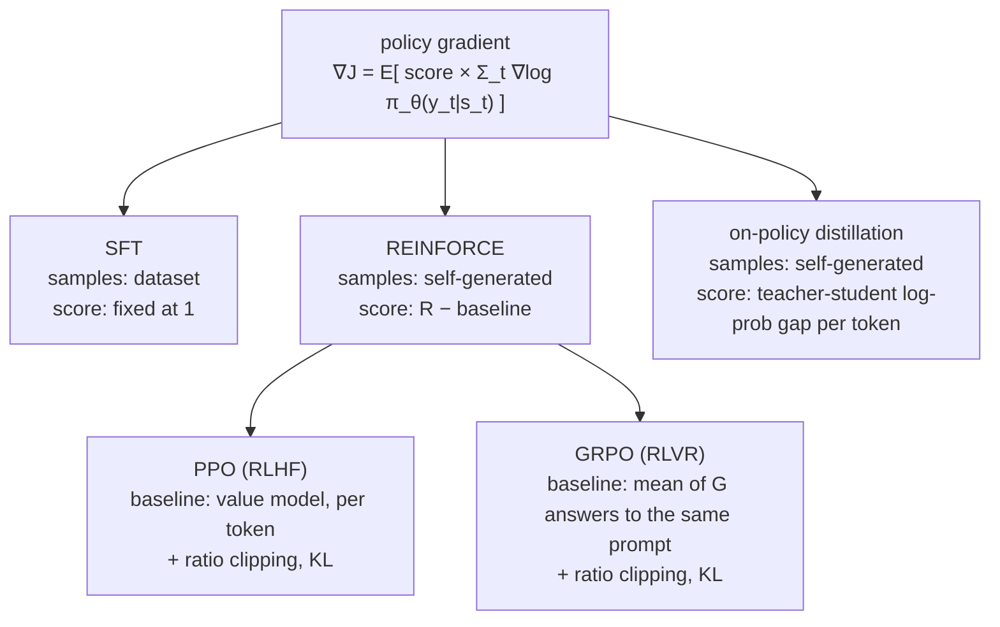

> :globe: [中文版](/posts/ai/2026-09-29-cme295-rl-with-llms)

**Video status: Videos included.** [Source details](#course-video-sources)

This is post 11 in the Stanford [CME295](/posts/ai/2026-09-29-cme295-course-overview-en) series, covering 2026 Lecture 4, "Reinforcement learning with LLMs" (October 16, 2026). The lecturers are Afshine Amidi and Shervine Amidi: Afshine takes the first part through GRPO, and Shervine takes the final section on on-policy distillation. The materials are the [135-page slides](https://cme295.stanford.edu/slides/fall26-cme295-lecture4.pdf) and the recording below.

The recording runs 1 hour 43 minutes, and this post covers all of it; each section opens with its time range in the recording, so you can jump back when a section doesn't click. The prerequisite is the training pipeline from Lecture 3: pretraining, SFT, preference tuning, reasoning. This series already covered the reward model and DPO in [post 5](/posts/ai/2026-09-29-cme295-preference-tuning-en) and the R1 recipe for reasoning models in [post 6](/posts/ai/2026-09-29-cme295-llm-reasoning-en); this lecture supplies where their losses come from.

The lecture has a clear spine: derive the most basic algorithm, REINFORCE, from the policy gradient, list its three gaps, then see which gap each method fills. The slides close both the PPO and GRPO sections with the same gap table. Put the two together, add an on-policy distillation column from the final section's wish list and pros and cons, and you have the map of the lecture:

| Gap | PPO | GRPO | On-policy distillation |
|---|---|---|---|
| 1. Noisy gradients | Advantages from a value function | Advantages from the group mean | Per-token signal from the teacher |
| 2. No token-level credit assignment | The value function provides it | ✗ every token gets the same advantage | The teacher scores every token |
| 3. No limit on update size | Clipping and/or KL penalty | Clipping and/or KL penalty | The objective itself is to match the teacher |
| Remaining cost | An extra value model to train | Credit assignment is gone again | You need a teacher first |

```youtube
url: https://www.youtube.com/watch?v=3Vaj0Oka_t4
title: Stanford CME295 Transformers & LLMs | Autumn 2026 | Lecture 4 - Reinforcement Learning with LLMs
```

## Three notation traps, and the LLM version of RL

[Recording 04:47–09:01](https://www.youtube.com/watch?v=3Vaj0Oka_t4&t=287s)

Before starting, Afshine warns that RL papers use messy notation, and the slides list the three most common collisions:

- **r**: could be the reward, or the ratio of new to old policy probabilities. The lecture writes the ratio as **ρ** and keeps r or R for rewards
- **The subscript on π**: could mean "the policy from the last batch" (π_old) or "the reference policy" (π_ref, usually the model after SFT). They play different roles, and the PPO section uses both
- **L**: could be a loss to minimize or an objective to maximize. The PPO paper's L^CLIP is the latter

Then the standard RL picture is mapped onto LLMs. The agent is the LLM, the state is "the input so far," the action is "the next token," and the policy π_θ is the LLM's probability distribution over the next token. That is where the π in earlier notation comes from.

Token-level rewards are hard to define, so in practice the whole response is often treated as one action: the state is the prompt, the action is the full response, π_θ(y | x) is "the probability of outputting this response given the prompt," and a single score arrives when the response is finished. A student asked whether the probability of a full response would be tiny. It would, which is why implementations always work with logs for numerical stability.

## Two kinds of reward: subjective RLHF, verifiable RLVR

[Recording 09:01–14:44](https://www.youtube.com/watch?v=3Vaj0Oka_t4&t=541s)

To quantify "how good is this response," the lecture splits situations into two kinds:

| | Subjective | Verifiable |
|---|---|---|
| Example | Preference tuning: tone, helpfulness | Reasoning: math solutions, code passing tests |
| Where the score comes from | Human preference, with a reward model trained via Bradley-Terry | A deterministic check |
| Name | RLHF (RL from Human Feedback) | RLVR (RL with Verifiable Rewards) |

Both give a response-level score. The slides show one example of each: in preference tuning, the LLM answers "I'd suggest you do not spend much time with your teddy bear at all," and a frozen reward model scores it low; in reasoning, "the bear was born in 2020, how old is it now" gets the answer 6, and a rule check marks it correct. RL's job is to adjust the LLM's weights so it produces high-scoring responses more often.

A student asked whether a human has to grade every generated response. No. You first train the reward model on human preferences, then hand every response to it; no human is in the training loop.

> **Self-check**: Viewing token-by-token generation as RL, what are the state and the action at one decoding step? (2026 midterm, Part IV, question 2)
>
> Answer: the state is the prompt plus the prefix generated so far; the action is the next token.

## Policy gradient: pushing probability toward high-scoring responses

[Recording 14:44–25:50](https://www.youtube.com/watch?v=3Vaj0Oka_t4&t=884s)

The goal is to maximize expected reward J(θ). Training a neural network needs a gradient, but the reward comes from "sample some text, then grade it," and the sampling step can't be differentiated directly. Afshine worked it out on the blackboard: R is frozen and doesn't depend on θ; only π_θ does. One identity, ∇π = π · ∇log π, turns the gradient back into an expectation you can estimate by sampling:

$$
J(\theta) = \mathbb{E}_{\tau\sim\pi_\theta}\big[R(\tau)\big]
\quad\Longrightarrow\quad
\nabla_\theta J(\theta) = \mathbb{E}_{\tau\sim\pi_\theta}\big[R(\tau)\,\nabla_\theta \log \pi_\theta(\tau)\big]
$$

Read it as: if a sampled response scores positive, push its log-probability up; if it scores negative, push it down. The lecture stresses that this formula will keep coming back, so it is worth knowing where it comes from.

<details>
<summary>Derivation: from J(θ) to the policy gradient</summary>

$$
\begin{aligned}
\nabla_\theta J(\theta)
&= \nabla_\theta \int R(\tau)\,\pi_\theta(\tau)\,d\tau
 = \int R(\tau)\,\nabla_\theta \pi_\theta(\tau)\,d\tau \\
&= \int R(\tau)\,\pi_\theta(\tau)\,\nabla_\theta \log \pi_\theta(\tau)\,d\tau
 \qquad (\nabla \pi = \pi\,\nabla \log \pi) \\
&= \mathbb{E}_{\tau\sim\pi_\theta}\big[R(\tau)\,\nabla_\theta \log \pi_\theta(\tau)\big]
\end{aligned}
$$

- Moving the gradient inside the integral needs some regularity conditions, which the lecture simply assumes
- For LLMs, τ is really "sample a prompt x from the dataset, then a response y from π_θ(·|x)," so the expectation has two layers. The blackboard wrote just τ to keep it uncluttered
- The log-probability of a full response is the sum of per-token log-probabilities: log π_θ(y|x) = Σ_t log π_θ(y_t | x, y_<t)

</details>

Written as an algorithm, this is [Williams (1992)](https://link.springer.com/article/10.1007/BF00992696) REINFORCE, which the slides call a Monte Carlo algorithm, in four steps:

1. Given a prompt x, **sample** a response y ~ π_θ(· | x)
2. Grade it: R = R(x, y)
3. Compute the gradient: g = R · ∇_θ log π_θ(y | x)
4. Update: θ ← θ + αg (we maximize, so it is gradient ascent, with a plus sign)

The slides label step 1 "this step is expensive." That is the biggest difference from pretraining and SFT: there the answers are fixed in the dataset, while RL is on-policy and every update needs fresh responses generated by the model itself. Generation goes one token at a time and can't be parallelized.

> **Self-check**: A program returns 1 when a teddy bear counting answer is correct and 0 otherwise, and the check is not differentiable. Can a policy-gradient method still use it to train the generator? (Midterm Part IV, question 1)
>
> Answer: yes. The reward is just a weight in front of the gradient of the response's log-probability. What must be differentiable is log π_θ, not the reward.

## Reusing samples: importance sampling

[Recording 25:50–32:53](https://www.youtube.com/watch?v=3Vaj0Oka_t4&t=1550s)

If generation is expensive, can you generate once and update several times? Afshine did a second blackboard derivation: sample with a fixed policy π_θfixed, then rewrite the expectation with a probability ratio.

$$
\mathbb{E}_{\tau\sim\pi_\theta}\big[R(\tau)\big]
= \int R(\tau)\,\frac{\pi_\theta(\tau)}{\pi_{\theta_\text{fixed}}(\tau)}\,\pi_{\theta_\text{fixed}}(\tau)\,d\tau
= \mathbb{E}_{\tau\sim\pi_{\theta_\text{fixed}}}\!\left[R(\tau)\,\frac{\pi_\theta(\tau)}{\pi_{\theta_\text{fixed}}(\tau)}\right]
$$

You sample from π_θfixed once, then reweight with the ratio π_θ / π_θfixed at every update. This ratio is the **importance sampling ratio**.

A student asked on the spot: the ratio still contains π_θ(τ), so what did we save? The answer is that evaluating and generating cost very different amounts. Generation is token in, token out, over and over; for evaluation the full response is already known, so you feed it all in at once. A decoder-only model has masked self-attention, so each position only sees the tokens before it, and one forward pass gives you every token's probability in parallel. Do the expensive generation once, the cheap evaluation many times.

> **Self-check**: Why is "computing the probability of a known response" cheaper than "generating that response"?
>
> Answer: generation has to go one token at a time; when computing probabilities the full response is known, so it can be fed in at once, and masked self-attention yields every position's probability in a single parallel forward pass.

## Three gaps in vanilla REINFORCE

[Recording 32:53–40:15](https://www.youtube.com/watch?v=3Vaj0Oka_t4&t=1973s)

**Gap 1: high-variance gradients.** The raw reward has no notion of "compared to what." The slides' example: for one prompt the good answer scores 101 and the bad answer 100. Both are large positives, so the model pushes both up hard, the good one just a bit more. With enough steps you still end up in the right place, but each step's gradient swings wildly and is noisy.

The fix is to estimate "what this prompt normally scores" as a baseline and look at how much better each response is. The slides compute it on a toy model: assume π_θ(good) = σ(θ) = 0.5 and π_θ(bad) = 1 − σ(θ) = 0.5, so ∇_θ log π_θ(good) = +0.5 and ∇_θ log π_θ(bad) = −0.5. Plug into g = R · ∇_θ log π_θ:

| | g_good | g_bad |
|---|---|---|
| No baseline | 101 × 0.5 = +50.5 | 100 × (−0.5) = −50 |
| Baseline = 100.5 | (+0.5) × 0.5 = +0.25 | (−0.5) × (−0.5) = +0.25 |

Without a baseline the two samples give gradients of +50.5 and −50, opposite in sign and huge; after subtracting the baseline both are +0.25, pointing the same way (both pushing the good answer up), with far less variance.

<details>
<summary>Added in this post: why subtracting a baseline doesn't bias the gradient</summary>

As long as the baseline b(x) doesn't depend on the sampled response y, it contributes zero to the expected gradient:

$$
\mathbb{E}_{y\sim\pi_\theta}\big[b(x)\,\nabla_\theta \log \pi_\theta(y\mid x)\big]
= b(x)\sum_y \nabla_\theta \pi_\theta(y\mid x)
= b(x)\,\nabla_\theta \sum_y \pi_\theta(y\mid x)
= b(x)\,\nabla_\theta 1 = 0
$$

So replacing R with R − b(x) keeps the expectation and lowers the variance. R − b is the advantage that keeps appearing later. The baseline can also vary with the state (PPO's V(s_t), for example); as long as it doesn't depend on which token was chosen at this step, the proof still holds. The lecture shows the effect with the toy example rather than proving this.

</details>

**Gap 2: no explicit token-level credit assignment.** Both kinds of reward are response-level: a response is either all right or all wrong. The slides' example:

> Prompt: Teddy is in a sealed box. The box moves to the kitchen. Where is Teddy?
> Output: Step 1: Teddy climbs out of the box. Step 2: Teddy walks to the kitchen. Step 3: Answer: Kitchen. ✓

The answer is right, but the reasoning is wrong: Teddy was in the box the whole time. Vanilla REINFORCE pushes up every token of this response, including the wrong "climbs out of the box."

**Gap 3: no constraint on the size of policy updates.** By the RL stage the model has been pretrained and fine-tuned and is already decent, so you don't want it to wander far. There are three reasons: the starting point is already good; you don't want it to regress on tasks it already handles; and the reward may not match your real goal, so reward hacking is a risk. Afshine used himself as the example: if he judged how well a lecture went only by how loud the applause was at the end, the best strategy might be two hours of jokes unrelated to the course.

How do you quantify how far apart two distributions are? The PPO section answers with KL divergence.

> **Self-check**: Two teddy bear stories for the same prompt score 8 and 6; subtracting a baseline of 7 gives advantages +1 and −1. What is the main reason to use advantages instead of raw scores? (Midterm Part IV, question 3)
>
> Answer: to reduce gradient variance. It compares "how much better than the baseline"; it can't say which tokens caused the score, and it doesn't bound the update size.

## PPO: advantages from a value function, then limit the step

[Recording 40:15–1:07:08](https://www.youtube.com/watch?v=3Vaj0Oka_t4&t=2415s)

[PPO (Proximal Policy Optimization)](https://arxiv.org/abs/1707.06347) differs from REINFORCE in two ways: it maximizes advantages instead of raw rewards, and it avoids straying too far from the previous policy. The "Proximal" in the name refers to the second.

### Advantages and the value function

The reward asks "how good is this response?" The advantage asks "compared to what we'd expect for this prompt, how good is this response?" The slides illustrate with a token-level example:

> Input: Teddy is in a box. Where is Teddy?　Output: In the box. (reward +1)

For each prefix, ask: "If I keep writing from here with the current policy, what final reward do I get on average?" After "In" the estimate is 0.6, after "the" 0.7, after "box" it jumps to 0.95, and the period gives 1.0. The advantage of the token "box" is "with it" minus "without it": 0.95 − 0.70 = +0.25. That gives you a baseline and also points at which token earned the score.

The function that "estimates the final reward from a prefix" is the **value function**:

$$
V^\pi(x, y_{<t}) = \mathbb{E}_\pi\big[R_\text{future} \mid x, y_{<t}\big],
\qquad
A^\pi(x, y_{<t}, y_t) = V^\pi(x, y_{\le t}) - V^\pi(x, y_{<t})
$$

The slides put the advantage formula in quotes because the real computation is more involved. Afshine's analogy: you teach a friend a math concept and they ace the exam, which is the short-term payoff; but acing it also sets them on a path of later successes, which can't all be credited to you, though part of it should be. The method that folds future value back into the current token is [GAE (Generalized Advantage Estimation)](https://arxiv.org/abs/1506.02438), which the lecture says is outside the exam's scope.

The lecture and Q&A covered several properties of the value model:

- It is token-level: every output position has a value
- Its label is the response-level reward: given the prompt and a partial response, predict the final score
- It is **trained jointly** with the policy, sharing a backbone, with a loss that combines a policy term and a value term. The reason is that the value's definition is tied to "continuing with the current policy," so when the policy changes the value has to follow
- The reward model, by contrast, is trained beforehand and frozen during RL

### Reusing a batch: the ratio ρ

Now the importance sampling derivation from the previous section comes into play. PPO generates a batch with π_θ and updates on it several times; after updating, the policy that generated the batch is no longer the current one and is called π_old. So the objective goes from E_t[A_t] to:

$$
\mathbb{E}_t\big[\rho_t(\theta)\,A_t\big],
\qquad
\rho_t(\theta) = \frac{\pi_\theta(y_t\mid s_t)}{\pi_\text{old}(y_t\mid s_t)}
$$

ρ is the importance sampling ratio, correcting for "the samples came from the old policy, but we're estimating for the new one."

### First idea: clip the ratio

The problem is that the ratio can keep growing. Afshine drew J against ρ on the blackboard. With a positive advantage, J = ρA is a line rising to the right; its gradient is never zero, so the model is always encouraged to push this action's probability higher. PPO clips the ratio to [1−ε, 1+ε]:

$$
J(\theta) = \mathbb{E}_t\Big[\min\big(\rho_t A_t,\ \operatorname{clip}(\rho_t, 1-\epsilon, 1+\epsilon)\,A_t\big)\Big]
$$

With a positive advantage, once ρ passes 1+ε, J goes flat, the gradient is zero, and there's no more incentive to push up; with a negative advantage, J flattens once ρ drops below 1−ε. In other words, once the new policy differs enough from the old one, this sample stops pushing it.

### Second idea: a KL penalty

The other way to constrain the update is to subtract "how different from the reference model" directly in the objective. The slides first recap KL divergence: KL(P‖Q) = Σ P log(P/Q), taking P as the true distribution and weighting the log ratio by it. PPO's second idea is:

$$
J(\theta) = \mathbb{E}_t\Big[\rho_t(\theta)\,A_t - \beta\,\mathrm{KL}\big(\pi_\theta(\cdot\mid s_t)\,\|\,\pi_\text{ref}(\cdot\mid s_t)\big)\Big]
$$

Watch the subscripts here. The lecture laid out the roles of the three policies:

- **π_θ**: the policy currently being updated
- **π_old**: the policy that generated the current batch. Generate a batch → it becomes π_old → update a few times → generate the next batch → a new π_old
- **π_ref**: the reference model at the start (usually the SFT model), fixed for the whole run

Clipping controls "don't move too far in one round" (relative to π_old); KL controls "don't drift too far from the start overall" (relative to π_ref). In practice the two are often used together. A student asked how KL is computed: the exact KL sums over the whole vocabulary, which is too expensive, so in practice people use an estimator.

<details>
<summary>Added in this post: the KL estimator DeepSeekMath uses</summary>

[DeepSeekMath](https://arxiv.org/abs/2402.03300) equation (4) uses this per-token estimator, which only needs the sampled token's probability under the two models and is always ≥ 0:

$$
\mathbb{D}_\mathrm{KL}\big[\pi_\theta \,\|\, \pi_\text{ref}\big]
\approx \frac{\pi_\text{ref}(o_t\mid q, o_{<t})}{\pi_\theta(o_t\mid q, o_{<t})}
- \log\frac{\pi_\text{ref}(o_t\mid q, o_{<t})}{\pi_\theta(o_t\mid q, o_{<t})} - 1
$$

DeepSeekMath credits it to [John Schulman's blog post](http://joschu.net/blog/kl-approx.html).

</details>

### The same β as in DPO

Afshine then brought back DPO from the previous lecture. DPO rewrites the RL objective as a supervised loss shaped like Bradley-Terry, with the reward replaced by r_θ(x, y) = β log(π_θ(y|x) / π_ref(y|x)):

$$
\mathcal{L}_\text{DPO} = -\,\mathbb{E}_{(x, y_w, y_l)\sim\mathcal{D}}\left[\log\sigma\!\left(\beta\log\frac{\pi_\theta(y_w\mid x)}{\pi_\text{ref}(y_w\mid x)} - \beta\log\frac{\pi_\theta(y_l\mid x)}{\pi_\text{ref}(y_l\mid x)}\right)\right]
$$

This β is the β in the KL penalty. The lecture explained it with the shape of the sigmoid: the loss wants the difference inside the parentheses to be as large as possible. With a large β, a slight move of π_θ away from π_ref already makes the parentheses large and pushes the sigmoid close to 1, leaving no incentive to go further; with a small β, the policy has to move much further for the same effect. So the larger β is, the more tightly the policy is tied to the reference model. DPO details are in [post 5](/posts/ai/2026-09-29-cme295-preference-tuning-en).

### PPO today, and its cost

The "PPO nowadays" slide sums it up in two lines: maximize advantages using a value function as the baseline; avoid moving too far with clipping (relative to the previous batch) and a KL penalty (relative to the reference model). Implementations combine them differently, some using both and some only one; the KL penalty can also be placed in several ways, and one common choice folds it into the reward before computing advantages.

Two things to keep in mind when reading the PPO paper, which the slides give their own page: the paper's L^CLIP is an objective to **maximize**, not a loss; the paper's r_t is a **ratio**, not a reward.

Against the three gaps, PPO fills gap 1 (advantages have a baseline), gap 2 (the token-level value function gives credit assignment as a side effect), and gap 3 (clipping and KL). The cost is training and hosting an extra value model kept in sync with the policy, which the lecture bluntly calls "a lot of hassle."

> **Self-check**: Let ρ = π_θ(a|s) / π_old(a|s); PPO maximizes J(ρ, A) = min(ρA, clip(ρ, 0.8, 1.2)A). At ρ = 1.4, compute J for A = +2 and A = −2, and say which way maximizing J pushes ρ. Does clipping guarantee the actual ρ stays within [0.8, 1.2]? (Midterm Part IV, question 9)
>
> Answer: clip(1.4) = 1.2. For A = +2, J = min(2.8, 2.4) = 2.4, picking the clipped term; J is flat here, so there's no incentive to raise ρ further. For A = −2, J = min(−2.8, −2.4) = −2.8, picking the unclipped term; J = −2ρ, so gradient ascent pulls ρ down. Clipping doesn't guarantee the actual ratio stays in the range; it only removes the surrogate's incentive, and since parameters are shared, updates from other samples can still push this ratio outside.

## GRPO: sample G answers to one prompt and use the group mean as the baseline

[Recording 1:07:08–1:25:05](https://www.youtube.com/watch?v=3Vaj0Oka_t4&t=4028s)

GRPO (Group Relative Policy Optimization) comes from [DeepSeekMath](https://arxiv.org/abs/2402.03300). It still maximizes advantages and still avoids moving too far; its selling point is that it **needs no value function**.

It returns to the intuition of "you need something to compare the reward to": for one prompt x, sample G different responses o_1…o_G with a positive temperature, grade each one, then standardize with the group mean and standard deviation:

$$
\hat{A}_i = \frac{R(x, o_i) - \operatorname{mean}\big(\{R(x, o_1), \dots, R(x, o_G)\}\big)}{\operatorname{std}\big(\{R(x, o_1), \dots, R(x, o_G)\}\big)}
$$

Responses better than the group mean get positive advantages and worse ones negative, with no extra model trained to estimate "normal." The full objective keeps PPO's clipping and puts the KL penalty directly in the objective:

$$
J(\theta) = \mathbb{E}\left[\frac{1}{G}\sum_{i=1}^{G}\frac{1}{|o_i|}\sum_{t=1}^{|o_i|}\Big\{\min\big[\rho_{i,t}\hat{A}_i,\ \operatorname{clip}(\rho_{i,t}, 1-\epsilon, 1+\epsilon)\,\hat{A}_i\big] - \beta\,\mathrm{KL}(\pi_\theta\,\|\,\pi_\text{ref})\Big\}\right]
$$

### GRPO versus PPO

Following DeepSeekMath's diagram, the lecture lists which models each method uses:

| Model | PPO | GRPO |
|---|---|---|
| Policy model | Trained | Trained |
| Value model | Trained jointly with the policy | Not needed |
| Reward model | Trained beforehand, frozen | Trained beforehand, frozen; optional with verifiable rewards |
| Reference model | Fixed | Fixed |

In the formulas, the similarities are the ratio ρ and clipping. There are two differences:

- **Where the KL goes**: one common PPO variant folds the KL penalty into the reward; GRPO puts it directly in the objective. Every paper writes this differently, and the lecture says not to be surprised
- **How the advantage is computed**: PPO does it per token with a value function; GRPO does it at the response level against the group. GRPO's formula writes the advantage as Â_{i,t}, with a token index t, because the general form allows token-level advantages; but token-level advantages need a way to tell each token's contribution apart, so the response level is the usual choice and every token shares the same Â_i

### Responses keep getting longer

The slides cite the [DeepSeek-R1](https://arxiv.org/abs/2501.12948) training curve: average response length keeps rising during RL training, and the lecture points out that it keeps rising even after performance plateaus. Why?

Afshine asked everyone to look only at the 1/|o_i| in the formula. For a short response this coefficient is large; for a long one it is small. It multiplies every token's contribution to the objective:

| | Short response | Long response |
|---|---|---|
| Positive advantage | Each token pushed up a lot | Each token pushed up a little |
| Negative advantage | Each token pushed down a lot | Each token pushed down a little |

Look at the bottom right: the longer a wrong answer is, the less each of its tokens is penalized. When the model can't get some prompts right no matter what, it comes to prefer "long and wrong" over "short and wrong." That is why performance plateaus while length keeps growing.

The fix is to give every token an equal contribution:

- **[DAPO](https://arxiv.org/abs/2503.14476)**: divide by the total token count across the group, (1 / Σ_i |o_i|) Σ_i Σ_t
- **[Dr. GRPO](https://arxiv.org/abs/2503.20783)** (GRPO Done Right): drop 1/|o_i| entirely, leaving (1/G) Σ_i Σ_t. In the Dr. GRPO figure on the slides, correct responses end up about the same length under both methods; incorrect responses keep growing under GRPO but not under Dr. GRPO

### Other adjustments

The lecture pointed to two more fixes from follow-up work:

- **Difficulty bias**: the advantage is divided by the group's standard deviation, which varies with how hard the prompt is, and that introduces a bias. The lecturer suggests removing the standard deviation (which is what the Dr. GRPO paper does)
- **Encouraging diversity**: with the same ε for the lower and upper bound, a low-probability token has almost no room to be pushed up much. For example, a token with probability 0.001 and ε = 0.2 can only reach 0.0012 under the 1.2 ratio cap. DAPO decouples the bounds into clip(ρ, 1−ε_low, 1+ε_high), loosening the upper one

Against the three gaps, GRPO fills gap 1 with the group mean and gap 3 with clipping and KL, and drops the value model; but gap 2 is back: every token in a response gets the same advantage.

> **Self-check**: Four responses to the same problem get final-answer rewards (1, 1, 0, 0). Response 1 has valid reasoning; response 2 has a false intermediate claim but the correct final answer. GRPO gives every token in response i the advantage A_i = (R_i − R̄) / s_R, with s_R the population standard deviation. Compute R̄, s_R, and all four advantages, and say whether this advantage can separate the false claim in response 2 from the valid steps in response 1. (Midterm Part IV, question 10 (i))
>
> Answer: R̄ = 1/2, s_R = 1/2, A = (1, 1, −1, −1). It can't: both correct responses get +1 on every token, so the false claim in response 2 is pushed up too.

## On-policy distillation: a teacher scores every token the student writes

[Recording 1:25:05–1:43:26](https://www.youtube.com/watch?v=3Vaj0Oka_t4&t=5105s)

### GRPO's credit problem

Shervine takes over and expands the teddy bear example into a group of four responses:

| Output | Step 1 | Step 2 | Answer |
|---|---|---|---|
| o_1 | Teddy stays in the box | The box moves to the kitchen | Kitchen ✓ |
| o_2 | Teddy climbs out of the box | Teddy walks to the kitchen | Kitchen ✓ |
| o_3 | Teddy stays in the box | The box stays in the room | Room ✗ |
| o_4 | Teddy climbs out of the box | Teddy stays in the room | Room ✗ |

GRPO only looks at the answer, so o_2's wrong step 1 gets a positive advantage and o_3's correct step 1 gets a negative one. The consequences come in two layers: immediately, every token gets the same advantage, so the signal is noisy; in the long run, GRPO only learns which steps are good on average across many groups, which is slow.

What about scoring each step (process supervision)? DeepSeekMath also tried cutting the advantage at the step level. The slides list three problems: every step needs human labels; each step can carry the same ambiguity internally (in "Teddy walks to the kitchen," is the error "walks" or "to the kitchen"? Follow it down and you end up labeling tokens); and you need a dedicated step-level reward model, exactly what leaving PPO was meant to avoid.

Shervine lays out a wish list: keep on-policy training (learning from the model's own generations), get token-level credit assignment, and train no additional model. The matching proposal: train on the model's own generations, with a next-token-prediction loss, using an already available strong model as the teacher. That is distillation, but not the usual kind.

### Reverse KL

Comparing two next-token distributions uses KL divergence. Shervine's reading: KL(P‖Q) asks "in a world governed by P, how bad is it to approximate it with Q?" The weights in the sum come from the first argument, which is why KL isn't symmetric.

Ordinary distillation lets the teacher govern the world, KL(T‖S). Here we want on-policy, with the student governing, so we flip it and use **reverse KL**:

$$
\mathrm{KL}(S\,\|\,T) = \sum_i s_i \log\frac{s_i}{t_i}
$$

Two properties:

- The teacher has probability where the student gives almost none (t_i not small, s_i ≈ 0): the weight s_i is tiny, so the penalty is light. Reverse KL is forgiving when the student misses some of the teacher's options
- The teacher gives almost none where the student gives a fair amount (t_i ≈ 0, s_i not small): the log ratio is large and the weight isn't small, so the penalty is heavy

Combined with a student that usually has less capacity than the teacher, the result is **mode seeking**: the student concentrates on the peaks of the teacher's distribution. Shervine also notes that this is today's common choice, but the original [GKD paper](https://arxiv.org/abs/2306.13649) tried both, so it isn't self-evidently better.

### What per-token scoring looks like

The procedure: the student generates a response to the prompt; at each newly generated token, ask the teacher, "given the same context, does this token make sense to you?" Back to the four responses, the tokens the teacher penalizes are "climbs" in o_2 and o_4, "stays" in o_3's "the box stays in the room," and "stays" in o_4's "Teddy stays in the room."

The lecture asked: is anything not penalized that surprises you? "Walks to the kitchen" in o_2 isn't penalized. The reason is that the conditional probability p(x_{t+1} | x_1, …, x_t) takes everything before it as context: once the teacher sees "Teddy climbs out of the box" already written, "walks to the kitchen" is a natural next step. The slides conclude that a token is usually penalized **at the moment things start going wrong**, and the rest of the sentence usually isn't, since next-token prediction accepts the preceding context.

### Pros and limitations

Citing [Thinking Machines Lab's "On-Policy Distillation"](https://thinkingmachines.ai/blog/on-policy-distillation/), the slides list three pros:

- **Works well in practice**: it is on-policy, so the student learns the paths it will actually take; the signal is per token, far denser than outcome-only
- **Compute-efficient**: the slides show that post's figure: Qwen3-8B-Base trained on OpenThoughts-3 with SFT, then on-policy distillation, with additional compute (log scale) on the x-axis and AIME'24 on the y-axis. The three panels are full fine-tuning, LoRA rank 128, and LoRA rank 32; the smaller the rank, the lower SFT stalls, and on-policy distillation then closes much of that gap. Shervine uses it to argue the method is especially worthwhile under parameter constraints
- **No reward model**: there is nothing to hack. Even if the model tried, driving the loss to zero would just mean matching the teacher's distribution exactly

There are two limitations: you need a teacher to learn from in the first place (if you are training the strongest frontier model, nobody can teach you); and the student's ceiling is bounded by the teacher, whose distribution may be imperfect and may not cover every domain you care about.

One cost figure from outside the lecture: [Qwen3 Technical Report](https://arxiv.org/abs/2505.09388) Table 21 starts from the same off-policy-distilled Qwen3-8B. Continuing with RL takes AIME'24 from 55.0 to 67.6 in 17,920 GPU hours; on-policy distillation instead reaches 74.4 in 1,800 GPU hours, about a tenth.

### Extension 1: self-distillation, no teacher needed

The first limitation has a fix that looks like magic. When the teacher scores, the student's tokens are fed in all at once with teacher forcing, and nothing says the teacher has to see the same prompt as the student. So put a hint, or even the full solution, into the teacher's prompt.

The slides cite [Self-Distilled Reasoner (Zhao et al., 2026)](https://arxiv.org/abs/2601.18734): teacher and student are **the same model**. The student sees only the problem; the teacher also sees a hint, such as "Teddy remains in the box throughout the process, which means he ends up in the kitchen. Now solve it yourself:". The paper calls this OPSD (On-Policy Self-Distillation): the teacher conditions on the reference solution, and the two distributions are matched token by token over the student's own generation.

In the Q&A, someone asked when on-policy distillation pays off most. Shervine's answer: if you are already the best model, the benefit is smaller, but you can use it for other things. He cited the GLM-5 report discussed in the previous lecture, which uses self-distillation to keep the model from forgetting what it already learned. A common split at frontier labs might be: the pro series uses GRPO-style methods grounded in true labels that need more compute; the flash series uses on-policy distillation to learn from the lab's own larger models.

### Extension 2: multiple teachers, past a single teacher's ceiling

The fix for the second limitation: first run RL with verifiable rewards separately in each domain to train domain experts; then, during on-policy distillation, route each prompt to the expert for its domain as the teacher. The slides cite Xiaomi MiMo's [MOPD (Multi-Teacher On-Policy Distillation, Ma et al., 2026)](https://arxiv.org/abs/2606.30406), a three-stage pipeline: general SFT → separate RL per domain to get experts (math, instruction following, software engineering, search, safety, and so on) → the student generates, the matching domain teacher computes per-token probabilities, and the student is updated with reverse KL.

Why not just do RL for every domain on one model? Shervine's explanation: in practice, sequential multi-domain RL on a single model tends to forget, and one set of parameters has to serve several objectives at once; training experts separately and distilling them back has proven more efficient in experiments.

> **Self-check**: At a fixed prefix, on-policy distillation minimizes the student-to-teacher reverse KL, D_KL(S‖T). Which mismatch does its mode-seeking behavior strongly discourage? (Midterm Part IV, question 6)
>
> Answer: substantial student probability where the teacher's probability is near zero. Conversely, if the student misses an option the teacher assigns probability to but the student itself gives almost none, reverse KL penalizes it only lightly.

## Putting the four methods back into one formula

The lecture patches its way up from REINFORCE. Looking back, SFT, REINFORCE, PPO, GRPO, and on-policy distillation all share one shape: **the gradient of a token's log-probability, multiplied by a score**. They differ in only two places: where the samples come from, and how the score is computed. This framing is this post's own, borrowed from the unified form in DeepSeekMath Section 5.2; the lecture doesn't put SFT into it.



<details>
<summary>Formulas: SFT, GRPO versus RLOO, and on-policy distillation side by side</summary>

The SFT loss is the negative log-probability of each token in the dataset; its gradient equals a policy gradient with the score fixed at 1:

$$
\mathcal{L}_\text{SFT} = -\sum_t \log\pi_\theta(y_t\mid x, y_{<t})
$$

DeepSeekMath Section 5.2's unified form (equation 5), where D is the data source and GC is the gradient coefficient:

$$
\nabla_\theta J_\mathcal{A} = \mathbb{E}_{(q,o)\sim\mathcal{D}}\left[\frac{1}{|o|}\sum_t GC_\mathcal{A}(q, o, t)\,\nabla_\theta\log\pi_\theta(o_t\mid q, o_{<t})\right]
$$

RLOO ([Ahmadian et al., 2024](https://arxiv.org/abs/2402.14740)) uses "the mean of the other G−1 responses" as the baseline. Ignoring the standard deviation, GRPO's numerator is exactly (G−1)/G times the RLOO advantage:

$$
R_i - \frac{1}{G}\sum_j R_j = \frac{G-1}{G}\left(R_i - \frac{1}{G-1}\sum_{j\ne i} R_j\right)
$$

This is this post's own algebra, used to show how the two relate.

Thinking Machines' formulation uses each token's negative reverse KL directly as the advantage in an existing RL loss:

$$
\hat{A}_t = -\big(\log\pi_\theta(y_t\mid s_t) - \log\pi_\text{teacher}(y_t\mid s_t)\big)
$$

When the student's probability for a token equals the teacher's, Â_t = 0; when the student is more confident than the teacher it is pushed down, and when less confident, pushed up. It has almost the same shape as PPO's common per-token KL penalty, with π_ref swapped for π_teacher.

</details>

## Connecting back to the models you use

- **The small open model you're using was quite possibly distilled.** Qwen3's small sizes used on-policy distillation; DeepSeek's R1-Distill series used off-policy SFT on traces ([post 6](/posts/ai/2026-09-29-cme295-llm-reasoning-en)). The flash/pro split mentioned in the lecture follows the same logic
- **If you do post-training yourself, start from the scores you have.** If a rule can check correctness, go with GRPO-style methods that need no value model, check how many prompts come back all right or all wrong (all advantages zero, contributing no gradient), and watch whether wrong answers keep getting longer; if you have a stronger open teacher whose log-probabilities you can query, on-policy distillation is worth trying first; if you have no teacher but do have reference solutions, self-distillation is an option
- **When you meet a new algorithm, ask three questions**: which of the three gaps does it fill? Where do the samples come from? How is the score multiplying each token computed?

## How this differs from the 2025 version

The 2025 course had no such lecture. PPO was in [2025 Lecture 5](https://cme295.stanford.edu/slides/fall25-cme295-lecture5.pdf) and GRPO in [Lecture 6](https://cme295.stanford.edu/slides/fall25-cme295-lecture6.pdf), both presented directly as objectives; posts 5 and 6 of this series follow those two lectures. The 2026 version pulls them out, starts from a blackboard derivation of the policy gradient, threads PPO and GRPO together with the three gaps, and adds a full section on on-policy distillation, along with two 2026 extensions, self-distillation and multiple teachers. GRPO's length bias, DAPO, and Dr. GRPO were also in 2025 Lecture 6; the 2026 version explains them with a table of the signs of 1/|o_i|.

## Self-check

The first four questions come from the [2026 midterm](https://cme295.stanford.edu/exams/fall26-cme295-midterm.pdf), Part IV ([solutions](https://cme295.stanford.edu/exams/fall26-cme295-midterm-solutions.pdf)); the last two are this post's own.

1. A PPO value model receives a prompt and an unfinished response prefix. What quantity is it meant to estimate? (Question 4)
2. GRPO samples two responses to each of two prompts, with rewards (8, 10) and (2, 4); advantages are normalized within each prompt's group. Are the advantages of the responses with rewards 8 and 4 positive or negative? (Question 7)
3. A policy writing teddy bear stories learns that adding irrelevant praise earns higher reward-model scores, while human ratings fall. Which intervention directly addresses the faulty reward signal: a larger rollout batch, revising the reward model's training data to separate story quality from praise, training the value model longer, or widening PPO's clipping range? (Question 8)
4. Continuing with question 10's four responses, describe how on-policy distillation provides a token-level signal: who generates the prefixes, and where does the feedback come from? Give one reason it may still miss reasoning errors. (Question 10 (ii))
5. (Own question) When are π_old and π_ref each replaced? Which one does clipping relate to, and which one the KL penalty?
6. (Own question) Using the table of signs of 1/|o_i|, explain why GRPO makes answers grow longer when the model keeps getting some prompts wrong. How do DAPO and Dr. GRPO each change it?

<details>
<summary>Answers and criteria</summary>

1. The expected future return from this prefix if you keep writing with the current policy.
2. The first group's mean is 9, so reward 8 is below it and its advantage is negative; the second group's mean is 3, so reward 4 is above it and its advantage is positive.
3. Revising the reward model's training data. The other three only chase the same flawed reward more precisely or faster.
4. The student generates the prefixes; the teacher gives next-token probabilities on those prefixes, and the student matches them. It can miss errors when the teacher itself is wrong, or when a prefix is already wrong and the teacher takes that wrong context as given, so the continuation of the error looks plausible (as with "walks to the kitchen" not being penalized).
5. π_old is replaced every time a new batch is generated; π_ref stays fixed for the whole run. Clipping limits per-round change relative to π_old; the KL penalty limits total drift relative to π_ref.
6. With a negative advantage, each token of a long response is multiplied by a smaller 1/|o_i| and penalized less, so "long and wrong" beats "short and wrong." DAPO divides by the total token count of the group instead; Dr. GRPO drops 1/|o_i|. Both make every token's contribution equal.

</details>

## Going deeper

- RL fundamentals, deriving policy gradients and actor-critic from scratch: [Berkeley CS285 L5–10](/posts/learning/2026-08-22-berkeley-cs285-policy-value-methods-en), and earlier, [imitation learning and RL basics](/posts/learning/2026-08-22-berkeley-cs285-imitation-rl-basics-en)
- PPO-style RLHF and reward overoptimization: [CS336 Lecture 15: SFT and RLHF](/posts/ai/2026-08-22-cs336-sft-rlhf-en)
- GRPO's biases and rollout system costs: [CS336 Lecture 16: RLVR](/posts/ai/2026-08-22-cs336-rlvr-en)
- Another take on on-policy distillation and off-policy drift: [CS224N Lecture 13](/posts/ai/2026-08-22-cs224n-reasoning-two-en)
- Neighbors in this series: [post 5: preference tuning](/posts/ai/2026-09-29-cme295-preference-tuning-en), [post 6: reasoning](/posts/ai/2026-09-29-cme295-llm-reasoning-en); the next lecture, [post 10: LLM systems](/posts/ai/2026-09-29-cme295-llm-systems-en), is where rollout generation costs show up

## Course video sources

The recording in the introduction is the Autumn 2026 recording listed for Lecture 4, "Reinforcement learning with LLMs," on the official 2026 syllabus (https://cme295.stanford.edu/syllabus/): [Stanford CME295 Transformers & LLMs | Autumn 2026 | Lecture 4 - Reinforcement Learning with LLMs](https://www.youtube.com/watch?v=3Vaj0Oka_t4), 1:43:26 long. The body is written from that recording's English human-made captions (CC) and the official [2026 Lecture 4 slides](https://cme295.stanford.edu/slides/fall26-cme295-lecture4.pdf); formulas and numbers follow the slides.

Content check: verified against the video transcript (2026-11-23): I read the full English CC transcript; each section's time range comes from the caption timestamps (start points in 30-second units, slightly before the topic change); the spoken examples (applause and reward hacking, teaching a friend math and GAE, the cost gap between generation and evaluation, DPO's β, GLM-5 and the flash/pro split) all come from the transcript.

The 2025 course had no standalone RL lecture. For the earlier treatment of PPO and GRPO, see the [2025 Lecture 5 recording (LLM tuning)](https://www.youtube.com/watch?v=PmW_TMQ3l0I) and [2025 Lecture 6 recording (LLM Reasoning)](https://www.youtube.com/watch?v=k5Fh-UgTuCo), which correspond to [post 5](/posts/ai/2026-09-29-cme295-preference-tuning-en) and [post 6](/posts/ai/2026-09-29-cme295-llm-reasoning-en) of this series.

Course and recording entries:

- [Official 2026 syllabus](https://cme295.stanford.edu/syllabus/)
- [CME295 Autumn 2025 playlist (Stanford Online, 9 videos)](https://www.youtube.com/playlist?list=PLoROMvodv4rOCXd21gf0CF4xr35yINeOy)

Checked: 2026-11-23.

## Update Log

- 2026-10-10: Added explicit video status and checked recording sources and access notes.
- 2026-10-10: Rechecked video status. The 2026 Lecture 4 recording is not yet published; the 2025 Lecture 5 and 6 videos are included as related supplementary material.
- 2026-10-10: Checked the video content against its transcript. Both 2025 videos (Lecture 5 with PPO, Lecture 6 with GRPO) match the post's statements; nothing needed correcting.
- 2026-11-09: Rechecked video status. The 2026 Lecture 4 recording is now on the official syllabus; added the link and rewrote the status line. Updating the body against the recording is still to do.
- 2026-11-23: Rewrote the whole post from the 2026 Lecture 4 recording's captions and slides. The structure now follows the lecture's "three gaps" thread; added the importance sampling blackboard derivation, the variance toy example, PPO's token-level advantage example and the roles of the three policies, the link between DPO's β and the KL penalty, the sign-table explanation of GRPO's length bias plus DAPO, Dr. GRPO, and clip-higher, the reverse KL example for on-policy distillation, and the self-distillation and multi-teacher extensions; self-checks now use 2026 midterm questions and are spread across sections; moved the recording into the introduction and set the status to Videos included; removed the pre-lecture note, the update plan, and the 2025 slide page mapping table.

## References

- [CME 295 2026 syllabus](https://cme295.stanford.edu/syllabus/)
- [2026 Lecture 4 slides (PDF)](https://cme295.stanford.edu/slides/fall26-cme295-lecture4.pdf)
- [2026 midterm](https://cme295.stanford.edu/exams/fall26-cme295-midterm.pdf) / [solutions](https://cme295.stanford.edu/exams/fall26-cme295-midterm-solutions.pdf)
- [2025 Lecture 5 slides (PDF)](https://cme295.stanford.edu/slides/fall25-cme295-lecture5.pdf)
- [2025 Lecture 6 slides (PDF)](https://cme295.stanford.edu/slides/fall25-cme295-lecture6.pdf)
- [Williams, Simple Statistical Gradient-Following Algorithms for Connectionist Reinforcement Learning (1992)](https://link.springer.com/article/10.1007/BF00992696)
- [Schulman et al., High-Dimensional Continuous Control Using Generalized Advantage Estimation (2015)](https://arxiv.org/abs/1506.02438)
- [Schulman et al., Proximal Policy Optimization Algorithms (2017)](https://arxiv.org/abs/1707.06347)
- [Rafailov et al., Direct Preference Optimization: Your Language Model is Secretly a Reward Model (2023)](https://arxiv.org/abs/2305.18290)
- [Shao et al., DeepSeekMath (2024)](https://arxiv.org/abs/2402.03300)
- [Ahmadian et al., Back to Basics: Revisiting REINFORCE Style Optimization for Learning from Human Feedback in LLMs (2024)](https://arxiv.org/abs/2402.14740)
- [DeepSeek-AI, DeepSeek-R1: Incentivizing Reasoning Capability in LLMs via Reinforcement Learning (2025)](https://arxiv.org/abs/2501.12948)
- [Yu et al., DAPO: An Open-Source LLM Reinforcement Learning System at Scale (2025)](https://arxiv.org/abs/2503.14476)
- [Liu et al., Understanding R1-Zero-Like Training: A Critical Perspective (2025)](https://arxiv.org/abs/2503.20783)
- [Schulman, Approximating KL Divergence (2020)](http://joschu.net/blog/kl-approx.html)
- [Agarwal et al., On-Policy Distillation of Language Models: Learning from Self-Generated Mistakes (ICLR 2024)](https://arxiv.org/abs/2306.13649)
- [Lu & Thinking Machines Lab, On-Policy Distillation (2025)](https://thinkingmachines.ai/blog/on-policy-distillation/)
- [Qwen Team, Qwen3 Technical Report (2025)](https://arxiv.org/abs/2505.09388)
- [Zhao et al., Self-Distilled Reasoner: On-Policy Self-Distillation for Large Language Models (2026)](https://arxiv.org/abs/2601.18734)
- [Ma et al., MOPD: Multi-Teacher On-Policy Distillation for Capability Integration in LLM Post-Training (2026)](https://arxiv.org/abs/2606.30406)
- [Reading Stanford CME295 (series overview)](/posts/ai/2026-09-29-cme295-course-overview-en)
