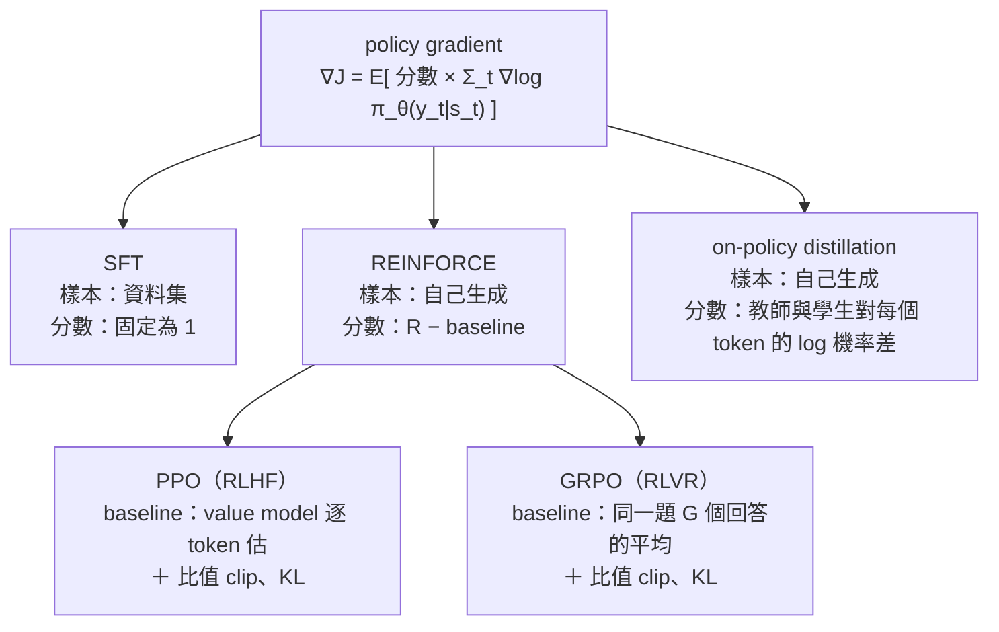

> :globe: [English version](/posts/ai/2026-09-29-cme295-rl-with-llms-en)

**影片狀態：已附影片。** [影片來源與說明](#課程影片來源)

本篇是 Stanford [CME295](/posts/ai/2026-09-29-cme295-course-overview) 導讀系列的第 11 篇，對應 2026 版第 4 講「Reinforcement learning with LLMs」（2026 年 10 月 16 日），講者是 Afshine Amidi 與 Shervine Amidi，前半由 Afshine 講到 GRPO，最後一段 on-policy distillation 由 Shervine 接手。材料是 [135 頁投影片](https://cme295.stanford.edu/slides/fall26-cme295-lecture4.pdf)與下方錄影。

全片 1 小時 43 分，本文涵蓋全部；每節開頭有對應的錄影時段，某一節看不懂時可以直接跳回去看。先備是第 3 講的訓練流程：預訓練、SFT、偏好對齊、推理。偏好對齊的 reward model 與 DPO、推理模型的 R1 配方，本系列的[第 5 篇](/posts/ai/2026-09-29-cme295-preference-tuning)和[第 6 篇](/posts/ai/2026-09-29-cme295-llm-reasoning)已經寫過；這一講補上的是它們背後的 loss 從哪裡來。

整堂課的骨架很清楚：先從 policy gradient 推出最陽春的 REINFORCE，列出它的三個缺口，再看每個方法補上哪一個。投影片在 PPO、GRPO 兩段結尾都放了同一張缺口表；把兩張拼起來，再依最後一段的願望清單與優缺點補上 on-policy distillation 一欄，就是這一講的地圖：

| 缺口 | PPO | GRPO | On-policy distillation |
|---|---|---|---|
| 1. 梯度雜訊大 | value function 算 advantage | 組內平均算 advantage | 教師逐 token 給的訊號 |
| 2. 沒有逐 token 的功過分配 | value function 順帶做到 | ✗ 每個 token 同一個 advantage | 教師對每個 token 打分 |
| 3. 更新幅度沒有限制 | clip 與／或 KL 懲罰 | clip 與／或 KL 懲罰 | 目標本身是貼近教師分布 |
| 留下的代價 | 要多訓練一個 value model | 功過分配又不見了 | 要先有一個教師 |

```youtube
url: https://www.youtube.com/watch?v=3Vaj0Oka_t4
title: Stanford CME295 Transformers & LLMs | Autumn 2026 | Lecture 4 - Reinforcement Learning with LLMs
```

## 三個記號陷阱，與 LLM 版的 RL 對照

[錄影 04:47–09:01](https://www.youtube.com/watch?v=3Vaj0Oka_t4&t=287s)

開講前，Afshine 先提醒 RL 論文的記號很亂，投影片列了三個最常撞的：

- **r**：可能是獎勵（reward），也可能是新舊 policy 的機率比（ratio）。課堂把比值改記成 **ρ**，r 或 R 只留給獎勵
- **π 的下標**：可能指「上一批資料的 policy」（π_old），也可能指「參考 policy」（π_ref，通常是 SFT 後的模型）。兩者角色不同，後面 PPO 一節會同時用到
- **L**：可能是要最小化的 loss，也可能是要最大化的目標。PPO 論文的 L^CLIP 就是後者

接著把 RL 的標準圖換成 LLM 的版本。agent 是 LLM，state 是「到目前為止的輸入」，action 是「下一個 token」，policy π_θ 就是 LLM 對下一個 token 的機率分布。這也是之前記號裡 π 的由來。

token 層級的獎勵很難定義，所以實務上常把整段回答看成一個動作：state 是 prompt，action 是整段回答，π_θ(y | x) 是「給定 prompt 時輸出這段回答的機率」，回答寫完才拿到一個分數。有同學問整段回答的機率會不會小到不行，答案是會，所以實作上一律取 log 維持數值穩定。

## 兩類獎勵：主觀的 RLHF，可驗證的 RLVR

[錄影 09:01–14:44](https://www.youtube.com/watch?v=3Vaj0Oka_t4&t=541s)

要量化「這個回答多好」，課堂分成兩類情境：

| | 主觀 | 可驗證 |
|---|---|---|
| 例子 | 偏好對齊：語氣、有沒有幫助 | 推理：數學解答、程式過不過測試 |
| 分數怎麼來 | 人類偏好，用 Bradley-Terry 訓練 reward model | 確定性的檢查 |
| 名稱 | RLHF（RL from Human Feedback） | RLVR（RL with Verifiable Rewards） |

兩者都是回答層級的分數。投影片各舉了一個例子：偏好對齊時，LLM 回答「建議你別花太多時間陪泰迪熊」，凍結的 reward model 給低分；推理時，「泰迪熊 2020 年出生，現在幾歲」答出 6，規則檢查給對。RL 的工作就是調整 LLM 的權重，讓它更常寫出高分的回答。

課堂上有人問：每生成一段回答都要找人評分嗎？不用。先拿人類偏好訓練好 reward model，之後每段回答都交給它打分，訓練迴圈裡沒有人。

> **自我檢查**：把逐 token 生成看成 RL 時，某一步的 state 和 action 各是什麼？（2026 期中考第 IV 大題第 2 題）
>
> 答：state 是 prompt 加上目前已生成的前綴，action 是下一個 token。

## Policy gradient：把機率往高分的回答推

[錄影 14:44–25:50](https://www.youtube.com/watch?v=3Vaj0Oka_t4&t=884s)

目標是最大化期望獎勵 J(θ)。訓練神經網路要的是梯度，但獎勵來自「抽一段文字、拿去評分」，抽樣這一步沒辦法直接微分。Afshine 在黑板上推了一遍：R 是凍結的，跟 θ 無關；跟 θ 有關的只有 π_θ。再用一個恆等式 ∇π = π · ∇log π，梯度就變回一個期望值，可以用抽樣估：

$$
J(\theta) = \mathbb{E}_{\tau\sim\pi_\theta}\big[R(\tau)\big]
\quad\Longrightarrow\quad
\nabla_\theta J(\theta) = \mathbb{E}_{\tau\sim\pi_\theta}\big[R(\tau)\,\nabla_\theta \log \pi_\theta(\tau)\big]
$$

讀法是：抽到的回答分數為正，就把它的 log 機率往上推；分數為負，就往下壓。課堂強調，這條式子後面會一直出現，所以值得知道它怎麼來。

<details>
<summary>推導：從 J(θ) 到 policy gradient</summary>

$$
\begin{aligned}
\nabla_\theta J(\theta)
&= \nabla_\theta \int R(\tau)\,\pi_\theta(\tau)\,d\tau
 = \int R(\tau)\,\nabla_\theta \pi_\theta(\tau)\,d\tau \\
&= \int R(\tau)\,\pi_\theta(\tau)\,\nabla_\theta \log \pi_\theta(\tau)\,d\tau
 \qquad (\nabla \pi = \pi\,\nabla \log \pi) \\
&= \mathbb{E}_{\tau\sim\pi_\theta}\big[R(\tau)\,\nabla_\theta \log \pi_\theta(\tau)\big]
\end{aligned}
$$

- 第一步把梯度移進積分，需要一些正則性條件，課堂上直接假設成立
- LLM 的情況下，τ 其實是「先從資料集抽 prompt x，再從 π_θ(·|x) 抽回答 y」，期望值是兩層。黑板上只寫 τ 是為了不讓式子太擠
- 整段回答的 log 機率是各 token log 機率的和：log π_θ(y|x) = Σ_t log π_θ(y_t | x, y_<t)

</details>

把它寫成演算法，就是 [Williams (1992)](https://link.springer.com/article/10.1007/BF00992696) 的 REINFORCE，投影片稱它是蒙地卡羅演算法，分四步：

1. 給一個 prompt x，**抽**一段回答 y ~ π_θ(· | x)
2. 評分：R = R(x, y)
3. 算梯度：g = R · ∇_θ log π_θ(y | x)
4. 更新：θ ← θ + αg（要最大化，所以是梯度上升，用加號）

投影片在第一步旁邊標了「這一步很貴」。這是跟預訓練、SFT 最大的不同：那兩個階段的答案是資料集裡固定的，RL 卻是 on-policy，每次更新都要模型自己生成新的回答。生成只能一個 token 接一個 token 來，沒辦法平行。

> **自我檢查**：某個程式在泰迪熊數數題答對時回傳 1、答錯回傳 0，這個檢查不可微分。policy gradient 還能拿它訓練生成模型嗎？（期中考第 IV 大題第 1 題）
>
> 答：可以。獎勵只是乘在「回答的 log 機率梯度」前面的權重，需要可微的是 log π_θ，不是獎勵本身。

## 重複使用樣本：importance sampling

[錄影 25:50–32:53](https://www.youtube.com/watch?v=3Vaj0Oka_t4&t=1550s)

既然生成很貴，能不能生成一次、更新好幾次？Afshine 在黑板上做了第二個推導：拿一個固定的 policy π_θfixed 抽樣，再用機率比把期望值改寫回來。

$$
\mathbb{E}_{\tau\sim\pi_\theta}\big[R(\tau)\big]
= \int R(\tau)\,\frac{\pi_\theta(\tau)}{\pi_{\theta_\text{fixed}}(\tau)}\,\pi_{\theta_\text{fixed}}(\tau)\,d\tau
= \mathbb{E}_{\tau\sim\pi_{\theta_\text{fixed}}}\!\left[R(\tau)\,\frac{\pi_\theta(\tau)}{\pi_{\theta_\text{fixed}}(\tau)}\right]
$$

樣本只要從 π_θfixed 抽一次，之後每次更新都用比值 π_θ / π_θfixed 重新加權。這個比值叫 **importance sampling ratio**。

當場有同學問：比值裡還是有 π_θ(τ)，省到了什麼？答案是「評估」和「生成」的成本差很多。生成要一個 token 進、一個 token 出，反覆做；評估時整段回答已經知道了，可以整串一次丟進模型。decoder-only 模型有 masked self-attention，每個位置只看前面的 token，所以一次前向傳播就拿到每個 token 的機率，完全平行。貴的生成做一次，便宜的評估做很多次。

> **自我檢查**：為什麼「拿已知的一段回答算它的機率」比「生成這段回答」便宜？
>
> 答：生成要一個 token 一個 token 依序做；算機率時整段回答已知，可以一次輸入，靠 masked self-attention 在一次前向傳播裡平行算出每個位置的機率。

## 原版 REINFORCE 的三個缺口

[錄影 32:53–40:15](https://www.youtube.com/watch?v=3Vaj0Oka_t4&t=1973s)

**缺口一：梯度變異大。** 原版的獎勵沒有「跟誰比」的概念。投影片的例子：同一題的好答案拿 101 分、壞答案拿 100 分。兩個都是大正數，模型兩個都會大力推高，只是好的推多一點。推得夠多次最後還是會到對的地方，但每一步的梯度忽大忽小，很吵。

解法是先估「這題平常會拿幾分」當 baseline，再看每個回答比平常好多少。投影片用一個玩具模型算給你看：假設 π_θ(good) = σ(θ) = 0.5、π_θ(bad) = 1 − σ(θ) = 0.5，那麼 ∇_θ log π_θ(good) = +0.5、∇_θ log π_θ(bad) = −0.5。代入 g = R · ∇_θ log π_θ：

| | g_good | g_bad |
|---|---|---|
| 沒有 baseline | 101 × 0.5 = +50.5 | 100 × (−0.5) = −50 |
| baseline = 100.5 | (+0.5) × 0.5 = +0.25 | (−0.5) × (−0.5) = +0.25 |

沒有 baseline 時，兩個樣本給出的梯度一個 +50.5、一個 −50，方向相反、量級巨大；減掉 baseline 後兩個都是 +0.25，方向一致（都在推高好答案），變異小很多。

<details>
<summary>本文補充：為什麼減掉 baseline 不會帶偏梯度</summary>

只要 baseline b(x) 不依賴抽到的回答 y，它對梯度期望值的貢獻是 0：

$$
\mathbb{E}_{y\sim\pi_\theta}\big[b(x)\,\nabla_\theta \log \pi_\theta(y\mid x)\big]
= b(x)\sum_y \nabla_\theta \pi_\theta(y\mid x)
= b(x)\,\nabla_\theta \sum_y \pi_\theta(y\mid x)
= b(x)\,\nabla_\theta 1 = 0
$$

所以把 R 換成 R − b(x)，期望值不變、變異數變小。R − b 就是後面一直出現的 advantage。baseline 也可以隨 state 變（例如 PPO 的 V(s_t)），只要不依賴「這一步選了哪個 token」，證明一樣成立。課堂用玩具例子示範效果，沒有推這個證明。

</details>

**缺口二：沒有逐 token 的功過分配。** 兩類獎勵都是回答層級的，回答要嘛整段對、要嘛整段錯。投影片的例子：

> Prompt：泰迪熊在一個密封的盒子裡，盒子被搬到廚房。泰迪熊在哪？
> 輸出：步驟 1，泰迪熊爬出盒子。步驟 2，泰迪熊走到廚房。步驟 3，答案：廚房。✓

答案對了，推理卻是錯的：泰迪熊一直在盒子裡。原版 REINFORCE 會把這段回答的每個 token 都推高，包括「爬出盒子」這種錯誤步驟。

**缺口三：更新幅度沒有限制。** 進到 RL 階段時，模型已經做過預訓練和 SFT，本來就不差，不希望它跑太遠。理由有三個：起點已經很好；不想讓它在原本會的任務上退步；獎勵不一定對齊真正的目標，有 reward hacking 的風險。Afshine 舉自己當例子：如果他只看下課時掌聲有多熱烈來判斷課講得好不好，最佳策略可能是花兩小時講跟課程無關的笑話。

那要怎麼量化兩個分布差多遠？這個問題留到 PPO 一節用 KL divergence 回答。

> **自我檢查**：同一題的兩個泰迪熊故事拿到 8 分和 6 分，減掉 baseline 7 之後 advantage 是 +1 和 −1。用 advantage 而不用原始分數，主要是為了什麼？（期中考第 IV 大題第 3 題）
>
> 答：降低梯度的變異數。它比較的是「比 baseline 好多少」，沒有辦法指出是哪些 token 造成了分數，也不限制更新幅度。

## PPO：用 value function 算 advantage，再限制步伐

[錄影 40:15–1:07:08](https://www.youtube.com/watch?v=3Vaj0Oka_t4&t=2415s)

[PPO（Proximal Policy Optimization）](https://arxiv.org/abs/1707.06347)跟 REINFORCE 差兩件事：最大化的是 advantage 而不是原始獎勵，以及不要離之前的 policy 太遠。名字裡的「Proximal」指的就是第二件事。

### Advantage 與 value function

獎勵問的是「這個回答多好」，advantage 問的是「跟這題預期的水準比，這個回答多好」。投影片用逐 token 的例子說明：

> 輸入：Teddy is in a box. Where is Teddy?　輸出：In the box.（獎勵 +1）

對每個前綴問：「從這裡照目前的 policy 繼續寫下去，最後平均會拿幾分？」寫到 In 時估 0.6，寫到 the 時 0.7，寫出 box 時跳到 0.95，句號 1.0。box 這個 token 的 advantage 就是「有它」減「沒有它」：0.95 − 0.70 = +0.25。這樣不但有 baseline，還能指出是哪個 token 貢獻了分數。

這個「從前綴估最終獎勵」的函數叫 **value function**：

$$
V^\pi(x, y_{<t}) = \mathbb{E}_\pi\big[R_\text{future} \mid x, y_{<t}\big],
\qquad
A^\pi(x, y_{<t}, y_t) = V^\pi(x, y_{\le t}) - V^\pi(x, y_{<t})
$$

投影片把 advantage 那條加了引號，因為實際算法更複雜。Afshine 的比喻是：你教朋友一個數學觀念，他考試考好了，這是短期回報；但考好也讓他走上後面一連串的成功，這些不能全算在你頭上，卻也有一部分該算給你。把未來的價值一起折回當下 token 的做法是 [GAE（Generalized Advantage Estimation）](https://arxiv.org/abs/1506.02438)，課堂說明不在考試範圍。

value model 的幾個性質，課堂和問答裡都講到了：

- 它是逐 token 的：輸出的每個位置都有一個值
- 訓練標籤是回答層級的獎勵：給定 prompt 和部分回答，預測最後會拿幾分
- 它跟 policy **一起訓練**，共用骨幹，loss 是 policy 項加 value 項。理由是 value 的定義本身就綁著「照目前這個 policy 寫下去」，policy 變了它就得跟著變
- reward model 則是事先訓練好、RL 期間凍結

### 重複使用一批樣本：比值 ρ

接下來把上一節 importance sampling 的黑板推導用上。PPO 會用 π_θ 生成一批回答，在這批回答上更新好幾次；更新過後，生成這批資料的 policy 就不再是目前的 policy，改叫 π_old。所以目標從 E_t[A_t] 變成：

$$
\mathbb{E}_t\big[\rho_t(\theta)\,A_t\big],
\qquad
\rho_t(\theta) = \frac{\pi_\theta(y_t\mid s_t)}{\pi_\text{old}(y_t\mid s_t)}
$$

ρ 就是 importance sampling ratio，修正「樣本是舊 policy 抽的，要估的卻是新 policy」這個落差。

### 第一招：clip 比值

問題是比值可以一路變大。Afshine 在黑板上畫了 J 對 ρ 的圖。advantage 為正時，J = ρA 是一條往右上的直線，梯度永遠不為 0，模型會一直被鼓勵把這個動作的機率越推越高。PPO 的處理是把比值夾在 [1−ε, 1+ε]：

$$
J(\theta) = \mathbb{E}_t\Big[\min\big(\rho_t A_t,\ \operatorname{clip}(\rho_t, 1-\epsilon, 1+\epsilon)\,A_t\big)\Big]
$$

advantage 為正時，ρ 超過 1+ε 之後 J 變成水平線，梯度為 0，不再有往上推的誘因；advantage 為負時，ρ 低於 1−ε 之後同樣變平。換句話說，新 policy 跟舊 policy 差到一定程度，這個樣本就不再推它。

### 第二招：KL 懲罰

另一種限制方式是在目標裡直接扣掉「跟參考模型差多少」。投影片先回顧 KL divergence：KL(P‖Q) = Σ P log(P/Q)，以 P 為真實分布、用 log 比值加權。PPO 的第二招就是：

$$
J(\theta) = \mathbb{E}_t\Big[\rho_t(\theta)\,A_t - \beta\,\mathrm{KL}\big(\pi_\theta(\cdot\mid s_t)\,\|\,\pi_\text{ref}(\cdot\mid s_t)\big)\Big]
$$

這裡要看清楚下標。課堂整理了三個 policy 的角色：

- **π_θ**：目前正在更新的 policy
- **π_old**：生成這一批資料的 policy。生成一批 → 它成為 π_old → 更新幾次 → 再生成下一批 → 新的 π_old
- **π_ref**：起點的參考模型（通常是 SFT 後的模型），整個訓練過程都固定

clip 管的是「每一輪別走太遠」（相對 π_old），KL 管的是「總共別離起點太遠」（相對 π_ref），實務上兩個常常同時用。有同學問 KL 怎麼算：完整的 KL 要對整個詞彙表加總，太貴，所以實務上用估計量。

<details>
<summary>本文補充：DeepSeekMath 用的 KL 估計量</summary>

[DeepSeekMath](https://arxiv.org/abs/2402.03300) 式 (4) 逐 token 用這個估計量，只需要被抽到的那個 token 在兩個模型下的機率，而且恆 ≥ 0：

$$
\mathbb{D}_\mathrm{KL}\big[\pi_\theta \,\|\, \pi_\text{ref}\big]
\approx \frac{\pi_\text{ref}(o_t\mid q, o_{<t})}{\pi_\theta(o_t\mid q, o_{<t})}
- \log\frac{\pi_\text{ref}(o_t\mid q, o_{<t})}{\pi_\theta(o_t\mid q, o_{<t})} - 1
$$

DeepSeekMath 標註它出自 [John Schulman 的部落格文章](http://joschu.net/blog/kl-approx.html)。

</details>

### 跟 DPO 的 β 是同一個

Afshine 接著把上一講的 DPO 拉回來。DPO 把 RL 目標改寫成監督式的 loss，形狀跟 Bradley-Terry 一樣，只是獎勵換成 r_θ(x, y) = β log(π_θ(y|x) / π_ref(y|x))：

$$
\mathcal{L}_\text{DPO} = -\,\mathbb{E}_{(x, y_w, y_l)\sim\mathcal{D}}\left[\log\sigma\!\left(\beta\log\frac{\pi_\theta(y_w\mid x)}{\pi_\text{ref}(y_w\mid x)} - \beta\log\frac{\pi_\theta(y_l\mid x)}{\pi_\text{ref}(y_l\mid x)}\right)\right]
$$

這裡的 β 就是 KL 懲罰裡的 β。課堂用 sigmoid 的形狀解釋：loss 想讓括號裡的差越大越好。β 大時，π_θ 只要稍微偏離 π_ref，括號就已經很大、sigmoid 已經貼近 1，沒有誘因再走遠；β 小時，要偏離很多才拿得到同樣的效果。所以 β 越大，越被綁在參考模型附近。DPO 的細節見[第 5 篇](/posts/ai/2026-09-29-cme295-preference-tuning)。

### 現在的 PPO，以及它的代價

投影片的「PPO nowadays」把上面收成兩句：用 value function 當 baseline 來最大化 advantage；用 clip（相對上一批）和 KL 懲罰（相對參考模型）避免走太遠。各家實作的組合不同，有的兩個都用，有的只用一個；KL 懲罰的放法也有好幾種，常見的一種是併進獎勵、再算 advantage。

讀 PPO 論文時記得兩件事，投影片特地放了一頁：論文的 L^CLIP 是要**最大化**的目標，不是 loss；論文的 r_t 是**比值**，不是獎勵。

對照三個缺口，PPO 補上了缺口一（advantage 有 baseline）、缺口二（value function 逐 token，順帶給了功過分配）、缺口三（clip 與 KL）。代價是要多訓練、多放一個跟 policy 同步的 value model，課堂直接說這「很麻煩」。

> **自我檢查**：設 ρ = π_θ(a|s) / π_old(a|s)，PPO 最大化 J(ρ, A) = min(ρA, clip(ρ, 0.8, 1.2)A)。在 ρ = 1.4 時，分別算出 A = +2 與 A = −2 的 J，並說明最大化 J 會推動 ρ 往哪裡走。clip 能保證實際的 ρ 留在 [0.8, 1.2] 嗎？（期中考第 IV 大題第 9 題）
>
> 答：clip(1.4) = 1.2。A = +2 時 J = min(2.8, 2.4) = 2.4，選到 clip 項，J 在這裡是平的，沒有誘因再提高 ρ。A = −2 時 J = min(−2.8, −2.4) = −2.8，選到未 clip 項，J = −2ρ，梯度上升會把 ρ 往下拉。clip 不保證實際比值留在區間裡，它只拿掉替代目標的誘因；參數是共用的，其他樣本的更新仍可能把這個比值推出區間。

## GRPO：同一題抽 G 個回答，用組內平均當基準

[錄影 1:07:08–1:25:05](https://www.youtube.com/watch?v=3Vaj0Oka_t4&t=4028s)

GRPO（Group Relative Policy Optimization）出自 [DeepSeekMath](https://arxiv.org/abs/2402.03300)。它一樣最大化 advantage、一樣不走太遠，賣點是**不需要 value function**。

做法回到「需要一個東西跟獎勵比」的直覺：同一個 prompt x，用正的 temperature 抽 G 個不同的回答 o_1…o_G，各自評分，再拿組內平均和標準差做標準化：

$$
\hat{A}_i = \frac{R(x, o_i) - \operatorname{mean}\big(\{R(x, o_1), \dots, R(x, o_G)\}\big)}{\operatorname{std}\big(\{R(x, o_1), \dots, R(x, o_G)\}\big)}
$$

比組內平均好的回答 advantage 為正，差的為負，不用另外訓練模型來估「平常水準」。完整目標保留 PPO 的 clip，KL 懲罰直接寫進目標：

$$
J(\theta) = \mathbb{E}\left[\frac{1}{G}\sum_{i=1}^{G}\frac{1}{|o_i|}\sum_{t=1}^{|o_i|}\Big\{\min\big[\rho_{i,t}\hat{A}_i,\ \operatorname{clip}(\rho_{i,t}, 1-\epsilon, 1+\epsilon)\,\hat{A}_i\big] - \beta\,\mathrm{KL}(\pi_\theta\,\|\,\pi_\text{ref})\Big\}\right]
$$

### GRPO 與 PPO 對照

課堂照 DeepSeekMath 的示意圖，把兩者要動用的模型列出來：

| 模型 | PPO | GRPO |
|---|---|---|
| policy model | 訓練 | 訓練 |
| value model | 跟 policy 一起訓練 | 不需要 |
| reward model | 事先訓練、凍結 | 事先訓練、凍結；用可驗證獎勵時可以不要 |
| reference model | 固定 | 固定 |

公式上的相同點是比值 ρ 和 clip。不同點有兩個：

- **KL 放哪裡**：PPO 常見的一種做法是把 KL 懲罰併進獎勵；GRPO 直接放進目標。各家論文寫法都不一樣，課堂提醒別被嚇到
- **advantage 怎麼算**：PPO 逐 token、靠 value function；GRPO 在回答層級跟同組比。GRPO 公式裡的 advantage 寫成 Â_{i,t}，帶著 token 下標 t，是因為通式允許逐 token 的 advantage；但逐 token 需要有辦法分辨每個 token 的貢獻，所以一般用回答層級，每個 token 共用同一個 Â_i

### 回答越寫越長

投影片引了 [DeepSeek-R1](https://arxiv.org/abs/2501.12948) 的訓練曲線：RL 訓練過程中，平均回答長度一路上升，課堂特別指出，連表現已經持平的階段，長度都還在漲。為什麼？

Afshine 請大家只看公式裡的 1/|o_i|。回答短時，這個係數大；回答長時，係數小。它乘在每個 token 對目標的貢獻上：

| | 短回答 | 長回答 |
|---|---|---|
| advantage 為正 | 每個 token 往上推得多 | 每個 token 往上推得少 |
| advantage 為負 | 每個 token 往下壓得多 | 每個 token 往下壓得少 |

看右下角：錯的回答寫得越長，每個 token 被罰得越輕。當模型對某些題目怎麼樣都答不對時，它會偏好「又長又錯」勝過「短而錯」。這就是表現持平、長度卻一直漲的原因。

修法是讓每個 token 的貢獻相等：

- **[DAPO](https://arxiv.org/abs/2503.14476)**：除以整組所有回答的總 token 數，(1 / Σ_i |o_i|) Σ_i Σ_t
- **[Dr. GRPO](https://arxiv.org/abs/2503.20783)**（GRPO Done Right）：直接拿掉 1/|o_i|，剩 (1/G) Σ_i Σ_t。投影片附的 Dr. GRPO 圖裡，答對的回答兩種做法長度差不多；答錯的回答在 GRPO 下一路變長，Dr. GRPO 則沒有

### 其他調整

課堂再點了兩個後續工作的修正：

- **難度偏差**：advantage 除以組內標準差，而標準差會隨題目難易變動，引入偏差。講者的建議是拿掉標準差（Dr. GRPO 論文就是這麼做的）
- **鼓勵多樣性**：上下界用同一個 ε 時，機率很小的 token 幾乎沒有空間被大幅推高。例如某個 token 機率 0.001、ε = 0.2，比值上限 1.2 只能把它推到 0.0012。DAPO 把上下界拆開成 clip(ρ, 1−ε_low, 1+ε_high)，放寬上界

對照三個缺口，GRPO 用組內平均補上缺口一、用 clip 與 KL 補上缺口三，也甩掉了 value model；但缺口二又回來了：同一段回答的每個 token 拿到一樣的 advantage。

> **自我檢查**：同一題的四個回答，最終答案的獎勵是 (1, 1, 0, 0)。回答 1 推理正確；回答 2 中間有一句錯誤的主張，但最終答案對。GRPO 以 A_i = (R_i − R̄) / s_R 給回答 i 的每個 token 同一個 advantage，s_R 用母體標準差。算出 R̄、s_R 與四個 advantage，並說明這個 advantage 能不能把回答 2 的錯誤主張跟回答 1 的正確步驟分開。（期中考第 IV 大題第 10 題 (i)）
>
> 答：R̄ = 1/2，s_R = 1/2，A = (1, 1, −1, −1)。不能：兩個答對的回答每個 token 都是 +1，回答 2 那句錯誤主張也一起被推高。

## On-policy distillation：讓教師替學生的每個 token 打分

[錄影 1:25:05–1:43:26](https://www.youtube.com/watch?v=3Vaj0Oka_t4&t=5105s)

### GRPO 的功過分配問題

Shervine 接手後，先把泰迪熊例子擴成一組四個回答：

| 輸出 | 步驟 1 | 步驟 2 | 答案 |
|---|---|---|---|
| o_1 | 泰迪熊留在盒子裡 | 盒子被搬到廚房 | 廚房 ✓ |
| o_2 | 泰迪熊爬出盒子 | 泰迪熊走到廚房 | 廚房 ✓ |
| o_3 | 泰迪熊留在盒子裡 | 盒子留在房間 | 房間 ✗ |
| o_4 | 泰迪熊爬出盒子 | 泰迪熊留在房間 | 房間 ✗ |

GRPO 只看答案，所以 o_2 的錯誤步驟 1 拿到正的 advantage，o_3 的正確步驟 1 拿到負的。後果分兩層：短期看，每個 token 拿到同一個 advantage，訊號很吵；長期看，GRPO 只能靠很多組的平均，慢慢學出哪些步驟是好的，很慢。

改用逐步打分（process supervision）呢？DeepSeekMath 也試過把 advantage 切到步驟層級。投影片列了三個問題：每一步都要人工標註；每一步內部又可能有同樣的模糊（「泰迪熊走到廚房」錯的是「走」還是「到廚房」？一路追下去就變成逐 token 標註）；還要另外訓練一個逐步打分的 reward model，這正是當初離開 PPO 想避免的。

Shervine 把願望清單列出來：想保留 on-policy 訓練（用模型自己的生成）、想要逐 token 的功過分配、不想再多訓練任何模型。對應的提案是：在模型自己的生成上、用 next-token prediction 的 loss、找一個現成的強模型當教師。也就是蒸餾，但跟一般的蒸餾不一樣。

### Reverse KL

比較兩個下一個 token 分布，用的是 KL divergence。Shervine 給的讀法是：KL(P‖Q) 問的是「在一個由 P 主宰的世界裡，用 Q 去近似有多糟」。加總的權重來自第一個參數，所以 KL 不對稱。

一般蒸餾讓教師主宰世界，寫成 KL(T‖S)。這裡要 on-policy、讓學生主宰，所以反過來用 **reverse KL**：

$$
\mathrm{KL}(S\,\|\,T) = \sum_i s_i \log\frac{s_i}{t_i}
$$

兩個性質：

- 教師有機率、學生幾乎沒給（t_i 不小、s_i ≈ 0）：權重 s_i 很小，罰得輕。reverse KL 對「學生漏掉教師的某些選項」很寬容
- 教師幾乎沒給、學生卻給了不少（t_i ≈ 0、s_i 不小）：log 比值很大，權重也不小，罰得很重

再加上學生的容量通常比教師小，結果是 **mode seeking**：學生會集中在教師分布的高峰上。Shervine 也提醒，這是現在常見的選擇，但原始的 [GKD 論文](https://arxiv.org/abs/2306.13649)其實兩種都試過，不是理所當然更好。

### 逐 token 打分的樣子

流程是：學生依 prompt 自己生成一段回答；每生成一個 token，就問教師「在同樣的上下文下，這個 token 對你合不合理」。回到四個回答，被教師罰的 token 是 o_2 和 o_4 的「爬」，以及 o_3「盒子留在房間」、o_4「泰迪熊留在房間」裡的「留」。

課堂問大家：有沒有哪裡沒被罰、讓你意外？o_2 的「走到廚房」就沒被罰。原因是條件機率 p(x_{t+1} | x_1, …, x_t) 會把前面所有 token 當成上下文：教師看到「泰迪熊爬出盒子」已經寫在前面，接著「走到廚房」就是順理成章的下一步。投影片的結論是：token 通常在**開始出錯的那一刻**被罰，後面的句子因為接受了前文，通常不會被罰。

### 優點與限制

投影片引用 [Thinking Machines Lab 的〈On-Policy Distillation〉](https://thinkingmachines.ai/blog/on-policy-distillation/)列了三個優點：

- **實務上效果好**：on-policy，學生學的是自己會走到的路；訊號是逐 token 的，比只看結果密很多
- **省算力**：投影片放了那篇文章的圖：Qwen3-8B-Base 在 OpenThoughts-3 上先做 SFT，再做 on-policy distillation，橫軸是額外算力（對數），縱軸是 AIME'24。分成完整微調、LoRA rank 128、LoRA rank 32 三格；rank 越小，SFT 停的位置越低，接上 on-policy distillation 之後把這段落差大幅拉回來。Shervine 用它說明這個方法在參數受限時特別划算
- **沒有 reward model**：沒有東西可以 hack。就算模型想 hack，把 loss 壓到 0 的結果也只是完全貼合教師的分布

限制有兩個：要先有一個教師可以學（如果你訓練的就是最強的前沿模型，沒有人能教你）；學生的上限受教師限制，教師的分布不一定完美，也不一定涵蓋你在意的所有領域。

課外補充一筆成本數字：[Qwen3 技術報告](https://arxiv.org/abs/2505.09388)表 21 從同一個 off-policy 蒸餾過的 Qwen3-8B 出發，接著做 RL，AIME'24 從 55.0 到 67.6，花 17,920 GPU 小時；改做 on-policy distillation 到 74.4，花 1,800 GPU 小時，約十分之一。

### 延伸一：self-distillation，沒有教師也行

第一個限制有個看起來很神奇的解法。教師打分時，學生的 token 是用 teacher forcing 整串丟進去的，沒有人規定教師看到的 prompt 要跟學生一樣。那就在教師的 prompt 裡塞進提示，甚至整個解答。

投影片引的是 [Self-Distilled Reasoner（Zhao et al., 2026）](https://arxiv.org/abs/2601.18734)：教師和學生是**同一個模型**，學生只看到題目；教師多看到一段提示，例如「泰迪熊從頭到尾都在盒子裡，所以最後在廚房。現在你自己解一次：」。論文把這個做法叫 OPSD（On-Policy Self-Distillation），教師條件在參考解答上，在學生自己的生成上逐 token 對齊兩邊的分布。

問答時有人問：什麼時候 on-policy distillation 最划算？Shervine 的回答是，如果你已經是最強的模型，好處會比較小，但可以拿來做別的事。他舉上一講提過的 GLM-5 報告為例，用自我蒸餾讓模型不要忘記之前學會的東西。前沿實驗室常見的分工可能是：pro 系列用 GRPO 這類以真實標籤為基礎、需要較多算力的方法；flash 系列用 on-policy distillation 向自家大模型學。

### 延伸二：多教師，突破單一教師的上限

第二個限制的解法是：先拿可驗證獎勵在各個領域分別做 RL，訓練出各領域的專家；做 on-policy distillation 時，每一題交給對應領域的專家當教師。投影片引的是小米 MiMo 團隊的 [MOPD（Multi-Teacher On-Policy Distillation，Ma et al., 2026）](https://arxiv.org/abs/2606.30406)，流程分三段：通用 SFT → 各領域分別做 RL 得到專家（數學、指令遵循、軟體工程、搜尋、安全等）→ 學生自己生成，交給對應領域的教師逐 token 計算機率，以 reverse KL 更新學生。

為什麼不直接在一個模型上把所有領域的 RL 做完？Shervine 的說法是：實務上單一模型依序做多領域 RL 容易遺忘，同一組參數也要同時服務好幾個目標；分開訓練專家再蒸餾回來，實驗上更有效率。

> **自我檢查**：在固定的前綴上，on-policy distillation 最小化學生對教師的 reverse KL，D_KL(S‖T)。它的 mode-seeking 性質強烈懲罰的是哪一種不一致？（期中考第 IV 大題第 6 題）
>
> 答：學生在教師機率接近 0 的地方放了不少機率。反過來，學生漏掉一個教師有給機率、但學生自己幾乎不給的選項，reverse KL 罰得很輕。

## 把四種方法放回同一條式子

課堂從 REINFORCE 一路修補下來。如果回頭看，SFT、REINFORCE、PPO、GRPO、on-policy distillation 其實都長成同一個形狀：**模型對某個 token 的 log 機率梯度，乘上一個分數**。差別只在兩處：樣本從哪裡來，分數怎麼算。這是本文的整理，借自 DeepSeekMath 第 5.2 節的統一寫法，課堂沒有把 SFT 放進這個框架。



<details>
<summary>公式：SFT、GRPO 與 RLOO、on-policy distillation 的對照</summary>

SFT 的 loss 是資料集裡每個 token 的負 log 機率，梯度等於把分數固定成 1 的 policy gradient：

$$
\mathcal{L}_\text{SFT} = -\sum_t \log\pi_\theta(y_t\mid x, y_{<t})
$$

DeepSeekMath 第 5.2 節的統一寫法（式 5），D 是資料來源，GC 是 gradient coefficient：

$$
\nabla_\theta J_\mathcal{A} = \mathbb{E}_{(q,o)\sim\mathcal{D}}\left[\frac{1}{|o|}\sum_t GC_\mathcal{A}(q, o, t)\,\nabla_\theta\log\pi_\theta(o_t\mid q, o_{<t})\right]
$$

RLOO（[Ahmadian et al., 2024](https://arxiv.org/abs/2402.14740)）用「其他 G−1 個回答的平均」當 baseline。不看標準差時，GRPO 的分子剛好是 RLOO advantage 的 (G−1)/G 倍：

$$
R_i - \frac{1}{G}\sum_j R_j = \frac{G-1}{G}\left(R_i - \frac{1}{G-1}\sum_{j\ne i} R_j\right)
$$

這條是本文自己的代數推導，用來說明兩者的關係。

Thinking Machines 的寫法把每個 token 的負 reverse KL 直接當成 advantage，丟進現成的 RL loss：

$$
\hat{A}_t = -\big(\log\pi_\theta(y_t\mid s_t) - \log\pi_\text{teacher}(y_t\mid s_t)\big)
$$

學生對某個 token 的機率跟教師一樣時 Â_t = 0；比教師更有把握時被壓低，比教師沒把握時被推高。它跟 PPO 常見的逐 token KL 懲罰形狀幾乎一樣，只是把 π_ref 換成 π_teacher。

</details>

## 連回你用的模型

- **你手上的小型開源模型，很可能是蒸餾出來的。** Qwen3 的小尺寸模型用了 on-policy distillation；DeepSeek 的 R1-Distill 系列用的是 off-policy 的軌跡 SFT（[第 6 篇](/posts/ai/2026-09-29-cme295-llm-reasoning)）。課堂提到的 flash／pro 分工，也是同一個思路
- **自己做 post-training 時，先看手上有什麼分數。** 能用規則判對錯，就走 GRPO 這類不需要 value model 的路線，記得檢查有多少題整組全對或全錯（advantage 全是 0，沒有貢獻梯度），也要留意錯誤回答是不是越寫越長；手上有更強、能查 log 機率的開源教師，on-policy distillation 值得先試；連教師都沒有但有參考解答，self-distillation 是一個選項
- **看到新演算法時，問三個問題**：它補的是三個缺口中的哪一個？樣本從哪裡來？每個 token 乘上的分數怎麼算？

## 跟 2025 版的差別

2025 版沒有這一講。PPO 放在 [2025 第 5 講](https://cme295.stanford.edu/slides/fall25-cme295-lecture5.pdf)、GRPO 放在[第 6 講](https://cme295.stanford.edu/slides/fall25-cme295-lecture6.pdf)，都直接給目標函數；本系列第 5、6 篇是依那兩講寫的。2026 版把它們抽出來，從 policy gradient 的黑板推導開始，用三個缺口串起 PPO 和 GRPO，再新增整段 on-policy distillation，連同 self-distillation 與多教師兩個 2026 年的延伸。GRPO 的長度偏差、DAPO 與 Dr. GRPO 在 2025 第 6 講也講過，2026 版改用 1/|o_i| 的正負號表格來解釋。

## 自我檢查

前四題取自 [2026 期中考](https://cme295.stanford.edu/exams/fall26-cme295-midterm.pdf)第 IV 大題（[解答](https://cme295.stanford.edu/exams/fall26-cme295-midterm-solutions.pdf)），最後兩題由本文自擬。

1. PPO 的 value model 接收 prompt 和一段還沒寫完的回答，它要估的是什麼？（第 4 題）
2. GRPO 對兩個 prompt 各抽兩個回答，獎勵分別是 (8, 10) 和 (2, 4)，advantage 在各自的組內標準化。獎勵 8 和獎勵 4 的那兩個回答，advantage 各是正還是負？（第 7 題）
3. 一個寫泰迪熊故事的 policy 發現，加入無關的讚美能讓 reward model 給更高分，人類評分卻下降了。哪一種介入直接處理了錯誤的獎勵訊號：加大 rollout 批次、修改 reward model 的訓練資料讓故事品質與讚美脫鉤、把 value model 訓練更久，還是放寬 PPO 的 clip 範圍？（第 8 題）
4. 承第 10 題的四個回答，說明 on-policy distillation 怎麼提供逐 token 的訊號：誰生成前綴？回饋從哪裡來？舉一個它仍可能漏掉推理錯誤的原因。（第 10 題 (ii)）
5. （自擬）π_old 和 π_ref 分別在什麼時候會換掉？clip 和 KL 懲罰各自對應哪一個？
6. （自擬）用 1/|o_i| 的正負號表格解釋：為什麼模型對某些題目一直答錯時，GRPO 會讓它的回答越寫越長？DAPO 和 Dr. GRPO 各怎麼改？

<details>
<summary>答案與判準</summary>

1. 從這個前綴開始、照目前的 policy 繼續寫下去，預期最後拿到的回報。
2. 第一組平均 9，獎勵 8 低於平均，advantage 為負；第二組平均 3，獎勵 4 高於平均，advantage 為正。
3. 修改 reward model 的訓練資料。其他三項都只是更準、更快地追同一個有缺陷的獎勵。
4. 學生自己生成前綴，教師在這些前綴上給出下一個 token 的機率，學生去貼合。可能漏掉的原因：教師本身會錯；或者前綴已經錯了，教師把錯誤的前文當成上下文，接下來的錯誤延續反而看起來合理（例如「走到廚房」沒被罰）。
5. π_old 每生成一批新資料就換一次；π_ref 整個訓練固定不變。clip 限制相對 π_old 的單輪變化，KL 懲罰限制相對 π_ref 的總偏離。
6. advantage 為負時，長回答的每個 token 乘上較小的 1/|o_i|，被罰得較輕，所以「又長又錯」比「短而錯」划算。DAPO 改除以整組總 token 數，Dr. GRPO 直接拿掉 1/|o_i|，兩者都讓每個 token 的貢獻相等。

</details>

## 想深入

- RL 基礎，把 policy gradient、actor-critic 從頭推一遍：[Berkeley CS285 L5–10](/posts/learning/2026-08-22-berkeley-cs285-policy-value-methods)，以及更前面的[模仿學習與 RL 基礎](/posts/learning/2026-08-22-berkeley-cs285-imitation-rl-basics)
- PPO 路線的 RLHF 與 reward overoptimization：[CS336 Lecture 15：SFT 與 RLHF](/posts/ai/2026-08-22-cs336-sft-rlhf)
- GRPO 的偏差與 rollout 系統成本：[CS336 Lecture 16：RLVR](/posts/ai/2026-08-22-cs336-rlvr)
- on-policy distillation 與 off-policy 漂移的另一種講法：[CS224N 第 13 講](/posts/ai/2026-08-22-cs224n-reasoning-two)
- 本系列前後篇：[第 5 篇：偏好對齊](/posts/ai/2026-09-29-cme295-preference-tuning)、[第 6 篇：推理](/posts/ai/2026-09-29-cme295-llm-reasoning)；下一講的[第 10 篇：LLM systems](/posts/ai/2026-09-29-cme295-llm-systems)，rollout 生成的成本會在那裡出現

## 課程影片來源

導言的錄影是官方 2026 課表（https://cme295.stanford.edu/syllabus/）第 4 講「Reinforcement learning with LLMs」所列的 Autumn 2026 錄影：[Stanford CME295 Transformers & LLMs | Autumn 2026 | Lecture 4 - Reinforcement Learning with LLMs](https://www.youtube.com/watch?v=3Vaj0Oka_t4)，片長 1:43:26。正文依這支錄影的英文人工字幕（CC）與官方 [2026 第 4 講投影片](https://cme295.stanford.edu/slides/fall26-cme295-lecture4.pdf)寫成；公式與數字以投影片為準。

內容核對：已依字幕核對（2026-11-23）：讀完英文 CC 字幕全文，各節的錄影時段取自字幕時間碼（各段起點以 30 秒為單位，略早於主題切換點）；課堂口述的例子（掌聲與 reward hacking、教朋友數學與 GAE、生成與評估的成本差、DPO 的 β、GLM-5 與 flash／pro 分工）皆出自字幕。

2025 版沒有獨立的 RL 講次。PPO 與 GRPO 的前一版講法見 [2025 第 5 講錄影（LLM tuning）](https://www.youtube.com/watch?v=PmW_TMQ3l0I)與 [2025 第 6 講錄影（LLM Reasoning）](https://www.youtube.com/watch?v=k5Fh-UgTuCo)，分別對應本系列[第 5 篇](/posts/ai/2026-09-29-cme295-preference-tuning)與[第 6 篇](/posts/ai/2026-09-29-cme295-llm-reasoning)。

課程與錄影入口：

- [官方 2026 課表](https://cme295.stanford.edu/syllabus/)
- [CME295 Autumn 2025 播放清單（Stanford Online，9 支）](https://www.youtube.com/playlist?list=PLoROMvodv4rOCXd21gf0CF4xr35yINeOy)

查核日期：2026-11-23。

## 更新紀錄

- 2026-10-10：標註影片狀態，核對錄影來源與取得方式。
- 2026-10-10：重查影片狀態。2026 版第 4 講錄影尚未上架，附上 2025 版第 5、6 講作為相關補充影片。
- 2026-10-10：依字幕核對影片內容。兩支 2025 影片（第 5 講含 PPO、第 6 講含 GRPO）與本文說法相符，沒有需修正之處。
- 2026-11-09：重查影片狀態。2026 版第 4 講錄影已在官方課表上架，補上原錄影連結並改寫狀態行；正文依錄影對照更新待另做。
- 2026-11-23：依 2026 第 4 講錄影字幕與投影片改寫全文。結構改照課堂的「三個缺口」主線；新增 importance sampling 黑板推導、變異數玩具例子、PPO 的逐 token advantage 例子與三個 policy 的角色、DPO 的 β 與 KL 的關係、GRPO 長度偏差的正負號解釋與 DAPO／Dr. GRPO／clip-higher、on-policy distillation 的 reverse KL 例子、self-distillation 與多教師延伸；自我檢查改用 2026 期中考題並分到各節；錄影移到導言，狀態改為已附影片；拿掉課前預寫說明、更新計畫與 2025 投影片頁碼對照表。

## 參考資料

- [CME 295 2026 版課表](https://cme295.stanford.edu/syllabus/)
- [2026 版第 4 講投影片（PDF）](https://cme295.stanford.edu/slides/fall26-cme295-lecture4.pdf)
- [2026 期中考](https://cme295.stanford.edu/exams/fall26-cme295-midterm.pdf)／[解答](https://cme295.stanford.edu/exams/fall26-cme295-midterm-solutions.pdf)
- [2025 版第 5 講投影片（PDF）](https://cme295.stanford.edu/slides/fall25-cme295-lecture5.pdf)
- [2025 版第 6 講投影片（PDF）](https://cme295.stanford.edu/slides/fall25-cme295-lecture6.pdf)
- [Williams, Simple Statistical Gradient-Following Algorithms for Connectionist Reinforcement Learning (1992)](https://link.springer.com/article/10.1007/BF00992696)
- [Schulman et al., High-Dimensional Continuous Control Using Generalized Advantage Estimation (2015)](https://arxiv.org/abs/1506.02438)
- [Schulman et al., Proximal Policy Optimization Algorithms (2017)](https://arxiv.org/abs/1707.06347)
- [Rafailov et al., Direct Preference Optimization: Your Language Model is Secretly a Reward Model (2023)](https://arxiv.org/abs/2305.18290)
- [Shao et al., DeepSeekMath (2024)](https://arxiv.org/abs/2402.03300)
- [Ahmadian et al., Back to Basics: Revisiting REINFORCE Style Optimization for Learning from Human Feedback in LLMs (2024)](https://arxiv.org/abs/2402.14740)
- [DeepSeek-AI, DeepSeek-R1: Incentivizing Reasoning Capability in LLMs via Reinforcement Learning (2025)](https://arxiv.org/abs/2501.12948)
- [Yu et al., DAPO: An Open-Source LLM Reinforcement Learning System at Scale (2025)](https://arxiv.org/abs/2503.14476)
- [Liu et al., Understanding R1-Zero-Like Training: A Critical Perspective (2025)](https://arxiv.org/abs/2503.20783)
- [Schulman, Approximating KL Divergence (2020)](http://joschu.net/blog/kl-approx.html)
- [Agarwal et al., On-Policy Distillation of Language Models: Learning from Self-Generated Mistakes (ICLR 2024)](https://arxiv.org/abs/2306.13649)
- [Lu & Thinking Machines Lab, On-Policy Distillation (2025)](https://thinkingmachines.ai/blog/on-policy-distillation/)
- [Qwen Team, Qwen3 Technical Report (2025)](https://arxiv.org/abs/2505.09388)
- [Zhao et al., Self-Distilled Reasoner: On-Policy Self-Distillation for Large Language Models (2026)](https://arxiv.org/abs/2601.18734)
- [Ma et al., MOPD: Multi-Teacher On-Policy Distillation for Capability Integration in LLM Post-Training (2026)](https://arxiv.org/abs/2606.30406)
- [Stanford CME295 導讀（本系列總覽）](/posts/ai/2026-09-29-cme295-course-overview)
