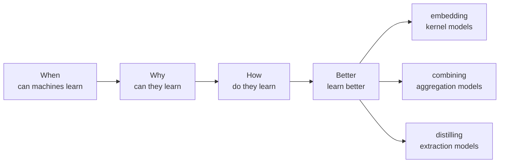

> 🌏 [中文版](/posts/ai/2026-09-30-ntu-htlin-ml-course-overview)

**Video status: Videos included.** The intro embeds the Course Introduction from Foundations Lecture 1 (11 minutes); each lecture's recordings are in its own post. [Source details](#course-video-sources)

[Machine Learning Foundations](https://www.csie.ntu.edu.tw/~htlin/mooc/) (機器學習基石) and Machine Learning Techniques (機器學習技法) are two Mandarin-taught MOOCs that Hsuan-Tien Lin of National Taiwan University launched on Coursera in 2015–2016, 16 lectures each. The textbook is [Learning from Data](http://amlbook.com) (LFD below), which he co-wrote with Yaser Abu-Mostafa and Malik Magdon-Ismail. Ten years later his NTU [Machine Learning](https://www.csie.ntu.edu.tw/~htlin/course/ml26fall/) course is still a flipped classroom, and each week's required watching is still these MOOC videos.

What sets these courses apart is that they ask "why" first. Most of Foundations is not about algorithms but about a proof: having seen only a finite sample, why should we believe a model is accurate on data it has never seen? Once that is settled, Techniques uses the same theory to explain why SVMs, boosting, decision trees, and neural networks work, and when they fail.

This post is the series entry point. It lays out the course's storyline and what each segment teaches, walks through one hand calculation that shows the core argument of Foundations, and ends with a prerequisite check and reading routes. The video below is Lin's own 11-minute introduction to how the two courses are designed, covering the same ground as the storyline section; watch it before or after reading.

```youtube
url: https://www.youtube.com/watch?v=nQvpFSMPhr0
title: The Learning Problem :: Course Introduction @ Machine Learning Foundations (機器學習基石)
```

## The storyline: four questions in Foundations, three segments in Techniques

[01_handout.pdf](https://www.csie.ntu.edu.tw/~htlin/mooc/doc/01_handout.pdf) describes Foundations as a "story-like" course that strings its 16 lectures along four questions. Techniques is split into three segments by how it handles features, plus a final lecture. The lectures are in Mandarin and the slides in English; the questions below are quoted from the slides.



### Foundations 1: When Can Machines Learn? (Lectures 1–4)

First, a precise definition of learning: there is an unknown target function $f$, and an algorithm $\mathcal{A}$ uses data $\mathcal{D}$ and a hypothesis set $\mathcal{H}$ to pick a $g$ that should satisfy $g \approx f$. The first algorithm is the perceptron learning algorithm (PLA): find a misclassified point $(\mathbf{x}_n, y_n)$ and update the weights to $\mathbf{w} + y_n\mathbf{x}_n$, turning toward the point for a positive example and away from it for a negative one; on linearly separable data it is guaranteed to stop. Lecture 3 then sorts learning problems by output (classification, regression, structured), labels (supervised, unsupervised, semi-supervised, reinforcement), protocol (batch, online, active), and input features, and explains that the course focuses on batch supervised binary classification and regression. Then the deeper question: can $g$ match $f$ anywhere outside the data? A marble-and-jar analogy leads to Hoeffding's inequality: as long as the hypothesis is fixed in advance, the probability that the in-sample error $E_{\text{in}}$ and the true error $E_{\text{out}}$ differ by a lot shrinks exponentially with the amount of data. With $M$ hypotheses, the probability grows by at most a factor of $M$.

Start with [Lecture 1](/posts/ai/2026-09-30-ntu-htlin-ml-learning-problem-perceptron-en).

### Foundations 2: Why Can Machines Learn? (Lectures 5–8)

PLA picks from infinitely many lines, so $M$ is infinite and the guarantee above collapses. The fix: infinitely many lines can only produce finitely many ○/× labelings (dichotomies) of $N$ points. The maximum count is the growth function $m_{\mathcal{H}}(N)$. Once some number of points (a break point) cannot be labeled in all $2^N$ ways, $m_{\mathcal{H}}(N)$ is bounded by a polynomial, and substituting it for $M$ gives the VC bound. The largest number of points that can still be labeled every way is the VC dimension $d_{\text{VC}}$; for a perceptron in $d$ dimensions, $d_{\text{VC}} = d + 1$. Lecture 8 handles noise by making the target a distribution $P(y|\mathbf{x})$, under which the VC bound still holds, and argues that the error measure should come from the application, for example a weighted error when false accepts and false rejects cost different amounts.

Start with [Lecture 5](/posts/ai/2026-09-30-ntu-htlin-ml-training-vs-testing-growth-function-en).

### Foundations 3: How Can Machines Learn? (Lectures 9–12)

With the guarantee that small $E_{\text{in}}$ plus modest $d_{\text{VC}}$ means learning works, the next step is driving $E_{\text{in}}$ down. Linear regression gets the squared-error optimum in one step with the pseudo-inverse. Logistic regression outputs probabilities and has no closed form, so it uses gradient descent. Lecture 11 compares the error functions of three linear models, explains why a regression solution is a reasonable starting point for classification, and introduces stochastic gradient descent (SGD) and multiclass classification. Lecture 12 maps data into a new space with a nonlinear transform and then fits a linear model there, at the cost of a larger $d_{\text{VC}}$.

Start with [Lecture 9](/posts/ai/2026-09-30-ntu-htlin-ml-linear-logistic-regression-en).

### Foundations 4: How Can Machines Learn Better? (Lectures 13–16)

When the model is too complex and the data is noisy, $E_{\text{in}}$ is low but $E_{\text{out}}$ is high: overfitting. There are two remedies. Regularization (weight decay) adds a penalty on weight size to the error function, with $\lambda$ setting its strength. Validation holds out part of the data from training and uses it to choose $\lambda$ or the model. The last lecture covers three principles: Occam's razor (prefer the simpler model when it will do), sampling bias (training and test data must come from the same distribution), and data snooping (choosing a model after looking at the data quietly spends that data).

Start with [Lecture 13](/posts/ai/2026-09-30-ntu-htlin-ml-overfitting-regularization-en).

### Techniques 1: embedding numerous features (Lectures 1–6)

Among all lines that separate the data, the linear SVM picks the one farthest from the nearest point (the "fattest"), written as a quadratic program. The dual form rewrites the problem so it depends only on inner products between data points, so a kernel function $K(\mathbf{x}, \mathbf{x}')$ can compute high-dimensional inner products directly without ever computing the features. The soft-margin SVM allows mistakes and uses $C$ to trade margin width against errors. Lectures 5 and 6 view the SVM as a regularized model and carry kernels over to logistic regression and to regression (SVR).

Start with [Techniques Lecture 1](/posts/ai/2026-09-30-ntu-htlin-ml-linear-dual-svm-en).

### Techniques 2: combining predictive features (Lectures 7–11)

Combine many hypotheses. Blending votes or weights models that are already trained; bagging trains different models on bootstrap samples and lets them vote. AdaBoost, after each round, scales up the weights of the examples the last classifier got wrong and scales down the rest, so that classifier is exactly half right under the new weights, which forces the next one to learn something different. Decision trees (C&RT) repeatedly pick the split that leaves each side "purest" (for classification, usually measured by Gini impurity), grow the tree fully, then prune it with a penalty on the number of leaves. A random forest is bagging over decision trees that also pick features at random, and the examples left out of each bootstrap sample (out-of-bag) give a free error estimate. GBDT views boosting as gradient descent on an error function, with each tree fitting the current residuals.

Start with [Techniques Lecture 7](/posts/ai/2026-09-30-ntu-htlin-ml-blending-bagging-adaboost-en).

### Techniques 3: distilling hidden features (Lectures 12–15)

Let the model learn features from the data. Each layer of a neural network is a feature transform, and backpropagation computes the gradients. Deep learning uses pre-training and autoencoders to find good initial weights; after the data is mean-centered, a linear autoencoder learns PCA. An RBF network uses similarity to a few centers as features, with the centers found by k-means. Matrix factorization approximates the rating matrix as a user matrix times a movie matrix, measures error only on the cells that have ratings, and learns both sets of feature vectors with alternating least squares or SGD.

Start with [Techniques Lecture 12](/posts/ai/2026-09-30-ntu-htlin-ml-neural-network-deep-learning-en). [Techniques Lecture 16](/posts/ai/2026-09-30-ntu-htlin-ml-finale-modern-deep-learning-en) gathers the whole course into three families of feature techniques.

## Work it by hand: why the VC dimension is needed

This is a teaching example written for this post. It shows what problem the first two segments of Foundations solve.

**One fixed hypothesis.** Hoeffding's inequality says:

$$
P\big[\,|E_{\text{in}}(h) - E_{\text{out}}(h)| > \epsilon\,\big] \le 2\exp(-2\epsilon^2 N)
$$

With $\epsilon = 0.1$ and $N = 100$, the right side is $2e^{-2} \approx 0.271$. So the error measured on 100 examples differs from the true error by more than 0.1 with probability at most 27%. To push that below 5%, you need $2e^{-0.02N} \le 0.05$, which gives $N \ge \ln 40 / 0.02 \approx 184.4$: at least 185 examples.

**Picking from 10 hypotheses.** The algorithm returns whichever hypothesis looks best, so all of them must stay close at once, and the probability can grow up to 10 times. At $N = 100$ the bound is 2.71, larger than 1, which guarantees nothing. To get back to 5% you need $20e^{-0.02N} \le 0.05$, so $N \ge \ln 400 / 0.02 \approx 299.6$: at least 300 examples. Ten times as many hypotheses cost only a modest amount of extra data, because $M$ sits inside a logarithm.

**Picking from infinitely many lines.** PLA's $M$ is infinite, and the bound fails outright. This is where Foundations Lecture 5 starts. Put 4 points on the corners of a square in the plane: a linear classifier can produce only 14 of the $2^4 = 16$ ○/× labelings. "Two diagonal corners ○, the other two ×" and its reverse are impossible. No other placement of 4 points does better (Lecture 5 shows the maximum is 14), while 3 non-collinear points can be labeled all 8 ways. So 4 is the 2D perceptron's break point and $d_{\text{VC}} = 3$. The growth function is therefore polynomial rather than $2^N$; the VC bound uses it in place of $M$ (with slightly different constants than the Hoeffding version), and the bound still goes to 0 as the data grows.

**What this means:** whether a model can learn does not depend on how many parameters or lines it has, but on how many different labelings it can produce on finite data. That quantity is the "model complexity" every later segment trades off. The large margin in SVMs, regularization, and boosting can all be read as ways of controlling it.

## Prerequisites and self-check

You need first-year calculus, linear algebra, and probability. If probability is shaky, read this site's [Stanford CS109 guide](/posts/learning/2026-08-21-stanford-cs109-probability-en) or the [statistics and ML series](/series/statistics-ml-ai) first. The most direct test is [Fall 2024 HW0](https://www.csie.ntu.edu.tw/~htlin/course/ml24fall/doc/hw0.pdf): give yourself an hour for the combinatorics and probability part, and if you get stuck on two or more problems, review probability first.

After reading this post, try to answer:

1. Why can't Hoeffding's inequality alone guarantee that PLA learns?
   Answer: It only covers a hypothesis fixed in advance. PLA picks from infinitely many lines, and a union bound multiplied by infinity says nothing, so the growth function is needed instead.
2. What is $d_{\text{VC}}$ for a perceptron in 3 dimensions, and why does it matter?
   Answer: $d + 1 = 4$. It measures model complexity; in the VC bound, the gap between $E_{\text{in}}$ and $E_{\text{out}}$ grows with it.
3. A degree-10 polynomial fit to 15 noisy examples has lower training error than a degree-2 polynomial but much higher test error. Which segment covers this?
   Answer: Foundations 4. It is overfitting, and the remedies are regularization and validation.
4. After a round of AdaBoost, how are the example weights adjusted, and why?
   Answer: Misclassified examples are multiplied by $\sqrt{(1-\epsilon_t)/\epsilon_t}$ and correct ones divided by it, so this round's classifier is exactly half right under the new weights and the next round has to learn something different.
5. Why doesn't a kernel SVM need to compute high-dimensional features?
   Answer: The dual form only uses inner products between features, and the kernel function computes that inner product directly in the original space.

## Three self-study routes

This series uses the MOOC recordings as the core material and the homework published on the [Fall 2024 course page](https://www.csie.ntu.edu.tw/~htlin/course/ml24fall/) for practice.

**Route A: videos only.** Watch the [Foundations](https://www.youtube.com/playlist?list=PLXVfgk9fNX2I7tB6oIINGBmW50rrmFTqf) and [Techniques](https://www.youtube.com/playlist?list=PLXVfgk9fNX2IQOYPmqjqWsNUFl2kpk1U2) YouTube playlists in order, with the [handout slides](https://www.csie.ntu.edu.tw/~htlin/mooc/). Each video ends with a "Fun Time" multiple-choice question you can use as a minimal self-check. The YouTube videos are the same as the Coursera ones; since August 2025, free Coursera accounts can only view the first module.

**Route B: videos plus Fall 2024 homework (this series' main line).** After each segment, do the matching homework: 8 sets, HW0–HW7, each with 12 problems plus a bonus, and most programming data comes from [LIBSVM datasets](https://www.csie.ntu.edu.tw/~cjlin/libsvmtools/datasets/). There are no public solutions, so set up your own checks for programming problems, for example comparing numbers against the scikit-learn model of the same name. The Kaggle competition for the final project (predicting game outcomes in a fictional baseball league, HTMLB) is no longer public, so you have to split the data and validate on your own. For how the homework maps to lectures, see the [Foundations homework](/posts/ai/2026-09-30-ntu-htlin-ml-foundations-homework-guide-en) and [Techniques homework](/posts/ai/2026-09-30-ntu-htlin-ml-techniques-homework-final-project-en) posts.

**Route C: follow the current semester.** The [Fall 2026 course page](https://www.csie.ntu.edu.tw/~htlin/course/ml26fall/) lists each week's required videos and LFD sections, and class is streamed publicly via a [synchronous screencast](https://www.csie.ntu.edu.tw/~htlin/course/ml26fall/screencast.php). Homework grading is for enrolled students only; auditors can follow the schedule on their own. The current schedule skips Techniques Lectures 5–6 (kernel logistic regression, SVR) and 14–15 (RBF networks, matrix factorization) and lists Foundations Lecture 6 as optional, so if you only follow the schedule you will miss these and need to cover them yourself.

## Posts in this series

| Order | Post | Lecture |
|---|---|---|
| 1 | [The Learning Problem: When Machine Learning Is the Right Tool](/posts/ai/2026-09-30-ntu-htlin-ml-learning-problem-perceptron-en) | Foundations Lecture 1 |
| 2 | [Perceptrons and PLA: How a Line Corrects Itself from Mistakes](/posts/ai/2026-10-13-ntu-htlin-ml-foundations-02-perceptron-learning-algorithm-en) | Foundations Lecture 2 |
| 3 | [Types of Learning: Output Space, Labels, Protocol, and Input Space](/posts/ai/2026-10-13-ntu-htlin-ml-foundations-03-types-of-learning-en) | Foundations Lecture 3 |
| 4 | [Feasibility of Learning: Hoeffding's Inequality and Guarantees Outside the Data](/posts/ai/2026-09-30-ntu-htlin-ml-feasibility-of-learning-en) | Foundations Lecture 4 |
| 5 | [Training versus Testing: Infinitely Many Lines, Only a Few Kinds](/posts/ai/2026-09-30-ntu-htlin-ml-training-vs-testing-growth-function-en) | Foundations Lecture 5 |
| 6 | [Theory of Generalization: How One Break Point Makes the Growth Function Polynomial](/posts/ai/2026-10-13-ntu-htlin-ml-foundations-06-theory-of-generalization-en) | Foundations Lecture 6 |
| 7 | [The VC Dimension: Measuring Model Complexity](/posts/ai/2026-09-30-ntu-htlin-ml-vc-dimension-noise-error-en) | Foundations Lecture 7 |
| 8 | [Noise and Error Measures: Learning with Noisy Targets and Unequal Mistakes](/posts/ai/2026-10-13-ntu-htlin-ml-foundations-08-noise-and-error-en) | Foundations Lecture 8 |
| 9 | [Linear Regression: The Pseudo-Inverse Solution in One Step](/posts/ai/2026-09-30-ntu-htlin-ml-linear-logistic-regression-en) | Foundations Lecture 9 |
| 10 | [Logistic Regression: Learning Probabilities with Gradient Descent](/posts/ai/2026-10-13-ntu-htlin-ml-foundations-10-logistic-regression-en) | Foundations Lecture 10 |
| 11 | [Linear Models for Classification: Three Error Functions, SGD, and Multiclass](/posts/ai/2026-09-30-ntu-htlin-ml-linear-classification-nonlinear-transform-en) | Foundations Lecture 11 |
| 12 | [Nonlinear Transformation: The Price of Curved Boundaries](/posts/ai/2026-10-13-ntu-htlin-ml-foundations-12-nonlinear-transformation-en) | Foundations Lecture 12 |
| 13 | [Hazard of Overfitting: How Noise, Data Size, and Model Complexity Combine](/posts/ai/2026-09-30-ntu-htlin-ml-overfitting-regularization-en) | Foundations Lecture 13 |
| 14 | [Regularization: How Weight Decay Constrains a Model](/posts/ai/2026-10-13-ntu-htlin-ml-foundations-14-regularization-en) | Foundations Lecture 14 |
| 15 | [Validation: Holding Out Data to Select a Model](/posts/ai/2026-09-30-ntu-htlin-ml-validation-three-principles-en) | Foundations Lecture 15 |
| 16 | [Three Learning Principles: Occam's Razor, Sampling Bias, and Data Snooping](/posts/ai/2026-10-13-ntu-htlin-ml-foundations-16-three-learning-principles-en) | Foundations Lecture 16 |
| 17 | [Foundations Homework: Fall 2024 HW0–HW5](/posts/ai/2026-09-30-ntu-htlin-ml-foundations-homework-guide-en) | Assignments 0–5, for Foundations Lectures 1–16 |
| 18 | [Linear SVM: Writing the Fattest Separating Line as a Quadratic Program](/posts/ai/2026-09-30-ntu-htlin-ml-linear-dual-svm-en) | Techniques Lecture 1 |
| 19 | [Dual SVM: Escaping Feature Dimension with Lagrange Duality](/posts/ai/2026-10-13-ntu-htlin-ml-techniques-02-dual-svm-en) | Techniques Lecture 2 |
| 20 | [Kernel SVM: Inner Products Without Computing High-Dimensional Features](/posts/ai/2026-09-30-ntu-htlin-ml-kernel-soft-margin-svm-en) | Techniques Lecture 3 |
| 21 | [Soft-Margin SVM: Allowing Mistakes and Choosing C](/posts/ai/2026-10-13-ntu-htlin-ml-techniques-04-soft-margin-svm-en) | Techniques Lecture 4 |
| 22 | [Kernel Logistic Regression: The SVM Is a Regularized Model](/posts/ai/2026-09-30-ntu-htlin-ml-kernel-logistic-support-vector-regression-en) | Techniques Lecture 5 |
| 23 | [Support Vector Regression: Kernels and Sparse Solutions for Regression](/posts/ai/2026-10-13-ntu-htlin-ml-techniques-06-support-vector-regression-en) | Techniques Lecture 6 |
| 24 | [Blending and Bagging: Why Combining Hypotheses Works Better](/posts/ai/2026-09-30-ntu-htlin-ml-blending-bagging-adaboost-en) | Techniques Lecture 7 |
| 25 | [AdaBoost: Re-weighting Data to Stack Weak Classifiers into a Strong One](/posts/ai/2026-10-13-ntu-htlin-ml-techniques-08-adaptive-boosting-en) | Techniques Lecture 8 |
| 26 | [Decision Trees: How C&RT Splits and Prunes](/posts/ai/2026-09-30-ntu-htlin-ml-decision-tree-random-forest-gbdt-en) | Techniques Lecture 9 |
| 27 | [Random Forests: Bagging plus Decision Trees and the Out-of-Bag Estimate](/posts/ai/2026-10-13-ntu-htlin-ml-techniques-10-random-forest-en) | Techniques Lecture 10 |
| 28 | [Gradient Boosted Decision Trees: AdaBoost as Gradient Descent on an Error Function](/posts/ai/2026-10-13-ntu-htlin-ml-techniques-11-gradient-boosted-decision-tree-en) | Techniques Lecture 11 |
| 29 | [Neural Networks: How Backpropagation Computes Gradients](/posts/ai/2026-09-30-ntu-htlin-ml-neural-network-deep-learning-en) | Techniques Lecture 12 |
| 30 | [Deep Learning: Pre-training, Autoencoders, and PCA](/posts/ai/2026-10-13-ntu-htlin-ml-techniques-13-deep-learning-en) | Techniques Lecture 13 |
| 31 | [RBF Networks: Predicting by Similarity to Centers Found with k-Means](/posts/ai/2026-09-30-ntu-htlin-ml-rbf-network-matrix-factorization-en) | Techniques Lecture 14 |
| 32 | [Matrix Factorization: Learning User and Movie Features from a Rating Matrix](/posts/ai/2026-10-13-ntu-htlin-ml-techniques-15-matrix-factorization-en) | Techniques Lecture 15 |
| 33 | [Finale: Three Families of Techniques Across the Whole Course](/posts/ai/2026-09-30-ntu-htlin-ml-finale-modern-deep-learning-en) | Techniques Lecture 16 + Fall 2024 supplementary slides |
| 34 | [Techniques Homework and Final Project: HW6–HW7 and HTMLB](/posts/ai/2026-09-30-ntu-htlin-ml-techniques-homework-final-project-en) | Assignments 6–7, for Techniques Lectures 1–12 |

## What to do tonight

1. Open [Fall 2024 HW0](https://www.csie.ntu.edu.tw/~htlin/course/ml24fall/doc/hw0.pdf) and give yourself an hour for the combinatorics and probability part.
2. Download the [Foundations handout zip](https://www.csie.ntu.edu.tw/~htlin/mooc/doc/mlfound_handout.zip) and watch the [Course Introduction](https://www.youtube.com/watch?v=nQvpFSMPhr0) video.
3. Redo the three steps in "Work it by hand" yourself, then read [Foundations Lecture 1](/posts/ai/2026-09-30-ntu-htlin-ml-learning-problem-perceptron-en).

Next: [Foundations Lecture 1: The Learning Problem](/posts/ai/2026-09-30-ntu-htlin-ml-learning-problem-perceptron-en)

## Further reading

- [NTU AI/ML course map](/posts/learning/2026-09-30-ntu-ai-ml-course-map-en): places Lin's courses within NTU's offerings.
- [Reading NTU Hung-yi Lee's Machine Learning 2026 Spring](/posts/ai/2026-09-30-ntu-ml2026-course-overview-en): NTU's parallel track, which starts from AI agents and leans toward deep learning and generative AI.
- [Stanford CS229 guide](/posts/ai/2026-08-21-stanford-cs229-machine-learning-en): another take on SVMs, kernels, and learning theory.
- [Caltech Learning from Data](https://work.caltech.edu/telecourse): Abu-Mostafa's English course on the same textbook, good to watch alongside Foundations.
- [CMU 10-301 guide](/posts/learning/2026-08-22-cmu-10301-overview-en), [Berkeley CS189 guide](/posts/learning/2026-08-22-berkeley-cs189-spring-2025-overview-en): intro ML at other schools.

## Course video sources

This is a course overview; the intro embeds the Course Introduction from Foundations Lecture 1. Use the official course entries and playlists for the other lectures.

Course and recording entries:

- [Official course and recording entry](https://www.csie.ntu.edu.tw/~htlin/mooc/)
- [Foundations: official free YouTube playlist](https://www.youtube.com/playlist?list=PLXVfgk9fNX2I7tB6oIINGBmW50rrmFTqf)
- [Techniques: official free YouTube playlist](https://www.youtube.com/playlist?list=PLXVfgk9fNX2IQOYPmqjqWsNUFl2kpk1U2)

- [Foundations Lecture 1 Course Introduction](https://www.youtube.com/watch?v=nQvpFSMPhr0) (embedded in the intro, 11 minutes)

Each playlist has 65 videos (4 per lecture, plus a Course Introduction in Lecture 1); each lecture's recordings are in its own post. Checked: 2026-10-14.

## Update Log

- 2026-10-14: Rewrote the body as a real guide: added the mechanism behind each of the seven segments, a hand calculation from Hoeffding to the VC dimension, self-check questions, and the Course Introduction video in the intro; access grading, version baselines, Coursera policy, and the Fall 2026 weekly table were cut down to a few sentences in the self-study routes.
- 2026-10-13: The series now has one post per lecture (16 for Foundations, 16 for Techniques); the tables and links here were updated to match.
- 2026-10-10: Added explicit video status and checked recording sources and access notes.

## References

- [Hsuan-Tien Lin > MOOCs](https://www.csie.ntu.edu.tw/~htlin/mooc/) — 32-lecture outline, slides, license note
- [Machine Learning Foundations handout zip](https://www.csie.ntu.edu.tw/~htlin/mooc/doc/mlfound_handout.zip)
- [Machine Learning Techniques handout zip](https://www.csie.ntu.edu.tw/~htlin/mooc/doc/mltech_handout.zip)
- [MOOC errata](https://www.csie.ntu.edu.tw/~htlin/mooc/errata.php)
- [Machine Learning Foundations YouTube playlist](https://www.youtube.com/playlist?list=PLXVfgk9fNX2I7tB6oIINGBmW50rrmFTqf) (65 videos, in Mandarin)
- [Machine Learning Techniques YouTube playlist](https://www.youtube.com/playlist?list=PLXVfgk9fNX2IQOYPmqjqWsNUFl2kpk1U2) (65 videos, in Mandarin)
- [Lecture 1 slides, 01_handout.pdf](https://www.csie.ntu.edu.tw/~htlin/mooc/doc/01_handout.pdf) — course introduction and design
- [Coursera: Machine Learning Foundations part 1 (Mathematical Foundations)](https://www.coursera.org/learn/ntumlone-mathematicalfoundations)
- [Coursera: Machine Learning Foundations part 2 (Algorithmic Foundations)](https://www.coursera.org/learn/ntumlone-algorithmicfoundations)
- [Coursera: Machine Learning Techniques](https://www.coursera.org/learn/machine-learning-techniques)
- [NTU OpenCourseWare: note on Coursera platform changes](https://ocw.aca.ntu.edu.tw/courses/mooc0016) (in Mandarin) — the preview model since August 2025
- [Machine Learning, Fall 2026 course page](https://www.csie.ntu.edu.tw/~htlin/course/ml26fall/) — weekly watch lists, course plan
- [Machine Learning, Fall 2024 course page](https://www.csie.ntu.edu.tw/~htlin/course/ml24fall/) — homework and slides
- [Fall 2024 Homework 0](https://www.csie.ntu.edu.tw/~htlin/course/ml24fall/doc/hw0.pdf)
- [Fall 2024 Final Project (final.pdf)](https://www.csie.ntu.edu.tw/~htlin/course/ml24fall/final/final.pdf)
- [LIBSVM Data](https://www.csie.ntu.edu.tw/~cjlin/libsvmtools/datasets/) — source of the Fall 2024 programming datasets
- [Learning from Data textbook site](http://amlbook.com)
- [Caltech Learning from Data telecourse](https://work.caltech.edu/telecourse)
- On this site: [NTU AI/ML course map](/posts/learning/2026-09-30-ntu-ai-ml-course-map-en)
