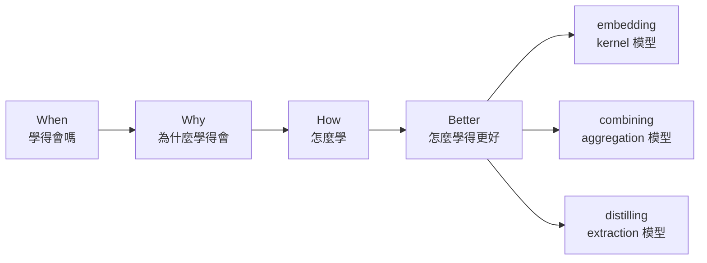

> 🌏 [English version](/posts/ai/2026-09-30-ntu-htlin-ml-course-overview-en)

**影片狀態：已附影片。** 導言附基石第 1 堂的 Course Introduction（11 分鐘），各堂錄影在各堂導讀。[影片來源與說明](#課程影片來源)

台大資工系林軒田老師的[機器學習基石](https://www.csie.ntu.edu.tw/~htlin/mooc/)與機器學習技法，是兩門 2015–2016 年開在 Coursera 上的中文 MOOC，各 16 堂。教科書是他和 Yaser Abu-Mostafa、Malik Magdon-Ismail 合著的 [Learning from Data](http://amlbook.com)（下稱 LFD）。十年後他在台大開的 [Machine Learning](https://www.csie.ntu.edu.tw/~htlin/course/ml26fall/) 仍是翻轉教室，每週的課前必看就是這兩門 MOOC 的影片。

這兩門課的特色是先問「為什麼」。基石大半時間不在教演算法，而在證明：只看過有限的資料，憑什麼相信模型對沒看過的資料也準？把這件事講清楚之後，技法才拿這套理論去解釋 SVM、boosting、決策樹、神經網路為什麼有效、什麼時候會失效。

這篇是系列入口：先講整門課的主線與每一段在學什麼，再用一個手算例子示範基石的核心論證，最後給先備檢查與閱讀路線。下面這支是林軒田自己介紹兩門課的設計，11 分鐘，和本文「主線」一節講的是同一件事，可以先看影片再讀，或讀完再看。

```youtube
url: https://www.youtube.com/watch?v=nQvpFSMPhr0
title: The Learning Problem :: Course Introduction @ Machine Learning Foundations (機器學習基石)
```

## 主線：基石四問與技法三段

[01_handout.pdf](https://www.csie.ntu.edu.tw/~htlin/mooc/doc/01_handout.pdf) 把基石定位成「story-like」的課，用四個問題串起 16 堂；技法再依「怎麼處理特徵」分成三段，最後一堂收尾。授課是中文、投影片是英文，下面保留投影片的問題原文。



### 基石 1：When Can Machines Learn?（第 1–4 堂）

先把「學習」定義清楚：有一個未知的目標函數 $f$，演算法 $\mathcal{A}$ 從資料 $\mathcal{D}$ 和假說集合 $\mathcal{H}$ 裡挑出 $g$，希望 $g \approx f$。第一個演算法是感知器學習法（PLA）：找到一個分錯的點 $(\mathbf{x}_n, y_n)$，就把權重更新成 $\mathbf{w} + y_n\mathbf{x}_n$，正例往那個點轉、負例往反方向轉；資料線性可分時保證停下來。第 3 堂接著依輸出（分類、迴歸、結構化）、標籤（監督、非監督、半監督、強化）、資料取得方式（批次、線上、主動）與輸入特徵分類各種學習問題，說明這門課聚焦在批次的監督式二元分類與迴歸。接著問更根本的事：資料以外的地方，$g$ 有可能和 $f$ 一樣嗎？用「從罐子抽彈珠」的比喻帶出 Hoeffding 不等式：只要假說是事先固定的一個，樣本上的錯誤率 $E_{\text{in}}$ 和整體錯誤率 $E_{\text{out}}$ 差很多的機率會隨資料量指數下降。假說有 $M$ 個時，機率最多放大 $M$ 倍。

從[第 1 堂](/posts/ai/2026-09-30-ntu-htlin-ml-learning-problem-perceptron)開始讀。

### 基石 2：Why Can Machines Learn?（第 5–8 堂）

PLA 從無限多條線裡挑，$M$ 是無限大，上一段的保證就失效了。這一段的解法是：無限多條線在 $N$ 個點上能切出的 ○× 組合（dichotomy）是有限的。把最多能切出幾種記成成長函數 $m_{\mathcal{H}}(N)$；只要在某個點數（break point）切不出全部 $2^N$ 種，$m_{\mathcal{H}}(N)$ 就被一個多項式壓住，用它取代 $M$ 得到 VC bound。最大的「還切得出全部組合」的點數叫 VC 維度 $d_{\text{VC}}$，$d$ 維感知器的 $d_{\text{VC}} = d + 1$。第 8 堂把目標改成機率分布 $P(y|\mathbf{x})$ 來容納雜訊，VC bound 照樣成立；也說明錯誤衡量要依應用來定，例如誤拒與誤收代價不同時，用加權的錯誤衡量。

從[第 5 堂](/posts/ai/2026-09-30-ntu-htlin-ml-training-vs-testing-growth-function)開始讀。

### 基石 3：How Can Machines Learn?（第 9–12 堂）

有了「$E_{\text{in}}$ 小、$d_{\text{VC}}$ 不大就能學」的保證，接著講怎麼把 $E_{\text{in}}$ 壓低。線性迴歸用 pseudo-inverse 一步算出平方誤差的最佳解；邏輯迴歸輸出機率，沒有公式解，改用梯度下降。第 11 堂比較三種線性模型的誤差函數，說明為什麼迴歸的解可以拿來當分類的起點，並帶出隨機梯度下降（SGD）與多類別分類。第 12 堂用非線性轉換把資料映到新空間再用線性模型，代價是 $d_{\text{VC}}$ 跟著變大。

從[第 9 堂](/posts/ai/2026-09-30-ntu-htlin-ml-linear-logistic-regression)開始讀。

### 基石 4：How Can Machines Learn Better?（第 13–16 堂）

模型太複雜、資料又有雜訊時，$E_{\text{in}}$ 很低但 $E_{\text{out}}$ 很高，就是過擬合。對策有兩個：正則化（weight decay）在誤差函數裡加一項懲罰權重大小，用 $\lambda$ 控制強度；驗證則是留一部分資料不訓練，拿來挑 $\lambda$ 或模型。最後一堂講三個原則：Occam's Razor（能用簡單的模型就不要用複雜的）、抽樣偏差（訓練與測試資料要來自同一個分布）、資料窺探（看過資料再決定模型，等於偷用了資料）。

從[第 13 堂](/posts/ai/2026-09-30-ntu-htlin-ml-overfitting-regularization)開始讀。

### 技法 1：embedding numerous features（第 1–6 堂）

線性 SVM 在所有能分開資料的線裡，挑離最近的點最遠（最「胖」）的那條，寫成二次規劃。對偶形式把問題改寫成只依賴資料點之間的內積，於是可以用 kernel 函數 $K(\mathbf{x}, \mathbf{x}')$ 直接算出高維空間裡的內積，不必真的把特徵算出來。軟邊界 SVM 允許犯錯，用 $C$ 權衡邊界寬度與錯誤。第 5、6 堂把 SVM 看成一種正則化模型，把 kernel 帶到邏輯迴歸與迴歸（SVR）。

從[技法第 1 堂](/posts/ai/2026-09-30-ntu-htlin-ml-linear-dual-svm)開始讀。

### 技法 2：combining predictive features（第 7–11 堂）

把多個假說合起來。Blending 對已經訓練好的模型投票或加權；bagging 用 bootstrap 抽樣訓練出不同的模型再投票。AdaBoost 每一輪把上一個分類器答錯的資料權重放大、答對的縮小，讓它在新權重下剛好只有一半正確，逼下一個分類器學不一樣的東西。決策樹（C&RT）每次選一個讓兩邊資料最「純」（分類時常用 Gini 不純度衡量）的切法，遞迴切到底，再依葉子數做正則化剪枝；隨機森林是 bagging 加上隨機選特徵的決策樹，還能用沒被抽到的資料（out-of-bag）估計誤差。GBDT 把 boosting 看成對誤差函數做梯度下降，每一棵樹去擬合目前的殘差。

從[技法第 7 堂](/posts/ai/2026-09-30-ntu-htlin-ml-blending-bagging-adaboost)開始讀。

### 技法 3：distilling hidden features（第 12–15 堂）

讓模型自己從資料學出特徵。神經網路的每一層都是一次特徵轉換，用反向傳播算梯度；深度學習用預訓練與 autoencoder 找出好的初始權重，資料先減去平均後，線性 autoencoder 學到的就是 PCA。RBF 網路以資料到幾個中心點的相似度當特徵，中心點用 k-means 找。矩陣分解把評分矩陣近似成使用者矩陣乘上電影矩陣，只對有評分的格子算誤差，用交替最小平方或 SGD 同時學出兩邊的特徵向量。

從[技法第 12 堂](/posts/ai/2026-09-30-ntu-htlin-ml-neural-network-deep-learning)開始讀。[技法第 16 堂](/posts/ai/2026-09-30-ntu-htlin-ml-finale-modern-deep-learning)把整門課收成三類處理特徵的技巧。

## 手算一次：為什麼需要 VC 維度

這是本文的教學例子，用來體會基石前兩段在解決什麼問題。

**一個固定的假說。** Hoeffding 不等式說：

$$
P\big[\,|E_{\text{in}}(h) - E_{\text{out}}(h)| > \epsilon\,\big] \le 2\exp(-2\epsilon^2 N)
$$

取 $\epsilon = 0.1$、$N = 100$：右邊是 $2e^{-2} \approx 0.271$。也就是說，100 筆資料上量到的錯誤率，和真正的錯誤率差超過 0.1 的機率最多 27%。想把這個機率壓到 5% 以下，要 $2e^{-0.02N} \le 0.05$，解出 $N \ge \ln 40 / 0.02 \approx 184.4$，至少 185 筆。

**從 10 個假說裡挑。** 演算法挑出的是表現最好的那個，所以要所有假說同時都不能差太多，機率最多變成 10 倍。$N = 100$ 時上界是 2.71，比 1 還大，什麼都沒保證。要壓回 5%，要 $20e^{-0.02N} \le 0.05$，得 $N \ge \ln 400 / 0.02 \approx 299.6$，至少 300 筆。假說多了 10 倍，資料只要多一些，因為 $M$ 是在對數裡。

**從無限多條線裡挑。** PLA 的 $M$ 是無限大，上界直接失效。這就是基石第 5 堂的起點：在平面上把 4 個點擺成正方形，線性分類器只切得出 $2^4 = 16$ 種 ○× 組合裡的 14 種，「對角兩點是 ○、另外兩點是 ×」和它的反相切不出來。換成任何其他擺法，4 個點也切不出全部 16 種（第 5 堂的結論是最多 14 種）；而 3 個不共線的點，8 種組合都切得出來。所以 4 是二維感知器的 break point，$d_{\text{VC}} = 3$。成長函數因此是多項式而不是 $2^N$；VC bound 用它取代 $M$（常數和 Hoeffding 版略有不同），資料量夠大時上界仍會趨近 0。

**這個例子的意思：** 能不能學，不看模型有幾個參數或幾條線，而看它在有限資料上能切出多少種結果。這個量就是後面每一段都在權衡的「模型複雜度」：技法講 SVM 的大邊界、正則化、boosting，都可以理解成在控制它。

## 先備與自我檢查

需要大一的微積分、線性代數與機率。機率不熟的話先讀站內的 [Stanford CS109 導讀](/posts/learning/2026-08-21-stanford-cs109-probability)，或看[統計與 ML 系列](/series/statistics-ml-ai)。最直接的檢測是 [Fall 2024 HW0](https://www.csie.ntu.edu.tw/~htlin/course/ml24fall/doc/hw0.pdf)：限時一小時做組合與機率的部分，卡住兩題以上就先補機率。

讀完這篇，試著回答：

1. Hoeffding 不等式為什麼不能直接保證 PLA 學得會？
   答：它只保證一個事先固定的假說。PLA 從無限多條線裡挑，聯集上界乘上無限大就失效，要改用成長函數。
2. 在 3 維空間裡用感知器，$d_{\text{VC}}$ 是多少？為什麼這個數字重要？
   答：$d + 1 = 4$。它是模型複雜度，VC bound 裡 $E_{\text{in}}$ 和 $E_{\text{out}}$ 的差距隨它變大。
3. 用 10 次多項式擬合 15 筆有雜訊的資料，訓練誤差比 2 次多項式低，測試誤差卻高很多。該去讀哪一段？
   答：基石 4。這是過擬合，對策是正則化與驗證。
4. AdaBoost 一輪結束後，怎麼調整資料權重？目的是什麼？
   答：答錯的乘上 $\sqrt{(1-\epsilon_t)/\epsilon_t}$、答對的除以它，讓這一輪的分類器在新權重下剛好一半正確，下一輪才學得到不一樣的東西。
5. kernel SVM 為什麼不必算出高維特徵？
   答：對偶形式只用到特徵之間的內積，kernel 函數直接在原空間算出這個內積。

## 三條自學路線

本系列以 MOOC 錄影為核心教材，以 [Fall 2024 課程頁](https://www.csie.ntu.edu.tw/~htlin/course/ml24fall/)公開的作業為練習。

**路線 A：只看影片。** 照 [基石](https://www.youtube.com/playlist?list=PLXVfgk9fNX2I7tB6oIINGBmW50rrmFTqf)與[技法](https://www.youtube.com/playlist?list=PLXVfgk9fNX2IQOYPmqjqWsNUFl2kpk1U2)兩份 YouTube 播放清單看，配 [handout 投影片](https://www.csie.ntu.edu.tw/~htlin/mooc/)。每支影片結尾有一題「Fun Time」選擇題，可以當最低限度的自我檢查。YouTube 版內容和 Coursera 版相同；Coursera 自 2025 年 8 月起，免費帳號只能看第一個單元。

**路線 B：影片加 Fall 2024 作業（本系列主線）。** 每讀完一段，做對應的作業：HW0–HW7 共 8 份，每份 12 題加 1 題 bonus，程式題的資料多半來自 [LIBSVM datasets](https://www.csie.ntu.edu.tw/~cjlin/libsvmtools/datasets/)。作業沒有公開解答，程式題要自己設驗收方法，例如用 scikit-learn 的同名模型對照數值。期末專題（預測虛構棒球聯盟 HTMLB 的比賽輸贏）的 Kaggle 競賽頁已經不公開，只能自己切資料驗收。作業怎麼對到各堂，見[基石作業](/posts/ai/2026-09-30-ntu-htlin-ml-foundations-homework-guide)與[技法作業](/posts/ai/2026-09-30-ntu-htlin-ml-techniques-homework-final-project)兩篇。

**路線 C：跟著當期課程。** [Fall 2026 課程頁](https://www.csie.ntu.edu.tw/~htlin/course/ml26fall/)每週列出課前必看的影片與 LFD 章節，課堂有公開的[同步直播](https://www.csie.ntu.edu.tw/~htlin/course/ml26fall/screencast.php)。作業批改只開放給修課生，旁聽可以照時程自己練。當期課表沒有排技法第 5–6 堂（kernel 邏輯迴歸、SVR）與第 14–15 堂（RBF 網路、矩陣分解），基石第 6 堂只列為選看，只跟課表走會漏掉這幾堂，要自己補。

## 本系列篇目

| order | 篇目 | 堂次 |
|---|---|---|
| 1 | [機器學習是什麼：什麼時候該讓機器自己學](/posts/ai/2026-09-30-ntu-htlin-ml-learning-problem-perceptron) | 基石第 1 堂 |
| 2 | [感知器與 PLA：一條線怎麼從錯誤裡修正出來](/posts/ai/2026-10-13-ntu-htlin-ml-foundations-02-perceptron-learning-algorithm) | 基石第 2 堂 |
| 3 | [學習的種類：依輸出、標籤、資料取得方式與輸入來分](/posts/ai/2026-10-13-ntu-htlin-ml-foundations-03-types-of-learning) | 基石第 3 堂 |
| 4 | [學習可行嗎：Hoeffding 不等式與資料以外的保證](/posts/ai/2026-09-30-ntu-htlin-ml-feasibility-of-learning) | 基石第 4 堂 |
| 5 | [訓練與測試：無限多條線其實只有幾種](/posts/ai/2026-09-30-ntu-htlin-ml-training-vs-testing-growth-function) | 基石第 5 堂 |
| 6 | [泛化理論：一個 break point 怎麼把成長函數壓成多項式](/posts/ai/2026-10-13-ntu-htlin-ml-foundations-06-theory-of-generalization) | 基石第 6 堂 |
| 7 | [VC 維度：模型複雜度怎麼量](/posts/ai/2026-09-30-ntu-htlin-ml-vc-dimension-noise-error) | 基石第 7 堂 |
| 8 | [雜訊與誤差衡量：目標有雜訊、錯誤有輕重時怎麼學](/posts/ai/2026-10-13-ntu-htlin-ml-foundations-08-noise-and-error) | 基石第 8 堂 |
| 9 | [線性迴歸：用 pseudo-inverse 一步算出最佳解](/posts/ai/2026-09-30-ntu-htlin-ml-linear-logistic-regression) | 基石第 9 堂 |
| 10 | [邏輯迴歸：用梯度下降學出機率](/posts/ai/2026-10-13-ntu-htlin-ml-foundations-10-logistic-regression) | 基石第 10 堂 |
| 11 | [線性分類模型：三種誤差、SGD 與多類別](/posts/ai/2026-09-30-ntu-htlin-ml-linear-classification-nonlinear-transform) | 基石第 11 堂 |
| 12 | [非線性轉換：用特徵轉換畫出曲線邊界的代價](/posts/ai/2026-10-13-ntu-htlin-ml-foundations-12-nonlinear-transformation) | 基石第 12 堂 |
| 13 | [過擬合：雜訊、資料量與模型複雜度怎麼聯手](/posts/ai/2026-09-30-ntu-htlin-ml-overfitting-regularization) | 基石第 13 堂 |
| 14 | [正則化：weight decay 怎麼限制模型](/posts/ai/2026-10-13-ntu-htlin-ml-foundations-14-regularization) | 基石第 14 堂 |
| 15 | [驗證：留一份資料來選模型](/posts/ai/2026-09-30-ntu-htlin-ml-validation-three-principles) | 基石第 15 堂 |
| 16 | [三個學習原則：Occam's Razor、抽樣偏差與資料窺探](/posts/ai/2026-10-13-ntu-htlin-ml-foundations-16-three-learning-principles) | 基石第 16 堂 |
| 17 | [基石作業：Fall 2024 HW0–HW5](/posts/ai/2026-09-30-ntu-htlin-ml-foundations-homework-guide) | 作業 0–5，對應基石第 1–16 堂 |
| 18 | [線性 SVM：最胖的分隔線怎麼寫成二次規劃](/posts/ai/2026-09-30-ntu-htlin-ml-linear-dual-svm) | 技法第 1 堂 |
| 19 | [對偶 SVM：用拉格朗日對偶擺脫特徵維度](/posts/ai/2026-10-13-ntu-htlin-ml-techniques-02-dual-svm) | 技法第 2 堂 |
| 20 | [Kernel SVM：不算高維特徵也能算內積](/posts/ai/2026-09-30-ntu-htlin-ml-kernel-soft-margin-svm) | 技法第 3 堂 |
| 21 | [軟邊界 SVM：允許犯錯之後怎麼選 C](/posts/ai/2026-10-13-ntu-htlin-ml-techniques-04-soft-margin-svm) | 技法第 4 堂 |
| 22 | [Kernel 邏輯迴歸：SVM 其實是正則化模型](/posts/ai/2026-09-30-ntu-htlin-ml-kernel-logistic-support-vector-regression) | 技法第 5 堂 |
| 23 | [支援向量迴歸：把 kernel 與稀疏解帶到迴歸](/posts/ai/2026-10-13-ntu-htlin-ml-techniques-06-support-vector-regression) | 技法第 6 堂 |
| 24 | [Blending 與 Bagging：把多個假說合起來為什麼更好](/posts/ai/2026-09-30-ntu-htlin-ml-blending-bagging-adaboost) | 技法第 7 堂 |
| 25 | [AdaBoost：調整資料權重，把弱分類器疊成強的](/posts/ai/2026-10-13-ntu-htlin-ml-techniques-08-adaptive-boosting) | 技法第 8 堂 |
| 26 | [決策樹：C&RT 怎麼切、怎麼剪](/posts/ai/2026-09-30-ntu-htlin-ml-decision-tree-random-forest-gbdt) | 技法第 9 堂 |
| 27 | [隨機森林：Bagging 加決策樹與 out-of-bag 估計](/posts/ai/2026-10-13-ntu-htlin-ml-techniques-10-random-forest) | 技法第 10 堂 |
| 28 | [梯度提升決策樹：把 AdaBoost 看成對誤差函數做梯度下降](/posts/ai/2026-10-13-ntu-htlin-ml-techniques-11-gradient-boosted-decision-tree) | 技法第 11 堂 |
| 29 | [神經網路：反向傳播怎麼算梯度](/posts/ai/2026-09-30-ntu-htlin-ml-neural-network-deep-learning) | 技法第 12 堂 |
| 30 | [深度學習：預訓練、autoencoder 與 PCA](/posts/ai/2026-10-13-ntu-htlin-ml-techniques-13-deep-learning) | 技法第 13 堂 |
| 31 | [RBF 網路：用到中心點的相似度做預測，再用 k-means 找中心](/posts/ai/2026-09-30-ntu-htlin-ml-rbf-network-matrix-factorization) | 技法第 14 堂 |
| 32 | [矩陣分解：從評分矩陣學出使用者與電影的特徵](/posts/ai/2026-10-13-ntu-htlin-ml-techniques-15-matrix-factorization) | 技法第 15 堂 |
| 33 | [Finale：整門課收成三類技巧](/posts/ai/2026-09-30-ntu-htlin-ml-finale-modern-deep-learning) | 技法第 16 堂＋Fall 2024 補充投影片 |
| 34 | [技法作業與期末專題：HW6–HW7 與 HTMLB](/posts/ai/2026-09-30-ntu-htlin-ml-techniques-homework-final-project) | 作業 6–7，對應技法第 1–12 堂 |

## 今晚可以做的事

1. 打開 [Fall 2024 HW0](https://www.csie.ntu.edu.tw/~htlin/course/ml24fall/doc/hw0.pdf)，限時一小時做完組合與機率那一段。
2. 下載[基石 handout zip](https://www.csie.ntu.edu.tw/~htlin/mooc/doc/mlfound_handout.zip)，看 [Course Introduction](https://www.youtube.com/watch?v=nQvpFSMPhr0)。
3. 把上面「手算一次」的三步自己再算一遍，然後讀[基石第 1 堂](/posts/ai/2026-09-30-ntu-htlin-ml-learning-problem-perceptron)。

下一篇：[基石第 1 堂：機器學習是什麼](/posts/ai/2026-09-30-ntu-htlin-ml-learning-problem-perceptron)

## 延伸閱讀

- [台大 AI／ML 課程導讀](/posts/learning/2026-09-30-ntu-ai-ml-course-map)：把林軒田的課放進台大課程版圖比較。
- [台大李宏毅 機器學習 2026 Spring 導讀](/posts/ai/2026-09-30-ntu-ml2026-course-overview)：台大的平行路線，從 AI Agent 切入，偏深度學習與生成式 AI。
- [Stanford CS229 導讀](/posts/ai/2026-08-21-stanford-cs229-machine-learning)：SVM、kernel 與學習理論的另一種講法。
- [Caltech Learning from Data](https://work.caltech.edu/telecourse)：Abu-Mostafa 用同一本教科書開的英文課，可以和基石對照著看。
- [CMU 10-301 導讀](/posts/learning/2026-08-22-cmu-10301-overview)、[Berkeley CS189 導讀](/posts/learning/2026-08-22-berkeley-cs189-spring-2025-overview)：其他學校的 ML 入門課。

## 課程影片來源

本文是課程總覽，導言嵌入基石第 1 堂的 Course Introduction；其餘各堂請從官方課程入口與播放清單查找。

課程與錄影入口：

- [官方課程與錄影入口](https://www.csie.ntu.edu.tw/~htlin/mooc/)
- [基石 官方免費 YouTube 播放清單](https://www.youtube.com/playlist?list=PLXVfgk9fNX2I7tB6oIINGBmW50rrmFTqf)
- [技法 官方免費 YouTube 播放清單](https://www.youtube.com/playlist?list=PLXVfgk9fNX2IQOYPmqjqWsNUFl2kpk1U2)

- [基石第 1 堂 Course Introduction](https://www.youtube.com/watch?v=nQvpFSMPhr0)（導言嵌入，11 分鐘）

兩份播放清單各 65 支（每堂 4 支，第 1 堂多一支 Course Introduction）；各堂錄影見各堂導讀。查核日期：2026-10-14。

## 更新紀錄

- 2026-10-14：正文改寫成導讀：補上七段主線各自的機制、Hoeffding 到 VC 維度的手算例子與自我檢查，導言嵌入 Course Introduction；存取分級、版本基準、Coursera 政策與 Fall 2026 週次表縮成自學路線裡的幾句話。
- 2026-10-13：系列改為一堂一篇（基石 16 堂、技法 16 堂），這篇的對照表、篇目與連結跟著更新。
- 2026-10-10：標註影片狀態，核對錄影來源與取得方式。

## 參考資料

- [Hsuan-Tien Lin > MOOCs](https://www.csie.ntu.edu.tw/~htlin/mooc/) — 兩門 MOOC 的 32 堂大綱、投影片、授權說明
- [機器學習基石 handout 全集（zip）](https://www.csie.ntu.edu.tw/~htlin/mooc/doc/mlfound_handout.zip)
- [機器學習技法 handout 全集（zip）](https://www.csie.ntu.edu.tw/~htlin/mooc/doc/mltech_handout.zip)
- [MOOC 勘誤](https://www.csie.ntu.edu.tw/~htlin/mooc/errata.php)
- [機器學習基石 YouTube 播放清單](https://www.youtube.com/playlist?list=PLXVfgk9fNX2I7tB6oIINGBmW50rrmFTqf)（65 支）
- [機器學習技法 YouTube 播放清單](https://www.youtube.com/playlist?list=PLXVfgk9fNX2IQOYPmqjqWsNUFl2kpk1U2)（65 支）
- [Lecture 1 投影片 01_handout.pdf](https://www.csie.ntu.edu.tw/~htlin/mooc/doc/01_handout.pdf) — Course Introduction 與課程設計
- [Coursera：機器學習基石上（Mathematical Foundations）](https://www.coursera.org/learn/ntumlone-mathematicalfoundations)
- [Coursera：機器學習基石下（Algorithmic Foundations）](https://www.coursera.org/learn/ntumlone-algorithmicfoundations)
- [Coursera：機器學習技法](https://www.coursera.org/learn/machine-learning-techniques)
- [臺大開放式課程：Coursera 平台課程資訊提醒](https://ocw.aca.ntu.edu.tw/courses/mooc0016) — 2025 年 8 月起的預覽制
- [Machine Learning, Fall 2026 課程頁](https://www.csie.ntu.edu.tw/~htlin/course/ml26fall/) — 課前必看清單、課程計畫
- [Machine Learning, Fall 2024 課程頁](https://www.csie.ntu.edu.tw/~htlin/course/ml24fall/) — 作業與投影片
- [Fall 2024 Homework 0](https://www.csie.ntu.edu.tw/~htlin/course/ml24fall/doc/hw0.pdf)
- [Fall 2024 Final Project（final.pdf）](https://www.csie.ntu.edu.tw/~htlin/course/ml24fall/final/final.pdf)
- [LIBSVM Data](https://www.csie.ntu.edu.tw/~cjlin/libsvmtools/datasets/) — Fall 2024 程式題資料集來源
- [Learning from Data 教科書網站](http://amlbook.com)
- [Caltech Learning from Data telecourse](https://work.caltech.edu/telecourse)
- 站內：[台大 AI／ML 課程導讀](/posts/learning/2026-09-30-ntu-ai-ml-course-map)
