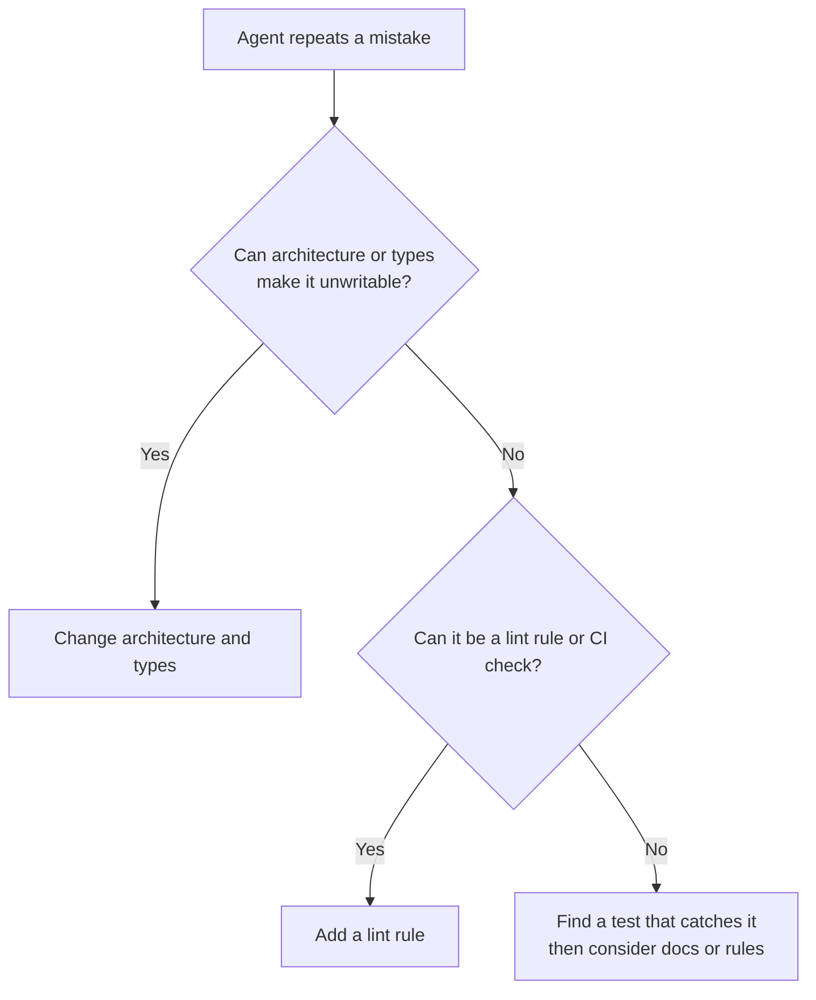

> 🌏 [中文版](/posts/ai/2026-10-07-poteto-trust-ladder-verification-first)

[Start the English video exercise (3 clips, 2 min 8 sec; partial bilingual captions)](#video-practice-0)

If you already use a coding agent but still have to watch every conversation, this post asks one thing: which parts of Lauren Tan's approach can you try tomorrow, and which depend on conditions only she has?

## What this is

Lauren Tan ([poteto](https://x.com/poteto) online) was on Meta's React team and now works on Cursor's agents window and Grok Bot, both under SpaceXAI. On October 2, 2026, Matt Pocock hosted a [65-minute livestream conversation](https://www.youtube.com/watch?v=MN9dGgmLyso) with her about producing a lot of work with agents without losing quality. Her skills are public under the MIT license as [pstack](https://github.com/cursor/plugins/tree/main/pstack), entered through `/poteto-mode`.

[Original interview on YouTube](https://www.youtube.com/watch?v=MN9dGgmLyso). Use the practice player below to listen here.

## The number first: 2,500 is self-reported

The PR count differs by source:

- The stream title says "1,000's of PRs".
- Her September 21 [X post](https://x.com/poteto/status/2102050467505430555) says 2,500.
- Cursor's [Compile London schedule](https://cursor.com/compile/london) lists the September 16 event’s talk as "I Shipped 2,000 PRs Last Month".
- An [analysis of the Compile talk's auto-captions](https://redreamality.com/blog/lauren-tan-poteto-trust-before-parallel/) says the spoken figure is about 2,000.

All are her own numbers for a month she chose, with no outside audit and no data on how many merged PRs were later reverted. At about 45:54 in the conversation, she says a good share are small "gardening" fixes. So the figure tells you how finely she slices work, not how much value shipped.

## Who it is for, and prerequisites

It fits people who use coding agents daily and find themselves the bottleneck. You do not need Cursor or pstack; the transferable part is the thinking. The prerequisite is that something in your project can judge right from wrong by code: a runnable app, tests, types, lint.

## Content map

**1. The trust ladder.** Connecting her kitchen metaphors across different parts of the conversation gives this reading: one person watching one agent is a home cook; adding agents without a system is a family crowding into the kitchen, which only makes things worse; then comes the head chef who designs how the kitchen runs; finally the owner who moves between branches. She dislikes the associations of "software factory" that downplay quality and craft, and separately reminds us that the engineer’s reputation remains attached to the work.

**2. A verification skill is the first rung.** At Cursor she started as the "meat proxy" between the agent and Chrome DevTools: reading flame graphs and heap snapshots herself, then relaying them. Her first skill after joining Cursor let the agent launch the app, use it, and capture traces. Her definition of a loop follows: it is a loop only if the agent can check its own work.

**3. Deterministic work as code, judgment for the agent.** The verification skill contains a CLI wrapping Playwright and the Chrome DevTools Protocol. She says herself it is not impressive; the point is that every agent shares one toolset instead of rewriting a verification script each time, and behaves consistently. Migrations follow the same rule: prefer codemods over an agent reasoning about each file.

**4. Environment over nagging.** Each time an agent errs, she first asks how to make the mistake impossible to write; the answer is usually a lint rule, a type, or a directory convention. She describes Dune as a non-open-source internal framework: each feature has its own directory, a registry and codebase scanning discover features, and restrictive lint rules narrow the available patterns. The transferable part is the design idea.

**5. Outer and inner loops.** The inner loop is the agent writing code from your intent; the outer loop is the new information constantly arriving in Slack, Linear and X. Her personal agent subscribes to those sources and hands work to a cloud coordinator that splits tasks among sub-agents. Giving related bugs to one coordinator makes it easier to spot the shared root cause.

**6. Sample after merge.** The flow: an agent makes a PR, several verifiers exercise the running app, issues get fixed, and it merges automatically; she reads the commit history the next morning. When several agents take the same shortcut, she fixes the skill, lint, or types, not the one agent.

## One concrete example: which layer should a correction live in?

The official pstack guide’s [`/correct` section](https://github.com/cursor/plugins/blob/main/pstack/docs/guide/09-make-it-yours.md#fix-the-environment-with-correct) gives four places to fix recurring mistakes, preferring the strongest enforceable option:

1. Architecture or data structures that make the mistake impossible.
2. Types, lint or CI checks that block it and explain the fix.
3. Tests that catch it.
4. Documentation or agent rules when the earlier options do not work; skipping text alone does not fail a check.

This is the current public tool’s correction strategy, rather than a ranking recited in this interview. `/correct` also requires proving a new check fails on a real historical mistake, so adding a plausible rule is not enough.



For recurring errors, look for a fix in code or checks before falling back to written reminders. The official guide's starter example is similarly plain, a goal plus a way to check it:

```text
/poteto-mode the export writes duplicate rows when a retry lands mid-run. repro first, then fix and verify.
```

Source: the [pstack guide](https://github.com/cursor/plugins/blob/main/pstack/docs/guide/README.md).

## Limits

- **Scope**: Matt asks about irreversible changes and domains such as medicine, law and finance. She says programmatically hard-to-verify domains make it harder to reach this level of autonomy, and acknowledges she has no complete answer. Her metaphor of verification turning one-way doors into two-way doors does not mean verification can undo data loss. This article recommends retaining human merge judgment when verification is insufficient or consequences cannot be reversed.
- **Cost**: Full autopilot spawns several verifiers per PR, and she admits it burns tokens.
- **Heavy prerequisites**: Her codebases were deliberately narrowed to one way of doing things; an early Grok Bot had eight files of 10,000+ lines each and was split under pressure. Applying this to an existing project still requires building corresponding tools and constraints.
- **Verification must cover the goal**: Passing existing functional checks does not cover every quality or performance target. She also uses verification tools for performance improvement; those goals need appropriate traces, profiling or benchmarks.
- **Sourcing**: The main claims have been checked against automatic English captions; the practice excerpt has not been checked by listening to the audio. Dune is the internal framework she describes, and the PR numbers and workflow are her own account. For her exact words, go back to the [original stream](https://www.youtube.com/watch?v=MN9dGgmLyso).

## How to use it: three things for tonight

1. Pick the app you change most and write a command that lets the agent launch it, run one main flow, and leave evidence (a screenshot or trace); have it run after every change.
2. The second time an agent makes the same mistake, stop and ask whether it can become a lint rule, a type, or a directory constraint. Editing the prompt is the last resort.
3. Go through your past chat logs, pick the three things you keep correcting, and write each into a skill or rule. She also advises building your own set rather than copying hers wholesale; Matt's [skills repo](https://github.com/mattpocock/skills) is a reasonable template.

For why harnesses matter, pair this with the site's [Phil Schmid guide](/posts/ai/2026-03-28-phil-schmid-agent-harness-en) and the [meta-harness layering post](/posts/ai/2026-08-26-meta-harness-layers-en).

## Listening and speaking practice

[Browse more English video exercises](/en/tags/english-video-practice). Use the three clip buttons above to switch within the same player. Play the whole clip, then click a quoted line to repeat it; choose 0.75× if needed. The selected lines have Chinese translations; the player’s CC provides the remaining source captions.

Each clip includes a listening goal, a language note and a speaking task. The examples are written for this site and are not the speaker’s words. Clip boundaries follow automatic-caption cues and have not been checked by listening; the first and last words can continue outside the selected range.


```video-practice
{
  "title": "Three listening tasks: verify, reuse, sample",
  "videoId": "MN9dGgmLyso",
  "start": 1002,
  "end": 1045,
  "question": "What problem does each clip address, and which change could you try in your project?",
  "answer": "Listen for three actions: checking a running app, sharing a verification tool, and sampling work at scale. Apply one action to a task you already do.",
  "phrases": [
    {
      "term": "verification",
      "meaning": "Checking a result against a defined expectation.",
      "example": "Verification should include opening the exported file, not only checking that it exists."
    },
    {
      "term": "evidence",
      "meaning": "A concrete observation that supports a conclusion.",
      "example": "The agent attached a screenshot as evidence that the form showed the error."
    }
  ],
  "prompt": "Pick one clip and explain how you would apply its idea to your own app. Name an action, the evidence it leaves, and one decision you still make.",
  "modelAnswer": "The agent should open the form, submit an empty field and capture the error message. I will review whether the message helps the user fix the problem.",
  "lang": "en",
  "captionNote": "Selected passage with sentence-grouped captions. Full transcript below; machine translation has not been reviewed sentence by sentence.",
  "clips": [
    {
      "title": "Give agents hands and eyes",
      "start": 1002.16,
      "end": 1044.949,
      "captionCoverage": "partial",
      "sentences": [
        {
          "start": 1002.16,
          "end": 1007.04,
          "en": "I where the agent is able to run the code, right?",
          "zh": "代理程式能夠執行程式碼，對吧？"
        },
        {
          "start": 1007.04,
          "end": 1017.6,
          "en": "And actually >> [snorts] >> uh interact with it like a normal human user would and also do things like you know debug it, you know, take traces and snapshots.",
          "zh": "而且實際上[嗤之以鼻]，它能像一般使用者一樣與其互動，還能進行除錯、追蹤和擷取快照等動作。"
        },
        {
          "start": 1017.6,
          "end": 1022.959,
          "en": "Um and uh funnily enough like that was actually the first skill I built when I joined Cursor.",
          "zh": "有趣的是，這其實是我加入Cursor時所建立的第一個技能。"
        },
        {
          "start": 1022.959,
          "end": 1044.949,
          "en": "uh that gave me a lot of that was that was the thing that actually started to let me ascend the trust ladder a little bit in a way that some of the other skills I had looked at or built had not really let me do because no matter how good you know some of the other skills were like the how skill, the why skill, the unsop skill were, I was still relying on me",
          "zh": "這讓我開始逐步提升對代理程式的信任，而其他我曾研究或建立的技能卻沒有讓我做到這一點，因為不管其他技能多麼優秀，例如如何做、為什麼做、unsop技能，我仍然需要依靠自己"
        }
      ],
      "teaching": {
        "goal": "Listen for actions the agent can perform. Name two without rereading.",
        "note": "Be able to + verb describes capability. Interact with means to operate or engage with something; it does not just mean seeing a screenshot.",
        "prompt": "Complete: The agent is able to __ and __. Use two actions from your own app.",
        "example": "The agent is able to open the checkout page and submit the form."
      }
    },
    {
      "title": "Share verification tools",
      "start": 1365.6,
      "end": 1419.76,
      "sentences": [
        {
          "start": 1365.6,
          "end": 1367.27,
          "en": ">> Yeah, >> that's fascinating.",
          "zh": ">> 是的，這很令人著迷。"
        },
        {
          "start": 1367.28,
          "end": 1391.43,
          "en": "And it it [clears throat] also helps I guess if you care about context window it it does help because now the agent doesn't need to uh you know re reinvent uh things cuz uh one thing I had noticed early on when we didn't have a CLI was that uh well the the agent would try to verify it work but it would basically rebuild the world each time and then every agent did it differently and I was",
          "zh": "而且，如果你在意上下文窗口的話，這確實有幫助，因為現在代理程式不需要重新創造東西，因為我早期注意到，當我們還沒有CLI時，代理程式會嘗試驗證它是否運作，但每次都會重新建構整個世界，而每個代理程式做法都不同，我當時"
        },
        {
          "start": 1391.44,
          "end": 1398.24,
          "en": "starting to notice like that's very inefficient right I was wasting it it was actually not just about context usage but also speed, right?",
          "zh": "開始注意到這樣非常低效，我當時浪費了它，實際上不僅是上下文使用問題，還有速度問題，對吧？"
        },
        {
          "start": 1398.24,
          "end": 1407.52,
          "en": "Like because now an agent had to actually go off and write the scripts or the CLI and test it and you know and it doesn't work and the last agent did it and it worked but it discarded it.",
          "zh": "因為現在代理程式必須真的去寫腳本或 CLI 並測試它，但卻不 works，而上一個代理程式做了卻 works，但卻丟棄了它。"
        },
        {
          "start": 1407.52,
          "end": 1419.76,
          "en": "So it was just very obvious at that point like I should just turn this into a CLI and put that inside of the skill uh so that every agent that uses it now benefits from that same piece.",
          "zh": "所以在那時就很明顯，我應該直接把它轉換為 CLI 並放入技能組合中，這樣所有使用它的代理程式都能受益於同一個部分。"
        }
      ],
      "teaching": {
        "goal": "Identify what is repeated and why a shared tool would help.",
        "note": "Rebuild the world is an exaggeration for rebuilding too much. Each time describes repetition. Substitute a concrete object when talking about your own project.",
        "prompt": "Complete: We should reuse __ instead of rebuilding it each time. Name an actual tool.",
        "example": "We should reuse the login test instead of rebuilding it each time."
      },
      "captionCoverage": "partial"
    },
    {
      "title": "Sample results and improve the workflow",
      "start": 2967.52,
      "end": 3027.68,
      "sentences": [
        {
          "start": 2967.52,
          "end": 2974.309,
          "en": ">> And I assume the answer is a variety is a version of no.",
          "zh": ">> 我猜答案是多樣性其實是「不」的某種形式。"
        },
        {
          "start": 2974.319,
          "end": 2979.92,
          "en": ">> Yeah, I think you you you don't want to be in a position where you're not tasting your food ever again.",
          "zh": ">> 我認為你不會想要處於永遠不再嘗試食物的狀態。"
        },
        {
          "start": 2979.92,
          "end": 2987.119,
          "en": "Uh but you also, you know, for scale, you cannot be tasting every single dish that comes out of your kitchen, especially if you have multiple restaurants.",
          "zh": "嗯，但你也知道，就規模而言，你無法嘗試每一道從廚房出來的菜餚，尤其是如果你有好幾家餐廳的時候。"
        },
        {
          "start": 2987.119,
          "end": 3011.109,
          "en": "So it becomes more about sampling right and thinking about the processes in the same way that you know if I guess maybe this is where the the the factory analogy is a bit more apt is you know as a quality supervisor on a factory you you can't look at every single item you sample right you take you you you go in there every day and you look at the quality of the pull",
          "zh": "所以這變得更關於取樣，並思考流程，就像你說的，可能這就是工廠比喻更貼切的地方，你知道的，作為一個品質監督員在工廠裡，你無法檢查每個單獨的物品，你會進行取樣，你每天進去檢查品質的抽樣。"
        },
        {
          "start": 3011.119,
          "end": 3027.68,
          "en": "requests you look at the code that the agents are writing and you scrutinize it very rig rigorously and you think about all the inefficiencies, the bad patterns that the agents are doing and then you think about how to course correct the environment, right?",
          "zh": "你查看代理程式撰寫的程式碼，並嚴格審查，思考所有效率低下的地方和代理程式所使用的不良模式，然後思考如何調整環境。"
        }
      ],
      "teaching": {
        "goal": "Listen for the contrast between checking every result and checking a sample.",
        "note": "After a preposition such as about, an action takes the -ing form: about sampling, about testing. Practice the pattern with a task of your own.",
        "prompt": "Complete: Our review is about __ and __. Explain one thing you would always check.",
        "example": "Our review is about checking accuracy and finding confusing instructions."
      },
      "captionCoverage": "partial"
    }
  ],
  "transcript": {
    "note": "Sentence-grouped source captions with Traditional Chinese machine translations. Source timestamps retained; translations have not been reviewed sentence by sentence.",
    "sentences": [
      {
        "start": 0.4,
        "end": 1.92,
        "en": "So, hello folks.",
        "zh": "大家好。"
      },
      {
        "start": 1.92,
        "end": 3.919,
        "en": "I've got another treat for you today.",
        "zh": "我今天要給大家另一個驚喜。"
      },
      {
        "start": 3.919,
        "end": 9.599,
        "en": "Last time on this kind of podcasty thing, I suppose, we had Uncle Bob and we talked about software quality.",
        "zh": "上次在這種播客節目中，我想我們有請到 Uncle Bob，然後談論了軟體品質。"
      },
      {
        "start": 9.599,
        "end": 10.719,
        "en": "We talked about agents.",
        "zh": "我們談到了代理程式。"
      },
      {
        "start": 10.719,
        "end": 12.639,
        "en": "We talked about lots of cool stuff.",
        "zh": "我們談到了許多有趣的內容。"
      },
      {
        "start": 12.639,
        "end": 32.239,
        "en": "Now, we have uh an incredible guest, someone who I'm delighted to welcome on, who's been exploding on Twitter recently about software factories, um about increasing the quality of your work, about increasing your velocity and climbing the trust ladder with agents so that you can ship more and more and more.",
        "zh": "現在，我們有位令人驚嘆的來賓，我非常高興能邀請到這位來賓。最近這位來賓在 Twitter 上引起熱烈討論，談到軟體工廠、提升工作品質、加快交付速度，以及透過代理程式建立信任階梯，讓你能不斷交付更多成果。"
      },
      {
        "start": 32.239,
        "end": 34.64,
        "en": "And it is potato.",
        "zh": "而且是Poteto。"
      },
      {
        "start": 34.64,
        "end": 35.28,
        "en": "Welcome.",
        "zh": "歡迎。"
      },
      {
        "start": 35.28,
        "end": 36.95,
        "en": "Thank you so much for joining.",
        "zh": "非常感謝您參與。"
      },
      {
        "start": 36.96,
        "end": 37.76,
        "en": ">> Thanks for having me.",
        "zh": ">> 感謝您邀請我。"
      },
      {
        "start": 37.76,
        "end": 39.52,
        "en": "Yeah, very excited to be here.",
        "zh": "是的，我非常期待能來這裡。"
      },
      {
        "start": 39.52,
        "end": 42.399,
        "en": "Yeah, big fan of yours >> and a huge fan of yours.",
        "zh": "是的，我是您的大粉絲 >> 也是您的大粉絲。"
      },
      {
        "start": 42.399,
        "end": 51.6,
        "en": "I [laughter] think people have been talking about this like it's like the meeting of the skill minds, the skill Mount Olympus or something because both of us have very popular skill libraries.",
        "zh": "我（笑）覺得大家一直在討論這個問題，好像像是技能大腦的會議，或是技能的宙斯神殿之類的，因為我們兩人都有非常受歡迎的技能組合。"
      },
      {
        "start": 51.6,
        "end": 62.719,
        "en": "Um I've not, as I was saying before we started, I've not used a ton of yours and like I want to get all of the juice out of your brain so that I can go and use it properly and use it better.",
        "zh": "嗯，就像我剛才在開始前說的，我並沒有用過很多你的東西，而我想盡可能從你的大腦中榨取所有價值，這樣我才能正確且更有效地使用它。"
      },
      {
        "start": 62.719,
        "end": 86.07,
        "en": "And I think where I want to start with this is you gave a talk um pretty recently like um about 10 days ago and posted on X which went absolutely nuts as about how I shipped 2,500 PRs last month to production got about 3 million views or something on X and I watched it and I loved it and I recommended it and I kind of want to run this as almost like a Q&A of that talk",
        "zh": "我想從這裡開始，你最近大概十天前做了一場演講，並在X上張貼，結果引起巨大迴響，內容是關於我上個月送達生產環境的2,500個PR，並在X上獲得約300萬次觀看，我看了之後非常喜歡，也推薦給別人，我其實想把這場演講當成類似Q&A的討論。"
      },
      {
        "start": 86.08,
        "end": 93.119,
        "en": "basically of giving you because it just I just had tons of questions about it and I wanted to dive into it.",
        "zh": "基本上就是因為我對這部分有太多問題，想要深入探討。"
      },
      {
        "start": 93.119,
        "end": 108.64,
        "en": "And I think where I want to start is you talk about a trust ladder with agents where you as you trust agents more, you can get them to do better and better things and or scale them to up to use more and more agents.",
        "zh": "我想從這裡開始，你提到關於代理程式信任階梯的概念，當你越信任代理程式，就能讓他們做越來越好、越來越複雜的事情，或者將他們擴展到使用越來越多的代理程式。"
      },
      {
        "start": 108.64,
        "end": 118.63,
        "en": "So what is your story of how you climbed the trust ladder and how did that work when like you got SpaceX and >> started climbing more and more?",
        "zh": "所以你的故事是怎麼樣爬升這座信任階梯的？當你加入SpaceX後，這是如何運作的，開始逐步爬升的？"
      },
      {
        "start": 118.64,
        "end": 125.759,
        "en": "So I think this the the journey sort of began even before I joined cursor uh which is now SpaceX AI.",
        "zh": "所以我認為這段旅程早在加入Cursor（現在的SpaceX AI）之前就已經開始了。"
      },
      {
        "start": 125.759,
        "end": 133.621,
        "en": "Uh [snorts] so the story is um after Meta so I I used to work at Meta on the React team.",
        "zh": "[snorts] 所以故事是，在Meta之後，我曾經在Meta的React團隊工作。"
      },
      {
        "start": 133.621,
        "end": 140.229,
        "en": "[snorts] Uh I took a month off uh because I was feeling kind of burnt out and of course when what what do you do when you're burnt out?",
        "zh": "[snorts] 我請了一個月的假，因為我覺得有點倦怠，當然，當你倦怠的時候，你會做什麼？"
      },
      {
        "start": 140.239,
        "end": 142.4,
        "en": "You go and start a new side project.",
        "zh": "你會開始一個新的側邊專案。"
      },
      {
        "start": 142.4,
        "end": 144.56,
        "en": "Um and so I started a side project.",
        "zh": "嗯，所以我開始了一個側邊專案。"
      },
      {
        "start": 144.56,
        "end": 148.48,
        "en": "you know, I was uh of course using AI to to write code.",
        "zh": "你知道，我當然在使用AI來寫程式。"
      },
      {
        "start": 148.48,
        "end": 155.84,
        "en": "Uh [snorts] but then I started to realize uh you know, I was spending like so many hours just micromanaging one agent, right?",
        "zh": "呃[嗤笑]但後來我開始意識到,你知道,我花了好多小時只是在微觀管理一個代理程式,對吧?"
      },
      {
        "start": 155.84,
        "end": 165.36,
        "en": "And you know, at the time, this was back in February, maybe February, early February or January, you know, people were really obsessed with this idea of like orchestration.",
        "zh": "你知道,當時是二月,可能二月或一月初,人們對協調這個概念非常著迷。"
      },
      {
        "start": 165.36,
        "end": 171.76,
        "en": "This was like, you know, before, you know, things like cursor, you know, like the agents window was had become popular.",
        "zh": "那時候還是在這之前,你知道,像cursor這樣的東西,你知道,代理程式視窗才開始流行。"
      },
      {
        "start": 171.76,
        "end": 193.75,
        "en": "So people were still in like like 2 land you know in their terminal and they were all talking about okay here you know I built a custom orchestrator right and so of course I had I was a bit nerd sniped by that [snorts] and you know as I was building my toy project uh I got nerd sniped by oh how do I make my AI coding setup more efficient and so you know I I kind of",
        "zh": "所以人們還是在終端機裡玩2 land,他們都在說『你知道,我建立了一個自訂的協調器』,當然我也被這東西吸引住了[嗤笑],你知道,當我正在做我的玩具專案時,我被吸引去思考怎麼讓我的AI程式碼設定更有效率,所以你知道,我開始"
      },
      {
        "start": 193.76,
        "end": 219.67,
        "en": "started the journey there where I just you know took a step back and realized you know I was spending all this time micromanaging a single agent you know I was [snorts] creating skills and I was like finding it quite difficult to measure the output or the the result the impact of the skill as well so I was kind of flying blind but I was you know iterating really fast um and um so that",
        "zh": "那條路徑,你知道,我退後一步發現我花了很多時間在微觀管理單一代理程式,你知道,我[嗤笑]在建立技能,而我覺得很難衡量這些技能的輸出或結果與影響,所以我有點盲目進行,但你知道,我迭代得非常快,嗯,所以那個"
      },
      {
        "start": 219.68,
        "end": 231.84,
        "en": "project eventually sort of became the basis of PAC even though I didn't know it at the time um and a lot of some tricks I had learned like building that early set of skills.",
        "zh": "專案最終成為PAC的基礎,雖然當時我並不知道,嗯,還有我學到的一些技巧,像是建立早期的技能組合。"
      },
      {
        "start": 231.84,
        "end": 235.36,
        "en": "Actually, it's still open source if you want to if anybody wants to take a look.",
        "zh": "實際上，它仍然是開源的，如果你想的話，任何人都可以看看。"
      },
      {
        "start": 235.36,
        "end": 241.36,
        "en": "It's on my GitHub like potato noodle n o d l e.",
        "zh": "它在我的 GitHub 上，像 Poteto 面條 n o d l e。"
      },
      {
        "start": 241.36,
        "end": 244.972,
        "en": "Um, and in there you will see some skills and a brain directory.",
        "zh": "嗯，你在那裡會看到一些技能和一個大腦目錄。"
      },
      {
        "start": 244.972,
        "end": 254.799,
        "en": "[snorts] And so I was really interested in this idea of how do I, you know, extract my own ability, if that makes sense, and give it to the agent, right?",
        "zh": "[snorts] 所以我對這個想法非常感興趣，你知道，如何提取我自己的能力，如果這有道理的話，然後把它給代理程式，對吧？"
      },
      {
        "start": 254.799,
        "end": 264,
        "en": "cuz I was I I realized that you know all I was trying to do was trying to teach the agent to write code more like me you know do do you do do workflows more like me.",
        "zh": "因為我意識到，你知道，我試圖做的就是教代理程式寫程式更像我，你知道，做工作流程更像我。"
      },
      {
        "start": 264,
        "end": 268.95,
        "en": "So you know the skills were like an entry point to doing that.",
        "zh": "所以你知道，這些技能就像是這樣做的入門點。"
      },
      {
        "start": 268.96,
        "end": 277.84,
        "en": "Um and then you know after I joined cursor uh I was starting to work on the agents window and uh it had a lot of performance issues.",
        "zh": "嗯，然後你知道的，在我加入Cursor之後，我開始處理代理程式視窗，但當時有很多效能問題。"
      },
      {
        "start": 277.84,
        "end": 280.24,
        "en": "Uh it was it was it was pretty laggy.",
        "zh": "嗯，它真的很延遲。"
      },
      {
        "start": 280.24,
        "end": 287.36,
        "en": "Uh and so since I had experience working in React, I was asked like, \"Hey, do you want to come and help out uh with the agents window?\"",
        "zh": "嗯，因為我有使用React的經驗，有人問我：「嘿，你想來協助處理代理程式視窗嗎？」"
      },
      {
        "start": 287.36,
        "end": 294.753,
        "en": "Um and so the the this beginning of the cursor journey was very manual.",
        "zh": "嗯，所以Cursor旅程的這段開始非常手動。"
      },
      {
        "start": 294.753,
        "end": 303.83,
        "en": "[snorts] Uh I was deep in like looking at like flame graphs and heap snapshots and trying to see like why exactly is the app so slow.",
        "zh": "[嗤之以鼻] 嗯，我深入研究火焰圖和堆積快照，試圖找出應用程式為什麼這麼慢。"
      },
      {
        "start": 303.84,
        "end": 308.639,
        "en": "Uh but then coming back to the same realization like you know I was sort of the bottleneck.",
        "zh": "嗯，但後來我又回到同樣的體會，你知道的，我有點像瓶頸。"
      },
      {
        "start": 308.639,
        "end": 310,
        "en": "I was doing everything manually.",
        "zh": "我當時都是手動做的。"
      },
      {
        "start": 310,
        "end": 312.4,
        "en": "I was sort of the meat proxy in a way, right?",
        "zh": "我有點像是個肉體代理，對吧？"
      },
      {
        "start": 312.4,
        "end": 316.32,
        "en": "I was the meat proxy between my agent and Chrome DevTools.",
        "zh": "我是在我的代理程式和 Chrome DevTools 之間的肉體代理。"
      },
      {
        "start": 316.32,
        "end": 318.71,
        "en": "Uh and I was like really annoyed by that.",
        "zh": "我當時真的對這件事很煩。"
      },
      {
        "start": 318.72,
        "end": 320.629,
        "en": ">> And what month of the year is that?",
        "zh": "那是一年中的哪個月份？"
      },
      {
        "start": 320.639,
        "end": 322.79,
        "en": "Let's say where are we in the timeline?",
        "zh": "我們現在在時間軸上的哪裡？"
      },
      {
        "start": 322.8,
        "end": 325.28,
        "en": ">> Uh so I joined Cursor in March.",
        "zh": "呃，我是在三月加入Cursor的。"
      },
      {
        "start": 325.28,
        "end": 332.639,
        "en": "So this was like early early April probably early April is when [snorts] you know uh I joined and I didn't have any skills, right?",
        "zh": "所以應該是四月初，大概四月的時候[嗤笑]，你知道嗎？我加入的時候什麼技能都沒有，對吧？"
      },
      {
        "start": 332.639,
        "end": 338.16,
        "en": "I had I I sort of abandoned my personal skills because I didn't think they'd be relevant anymore.",
        "zh": "我當時放棄了我的個人技能，因為我不認為它們還會有幫助。"
      },
      {
        "start": 338.16,
        "end": 369.199,
        "en": "Uh but then working on the agents window uh and [snorts] now working on grockbot uh I sort of realized that a lot of the lessons I had learned from those skill time building the the initial set of skills were very relevant especially around things like verification uh you know being very rigorous in your work um [clears throat] because I think from my experience even the the frontier ones tend to tend to take shortcuts.",
        "zh": "呃，但後來在代理程式視窗上工作，[嗤笑]現在在Grockbot上工作，我漸漸意識到，我從那些技能時期建立初始技能組合時學到的許多教訓其實非常相關，尤其是在驗證這類事情上，你知道嗎？在工作中要非常嚴謹，[清喉]因為根據我的經驗，即使是前沿的那些也往往會走捷徑。"
      },
      {
        "start": 369.199,
        "end": 372.88,
        "en": "Uh they tend to do the easy thing.",
        "zh": "呃，他們往往會選擇簡單的方法。"
      },
      {
        "start": 372.88,
        "end": 379.68,
        "en": "Uh so uh a lot of the skills that I've built have been around how do I make the easy thing the right thing?",
        "zh": "呃，所以我建立的許多技能都是關於如何讓簡單的事情變成正確的事情？"
      },
      {
        "start": 379.68,
        "end": 382.629,
        "en": "You know, how do I make that the best thing?",
        "zh": "你知道，我怎麼才能讓它成為最好的選擇？"
      },
      {
        "start": 382.639,
        "end": 392.24,
        "en": ">> The idea of sort of distilling your expertise and turning what you do every day into processes, that's something that feels super familiar to me.",
        "zh": ">> 萃取你的專業知識並將你每天做的事情轉化為流程，這讓我感到非常熟悉。"
      },
      {
        "start": 392.24,
        "end": 394.88,
        "en": "That's exactly what I've been doing with the skills.",
        "zh": "這正是我一直在技能組合上做的事情。"
      },
      {
        "start": 394.88,
        "end": 418.95,
        "en": "And I suppose there's something in that which is a lot of people think domain expertise is getting less useful now as people uh start to rely more on AI where what do you think about that just as a sort of vibe check before we start talking [laughter] >> I actually feel like domain expertise is is more important than ever you know uh I think I wrote this on my ex at some",
        "zh": "我想這其中有些東西，很多人認為領域專業知識正在變得不那麼有用，當人們開始更多依賴AI時，你怎麼看這一點，作為我們開始談話前的一個感覺檢查？>> 其實我覺得領域專業知識比以往任何時候都更重要，你知道嗎？我認為我曾經在某個地方寫過這個。"
      },
      {
        "start": 418.96,
        "end": 447.35,
        "en": "point but you know at times I sometimes think of you know AI as is like especially as the models get smarter and smarter and more capable and the frontier models are just getting so good like I [snorts] love Opus 5.5 by the way um uh you know as the models get really really really good it almost becomes like the bottleneck is no longer the agent right it becomes your ability to express your intent and your goals in a",
        "zh": "但有時候我會想，你知道的，AI就像是，特別是當模型變得越來越智能和強大，前沿模型變得如此優秀，比如我[嗤之以鼻]其實我超喜歡Opus 5.5。你知道嗎，當模型變得非常非常優秀時，幾乎變得像瓶頸不再是由代理程式，而是你表達意圖和目標的能力。"
      },
      {
        "start": 447.36,
        "end": 472.07,
        "en": "clear way that [snorts] the agent can understand and actually carry out and That's why I think you know like people with a lot of domain expertise are extremely have a have a huge advantage in my opinion especially if you're a little bit like you know tech technoc curious you know so I I think of people like you know like uh like a doctor or a lawyer or you know someone who who has a",
        "zh": "清晰的方式讓代理程式能理解並實際執行，這就是為什麼我認為擁有大量領域專業知識的人在我不斷的意見中具有巨大優勢，特別是如果你對科技有點好奇的話。所以我想到的是像醫生、律師或有某種專業的人。"
      },
      {
        "start": 472.08,
        "end": 484.24,
        "en": "deep expertise in a particular non-engineering domain and [snorts] if they're actually just a little bit techsavvy and they can figure out how to use agents they can actually build really really great products, right?",
        "zh": "在特定非工程領域的深度專業知識，以及如果他們稍微有點科技敏銳度，能夠理解如何使用代理程式，他們實際上可以打造出非常優秀的產品，對吧？"
      },
      {
        "start": 484.24,
        "end": 503.43,
        "en": "If they if they have a clear enough vision in their head and they can articulate it in a way that the agent can build it, you know, I think that that is really the the bottleneck these days is is like the transfer of your intent, right, and your vision to the agent.",
        "zh": "如果他們腦中有一個足夠清晰的願景，並能以代理程式能理解並執行的方式表達出來，我認為這才是當前的瓶頸，也就是將你的意圖和願景傳遞給代理程式的過程。"
      },
      {
        "start": 503.44,
        "end": 503.68,
        "en": ">> Yeah.",
        "zh": "對。"
      },
      {
        "start": 503.68,
        "end": 507.599,
        "en": "I've been obsessed with language basically since agents um dropped.",
        "zh": "我從代理程式問世以來，基本上就對語言非常著迷。"
      },
      {
        "start": 507.599,
        "end": 519.279,
        "en": "are just obsessed 100% and thinking constantly about the the composition of words, how I can make things sharper, what um what might be hidden in the phrases that I'm using.",
        "zh": "我完全沉迷其中，持續思考詞語的組合方式，如何讓表達更精準，以及我使用的語句中可能隱含的意義。"
      },
      {
        "start": 519.279,
        "end": 528.16,
        "en": "And it's and finding what I love is when you find a word that the agent then hooks on to and then goes, \"Okay, I'm going to reinforce that word.",
        "zh": "當你找到一個詞語，代理程式會抓住它並說：「好的，我會強化這個詞。」"
      },
      {
        "start": 528.16,
        "end": 530.56,
        "en": "I'm going to reuse that in my thinking traces.\"",
        "zh": "我會在思考過程裡重複使用它。"
      },
      {
        "start": 530.56,
        "end": 533.92,
        "en": "You know, I found that with um TDD was an early example of that.",
        "zh": "你知道嗎，我發現用TDD是早期的一個例子。"
      },
      {
        "start": 533.92,
        "end": 538.48,
        "en": "a lot of chat about TDD recently of like, you know, people say, should you use TDD with agents?",
        "zh": "最近有很多關於TDD的討論，就像你知道的，人們說，應該用TDD和代理程式嗎？"
      },
      {
        "start": 538.48,
        "end": 539.03,
        "en": "Doesn't matter.",
        "zh": "無所謂。"
      },
      {
        "start": 539.04,
        "end": 547.04,
        "en": "What you're doing is you're getting the agent to think about TDD, getting it to write tests, getting it to prioritize things in a different way than it did before.",
        "zh": "你所做的就是讓代理程式思考TDD，讓它寫測試，讓它以不同的方式優先處理事情。"
      },
      {
        "start": 547.04,
        "end": 550.16,
        "en": "And that's why sort of grilling, I think, works effectively.",
        "zh": "這就是為什麼我認為嚴格審查能有效運作。"
      },
      {
        "start": 550.16,
        "end": 551.36,
        "en": "Grilling is a >> Yeah.",
        "zh": "烤問是 >> 對。"
      },
      {
        "start": 551.36,
        "end": 551.519,
        "en": "Yeah.",
        "zh": "對。"
      },
      {
        "start": 551.519,
        "end": 554.399,
        "en": "It it draws those words out of you, right?",
        "zh": "它會讓你說出那些詞語，對吧？"
      },
      {
        "start": 554.399,
        "end": 563.75,
        "en": "or or at least it helps the agent understand your thinking so that they can propose those words to you and you can pick up and say yes exactly that.",
        "zh": "或者至少它幫助代理程式理解你的想法，這樣他們可以向你提出這些詞語，而你可以選擇並說『對，就是這樣。』"
      },
      {
        "start": 563.76,
        "end": 577.12,
        "en": ">> Uh I've actually copied some of the the tips that you've shared as well where you know one of my favorite ones that you've shared recently or or not or like maybe in the past couple weeks is [snorts] about uh reducing or eliminating tautological tests.",
        "zh": ">> 嗯，我確實複製了你分享的一些技巧，你知道的，其中我最喜歡的一個是你最近分享的，或者說是幾個星期前的，[嗤之以鼻] 關於減少或消除同義反覆測試的。"
      },
      {
        "start": 577.12,
        "end": 581.509,
        "en": "Like one of my pet peeves of agents is like all of the useless tests that they write.",
        "zh": "比如我對代理程式的一個煩惱就是它們寫的所有無用測試。"
      },
      {
        "start": 581.519,
        "end": 594.88,
        "en": "And so, you know, that was one thing where, you know, the word tutology, right, is is is I guess, you know, not many people necessarily know that if if especially if English isn't your first language, but there's a lot of meaning to that word.",
        "zh": "所以，你知道，那是其中一件事，你知道，那個詞同義反覆，對吧，其實我猜並不是很多人確實知道，如果英語不是你的母語的話，但這個詞其實有很豐富的含義。"
      },
      {
        "start": 594.88,
        "end": 597.92,
        "en": "And it's like it's almost like compressed, right?",
        "zh": "而且這就像壓縮過的一樣，對吧？"
      },
      {
        "start": 597.92,
        "end": 602.48,
        "en": "Like you compress a lot of intent and meaning into words.",
        "zh": "你把很多意圖和意義壓縮進單字裡。"
      },
      {
        "start": 602.48,
        "end": 604.48,
        "en": "And so I I I totally agree with you.",
        "zh": "所以，我完全同意你的看法。"
      },
      {
        "start": 604.48,
        "end": 628.55,
        "en": "I think language I've always been interested in language actually uh like programming languages natural human languages and how they came to be and it's so interesting that now with agents it's sort of like this meeting of natural language with programming language but it's all it's all language out of the hood it's all communication >> totally I did a drama degree right so you know I've been thinking about language and Shakespeare and stuff for a",
        "zh": "我對語言一直很感興趣，實際上，像程式語言、自然人類語言以及它們的起源，這非常有趣，現在有了代理程式，這就像是自然語言與程式語言的結合，但所有都是語言，都是溝通 >> 我確實讀過戲劇學位，所以你懂的，我一直都在思考語言、莎士比亞等等很久了"
      },
      {
        "start": 628.56,
        "end": 640.399,
        "en": "long time [laughter] and so this all feels very familiar >> um so okay there's sort before we get into like because I think the thing I want from you is like software factory stuff, right?",
        "zh": "了 [笑聲]，所以這一切感覺非常熟悉 >> 嗯，那我們先不談這個，因為我覺得我想要的是軟體工廠的內容，對吧？"
      },
      {
        "start": 640.399,
        "end": 642.079,
        "en": "Software factory is the big buzzword.",
        "zh": "軟體工廠是當前的熱門術語。"
      },
      {
        "start": 642.079,
        "end": 644.24,
        "en": "Software factory is the thing that I'm thinking about too.",
        "zh": "軟體工廠也是我正在思考的東西。"
      },
      {
        "start": 644.24,
        "end": 647.11,
        "en": "I'm sort of releasing a course in that direction too.",
        "zh": "我也在那個方向推出了一門課程。"
      },
      {
        "start": 647.12,
        "end": 659.12,
        "en": ">> And it's this sort of scaling yourself up to un unrealistic numbers of PRs basically or PR numbers that sound ridiculous to people who don't understand how this works.",
        "zh": ">> 這就像是將自己擴展到不切實際的PR數量，基本上就是那些對不了解這套運作方式的人來說顯得荒謬的PR數字。"
      },
      {
        "start": 659.12,
        "end": 669.36,
        "en": "So where I want to get to is sort of from people who are doing kind of like one to five agents today up to, you know, hundreds of agents running at once and how that sort of functions.",
        "zh": "所以我希望探討的是，從現在人們操作的一到五個代理程式，進階到同時運行數百個代理程式的狀態，以及這種方式如何運作。"
      },
      {
        "start": 669.36,
        "end": 678.55,
        "en": "And so I'd love to hear about your metaphor of the Michelin Kitchen instead of the software factory because I think that says a bit about the way you think about this stuff.",
        "zh": ">> 所以我想聽聽你關於米其林廚房的隱喻，而不是軟體工廠，因為我想這能反映出你對這件事的思考方式。"
      },
      {
        "start": 678.56,
        "end": 680.069,
        "en": ">> Yes.",
        "zh": "對。"
      },
      {
        "start": 680.079,
        "end": 680.32,
        "en": "Yeah.",
        "zh": "對。"
      },
      {
        "start": 680.32,
        "end": 684.48,
        "en": "I I I've I've never really liked the term software factory.",
        "zh": "我...我從來不太喜歡「軟體工廠」這個詞。"
      },
      {
        "start": 684.48,
        "end": 707.04,
        "en": "Not because you know it's not accurate but I think I think the a lot of people when they think factory right they don't necessarily equate that with quality or craft right things which are very important to me and a lot of people and technologists who work you know building products we care about the user experience we care about the things we're building.",
        "zh": "不是說這個詞不準確，但我認為很多人想到工廠時，不會立刻聯想到品質或工藝，而這些對我來說非常重要，也許多數從事產品開發的技術人員都重視使用者體驗，重視我們所打造的東西。"
      },
      {
        "start": 707.04,
        "end": 717.04,
        "en": "So while so while I do think software factory is an apt term, it also I guess maybe conjures up negative, you know, maybe sometimes negative connotations.",
        "zh": "所以雖然我認為「軟體工廠」這個詞很貼切，但可能也會引發一些負面的聯想。"
      },
      {
        "start": 717.04,
        "end": 727.36,
        "en": "So Michelin Kitchen is the thing that I've sort of landed on where it's much more I feel like it's much more aspirational and uh I like the metaphor a lot cuz you know I like food.",
        "zh": "所以我想出的是「米其林廚房」這個概念，我覺得這更具有前瞻性，而且我非常喜歡這個比喻，因為我喜歡食物。"
      },
      {
        "start": 727.36,
        "end": 751.03,
        "en": "I'm called potato of course [snorts] and I like cooking [laughter] and I see a lot of parallels right like with food right when you're cooking a meal for yourself for example [clears throat] it's both utilitarian like you're trying to just feed yourself right and and survive uh but it can actually be transformed into art right and that's what what a Michelin starred chef or even just a chef or a cook can",
        "zh": "我當然被稱為 Poteto [嗤之以鼻]，我喜歡烹飪 [笑聲]，我看到很多相似之處，就像食物一樣，當你為自己準備一餐時，例如 [清喉嚨]，它既是實用的，你只是想餵飽自己，生存下來，但實際上可以轉化為藝術，這就是米其林星級主廚，甚至只是主廚或廚師能做到的"
      },
      {
        "start": 751.04,
        "end": 760.639,
        "en": "do with food is take something very ordinary and turn it into a delicious meal that you know takes you back to your childhood days or something like that.",
        "zh": "把非常普通的東西轉化成一道美味的餐點，這會讓你回想起童年的日子之類的"
      },
      {
        "start": 760.639,
        "end": 770.48,
        "en": "Um and so it almost like mirrors that trust letter that I talk about where uh you can sort of imagine your own journey as a home cook, right?",
        "zh": "嗯，這幾乎像鏡子一樣反映我談論的那封信任信件，你知道嗎？你可以想像自己作為家庭主婦的旅程"
      },
      {
        "start": 770.48,
        "end": 774.56,
        "en": "Uh as a home cook, you are doing all of the food, the cooking yourself.",
        "zh": "作為家庭主婦，你親自處理所有食物，親自烹飪"
      },
      {
        "start": 774.56,
        "end": 784.88,
        "en": "You cut all the vegetables, you do all the prep work, you do all the cleanup, you know, you are the one man or one woman show really.",
        "zh": "你切所有蔬菜，做所有準備工作，做所有清潔，你真的就是一個人的表演"
      },
      {
        "start": 784.88,
        "end": 798.88,
        "en": "Um, and it's an interesting thought experiment like, okay, if you were to cook a meal and then you add people, right, your your your partner trying to your brother, your sister, and now suddenly you have your whole family in the kitchen.",
        "zh": "嗯，這是一個有趣的思維實驗，比如說，如果你要準備一餐，然後再加上其他人，對吧？你的伴侶、你的哥哥、你的妹妹，現在你整個家庭都進了廚房"
      },
      {
        "start": 798.88,
        "end": 801.43,
        "en": "I think most people would get very stressed by that, right?",
        "zh": "我想大多數人會對這件事感到壓力很大，對吧？"
      },
      {
        "start": 801.44,
        "end": 804.8,
        "en": "The thought of, oh, so many people are just mocking around in my kitchen.",
        "zh": "想到有那麼多人在我的廚房裡閒晃。"
      },
      {
        "start": 804.8,
        "end": 807.43,
        "en": "They have no no idea where all the utensils are.",
        "zh": "他們完全不知道所有廚具放在哪裡。"
      },
      {
        "start": 807.44,
        "end": 810,
        "en": ">> I have a max capacity of one person in the kitchen.",
        "zh": ">> 我廚房最多只能容納一個人。"
      },
      {
        "start": 810,
        "end": 810.72,
        "en": "Yeah, absolutely.",
        "zh": "對，完全正確。"
      },
      {
        "start": 810.72,
        "end": 825.509,
        "en": "So, I feel like that that's really apt because when you ask yourself that question of how do I go from being a solo cook, right, to having an army or even not not even an army but a few sue chefs, right, that that are helping me in the kitchen.",
        "zh": "所以我觉得這個比喻非常貼切，因為當你問自己這個問題時，如何從單打獨鬥的廚師，變成有一大群人，甚至不一定要一大群，只是幾個主廚在廚房裡幫忙。"
      },
      {
        "start": 825.519,
        "end": 830.24,
        "en": "How do I think about dividing the work in a way that makes sense?",
        "zh": "我該如何思考以一種有邏輯的方式來分工？"
      },
      {
        "start": 830.24,
        "end": 839.68,
        "en": "You know, I'm not dividing work just for the sake of it, but in a way that actually makes the sum the to the better than, you know, the total of its parts.",
        "zh": "你知道的，我並不是為了分工而分工，而是以一種實際上讓整體大於部分總和的方式。"
      },
      {
        "start": 839.68,
        "end": 863.35,
        "en": "And so the Michelin kitchen metaphor to me like works really well in that regard because you know as a chef you're you know if you become a chef you're in a position where you're not necessarily cooking all the food yourself anymore but you are thinking you're almost like the tech lead right for the kitchen where uh you know chefs have to think about you know not just cooking but they have to",
        "zh": "所以米其林廚房的比喻對我來說在這方面非常有效，因為你知道的，作為一個主廚，你成為主廚後，你不再親自烹飪所有食物，但你幾乎像是廚房的技術主管，你知道的，主廚必須考慮的不僅僅是烹飪，他們還必須"
      },
      {
        "start": 863.36,
        "end": 875.92,
        "en": "basically organize the whole kitchen and they're like the CEO of the kitchen they have to think about when do you order ingredients, how do you store them, how do you prepare them, when do they have to be prepared, you know, it's a whole it's a whole job, right?",
        "zh": "組織整個廚房，他們幾乎是廚房的CEO，他們必須思考何時訂購食材、如何儲存、如何準備，何時必須準備好，你知道的，這是一份完整的職務，對吧？"
      },
      {
        "start": 875.92,
        "end": 877.6,
        "en": "That's not just cooking.",
        "zh": "這不只是烹飪。"
      },
      {
        "start": 877.6,
        "end": 886.079,
        "en": "Um, and I think that again it mirrors so much of how engineers write code today where you are not writing the code yourself anymore.",
        "zh": "嗯，我想這再次反映了工程師今天寫程式碼的方式，你已經不再親自寫程式碼了。"
      },
      {
        "start": 886.079,
        "end": 887.44,
        "en": "You have agents, right?",
        "zh": "你們有代理程式，對吧？"
      },
      {
        "start": 887.44,
        "end": 891.76,
        "en": "But you as the human are still responsible for the final outcome, right?",
        "zh": "但作為人類的你，仍然要對最終結果負責，對吧？"
      },
      {
        "start": 891.76,
        "end": 920.389,
        "en": "your name still is associated with the work that you do, your reputation and you know so how you set up your kitchen right and how you set up your skills your environment your codebase I think are ultimately the new ingredients that go into um building product >> yeah I think what I love about your approach is the amount of focus that you put into the environment that the agent operates in right because I think a lot",
        "zh": "你的名譽和你知道的，所以你如何設置你的廚房，你的技能、環境、程式碼庫，我認為這些是最終成為產品的新的原料。"
      },
      {
        "start": 920.399,
        "end": 923.44,
        "en": "of people they think, right, the agent is good.",
        "zh": "很多人認為，對吧，代理程式很好。"
      },
      {
        "start": 923.44,
        "end": 926.32,
        "en": "I'm probably not going to be able to make it better.",
        "zh": "我可能無法讓它變得更好。"
      },
      {
        "start": 926.32,
        "end": 932.079,
        "en": "Let's just trust what these magic model people have put into the harness and the model combination.",
        "zh": "我們就信任這些神奇模型專家放入的Harness和模型組合吧。"
      },
      {
        "start": 932.079,
        "end": 938,
        "en": "Uh, there's nothing I can really do, like I can't mess about with claw codes internals or something or whatever you're using.",
        "zh": "呃，我真的做不了什麼，像我不能亂搞程式碼的內部或你用的其他東西。"
      },
      {
        "start": 938,
        "end": 946.959,
        "en": "Um, but what I love about your approach, and it's something I advocate for too, is that you can change the environment the agent operates in, right?",
        "zh": "嗯，但我喜歡你的方法，這也是我提倡的，就是你可以改變代理程式運作的環境，對吧？"
      },
      {
        "start": 946.959,
        "end": 955.6,
        "en": "you can make changes in the codebase and also give it tools for verification as well and allow it to verify its own work.",
        "zh": "你可以修改程式碼庫，同時提供驗證工具，並讓它驗證自己的工作。"
      },
      {
        "start": 955.6,
        "end": 965.12,
        "en": "So the thing I I loved about watching that talk is the amount of focus you put in verification and like that is the lever that you can start to generate trust.",
        "zh": "所以讓我印象深刻的是你對驗證的重視，這就是你可以開始建立信任的槓桿。"
      },
      {
        "start": 965.12,
        "end": 967.92,
        "en": "Can you talk about that and what that concretely looks like?",
        "zh": "你能談談這一點，以及它具體是什麼樣子嗎？"
      },
      {
        "start": 967.92,
        "end": 974.47,
        "en": "Let's start like looking at practical ways that people can improve their own processes, their own kitchens.",
        "zh": "我們先從實際的方法開始，看看人們如何改善自己的流程。"
      },
      {
        "start": 974.48,
        "end": 1002.15,
        "en": "Yeah, I've I've I've said this a lot actually that you know even if you don't use PAC or you know your skills I think that the single most important skill that should be in your toolkit is verification because without verification and for for by the way for those watching who don't know what that means it's this idea that you can give you can sort of give your agent uh hands and eyes in a way that's the the analogy",
        "zh": "我確實說過很多次，即使你沒有使用PAC或者你所具備的技能，我認為你工具箱中最重要的技能就是驗證，因為沒有驗證的話，順便說一下，對於那些不清楚這是什麼意思的人，這是指你可以讓你的代理程式擁有類似人類的視覺和操作能力，這種類比"
      },
      {
        "start": 1002.16,
        "end": 1007.04,
        "en": "I where the agent is able to run the code, right?",
        "zh": "代理程式能夠執行程式碼，對吧？"
      },
      {
        "start": 1007.04,
        "end": 1017.6,
        "en": "And actually >> [snorts] >> uh interact with it like a normal human user would and also do things like you know debug it, you know, take traces and snapshots.",
        "zh": "而且實際上[嗤之以鼻]，它能像一般使用者一樣與其互動，還能進行除錯、追蹤和擷取快照等動作。"
      },
      {
        "start": 1017.6,
        "end": 1022.959,
        "en": "Um and uh funnily enough like that was actually the first skill I built when I joined Cursor.",
        "zh": "有趣的是，這其實是我加入Cursor時所建立的第一個技能。"
      },
      {
        "start": 1022.959,
        "end": 1044.949,
        "en": "uh that gave me a lot of that was that was the thing that actually started to let me ascend the trust ladder a little bit in a way that some of the other skills I had looked at or built had not really let me do because no matter how good you know some of the other skills were like the how skill, the why skill, the unsop skill were, I was still relying on me",
        "zh": "這讓我開始逐步提升對代理程式的信任，而其他我曾研究或建立的技能卻沒有讓我做到這一點，因為不管其他技能多麼優秀，例如如何做、為什麼做、unsop技能，我仍然需要依靠自己"
      },
      {
        "start": 1044.959,
        "end": 1049.12,
        "en": "right as the proxy between my agent and the output.",
        "zh": "作為代理程式與輸出之間的中介。"
      },
      {
        "start": 1049.12,
        "end": 1070.39,
        "en": "So that you know if the agent can't actually see the result of its work there's no way it can actually iterate right and so this is where people start to talk about loops this idea of a loop and really I think the term loop you know seems kind of uh almost abstract like people like what what what is a loop what is an agent loop but really to me like the most",
        "zh": "所以你知道，如果代理程式無法實際看到其工作的結果，就無法實際進行迭代。這就是人們開始談論迴圈的地方，這個迴圈的概念。我認為『迴圈』這個術語似乎有點抽象，人們會問，什麼是迴圈？什麼是代理程式迴圈？但對我來說，最重要的部分是"
      },
      {
        "start": 1070.4,
        "end": 1094.23,
        "en": "important part of a loop that allows it to be a loop is the verification part because the agent is able to to verify by its own work and uh you know that takes you out of the equation where now I can actually do something like so the very one of the very first use cases I had for verification was you know like the performance work that I was doing on cursors agent window and I want I wanted",
        "zh": "讓它成為一個迴圈的關鍵部分是驗證部分，因為代理程式能夠自行驗證其工作。這樣你就不用再參與其中，現在我可以實際做某種事情。我最早使用驗證的案例之一，就是我在 Cursor 的代理程式視窗上進行的性能工作，我想要"
      },
      {
        "start": 1094.24,
        "end": 1114.72,
        "en": "to get to a point where I could do something called hill climbing uh which is a term that I I think the labs uh talk about a lot which is this idea that you know you have some kind of rubric or a way to judge or score something And now because you have a loop, you can have an agent continually try to make improvements to that.",
        "zh": "達到某種稱為山丘爬升的狀態，這是實驗室經常提到的術語，這個概念是說你有某種評分標準或評估方式。現在因為你有迴圈，你可以讓代理程式持續嘗試改進它。"
      },
      {
        "start": 1114.72,
        "end": 1123.669,
        "en": "Uh I think Carpathy, Andre Carpathy also famously released uh something called auto research that has a lot of these ideas.",
        "zh": "我認為安德烈·卡帕蒂也曾經發佈過一個稱為自動研究的東西，其中包含許多這些想法。"
      },
      {
        "start": 1123.679,
        "end": 1132.96,
        "en": "Um but yeah, verification I would say is probably the most important skill in PAC uh and many [clears throat] other you know tool sets.",
        "zh": "嗯，我認為驗證可能是 PAC 中最重要的技能，還有許多其他工具組。"
      },
      {
        "start": 1132.96,
        "end": 1137.36,
        "en": "Uh and I think it's the most important thing to focus on.",
        "zh": "嗯，我認為這是最需要關注的。"
      },
      {
        "start": 1137.36,
        "end": 1166.23,
        "en": "So a lot of the a lot of I spent a lot of time actually you know tuning the verification the creative verification skill um and also internally the the we have so many verification skills now like every app that cursor has or spaceexai has has a uh verification skill that is automaintained as well [clears throat] >> uh and it's become critical infrastructure for our team because everybody uses it >> and you went pretty far with that too",
        "zh": "所以我在這方面花了很多時間調整驗證的創意驗證技能，同時我們內部現在有許多驗證技能，例如 cursor 或 spaceexai 的每個應用程式都有自動維護的驗證技能。[清喉] >> 這已經成為我們團隊的關鍵基礎設施，因為每個人都在使用它 >> 你也在這方面走得很遠。"
      },
      {
        "start": 1166.24,
        "end": 1171.12,
        "en": "right like you had a um in your talk I saw that you actually built a custom CLI for that too.",
        "zh": "對，你在演講中提到你實際上為此打造了一個自訂的 CLI。"
      },
      {
        "start": 1171.12,
        "end": 1172.549,
        "en": "So what does that CLI do?",
        "zh": "那這個 CLI 做什麼？"
      },
      {
        "start": 1172.559,
        "end": 1179.75,
        "en": "Like how does it [clears throat] execute things and why did you I mean that's proof of how deep you're going right of how much you're pushing that.",
        "zh": "就像它如何[清喉]執行事情，你為什麼要這麼做？這證明了你有多深入，你有多努力推動這一點。"
      },
      {
        "start": 1179.76,
        "end": 1180.08,
        "en": ">> Yeah.",
        "zh": ">> 對。"
      },
      {
        "start": 1180.08,
        "end": 1194.32,
        "en": "So this is actually a tip I learned early on where um I guess you know back in January or or late last year the thing that people were concerned about was context window, right?",
        "zh": "所以這其實是我早期學到的一個技巧，當時大概在一月或去年年底，人們關注的是上下文窗口，對吧？"
      },
      {
        "start": 1194.32,
        "end": 1217.44,
        "en": "That was the big the big topic at the time was how do I you know manage the context window because you know compaction summarization wasn't really that good yet [snorts] and people were always people had this there was almost this meme in the community that you know once your agent summarized or compacted once it would become sort of stupid right for the rest of your session.",
        "zh": "當時最大的議題就是我怎麼管理上下文視窗，因為當時壓縮摘要還不是很有效[嗤之以鼻]，人們總是覺得社區中幾乎有一種迷因，一旦你的代理程式進行摘要或壓縮，它就會變得有點愚蠢，整個會話期間都這樣。"
      },
      {
        "start": 1217.44,
        "end": 1232.24,
        "en": "So there was a lot of thinking around like you know being very efficient with your context usage and so that was actually the inspiration for some of the uh the CLI work inside of the verification skills.",
        "zh": "因此人們開始思考如何有效利用上下文，這實際上成為驗證技能中某些CLI工作的靈感來源。"
      },
      {
        "start": 1232.24,
        "end": 1242.39,
        "en": "I guess now it's less so about context because uh you know agents are much better or harnesses have gotten a lot better with summarization.",
        "zh": "我想現在對上下文的關注度降低，因為代理程式或Harnesses在摘要方面有了顯著提升。"
      },
      {
        "start": 1242.4,
        "end": 1250,
        "en": "Um, I still think there's some benefits to, you know, uh, having a clean context window.",
        "zh": "嗯，我認為保持乾淨的上下文視窗還是有好處的。"
      },
      {
        "start": 1250,
        "end": 1278.549,
        "en": "Uh, so the CLI is really just more of a way for me to take the deterministic parts of what the skill does and encode that into a script or CLI to reduce to kind of take away the judgment that would otherwise unnecessarily be used because with judgment so I also think of you know agents and skills in sort of like it's like a gradient you have some parts of the work that are",
        "zh": "嗯，CLI其實就是一種方式，讓我將技能中確定性的部分提取出來，編碼成腳本或CLI，以減少不必要的判斷，因為判斷會導致資源浪費。我認為代理程式和技能有點像漸變，有些工作部分是"
      },
      {
        "start": 1278.559,
        "end": 1305.51,
        "en": "entirely judge measurement based right you know something that requires thought you know putting together multiple pieces of context thinking um and then you have the more deterministic parts like I don't know if you wanted to uh refactor some code right from one pattern to another that's very mechanical right you don't you don't need an agent to think about it and come up with it in a novel way each time right and so that that was really the",
        "zh": "完全基於判斷的測量，你知道，需要思考的東西，把多個上下文片段整合起來思考，然後你會有更多確定性的部分，比如你可能想重構一些程式碼，從一種模式轉換到另一種，這非常機械化，你不需要代理程式每次都思考並以創新方式提出。"
      },
      {
        "start": 1305.52,
        "end": 1319.99,
        "en": "inspiration for the CLI and you'll see this in a lot of the other skills that I built is like I try to extract out the deterministic parts and turn that into code and just leave only the parts that actually require judgment to the agent.",
        "zh": "CLI的靈感，你會在許多其他我開發的技能中看到這一點，我試圖提取出確定性部分並轉換為程式碼，只將真正需要判斷的部分留給代理程式。"
      },
      {
        "start": 1320,
        "end": 1322.96,
        "en": "So in a way I think of the seal as kind of like your wrapper, right?",
        "zh": "從某種意義上來說，我將它視為一種類似於你的封裝，對吧？"
      },
      {
        "start": 1322.96,
        "end": 1329.12,
        "en": "It's a wrapper with some light instructions around how to use these custom tools that are inside of the skill.",
        "zh": "這是一種封裝，包含一些輕量的指示，說明如何使用技能內的這些自訂工具。"
      },
      {
        "start": 1329.12,
        "end": 1333.52,
        "en": "Um but yeah, I don't think the CL is really that interesting in its own really.",
        "zh": "嗯，但其實我認為CL本身真的不太有趣。"
      },
      {
        "start": 1333.52,
        "end": 1335.84,
        "en": "It's not like a novel piece of software.",
        "zh": "它不像是一套創新軟體。"
      },
      {
        "start": 1335.84,
        "end": 1342.559,
        "en": "It's just something that interacts with like Playright and the Chrome DevTools protocol and calls a bunch of APIs.",
        "zh": "它只是與Playright和Chrome DevTools協議互動，並呼叫大量API。"
      },
      {
        "start": 1342.559,
        "end": 1344.07,
        "en": "It's like it's just a bunch of glue.",
        "zh": "它就像是一堆黏合劑。"
      },
      {
        "start": 1344.08,
        "end": 1347.44,
        "en": ">> No, it's fascinating because it's a way of hiding information from the skill, right?",
        "zh": ">> 不，這很令人著迷，因為這是隱藏資訊的方法，對吧？"
      },
      {
        "start": 1347.44,
        "end": 1357.36,
        "en": "It's a way of conserving the skill, keeping the skill quite small, I imagine, and then you're able to delegate more of the complicated deterministic stuff into a script within the skill.",
        "zh": "這是一種保存技能的方法，讓技能保持較小，我猜測，然後你可以將更多複雜的確定性內容委派到技能內的腳本中。"
      },
      {
        "start": 1357.36,
        "end": 1365.59,
        "en": "So it's almost you're compressing information and making the agent do more consistent things more consistently.",
        "zh": "所以，你幾乎是在壓縮資訊，讓代理程式更一致地執行更多行為。"
      },
      {
        "start": 1365.6,
        "end": 1367.27,
        "en": ">> Yeah, >> that's fascinating.",
        "zh": ">> 是的，這很令人著迷。"
      },
      {
        "start": 1367.28,
        "end": 1391.43,
        "en": "And it it [clears throat] also helps I guess if you care about context window it it does help because now the agent doesn't need to uh you know re reinvent uh things cuz uh one thing I had noticed early on when we didn't have a CLI was that uh well the the agent would try to verify it work but it would basically rebuild the world each time and then every agent did it differently and I was",
        "zh": "而且，如果你在意上下文窗口的話，這確實有幫助，因為現在代理程式不需要重新創造東西，因為我早期注意到，當我們還沒有CLI時，代理程式會嘗試驗證它是否運作，但每次都會重新建構整個世界，而每個代理程式做法都不同，我當時"
      },
      {
        "start": 1391.44,
        "end": 1398.24,
        "en": "starting to notice like that's very inefficient right I was wasting it it was actually not just about context usage but also speed, right?",
        "zh": "開始注意到這樣非常低效，我當時浪費了它，實際上不僅是上下文使用問題，還有速度問題，對吧？"
      },
      {
        "start": 1398.24,
        "end": 1407.52,
        "en": "Like because now an agent had to actually go off and write the scripts or the CLI and test it and you know and it doesn't work and the last agent did it and it worked but it discarded it.",
        "zh": "因為現在代理程式必須真的去寫腳本或 CLI 並測試它，但卻不 works，而上一個代理程式做了卻 works，但卻丟棄了它。"
      },
      {
        "start": 1407.52,
        "end": 1419.76,
        "en": "So it was just very obvious at that point like I should just turn this into a CLI and put that inside of the skill uh so that every agent that uses it now benefits from that same piece.",
        "zh": "所以在那時就很明顯，我應該直接把它轉換為 CLI 並放入技能組合中，這樣所有使用它的代理程式都能受益於同一個部分。"
      },
      {
        "start": 1419.76,
        "end": 1430.47,
        "en": "Um but I I also think like you know it's a good push for people to think about is how much of your skills and rules could actually be deterministic.",
        "zh": "嗯，但我認為這也是推動人們思考的很好機會，就是你的技能和規則中有多少實際上可以是決定性的。"
      },
      {
        "start": 1430.48,
        "end": 1451.2,
        "en": "Um that's like another core thing or or one of my core principles that I like to think about is yeah how do I uh make very efficient use of determinism and non-determinism and you know let Asians shine at the non-deterministic parts right because that's what they're trained to do.",
        "zh": "嗯，這也是另一個核心觀念，或者說是我喜歡思考的核心原則之一，就是如何有效利用決定性和非決定性，並讓代理程式在非決定性部分發揮優勢，因為那是它們被訓練來做的。"
      },
      {
        "start": 1451.2,
        "end": 1458.96,
        "en": "Um and the other parts which are much more mechanical or you know straightforward can be just pure determinism.",
        "zh": "而其他更機械或直接的部份，可以只是純粹的決定性。"
      },
      {
        "start": 1458.96,
        "end": 1462.88,
        "en": "Um, and you'll see this as well for things like doing migrations.",
        "zh": "你也會看到這一點，例如進行遷移時。"
      },
      {
        "start": 1462.88,
        "end": 1473.44,
        "en": "Um, which is another big thing that I've I've talked about is, you know, going from one technology to another, especially one that is better for agents, right?",
        "zh": "這是我之前談過的另一個重要議題，就是從一種技術遷移到另一種技術，尤其是更適合代理程式的技術，對吧？"
      },
      {
        "start": 1473.44,
        "end": 1488.24,
        "en": "And a lot of how you can do that migration is, I think, through things like scripts and CLIs, like the deterministic parts like code mods, you know, like crawling the abstract syntax tree and transforming code literally mechanically, right?",
        "zh": "我想，進行這種遷移的很多方式是透過腳本和命令列介面，例如決定性部分的程式碼修改，像爬行抽象語法樹並以機械方式轉換程式碼，對吧？"
      },
      {
        "start": 1488.24,
        "end": 1492.39,
        "en": "like a script does it for you instead of the agent.",
        "zh": "就像腳本為你完成，而不是代理程式。"
      },
      {
        "start": 1492.4,
        "end": 1493.44,
        "en": ">> Totally makes sense.",
        "zh": "完全有道理。"
      },
      {
        "start": 1493.44,
        "end": 1510.4,
        "en": "I I mean I think what there's another thing there which is you're taking stuff away from the agent and you're kind of putting it in the environment too a little bit which is let's say you have a a thing that you notice the agent always gets wrong.",
        "zh": "我的意思是，還有另一個點是，你從代理程式中移除一些東西，同時也將其放入環境中一點點，例如你發現代理程式總是出錯的東西。"
      },
      {
        "start": 1510.4,
        "end": 1514.799,
        "en": "You want to make that um just impossible within the environment.",
        "zh": "你想要讓那樣在環境中變得不可能。"
      },
      {
        "start": 1514.799,
        "end": 1518.799,
        "en": "And that sort of comes down to code quality as well.",
        "zh": "這也與程式碼品質有關。"
      },
      {
        "start": 1518.799,
        "end": 1524.64,
        "en": "I mean, I talk about a lot like having a what a good codebase means, right?",
        "zh": "我的意思是，我談論了很多關於什麼是良好程式碼庫的意義，對吧？"
      },
      {
        "start": 1524.64,
        "end": 1526.08,
        "en": "What is a good codebase?",
        "zh": "什麼是良好的程式碼庫？"
      },
      {
        "start": 1526.08,
        "end": 1532.24,
        "en": "And there's a definition I like which is a a good codebase is a codebase that's easy to make changes in, right?",
        "zh": "我喜歡的一個定義是，良好的程式碼庫是容易進行修改的程式碼庫，對吧？"
      },
      {
        "start": 1532.24,
        "end": 1536.31,
        "en": "Easy to um change stuff without things screwing up.",
        "zh": "容易嗯，修改東西而不會出問題。"
      },
      {
        "start": 1536.32,
        "end": 1544.159,
        "en": "And that means that you have a lot of guard rails that you have a lot of um the agent or the human is constrained to very narrow paths.",
        "zh": "這意味著你有很多防護欄，你有很多嗯，代理程式或人類被限制在非常狹窄的路徑上。"
      },
      {
        "start": 1544.159,
        "end": 1546.789,
        "en": "And that's again something you talk about in your talk.",
        "zh": "這又是在你的演講中提到的東西。"
      },
      {
        "start": 1546.799,
        "end": 1552.32,
        "en": ">> And you talk about this not only on the kind of sort of automated checks side of things.",
        "zh": "所以你提到這一點，不僅是在自動檢查這類事情上。"
      },
      {
        "start": 1552.32,
        "end": 1556.88,
        "en": "So linting and type checking blah blah blah but also in the way you design abstractions.",
        "zh": "例如靜態檢查和類型檢查等等，但也包括你設計抽象層的方式。"
      },
      {
        "start": 1556.88,
        "end": 1561.83,
        "en": "And you guys even I think built a framework uh for your agent to work in too.",
        "zh": "你們甚至為代理程式建立了一個框架來運作。"
      },
      {
        "start": 1561.84,
        "end": 1567.039,
        "en": ">> I think what I'd love to hear is you obviously think of that as very important, right?",
        "zh": "我想聽到的是，你當然認為這非常重要，對吧？"
      },
      {
        "start": 1567.039,
        "end": 1574.47,
        "en": "And that's how important is that compared to other things you could be doing like building features or shipping work.",
        "zh": "這就是它的重要性，與你其他可以做的事情相比，比如開發功能或交付工作。"
      },
      {
        "start": 1574.48,
        "end": 1582.24,
        "en": "Yeah, I think that's a um I almost feel like the new job of the engineer is really to to spend time on the environment.",
        "zh": "嗯，我想這大概就是工程師的新工作，真的就是花時間在環境上。"
      },
      {
        "start": 1582.24,
        "end": 1586.4,
        "en": "Um I almost actually wrote a tweet about this yesterday, but I but I didn't.",
        "zh": "嗯，我其實昨天寫了一條推文，但後來沒發。"
      },
      {
        "start": 1586.4,
        "end": 1601.12,
        "en": "But I think that I think that you you know if you if you haven't really spent time, you know, building trust in your agents and building skills and tools, you can get stuck in this mode where you're very low on that trust ladder, right?",
        "zh": "但我想，如果你真的沒有花時間建立對代理程式的信任，以及建立技能和工具，你可能會陷入這種狀態，也就是在信任階梯上處於非常低的位置，對吧？"
      },
      {
        "start": 1601.12,
        "end": 1603.59,
        "en": "you don't have a lot of trust in your agents work.",
        "zh": "你對代理程式的工作沒有太多信任。"
      },
      {
        "start": 1603.6,
        "end": 1611.75,
        "en": "And so the only way to cope in that when you're in that situation is just to kind of lock in and micromanage your agents.",
        "zh": "所以在這種情況下，唯一能做的就是鎖定並微觀管理你的代理程式。"
      },
      {
        "start": 1611.76,
        "end": 1613.44,
        "en": "And that's very time consuming.",
        "zh": "這非常耗時。"
      },
      {
        "start": 1613.44,
        "end": 1625.039,
        "en": "And when you're stuck in that mode, you don't really have the luxury to think about, you know, uh higher level things like like making yourself more productive.",
        "zh": "當你卡在那個模式裡時，你其實沒有奢侈的時間去思考，你知道的，像如何讓自己更有效率這類更高層次的問題。"
      },
      {
        "start": 1625.039,
        "end": 1644.08,
        "en": "In the same way that uh I guess analogy would be like if you've never taken the time to learn like your tools right as a developer when you were writing code yourself and you know you've never heard of VS Code, you've never heard of Vim, you only knew about Notepad [laughter] uh and you had hadn't even heard about Git.",
        "zh": "就像你從來沒有花時間去學習如何正確使用你的工具，作為開發者當你親自寫程式時，你從來沒聽過 VS Code，也從來沒聽過 Vim，只用過 Notepad [笑聲]，而且你甚至還沒聽過 Git。"
      },
      {
        "start": 1644.08,
        "end": 1645.039,
        "en": "That's sort of the analogy.",
        "zh": "這大概就是那個類比。"
      },
      {
        "start": 1645.039,
        "end": 1649.6,
        "en": "It's like you you haven't spent the time sharpening your own knives, right?",
        "zh": "就像你從來沒有花時間磨鋒利自己的刀，對吧？"
      },
      {
        "start": 1649.6,
        "end": 1654.96,
        "en": "And so, of course, if you have a dull knife, then everything's going to take a long time.",
        "zh": "所以當然的，如果你用的是鈍刀，那所有事情都會花很長時間。"
      },
      {
        "start": 1654.96,
        "end": 1663.679,
        "en": "Um, and you're going to be you're just going to be and and especially if you know deadlines are looming, then you don't have the now you're stuck in this rut, right?",
        "zh": "嗯，你會只是...特別是你知道截止日期即將到來時，你現在就沒有辦法，你會陷入這種困境，對吧？"
      },
      {
        "start": 1663.679,
        "end": 1670.64,
        "en": "Where where you you you don't have sharp knives, you don't have good tools, but you're under all this pressure to ship, right?",
        "zh": "你就是沒有鋒利的刀，沒有好的工具，但你卻有著巨大的出貨壓力，對吧？"
      },
      {
        "start": 1670.64,
        "end": 1673.52,
        "en": "And so, all you can do is just focus on that.",
        "zh": "所以，你只能專注於這一點。"
      },
      {
        "start": 1673.52,
        "end": 1691.51,
        "en": "But I do think that, you know, if you can find yourself the time to actually spend time thinking about your setup, it's again going back to the cooking, you know, analogy, it's like uh, you know, if you, for example, if if cutting cutting cutting the garlic is like super slow, right?",
        "zh": "但我想，如果你能找到時間實際上花時間思考你的工具組合，這又回到烹飪的比喻，就像，如果你切蒜頭非常慢，對吧？"
      },
      {
        "start": 1691.52,
        "end": 1693.039,
        "en": "There are garlic mashers, right?",
        "zh": "有蒜頭壓碎機，對吧？"
      },
      {
        "start": 1693.039,
        "end": 1696.88,
        "en": "You can you can buy and you put it in the thing and you like squeeze it out, right?",
        "zh": "你可以買下來，把它放進去，然後擠出來，對吧？"
      },
      {
        "start": 1696.88,
        "end": 1698.159,
        "en": "It's super fast.",
        "zh": "它非常快。"
      },
      {
        "start": 1698.159,
        "end": 1702,
        "en": "Uh, machines and tools were invented for a reason, right?",
        "zh": "呃，機器和工具當然有其原因，對吧？"
      },
      {
        "start": 1702,
        "end": 1715.36,
        "en": "And so if you're operating a Michelin kitchen and your your your cooks had no tools, then of course everything's going to be extremely inefficient, very very, you know, every every every cook is going to make something up of their own.",
        "zh": "如果你經營米其林餐廳，而你的廚師沒有工具，當然效率會非常低，每一個廚師都會自己想辦法。"
      },
      {
        "start": 1715.36,
        "end": 1724.08,
        "en": "So I think the tools and the determinism to me are you know taking that part away and and just like you said about constraints as well.",
        "zh": "所以對我來說，工具和決定論就是把那部分拿掉，就像你說的關於限制條件一樣。"
      },
      {
        "start": 1724.08,
        "end": 1747.909,
        "en": "It's the constraints are are to me as well like uh actually a slight tangent on that is uh I think we should talk about TypeScript cuz like we we actually both share like a background in Typescript where you know you obviously have done a lot of work with TypeScript and total TypeScript and you know you're a leader in that space and I uh had adopted TypeScript pretty early and I had given",
        "zh": "我認為我們應該談談 TypeScript，因為我們都有一樣的背景，你知道你當然在 TypeScript 上做了很多工作，以及整個 TypeScript，你知道你在那個領域是領導者，而我則是早期採用 TypeScript，並在很多年前在 TypeScript 會議上做過幾場演講。"
      },
      {
        "start": 1747.919,
        "end": 1758.96,
        "en": "like a talk or two at Typescript conf uh many years ago and so one of the the talk that I did actually was about type systems and constraining the constraining types.",
        "zh": "我做的其中一場演講實際上是關於類型系統和限制類型的限制。"
      },
      {
        "start": 1758.96,
        "end": 1763.52,
        "en": "Like one of my most favorite things about Typescript is actually type narrowing, right?",
        "zh": "我最喜歡 TypeScript 的一點其實是類型收窄，對吧？"
      },
      {
        "start": 1763.52,
        "end": 1766.559,
        "en": "This idea that you go from a very broad type, right?",
        "zh": "這個概念是從一個非常廣泛的類型開始，對吧？"
      },
      {
        "start": 1766.559,
        "end": 1780.149,
        "en": "That could be anything and then you through type guards and you know type narrowing and you know runtime checks you can actually narrow the space and say like oh this isn't just a string this is a very special type of string.",
        "zh": "它可以是任何東西，然後透過類型守護、類型收窄和執行時檢查，你可以實際上縮小範圍，說這不僅僅是字串，而是一個非常特殊的字串類型。"
      },
      {
        "start": 1780.159,
        "end": 1781.12,
        "en": "It's a constant, right?",
        "zh": "它是一個常數，對吧？"
      },
      {
        "start": 1781.12,
        "end": 1810.23,
        "en": "like I but I I determine that through the type system and in a way it's like uh there's a lot of parallels I think to that with constraints in your codebase where is it you're you're constraining the space right if you if you think about category theory as well you know you're constraining the the number of possible types right that can can exist and you're saying there's only one type right and for for us like that framework",
        "zh": "我透過類型系統來確定這一點，從某種意義上來說，這與程式碼庫中的約束有很多相似之處。如果你也考慮範疇理論，你其實是在限制可能的類型數量，說只有單一類型存在，對我們來說，那個框架就是"
      },
      {
        "start": 1810.24,
        "end": 1812.32,
        "en": "that I'm called Dune.",
        "zh": "我稱之為 Dune。"
      },
      {
        "start": 1812.32,
        "end": 1814.48,
        "en": "Uh it's not an open source framework.",
        "zh": "呃，它不是一個開源框架。"
      },
      {
        "start": 1814.48,
        "end": 1817.039,
        "en": "It's the the way I describe it to people.",
        "zh": "這是我在描述給人們聽的方式。"
      },
      {
        "start": 1817.039,
        "end": 1822.24,
        "en": "It's it's kind of like a internal Nex.js for our Electron apps.",
        "zh": "有點像我們 Electron 應用的內部 Nex.js。"
      },
      {
        "start": 1822.24,
        "end": 1831.12,
        "en": "Uh but it comes with a lot of really really restrictive lit rules and the codebase is designed in a way that there's really only one way to do something.",
        "zh": "呃，但它附帶了很多非常非常嚴格的規則，而且程式碼庫的設計方式是只有一種做法。"
      },
      {
        "start": 1831.12,
        "end": 1836.559,
        "en": "So we make use a we make use of a lot of conventional patterns.",
        "zh": "所以我們使用了很多常見的模式。"
      },
      {
        "start": 1836.559,
        "end": 1840.32,
        "en": "So like features all go into a specific directory.",
        "zh": "所以功能都放在特定的目錄中。"
      },
      {
        "start": 1840.32,
        "end": 1842.159,
        "en": "Well, every feature has its own directory.",
        "zh": "嗯，每個功能都有自己的目錄。"
      },
      {
        "start": 1842.159,
        "end": 1850.559,
        "en": "As an example, you know, there's like a a thing that discovers features like through a registry and like crawling the codebase and stuff like that.",
        "zh": "例如，有一種機制可以透過註冊表來發現功能，並爬取程式碼庫之類的。"
      },
      {
        "start": 1850.559,
        "end": 1861.51,
        "en": "But this conventional pattern and the lint rules make for an environment where it's actually very hard to write bad code.",
        "zh": "但這種常見的模式和靜態檢查規則創造出一個很難寫出壞程式碼的環境。"
      },
      {
        "start": 1861.52,
        "end": 1885.43,
        "en": "And that sort of frees up the it both frees up your own mental uh you know capacity as well as the agent sort of doesn't have to think about that anymore where it's just like oh there's only there's I should just if I want to add a new feature it just goes in the feature the new feature directory and all the code goes in there and I'm not going to append to a god file right that was",
        "zh": "這讓你的心智容量得到釋放，同時代理程式也不需要再考慮這一點，因為只要想新增功能，就直接放到功能目錄裡，所有程式碼都放進去，而不會再附加到巨型程式檔案中，對吧？"
      },
      {
        "start": 1885.44,
        "end": 1903.83,
        "en": "really actually the inspiration for those feature directories is the very first couple of versions of Grockbot were composed of like eight god files which were like at least 10,000 lines long if not longer and so I kind of had to break it up into smaller pieces.",
        "zh": "實際上，這些功能目錄的靈感來自於Grockbot最初的幾個版本，當時由八個巨型程式檔案組成，每個至少有10,000行，甚至更長，所以我不得不將其拆分成更小的模組。"
      },
      {
        "start": 1903.84,
        "end": 1918.559,
        "en": "Uh but it was just observing you know actually that's another important part is observing how agents fail and then every time you see a mistake every time you see something that could be done better you think you step back and think how do I turn this into a lint rule?",
        "zh": "嗯，其實觀察代理程式失敗的過程也很重要，每次看到錯誤或可以改進的地方，你都會退一步思考如何將其轉化為靜態檢查規則？"
      },
      {
        "start": 1918.559,
        "end": 1922.159,
        "en": "How do I make it so that the code base makes this impossible?",
        "zh": "我怎麼才能讓程式碼庫讓這件事變得不可能？"
      },
      {
        "start": 1922.159,
        "end": 1922.88,
        "en": "Right?",
        "zh": "對吧？"
      },
      {
        "start": 1922.88,
        "end": 1938.23,
        "en": "And it comes back to me for my you know my background learning Typescript and types uh type systems is how do I constrain the space so that you know I know precisely what I'm working with and I think yeah there's a lot of parallels there.",
        "zh": "這又回到我過去學習 TypeScript 和類型的背景，類型系統是如何限制空間，讓我精確知道我在處理什麼，我想這之間有很多相似之處。"
      },
      {
        "start": 1938.24,
        "end": 1939.36,
        "en": ">> Totally makes sense.",
        "zh": "完全有道理。"
      },
      {
        "start": 1939.36,
        "end": 1949.292,
        "en": "And don't I mean it's funny that you mentioned TypeScript and Goth files in the same sentence because Typescript famously has a 25,000line type uh file.",
        "zh": "你提到 TypeScript 和 巨型程式檔案 一起，這很有趣，因為 TypeScript 著名的有一個 25,000 行的類型檔案。"
      },
      {
        "start": 1949.302,
        "end": 1953.44,
        "en": ">> [laughter] >> Although I don't know if they've rewritten that and go as they probably have, haven't they?",
        "zh": "雖然我不確定他們是否已經重寫了那個檔案，他們大概已經這麼做了，對吧？"
      },
      {
        "start": 1953.44,
        "end": 1955.679,
        "en": "Um, okay.",
        "zh": "嗯，好的。"
      },
      {
        "start": 1955.679,
        "end": 1957.84,
        "en": "So, environment is important.",
        "zh": "所以，環境很重要。"
      },
      {
        "start": 1957.84,
        "end": 1962.23,
        "en": "You should watch your agent like a hawk to make sure that any mistakes it makes.",
        "zh": "你應該像鷹一樣密切監控你的代理程式，以確保它不會犯錯。"
      },
      {
        "start": 1962.24,
        "end": 1964.72,
        "en": "You turn them into things in the environment.",
        "zh": "你把它們轉化為環境中的事物。"
      },
      {
        "start": 1964.72,
        "end": 1971.44,
        "en": "And the benefit of the environment is you're not overloading your agent, right, in terms of rules, in terms of things it has to remember.",
        "zh": "環境的優勢在於你不會過度加重代理程式的負擔，無論是規則還是它需要記住的東西。"
      },
      {
        "start": 1971.44,
        "end": 1972.64,
        "en": "It's just in the environment.",
        "zh": "它只是存在於環境中。"
      },
      {
        "start": 1972.64,
        "end": 1979.11,
        "en": "And so it stumbles into the rules and exactly um you know bounces off them and hits them at the right moment.",
        "zh": "所以它會不小心碰到規則，準確來說是彈開，並在正確的時機觸發。"
      },
      {
        "start": 1979.12,
        "end": 1982.72,
        "en": ">> So okay, we still haven't talked about the 2,500 PRs.",
        "zh": ">> 好吧，我們還沒有談到那2,500個PR。"
      },
      {
        "start": 1982.72,
        "end": 1983.75,
        "en": "Where do those come from?",
        "zh": "那些來自哪裡？"
      },
      {
        "start": 1983.76,
        "end": 1992.32,
        "en": "Like how do you you've built your trust ladder, you've worked on your environment, and you understand, okay, um I now want to scale up.",
        "zh": "就像你如何建立你的信任階梯，你已經改善了你的環境，並理解到，好吧，我現在想要擴展。"
      },
      {
        "start": 1992.32,
        "end": 1995.679,
        "en": "So what are the mechanics of that scaling?",
        "zh": "那擴展的機制是什麼？"
      },
      {
        "start": 1995.679,
        "end": 2001.12,
        "en": "Are you um initiating 2500 like chats per month?",
        "zh": "你是不是每月會發起2500次左右的對話？"
      },
      {
        "start": 2001.12,
        "end": 2002,
        "en": "That can't be right.",
        "zh": "這不可能正確。"
      },
      {
        "start": 2002,
        "end": 2007.84,
        "en": "So there must be are there any kind of automated triggers that trigger stuff in your repo?",
        "zh": "所以應該有自動觸發機制來觸發您儲存庫中的東西吧？"
      },
      {
        "start": 2007.84,
        "end": 2012.549,
        "en": "Like how do you get the software factory kind of triggering work by itself?",
        "zh": "像您是如何讓軟體工廠自動觸發工作的？"
      },
      {
        "start": 2012.559,
        "end": 2014.23,
        "en": ">> Right.",
        "zh": "對。"
      },
      {
        "start": 2014.24,
        "end": 2025.6,
        "en": "Um I'll definitely say that the prerequisite to you know something like a very high volume of of pull requests um is the environment.",
        "zh": "嗯，我肯定會說，像這樣大量拉取請求的前置條件是環境。"
      },
      {
        "start": 2025.6,
        "end": 2036.48,
        "en": "you know, the the stuff we just talked about where I definitely would not have been able to do this if I had not spent the time, you know, thinking about the kitchen, right, and the knives and the tools for my Asians.",
        "zh": "您知道，我們剛才談到的那些東西，如果我沒有花時間思考廚房，還有我的亞洲人用的刀具和工具，我肯定無法做到這一點。"
      },
      {
        "start": 2036.48,
        "end": 2044.159,
        "en": "And so, in a way, I I think of this as I've spent the time building one kitchen and one restaurant.",
        "zh": "所以，從某種意義來說，我想這是我花時間建造了一間廚房和一家餐廳。"
      },
      {
        "start": 2044.159,
        "end": 2052.96,
        "en": "And now I I'm in a position where I don't actually have to be there anymore because the environment, you know, that the same analogy, right?",
        "zh": "現在，我處於一個不需要親自在那裡的位置，因為環境，你知道，相同的類比，對吧？"
      },
      {
        "start": 2052.96,
        "end": 2054.093,
        "en": "It works really well.",
        "zh": "這運作得非常好。"
      },
      {
        "start": 2054.103,
        "end": 2054.56,
        "en": "[laughter] Yeah.",
        "zh": "[笑聲] 對。"
      },
      {
        "start": 2054.56,
        "end": 2056.56,
        "en": "You open chain of restaurants, right?",
        "zh": "你開設連鎖餐廳，對吧？"
      },
      {
        "start": 2056.56,
        "end": 2057.119,
        "en": "That's >> Yeah.",
        "zh": "那是……對。"
      },
      {
        "start": 2057.119,
        "end": 2057.679,
        "en": "Exactly.",
        "zh": "完全正確。"
      },
      {
        "start": 2057.679,
        "end": 2058,
        "en": "Yeah.",
        "zh": "對。"
      },
      {
        "start": 2058,
        "end": 2058.72,
        "en": "Exactly.",
        "zh": "完全正確。"
      },
      {
        "start": 2058.72,
        "end": 2067.119,
        "en": "It's like you're Gordon Ramsay and you know, you you've taught your executive chef like all the tricks of the of coming up with great menu.",
        "zh": "這就像你是戈登·拉姆齊，你知道，你已經教會了你的主廚所有設計出色菜單的技巧。"
      },
      {
        "start": 2067.119,
        "end": 2069.44,
        "en": "Uh and like the kitchen is set up really well.",
        "zh": "呃，廚房的設置非常完善。"
      },
      {
        "start": 2069.44,
        "end": 2075.04,
        "en": "Everything's just perfect and you're now in a position where you can open your second your third restaurant.",
        "zh": "一切都很完美，現在你有條件可以開設第二家、第三家餐廳。"
      },
      {
        "start": 2075.04,
        "end": 2082.879,
        "en": "And [snorts] I guess I I sort of see each project that I work on, like each big chat is sort of like a restaurant, right?",
        "zh": "而且[嗤之以鼻]我想我每個專案都像是一間餐廳，對吧？"
      },
      {
        "start": 2082.879,
        "end": 2111.67,
        "en": "and and I'm I'm I have multiple of them operating at the same time and I'm sort of like helicoptering between them sometimes some more than others depending on how in the loop I am but yeah definitely I think there's there there are external triggers and context that those projects don't have that for a long time I was the proxy for that so uh the best example I have is like you know you have a project that's",
        "zh": "而且我同時運作多個專案，有時候會像直升機一樣在他們之間來回飛行，有時候會更關注某些專案，這取決於我是否在環內，但的確，我認為這些專案缺乏一些外部觸發和上下文，長時間以來我一直是這方面的代理，所以最好的例子是，你知道，你有一個專案"
      },
      {
        "start": 2111.68,
        "end": 2122.96,
        "en": "working on a feature uh or you're trying to fix a bug and you're getting bug reports, but the bug reports are going to things like Slack or linear or X, right?",
        "zh": "在開發功能或試圖修復錯誤時，你會收到錯誤報告，但這些報告會送到Slack、Linear或X等地方，對吧？"
      },
      {
        "start": 2122.96,
        "end": 2127.92,
        "en": "And these are external systems that aren't connected to your inner loop.",
        "zh": "這些是與你的內部循環無關的外部系統。"
      },
      {
        "start": 2127.92,
        "end": 2132.31,
        "en": "So, I like to talk about this outer loop and the inner loop.",
        "zh": "所以，我想談談這個外部循環和內部循環。"
      },
      {
        "start": 2132.32,
        "end": 2159.349,
        "en": "Uh I don't know if I'm using the definition correctly but to me my inner loop is like basically my engineers my agent engineers working on the code to an building towards an intent or snapshot of my intent right and the thing about that is that the snapshot can go stale right new information comes to light that I then have to be the proxy of and you know transfer that context to my agent so you know if you",
        "zh": "我不確定我是否正確使用這個定義，但對我來說，我的內部循環基本上是我的工程師和代理程式工程師在編寫程式碼，朝向我的意圖或意圖的快照，對吧？但問題是，這個快照可能會過時，因為有新的資訊出現，我必須成為這些資訊的代理，並轉移這些上下文給我的代理，你知道的，如果你..."
      },
      {
        "start": 2159.359,
        "end": 2174.079,
        "en": "if you don't have these triggers pulling information back into the interloop, then you sort of have to play that role where you're you're off, you know, in Slack or X or or whatever and you're gathering context, right?",
        "zh": "如果你沒有這些觸發機制將資訊拉回內循環，那麼你就要扮演那個角色，你在Slack或X或其他地方，收集上下文，對吧？"
      },
      {
        "start": 2174.079,
        "end": 2188.64,
        "en": "You're getting context about bug reports, about feature requests, about, you know, something someone said about, you know, our backend infrastructure has some limitation, you know, all that information, you have to f that across to your agent.",
        "zh": "你正在取得關於錯誤報告、功能需求、有人提到我們後端基礎設施有某些限制等資訊，所有這些資訊你都必須傳給你的代理程式。"
      },
      {
        "start": 2188.64,
        "end": 2196.24,
        "en": "So that's where I think like tools like Grogbot are really good because they help you automate the outer loop as well.",
        "zh": "所以這就是我認為像Grogbot這樣的工具非常有用的原因，因為它幫助你自動化外循環。"
      },
      {
        "start": 2196.24,
        "end": 2206.48,
        "en": "And when you connect those two loops, it's very very powerful because now all of a sudden your agents have the ability to get context for this for themselves, right?",
        "zh": "當你連接這兩個循環時，會非常強大，因為現在你的代理程式就能自行取得上下文了。"
      },
      {
        "start": 2206.48,
        "end": 2214.8,
        "en": "If for example uh you know either through just as a simple example like maybe you have the Slack MCP, right?",
        "zh": "例如，透過簡單的例子，比如你有Slack的MCP，對吧？"
      },
      {
        "start": 2214.8,
        "end": 2222.24,
        "en": "Or you have uh your own harness, right, that you've built a Slack subscription into for a particular Slack channel.",
        "zh": "或者，你有自己打造的執行框架，裡面整合了訂閱特定 Slack 頻道的功能。"
      },
      {
        "start": 2222.24,
        "end": 2226.8,
        "en": "Now all of a sudden you can tell your agents, okay, subscribe to the Slack channel.",
        "zh": "現在你突然可以告訴你的代理程式，好，訂閱Slack頻道。"
      },
      {
        "start": 2226.8,
        "end": 2234.32,
        "en": "Every time there's a uh, you know, bug report about something, go off and triage that thing, right?",
        "zh": "每次有錯誤報告時，就去處理那個問題，對吧？"
      },
      {
        "start": 2234.32,
        "end": 2236.23,
        "en": "Go reproduce the issue, right?",
        "zh": "去重現這個問題，對吧？"
      },
      {
        "start": 2236.24,
        "end": 2244,
        "en": "Using the verification skills that we've already spent time building and all of those other skills that we've set up so that I have a lot of trust, right?",
        "zh": "使用我們已經花時間建立的驗證技能，以及所有其他我們設定的技能，這樣我就能有很強的信任感，對吧？"
      },
      {
        "start": 2244,
        "end": 2273.91,
        "en": "I have a lot of trust that these agents can actually go off and understand the bug, you know, uh verify that the bug actually still exists on main and it wasn't something about you maybe the users setup or their data or maybe I don't know they didn't install a dependency or something like that like uh basically I think uh creating that yeah creating those two loops and connecting them is really a very important part of the job",
        "zh": "我對這些代理程式有很強的信任，它們真的可以去處理錯誤，你知道，驗證這個錯誤是否真的存在於主分支，而不是你的使用者設定或資料問題，或者可能他們沒有安裝依賴，像這樣的基本來說，我認為建立那兩個迴圈並連接起來是工作中非常重要的一部分"
      },
      {
        "start": 2273.92,
        "end": 2274.96,
        "en": "these days.",
        "zh": "現在。"
      },
      {
        "start": 2274.96,
        "end": 2278.95,
        "en": "Um, especially if you are thinking about how to scale yourself.",
        "zh": "嗯，特別是如果你在思考如何擴展自己。"
      },
      {
        "start": 2278.96,
        "end": 2286.72,
        "en": "So, a big theme here is really just like always thinking about like what where am I the bottleneck in this process?",
        "zh": "所以這裡的主要重點就是一直思考自己在這個流程中的瓶頸在哪裡？"
      },
      {
        "start": 2286.72,
        "end": 2290,
        "en": "Why do my agents need me, you know, to answer this question?",
        "zh": "我的代理程式為什麼需要我來回答這個問題呢？"
      },
      {
        "start": 2290,
        "end": 2291.92,
        "en": "I I always like to think about that.",
        "zh": "我總是喜歡這樣思考。"
      },
      {
        "start": 2291.92,
        "end": 2296.88,
        "en": "And so I try to think about how do I actually get the agent to answer its own question, right?",
        "zh": "所以我試著思考如何真正讓代理程式自己回答問題，對吧？"
      },
      {
        "start": 2296.88,
        "end": 2301.28,
        "en": "But not by hallucinating, not by guessing, but actually real data.",
        "zh": "但不是憑空捏造，也不是猜測，而是實際的資料。"
      },
      {
        "start": 2301.28,
        "end": 2306.56,
        "en": "And you know, a lot of people talk about this idea of a company brain, right, or a context graph.",
        "zh": "你知道，很多人談論公司大腦這個概念，或者上下文圖。"
      },
      {
        "start": 2306.56,
        "end": 2313.119,
        "en": "I feel like those terms are unnecessarily complex uh or even abstract.",
        "zh": "我覺得這些詞語不必要的複雜，甚至抽象。"
      },
      {
        "start": 2313.119,
        "end": 2324.79,
        "en": "To me, it's just about um how do I take information that my agent needs that I would otherwise have to go and pass it myself and just teach it how to do it, right?",
        "zh": "對我來說，只是關於我如何取得代理程式需要的資訊，原本我必須親自去傳達給它，現在只是教它怎麼做而已。"
      },
      {
        "start": 2324.8,
        "end": 2327.349,
        "en": "And that removes me from the equation.",
        "zh": "這樣我就不再參與其中。"
      },
      {
        "start": 2327.359,
        "end": 2335.2,
        "en": "And so how I arrive at 2,000 or however many PRs is the fact that I have all these loops set up, right?",
        "zh": "所以我能達到2,000個或不管多少個合併請求的原因，就是我設定了所有這些循環。"
      },
      {
        "start": 2335.2,
        "end": 2340.48,
        "en": "And so uh it allows me to open chain restaurants, right?",
        "zh": "這樣讓我能夠開設連鎖餐廳。"
      },
      {
        "start": 2340.48,
        "end": 2343.28,
        "en": "I can I can really parallels myself.",
        "zh": "我真的能同時處理很多事情。"
      },
      {
        "start": 2343.28,
        "end": 2346.16,
        "en": "So yeah, I'm not sitting there creating 2,500 chats, right?",
        "zh": "所以對吧，我並不是坐在那裡創造2,500筆對話。"
      },
      {
        "start": 2346.16,
        "end": 2355.359,
        "en": "Of course, it's really like these projects are um actually cursor has a new feature called projects which are these like coordinator agents.",
        "zh": "當然，這些專案其實是Cursor的新功能，稱為專案，這些是協調代理程式。"
      },
      {
        "start": 2355.359,
        "end": 2368.72,
        "en": "Um and so the coordination co coordinator agents are really good at sort of delegating and not doing work of their own but they manage and supervise like almost a list of tasks and they spawn sub agents to go and do them.",
        "zh": "所以這些協調代理程式非常擅長委派工作，而不是自己執行任務，而是管理並監督幾乎所有任務清單，並啟動子代理程式去執行它們。"
      },
      {
        "start": 2368.72,
        "end": 2376.72,
        "en": "And so I'm just constantly feeding context or teaching the agents how to get their own context and then they're going off and doing the work for me.",
        "zh": "所以我一直在提供上下文或教代理程式如何自行取得上下文，然後它們就會去為我完成工作。"
      },
      {
        "start": 2376.72,
        "end": 2391.67,
        "en": "Uh and really the big the last thing I'll say to this is like the big unlock for me for getting to 2,000 PRs is starting from the question and working backwards of how do I get to the point where my agent can merge its own code?",
        "zh": "而我最後想說的是，讓我達到2,000個PR的關鍵突破，是從問題出發並反向思考，如何讓我的代理程式能合併自己的程式碼？"
      },
      {
        "start": 2391.68,
        "end": 2399.68,
        "en": "Because the obvious thing people ask me when when they when I tell them, \"Oh, I shipped 2,000 and 2,500 pull requests last month.\"",
        "zh": "因為人們最常問我的問題是，當我告訴他們「哦，我上個月推出了2,000和2,500個pull requests。」"
      },
      {
        "start": 2399.68,
        "end": 2401.92,
        "en": "They'll be like, \"How did you review that?\"",
        "zh": "他們會問：「你怎麼審查那麼多？」"
      },
      {
        "start": 2401.92,
        "end": 2402.24,
        "en": "Right?",
        "zh": "對吧？"
      },
      {
        "start": 2402.24,
        "end": 2404.079,
        "en": "That that's a lot of PRs to review.",
        "zh": "這要審查很多個pull requests。"
      },
      {
        "start": 2404.079,
        "end": 2405.67,
        "en": "Like your team must hate you.",
        "zh": "就像你的團隊一定很討厭你。"
      },
      {
        "start": 2405.68,
        "end": 2407.359,
        "en": ">> Do do you mind if we go there in a second?",
        "zh": ">> 你介意我們馬上談那個嗎？"
      },
      {
        "start": 2407.359,
        "end": 2409.51,
        "en": "Because a good question about that.",
        "zh": "因為這是個好問題。"
      },
      {
        "start": 2409.52,
        "end": 2409.76,
        "en": ">> Yeah.",
        "zh": ">> 對。"
      },
      {
        "start": 2409.76,
        "end": 2409.92,
        "en": "Yeah.",
        "zh": "對。"
      },
      {
        "start": 2409.92,
        "end": 2410.39,
        "en": "Yeah.",
        "zh": "對。"
      },
      {
        "start": 2410.4,
        "end": 2412.079,
        "en": ">> I want to like this analogy is great.",
        "zh": ">> 我想這個比喻很好。"
      },
      {
        "start": 2412.079,
        "end": 2435.99,
        "en": "I want to like deepen it a bit which is before if you're like manually initiating all those chats it's like you're bringing the orders to your chefs manually right whereas if you've got an agent sort of like doing the expo then you're able to sort of run it yourself itself what is what does that concretely look like then you've got these sort of grock bots that are um subscribing to channels pulling in Slack messages and",
        "zh": "我想深入一點，這是在你手動啟動所有對話之前，就像你手動把訂單帶給廚師一樣，而如果你有一個代理程式類似於做expo，那你就能自己運行它了。那具體看起來是什麼樣子呢？然後你會有這些類似於grock的機器人，它們會訂閱頻道，接收Slack訊息，以及"
      },
      {
        "start": 2436,
        "end": 2449.75,
        "en": "you it sounds like have a couple of coordinator agents or like chief of staff agents that like monitor that or something like when you look at your computer to manage your agents, what does it look like?",
        "zh": "你聽起來像是有幾個協調代理程式或類似幕僚長代理程式來監控這類事情，就像你查看電腦來管理你的代理程式時，會看到什麼樣的介面？"
      },
      {
        "start": 2449.76,
        "end": 2450.079,
        "en": ">> Yeah.",
        "zh": "是的。"
      },
      {
        "start": 2450.079,
        "end": 2465.599,
        "en": "So, [clears throat] so uh this is I guess somewhat confusing but we're working on you know simplifying and unifying but so uh there's graphbot uh which or you know you can use other tools of course as well but I I largely think of these tools as like your outer loop.",
        "zh": "所以，[清喉嚨] 嗯，這或許有點令人困惑，但我們正在努力簡化和統一。嗯，有graphbot，當然你也可以使用其他工具，但我主要將這些工具視為你的外層迴路。"
      },
      {
        "start": 2465.599,
        "end": 2493.99,
        "en": "These are tools like you know Grabbot that have connectors right these are connectors I guess they a lot of people call them personal agents um but they're connectors to things like your email your calendar slack uh plaid I don't know like all these different services and they are a great source of pulling context in to your work so the same way that a human like you know if I were if I was a manager and I was",
        "zh": "這些是像Grabbot這樣的工具，它們有連接器，這些連接器可以說是連接各種服務的介接程式，例如你的電子郵件、日曆、Slack、Plaid等等，這些都是將上下文引入你工作的優質來源。就像人類一樣，如果你是經理，"
      },
      {
        "start": 2494,
        "end": 2496.4,
        "en": "leading a team of engineers years.",
        "zh": "帶領一組工程師的團隊。"
      },
      {
        "start": 2496.4,
        "end": 2511.589,
        "en": "Um, you know, like when I used to work in Netflix, one of the biggest things that managers would talk about was this idea of context not control, which funnily enough, you know, has so much uh has so much uh carry over to the agents world.",
        "zh": "嗯，你知道，當我以前在Netflix工作時，經理們最常談論的一件事就是「上下文而非控制」這個概念，這實在很有趣，這個概念在代理程式世界中也有很大的應用。"
      },
      {
        "start": 2511.599,
        "end": 2517.92,
        "en": "Uh, of you know, you you know, you you of course can drive to an outcome you want by control, right?",
        "zh": "你知道的，當然你可以透過控制來達成你想要的結果，對吧？"
      },
      {
        "start": 2517.92,
        "end": 2522.48,
        "en": "Like by micromanaging, but what you want is to provide context instead, right?",
        "zh": "就像透過微觀管理，但你真正需要做的是提供上下文，對吧？"
      },
      {
        "start": 2522.48,
        "end": 2529.349,
        "en": "like teach the agent, teach your engineers how to be self-sufficient and then you don't have to micromanage them.",
        "zh": "就像教代理程式，教你的工程師如何自給自足，這樣你就不用微觀管理他們了。"
      },
      {
        "start": 2529.359,
        "end": 2532,
        "en": ">> Um, and so I see a lot of parallels there.",
        "zh": ">> 我覺得那裡有很多相似之處。"
      },
      {
        "start": 2532,
        "end": 2533.599,
        "en": "Uh, but yeah, graphbot.",
        "zh": "嗯，圖形機器人。"
      },
      {
        "start": 2533.599,
        "end": 2546.319,
        "en": "So, concretely, I have some graph bots that look at my Slack channels, look at my X, uh, or my emails, uh, or linear, and they're just constantly they have routines that subscribe.",
        "zh": "具體來說，我有一些圖形機器人會監看我的Slack頻道、我的X帳號，或者我的電子郵件、Linear，它們持續運行著訂閱的例行程式。"
      },
      {
        "start": 2546.319,
        "end": 2556.88,
        "en": "So they're constantly watching and I have I I'll tell them things like you know uh I'll watch for issues with uh bugs in the graphbot desktop app as an example.",
        "zh": "所以它們持續監控，我會告訴它們一些事情，例如我會監控 graphbot 桌面應用程式中的問題，作為一個例子。"
      },
      {
        "start": 2556.88,
        "end": 2561.28,
        "en": "Uh and whenever you find that send it to my cursor project.",
        "zh": "一旦發現，就傳送給我的 cursor 專案。"
      },
      {
        "start": 2561.28,
        "end": 2565.119,
        "en": "So one of the really cool things about grabbot is it connects to cursor.",
        "zh": "所以 graphbot 最酷的一點是它能連接到 cursor。"
      },
      {
        "start": 2565.119,
        "end": 2570.64,
        "en": "So cursor has uh like I I just mentioned this new feature called projects.",
        "zh": "所以 cursor 有類似我剛才提到的新功能，稱為專案。"
      },
      {
        "start": 2570.64,
        "end": 2576.4,
        "en": "And a project is really a uh again like a you get a coordinator agent that's in the cloud.",
        "zh": "專案其實就像一個協調員代理程式，位於雲端。"
      },
      {
        "start": 2576.4,
        "end": 2580.96,
        "en": "It has its own computer and all it really does is like it's a manager of agents.",
        "zh": "它有自己的電腦，而且它真正做的就是擔任代理程式的管理員。"
      },
      {
        "start": 2580.96,
        "end": 2582.56,
        "en": "It's like your executive chef, right?",
        "zh": "它就像你的行政主廚，對吧？"
      },
      {
        "start": 2582.56,
        "end": 2584.24,
        "en": "Your your chief of staff.",
        "zh": "你的幕僚長。"
      },
      {
        "start": 2584.24,
        "end": 2586.23,
        "en": "It doesn't do the work itself.",
        "zh": "它本身不會執行工作。"
      },
      {
        "start": 2586.24,
        "end": 2598.16,
        "en": "It delegates and orchestrates and manages the work of other sub agents to you know that report to your chief your chief uh of staff.",
        "zh": "它會委派、協調並管理其他子代理程式的任務，這些子代理程式的報告對象是你的幕僚長。"
      },
      {
        "start": 2598.16,
        "end": 2607.109,
        "en": "And it basically is responsible for driving the work forward and managing things and uh passing context to them.",
        "zh": "它基本上負責推動工作進展，管理事務，並向他們傳遞上下文。"
      },
      {
        "start": 2607.119,
        "end": 2614.71,
        "en": ">> So if you get a sudden burst of issues, let's say you get 30 issues at once in one payload or something or very quickly the coordinator agent can figure it out and delegate.",
        "zh": ">> 如果突然出現大量問題，例如一次收到 30 個問題在一個載荷中，或類似的情況，協調代理程式可以解決並進行委派。"
      },
      {
        "start": 2614.72,
        "end": 2615.2,
        "en": ">> Yeah, exactly.",
        "zh": ">> 對，完全正確。"
      },
      {
        "start": 2615.2,
        "end": 2621.43,
        "en": "It gets like uh you know 30 the 30 or so payloads and spawns a sub agent or a single coordinator agent.",
        "zh": "它會接收到大約30個資料包，並產生一個子代理程式或單一協調代理程式。"
      },
      {
        "start": 2621.44,
        "end": 2634.48,
        "en": "It can actually do a bunch of different topologies of agents and it will sort of figure out the best way to uh you know efficiently distribute the tasks to your team of agents.",
        "zh": "它實際上可以處理多種代理程式的拓撲結構，並會找出最佳方式來有效分配任務給你的代理程式團隊。"
      },
      {
        "start": 2634.48,
        "end": 2645.91,
        "en": "Um so I use uh cursor projects a lot um and I also use grapot a lot and cursor projects are my inner loop and grabbot is my outer loop.",
        "zh": "嗯，我經常使用Cursor Projects，也經常使用Grabbot，Cursor Projects是我的內部循環，而Grabbot是我的外部循環。"
      },
      {
        "start": 2645.92,
        "end": 2654.24,
        "en": "Grabbot takes all the context, external context, gives it to the projects because it can actually just send messages to those projects, right?",
        "zh": "Grabbot會接收所有上下文，包括外部上下文，並把它們傳給專案，因為它實際上可以直接向這些專案傳送訊息，對吧？"
      },
      {
        "start": 2654.24,
        "end": 2656,
        "en": "You don't even have to open cursor.",
        "zh": "你甚至不需要開啟Cursor。"
      },
      {
        "start": 2656,
        "end": 2661.2,
        "en": "You can just tell your grabbot, okay, create a project, right, for these series of tasks.",
        "zh": "你只要告訴你的grabbot，好的，為這些一連串任務建立一個專案，對吧？"
      },
      {
        "start": 2661.2,
        "end": 2662.64,
        "en": "They're all related, right?",
        "zh": "它們都是相關的，對吧？"
      },
      {
        "start": 2662.64,
        "end": 2669.829,
        "en": "Maybe as an example, you know, you've had a uh [clears throat] a big burst of issues that are all about performance, right?",
        "zh": "例如，你可能遇到過[清了清喉嚨]大量關於效能的問題，對吧？"
      },
      {
        "start": 2669.839,
        "end": 2674.079,
        "en": "Your app is slow uh and they're all connected, right?",
        "zh": "你的應用程式很慢，而且它們都相關聯，對吧？"
      },
      {
        "start": 2674.079,
        "end": 2677.599,
        "en": "Maybe some of them even have a similar fix, right?",
        "zh": "也許其中一些問題甚至有類似的解決方案，對吧？"
      },
      {
        "start": 2677.599,
        "end": 2685.109,
        "en": "But and you can certainly go off and just spawn one agent per task, but then you've lost that sort of thread between them, right?",
        "zh": "但你當然可以去為每個任務產生一個代理程式，但這樣你就失去了它們之間的某種聯繫，對吧？"
      },
      {
        "start": 2685.119,
        "end": 2689.599,
        "en": "And and you may duplicate work or you may not really think about the higher level problem.",
        "zh": "你可能會重複工作，或者你可能根本不會考慮更高層次的問題。"
      },
      {
        "start": 2689.599,
        "end": 2707.67,
        "en": "You know, sometimes when you you you solve bugs, you know, it helps to have multiple bug reports that are are slightly different because it helps you really, you know, zoom out and see actually, you know, the problem when I looked at this one report, I thought the bug was here, but actually when when I see the other multitude of bugs is actually up here, >> right?",
        "zh": "有時候當你解決錯誤時，如果有幾個稍微不同的錯誤報告會有幫助，這能讓你放大視野並看到實際上當我只看這份報告時，我認為問題在這裡，但實際上當我看見其他多個錯誤時，問題其實是在這裡，對吧？"
      },
      {
        "start": 2707.68,
        "end": 2707.92,
        "en": ">> Yeah.",
        "zh": "對。"
      },
      {
        "start": 2707.92,
        "end": 2708.4,
        "en": "Got you.",
        "zh": "我懂了。"
      },
      {
        "start": 2708.4,
        "end": 2711.28,
        "en": "So that that's why you have so many agents in that loop then, right?",
        "zh": "所以這就是為什麼你在那個迴圈裡有這麼多代理程式，對吧？"
      },
      {
        "start": 2711.28,
        "end": 2717.68,
        "en": "Because it's not just you have um like you have a bug report comes in, you spawn a single agent to look at that bug report.",
        "zh": "因為當有錯誤報告進來時，你只是啟動一個代理程式來處理該錯誤報告。"
      },
      {
        "start": 2717.68,
        "end": 2722.48,
        "en": "that a that single agent will be duplicating work with other um other agents, right?",
        "zh": "那個單一的代理程式會和其他嗯其他代理程式重複工作，對吧？"
      },
      {
        "start": 2722.48,
        "end": 2726.309,
        "en": "Because if there are multiple bug reports coming in through the same thing, that can be duplicated work.",
        "zh": "因為如果有許多錯誤報告透過同一個來源進來，這可能會導致重複工作。"
      },
      {
        "start": 2726.319,
        "end": 2726.71,
        "en": ">> Yeah.",
        "zh": ">> 是的。"
      },
      {
        "start": 2726.72,
        "end": 2728.106,
        "en": ">> Fascinating.",
        "zh": ">> 真有趣。"
      },
      {
        "start": 2728.106,
        "end": 2729.92,
        "en": "[snorts] >> That's really fascinating.",
        "zh": "[嗤之以鼻] >> 真的很有趣。"
      },
      {
        "start": 2729.92,
        "end": 2730.24,
        "en": "Okay.",
        "zh": ">> 好。"
      },
      {
        "start": 2730.24,
        "end": 2742.8,
        "en": "And so this just this endless series of triggers um coming from real users reporting real reports um builds up this sort of and accelerates the factory sort of adds more orders in.",
        "zh": "所以這只是來自真實使用者報告真實報告的無盡觸發系列，逐步累積並加速工廠的運作，進而增加更多訂單。"
      },
      {
        "start": 2742.8,
        "end": 2751.589,
        "en": "Other than bug reports, are there any other sources that you use for like um accelerating for pushing these PRs?",
        "zh": "除了錯誤報告之外，還有其他來源可以用來加速推動這些PR嗎？"
      },
      {
        "start": 2751.599,
        "end": 2756.88,
        "en": ">> Uh well, funnily enough, it's some of it comes from uh reading the code, too.",
        "zh": ">> 呃，有趣的是，其中一些來自閱讀程式碼。"
      },
      {
        "start": 2756.88,
        "end": 2767.2,
        "en": "So, I guess I have sort of uh well, so to clarify that, you know, the 2,500 PRs, they're not obviously like 2,500 features, right?",
        "zh": "所以，我想大概吧，嗯，為了澄清這一點，你知道，2,500個PR並不是明顯的2,500個功能，對吧？"
      },
      {
        "start": 2767.2,
        "end": 2774.48,
        "en": "they are a lot of the work actually is spent on gardening like another term that I really love.",
        "zh": "實際上，很多工作都花在程式碼整理上，這是另一個我非常喜愛的術語。"
      },
      {
        "start": 2774.48,
        "end": 2787.76,
        "en": "Uh where so I guess this is more important when you have a big team of engineers human engineers that you work with where and also this goes back a little bit to what I was talking about with the environment.",
        "zh": "呃，所以這在你與大型工程團隊（人類工程師）合作時更加重要，這也與我之前談到的環境有關。"
      },
      {
        "start": 2787.76,
        "end": 2792.8,
        "en": "You know, setting up a really good environment that doesn't just help you and your agents, but everybody on your team, right?",
        "zh": "你知道，建立一個真正良好的環境，不僅幫助你和你的代理程式，也幫助你團隊中的每個人，對吧？"
      },
      {
        "start": 2792.8,
        "end": 2799.2,
        "en": "Think of a new hire who doesn't have a lot of context on all of your engineering practices joining your your team.",
        "zh": "想像一個新進員工，他們對你們所有的工程實踐沒有太多背景知識，卻加入了你的團隊。"
      },
      {
        "start": 2799.2,
        "end": 2803.27,
        "en": "And if you have a really good environment, they can be productive from day one, right?",
        "zh": "如果你有個真正良好的環境，他們可以從第一天就開始有生產力，對吧？"
      },
      {
        "start": 2803.28,
        "end": 2807.44,
        "en": "They can they don't have to like, you know, make open a bunch of lowquality PRs.",
        "zh": "他們不需要像這樣，你知道，開啟一堆低品質的PR。"
      },
      {
        "start": 2807.44,
        "end": 2812.15,
        "en": "They can start, you know, they can start just turning out really good code.",
        "zh": "他們可以開始，你知道，直接產生優質的程式碼。"
      },
      {
        "start": 2812.16,
        "end": 2818.79,
        "en": "Um, and uh, yeah, I think I I sort of lost my train of thought.",
        "zh": "嗯，還有，是的，我想我大概失去了思路。"
      },
      {
        "start": 2818.8,
        "end": 2830.069,
        "en": ">> I've got a I've got a followup, which is what's what are the mechanics of like triggering >> like how when when do you trigger a a agent to go and look at the code, right?",
        "zh": ">> 我有一個後續問題，就是觸發的機制是什麼，像什麼時候會觸發代理程式去檢查程式碼，對吧？"
      },
      {
        "start": 2830.079,
        "end": 2836.64,
        "en": "Because some people might say, \"Oh, let's just do that every hour or something or like on a chron job or what's >> Oh, yeah.",
        "zh": "因為有些人可能會說：「我們每小時做一次就好了，或者像在 cron 作業中執行，或者像這樣？」 >> 哦，對。"
      },
      {
        "start": 2836.64,
        "end": 2836.88,
        "en": "Yeah.",
        "zh": "對。"
      },
      {
        "start": 2836.88,
        "end": 2837.52,
        "en": "Yeah.",
        "zh": "對。"
      },
      {
        "start": 2837.52,
        "end": 2838.4,
        "en": "Yeah.",
        "zh": "對。"
      },
      {
        "start": 2838.4,
        "end": 2846,
        "en": "Uh I saw some of your recent tweets as well about like you know the some of the tweets you've been doing which are great for setting up your routines.",
        "zh": "呃，我也看到你最近的一些推文，關於你所做的某些推文，這些對建立你的例行程序很有幫助。"
      },
      {
        "start": 2846,
        "end": 2849.839,
        "en": "Uh I have some routines like that as well.",
        "zh": "嗯，我也有類似的例行程序。"
      },
      {
        "start": 2849.839,
        "end": 2862.64,
        "en": "Um so uh one of them is uh like looking through just another simple example is you know [clears throat] React has a lot of foot guns.",
        "zh": "嗯，比如其中一個就是像這樣，再舉一個簡單的例子，你懂的[清喉嚨] React 有很多容易誤用的特徵。"
      },
      {
        "start": 2862.64,
        "end": 2865.52,
        "en": "Um, so, uh, as as I'm sure you're aware.",
        "zh": "所以，我想你應該知道。"
      },
      {
        "start": 2865.52,
        "end": 2869.44,
        "en": "And so I have an agent that's just constantly looking for band patterns.",
        "zh": "所以我有一個代理程式一直在尋找頻帶模式。"
      },
      {
        "start": 2869.44,
        "end": 2874.16,
        "en": "And the interesting thing about that one is that I don't actually tell it to fix the issue first.",
        "zh": "有趣的是，我其實並不會直接告訴它去修復問題。"
      },
      {
        "start": 2874.16,
        "end": 2876.88,
        "en": "I tell it to append it to a document.",
        "zh": "我只是告訴它將其追加到文件中。"
      },
      {
        "start": 2876.88,
        "end": 2886.319,
        "en": "And then every couple of days I look at it and I see actually these are all the same thing, you know, and so that gives me, you know, you almost want like a buffer, a queue.",
        "zh": "然後每隔幾天我會看一下，發現其實這些都是同一回事，你知道嗎，這樣就讓我覺得，你幾乎想要一個緩衝區，一個佇列。"
      },
      {
        "start": 2886.319,
        "end": 2905.119,
        "en": "Sometimes that's actually more effective than just spawning off a couple of like a lot of sub agents to fix every single thing because when you are [clears throat] in kind of pure execution mode and just trying to like you know f uh you know execute on the orders that are coming in very fast you sometimes miss the big picture.",
        "zh": "有時候這反而比直接產生幾個子代理程式來解決每個問題更有效，因為當你處於純執行模式時，只是快速執行 incoming 的指令，有時候會忽略整體圖景。"
      },
      {
        "start": 2905.119,
        "end": 2921.44,
        "en": "So sometimes having a buffer forces you to think about the big picture because you you you have these artifacts and things that you can look at as a human um and sort of use your own human judgment to or I guess you can use an agent to do that as well.",
        "zh": "所以有時候擁有緩衝區會迫使你思考整體圖景，因為你有這些工件和東西可以作為人類來觀察，並運用你自己的人類判斷，或者我猜也可以用代理程式來做這件事。"
      },
      {
        "start": 2921.44,
        "end": 2932.079,
        "en": "But you give the [clears throat] agent and yourself a way to identify patterns, right, that you might otherwise miss if you're just only solving each bug at a time.",
        "zh": "但你給代理程式和你自己一個識別模式的方式，對吧，這樣你就不會錯過原本可能忽略的模式，如果你只是一次解決一個錯誤的話。"
      },
      {
        "start": 2932.079,
        "end": 2944.47,
        "en": "And that's also really the benefit of having something like a chief of staff agent is uh it can see the forest right uh in addition to actually doing the execution.",
        "zh": "這也是擁有像幕僚長代理程式這樣的東西的好處，它不僅能實際執行，還能看見整體圖景。"
      },
      {
        "start": 2944.48,
        "end": 2945.28,
        "en": ">> Fascinating.",
        "zh": ">> 非常有趣。"
      },
      {
        "start": 2945.28,
        "end": 2950.15,
        "en": "That's I mean my brain is exploding a bit there with the sort of chief of staff at the software factory.",
        "zh": "那裡的軟體工廠總管讓我有點頭暈目眩。"
      },
      {
        "start": 2950.16,
        "end": 2953.51,
        "en": "I might have to change some of the course that I'm filming next week.",
        "zh": "我可能需要改變我下週拍攝的課程內容。"
      },
      {
        "start": 2953.52,
        "end": 2956.079,
        "en": "That's [laughter] >> uh all right.",
        "zh": "那裡[笑聲] >> 嗯，好的。"
      },
      {
        "start": 2956.079,
        "end": 2958,
        "en": "Let's talk about let's talk about review, right?",
        "zh": "我們來談談審查，對吧？"
      },
      {
        "start": 2958,
        "end": 2967.51,
        "en": "because this is the reply that you get, you know, is >> did you read did you taste all 2500 of those dishes as they swept past you?",
        "zh": "因為這是你的回應，你知道，>> 你有沒有品嘗所有2500道菜餚，當它們從你面前經過？"
      },
      {
        "start": 2967.52,
        "end": 2974.309,
        "en": ">> And I assume the answer is a variety is a version of no.",
        "zh": ">> 我猜答案是多樣性其實是「不」的某種形式。"
      },
      {
        "start": 2974.319,
        "end": 2979.92,
        "en": ">> Yeah, I think you you you don't want to be in a position where you're not tasting your food ever again.",
        "zh": ">> 我認為你不會想要處於永遠不再嘗試食物的狀態。"
      },
      {
        "start": 2979.92,
        "end": 2987.119,
        "en": "Uh but you also, you know, for scale, you cannot be tasting every single dish that comes out of your kitchen, especially if you have multiple restaurants.",
        "zh": "嗯，但你也知道，就規模而言，你無法嘗試每一道從廚房出來的菜餚，尤其是如果你有好幾家餐廳的時候。"
      },
      {
        "start": 2987.119,
        "end": 3011.109,
        "en": "So it becomes more about sampling right and thinking about the processes in the same way that you know if I guess maybe this is where the the the factory analogy is a bit more apt is you know as a quality supervisor on a factory you you can't look at every single item you sample right you take you you you go in there every day and you look at the quality of the pull",
        "zh": "所以這變得更關於取樣，並思考流程，就像你說的，可能這就是工廠比喻更貼切的地方，你知道的，作為一個品質監督員在工廠裡，你無法檢查每個單獨的物品，你會進行取樣，你每天進去檢查品質的抽樣。"
      },
      {
        "start": 3011.119,
        "end": 3027.68,
        "en": "requests you look at the code that the agents are writing and you scrutinize it very rig rigorously and you think about all the inefficiencies, the bad patterns that the agents are doing and then you think about how to course correct the environment, right?",
        "zh": "你查看代理程式撰寫的程式碼，並嚴格審查，思考所有效率低下的地方和代理程式所使用的不良模式，然後思考如何調整環境。"
      },
      {
        "start": 3027.68,
        "end": 3029.839,
        "en": "Not not that single agent.",
        "zh": "不是那個單一的代理程式。"
      },
      {
        "start": 3029.839,
        "end": 3035.119,
        "en": "Uh because if maybe if it if it was a one-off incident, it's fine.",
        "zh": "嗯，因為如果只是偶發事件，那沒關係。"
      },
      {
        "start": 3035.119,
        "end": 3038,
        "en": "You know that maybe there's nothing to fix there.",
        "zh": "你知道那裡可能沒有什麼需要修復的。"
      },
      {
        "start": 3038,
        "end": 3042.4,
        "en": "But if you actually notice that multiple agents are are having the same issue, right?",
        "zh": "但如果你真的注意到多個代理程式有相同的問題，對吧？"
      },
      {
        "start": 3042.4,
        "end": 3044.079,
        "en": "They're taking the same shortcut.",
        "zh": "他們在使用相同的捷徑。"
      },
      {
        "start": 3044.079,
        "end": 3047.92,
        "en": "they're they're propagating the same workaround everywhere.",
        "zh": "他們在各處傳播相同的權宜之計。"
      },
      {
        "start": 3047.92,
        "end": 3055.2,
        "en": "Uh that's a sign that you should go off and think about how to uh amend your kitchen or your factory, right?",
        "zh": "嗯，這表示你應該去思考如何改善你的廚房或工廠，對吧？"
      },
      {
        "start": 3055.2,
        "end": 3066.319,
        "en": "Like thinking about your skills, your constraints, your lints, your type systems um and setting or adjusting it so that that problem doesn't happen again.",
        "zh": "例如思考你的技能組合、限制、程式碼檢查工具、類型系統，並設定或調整它們，以避免問題再次發生。"
      },
      {
        "start": 3066.319,
        "end": 3079.349,
        "en": "And when you do that enough times, then you get to a place where the codebase is again like the environment is so constrained and so it guides you so well that you can just you can just step away, right?",
        "zh": "當你這樣做足夠多次之後，就會到達一個程式碼庫再次變得非常受限制的狀態，而且環境會這麼有效地引導你，讓你可以直接放手，對吧？"
      },
      {
        "start": 3079.359,
        "end": 3080.16,
        "en": "That's the dream.",
        "zh": "這就是夢想。"
      },
      {
        "start": 3080.16,
        "end": 3085.2,
        "en": "And I'll I'll definitely say it um it's very hard to get to this point.",
        "zh": "我確實會說，這非常困難。"
      },
      {
        "start": 3085.2,
        "end": 3090.39,
        "en": "I don't want to sell this as like, you know, something that you can just do easily by using PAC.",
        "zh": "我不希望將這當成可以輕易透過使用PAC達成的事情。"
      },
      {
        "start": 3090.4,
        "end": 3107.109,
        "en": "Like it takes a lot of time and effort to think about your code and where you see your agents failing and thinking very thoughtfully, intentionally and setting up guard rails and constraints so that they do the right thing by default.",
        "zh": "這需要花費大量時間和精力去思考你的程式碼，以及你看到代理程式失敗的地方，並仔細、有意識地思考，設置防護措施和限制，讓它們預設就能正確運作。"
      },
      {
        "start": 3107.119,
        "end": 3113.839,
        "en": ">> And you're not [clears throat] like if to go back to the software factory analogy, this isn't a dark factory, right?",
        "zh": ">> 你不是[清嗓]，如果回到軟體工廠的比喻，這不是一個黑暗工廠，對吧？"
      },
      {
        "start": 3113.839,
        "end": 3115.51,
        "en": "This the lights are on, right?",
        "zh": "燈是亮著的，對吧？"
      },
      {
        "start": 3115.52,
        "end": 3116.079,
        "en": ">> It kind of is.",
        "zh": "這有點是。"
      },
      {
        "start": 3116.079,
        "end": 3116.87,
        "en": "Yeah, actually.",
        "zh": "實際上是的。"
      },
      {
        "start": 3116.88,
        "end": 3117.67,
        "en": ">> Is it?",
        "zh": "這是真的嗎？"
      },
      {
        "start": 3117.68,
        "end": 3118,
        "en": ">> Yeah.",
        "zh": "是的。"
      },
      {
        "start": 3118,
        "end": 3143.109,
        "en": "Well, it's dark in the sense that so um it's dark in the sense that well I think if my agents are merging their own pull requests it's sort of become dark where I go to sleep my agents now work 24/7 uh I have I have the equivalent of like more than 10 chiefs of staff right each working on a different area like for example I have one that's working on performance of the Grockbot desktop app",
        "zh": "嗯，從某種意義上來說，這有點黑暗，因為我認為如果我的代理程式自行合併他們的拉取請求，它們就變得有點自主，當我睡覺時，我的代理程式現在全天候運作。我有超過10位幕僚長的等效人數，每個人都在處理不同的領域，例如，我有一個專門處理Grockbot桌面應用程式性能的代理程式。"
      },
      {
        "start": 3143.119,
        "end": 3157.2,
        "en": "I have one that's working on uh fixing bugs that users report I have one that's exploring rewriting it in a different language just for fun, you know, like what if what if, you know, just reimagining what what it would be if it was like a native app.",
        "zh": "我有一個代理程式正在處理修復使用者報告的錯誤，我還有另一個代理程式在探索用不同語言重寫它，只是為了好玩，你知道的，就像如果如果，你知道的，重新構思如果它像原生應用程式會是什麼樣子。"
      },
      {
        "start": 3157.2,
        "end": 3158.47,
        "en": "It's just a toy.",
        "zh": "這只是一個玩具。"
      },
      {
        "start": 3158.48,
        "end": 3168.96,
        "en": "Um, but the idea is like yeah, I uh I when you spend the time setting up your environment, I've gotten to a point where I review the pull request after it's landed, right?",
        "zh": "嗯，這個想法是，當你花時間設定你的環境時，我已經到了一個階段，會在合併後審查拉取請求，對吧？"
      },
      {
        "start": 3168.96,
        "end": 3188.24,
        "en": "I I tell my agents full autopilot is is something that you can do in in PAC and that will trigger off this very intense rigorous verification loop where it will spawn a bunch of verifier agents for every pull request and it will fuzz right fuzzing meaning that it will actually run the application.",
        "zh": "我會告訴我的代理程式，全自動駕駛模式是在PAC中可以執行的動作，這會觸發一個非常嚴謹的驗證循環，它會為每個拉取請求產生大量驗證代理程式，並進行模糊測試，也就是實際運行應用程式。"
      },
      {
        "start": 3188.24,
        "end": 3191.349,
        "en": "It's going to click around and try to use it like a real human.",
        "zh": "它會點擊操作並試圖像真實使用者一樣使用它。"
      },
      {
        "start": 3191.359,
        "end": 3201.2,
        "en": "look for regressions, look for bugs in your implementation and um it will try to find issues with the thing and then it will fix it itself.",
        "zh": "尋找回退問題，尋找程式碼中的錯誤，並試圖發現這個東西的問題，然後自行修復問題。"
      },
      {
        "start": 3201.2,
        "end": 3206.79,
        "en": "It'll do that again and eventually get the PR to a state where it can land.",
        "zh": "它會再次這樣做，最終讓這個Pull Request達到可以合併的狀態。"
      },
      {
        "start": 3206.8,
        "end": 3210.559,
        "en": "Uh so it does it does it is quite token intensive.",
        "zh": "呃，所以它確實相當耗費token。"
      },
      {
        "start": 3210.559,
        "end": 3212.47,
        "en": "You can tune this of course.",
        "zh": "當然你可以調整這個。"
      },
      {
        "start": 3212.48,
        "end": 3217.28,
        "en": "Uh so you know instead of like 10 verifier agents you might do like one, right?",
        "zh": "呃，所以你知道，不是像10個驗證代理程式，你可能只做一個，對吧？"
      },
      {
        "start": 3217.28,
        "end": 3220.48,
        "en": "Or you just tell the agent to verify it's done work.",
        "zh": "或者你只是告訴代理程式驗證它已完成的工作。"
      },
      {
        "start": 3220.48,
        "end": 3230.48,
        "en": "But yeah, the key thing is the verification part is really the key piece that gives me a lot of confidence that I guess verification plus the environment, right?",
        "zh": "但對了，關鍵是驗證部分真的給了我很多信心，我想是驗證加上環境，對吧？"
      },
      {
        "start": 3230.48,
        "end": 3236.16,
        "en": "It's these the combination of these two things that allow me to step away and say agents go off and merge your thing.",
        "zh": "正是這兩者的組合讓我能夠放手，說聲代理程式去執行合併吧。"
      },
      {
        "start": 3236.16,
        "end": 3243.359,
        "en": "I'll review it in the morning by looking at my commit history >> and if I see problems, I go and course correct, >> right?",
        "zh": "我會在早上透過查看我的提交紀錄來審查，>> 如果發現問題，我就去調整方向，>> 對吧？"
      },
      {
        "start": 3243.359,
        "end": 3249.04,
        "en": "And I'll go and revert or modify, add new link rules and whatever.",
        "zh": "我會去復原或修改，新增新的連結規則等等。"
      },
      {
        "start": 3249.04,
        "end": 3256.079,
        "en": "Um, so it does it does take time to get to that point, but once you get it, oh, it's so it feels so magical.",
        "zh": "嗯，所以要達到那個階段確實需要花時間，但一旦達成，哇，感覺真的超級神奇。"
      },
      {
        "start": 3256.079,
        "end": 3268.4,
        "en": "Uh, I I I tell people like I'm sleeping so much better now because, you know, it took it the very first day I turned on the sort of dark factory was very scary because I was like, \"Ooh, what if I call the SE, right?",
        "zh": "嗯，我現在告訴別人我睡得更好了，因為你知道，我第一天啟動那個黑暗工廠時真的很可怕，我心想，「哇，萬一我需要呼叫軟體工程師，對吧？」"
      },
      {
        "start": 3268.4,
        "end": 3270.87,
        "en": "What if I break something overnight?\"",
        "zh": "萬一我弄壞了什麼呢？"
      },
      {
        "start": 3270.88,
        "end": 3277.92,
        "en": ">> Uh, and it took a lot of it took a lot of uh bravery, I think, to do that, but >> somehow I did it.",
        "zh": "呃，我認為這需要很大的勇氣才能做到，但不知怎麼的，我做到了。"
      },
      {
        "start": 3277.92,
        "end": 3283.75,
        "en": "And yeah, now I'm in a place where my Asians are are merging their own code while I sleep.",
        "zh": "而且現在我處於一個情況，我的亞洲人會在我不斷合併他們自己的程式碼。"
      },
      {
        "start": 3283.76,
        "end": 3286.069,
        "en": ">> It sounds like >> I think it's dark in that sense.",
        "zh": "聽起來像是，我認為在那個意義上它確實是黑暗的。"
      },
      {
        "start": 3286.079,
        "end": 3287.76,
        "en": ">> Yes, it's dark sometimes, right?",
        "zh": "是的，有時候它確實是黑暗的，對吧？"
      },
      {
        "start": 3287.76,
        "end": 3288.71,
        "en": "You do sometimes.",
        "zh": "你確實有時候會這樣。"
      },
      {
        "start": 3288.72,
        "end": 3289.04,
        "en": ">> That's true.",
        "zh": "這是真的。"
      },
      {
        "start": 3289.04,
        "end": 3289.829,
        "en": "That's true.",
        "zh": "這是真的。"
      },
      {
        "start": 3289.839,
        "end": 3298.319,
        "en": ">> Because I think of a dark factory is like almost like if you take the original definition of Kapathy's vibe coding, right, which is the code almost doesn't exist.",
        "zh": "因為我認為黑暗工廠幾乎就像採用Kapathy的氛圍程式碼的原始定義，對吧？那裡的程式碼幾乎不存在。"
      },
      {
        "start": 3298.319,
        "end": 3300.319,
        "en": "You forget that code might be a thing.",
        "zh": "你可能會忘記程式碼可能是一回事。"
      },
      {
        "start": 3300.319,
        "end": 3306.88,
        "en": "I think your approach is totally different from that, which is that code and the environment is essential.",
        "zh": "我認為你的方法與此完全不同，這是指程式碼和環境是必要的。"
      },
      {
        "start": 3306.88,
        "end": 3310.24,
        "en": "And if the code in the environment are bad, then you will get bad outputs.",
        "zh": "如果環境中的程式碼有問題，你會得到不良的輸出。"
      },
      {
        "start": 3310.24,
        "end": 3311.92,
        "en": "Garbage in, garbage out.",
        "zh": "垃圾進，垃圾出。"
      },
      {
        "start": 3311.92,
        "end": 3315.76,
        "en": "So I I I think this is a this is a different thing.",
        "zh": "所以我覺得這其實是不同的事情。"
      },
      {
        "start": 3315.76,
        "end": 3321.44,
        "en": "It's like, you know, the I don't know, maybe there's a dimmer switch or something, right?",
        "zh": "就像你知道的，我不太確定，也許有個調光開關之類的，對吧？"
      },
      {
        "start": 3321.44,
        "end": 3323.839,
        "en": "Like, you know, some parts of dark, some parts were light.",
        "zh": "有些地方比較暗，有些地方比較亮。"
      },
      {
        "start": 3323.839,
        "end": 3346.63,
        "en": "This is why the maybe the the kitchen is a better analogy >> the restaurant because you know even as a as a as a as a [clears throat] restaurant restaurant you still might go to your restaurants every now and then to take take a peek in taste the food right >> uh I think that's >> the idea of sampling instead of blocking I think is really important >> I think what would you say to people who",
        "zh": "這就是為什麼也許廚房比餐廳更適合做類比，因為你知道的，即使你經營的是餐廳，偶爾還是會去查看食物的品質，對吧？我認為取樣而不是封鎖的概念真的很重要。"
      },
      {
        "start": 3346.64,
        "end": 3362.4,
        "en": "are in I guess you're obviously in a pretty security conscious environment where you're working very security conscious >> mh [clears throat] Um maybe there are folks working in like um medical applications or law or finance or something.",
        "zh": "我認為在注重安全的環境中，你可能需要處理醫療、法律或金融等領域的應用。"
      },
      {
        "start": 3362.4,
        "end": 3368.72,
        "en": "I think of the like some PRs are kind of like two-way doors which is you can merge it and then revert it, right?",
        "zh": "我認為有些PR就像是雙向門，你可以合併後再撤回，對吧？"
      },
      {
        "start": 3368.72,
        "end": 3370.16,
        "en": "It's cheap back through.",
        "zh": "這很便宜透過。"
      },
      {
        "start": 3370.16,
        "end": 3372.4,
        "en": "But there are some PRs that are one-way doors, right?",
        "zh": "但有些PR就像是單向門，對吧？"
      },
      {
        "start": 3372.4,
        "end": 3379.76,
        "en": "That will cause data loss of some kind that will >> do something that can't be easily walked back.",
        "zh": "這會導致某種資料遺失，而且會做些無法輕易撤回的事情。"
      },
      {
        "start": 3379.76,
        "end": 3384.72,
        "en": "How do you deal with situations where most of your PRs, let's say, are one-way doors?",
        "zh": "你怎麼處理大部分PR都是單向門的情況？"
      },
      {
        "start": 3384.72,
        "end": 3388.63,
        "en": "Like, is this something you just wouldn't recommend or like what do you think?",
        "zh": "例如，這是不是你不會推薦的，或者你怎麼看？"
      },
      {
        "start": 3388.64,
        "end": 3390.48,
        "en": ">> Yeah, I think that's a really good question.",
        "zh": ">> 對，這是一個很好的問題。"
      },
      {
        "start": 3390.48,
        "end": 3401.2,
        "en": "I think that it all comes back to me to the quality of the verification that you're able to um get out of your agent.",
        "zh": "我認為這最終還是取決於你從代理程式中能夠獲得的驗證品質。"
      },
      {
        "start": 3401.2,
        "end": 3407.44,
        "en": "And I think for domains where the work is verifiable, this is easier, right?",
        "zh": "我認為在工作可驗證的領域中，這會更容易，對吧？"
      },
      {
        "start": 3407.44,
        "end": 3413.03,
        "en": "and the the oneway doors become two-way doors in a sense.",
        "zh": "單向門在某種意義上會變成雙向門。"
      },
      {
        "start": 3413.04,
        "end": 3425.92,
        "en": "But I guess I don't know if you're working on something that is like extremely is very hard to verify programmatically then I think yeah you're definitely in a position where it's very hard to get to that point.",
        "zh": "但我不確定你是否在處理一個極其困難的程式碼驗證問題，那麼我認為你確實處於一個很難達到那個點的狀態。"
      },
      {
        "start": 3425.92,
        "end": 3433.109,
        "en": "Um so I do think like yeah verifiability of the domain is an important aspect to be able to do this.",
        "zh": "嗯，所以我認為領域的可驗證性是能夠做到這一點的重要方面。"
      },
      {
        "start": 3433.119,
        "end": 3460.069,
        "en": "Um and software engineering is just one of those things where it's quite verifiable in in a lot of cases maybe not totally um you know like other domains like mathematics I think are another example of not all of it of course but some aspects of mathematics can be verifiable if you write a proof for example um and so yeah I think it's a great question that I don't really have the answer to",
        "zh": "嗯，軟體工程只是其中一個在很多情況下相當可驗證的領域，當然不是全部，比如數學就是另一個例子，當然不是全部，但數學的一些方面如果寫出證明的話是可以驗證的。嗯，所以這是一個很好的問題，但我真的沒有答案。"
      },
      {
        "start": 3460.079,
        "end": 3488.95,
        "en": "and I think that this is something the industry and us as engineers will have to figure out is you know my sort of uh hope and prediction for the future is that we'll see more and more interesting new agentoriented programming languages and one of the most fascinating ones that I've seen so far is this one called bend bend d bend um and that language is one where it kind of marries programming",
        "zh": "而且我想這件事產業和我們工程師都必須去解決，你知道我對未來的希望和預測是我們會看到越來越多有趣的新代理程式導向的程式語言，到目前為止我看到最吸引人的其中一種是這個叫做 bend bend d bend 的語言，這個語言是一種結合程式設計的"
      },
      {
        "start": 3488.96,
        "end": 3497.119,
        "en": "with proofs right there used to be a time, you know, where you actually had to write your proofs in a different language.",
        "zh": "與證明結合，過去有一段時間，你知道，你實際上必須用另一種語言來寫你的證明。"
      },
      {
        "start": 3497.119,
        "end": 3508.72,
        "en": "And proofs, by the way, for those uh who who aren't familiar is this idea of uh that you can sort of formally verify that some code is correct mathematically, right?",
        "zh": "順帶一提，證明對那些不太熟悉的人來說，就是這個概念，你知道，你可以正式驗證某段程式碼在數學上是正確的，對吧？"
      },
      {
        "start": 3508.72,
        "end": 3514.71,
        "en": "Especially if you've written your code in a very functional programming way.",
        "zh": "尤其是如果你用非常函數式程式設計的方式寫程式的話。"
      },
      {
        "start": 3514.72,
        "end": 3538.23,
        "en": "uh but for the longest time you had to do that in a separate language like lean or tla+ or uh I'm blanking on some of the other other examples but uh like languages like that where you would construct the mathematical proof and then use a solver essentially to det that that you've covered all the cases you don't have like a race condition or or whatever.",
        "zh": "但長時間以來你都必須用另一種語言來做這件事，像是 lean 或 tla+ 或者我有點想不起來其他例子，但像是這種語言，你會建立數學證明，然後用求解器基本上來驗證你已經涵蓋所有情況，你不會有類似競爭條件或其他問題。"
      },
      {
        "start": 3538.24,
        "end": 3562.799,
        "en": "So yeah, I think trying to sum up the question, I think yeah, if you are in a position where you can figure out how your agents can truly verify the work in a way that gives you confidence, you can actually, you know, uh have the PRs merge cuz if it compiles, right, if it if the proofs show you that it's correct, then why wouldn't you just merge it?",
        "zh": "所以，我想總結這個問題，是的，如果你處在能真正驗證代理程式工作的位置，以給你信心的方式，你實際上可以合併 PRs，因為如果能編譯通過，對吧？如果證明顯示它是正確的，那你為什麼不直接合併呢？"
      },
      {
        "start": 3562.799,
        "end": 3567.92,
        "en": "Um but of course, yeah, not all the means are verifiable.",
        "zh": "嗯，當然，並非所有方法都能驗證。"
      },
      {
        "start": 3567.92,
        "end": 3570.24,
        "en": "Yeah, it's a tough one.",
        "zh": "是的，這是一個難題。"
      },
      {
        "start": 3570.24,
        "end": 3572.079,
        "en": "Um, okay.",
        "zh": "嗯，好的。"
      },
      {
        "start": 3572.079,
        "end": 3576,
        "en": "I think we've got to think about wrapping up because we are nearly on the hour.",
        "zh": "我想我們該考慮結束了，因為我們接近整點了。"
      },
      {
        "start": 3576,
        "end": 3577.44,
        "en": "Have you Have you got something after this?",
        "zh": "你之後有什麼嗎？"
      },
      {
        "start": 3577.44,
        "end": 3582.47,
        "en": "I mean, I've got something before I give my son dinner, but >> I I can go a bit longer after you.",
        "zh": "我的意思是，在我給兒子吃晚餐之前我有件事，但我在你之後可以多說一點。"
      },
      {
        "start": 3582.48,
        "end": 3584.16,
        "en": ">> Okay, let's let's go five minutes longer then.",
        "zh": ">> 那我們再延長五分鐘吧。"
      },
      {
        "start": 3584.16,
        "end": 3609.2,
        "en": "Um I think I just want to have one more question which is I think I want to ask how you see Pstack and how you see skills in general like in terms of we talked about this before we went on air which is like people think of as like my skills versus your skills and how do you combine frameworks together?",
        "zh": "嗯，我想我只想再問一個問題，就是我想問你如何看待 Pstack，以及你如何看待技能組合的整體觀點，就我們之前上線時談過的，也就是人們會認為是我的技能對比你的技能，而你如何將這些框架結合起來？"
      },
      {
        "start": 3609.2,
        "end": 3612.079,
        "en": "How do you use Pstack with my stuff?",
        "zh": "你如何將 Pstack 與我的東西結合？"
      },
      {
        "start": 3612.079,
        "end": 3635.03,
        "en": "like what should you take from each one and because I think I see skills as sort of just derived from process basically like they're just processes turned into words and I would love to know how you recommend people take Pstack and take my stuff as well and turn it into their own processes.",
        "zh": "也就是你應該從每個地方取什麼，因為我認為我將技能視為基本上是從流程中衍生出來的，也就是將流程轉化為文字，我非常想知道你建議人們如何將 Pstack 和我的東西結合，並轉化為自己的流程。"
      },
      {
        "start": 3635.04,
        "end": 3643.359,
        "en": "I think you shared a tip actually today that I thought was actually very relevant, which is this idea that you go off and look at your previous transcripts, right?",
        "zh": "我想你今天實際上分享了一個我認為非常相關的技巧，就是這個想法，你去查看自己的先前轉錄檔，對吧？"
      },
      {
        "start": 3643.359,
        "end": 3660.72,
        "en": "And you sort of mine for information of, you know, your own look through your own your own prompts, right, to the agents where you correct them where you have to constantly intervene and uh you know take that higher level learning and turn that into a a reusable skill, right?",
        "zh": "並從中挖掘資訊，也就是你自己查看自己的提示內容，對代理程式進行修正，你必須不斷介入，並從中提取更高層次的學習成果，轉化為可重複使用的技能，對吧？"
      },
      {
        "start": 3660.72,
        "end": 3664,
        "en": "So that agents stop repeating that mistake.",
        "zh": "這樣代理程式就不會再重複那個錯誤。"
      },
      {
        "start": 3664,
        "end": 3669.44,
        "en": "I think that uh PAC and your skills are very complimementaryary.",
        "zh": "我想 PAC 和你的技能是非常互補的。"
      },
      {
        "start": 3669.44,
        "end": 3673.52,
        "en": "I I totally agree with you that they're like a skill is really much just process.",
        "zh": "我完全同意你的看法，技能其實就是流程。"
      },
      {
        "start": 3673.52,
        "end": 3677.76,
        "en": "I mean it's just at the end of the day a skill is just English or or language.",
        "zh": "我的意思是，歸根結底，技能就是英語或語言。"
      },
      {
        "start": 3677.76,
        "end": 3679.349,
        "en": "It's just markdown.",
        "zh": "只是 markdown。"
      },
      {
        "start": 3679.359,
        "end": 3686.64,
        "en": ">> Um and I think you can you can definitely weave them, combine them in a way that makes sense to you.",
        "zh": "我想你可以確實將它們整合，以符合你自己的方式。"
      },
      {
        "start": 3686.64,
        "end": 3693.67,
        "en": "But I do think that uh everyone should have their own set of knives, right?",
        "zh": "但我確實認為每個人都應該有自己的刀具組合，對吧？"
      },
      {
        "start": 3693.68,
        "end": 3704.079,
        "en": "I I keep going back to the the the cooking analogy, but it's so apt because like, you know, every chef when they go to a different job, right, when they go to a different restaurant, they carry they bring their knives with them.",
        "zh": "我一直在回到烹飪比喻，但這真的很貼切，因為你知道，每個廚師去不同工作時，對吧？當他們去不同餐廳時，都會帶著自己的刀具。"
      },
      {
        "start": 3704.079,
        "end": 3706,
        "en": "The tools go with them, right?",
        "zh": "工具會跟著他們，對吧？"
      },
      {
        "start": 3706,
        "end": 3709.52,
        "en": "And so trust to me is really about trust in your own tools.",
        "zh": "所以對我來說，信任就是信任自己的工具。"
      },
      {
        "start": 3709.52,
        "end": 3714.559,
        "en": "And when you spend the time sharpening them and understanding them really, really well, you can do great things.",
        "zh": "當你花時間磨利它們並非常非常深入地理解它們時，你就能做出了不起的事情。"
      },
      {
        "start": 3714.559,
        "end": 3718.64,
        "en": "And everybody's skills and tool set is going to look different.",
        "zh": "而且每個人的技能和工具組合都會有所不同。"
      },
      {
        "start": 3718.64,
        "end": 3729.76,
        "en": "you know, someone might find a lot of success combining, you know, like your grill me with docs, uh, or wayfinder skill with some of the execution skills in Pstack as an example.",
        "zh": "你知道，有人可能會發現很多成功的方法，例如把你的文件測試我，或者將wayfinder技能與Pstack中的一些執行技能結合，例如這樣。"
      },
      {
        "start": 3729.76,
        "end": 3733.68,
        "en": "Some people might use more of your skills, some people might use more of my skills.",
        "zh": "有些人可能會更多使用你的技能，有些人可能會更多使用我的技能。"
      },
      {
        "start": 3733.68,
        "end": 3739.91,
        "en": "I think at the end end of the day, it really just comes back to how much do you trust, you know, me and Matt, right?",
        "zh": "我認為最終來說，這真的回到你有多信任我和馬特，對吧？"
      },
      {
        "start": 3739.92,
        "end": 3746.4,
        "en": "Like if you if you trust us both, of course, use our skills, but I also encourage you to, you know, look at your own transcripts.",
        "zh": "如果你信任我們兩個人，當然可以使用我們的技能，但我也鼓勵你看看你自己的對話紀錄。"
      },
      {
        "start": 3746.4,
        "end": 3761.04,
        "en": "Um um tell the agent to look through, you know, some of the all of the patterns that you've used, the the times you've had to intervene, you know, suggest turning them into lint rules or new skills, right?",
        "zh": "嗯，讓代理程式檢查你使用過的模式，你曾經需要介入的時間，建議將它們轉換成lint rules或新技能，對吧？"
      },
      {
        "start": 3761.04,
        "end": 3771.76,
        "en": "The the past chats I I often say is like a a treasure trove of context because that, you know, it's it's like the process materialized, right?",
        "zh": "過去的對話我常常說是充滿上下文的寶藏，因為這就像過程具體化了，對吧？"
      },
      {
        "start": 3771.76,
        "end": 3772.88,
        "en": "Like it's the real process.",
        "zh": "就像這是真的流程。"
      },
      {
        "start": 3772.88,
        "end": 3775.359,
        "en": "It's not an abstract idea in your head.",
        "zh": "這不是你腦中抽象的觀念。"
      },
      {
        "start": 3775.359,
        "end": 3798.95,
        "en": "it's the actual thing right and you can actually see how it happened in practice and extract so much information from that and there's so much so that I actually turn I have a skill in pac called recall which is exactly that um where this was a pattern where you know I was working in I was working on a similar problem so specifically I was working on virtualization for the cursor application and there were a lot",
        "zh": "這就是實際的東西，對吧？你可以實際看到它是如何在實踐中發生的，並從中提取大量資訊。而且有這麼多，所以我實際上開發了一個稱為 recall 的技能，這正是那個。嗯，這是一個模式，你知道，我當時在處理一個類似問題。所以具體來說，我當時在為游標應用程式進行虛擬化，而且有很多"
      },
      {
        "start": 3798.96,
        "end": 3807.039,
        "en": "of bugs and so you know every time I started a new chat I was like ah this there's so much good context from the last one So, you know, I want to bring it over to the new chat.",
        "zh": "錯誤，所以每次我開始新的對話時，我都會想，啊，從上一次對話中有很多好的上下文。所以，你知道，我想把它帶到新的對話中。"
      },
      {
        "start": 3807.039,
        "end": 3807.76,
        "en": "How do I do that?",
        "zh": "我該怎麼做呢？"
      },
      {
        "start": 3807.76,
        "end": 3812.319,
        "en": "And that's where the transcript came, uh, you know, looking at the past transcript came about.",
        "zh": "這就是對話紀錄出現的地方，嗯，你知道，查看過去的對話紀錄就這樣產生了。"
      },
      {
        "start": 3812.319,
        "end": 3818.72,
        "en": "And then recall was just a way for me to collapse collapse and compress that workflow into a skill.",
        "zh": "然後回溯只是讓我將那個工作流程壓縮並整合成一個技能的方式。"
      },
      {
        "start": 3818.72,
        "end": 3822.48,
        "en": "So that I didn't have to just say I didn't have to write a long essay every time.",
        "zh": "這樣我就不用每次都寫長篇大論。"
      },
      {
        "start": 3822.48,
        "end": 3823.92,
        "en": "Go look at all these chats, right?",
        "zh": "去看所有這些對話，對吧？"
      },
      {
        "start": 3823.92,
        "end": 3825.67,
        "en": "And, you know, blah blah blah.",
        "zh": "嗯嗯啊啊。"
      },
      {
        "start": 3825.68,
        "end": 3832.319,
        "en": "So, I I largely think of skills, especially as agents get more capable as really encoding workflows.",
        "zh": "所以，我認為技能，尤其是當代理程式變得更強大時，實際上是編碼工作流程。"
      },
      {
        "start": 3832.319,
        "end": 3858.549,
        "en": "you know skills from last year were really more about like almost like implementation details like here are the exact script commands you know you should use right I think with the latest models you can just delete those parts and just really focus on the workflow right until it it's more the skill becomes more like a series of steps a series of your process uh and I think over time we'll see that skills get",
        "zh": "去年的技能更多是實現細節，例如這裡是具體的腳本命令，你應該使用這些。不過，我認為使用最新模型時，你可以刪除這些部分，專注於工作流程。直到它變得更像一系列步驟，你的流程，我認為隨著時間的推移，我們會看到技能變得..."
      },
      {
        "start": 3858.559,
        "end": 3865.359,
        "en": "smaller and smaller you know more compact Um, and yeah, they're very compatible.",
        "zh": "越來越小，你知道，更緊湊，而且它們非常相容。"
      },
      {
        "start": 3865.359,
        "end": 3872.319,
        "en": "Or you can, you know, if you want, why not read our skills, right, and com and combine them in your of your own, right?",
        "zh": "或者，如果你想要的話，為什麼不看看我們的技能，然後結合它們，創造屬於你自己的，對吧？"
      },
      {
        "start": 3872.319,
        "end": 3876.24,
        "en": "Combine Wfinder with potato mode and make your own custom mode, right?",
        "zh": "將 Wfinder 與 Poteto 模式結合，打造屬於你自己的自訂模式，對吧？"
      },
      {
        "start": 3876.24,
        "end": 3882.48,
        "en": "Like like skills are the the thing I love about skills that is are that they're so malleable.",
        "zh": "就像技能是我最喜愛的東西，因為它們非常可塑。"
      },
      {
        "start": 3882.48,
        "end": 3883.68,
        "en": "You can do anything you want.",
        "zh": "你可以做任何你想做的事。"
      },
      {
        "start": 3883.68,
        "end": 3884.95,
        "en": "It's just language.",
        "zh": "這不過是語言。"
      },
      {
        "start": 3884.96,
        "end": 3885.44,
        "en": ">> Absolutely.",
        "zh": ">> 當然。"
      },
      {
        "start": 3885.44,
        "end": 3886.88,
        "en": "There's nothing magical in them, right?",
        "zh": "它們裡面沒有什麼神奇之處，對吧？"
      },
      {
        "start": 3886.88,
        "end": 3887.76,
        "en": "They're just words.",
        "zh": "它們只是文字。"
      },
      {
        "start": 3887.76,
        "end": 3888.4,
        "en": "And >> Exactly.",
        "zh": "而且 >> 正確。"
      },
      {
        "start": 3888.4,
        "end": 3902.559,
        "en": "If if there is any magic in them, it's just the words chosen and the phrases used and the thinking that's been done to turn those like take abstract process and turn them into language.",
        "zh": "如果它們有任何神奇之處，那只是所選的詞語和使用的語句，以及將這些抽象流程轉化為語言所進行的思考。"
      },
      {
        "start": 3902.559,
        "end": 3905.28,
        "en": "And once that thinking has been done, then it's just there.",
        "zh": "一旦那種思考完成後，它就只是那樣。"
      },
      {
        "start": 3905.28,
        "end": 3905.839,
        "en": "It's available.",
        "zh": "它已經可用。"
      },
      {
        "start": 3905.839,
        "end": 3908.079,
        "en": "It's on the surface and you just nick it.",
        "zh": "它就在表面，你只需要輕輕刮取。"
      },
      {
        "start": 3908.079,
        "end": 3910.64,
        "en": "Um Lauren, thank you so much.",
        "zh": "呃，Lauren，非常感謝。"
      },
      {
        "start": 3910.64,
        "end": 3911.75,
        "en": "This has been glorious.",
        "zh": "這真的非常棒。"
      },
      {
        "start": 3911.76,
        "end": 3912.96,
        "en": ">> Yeah, this has been super fun.",
        "zh": "對，這真的非常有趣。"
      },
      {
        "start": 3912.96,
        "end": 3915.44,
        "en": "I really enjoyed talking to you.",
        "zh": "我真的很享受和你談話。"
      },
      {
        "start": 3915.44,
        "end": 3917.599,
        "en": "Hope we can do it again.",
        "zh": "希望我們能再做一次。"
      },
      {
        "start": 3917.599,
        "end": 3918.799,
        "en": "I'd love to do it again.",
        "zh": "我真的很想再做一次。"
      },
      {
        "start": 3918.799,
        "end": 3919.76,
        "en": "I'd love to do it again.",
        "zh": "我真的很想再做一次。"
      },
      {
        "start": 3919.76,
        "end": 3920.559,
        "en": "Absolutely.",
        "zh": "絕對。"
      },
      {
        "start": 3920.559,
        "end": 3923.92,
        "en": "Um yeah, we'll check in in uh >> I don't know.",
        "zh": "嗯，是啊，我們會在……聯絡。>> 我不知道。"
      },
      {
        "start": 3923.92,
        "end": 3924.96,
        "en": "Yeah, Monday.",
        "zh": "對，週一。"
      },
      {
        "start": 3924.96,
        "end": 3925.829,
        "en": "Let's do it.",
        "zh": "我們來做吧。"
      },
      {
        "start": 3925.839,
        "end": 3927.52,
        "en": ">> Yeah, [laughter] let's do it.",
        "zh": ">> 嗯，[笑聲] 我們來做吧。"
      },
      {
        "start": 3927.52,
        "end": 3928.47,
        "en": "Part two.",
        "zh": "第二部分。"
      },
      {
        "start": 3928.48,
        "end": 3929.119,
        "en": ">> Well, thank you so much.",
        "zh": ">> 好的，非常感謝。"
      },
      {
        "start": 3929.119,
        "end": 3930.319,
        "en": "I'm going to close the stream here.",
        "zh": "我現在要結束這個串流。"
      },
      {
        "start": 3930.319,
        "end": 3933.119,
        "en": "Laura and I will uh chat a little bit and stay here.",
        "zh": "勞拉和我會稍微聊一下，然後留在這裡。"
      },
      {
        "start": 3933.119,
        "end": 3934.72,
        "en": "But thank you guys so much for watching.",
        "zh": "但非常感謝大家觀看。"
      },
      {
        "start": 3934.72,
        "end": 3937.359,
        "en": "The glorious.",
        "zh": "光榮的。"
      }
    ]
  },
  "sentences": [
    {
      "start": 1002.16,
      "end": 1007.04,
      "en": "I where the agent is able to run the code, right?",
      "zh": "代理程式能夠執行程式碼，對吧？"
    },
    {
      "start": 1007.04,
      "end": 1017.6,
      "en": "And actually >> [snorts] >> uh interact with it like a normal human user would and also do things like you know debug it, you know, take traces and snapshots.",
      "zh": "而且實際上[嗤之以鼻]，它能像一般使用者一樣與其互動，還能進行除錯、追蹤和擷取快照等動作。"
    },
    {
      "start": 1017.6,
      "end": 1022.959,
      "en": "Um and uh funnily enough like that was actually the first skill I built when I joined Cursor.",
      "zh": "有趣的是，這其實是我加入Cursor時所建立的第一個技能。"
    },
    {
      "start": 1022.959,
      "end": 1044.949,
      "en": "uh that gave me a lot of that was that was the thing that actually started to let me ascend the trust ladder a little bit in a way that some of the other skills I had looked at or built had not really let me do because no matter how good you know some of the other skills were like the how skill, the why skill, the unsop skill were, I was still relying on me",
      "zh": "這讓我開始逐步提升對代理程式的信任，而其他我曾研究或建立的技能卻沒有讓我做到這一點，因為不管其他技能多麼優秀，例如如何做、為什麼做、unsop技能，我仍然需要依靠自己"
    }
  ]
}
```

## Update history

- 2026-10-20: Rebuilt 548 timed semantic units before translation; source-word coverage retained. Selected passages now share sentence boundaries with the full transcript, which follows playback without requiring prior selection.

- 2026-10-20: Imported all 1707 supplied subtitle segments with Traditional Chinese machine translations and sentence replay. Original clip exercises retained; translations have not been reviewed sentence by sentence.

- 2026-10-19: Added a listening goal, language note and authored speaking example for each clip; added two brief caption excerpts and consolidated duplicate players. These remain selected quotations, not complete bilingual transcripts.
- 2026-10-19: Combined three original-audio clips into one switchable player and labelled caption coverage. Complete bilingual captions for all three clips remain unfinished.

- 2026-10-19: Added a guided clip exercise with revealable comprehension answers, contextual phrases and an original speaking task; added the English video practice tag.
- 2026-10-10: Labeled the exercises as shadowing with source-player captions; distinguished short quotes and paraphrased notes from complete bilingual transcripts, and added timed source/transcript instructions.

- 2026-10-10: Added three continuous 31–51-second topic clips with synchronized English captions, comprehension prompts and a listening-to-shadowing progression; kept the short quote as a locator.

- 2026-10-10: Checked the main claims against original interview captions; clarified Dune, verification coverage and irreversible changes; corrected the Compile event date and replaced the correction ranking with the official pstack `/correct` guide.

- 2026-10-10: Replaced isolated phrases with a coherent caption excerpt, corresponding audio player, English captions, playback range, and practice steps.
- 2026-10-10: Retrieved automatic English captions and added short excerpts, Chinese comparisons, and original speaking exercises. Caption text checked; audio verification pending.

## References

- [Matt Pocock × Lauren Tan livestream (YouTube, 2026-10-02)](https://www.youtube.com/watch?v=MN9dGgmLyso)
- [Lauren Tan's X post: how i shipped 2,500 PRs last month](https://x.com/poteto/status/2102050467505430555)
- [pstack (cursor/plugins, MIT)](https://github.com/cursor/plugins/tree/main/pstack)
- [pstack guide](https://github.com/cursor/plugins/blob/main/pstack/docs/guide/README.md)
- [pstack guide: Make it yours (`/correct` enforcement levels)](https://github.com/cursor/plugins/blob/main/pstack/docs/guide/09-make-it-yours.md)
- [Cursor Compile London schedule](https://cursor.com/compile/london)
- [Agile 3 Uncles: the secret of 2,500 PRs a month (in Chinese, secondhand)](https://agile3uncles.com/2026/10/04/2500-prs-a-month-her-ai-isnt-smarter-its-workspace-is/)
- [PJFP: Poteto on pstack (chapter summary, secondhand)](https://pjfp.com/poteto-pstack-meat-proxy-coding-agents-spacex/)
- [Redreamality: Trust First, Then Parallel (Compile talk caption analysis, secondhand)](https://redreamality.com/blog/lauren-tan-poteto-trust-before-parallel/)
- [Matt Pocock's skills repo](https://github.com/mattpocock/skills)
