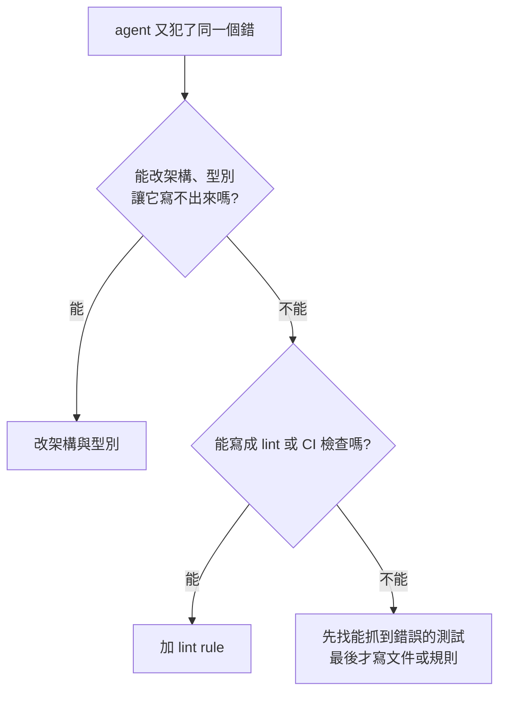

> 🌏 [English version](/posts/ai/2026-10-07-poteto-trust-ladder-verification-first-en)

[完整中英字幕對照：點任一句播放與跟讀](#video-practice-0-transcript)

如果你已經用 coding agent 寫 code，卻還是得一個對話一個對話盯著，這篇想回答的是：Lauren Tan 的做法裡，哪些你明天就能試，哪些其實靠她自己的條件才成立。

## 這是什麼

Lauren Tan（網名 [poteto](https://x.com/poteto)）曾在 Meta 的 React 團隊，現在做 Cursor 的 agents window 與 Grok Bot，兩者都隸屬 SpaceXAI。2026 年 10 月 2 日，Matt Pocock 為她開了一場 [65 分鐘的直播對談](https://www.youtube.com/watch?v=MN9dGgmLyso)，談她怎麼讓 agent 大量產出又維持品質。她的整套 skill 以 MIT 授權公開在 [pstack](https://github.com/cursor/plugins/tree/main/pstack)，入口是 `/poteto-mode`。

[完整訪談來源（YouTube）](https://www.youtube.com/watch?v=MN9dGgmLyso)。想在本頁聽原音，使用上方的練習播放器即可。

## 先講數字：2,500 只是她的自述

標題裡的 PR 數量，各處說法不同：

- 直播標題寫「1,000's of PRs」。
- 她 9 月 21 日在 X 的[貼文](https://x.com/poteto/status/2102050467505430555)寫 2,500。
- Cursor 的 [Compile London 議程](https://cursor.com/compile/london)列出 9 月 16 日活動的講題「I Shipped 2,000 PRs Last Month」。
- 一份對 Compile 演講自動字幕的[分析](https://redreamality.com/blog/lauren-tan-poteto-trust-before-parallel/)指出，口述的數字約是 2,000。

這些都是她自己說的月份與數字，沒有外部稽核，也看不出合併後有多少沒被回退。對談約 45:54，她提到相當一部分是「園藝」型的小修維護。所以這個數字拿來判斷「她把工作切得多細」比較合理，拿來比較產出價值就不太站得住。

## 給誰、需要什麼前提

適合已經天天用 coding agent、卻發現自己是瓶頸的人。不需要用 Cursor 或 pstack；對談裡真正值得拿走的是思路。前提是你的專案要有能被程式判斷對錯的東西，例如能跑起來的 app、測試、型別、lint。

## 內容地圖

**1. 信任階梯**。把她在對談不同段落的廚房比喻串起來，可以這樣理解：一個人盯一個 agent 是家庭廚師；多開幾個 agent 卻沒有制度，像全家擠進廚房，只會更亂；接著是設計廚房運作的主廚，最後才是同時巡視多家分店。她不喜歡「軟體工廠」容易淡化品質與手藝的聯想，也提醒工程師的名字仍掛在出品上。

**2. 驗證 skill 是第一階**。她在 Cursor 一開始是 agent 和 Chrome DevTools 之間的「meat proxy」：自己看 flame graph、heap snapshot，再轉述給 agent。她加入 Cursor 後做的第一個 skill，就是讓 agent 自己把 app 跑起來、操作、抓 trace。她對 loop 的定義也由此而來：agent 能自己檢查自己的成果，才算 loop。

**3. 確定的事寫成程式，判斷留給 agent**。驗證 skill 裡有一支包住 Playwright 與 Chrome DevTools Protocol 的 CLI。她自己說它沒有多厲害，重點是每個 agent 共用同一套工具，不用每次重寫一次驗證腳本，而且行為一致。技術遷移也一樣，優先用 codemod，而不是讓 agent 一個檔案一個檔案想。

**4. 用環境取代叮嚀**。每次 agent 犯錯，她先問「怎麼讓這個錯誤寫不出來」，答案多半是 lint rule、型別或目錄慣例。她說，Dune 是非開源的內部框架，每個 feature 放在自己的目錄，透過 registry 與掃描 codebase 找到 feature，再配合嚴格的 lint rule 收斂寫法。這裡能借的是設計思路。

**5. 外循環與內循環**。內循環是 agent 照你給的意圖寫 code；外循環是 Slack、Linear、X 上不斷冒出來的新資訊。她讓個人 agent 訂閱這些來源，再轉給雲端的 coordinator，由它拆任務給 sub-agent。同一批相關的 bug 交給同一個 coordinator，比較容易看出共同根因。

**6. 合併後抽樣**。流程是 agent 做完 PR、多個 verifier 實際操作 app 找問題、修完、自動合併；她隔天早上看 commit history。發現好幾個 agent 都走同一條捷徑，就回去修 skill、lint、型別，不修那一個 agent。

## 一個具體例子：修正該放在哪一層

pstack 官方 guide 的 [`/correct` 說明](https://github.com/cursor/plugins/blob/main/pstack/docs/guide/09-make-it-yours.md#fix-the-environment-with-correct)把反覆犯錯的修正分成四層，優先選能確實擋住錯誤的那一層：

1. 架構或資料結構：讓錯誤根本寫不出來。
2. 型別、lint 或 CI 檢查：擋下錯誤，並在錯誤訊息指出怎麼修。
3. 測試：讓錯誤被抓到。
4. 文件或 agent 規則：前三層做不到時才寫成提醒，因為略過文字本身不會讓檢查失敗。

這是目前公開工具的修正策略，不是這場對談逐字列出的排名。`/correct` 還要求用真實的歷史錯誤證明新檢查會失敗，避免只新增一條看起來有用的規則。



所以，看到重複錯誤時，先找能落在程式與檢查裡的修正，再考慮文字提醒。官方 guide 的入門例子也很樸素，只給目標與驗收方式：

```text
/poteto-mode the export writes duplicate rows when a retry lands mid-run. repro first, then fix and verify.
```

出處：[pstack guide](https://github.com/cursor/plugins/blob/main/pstack/docs/guide/README.md)。

## 限制

- **適用範圍**：Matt 問到無法回頭的變更，以及醫療、法律、金融等領域時，她說，越難用程式驗證，越難走到放手這一步，也承認沒有完整答案。她把充分驗證比喻成讓單向門變成雙向門，但這不代表驗證能撤銷已發生的資料損失。本文的建議是：驗證不足或後果無法回復時，保留人工合併判斷。
- **成本**：full autopilot 每個 PR 開多個 verifier，她承認很耗 token。
- **前提很重**：她的專案被刻意收斂成「只有一種做法」，Grok Bot 早期甚至有八個各一萬行以上的檔案，是被逼著拆開才建立這套約束。搬到自己的既有專案時，仍得先建立相應工具與約束。
- **驗證要覆蓋目標**：通過既有功能檢查，不代表所有品質與效能目標都已覆蓋。她也用驗證工具做效能改善；效能目標仍需要對應的 trace、profiling 或 benchmark。
- **來源**：正文主要主張已對照英文自動字幕，文末短摘錄尚未回聽原音。Dune 是她描述的內部框架；PR 數字與工作流程是她的自述。要引用她的原話，請回頭看[原始直播](https://www.youtube.com/watch?v=MN9dGgmLyso)。

## 怎麼用：今晚能做的三件事

1. 挑你最常改的 app，寫一支指令讓 agent 能自己啟動、操作一條主要流程並留下證據（截圖或 trace），再讓它在每次改動後執行。
2. 下次 agent 第二次犯同一個錯，先停下來問：能不能寫成 lint rule、型別或目錄限制？只改提示詞是最後手段。
3. 翻你過去的對話紀錄，挑出你反覆糾正的三件事，各寫成一條 skill 或規則。她也建議每個人養自己的一套 skill，不要整包照搬；Matt 的 [skills 庫](https://github.com/mattpocock/skills)可以當範本。

想了解 harness 為什麼是這幾年的重點，可以搭配站內的 [Phil Schmid 導讀](/posts/ai/2026-03-28-phil-schmid-agent-harness)與 [meta-harness 分層整理](/posts/ai/2026-08-26-meta-harness-layers)。

## 聽力與口說練習

[找更多英文影音練習文章](/tags/english-video-practice)。上方三個片段按鈕會切換同一個播放器。先播放整段，再點原音語句重複聽；太快就選 0.75 倍。精選語句附中文對照，其餘原音字幕可用播放器的 CC 顯示。

每段都有聽力目標、語言重點與開口練習；示範句為本站編寫，不是講者原話。片段邊界依自動字幕選取，尚未逐句回聽，開頭或結尾可能承接範圍外的話。


```video-practice
{
  "title": "三段聽力練習：驗證、共用工具、抽樣",
  "videoId": "MN9dGgmLyso",
  "start": 1003,
  "end": 1023,
  "question": "三個片段各在解決什麼問題？哪一項改變能用在你的專案？",
  "answer": "分別找出三種動作：操作並檢查 app、共用驗證工具，以及規模變大後抽樣檢查。選一項套用到自己正在做的工作。",
  "phrases": [
    {
      "term": "verification",
      "meaning": "把實際成果和預期條件對照，確認是否符合要求。",
      "example": "Verification should include opening the exported file, not only checking that it exists."
    },
    {
      "term": "evidence",
      "meaning": "能支持判斷的具體觀察，例如畫面或執行紀錄。",
      "example": "The agent attached a screenshot as evidence that the form showed the error."
    }
  ],
  "prompt": "選一個片段，用英文說明怎麼套用到自己的 app：要做什麼、留下什麼證據，以及哪件事仍由你判斷。",
  "modelAnswer": "The agent should open the form, submit an empty field and capture the error message. I will review whether the message helps the user fix the problem.",
  "lang": "zh-TW",
  "captionNote": "來源：原影片字幕軌。以下是自動字幕的精選語句，非完整逐字稿；部分語句承接前後文。已核對字幕文字，尚未逐句回聽。",
  "clips": [
    {
      "title": "讓 agent 有手有眼",
      "start": 1003,
      "end": 1034,
      "captionCoverage": "partial",
      "sentences": [
        {
          "start": 1003,
          "end": 1008,
          "en": "where the agent is able to run the code, right? And actually",
          "zh": "也就是讓 agent 能把程式跑起來，對吧？而且還能實際……"
        },
        {
          "start": 1008,
          "end": 1016,
          "en": "uh interact with it like a normal human user would and also do things like you know debug it, you know, take traces and snapshots.",
          "zh": "呃，像一般使用者那樣操作它，也能做除錯、擷取執行追蹤和快照這些事。"
        },
        {
          "start": 1016,
          "end": 1023,
          "en": "Um and uh funnily enough like that was actually the first skill I built when I joined Cursor.",
          "zh": "嗯，說來有趣，那其實就是我加入 Cursor 後做的第一個 skill。"
        }
      ],
      "teaching": {
        "goal": "聽出 agent 能做哪些動作；聽完不看文字，說出其中兩項。",
        "note": "be able to + 原形動詞描述能力；interact with 是實際操作或互動，可以用在 app、表單與介面。把動作動詞讀重一點。",
        "prompt": "用自己的 app 完成：The agent is able to __ and __. 填入兩項看得見的動作。",
        "example": "The agent is able to open the checkout page and submit the form."
      }
    },
    {
      "title": "共用驗證工具",
      "start": 1367,
      "end": 1418,
      "sentences": [
        {
          "start": 1387,
          "end": 1389,
          "en": "rebuild the world each time and then",
          "zh": "每一次都重新打造整個世界，然後……"
        }
      ],
      "teaching": {
        "goal": "聽出哪些工作一直被重做，以及共用工具能省下什麼。",
        "note": "rebuild the world 是誇張說法，指每次都重做太多東西。each time 表示每一次；描述自己的專案時，換成具體重做的工作。",
        "prompt": "完成：We should reuse __ instead of rebuilding it each time. 填入真的能共用的工具。",
        "example": "We should reuse the login test instead of rebuilding it each time."
      },
      "captionCoverage": "partial"
    },
    {
      "title": "抽樣成果，修正流程",
      "start": 2974,
      "end": 3020,
      "sentences": [
        {
          "start": 2988,
          "end": 2990,
          "en": "about sampling right and thinking about",
          "zh": "關於抽樣，對吧，還有思考……"
        }
      ],
      "teaching": {
        "goal": "注意逐一檢查和抽樣檢查的對比；說出兩者各自適合的情境。",
        "note": "about 後面接動作時用 -ing：about sampling、about testing。先找出 about，再把後面的動名詞連起來讀。",
        "prompt": "完成：Our review is about __ and __. 再說一項你認為每次都必須檢查的事。",
        "example": "Our review is about checking accuracy and finding confusing instructions."
      },
      "captionCoverage": "partial"
    }
  ],
  "transcript": {
    "note": "已匯入所提供字幕的全部句子；機器翻譯，尚未逐句人工校訂。",
    "sentences": [
      {
        "start": 0.4,
        "end": 2.8689999999999998,
        "en": "So, hello folks. I've got another treat",
        "zh": "那麼，大家好。今天要給大家另一個驚人的好東西"
      },
      {
        "start": 2.879,
        "end": 5.67,
        "en": "for you today. Last time on this kind of",
        "zh": "今天要給大家的。上次在這種播客類的內容中"
      },
      {
        "start": 5.68,
        "end": 7.59,
        "en": "podcasty thing, I suppose, we had Uncle",
        "zh": "我認為我們有 Uncle Bob"
      },
      {
        "start": 7.6,
        "end": 9.19,
        "en": "Bob and we talked about software",
        "zh": "我們談論了軟體品質"
      },
      {
        "start": 9.2,
        "end": 10.79,
        "en": "quality. We talked about agents. We",
        "zh": "我們談論了代理程式。我們"
      },
      {
        "start": 10.8,
        "end": 13.43,
        "en": "talked about lots of cool stuff. Now, we",
        "zh": "談論了很多酷東西。現在，我們有"
      },
      {
        "start": 13.44,
        "end": 15.509,
        "en": "have uh an incredible guest, someone who",
        "zh": "一位令人驚嘆的嘉賓，我非常樂於歡迎的"
      },
      {
        "start": 15.519,
        "end": 18.07,
        "en": "I'm delighted to welcome on, who's been",
        "zh": "最近在 Twitter 上關於軟體工廠爆紅的人"
      },
      {
        "start": 18.08,
        "end": 21.269,
        "en": "exploding on Twitter recently about",
        "zh": "談論提高你的工作品質"
      },
      {
        "start": 21.279,
        "end": 24.47,
        "en": "software factories, um about increasing",
        "zh": "提高你的工作效率，以及攀登"
      },
      {
        "start": 24.48,
        "end": 25.99,
        "en": "the quality of your work, about",
        "zh": "提高你的工作效率，以及攀登"
      },
      {
        "start": 26,
        "end": 28.55,
        "en": "increasing your velocity and climbing",
        "zh": "速度並爬升"
      },
      {
        "start": 28.56,
        "end": 30.55,
        "en": "the trust ladder with agents so that you",
        "zh": "透過代理程式建立信任階梯，讓你"
      },
      {
        "start": 30.56,
        "end": 32.63,
        "en": "can ship more and more and more. And it",
        "zh": "可以釋出越來越多。而且這是"
      },
      {
        "start": 32.64,
        "end": 35.91,
        "en": "is potato. Welcome. Thank you so much",
        "zh": "是Poteto。歡迎。非常感謝"
      },
      {
        "start": 35.92,
        "end": 36.95,
        "en": "for joining.",
        "zh": "加入。"
      },
      {
        "start": 36.96,
        "end": 38.47,
        "en": ">> Thanks for having me. Yeah, very excited",
        "zh": "感謝邀請。是的，我非常興奮"
      },
      {
        "start": 38.48,
        "end": 41.11,
        "en": "to be here. Yeah, big fan of yours",
        "zh": "能來這裡。是的，你是你的大粉絲"
      },
      {
        "start": 41.12,
        "end": 42.63,
        "en": ">> and a huge fan of yours. I [laughter]",
        "zh": "也是你的大粉絲。我[笑]"
      },
      {
        "start": 42.64,
        "end": 44.229,
        "en": "think people have been talking about",
        "zh": "認為人們一直在討論"
      },
      {
        "start": 44.239,
        "end": 45.83,
        "en": "this like it's like the meeting of the",
        "zh": "這就像"
      },
      {
        "start": 45.84,
        "end": 49.11,
        "en": "skill minds, the skill Mount Olympus or",
        "zh": "技能思維，技能宙斯山或"
      },
      {
        "start": 49.12,
        "end": 50.47,
        "en": "something because both of us have very",
        "zh": "某種東西，因為我們兩人都有非常"
      },
      {
        "start": 50.48,
        "end": 52.79,
        "en": "popular skill libraries. Um I've not, as",
        "zh": "流行的技能庫。嗯，我沒有，因為"
      },
      {
        "start": 52.8,
        "end": 54.47,
        "en": "I was saying before we started, I've not",
        "zh": "我之前說過，我沒有"
      },
      {
        "start": 54.48,
        "end": 57.59,
        "en": "used a ton of yours and like I want to",
        "zh": "用過很多你的，而且我想"
      },
      {
        "start": 57.6,
        "end": 59.349,
        "en": "get all of the juice out of your brain",
        "zh": "把你的腦中所有精華都挖出來"
      },
      {
        "start": 59.359,
        "end": 61.51,
        "en": "so that I can go and use it properly and",
        "zh": "以便我能正確使用它，並"
      },
      {
        "start": 61.52,
        "end": 64.07,
        "en": "use it better. And I think where I want",
        "zh": "更好地使用它。我想從"
      },
      {
        "start": 64.08,
        "end": 66.39,
        "en": "to start with this is you gave a talk um",
        "zh": "開始，這是你最近做了一場演講"
      },
      {
        "start": 66.4,
        "end": 68.789,
        "en": "pretty recently like um about 10 days",
        "zh": "大概10天前"
      },
      {
        "start": 68.799,
        "end": 70.95,
        "en": "ago and posted on X which went",
        "zh": "並在X上發佈，這場演講"
      },
      {
        "start": 70.96,
        "end": 73.109,
        "en": "absolutely nuts as about how I shipped",
        "zh": "非常熱門，關於我如何發佈"
      },
      {
        "start": 73.119,
        "end": 76.39,
        "en": "2,500 PRs last month to production got",
        "zh": "上個月到生產環境的2,500個PR，獲得"
      },
      {
        "start": 76.4,
        "end": 79.109,
        "en": "about 3 million views or something on X",
        "zh": "約300萬次觀看左右在X上"
      },
      {
        "start": 79.119,
        "end": 81.749,
        "en": "and I watched it and I loved it and I",
        "zh": "我看了，我喜歡它，我"
      },
      {
        "start": 81.759,
        "end": 84.149,
        "en": "recommended it and I kind of want to run",
        "zh": "推薦它，我有點想執行"
      },
      {
        "start": 84.159,
        "end": 86.07,
        "en": "this as almost like a Q&A of that talk",
        "zh": "這幾乎像那場演講的Q&A"
      },
      {
        "start": 86.08,
        "end": 89.59,
        "en": "basically of giving you because it just",
        "zh": "基本上是因為它只是"
      },
      {
        "start": 89.6,
        "end": 91.429,
        "en": "I just had tons of questions about it",
        "zh": "我對它有太多問題"
      },
      {
        "start": 91.439,
        "end": 93.51,
        "en": "and I wanted to dive into it. And I",
        "zh": "我想深入探討它。我想"
      },
      {
        "start": 93.52,
        "end": 95.99,
        "en": "think where I want to start is you talk",
        "zh": "我想從你談論代理程式的信任階梯開始"
      },
      {
        "start": 96,
        "end": 99.109,
        "en": "about a trust ladder with agents where",
        "zh": "關於代理程式信任階梯"
      },
      {
        "start": 99.119,
        "end": 101.99,
        "en": "you as you trust agents more, you can",
        "zh": "當你對代理程式的信任增加時"
      },
      {
        "start": 102,
        "end": 104.789,
        "en": "get them to do better and better things",
        "zh": "讓他們做越來越好事情"
      },
      {
        "start": 104.799,
        "end": 107.429,
        "en": "and or scale them to up to use more and",
        "zh": "並擴展他們以使用更多"
      },
      {
        "start": 107.439,
        "end": 110.31,
        "en": "more agents. So what is your story of",
        "zh": "代理程式。那麼你的故事是"
      },
      {
        "start": 110.32,
        "end": 113.59,
        "en": "how you climbed the trust ladder and how",
        "zh": "你是如何爬過信任階梯的以及"
      },
      {
        "start": 113.6,
        "end": 115.59,
        "en": "did that work when like you got SpaceX",
        "zh": "那樣做有效嗎？就像你獲得SpaceX的時候。"
      },
      {
        "start": 115.6,
        "end": 116.23,
        "en": "and",
        "zh": "和"
      },
      {
        "start": 116.24,
        "end": 118.63,
        "en": ">> started climbing more and more?",
        "zh": ">> 開始越來越多地攀登？"
      },
      {
        "start": 118.64,
        "end": 120.789,
        "en": "So I think this the the journey sort of",
        "zh": "所以我想這段旅程大概是"
      },
      {
        "start": 120.799,
        "end": 123.59,
        "en": "began even before I joined cursor uh",
        "zh": "是在我加入cursor之前就開始的。嗯"
      },
      {
        "start": 123.6,
        "end": 126.55,
        "en": "which is now SpaceX AI. Uh [snorts] so",
        "zh": "現在是SpaceX AI。嗯 [嗤之以鼻] 所以"
      },
      {
        "start": 126.56,
        "end": 129.589,
        "en": "the story is um",
        "zh": "故事是，嗯"
      },
      {
        "start": 129.599,
        "end": 132.55,
        "en": "after Meta so I I used to work at Meta",
        "zh": "在Meta之後，所以我曾經在Meta工作過"
      },
      {
        "start": 132.56,
        "end": 134.63,
        "en": "on the React team. [snorts] Uh I took a",
        "zh": "在React團隊。[嗤之以鼻] 嗯，我請了一個月假"
      },
      {
        "start": 134.64,
        "end": 136.39,
        "en": "month off uh because I was feeling kind",
        "zh": "因為我覺得有點"
      },
      {
        "start": 136.4,
        "end": 139.03,
        "en": "of burnt out and of course when what",
        "zh": "精疲力盡，當然當你精疲力盡時，會怎麼辦？"
      },
      {
        "start": 139.04,
        "end": 140.229,
        "en": "what do you do when you're burnt out?",
        "zh": "你會做什麼？"
      },
      {
        "start": 140.239,
        "end": 142.79,
        "en": "You go and start a new side project. Um",
        "zh": "你去開始一個新的副專案。嗯"
      },
      {
        "start": 142.8,
        "end": 144.71,
        "en": "and so I started a side project. you",
        "zh": "所以我開始了一個副專案。你"
      },
      {
        "start": 144.72,
        "end": 147.43,
        "en": "know, I was uh of course using AI to to",
        "zh": "你知道，我當然使用AI來"
      },
      {
        "start": 147.44,
        "end": 149.35,
        "en": "write code. Uh [snorts] but then I",
        "zh": "寫程式。嗯 [嗤之以鼻] 但後來我"
      },
      {
        "start": 149.36,
        "end": 151.43,
        "en": "started to realize uh you know, I was",
        "zh": "開始意識到，你知道，我"
      },
      {
        "start": 151.44,
        "end": 153.43,
        "en": "spending like so many hours just",
        "zh": "花了好多小時只是"
      },
      {
        "start": 153.44,
        "end": 156.63,
        "en": "micromanaging one agent, right? And you",
        "zh": "微管理一個代理程式，對吧？而且你"
      },
      {
        "start": 156.64,
        "end": 158.71,
        "en": "know, at the time, this was back in",
        "zh": "知道，當時這是在"
      },
      {
        "start": 158.72,
        "end": 161.11,
        "en": "February, maybe February, early February",
        "zh": "二月，也許是二月，早期二月"
      },
      {
        "start": 161.12,
        "end": 163.509,
        "en": "or January, you know, people were really",
        "zh": "或是一月，你知道，人們真的"
      },
      {
        "start": 163.519,
        "end": 164.63,
        "en": "obsessed with this idea of like",
        "zh": "對這個想法非常著迷，就像"
      },
      {
        "start": 164.64,
        "end": 166.47,
        "en": "orchestration. This was like, you know,",
        "zh": "這就像，你知道，"
      },
      {
        "start": 166.48,
        "end": 168.47,
        "en": "before, you know, things like cursor,",
        "zh": "在這之前，你知道，像光標之類的東西，"
      },
      {
        "start": 168.48,
        "end": 170.39,
        "en": "you know, like the agents window was had",
        "zh": "你知道，像代理程式視窗有"
      },
      {
        "start": 170.4,
        "end": 173.11,
        "en": "become popular. So people were still in",
        "zh": "變得流行。所以人們還是處在"
      },
      {
        "start": 173.12,
        "end": 175.11,
        "en": "like like 2 land you know in their",
        "zh": "像像2 land 你知道在他們的"
      },
      {
        "start": 175.12,
        "end": 176.949,
        "en": "terminal and they were all talking about",
        "zh": "終端機裡，他們都在談論"
      },
      {
        "start": 176.959,
        "end": 178.39,
        "en": "okay here you know I built a custom",
        "zh": "好的，你知道，我建立了一個自訂的"
      },
      {
        "start": 178.4,
        "end": 181.03,
        "en": "orchestrator right and so of course I",
        "zh": "協調程式，對的，所以當然我"
      },
      {
        "start": 181.04,
        "end": 183.392,
        "en": "had I was a bit nerd sniped by that",
        "zh": "被那東西稍微電磁爐吸引"
      },
      {
        "start": 183.402,
        "end": 184.949,
        "en": "[snorts] and you know as I was building",
        "zh": "[嗤之以鼻]，你知道當我正在建立"
      },
      {
        "start": 184.959,
        "end": 188.07,
        "en": "my toy project uh I got nerd sniped by",
        "zh": "我的玩具專案時，呃，我被電磁爐吸引"
      },
      {
        "start": 188.08,
        "end": 190.71,
        "en": "oh how do I make my AI coding setup more",
        "zh": "哦，我該怎麼讓我的AI程式碼設定更"
      },
      {
        "start": 190.72,
        "end": 193.75,
        "en": "efficient and so you know I I kind of",
        "zh": "高效，所以你知道，我大概"
      },
      {
        "start": 193.76,
        "end": 196.79,
        "en": "started the journey there where I just",
        "zh": "在那裡開始這段旅程，我只是"
      },
      {
        "start": 196.8,
        "end": 198.869,
        "en": "you know took a step back and realized",
        "zh": "你會退一步並意識到"
      },
      {
        "start": 198.879,
        "end": 200.63,
        "en": "you know I was spending all this time",
        "zh": "你會發現我花費了這麼多時間"
      },
      {
        "start": 200.64,
        "end": 203.03,
        "en": "micromanaging a single agent you know I",
        "zh": "微觀管理單一代理程式，你會知道我"
      },
      {
        "start": 203.04,
        "end": 204.63,
        "en": "was [snorts] creating skills and I was",
        "zh": "嗤之以鼻地創造技能，而我"
      },
      {
        "start": 204.64,
        "end": 206.63,
        "en": "like finding it quite difficult to",
        "zh": "覺得非常困難"
      },
      {
        "start": 206.64,
        "end": 209.75,
        "en": "measure the output or the the result the",
        "zh": "衡量輸出或結果"
      },
      {
        "start": 209.76,
        "end": 212.309,
        "en": "impact of the skill as well so I was",
        "zh": "技能的影響，所以我就"
      },
      {
        "start": 212.319,
        "end": 214.55,
        "en": "kind of flying blind but I was you know",
        "zh": "有點像盲目飛行，但我就"
      },
      {
        "start": 214.56,
        "end": 219.67,
        "en": "iterating really fast um and um so that",
        "zh": "快速迭代，所以那"
      },
      {
        "start": 219.68,
        "end": 222.869,
        "en": "project eventually sort of became the",
        "zh": "專案最終成為PAC的基礎"
      },
      {
        "start": 222.879,
        "end": 224.949,
        "en": "basis of PAC even though I didn't know",
        "zh": "即使我當時不知道"
      },
      {
        "start": 224.959,
        "end": 228.39,
        "en": "it at the time um and a lot of some",
        "zh": "當時的許多東西"
      },
      {
        "start": 228.4,
        "end": 230.789,
        "en": "tricks I had learned like building that",
        "zh": "我學到的技巧，比如建立那個"
      },
      {
        "start": 230.799,
        "end": 232.309,
        "en": "early set of skills. Actually, it's",
        "zh": "早期的技能組合。實際上，它仍然是"
      },
      {
        "start": 232.319,
        "end": 234.149,
        "en": "still open source if you want to if",
        "zh": "仍然是開源的，如果你想要的話"
      },
      {
        "start": 234.159,
        "end": 236.149,
        "en": "anybody wants to take a look. It's on my",
        "zh": "任何人都可以看一下。它在我的"
      },
      {
        "start": 236.159,
        "end": 238.55,
        "en": "GitHub like potato",
        "zh": "GitHub 像Poteto"
      },
      {
        "start": 238.56,
        "end": 242.39,
        "en": "noodle n o d l e. Um, and in there you",
        "zh": "麵條 n o d l e。呃，而在那裡你"
      },
      {
        "start": 242.4,
        "end": 244.229,
        "en": "will see some skills and a brain",
        "zh": "會看到一些技能和一個大腦目錄"
      },
      {
        "start": 244.239,
        "end": 245.99,
        "en": "directory. [snorts] And so I was really",
        "zh": "目錄。[嗤之以鼻] 所以我真的很"
      },
      {
        "start": 246,
        "end": 249.19,
        "en": "interested in this idea of how do I, you",
        "zh": "對這個想法很感興趣，我如何，你"
      },
      {
        "start": 249.2,
        "end": 252.39,
        "en": "know, extract my own ability, if that",
        "zh": "知道，提取自己的能力，如果這"
      },
      {
        "start": 252.4,
        "end": 254.55,
        "en": "makes sense, and give it to the agent,",
        "zh": "有道理的話，並把它給代理程式，"
      },
      {
        "start": 254.56,
        "end": 256.87,
        "en": "right? cuz I was I I realized that you",
        "zh": "對吧？因為我當時我意識到你"
      },
      {
        "start": 256.88,
        "end": 258.15,
        "en": "know all I was trying to do was trying",
        "zh": "你知道的，我當時只是試圖"
      },
      {
        "start": 258.16,
        "end": 259.83,
        "en": "to teach the agent to write code more",
        "zh": "教代理程式寫程式更像我"
      },
      {
        "start": 259.84,
        "end": 261.99,
        "en": "like me you know do do you do do",
        "zh": "像我一樣，你懂的，做做你做做"
      },
      {
        "start": 262,
        "end": 264.87,
        "en": "workflows more like me. So you know the",
        "zh": "工作流程更像我。所以你懂的，那些"
      },
      {
        "start": 264.88,
        "end": 267.27,
        "en": "skills were like an entry point to doing",
        "zh": "技能就像是進入這個的入門點"
      },
      {
        "start": 267.28,
        "end": 268.95,
        "en": "that.",
        "zh": "那個。"
      },
      {
        "start": 268.96,
        "end": 271.27,
        "en": "Um and then you know after I joined",
        "zh": "嗯，你懂的，加入後"
      },
      {
        "start": 271.28,
        "end": 273.67,
        "en": "cursor uh I was starting to work on the",
        "zh": "游標啊，我開始著手處理"
      },
      {
        "start": 273.68,
        "end": 276.39,
        "en": "agents window and uh it had a lot of",
        "zh": "代理程式的視窗，啊，有很多"
      },
      {
        "start": 276.4,
        "end": 279.11,
        "en": "performance issues. Uh it was it was it",
        "zh": "效能問題。啊，它當時是它當時是"
      },
      {
        "start": 279.12,
        "end": 281.909,
        "en": "was pretty laggy. Uh and so since I had",
        "zh": "有點延遲。啊，所以因為我有"
      },
      {
        "start": 281.919,
        "end": 283.909,
        "en": "experience working in React, I was asked",
        "zh": "在 React 上有經驗，我被問到"
      },
      {
        "start": 283.919,
        "end": 285.27,
        "en": "like, \"Hey, do you want to come and help",
        "zh": "像是「嘿，你想要來幫忙"
      },
      {
        "start": 285.28,
        "end": 287.99,
        "en": "out uh with the agents window?\" Um and",
        "zh": "處理代理程式視窗嗎？」嗯，還有"
      },
      {
        "start": 288,
        "end": 292.39,
        "en": "so the the this beginning of the cursor",
        "zh": "所以這是最開始的游標"
      },
      {
        "start": 292.4,
        "end": 295.51,
        "en": "journey was very manual. [snorts] Uh I",
        "zh": "旅程非常手動。[嗤] 呃，我"
      },
      {
        "start": 295.52,
        "end": 298.15,
        "en": "was deep in like looking at like flame",
        "zh": "深入研究類似火焰圖"
      },
      {
        "start": 298.16,
        "end": 300.95,
        "en": "graphs and heap snapshots and trying to",
        "zh": "圖和堆快照，並試圖"
      },
      {
        "start": 300.96,
        "end": 303.83,
        "en": "see like why exactly is the app so slow.",
        "zh": "看出應用程式為什麼這麼慢。"
      },
      {
        "start": 303.84,
        "end": 305.67,
        "en": "Uh but then coming back to the same",
        "zh": "呃，但後來又回到相同的"
      },
      {
        "start": 305.68,
        "end": 307.27,
        "en": "realization like you know I was sort of",
        "zh": "認知，你知道的，我有點像"
      },
      {
        "start": 307.28,
        "end": 309.43,
        "en": "the bottleneck. I was doing everything",
        "zh": "瓶頸。我做了所有事情"
      },
      {
        "start": 309.44,
        "end": 311.51,
        "en": "manually. I was sort of the meat proxy",
        "zh": "手動的。我有點像人肉代理"
      },
      {
        "start": 311.52,
        "end": 313.43,
        "en": "in a way, right? I was the meat proxy",
        "zh": "在某種意義上來說，對吧？我就是人肉代理"
      },
      {
        "start": 313.44,
        "end": 316.55,
        "en": "between my agent and Chrome DevTools. Uh",
        "zh": "在我自己的代理程式和 Chrome DevTools 之間。嗯"
      },
      {
        "start": 316.56,
        "end": 318.71,
        "en": "and I was like really annoyed by that.",
        "zh": "我當時真的非常煩躁。"
      },
      {
        "start": 318.72,
        "end": 320.629,
        "en": ">> And what month of the year is that?",
        "zh": ">> 那是幾月份？"
      },
      {
        "start": 320.639,
        "end": 322.79,
        "en": "Let's say where are we in the timeline?",
        "zh": "我們來說說現在處於時間軸的哪個階段？"
      },
      {
        "start": 322.8,
        "end": 325.67,
        "en": ">> Uh so I joined Cursor in March. So this",
        "zh": ">> 嗯，我是在三月加入 Cursor 的。所以這"
      },
      {
        "start": 325.68,
        "end": 328.469,
        "en": "was like early early April probably",
        "zh": "大概是在四月初"
      },
      {
        "start": 328.479,
        "end": 330.71,
        "en": "early April is when [snorts] you know uh",
        "zh": "四月初的時候[嗤之以鼻]，你知道的"
      },
      {
        "start": 330.72,
        "end": 332.469,
        "en": "I joined and I didn't have any skills,",
        "zh": "我加入時什麼技能都沒有，"
      },
      {
        "start": 332.479,
        "end": 335.11,
        "en": "right? I had I I sort of abandoned my",
        "zh": "對吧？我其實放棄了我的"
      },
      {
        "start": 335.12,
        "end": 336.39,
        "en": "personal skills because I didn't think",
        "zh": "個人技能，因為我不認為它們還會有幫助。"
      },
      {
        "start": 336.4,
        "end": 339.189,
        "en": "they'd be relevant anymore. Uh but then",
        "zh": "嗯，但後來"
      },
      {
        "start": 339.199,
        "end": 341.248,
        "en": "working on the agents window uh and",
        "zh": "正在處理代理程式視窗，呃，還有"
      },
      {
        "start": 341.258,
        "end": 344.31,
        "en": "[snorts] now working on grockbot uh I",
        "zh": "[嗤之以鼻] 現在正在處理 grockbot，呃，我"
      },
      {
        "start": 344.32,
        "end": 346.79,
        "en": "sort of realized that a lot of the",
        "zh": "似乎意識到很多"
      },
      {
        "start": 346.8,
        "end": 348.629,
        "en": "lessons I had learned from those skill",
        "zh": "從那些技能中學到的教訓"
      },
      {
        "start": 348.639,
        "end": 350.31,
        "en": "time building the the initial set of",
        "zh": "在建立初始的技能組合的時期"
      },
      {
        "start": 350.32,
        "end": 352.79,
        "en": "skills were very relevant especially",
        "zh": "這些技能非常相關，尤其是"
      },
      {
        "start": 352.8,
        "end": 355.83,
        "en": "around things like verification",
        "zh": "在驗證等事情上"
      },
      {
        "start": 355.84,
        "end": 357.749,
        "en": "uh you know being very rigorous in your",
        "zh": "呃，你知道的，在你的工作中非常嚴謹"
      },
      {
        "start": 357.759,
        "end": 361.83,
        "en": "work um [clears throat] because I think",
        "zh": "工作，呃 [清了清喉嚨] 因為我認為"
      },
      {
        "start": 361.84,
        "end": 364.629,
        "en": "from my experience even the the frontier",
        "zh": "從我的經驗來看，即使是前沿的"
      },
      {
        "start": 364.639,
        "end": 367.67,
        "en": "ones tend to",
        "zh": "那些往往會"
      },
      {
        "start": 367.68,
        "end": 370.87,
        "en": "tend to take shortcuts. Uh they tend to",
        "zh": "走捷徑。呃，他們往往會"
      },
      {
        "start": 370.88,
        "end": 374.629,
        "en": "do the easy thing. Uh so uh a lot of the",
        "zh": "做簡單的事。呃，所以呃，很多的"
      },
      {
        "start": 374.639,
        "end": 376.79,
        "en": "skills that I've built have been around",
        "zh": "我建立的技能一直以來都是圍繞著"
      },
      {
        "start": 376.8,
        "end": 379.189,
        "en": "how do I make the easy thing the right",
        "zh": "如何讓簡單的事成為正確的"
      },
      {
        "start": 379.199,
        "end": 380.95,
        "en": "thing? You know, how do I make that the",
        "zh": "事情？你知道的，如何讓它成為"
      },
      {
        "start": 380.96,
        "end": 382.629,
        "en": "best thing?",
        "zh": "最好的事情？"
      },
      {
        "start": 382.639,
        "end": 385.11,
        "en": ">> The idea of sort of distilling your",
        "zh": ">> 將你的專業知識精煉並轉化為流程的觀念"
      },
      {
        "start": 385.12,
        "end": 388.95,
        "en": "expertise and turning what you do every",
        "zh": "這對我來說感覺非常熟悉。這就是"
      },
      {
        "start": 388.96,
        "end": 390.79,
        "en": "day into processes, that's something",
        "zh": "我一直以來在做的事情。我想這"
      },
      {
        "start": 390.8,
        "end": 392.469,
        "en": "that feels super familiar to me. That's",
        "zh": "正是我一直在用技能所做的。而且"
      },
      {
        "start": 392.479,
        "end": 394.23,
        "en": "exactly what I've been doing with the",
        "zh": "我想這當中有很多人認為"
      },
      {
        "start": 394.24,
        "end": 397.029,
        "en": "skills. And I suppose there's something",
        "zh": "這件事"
      },
      {
        "start": 397.039,
        "end": 399.11,
        "en": "in that which is a lot of people think",
        "zh": "有著許多人們認為"
      },
      {
        "start": 399.12,
        "end": 401.35,
        "en": "domain expertise is getting less useful",
        "zh": "領域專業知識變得越來越不那麼有用"
      },
      {
        "start": 401.36,
        "end": 404.07,
        "en": "now as people uh start to rely more on",
        "zh": "現在當人們開始更多依賴於"
      },
      {
        "start": 404.08,
        "end": 407.189,
        "en": "AI where what do you think about that",
        "zh": "AI時，你怎麼看？"
      },
      {
        "start": 407.199,
        "end": 409.189,
        "en": "just as a sort of vibe check before we",
        "zh": "只是在我們開始之前的一種氣氛檢查"
      },
      {
        "start": 409.199,
        "end": 411.029,
        "en": "start talking [laughter]",
        "zh": "開始談話[笑聲]"
      },
      {
        "start": 411.039,
        "end": 412.87,
        "en": ">> I actually feel like domain expertise is",
        "zh": ">> 我實際上覺得領域專業知識是"
      },
      {
        "start": 412.88,
        "end": 416.95,
        "en": "is more important than ever you know uh",
        "zh": "比以往任何時候都更重要，你知道嗎"
      },
      {
        "start": 416.96,
        "end": 418.95,
        "en": "I think I wrote this on my ex at some",
        "zh": "我想我曾經在前任身上寫過這句話"
      },
      {
        "start": 418.96,
        "end": 421.83,
        "en": "point but you know at times I sometimes",
        "zh": "某個點，但你知道有時候我有時"
      },
      {
        "start": 421.84,
        "end": 425.11,
        "en": "think of you know AI as is like",
        "zh": "認為你知道AI就像"
      },
      {
        "start": 425.12,
        "end": 426.87,
        "en": "especially as the models get smarter and",
        "zh": "尤其是當模型變得更聰明時"
      },
      {
        "start": 426.88,
        "end": 428.23,
        "en": "smarter and more capable and the",
        "zh": "更聰明、更有能力，以及"
      },
      {
        "start": 428.24,
        "end": 430.79,
        "en": "frontier models are just getting so good",
        "zh": "前沿模型真的越來越出色"
      },
      {
        "start": 430.8,
        "end": 433.589,
        "en": "like I [snorts] love Opus 5.5 by the way",
        "zh": "就像我[嗤之以鼻]，我超愛Opus 5.5"
      },
      {
        "start": 433.599,
        "end": 437.11,
        "en": "um uh you know as the models get really",
        "zh": "嗯...你知道的，當模型變得越來越"
      },
      {
        "start": 437.12,
        "end": 439.189,
        "en": "really really good it almost becomes",
        "zh": "真的真的很好，幾乎變成"
      },
      {
        "start": 439.199,
        "end": 441.43,
        "en": "like the bottleneck is no longer the",
        "zh": "就像瓶頸不再是"
      },
      {
        "start": 441.44,
        "end": 444.79,
        "en": "agent right it becomes your ability to",
        "zh": "代理程式，對吧？它變成你能夠"
      },
      {
        "start": 444.8,
        "end": 447.35,
        "en": "express your intent and your goals in a",
        "zh": "以清晰的方式表達你的意圖和目標"
      },
      {
        "start": 447.36,
        "end": 449.589,
        "en": "clear way that [snorts] the agent can",
        "zh": "[嗤之以鼻]代理程式能夠"
      },
      {
        "start": 449.599,
        "end": 453.43,
        "en": "understand and actually carry out and",
        "zh": "理解並實際執行和"
      },
      {
        "start": 453.44,
        "end": 454.79,
        "en": "That's why I think you know like people",
        "zh": "這就是為什麼我認為，你知道的，像"
      },
      {
        "start": 454.8,
        "end": 457.11,
        "en": "with a lot of domain expertise are",
        "zh": "擁有大量領域專業知識的人"
      },
      {
        "start": 457.12,
        "end": 459.83,
        "en": "extremely have a have a huge advantage",
        "zh": "極大的優勢"
      },
      {
        "start": 459.84,
        "end": 462.07,
        "en": "in my opinion especially if you're a",
        "zh": "以我的看法，特別是你如果是"
      },
      {
        "start": 462.08,
        "end": 464.309,
        "en": "little bit like you know tech technoc",
        "zh": "有點像你所說的科技技術"
      },
      {
        "start": 464.319,
        "end": 466.39,
        "en": "curious you know so I I think of people",
        "zh": "好奇，你知道的，所以我想到的是人們"
      },
      {
        "start": 466.4,
        "end": 469.51,
        "en": "like you know like uh like a doctor or a",
        "zh": "像你所說的，像醫生或"
      },
      {
        "start": 469.52,
        "end": 472.07,
        "en": "lawyer or you know someone who who has a",
        "zh": "律師或你知道的，某個擁有"
      },
      {
        "start": 472.08,
        "end": 474.23,
        "en": "deep expertise in a particular",
        "zh": "在特定領域的深入專業知識，而且"
      },
      {
        "start": 474.24,
        "end": 476.469,
        "en": "non-engineering domain and [snorts] if",
        "zh": "非工程領域的[snorts]如果"
      },
      {
        "start": 476.479,
        "end": 477.909,
        "en": "they're actually just a little bit",
        "zh": "他們其實只是稍微"
      },
      {
        "start": 477.919,
        "end": 479.83,
        "en": "techsavvy and they can figure out how to",
        "zh": "懂技術，他們就能想出如何"
      },
      {
        "start": 479.84,
        "end": 481.909,
        "en": "use agents they can actually build",
        "zh": "使用代理程式，他們實際上能打造出"
      },
      {
        "start": 481.919,
        "end": 484.469,
        "en": "really really great products, right? If",
        "zh": "真正非常優秀的產品，對吧？如果"
      },
      {
        "start": 484.479,
        "end": 486.71,
        "en": "they if they have a clear enough vision",
        "zh": "他們如果擁有足夠清晰的願景"
      },
      {
        "start": 486.72,
        "end": 489.029,
        "en": "in their head and they can articulate it",
        "zh": "在他們腦中並能表達出來"
      },
      {
        "start": 489.039,
        "end": 491.589,
        "en": "in a way that the agent can build it,",
        "zh": "以代理程式能建構的方式"
      },
      {
        "start": 491.599,
        "end": 494.79,
        "en": "you know, I think that that is really",
        "zh": "你知道的，我想這真的"
      },
      {
        "start": 494.8,
        "end": 497.83,
        "en": "the the bottleneck these days is is like",
        "zh": "這幾天的瓶頸就是"
      },
      {
        "start": 497.84,
        "end": 500.39,
        "en": "the transfer of your intent, right, and",
        "zh": "你意圖的轉移，對吧，以及"
      },
      {
        "start": 500.4,
        "end": 503.43,
        "en": "your vision to the agent.",
        "zh": "你的願景傳遞給代理程式"
      },
      {
        "start": 503.44,
        "end": 505.189,
        "en": ">> Yeah. I've been obsessed with language",
        "zh": ">> 嗯。我對語言一直很著迷"
      },
      {
        "start": 505.199,
        "end": 507.749,
        "en": "basically since agents um dropped. are",
        "zh": "基本上自從代理程式推出以來，我就是"
      },
      {
        "start": 507.759,
        "end": 510.55,
        "en": "just obsessed 100% and thinking",
        "zh": "完全著迷，並持續思考"
      },
      {
        "start": 510.56,
        "end": 512.709,
        "en": "constantly about the the composition of",
        "zh": "不斷地關於詞語的組成"
      },
      {
        "start": 512.719,
        "end": 515.029,
        "en": "words, how I can make things sharper,",
        "zh": "詞語，如何讓事物更銳利，"
      },
      {
        "start": 515.039,
        "end": 517.829,
        "en": "what um what might be hidden in the",
        "zh": "什麼，可能隱藏在"
      },
      {
        "start": 517.839,
        "end": 520.149,
        "en": "phrases that I'm using. And it's and",
        "zh": "我使用的語句。而且"
      },
      {
        "start": 520.159,
        "end": 522.949,
        "en": "finding what I love is when you find a",
        "zh": "找到我喜歡的是當你找到一個"
      },
      {
        "start": 522.959,
        "end": 525.59,
        "en": "word that the agent then hooks on to and",
        "zh": "代理程式然後依附的詞"
      },
      {
        "start": 525.6,
        "end": 527.35,
        "en": "then goes, \"Okay, I'm going to reinforce",
        "zh": "然後說：「好的，我要加強"
      },
      {
        "start": 527.36,
        "end": 529.43,
        "en": "that word. I'm going to reuse that in my",
        "zh": "那個詞。我會在我的"
      },
      {
        "start": 529.44,
        "end": 531.43,
        "en": "thinking traces.\" You know, I found that",
        "zh": "思考痕跡中。」你知道，我發現那"
      },
      {
        "start": 531.44,
        "end": 533.509,
        "en": "with um TDD was an early example of",
        "zh": "嗯，TDD 是一個早期的例子"
      },
      {
        "start": 533.519,
        "end": 535.509,
        "en": "that. a lot of chat about TDD recently",
        "zh": "。最近有很多關於 TDD 的討論"
      },
      {
        "start": 535.519,
        "end": 537.03,
        "en": "of like, you know, people say, should",
        "zh": "例如，你知道，人們說，應該"
      },
      {
        "start": 537.04,
        "end": 539.03,
        "en": "you use TDD with agents? Doesn't matter.",
        "zh": "你用 TDD 跟代理程式？不重要。"
      },
      {
        "start": 539.04,
        "end": 540.71,
        "en": "What you're doing is you're getting the",
        "zh": "你正在做的是讓"
      },
      {
        "start": 540.72,
        "end": 543.19,
        "en": "agent to think about TDD, getting it to",
        "zh": "代理程式思考 TDD，讓它"
      },
      {
        "start": 543.2,
        "end": 544.949,
        "en": "write tests, getting it to prioritize",
        "zh": "寫測試，讓它優先處理"
      },
      {
        "start": 544.959,
        "end": 546.63,
        "en": "things in a different way than it did",
        "zh": "以不同的方式"
      },
      {
        "start": 546.64,
        "end": 548.31,
        "en": "before. And that's why sort of grilling,",
        "zh": "之前。這就是為什麼有點像盤問"
      },
      {
        "start": 548.32,
        "end": 550.87,
        "en": "I think, works effectively. Grilling is",
        "zh": "我認為，這樣有效。盤問是"
      },
      {
        "start": 550.88,
        "end": 551.19,
        "en": "a",
        "zh": "一個"
      },
      {
        "start": 551.2,
        "end": 553.59,
        "en": ">> Yeah. Yeah. It it draws those words out",
        "zh": ">> 是的。是的。它會引出你的詞語"
      },
      {
        "start": 553.6,
        "end": 556.15,
        "en": "of you, right? or or at least it helps",
        "zh": "對吧？或者至少它幫助"
      },
      {
        "start": 556.16,
        "end": 559.269,
        "en": "the agent understand your thinking so",
        "zh": "代理程式理解你的思考方式，所以"
      },
      {
        "start": 559.279,
        "end": 560.949,
        "en": "that they can propose those words to you",
        "zh": "它能向你提出這些詞語"
      },
      {
        "start": 560.959,
        "end": 562.87,
        "en": "and you can pick up and say yes exactly",
        "zh": "而你可以選擇並說是的，完全正確"
      },
      {
        "start": 562.88,
        "end": 563.75,
        "en": "that.",
        "zh": "就是這樣。"
      },
      {
        "start": 563.76,
        "end": 565.43,
        "en": ">> Uh I've actually copied some of the the",
        "zh": ">> 呃，我確實複製了一些"
      },
      {
        "start": 565.44,
        "end": 567.03,
        "en": "tips that you've shared as well where",
        "zh": "你分享的技巧，還有"
      },
      {
        "start": 567.04,
        "end": 568.389,
        "en": "you know one of my favorite ones that",
        "zh": "你知道我最喜歡的一個是"
      },
      {
        "start": 568.399,
        "end": 570.47,
        "en": "you've shared recently or or not or like",
        "zh": "你最近分享的，或者不是，或者"
      },
      {
        "start": 570.48,
        "end": 572.466,
        "en": "maybe in the past couple weeks is",
        "zh": "可能是在過去幾週內"
      },
      {
        "start": 572.476,
        "end": 574.47,
        "en": "[snorts] about uh reducing or",
        "zh": "[嗤之以鼻] 關於減少或"
      },
      {
        "start": 574.48,
        "end": 577.509,
        "en": "eliminating tautological tests. Like one",
        "zh": "消除循環論證的測試。例如"
      },
      {
        "start": 577.519,
        "end": 579.43,
        "en": "of my pet peeves of agents is like all",
        "zh": "我對代理程式的煩惱之一就是"
      },
      {
        "start": 579.44,
        "end": 581.509,
        "en": "of the useless tests that they write.",
        "zh": "他們寫的無用測試。"
      },
      {
        "start": 581.519,
        "end": 583.99,
        "en": "And so, you know, that was one thing",
        "zh": "所以，你知道，那是其中一個"
      },
      {
        "start": 584,
        "end": 585.829,
        "en": "where, you know, the word tutology,",
        "zh": "其中，你知道，這個詞 'tutology'，"
      },
      {
        "start": 585.839,
        "end": 587.67,
        "en": "right, is is is I guess, you know, not",
        "zh": "對，我猜，你知道，不是"
      },
      {
        "start": 587.68,
        "end": 589.75,
        "en": "many people necessarily know that if if",
        "zh": "很多人不一定知道，如果如果"
      },
      {
        "start": 589.76,
        "end": 591.269,
        "en": "especially if English isn't your first",
        "zh": "特別是如果英語不是你的母語"
      },
      {
        "start": 591.279,
        "end": 593.59,
        "en": "language, but there's a lot of meaning",
        "zh": "語言，但這其中有很多含義"
      },
      {
        "start": 593.6,
        "end": 596.87,
        "en": "to that word. And it's like it's almost",
        "zh": "那個詞的含義。這就像幾乎"
      },
      {
        "start": 596.88,
        "end": 598.23,
        "en": "like compressed, right? Like you",
        "zh": "被壓縮過的，對吧？就像你"
      },
      {
        "start": 598.24,
        "end": 600.47,
        "en": "compress a lot of intent and meaning",
        "zh": "將大量意圖和含義壓縮進去"
      },
      {
        "start": 600.48,
        "end": 604.07,
        "en": "into words. And so I I I totally agree",
        "zh": "我我我完全同意"
      },
      {
        "start": 604.08,
        "end": 606.07,
        "en": "with you. I think language I've always",
        "zh": "你的看法。我認為語言，我一直"
      },
      {
        "start": 606.08,
        "end": 608.389,
        "en": "been interested in language actually uh",
        "zh": "對語言很感興趣，呃"
      },
      {
        "start": 608.399,
        "end": 611.11,
        "en": "like programming languages natural human",
        "zh": "像程式語言、自然人類"
      },
      {
        "start": 611.12,
        "end": 613.35,
        "en": "languages and how they came to be and",
        "zh": "語言以及它們是如何形成的，還有"
      },
      {
        "start": 613.36,
        "end": 615.67,
        "en": "it's so interesting that now with agents",
        "zh": "現在有了代理程式，這真的很有趣"
      },
      {
        "start": 615.68,
        "end": 617.99,
        "en": "it's sort of like this meeting of",
        "zh": "這有點像是一種會合"
      },
      {
        "start": 618,
        "end": 619.99,
        "en": "natural language with programming",
        "zh": "自然語言與程式設計"
      },
      {
        "start": 620,
        "end": 621.829,
        "en": "language but it's all it's all language",
        "zh": "語言，但一切都是語言"
      },
      {
        "start": 621.839,
        "end": 623.59,
        "en": "out of the hood it's all communication",
        "zh": "從外面來看一切都是溝通"
      },
      {
        "start": 623.6,
        "end": 625.509,
        "en": ">> totally I did a drama degree right so",
        "zh": ">> 我當時讀的是戲劇專業，所以"
      },
      {
        "start": 625.519,
        "end": 626.63,
        "en": "you know I've been thinking about",
        "zh": "你知道我一直都在思考"
      },
      {
        "start": 626.64,
        "end": 628.55,
        "en": "language and Shakespeare and stuff for a",
        "zh": "語言和莎士比亞之類的東西已經很長時間了"
      },
      {
        "start": 628.56,
        "end": 629.829,
        "en": "long time [laughter] and so this all",
        "zh": "[笑聲] 所以這一切感覺都非常熟悉"
      },
      {
        "start": 629.839,
        "end": 631.67,
        "en": "feels very familiar",
        "zh": ">> 嗯，那我們先別深入討論，因為我想"
      },
      {
        "start": 631.68,
        "end": 634.23,
        "en": ">> um so okay there's sort",
        "zh": "你真正想要的是軟體工廠的東西，對吧？軟體"
      },
      {
        "start": 634.24,
        "end": 636.87,
        "en": "before we get into like because I think",
        "zh": "在我們深入討論之前，因為我認為"
      },
      {
        "start": 636.88,
        "end": 638.79,
        "en": "the thing I want from you is like",
        "zh": "我想要從你那裡得到的東西就像"
      },
      {
        "start": 638.8,
        "end": 640.71,
        "en": "software factory stuff, right? Software",
        "zh": "軟體工廠的東西，對吧？軟體"
      },
      {
        "start": 640.72,
        "end": 642.47,
        "en": "factory is the big buzzword. Software",
        "zh": "工廠是大熱門詞彙。軟體"
      },
      {
        "start": 642.48,
        "end": 643.829,
        "en": "factory is the thing that I'm thinking",
        "zh": "工廠是我正在思考的東西"
      },
      {
        "start": 643.839,
        "end": 645.19,
        "en": "about too. I'm sort of releasing a",
        "zh": "也關於。我正在釋出一個"
      },
      {
        "start": 645.2,
        "end": 647.11,
        "en": "course in that direction too.",
        "zh": "課程也朝這個方向。"
      },
      {
        "start": 647.12,
        "end": 650.23,
        "en": ">> And it's this sort of scaling yourself",
        "zh": "這類似於將自己擴展到不現實的PR數量"
      },
      {
        "start": 650.24,
        "end": 653.91,
        "en": "up to un unrealistic numbers of PRs",
        "zh": "基本上或PR數量聽起來"
      },
      {
        "start": 653.92,
        "end": 656.069,
        "en": "basically or PR numbers that sound",
        "zh": "對不理解這一點的人來說很荒謬。所以我想要達到的是"
      },
      {
        "start": 656.079,
        "end": 657.75,
        "en": "ridiculous to people who don't",
        "zh": "從現在做一到五個代理程式的使用者，到數百個"
      },
      {
        "start": 657.76,
        "end": 659.829,
        "en": "understand how this works. So where I",
        "zh": "的數字"
      },
      {
        "start": 659.839,
        "end": 661.59,
        "en": "want to get to is sort of from people",
        "zh": "的數字"
      },
      {
        "start": 661.6,
        "end": 663.91,
        "en": "who are doing kind of like one to five",
        "zh": "的數字"
      },
      {
        "start": 663.92,
        "end": 666.15,
        "en": "agents today up to, you know, hundreds",
        "zh": "的數字"
      },
      {
        "start": 666.16,
        "end": 668.15,
        "en": "of agents running at once and how that",
        "zh": "同時運行的代理程式數量以及這對"
      },
      {
        "start": 668.16,
        "end": 670.31,
        "en": "sort of functions. And so I'd love to",
        "zh": "某種功能。所以我想聽聽"
      },
      {
        "start": 670.32,
        "end": 672.79,
        "en": "hear about your metaphor of the Michelin",
        "zh": "你對米其林廚房的比喻，而不是軟體工廠"
      },
      {
        "start": 672.8,
        "end": 675.03,
        "en": "Kitchen instead of the software factory",
        "zh": "因為我想這反映了"
      },
      {
        "start": 675.04,
        "end": 676.55,
        "en": "because I think that says a bit about",
        "zh": "你對這件事的思考方式。"
      },
      {
        "start": 676.56,
        "end": 678.55,
        "en": "the way you think about this stuff.",
        "zh": "的某些看法。"
      },
      {
        "start": 678.56,
        "end": 680.069,
        "en": ">> Yes.",
        "zh": ">> 是的。"
      },
      {
        "start": 680.079,
        "end": 682.55,
        "en": "Yeah. I I I've I've never really liked",
        "zh": "嗯，我其實一直不太喜歡"
      },
      {
        "start": 682.56,
        "end": 685.269,
        "en": "the term software factory. Not because",
        "zh": "軟體工廠這個詞。不是因為"
      },
      {
        "start": 685.279,
        "end": 688.069,
        "en": "you know it's not accurate but I think I",
        "zh": "它不準確，但我認為很多人提到工廠時"
      },
      {
        "start": 688.079,
        "end": 689.67,
        "en": "think the a lot of people when they",
        "zh": "他們想到的並不是"
      },
      {
        "start": 689.68,
        "end": 691.19,
        "en": "think factory right they don't",
        "zh": "正確的意義"
      },
      {
        "start": 691.2,
        "end": 694.71,
        "en": "necessarily equate that with quality or",
        "zh": "必然等同於品質或"
      },
      {
        "start": 694.72,
        "end": 696.949,
        "en": "craft right things which are very",
        "zh": "製造正確的事物，這些是非常"
      },
      {
        "start": 696.959,
        "end": 699.19,
        "en": "important to me and a lot of people and",
        "zh": "對我來說很重要，還有許多人和"
      },
      {
        "start": 699.2,
        "end": 701.43,
        "en": "technologists who work you know building",
        "zh": "從事建造的技術人員，你知道"
      },
      {
        "start": 701.44,
        "end": 703.99,
        "en": "products we care about the user",
        "zh": "我們關心的使用者產品"
      },
      {
        "start": 704,
        "end": 705.43,
        "en": "experience we care about the things",
        "zh": "我們關心的經驗，這些事物"
      },
      {
        "start": 705.44,
        "end": 708.23,
        "en": "we're building. So while so while I do",
        "zh": "我們正在建造。所以雖然我認為"
      },
      {
        "start": 708.24,
        "end": 711.43,
        "en": "think software factory is an apt term,",
        "zh": "認為軟體工廠是一個恰當的術語,"
      },
      {
        "start": 711.44,
        "end": 713.43,
        "en": "it also I guess maybe conjures up",
        "zh": "它也可能是喚起"
      },
      {
        "start": 713.44,
        "end": 715.75,
        "en": "negative, you know, maybe sometimes",
        "zh": "負面，你知道，有時"
      },
      {
        "start": 715.76,
        "end": 717.99,
        "en": "negative connotations. So Michelin",
        "zh": "負面含義。所以米其林"
      },
      {
        "start": 718,
        "end": 720.069,
        "en": "Kitchen is the thing that I've sort of",
        "zh": "廚房是我覺得"
      },
      {
        "start": 720.079,
        "end": 722.389,
        "en": "landed on where it's much more I feel",
        "zh": "我覺得它更偏向於"
      },
      {
        "start": 722.399,
        "end": 725.11,
        "en": "like it's much more aspirational and uh",
        "zh": "更像是種追求目標的東西，呃"
      },
      {
        "start": 725.12,
        "end": 726.79,
        "en": "I like the metaphor a lot cuz you know I",
        "zh": "我超喜歡這個比喻，因為你知道，我"
      },
      {
        "start": 726.8,
        "end": 729.013,
        "en": "like food. I'm called potato of course",
        "zh": "喜歡食物。當然我被稱為Poteto"
      },
      {
        "start": 729.023,
        "end": 730.629,
        "en": "[snorts] and I like cooking [laughter]",
        "zh": "【嗤之以鼻】而我也喜歡烹飪【笑聲】"
      },
      {
        "start": 730.639,
        "end": 733.269,
        "en": "and I see a lot of parallels right like",
        "zh": "我看到很多相似之處，就像"
      },
      {
        "start": 733.279,
        "end": 735.67,
        "en": "with food right when you're cooking a",
        "zh": "關於食物，當你為自己烹飪一餐時"
      },
      {
        "start": 735.68,
        "end": 737.528,
        "en": "meal for yourself for example",
        "zh": "例如"
      },
      {
        "start": 737.538,
        "end": 739.03,
        "en": "[clears throat] it's both utilitarian",
        "zh": "【清喉嚨】這既是實用的"
      },
      {
        "start": 739.04,
        "end": 740.79,
        "en": "like you're trying to just feed yourself",
        "zh": "你只是想餵飽自己"
      },
      {
        "start": 740.8,
        "end": 743.59,
        "en": "right and and survive uh but it can",
        "zh": "對，而且生存，但實際上"
      },
      {
        "start": 743.6,
        "end": 745.829,
        "en": "actually be transformed into art right",
        "zh": "可以轉化為藝術"
      },
      {
        "start": 745.839,
        "end": 748.55,
        "en": "and that's what what a Michelin starred",
        "zh": "那就是米其林星級"
      },
      {
        "start": 748.56,
        "end": 751.03,
        "en": "chef or even just a chef or a cook can",
        "zh": "主廚甚至只是廚師或烹飪者都能"
      },
      {
        "start": 751.04,
        "end": 753.67,
        "en": "do with food is take something very",
        "zh": "對食物所做的就是把某樣非常"
      },
      {
        "start": 753.68,
        "end": 755.99,
        "en": "ordinary and turn it into a delicious",
        "zh": "普通的東西轉化為美味的"
      },
      {
        "start": 756,
        "end": 758.15,
        "en": "meal that you know takes you back to",
        "zh": "一餐，讓你回想起"
      },
      {
        "start": 758.16,
        "end": 759.67,
        "en": "your childhood days or something like",
        "zh": "童年時光或類似的事情。嗯，這幾乎像"
      },
      {
        "start": 759.68,
        "end": 763.509,
        "en": "that. Um and so it almost like mirrors",
        "zh": "我所談論的信任信件一樣，你在"
      },
      {
        "start": 763.519,
        "end": 765.59,
        "en": "that trust letter that I talk about",
        "zh": "這裡可以想像自己作為家庭主廚的"
      },
      {
        "start": 765.6,
        "end": 768.069,
        "en": "where uh you can sort of imagine your",
        "zh": "旅程，對吧？嗯，作為家庭主廚，"
      },
      {
        "start": 768.079,
        "end": 770.949,
        "en": "own journey as a home cook, right? Uh as",
        "zh": "你都在做所有食物，自己烹飪。你切所有"
      },
      {
        "start": 770.959,
        "end": 772.79,
        "en": "a home cook, you are doing all of the",
        "zh": "食物，自己烹飪。你切所有"
      },
      {
        "start": 772.8,
        "end": 775.269,
        "en": "food, the cooking yourself. You cut all",
        "zh": "食物，自己烹飪。你切所有"
      },
      {
        "start": 775.279,
        "end": 777.03,
        "en": "the vegetables, you do all the prep",
        "zh": "蔬菜，你都要自己準備"
      },
      {
        "start": 777.04,
        "end": 779.43,
        "en": "work, you do all the cleanup, you know,",
        "zh": "工作，你都要自己清理，你知道"
      },
      {
        "start": 779.44,
        "end": 783.75,
        "en": "you are the one man or one woman show",
        "zh": "你就是那個獨自一人演出"
      },
      {
        "start": 783.76,
        "end": 787.509,
        "en": "really. Um, and it's an interesting",
        "zh": "真的。嗯，這是一個有趣的"
      },
      {
        "start": 787.519,
        "end": 789.19,
        "en": "thought experiment like, okay, if you",
        "zh": "思考實驗，比如說，如果你"
      },
      {
        "start": 789.2,
        "end": 791.67,
        "en": "were to cook a meal and then you add",
        "zh": "要煮一餐飯，然後你加入"
      },
      {
        "start": 791.68,
        "end": 793.99,
        "en": "people, right, your your your partner",
        "zh": "人們，對吧，你的你的你的伴侶"
      },
      {
        "start": 794,
        "end": 796.79,
        "en": "trying to your brother, your sister, and",
        "zh": "試圖你的哥哥、你的妹妹，還有"
      },
      {
        "start": 796.8,
        "end": 798.23,
        "en": "now suddenly you have your whole family",
        "zh": "現在突然你有你的整個家庭"
      },
      {
        "start": 798.24,
        "end": 799.59,
        "en": "in the kitchen. I think most people",
        "zh": "在廚房裡。我想大多數人"
      },
      {
        "start": 799.6,
        "end": 801.43,
        "en": "would get very stressed by that, right?",
        "zh": "會因那件事而感到壓力，對吧？"
      },
      {
        "start": 801.44,
        "end": 803.11,
        "en": "The thought of, oh, so many people are",
        "zh": "想到，哦，這麼多人是"
      },
      {
        "start": 803.12,
        "end": 804.949,
        "en": "just mocking around in my kitchen. They",
        "zh": "只是在廚房裡開玩笑。他們"
      },
      {
        "start": 804.959,
        "end": 806.87,
        "en": "have no no idea where all the utensils",
        "zh": "完全不知道所有廚具在哪裡"
      },
      {
        "start": 806.88,
        "end": 807.43,
        "en": "are.",
        "zh": "。"
      },
      {
        "start": 807.44,
        "end": 808.87,
        "en": ">> I have a max capacity of one person in",
        "zh": ">> 我廚房最多只能容納一個人。"
      },
      {
        "start": 808.88,
        "end": 811.11,
        "en": "the kitchen. Yeah, absolutely. So, I",
        "zh": "對，完全正確。所以，我"
      },
      {
        "start": 811.12,
        "end": 813.75,
        "en": "feel like that that's really apt because",
        "zh": "覺得這真的很貼切，因為"
      },
      {
        "start": 813.76,
        "end": 815.269,
        "en": "when you ask yourself that question of",
        "zh": "當你問自己這個問題時"
      },
      {
        "start": 815.279,
        "end": 817.75,
        "en": "how do I go from being a solo cook,",
        "zh": "我怎麼從單打獨鬥的廚師"
      },
      {
        "start": 817.76,
        "end": 821.11,
        "en": "right, to having an army or even not not",
        "zh": "對，到擁有整個軍隊，甚至不是不是"
      },
      {
        "start": 821.12,
        "end": 824.15,
        "en": "even an army but a few sue chefs, right,",
        "zh": "甚至不是軍隊，而是幾個蘇 chefs，對吧，"
      },
      {
        "start": 824.16,
        "end": 825.509,
        "en": "that that are helping me in the kitchen.",
        "zh": "那些在廚房幫忙的。"
      },
      {
        "start": 825.519,
        "end": 828.389,
        "en": "How do I think about dividing the work",
        "zh": "我該如何思考如何分配工作"
      },
      {
        "start": 828.399,
        "end": 830.71,
        "en": "in a way that makes sense? You know, I'm",
        "zh": "以一種有道理的方式？你知道，我"
      },
      {
        "start": 830.72,
        "end": 832.23,
        "en": "not dividing work just for the sake of",
        "zh": "並不是為了分擔工作而分擔"
      },
      {
        "start": 832.24,
        "end": 835.35,
        "en": "it, but in a way that actually makes the",
        "zh": "它，而是以一種實際能讓"
      },
      {
        "start": 835.36,
        "end": 837.59,
        "en": "sum the to the better than, you know,",
        "zh": "總和比各部分總和更好，你知道，"
      },
      {
        "start": 837.6,
        "end": 840.15,
        "en": "the total of its parts. And so the",
        "zh": "各部分總和。所以"
      },
      {
        "start": 840.16,
        "end": 842.949,
        "en": "Michelin kitchen metaphor to me like",
        "zh": "米其林廚房的比喻對我來說很"
      },
      {
        "start": 842.959,
        "end": 845.11,
        "en": "works really well in that regard because",
        "zh": "在這方面非常有效，因為"
      },
      {
        "start": 845.12,
        "end": 848.23,
        "en": "you know as a chef you're you know if",
        "zh": "你知道，作為一名廚師，你會"
      },
      {
        "start": 848.24,
        "end": 849.99,
        "en": "you become a chef you're in a position",
        "zh": "成為廚師後，你處於"
      },
      {
        "start": 850,
        "end": 852.31,
        "en": "where you're not necessarily cooking all",
        "zh": "你不再需要親自烹飪所有"
      },
      {
        "start": 852.32,
        "end": 854.79,
        "en": "the food yourself anymore but you are",
        "zh": "食物，但你會"
      },
      {
        "start": 854.8,
        "end": 857.269,
        "en": "thinking you're almost like the tech",
        "zh": "思考，你幾乎就像技術"
      },
      {
        "start": 857.279,
        "end": 860.15,
        "en": "lead right for the kitchen where uh you",
        "zh": "正確引導廚房，你"
      },
      {
        "start": 860.16,
        "end": 861.67,
        "en": "know chefs have to think about you know",
        "zh": "你知道的，廚師們必須考慮"
      },
      {
        "start": 861.68,
        "end": 863.35,
        "en": "not just cooking but they have to",
        "zh": "不只是烹飪，他們還必須"
      },
      {
        "start": 863.36,
        "end": 865.11,
        "en": "basically organize the whole kitchen and",
        "zh": "基本上要組織整個廚房，並"
      },
      {
        "start": 865.12,
        "end": 867.269,
        "en": "they're like the CEO of the kitchen they",
        "zh": "他們就像廚房的CEO，他們"
      },
      {
        "start": 867.279,
        "end": 869.189,
        "en": "have to think about when do you order",
        "zh": "必須考慮何時訂購"
      },
      {
        "start": 869.199,
        "end": 870.949,
        "en": "ingredients, how do you store them, how",
        "zh": "食材，如何儲存它們，如何"
      },
      {
        "start": 870.959,
        "end": 872.79,
        "en": "do you prepare them, when do they have",
        "zh": "準備它們，它們何時需要"
      },
      {
        "start": 872.8,
        "end": 874.71,
        "en": "to be prepared, you know, it's a whole",
        "zh": "被準備，你知道的，這是一份完整的"
      },
      {
        "start": 874.72,
        "end": 876.55,
        "en": "it's a whole job, right? That's not just",
        "zh": "這是一份完整的工作，對吧？這不只是"
      },
      {
        "start": 876.56,
        "end": 879.03,
        "en": "cooking. Um, and I think that again it",
        "zh": "烹飪。嗯，我想這再次反映了"
      },
      {
        "start": 879.04,
        "end": 882.389,
        "en": "mirrors so much of how engineers write",
        "zh": "工程師們如何撰寫"
      },
      {
        "start": 882.399,
        "end": 885.269,
        "en": "code today where you are not writing the",
        "zh": "今天你不再撰寫的程式碼"
      },
      {
        "start": 885.279,
        "end": 887.11,
        "en": "code yourself anymore. You have agents,",
        "zh": "自己撰寫程式碼了。你現在有代理程式，"
      },
      {
        "start": 887.12,
        "end": 889.43,
        "en": "right? But you as the human are still",
        "zh": "對吧？但作為人類的你仍然"
      },
      {
        "start": 889.44,
        "end": 891.43,
        "en": "responsible for the final outcome,",
        "zh": "對最終結果負責，"
      },
      {
        "start": 891.44,
        "end": 893.75,
        "en": "right? your name still is associated",
        "zh": "對吧？你的名字仍然與"
      },
      {
        "start": 893.76,
        "end": 895.11,
        "en": "with the work that you do, your",
        "zh": "你所做的工作相關聯，你的"
      },
      {
        "start": 895.12,
        "end": 898.55,
        "en": "reputation and you know so how you set",
        "zh": "聲譽，你知道的，所以你如何設定"
      },
      {
        "start": 898.56,
        "end": 901.43,
        "en": "up your kitchen right and how you set up",
        "zh": "你的廚房對吧，以及你如何設定"
      },
      {
        "start": 901.44,
        "end": 903.509,
        "en": "your skills your environment your",
        "zh": "你的技能、你的環境、你的"
      },
      {
        "start": 903.519,
        "end": 907.11,
        "en": "codebase I think are ultimately the new",
        "zh": "程式碼庫，我認為最終是新的"
      },
      {
        "start": 907.12,
        "end": 910.629,
        "en": "ingredients that go into um building",
        "zh": "用於建立產品的原料"
      },
      {
        "start": 910.639,
        "end": 912.55,
        "en": "product",
        "zh": "產品"
      },
      {
        "start": 912.56,
        "end": 914.47,
        "en": ">> yeah I think what I love about your",
        "zh": ">> 我覺得我喜歡你的"
      },
      {
        "start": 914.48,
        "end": 916.31,
        "en": "approach is the amount of focus that you",
        "zh": "方法是您關注的重點"
      },
      {
        "start": 916.32,
        "end": 918.23,
        "en": "put into the environment that the agent",
        "zh": "投入代理程式運作的環境"
      },
      {
        "start": 918.24,
        "end": 920.389,
        "en": "operates in right because I think a lot",
        "zh": "因為我認為很多人"
      },
      {
        "start": 920.399,
        "end": 922.629,
        "en": "of people they think, right, the agent",
        "zh": "人們認為，對的，代理程式"
      },
      {
        "start": 922.639,
        "end": 925.11,
        "en": "is good. I'm probably not going to be",
        "zh": "很好。我可能無法"
      },
      {
        "start": 925.12,
        "end": 927.11,
        "en": "able to make it better. Let's just trust",
        "zh": "讓它變得更好。我們就信任"
      },
      {
        "start": 927.12,
        "end": 929.59,
        "en": "what these magic model people have put",
        "zh": "這些模型專家投入的"
      },
      {
        "start": 929.6,
        "end": 931.11,
        "en": "into the harness and the model",
        "zh": "harness 和模型"
      },
      {
        "start": 931.12,
        "end": 933.509,
        "en": "combination. Uh, there's nothing I can",
        "zh": "組合。呃，我什麼都做不了"
      },
      {
        "start": 933.519,
        "end": 935.03,
        "en": "really do, like I can't mess about with",
        "zh": "真的能做，比如我不能亂搞"
      },
      {
        "start": 935.04,
        "end": 936.71,
        "en": "claw codes internals or something or",
        "zh": "code 內部或類似東西"
      },
      {
        "start": 936.72,
        "end": 940.23,
        "en": "whatever you're using. Um, but what I",
        "zh": "不管你在使用什麼。嗯，但我在"
      },
      {
        "start": 940.24,
        "end": 942.069,
        "en": "love about your approach, and it's",
        "zh": "你方法中我喜愛的部分，以及它"
      },
      {
        "start": 942.079,
        "end": 943.91,
        "en": "something I advocate for too, is that",
        "zh": "我也是支持的，那就是"
      },
      {
        "start": 943.92,
        "end": 945.67,
        "en": "you can change the environment the agent",
        "zh": "你可以改變代理程式運作的環境，對吧？你可以進行更改"
      },
      {
        "start": 945.68,
        "end": 948.47,
        "en": "operates in, right? you can make changes",
        "zh": "在程式碼庫中，並給它工具"
      },
      {
        "start": 948.48,
        "end": 951.11,
        "en": "in the codebase and also give it tools",
        "zh": "用於驗證，並允許它"
      },
      {
        "start": 951.12,
        "end": 953.99,
        "en": "for verification as well and allow it to",
        "zh": "驗證自己的工作。所以我想說的是"
      },
      {
        "start": 954,
        "end": 956.949,
        "en": "verify its own work. So the thing I I",
        "zh": "觀看那場演講時我最喜愛的是"
      },
      {
        "start": 956.959,
        "end": 958.629,
        "en": "loved about watching that talk is the",
        "zh": "你在驗證上投入的關注程度"
      },
      {
        "start": 958.639,
        "end": 961.43,
        "en": "amount of focus you put in verification",
        "zh": "而這就是你能用來建立信任的槓桿。你能談談"
      },
      {
        "start": 961.44,
        "end": 963.67,
        "en": "and like that is the lever that you can",
        "zh": "嗎"
      },
      {
        "start": 963.68,
        "end": 965.829,
        "en": "start to generate trust. Can you talk",
        "zh": "嗎"
      },
      {
        "start": 965.839,
        "end": 967.509,
        "en": "about that and what that concretely",
        "zh": "關於這一點以及具體是什麼樣子"
      },
      {
        "start": 967.519,
        "end": 969.11,
        "en": "looks like? Let's start like looking at",
        "zh": "看起來像什麼？讓我們從觀察開始"
      },
      {
        "start": 969.12,
        "end": 970.949,
        "en": "practical ways that people can improve",
        "zh": "人們可以改進的實際方法"
      },
      {
        "start": 970.959,
        "end": 974.47,
        "en": "their own processes, their own kitchens.",
        "zh": "他們自己的流程，他們自己的廚房。"
      },
      {
        "start": 974.48,
        "end": 976.31,
        "en": "Yeah, I've I've I've said this a lot",
        "zh": "是的，我已經說過很多次了"
      },
      {
        "start": 976.32,
        "end": 978.55,
        "en": "actually that you know even if you don't",
        "zh": "實際上，即使你不知道"
      },
      {
        "start": 978.56,
        "end": 981.749,
        "en": "use PAC or you know your skills I think",
        "zh": "使用 PAC 或者你所知道的技能"
      },
      {
        "start": 981.759,
        "end": 984.55,
        "en": "that the single most important skill",
        "zh": "最重要的技能"
      },
      {
        "start": 984.56,
        "end": 987.43,
        "en": "that should be in your toolkit is",
        "zh": "應該在你的技能組合中的是"
      },
      {
        "start": 987.44,
        "end": 989.43,
        "en": "verification because without",
        "zh": "驗證，因為沒有"
      },
      {
        "start": 989.44,
        "end": 992.069,
        "en": "verification and for for by the way for",
        "zh": "驗證，而且順便說一下，對於"
      },
      {
        "start": 992.079,
        "end": 993.67,
        "en": "those watching who don't know what that",
        "zh": "那些觀看的人，他們不知道那是什麼"
      },
      {
        "start": 993.68,
        "end": 995.749,
        "en": "means it's this idea that you can give",
        "zh": "意思是你可以給"
      },
      {
        "start": 995.759,
        "end": 998.87,
        "en": "you can sort of give your agent uh hands",
        "zh": "你可以有點像給你的代理程式手"
      },
      {
        "start": 998.88,
        "end": 1002.15,
        "en": "and eyes in a way that's the the analogy",
        "zh": "以及眼睛，以一種類比的方式"
      },
      {
        "start": 1002.16,
        "end": 1003.509,
        "en": "I",
        "zh": "我"
      },
      {
        "start": 1003.519,
        "end": 1006.71,
        "en": "where the agent is able to run the code,",
        "zh": "代理程式可以執行程式碼，"
      },
      {
        "start": 1006.72,
        "end": 1008.046,
        "en": "right? And actually",
        "zh": "對吧？而且實際上"
      },
      {
        "start": 1008.056,
        "end": 1008.23,
        "en": ">> [snorts]",
        "zh": ">> [snorts]"
      },
      {
        "start": 1008.24,
        "end": 1010.629,
        "en": ">> uh interact with it like a normal human",
        "zh": ">> 有點像與它互動，像一個正常的人"
      },
      {
        "start": 1010.639,
        "end": 1013.189,
        "en": "user would and also do things like you",
        "zh": "使用者會做，而且還能做像你"
      },
      {
        "start": 1013.199,
        "end": 1016.15,
        "en": "know debug it, you know, take traces and",
        "zh": "知道除錯它，你知道，追蹤並"
      },
      {
        "start": 1016.16,
        "end": 1020.069,
        "en": "snapshots. Um and uh funnily enough like",
        "zh": "快照。嗯，有趣的是"
      },
      {
        "start": 1020.079,
        "end": 1021.269,
        "en": "that was actually the first skill I",
        "zh": "那其實是我第一個技能"
      },
      {
        "start": 1021.279,
        "end": 1023.509,
        "en": "built when I joined Cursor. uh that gave",
        "zh": "加入Cursor時建立的。嗯，這給了"
      },
      {
        "start": 1023.519,
        "end": 1025.27,
        "en": "me a lot of that was that was the thing",
        "zh": "我很多那種東西，那是那個東西"
      },
      {
        "start": 1025.28,
        "end": 1027.27,
        "en": "that actually started to let me ascend",
        "zh": "實際上開始讓我往上爬"
      },
      {
        "start": 1027.28,
        "end": 1029.11,
        "en": "the trust ladder a little bit in a way",
        "zh": "信任階梯一點點的方式"
      },
      {
        "start": 1029.12,
        "end": 1031.11,
        "en": "that some of the other skills I had",
        "zh": "一些我其他具備的技能"
      },
      {
        "start": 1031.12,
        "end": 1033.99,
        "en": "looked at or built had not really let me",
        "zh": "看起來或建立的並沒有真的讓我"
      },
      {
        "start": 1034,
        "end": 1037.35,
        "en": "do because no matter how good you know",
        "zh": "做到，因為不管多好你知道"
      },
      {
        "start": 1037.36,
        "end": 1039.11,
        "en": "some of the other skills were like the",
        "zh": "一些其他技能就像"
      },
      {
        "start": 1039.12,
        "end": 1041.75,
        "en": "how skill, the why skill, the unsop",
        "zh": "如何技能、為什麼技能、無人協助"
      },
      {
        "start": 1041.76,
        "end": 1044.949,
        "en": "skill were, I was still relying on me",
        "zh": "技能，我仍然依賴我"
      },
      {
        "start": 1044.959,
        "end": 1047.669,
        "en": "right as the proxy between my agent and",
        "zh": "作為代理程式和"
      },
      {
        "start": 1047.679,
        "end": 1050.07,
        "en": "the output. So that you know if the",
        "zh": "輸出之間的代理。所以你知道如果"
      },
      {
        "start": 1050.08,
        "end": 1051.83,
        "en": "agent can't actually see the result of",
        "zh": "代理程式實際上無法看到"
      },
      {
        "start": 1051.84,
        "end": 1053.99,
        "en": "its work there's no way it can actually",
        "zh": "它的工作實際上沒有辦法"
      },
      {
        "start": 1054,
        "end": 1056.23,
        "en": "iterate right and so this is where",
        "zh": "正確地重複，所以這裡就是"
      },
      {
        "start": 1056.24,
        "end": 1057.99,
        "en": "people start to talk about loops this",
        "zh": "人們開始談論迴圈這件事"
      },
      {
        "start": 1058,
        "end": 1060.63,
        "en": "idea of a loop and really I think the",
        "zh": "這個迴圈的概念，而我真的認為"
      },
      {
        "start": 1060.64,
        "end": 1063.75,
        "en": "term loop you know seems kind of uh",
        "zh": "這個詞彙『迴圈』看起來有點"
      },
      {
        "start": 1063.76,
        "end": 1066.31,
        "en": "almost abstract like people like what",
        "zh": "幾乎抽象，就像人們喜歡什麼"
      },
      {
        "start": 1066.32,
        "end": 1067.909,
        "en": "what what is a loop what is an agent",
        "zh": "什麼是迴圈？什麼是代理程式"
      },
      {
        "start": 1067.919,
        "end": 1070.39,
        "en": "loop but really to me like the most",
        "zh": "對我來說，迴圈最重要的部分是"
      },
      {
        "start": 1070.4,
        "end": 1072.95,
        "en": "important part of a loop that allows it",
        "zh": "讓它成為迴圈的驗證部分"
      },
      {
        "start": 1072.96,
        "end": 1075.51,
        "en": "to be a loop is the verification part",
        "zh": "因為代理程式能夠進行驗證"
      },
      {
        "start": 1075.52,
        "end": 1078.71,
        "en": "because the agent is able to to verify",
        "zh": "因為代理程式能夠進行驗證"
      },
      {
        "start": 1078.72,
        "end": 1081.669,
        "en": "by its own work and uh you know that",
        "zh": "憑藉自身的工作，嗯，你知道的"
      },
      {
        "start": 1081.679,
        "end": 1084.07,
        "en": "takes you out of the equation where now",
        "zh": "讓你從方程式中移除，現在"
      },
      {
        "start": 1084.08,
        "end": 1086.31,
        "en": "I can actually do something like so the",
        "zh": "我實際上可以做類似這樣的事情"
      },
      {
        "start": 1086.32,
        "end": 1087.83,
        "en": "very one of the very first use cases I",
        "zh": "每一個最開始的使用案例我"
      },
      {
        "start": 1087.84,
        "end": 1089.75,
        "en": "had for verification was you know like",
        "zh": "在驗證方面有過，你知道的，像"
      },
      {
        "start": 1089.76,
        "end": 1091.43,
        "en": "the performance work that I was doing on",
        "zh": "我正在進行的性能工作"
      },
      {
        "start": 1091.44,
        "end": 1094.23,
        "en": "cursors agent window and I want I wanted",
        "zh": "游標代理程式視窗和我想讓"
      },
      {
        "start": 1094.24,
        "end": 1095.59,
        "en": "to get to a point where I could do",
        "zh": "達到一個我可以做到的點"
      },
      {
        "start": 1095.6,
        "end": 1097.909,
        "en": "something called hill climbing uh which",
        "zh": "某種稱為 hill climbing 的東西，嗯，這"
      },
      {
        "start": 1097.919,
        "end": 1100.789,
        "en": "is a term that I I think the labs uh",
        "zh": "是一個術語，我認為實驗室會提到"
      },
      {
        "start": 1100.799,
        "end": 1102.87,
        "en": "talk about a lot which is this idea that",
        "zh": "經常談論的，這個想法是"
      },
      {
        "start": 1102.88,
        "end": 1105.43,
        "en": "you know you have some kind of rubric or",
        "zh": "你知道你有某種評分標準或"
      },
      {
        "start": 1105.44,
        "end": 1108.549,
        "en": "a way to judge or score something And",
        "zh": "一種評估或打分的方法，而且"
      },
      {
        "start": 1108.559,
        "end": 1110.47,
        "en": "now because you have a loop, you can",
        "zh": "現在因為你有一個循環，你可以"
      },
      {
        "start": 1110.48,
        "end": 1113.029,
        "en": "have an agent continually try to make",
        "zh": "讓代理程式持續嘗試進行"
      },
      {
        "start": 1113.039,
        "end": 1115.43,
        "en": "improvements to that. Uh I think",
        "zh": "改進。嗯，我想"
      },
      {
        "start": 1115.44,
        "end": 1118.39,
        "en": "Carpathy, Andre Carpathy also famously",
        "zh": "卡帕提，安德烈·卡帕提也以"
      },
      {
        "start": 1118.4,
        "end": 1120.23,
        "en": "released uh something called auto",
        "zh": "釋出了一個稱為自動"
      },
      {
        "start": 1120.24,
        "end": 1123.669,
        "en": "research that has a lot of these ideas.",
        "zh": "研究，其中包含許多這些想法。"
      },
      {
        "start": 1123.679,
        "end": 1126.07,
        "en": "Um but yeah, verification I would say is",
        "zh": "嗯，但確實，驗證我認為是"
      },
      {
        "start": 1126.08,
        "end": 1129.75,
        "en": "probably the most important skill in PAC",
        "zh": "在PAC中可能最重要的技能"
      },
      {
        "start": 1129.76,
        "end": 1131.59,
        "en": "uh and many [clears throat] other you",
        "zh": "嗯，以及許多[清喉]其他你"
      },
      {
        "start": 1131.6,
        "end": 1135.19,
        "en": "know tool sets. Uh and I think it's the",
        "zh": "知道的工具集。嗯，而且我認為這是"
      },
      {
        "start": 1135.2,
        "end": 1137.83,
        "en": "most important thing to focus on. So a",
        "zh": "最重要的事情要專注。所以，一個"
      },
      {
        "start": 1137.84,
        "end": 1140.47,
        "en": "lot of the a lot of I spent a lot of",
        "zh": "很多我花了很多"
      },
      {
        "start": 1140.48,
        "end": 1142.63,
        "en": "time actually you know tuning the",
        "zh": "時間實際上你調整了"
      },
      {
        "start": 1142.64,
        "end": 1145.27,
        "en": "verification the creative verification",
        "zh": "驗證的創意驗證"
      },
      {
        "start": 1145.28,
        "end": 1149.19,
        "en": "skill um and also internally the the we",
        "zh": "技能嗯還有我們內部的"
      },
      {
        "start": 1149.2,
        "end": 1150.87,
        "en": "have so many verification skills now",
        "zh": "現在我們有這麼多驗證技能"
      },
      {
        "start": 1150.88,
        "end": 1152.789,
        "en": "like every app that cursor has or",
        "zh": "像cursor擁有的每個應用程式或"
      },
      {
        "start": 1152.799,
        "end": 1156.23,
        "en": "spaceexai has has a uh verification",
        "zh": "spaceexai有個驗證"
      },
      {
        "start": 1156.24,
        "end": 1159.353,
        "en": "skill that is automaintained as well",
        "zh": "技能也自動維護"
      },
      {
        "start": 1159.363,
        "end": 1159.59,
        "en": "[clears throat]",
        "zh": "[清了清喉嚨]"
      },
      {
        "start": 1159.6,
        "end": 1161.029,
        "en": ">> uh and it's become critical",
        "zh": ">> 嗯而且已經變得關鍵"
      },
      {
        "start": 1161.039,
        "end": 1162.63,
        "en": "infrastructure for our team because",
        "zh": "我們團隊的基礎設施因為"
      },
      {
        "start": 1162.64,
        "end": 1164.63,
        "en": "everybody uses it",
        "zh": "每個人都使用它"
      },
      {
        "start": 1164.64,
        "end": 1166.23,
        "en": ">> and you went pretty far with that too",
        "zh": ">> 你對這方面也做了不少"
      },
      {
        "start": 1166.24,
        "end": 1168.71,
        "en": "right like you had a um in your talk I",
        "zh": "對，就是你在演講中提到的那個"
      },
      {
        "start": 1168.72,
        "end": 1170.23,
        "en": "saw that you actually built a custom CLI",
        "zh": "看到你實際上開發了一個自訂的 CLI"
      },
      {
        "start": 1170.24,
        "end": 1172.549,
        "en": "for that too. So what does that CLI do?",
        "zh": "也為此開發了 CLI。那這個 CLI 做什麼？"
      },
      {
        "start": 1172.559,
        "end": 1173.59,
        "en": "Like how does it [clears throat] execute",
        "zh": "就像它怎麼執行"
      },
      {
        "start": 1173.6,
        "end": 1175.51,
        "en": "things and why did you I mean that's",
        "zh": "事情，而且你為什麼要這麼做？"
      },
      {
        "start": 1175.52,
        "end": 1177.43,
        "en": "proof of how deep you're going right of",
        "zh": "這證明你深入的程度"
      },
      {
        "start": 1177.44,
        "end": 1179.75,
        "en": "how much you're pushing that.",
        "zh": "你到底有多用力推這件事。"
      },
      {
        "start": 1179.76,
        "end": 1182.39,
        "en": ">> Yeah. So this is actually a tip I",
        "zh": ">> 對。這其實是我早期學到的一個小技巧"
      },
      {
        "start": 1182.4,
        "end": 1185.83,
        "en": "learned early on where",
        "zh": "學到的。就是說"
      },
      {
        "start": 1185.84,
        "end": 1189.35,
        "en": "um I guess you know back in January or",
        "zh": "嗯，我想你應該知道，是在一月或"
      },
      {
        "start": 1189.36,
        "end": 1191.909,
        "en": "or late last year the thing that people",
        "zh": "或去年底的時候，人們關注的重點是"
      },
      {
        "start": 1191.919,
        "end": 1194.07,
        "en": "were concerned about was context window,",
        "zh": "關注的是上下文視窗，"
      },
      {
        "start": 1194.08,
        "end": 1196.07,
        "en": "right? That was the big the big topic at",
        "zh": "對吧？那當時的主要議題是"
      },
      {
        "start": 1196.08,
        "end": 1198.87,
        "en": "the time was how do I you know manage",
        "zh": "當時是怎麼管理"
      },
      {
        "start": 1198.88,
        "end": 1200.31,
        "en": "the context window because you know",
        "zh": "上下文視窗，因為你知道"
      },
      {
        "start": 1200.32,
        "end": 1202.63,
        "en": "compaction summarization wasn't really",
        "zh": "壓縮摘要還不是很有效"
      },
      {
        "start": 1202.64,
        "end": 1205.11,
        "en": "that good yet [snorts] and people were",
        "zh": "人們當時"
      },
      {
        "start": 1205.12,
        "end": 1207.11,
        "en": "always people had this there was almost",
        "zh": "總是有人有這種情況，幾乎"
      },
      {
        "start": 1207.12,
        "end": 1209.51,
        "en": "this meme in the community that you know",
        "zh": "這個社群中的迷因，你知道"
      },
      {
        "start": 1209.52,
        "end": 1212.95,
        "en": "once your agent summarized or compacted",
        "zh": "當你的代理程式進行摘要或壓縮時"
      },
      {
        "start": 1212.96,
        "end": 1215.35,
        "en": "once it would become sort of stupid",
        "zh": "就會變得有點笨"
      },
      {
        "start": 1215.36,
        "end": 1217.669,
        "en": "right for the rest of your session. So",
        "zh": "對你後續的會話來說。所以"
      },
      {
        "start": 1217.679,
        "end": 1220.789,
        "en": "there was a lot of thinking around like",
        "zh": "當時有很多討論"
      },
      {
        "start": 1220.799,
        "end": 1222.39,
        "en": "you know being very efficient with your",
        "zh": "你知道在使用方面非常有效率"
      },
      {
        "start": 1222.4,
        "end": 1225.11,
        "en": "context usage and so that was actually",
        "zh": "上下文使用，所以實際上是"
      },
      {
        "start": 1225.12,
        "end": 1228.549,
        "en": "the inspiration for some of the uh the",
        "zh": "一些的靈感來源"
      },
      {
        "start": 1228.559,
        "end": 1231.19,
        "en": "CLI work inside of the verification",
        "zh": "驗證內部的 CLI 工作"
      },
      {
        "start": 1231.2,
        "end": 1234.23,
        "en": "skills. I guess now it's less so about",
        "zh": "技能。我猜現在沒那麼多關於"
      },
      {
        "start": 1234.24,
        "end": 1238.149,
        "en": "context because uh you know agents are",
        "zh": "上下文，嗯，你知道代理程式是"
      },
      {
        "start": 1238.159,
        "end": 1240.07,
        "en": "much better or harnesses have gotten a",
        "zh": "好很多或工具已經變得"
      },
      {
        "start": 1240.08,
        "end": 1242.39,
        "en": "lot better with summarization.",
        "zh": "好很多的摘要。"
      },
      {
        "start": 1242.4,
        "end": 1245.19,
        "en": "Um, I still think there's some benefits",
        "zh": "嗯，我仍然認為有一些好處"
      },
      {
        "start": 1245.2,
        "end": 1249.029,
        "en": "to, you know, uh, having a clean context",
        "zh": "對，你知道，嗯，保持一個乾淨的上下文"
      },
      {
        "start": 1249.039,
        "end": 1251.43,
        "en": "window. Uh, so the CLI is really just",
        "zh": "視窗。嗯，所以 CLI 只是"
      },
      {
        "start": 1251.44,
        "end": 1253.83,
        "en": "more of a way for me to take the",
        "zh": "更多是一種方式，讓我採取"
      },
      {
        "start": 1253.84,
        "end": 1256.149,
        "en": "deterministic parts of what the skill",
        "zh": "技能的決定性部分"
      },
      {
        "start": 1256.159,
        "end": 1258.789,
        "en": "does and encode that into a script or",
        "zh": "將其編碼為腳本或"
      },
      {
        "start": 1258.799,
        "end": 1263.19,
        "en": "CLI to reduce to kind of take away the",
        "zh": "CLI 來減少某種程度上消除"
      },
      {
        "start": 1263.2,
        "end": 1265.43,
        "en": "judgment that would otherwise",
        "zh": "判斷，否則會"
      },
      {
        "start": 1265.44,
        "end": 1268.149,
        "en": "unnecessarily be used because with",
        "zh": "不必要的使用，因為有"
      },
      {
        "start": 1268.159,
        "end": 1270.71,
        "en": "judgment so I also think of you know",
        "zh": "判斷，所以我認為，你知道"
      },
      {
        "start": 1270.72,
        "end": 1273.59,
        "en": "agents and skills in sort of like it's",
        "zh": "代理程式和技能，有點像"
      },
      {
        "start": 1273.6,
        "end": 1275.75,
        "en": "like a gradient",
        "zh": "像一個梯度"
      },
      {
        "start": 1275.76,
        "end": 1278.549,
        "en": "you have some parts of the work that are",
        "zh": "你有一些工作部分是"
      },
      {
        "start": 1278.559,
        "end": 1280.71,
        "en": "entirely judge measurement based right",
        "zh": "完全基於判斷測量，對吧"
      },
      {
        "start": 1280.72,
        "end": 1282.549,
        "en": "you know something that requires thought",
        "zh": "你知道某種需要思考的東西"
      },
      {
        "start": 1282.559,
        "end": 1284.07,
        "en": "you know putting together multiple",
        "zh": "你知道組合多個"
      },
      {
        "start": 1284.08,
        "end": 1287.029,
        "en": "pieces of context thinking um and then",
        "zh": "上下文片段，思考，嗯，然後"
      },
      {
        "start": 1287.039,
        "end": 1288.549,
        "en": "you have the more deterministic parts",
        "zh": "你有更多確定的部分"
      },
      {
        "start": 1288.559,
        "end": 1291.83,
        "en": "like I don't know if you wanted to uh",
        "zh": "例如，我不確定你是否想要，呃"
      },
      {
        "start": 1291.84,
        "end": 1293.99,
        "en": "refactor some code right from one",
        "zh": "從一個模式重構一些程式碼"
      },
      {
        "start": 1294,
        "end": 1295.83,
        "en": "pattern to another that's very",
        "zh": "到另一個模式，這非常"
      },
      {
        "start": 1295.84,
        "end": 1297.669,
        "en": "mechanical right you don't you don't",
        "zh": "機械化的，對吧？你不需要"
      },
      {
        "start": 1297.679,
        "end": 1300.549,
        "en": "need an agent to think about it and come",
        "zh": "需要代理程式來思考並提出"
      },
      {
        "start": 1300.559,
        "end": 1303.83,
        "en": "up with it in a novel way each time",
        "zh": "以創新方式提出每次"
      },
      {
        "start": 1303.84,
        "end": 1305.51,
        "en": "right and so that that was really the",
        "zh": "對，所以這真的是"
      },
      {
        "start": 1305.52,
        "end": 1307.27,
        "en": "inspiration for the CLI and you'll see",
        "zh": "CLI的靈感，你會看到"
      },
      {
        "start": 1307.28,
        "end": 1308.789,
        "en": "this in a lot of the other skills that I",
        "zh": "這在許多其他技能中都會看到"
      },
      {
        "start": 1308.799,
        "end": 1312.07,
        "en": "built is like I try to extract out the",
        "zh": "我建立的，就像我試圖提取出"
      },
      {
        "start": 1312.08,
        "end": 1314.07,
        "en": "deterministic parts and turn that into",
        "zh": "確定性部分並轉換為"
      },
      {
        "start": 1314.08,
        "end": 1316.71,
        "en": "code and just leave only the parts that",
        "zh": "程式碼，並只保留需要判斷的部分"
      },
      {
        "start": 1316.72,
        "end": 1319.99,
        "en": "actually require judgment to the agent.",
        "zh": "真正需要代理程式判斷的部分。"
      },
      {
        "start": 1320,
        "end": 1321.51,
        "en": "So in a way I think of the seal as kind",
        "zh": "所以某種程度上，我將其視為一種"
      },
      {
        "start": 1321.52,
        "end": 1323.27,
        "en": "of like your wrapper, right? It's a",
        "zh": "類似於你的包裝，對吧？"
      },
      {
        "start": 1323.28,
        "end": 1324.95,
        "en": "wrapper with some light instructions",
        "zh": "帶有一些輕量說明的包裝"
      },
      {
        "start": 1324.96,
        "end": 1326.87,
        "en": "around how to use these custom tools",
        "zh": "關於如何使用這些自定義工具"
      },
      {
        "start": 1326.88,
        "end": 1330.47,
        "en": "that are inside of the skill. Um but",
        "zh": "位於技能中的工具。嗯，但"
      },
      {
        "start": 1330.48,
        "end": 1331.83,
        "en": "yeah, I don't think the CL is really",
        "zh": "其實我不認為CL真的"
      },
      {
        "start": 1331.84,
        "end": 1333.75,
        "en": "that interesting in its own really. It's",
        "zh": "那麼有趣。它只是"
      },
      {
        "start": 1333.76,
        "end": 1336.07,
        "en": "not like a novel piece of software. It's",
        "zh": "不是什麼新穎的軟體。它只是"
      },
      {
        "start": 1336.08,
        "end": 1337.909,
        "en": "just something that interacts with like",
        "zh": "只是與某些東西互動的東西"
      },
      {
        "start": 1337.919,
        "end": 1340.07,
        "en": "Playright and the Chrome DevTools",
        "zh": "Playright 和 Chrome DevTools"
      },
      {
        "start": 1340.08,
        "end": 1342.71,
        "en": "protocol and calls a bunch of APIs. It's",
        "zh": "協議並呼叫大量 API。它"
      },
      {
        "start": 1342.72,
        "end": 1344.07,
        "en": "like it's just a bunch of glue.",
        "zh": "就像只是許多膠水。"
      },
      {
        "start": 1344.08,
        "end": 1345.51,
        "en": ">> No, it's fascinating because it's a way",
        "zh": ">> 不，這很有趣，因為這是一種"
      },
      {
        "start": 1345.52,
        "end": 1347.19,
        "en": "of hiding information from the skill,",
        "zh": "隱藏資訊不讓技能接觸的辦法。"
      },
      {
        "start": 1347.2,
        "end": 1348.789,
        "en": "right? It's a way of conserving the",
        "zh": "對吧？這是一種保存技能的方法，"
      },
      {
        "start": 1348.799,
        "end": 1351.029,
        "en": "skill, keeping the skill quite small, I",
        "zh": "讓技能保持很小，我"
      },
      {
        "start": 1351.039,
        "end": 1352.63,
        "en": "imagine, and then you're able to",
        "zh": "認為，然後你就能夠"
      },
      {
        "start": 1352.64,
        "end": 1353.909,
        "en": "delegate more of the complicated",
        "zh": "委派更多複雜的"
      },
      {
        "start": 1353.919,
        "end": 1356.47,
        "en": "deterministic stuff into a script within",
        "zh": "確定性的事物到腳本中"
      },
      {
        "start": 1356.48,
        "end": 1358.549,
        "en": "the skill. So it's almost you're",
        "zh": "在技能內。所以幾乎是你在"
      },
      {
        "start": 1358.559,
        "end": 1361.59,
        "en": "compressing information and making the",
        "zh": "壓縮資訊並讓"
      },
      {
        "start": 1361.6,
        "end": 1364.31,
        "en": "agent do more consistent things more",
        "zh": "代理程式能更一致地執行更多任務"
      },
      {
        "start": 1364.32,
        "end": 1365.59,
        "en": "consistently.",
        "zh": "一致地。"
      },
      {
        "start": 1365.6,
        "end": 1365.83,
        "en": ">> Yeah,",
        "zh": ">> 是啊，"
      },
      {
        "start": 1365.84,
        "end": 1367.27,
        "en": ">> that's fascinating.",
        "zh": ">> 這很有趣。"
      },
      {
        "start": 1367.28,
        "end": 1369.029,
        "en": "And it it [clears throat] also helps I",
        "zh": "而且它也幫助我"
      },
      {
        "start": 1369.039,
        "end": 1370.71,
        "en": "guess if you care about context window",
        "zh": "假設你在意上下文視窗"
      },
      {
        "start": 1370.72,
        "end": 1373.27,
        "en": "it it does help because now the agent",
        "zh": "它確實有幫助，因為現在代理程式"
      },
      {
        "start": 1373.28,
        "end": 1376.47,
        "en": "doesn't need to uh you know re reinvent",
        "zh": "不需要嗯，你知道，重新發明"
      },
      {
        "start": 1376.48,
        "end": 1379.35,
        "en": "uh things cuz uh one thing I had noticed",
        "zh": "嗯，事情，因為嗯，我注意到的一件事"
      },
      {
        "start": 1379.36,
        "end": 1382.47,
        "en": "early on when we didn't have a CLI",
        "zh": "早期當我們還沒有 CLI 時"
      },
      {
        "start": 1382.48,
        "end": 1385.75,
        "en": "was that uh well the the agent would try",
        "zh": "是這樣的，嗯，其實代理程式會嘗試"
      },
      {
        "start": 1385.76,
        "end": 1387.43,
        "en": "to verify it work but it would basically",
        "zh": "驗證它是否運作，但基本上"
      },
      {
        "start": 1387.44,
        "end": 1389.75,
        "en": "rebuild the world each time and then",
        "zh": "每次重建世界然後"
      },
      {
        "start": 1389.76,
        "end": 1391.43,
        "en": "every agent did it differently and I was",
        "zh": "每個代理程式都以不同方式進行，而我"
      },
      {
        "start": 1391.44,
        "end": 1392.71,
        "en": "starting to notice like that's very",
        "zh": "開始注意到這一點非常"
      },
      {
        "start": 1392.72,
        "end": 1394.95,
        "en": "inefficient right I was wasting it it",
        "zh": "低效，對吧？我浪費了它"
      },
      {
        "start": 1394.96,
        "end": 1396.549,
        "en": "was actually not just about context",
        "zh": "實際上不僅僅是關於上下文"
      },
      {
        "start": 1396.559,
        "end": 1398.39,
        "en": "usage but also speed, right? Like",
        "zh": "使用，還有速度，對吧？例如"
      },
      {
        "start": 1398.4,
        "end": 1399.669,
        "en": "because now an agent had to actually go",
        "zh": "因為現在代理程式必須實際上進行"
      },
      {
        "start": 1399.679,
        "end": 1402.149,
        "en": "off and write the scripts or the CLI and",
        "zh": "離開並撰寫腳本或 CLI，並"
      },
      {
        "start": 1402.159,
        "end": 1404.47,
        "en": "test it and you know and it doesn't work",
        "zh": "測試它，你知道的，它無法運作"
      },
      {
        "start": 1404.48,
        "end": 1406.39,
        "en": "and the last agent did it and it worked",
        "zh": "最後一個代理程式做了，它成功了"
      },
      {
        "start": 1406.4,
        "end": 1408.789,
        "en": "but it discarded it. So it was just very",
        "zh": "但卻丟棄了它。所以這只是非常"
      },
      {
        "start": 1408.799,
        "end": 1410.39,
        "en": "obvious at that point like I should just",
        "zh": "在那個時候顯而易見，就像我應該直接"
      },
      {
        "start": 1410.4,
        "end": 1412.789,
        "en": "turn this into a CLI and put that inside",
        "zh": "將其轉換為 CLI 並放入其中"
      },
      {
        "start": 1412.799,
        "end": 1415.51,
        "en": "of the skill uh so that every agent that",
        "zh": "的技能，這樣每個代理程式都能"
      },
      {
        "start": 1415.52,
        "end": 1418.63,
        "en": "uses it now benefits from that same",
        "zh": "現在使用它都能從同一個"
      },
      {
        "start": 1418.64,
        "end": 1421.99,
        "en": "piece. Um but I I also think like you",
        "zh": "部分。嗯，但我認為這也是你"
      },
      {
        "start": 1422,
        "end": 1423.909,
        "en": "know it's a good push for people to",
        "zh": "知道這對人們來說是一個很好的推動"
      },
      {
        "start": 1423.919,
        "end": 1426.549,
        "en": "think about is how much of your skills",
        "zh": "思考的是你的技能中有多少"
      },
      {
        "start": 1426.559,
        "end": 1428.31,
        "en": "and rules could actually be",
        "zh": "和規則實際上可以"
      },
      {
        "start": 1428.32,
        "end": 1430.47,
        "en": "deterministic.",
        "zh": "是確定性的。"
      },
      {
        "start": 1430.48,
        "end": 1433.59,
        "en": "Um that's like another core thing or or",
        "zh": "嗯，這就像是另一個核心問題或"
      },
      {
        "start": 1433.6,
        "end": 1435.43,
        "en": "one of my core principles that I like to",
        "zh": "我喜歡思考的一個核心原則"
      },
      {
        "start": 1435.44,
        "end": 1439.43,
        "en": "think about is yeah how do I uh make",
        "zh": "思考的是，嗯，我如何才能"
      },
      {
        "start": 1439.44,
        "end": 1442.23,
        "en": "very efficient use of determinism and",
        "zh": "高效利用確定性與"
      },
      {
        "start": 1442.24,
        "end": 1444.07,
        "en": "non-determinism",
        "zh": "非決定性"
      },
      {
        "start": 1444.08,
        "end": 1447.27,
        "en": "and you know let Asians shine at the",
        "zh": "讓亞洲人在此發光"
      },
      {
        "start": 1447.28,
        "end": 1449.11,
        "en": "non-deterministic parts right because",
        "zh": "非決定性的部分，對吧，因為"
      },
      {
        "start": 1449.12,
        "end": 1451.669,
        "en": "that's what they're trained to do. Um",
        "zh": "這就是他們被訓練做的。嗯"
      },
      {
        "start": 1451.679,
        "end": 1454.31,
        "en": "and the other parts which are much more",
        "zh": "而其他部分則更"
      },
      {
        "start": 1454.32,
        "end": 1456.549,
        "en": "mechanical or you know straightforward",
        "zh": "機械化或說是直接的"
      },
      {
        "start": 1456.559,
        "end": 1459.43,
        "en": "can be just pure determinism. Um, and",
        "zh": "可以完全是決定性的。嗯，你"
      },
      {
        "start": 1459.44,
        "end": 1461.35,
        "en": "you'll see this as well for things like",
        "zh": "會看到這一點，例如"
      },
      {
        "start": 1461.36,
        "end": 1464.31,
        "en": "doing migrations. Um, which is another",
        "zh": "進行遷移。嗯，這也是"
      },
      {
        "start": 1464.32,
        "end": 1465.99,
        "en": "big thing that I've I've talked about",
        "zh": "我曾經談論過的另一個"
      },
      {
        "start": 1466,
        "end": 1469.75,
        "en": "is, you know, going from one technology",
        "zh": "從一種技術遷移到另一種"
      },
      {
        "start": 1469.76,
        "end": 1471.99,
        "en": "to another, especially one that is",
        "zh": "尤其是那種"
      },
      {
        "start": 1472,
        "end": 1474.31,
        "en": "better for agents, right? And a lot of",
        "zh": "對代理程式更有利，對吧？很多"
      },
      {
        "start": 1474.32,
        "end": 1476.07,
        "en": "how you can do that migration is, I",
        "zh": "你如何進行這種遷移是，我"
      },
      {
        "start": 1476.08,
        "end": 1478.47,
        "en": "think, through things like scripts and",
        "zh": "認為，透過像腳本和"
      },
      {
        "start": 1478.48,
        "end": 1480.47,
        "en": "CLIs, like the deterministic parts like",
        "zh": "CLI，例如確定性部分，例如"
      },
      {
        "start": 1480.48,
        "end": 1484.31,
        "en": "code mods, you know, like crawling the",
        "zh": "程式碼修改，你知道，像爬取"
      },
      {
        "start": 1484.32,
        "end": 1486.789,
        "en": "abstract syntax tree and transforming",
        "zh": "抽象語法樹，然後"
      },
      {
        "start": 1486.799,
        "end": 1488.47,
        "en": "code literally mechanically, right? like",
        "zh": "以機械式方式轉換程式碼，對吧？就像"
      },
      {
        "start": 1488.48,
        "end": 1490.39,
        "en": "a script does it for you instead of the",
        "zh": "腳本會為你完成，而不是"
      },
      {
        "start": 1490.4,
        "end": 1492.39,
        "en": "agent.",
        "zh": "代理程式。"
      },
      {
        "start": 1492.4,
        "end": 1495.43,
        "en": ">> Totally makes sense. I I mean I think",
        "zh": ">> 完全有道理。我意思是，我認為"
      },
      {
        "start": 1495.44,
        "end": 1497.59,
        "en": "what there's another thing there which",
        "zh": "還有另一件事是"
      },
      {
        "start": 1497.6,
        "end": 1500.71,
        "en": "is you're taking stuff away from the",
        "zh": "是你從"
      },
      {
        "start": 1500.72,
        "end": 1503.35,
        "en": "agent and you're kind of putting it in",
        "zh": "代理程式，你有點把它放進去"
      },
      {
        "start": 1503.36,
        "end": 1505.909,
        "en": "the environment too a little bit which",
        "zh": "環境中也一點點，這"
      },
      {
        "start": 1505.919,
        "end": 1508.47,
        "en": "is let's say you have a a thing that you",
        "zh": "是說，你有一個東西，你"
      },
      {
        "start": 1508.48,
        "end": 1510.63,
        "en": "notice the agent always gets wrong. You",
        "zh": "注意到代理程式總是出錯。你"
      },
      {
        "start": 1510.64,
        "end": 1513.269,
        "en": "want to make that um just impossible",
        "zh": "想要讓這件事變得不可能"
      },
      {
        "start": 1513.279,
        "end": 1515.909,
        "en": "within the environment. And that sort of",
        "zh": "在環境中。這類問題也"
      },
      {
        "start": 1515.919,
        "end": 1518.95,
        "en": "comes down to code quality as well. I",
        "zh": "與程式碼品質有關。我"
      },
      {
        "start": 1518.96,
        "end": 1522.149,
        "en": "mean, I talk about a lot like having a",
        "zh": "的意思是，我常談到擁有"
      },
      {
        "start": 1522.159,
        "end": 1524.789,
        "en": "what a good codebase means, right? What",
        "zh": "什麼是好的程式碼庫，對吧？什麼"
      },
      {
        "start": 1524.799,
        "end": 1526.789,
        "en": "is a good codebase? And there's a",
        "zh": "是好的程式碼庫？而且有一個"
      },
      {
        "start": 1526.799,
        "end": 1528.63,
        "en": "definition I like which is a a good",
        "zh": "我喜歡的定義是，一個好的"
      },
      {
        "start": 1528.64,
        "end": 1530.39,
        "en": "codebase is a codebase that's easy to",
        "zh": "程式碼庫是容易處理的程式碼庫"
      },
      {
        "start": 1530.4,
        "end": 1534.149,
        "en": "make changes in, right? Easy to um",
        "zh": "在裡面進行變更，對吧？很簡單的，嗯"
      },
      {
        "start": 1534.159,
        "end": 1536.31,
        "en": "change stuff without things screwing up.",
        "zh": "修改內容而不會出問題。"
      },
      {
        "start": 1536.32,
        "end": 1537.83,
        "en": "And that means that you have a lot of",
        "zh": "這意味著你有很多"
      },
      {
        "start": 1537.84,
        "end": 1540.31,
        "en": "guard rails that you have a lot of um",
        "zh": "防護欄，你有很多，嗯"
      },
      {
        "start": 1540.32,
        "end": 1542.789,
        "en": "the agent or the human is constrained to",
        "zh": "代理程式或人類被限制到"
      },
      {
        "start": 1542.799,
        "end": 1544.71,
        "en": "very narrow paths. And that's again",
        "zh": "非常狹窄的路徑。這同樣"
      },
      {
        "start": 1544.72,
        "end": 1546.789,
        "en": "something you talk about in your talk.",
        "zh": "是你在演講中提到的東西。"
      },
      {
        "start": 1546.799,
        "end": 1548.95,
        "en": ">> And you talk about this not only on the",
        "zh": ">> 你不僅在"
      },
      {
        "start": 1548.96,
        "end": 1551.99,
        "en": "kind of sort of automated checks side of",
        "zh": "自動檢查的某種側面"
      },
      {
        "start": 1552,
        "end": 1553.51,
        "en": "things. So linting and type checking",
        "zh": "linting 和類型檢查"
      },
      {
        "start": 1553.52,
        "end": 1555.35,
        "en": "blah blah blah but also in the way you",
        "zh": "等等，但也在你"
      },
      {
        "start": 1555.36,
        "end": 1558.149,
        "en": "design abstractions. And you guys even I",
        "zh": "設計抽象的方式中。你們甚至我"
      },
      {
        "start": 1558.159,
        "end": 1559.909,
        "en": "think built a framework uh for your",
        "zh": "認為建立了一個框架，嗯，為你的"
      },
      {
        "start": 1559.919,
        "end": 1561.83,
        "en": "agent to work in too.",
        "zh": "代理程式也能運作。"
      },
      {
        "start": 1561.84,
        "end": 1564.71,
        "en": ">> I think what I'd love to hear is you",
        "zh": ">> 我想聽到的是你"
      },
      {
        "start": 1564.72,
        "end": 1566.23,
        "en": "obviously think of that as very",
        "zh": "明顯認為那是非常"
      },
      {
        "start": 1566.24,
        "end": 1568.87,
        "en": "important, right? And that's how",
        "zh": "重要的，對吧？而這就是"
      },
      {
        "start": 1568.88,
        "end": 1570.47,
        "en": "important is that compared to other",
        "zh": "與其他相比有多重要"
      },
      {
        "start": 1570.48,
        "end": 1571.909,
        "en": "things you could be doing like building",
        "zh": "你可能做的事情，比如建立"
      },
      {
        "start": 1571.919,
        "end": 1574.47,
        "en": "features or shipping work.",
        "zh": "功能或發佈工作。"
      },
      {
        "start": 1574.48,
        "end": 1577.19,
        "en": "Yeah, I think that's a um I almost feel",
        "zh": "嗯，我想這是一個，我幾乎覺得"
      },
      {
        "start": 1577.2,
        "end": 1579.43,
        "en": "like the new job of the engineer is",
        "zh": "工程師的新工作是"
      },
      {
        "start": 1579.44,
        "end": 1581.11,
        "en": "really to to spend time on the",
        "zh": "真的要花時間在"
      },
      {
        "start": 1581.12,
        "end": 1583.59,
        "en": "environment. Um I almost actually wrote",
        "zh": "環境上。嗯，我幾乎實際上寫了"
      },
      {
        "start": 1583.6,
        "end": 1585.269,
        "en": "a tweet about this yesterday, but I but",
        "zh": "關於這件事的推文，但我在"
      },
      {
        "start": 1585.279,
        "end": 1589.75,
        "en": "I didn't. But I think that",
        "zh": "我沒有。但我認為那"
      },
      {
        "start": 1589.76,
        "end": 1591.51,
        "en": "I think that you you know if you if you",
        "zh": "我認為你你都知道如果如果你"
      },
      {
        "start": 1591.52,
        "end": 1593.269,
        "en": "haven't really spent time, you know,",
        "zh": "真的花時間，你知道，"
      },
      {
        "start": 1593.279,
        "end": 1594.789,
        "en": "building trust in your agents and",
        "zh": "建立對代理程式的信任以及"
      },
      {
        "start": 1594.799,
        "end": 1597.19,
        "en": "building skills and tools, you can get",
        "zh": "建立技能和工具，你可以得到"
      },
      {
        "start": 1597.2,
        "end": 1599.43,
        "en": "stuck in this mode where you're very low",
        "zh": "卡在這種模式中，你處於非常低的"
      },
      {
        "start": 1599.44,
        "end": 1601.51,
        "en": "on that trust ladder, right? you don't",
        "zh": "在那信任階梯上，對吧？你沒有"
      },
      {
        "start": 1601.52,
        "end": 1603.59,
        "en": "have a lot of trust in your agents work.",
        "zh": "對代理程式的工作有太多信任。"
      },
      {
        "start": 1603.6,
        "end": 1607.029,
        "en": "And so the only way to cope in that when",
        "zh": "所以當你處於這種情況時，唯一的方法是"
      },
      {
        "start": 1607.039,
        "end": 1608.95,
        "en": "you're in that situation is just to kind",
        "zh": "只是要"
      },
      {
        "start": 1608.96,
        "end": 1611.75,
        "en": "of lock in and micromanage your agents.",
        "zh": "鎖定並微管理你的代理程式。"
      },
      {
        "start": 1611.76,
        "end": 1613.83,
        "en": "And that's very time consuming. And when",
        "zh": "而且這非常耗時。當"
      },
      {
        "start": 1613.84,
        "end": 1615.11,
        "en": "you're stuck in that mode, you don't",
        "zh": "你被困在那個模式中時，你不會"
      },
      {
        "start": 1615.12,
        "end": 1618.39,
        "en": "really have the luxury to think about,",
        "zh": "真的有奢侈的時間去思考,"
      },
      {
        "start": 1618.4,
        "end": 1620.31,
        "en": "you know,",
        "zh": "你知道,"
      },
      {
        "start": 1620.32,
        "end": 1623.269,
        "en": "uh higher level things like like making",
        "zh": "嗯更高層次的事情，像是讓"
      },
      {
        "start": 1623.279,
        "end": 1625.59,
        "en": "yourself more productive. In the same",
        "zh": "自己更有效率。同樣的方式"
      },
      {
        "start": 1625.6,
        "end": 1629.43,
        "en": "way that uh I guess analogy would be",
        "zh": "就像你猜測的類比一樣"
      },
      {
        "start": 1629.44,
        "end": 1631.11,
        "en": "like if you've never taken the time to",
        "zh": "如果你從來沒有花時間"
      },
      {
        "start": 1631.12,
        "end": 1633.35,
        "en": "learn like your tools right as a",
        "zh": "學習你的工具，作為一個"
      },
      {
        "start": 1633.36,
        "end": 1634.549,
        "en": "developer when you were writing code",
        "zh": "開發者在寫程式碼時，你"
      },
      {
        "start": 1634.559,
        "end": 1637.35,
        "en": "yourself and you know you've never heard",
        "zh": "自己從來沒有聽過"
      },
      {
        "start": 1637.36,
        "end": 1639.59,
        "en": "of VS Code, you've never heard of Vim,",
        "zh": "VS Code，你從來沒有聽過Vim,"
      },
      {
        "start": 1639.6,
        "end": 1642.07,
        "en": "you only knew about Notepad [laughter]",
        "zh": "你只了解過記事本[笑聲]"
      },
      {
        "start": 1642.08,
        "end": 1643.75,
        "en": "uh and you had hadn't even heard about",
        "zh": "呃，你甚至還沒聽說過"
      },
      {
        "start": 1643.76,
        "end": 1645.19,
        "en": "Git. That's sort of the analogy. It's",
        "zh": "Git。這有點像類比。它是"
      },
      {
        "start": 1645.2,
        "end": 1647.19,
        "en": "like you you haven't spent the time",
        "zh": "就像你根本沒有花時間"
      },
      {
        "start": 1647.2,
        "end": 1649.909,
        "en": "sharpening your own knives, right? And",
        "zh": "磨利自己的刀，對吧？而且"
      },
      {
        "start": 1649.919,
        "end": 1651.99,
        "en": "so, of course, if you have a dull knife,",
        "zh": "當然，如果你有一把鈍刀，"
      },
      {
        "start": 1652,
        "end": 1653.59,
        "en": "then everything's going to take a long",
        "zh": "那麼所有事情都會花很長時間"
      },
      {
        "start": 1653.6,
        "end": 1656.549,
        "en": "time. Um, and you're going to be you're",
        "zh": "時間。呃，你會變得"
      },
      {
        "start": 1656.559,
        "end": 1658.71,
        "en": "just going to be and and especially if",
        "zh": "只是會，而且尤其是如果"
      },
      {
        "start": 1658.72,
        "end": 1661.029,
        "en": "you know deadlines are looming, then you",
        "zh": "你知道期限即將到來，那麼你"
      },
      {
        "start": 1661.039,
        "end": 1662.87,
        "en": "don't have the now you're stuck in this",
        "zh": "現在你會被困在這"
      },
      {
        "start": 1662.88,
        "end": 1665.43,
        "en": "rut, right? Where where you you you",
        "zh": "泥潭，對吧？哪裡哪裡你你你"
      },
      {
        "start": 1665.44,
        "end": 1667.59,
        "en": "don't have sharp knives, you don't have",
        "zh": "沒有鋒利的刀，你沒有"
      },
      {
        "start": 1667.6,
        "end": 1669.669,
        "en": "good tools, but you're under all this",
        "zh": "好的工具，但你處於所有這些"
      },
      {
        "start": 1669.679,
        "end": 1671.19,
        "en": "pressure to ship, right? And so, all you",
        "zh": "壓力下，對吧？所以，你只能"
      },
      {
        "start": 1671.2,
        "end": 1674.07,
        "en": "can do is just focus on that. But I do",
        "zh": "專注於此。但我想"
      },
      {
        "start": 1674.08,
        "end": 1675.669,
        "en": "think that, you know, if you can find",
        "zh": "認為，你知道，如果你能找到"
      },
      {
        "start": 1675.679,
        "end": 1678.23,
        "en": "yourself the time to actually spend time",
        "zh": "自己騰出時間實際花時間"
      },
      {
        "start": 1678.24,
        "end": 1680.71,
        "en": "thinking about your setup, it's again",
        "zh": "思考你的設定，又回到"
      },
      {
        "start": 1680.72,
        "end": 1682.63,
        "en": "going back to the cooking, you know,",
        "zh": "烹飪，你知道"
      },
      {
        "start": 1682.64,
        "end": 1684.389,
        "en": "analogy,",
        "zh": "類比"
      },
      {
        "start": 1684.399,
        "end": 1686.47,
        "en": "it's like uh, you know, if you, for",
        "zh": "就像，你知道，例如"
      },
      {
        "start": 1686.48,
        "end": 1689.51,
        "en": "example, if if cutting cutting cutting",
        "zh": "切切切"
      },
      {
        "start": 1689.52,
        "end": 1691.51,
        "en": "the garlic is like super slow, right?",
        "zh": "大蒜就像非常慢，對吧？"
      },
      {
        "start": 1691.52,
        "end": 1693.269,
        "en": "There are garlic mashers, right? You can",
        "zh": "有大蒜壓碎機，對吧？"
      },
      {
        "start": 1693.279,
        "end": 1694.87,
        "en": "you can buy and you put it in the thing",
        "zh": "你可以買下來並把它放進去"
      },
      {
        "start": 1694.88,
        "end": 1697.029,
        "en": "and you like squeeze it out, right? It's",
        "zh": "然後你把它擠出來，對吧？這"
      },
      {
        "start": 1697.039,
        "end": 1700.07,
        "en": "super fast. Uh, machines and tools were",
        "zh": "超快。嗯，機器和工具是"
      },
      {
        "start": 1700.08,
        "end": 1702.549,
        "en": "invented for a reason, right? And so if",
        "zh": "被發明出來是有原因的，對吧？所以如果"
      },
      {
        "start": 1702.559,
        "end": 1705.029,
        "en": "you're operating a Michelin kitchen and",
        "zh": "你經營米其林餐廳，而且"
      },
      {
        "start": 1705.039,
        "end": 1707.909,
        "en": "your your your cooks had no tools, then",
        "zh": "你的廚師沒有任何工具，那麼"
      },
      {
        "start": 1707.919,
        "end": 1709.19,
        "en": "of course everything's going to be",
        "zh": "當然一切都會變得"
      },
      {
        "start": 1709.2,
        "end": 1711.43,
        "en": "extremely inefficient, very very, you",
        "zh": "極其低效，非常非常，你"
      },
      {
        "start": 1711.44,
        "end": 1713.43,
        "en": "know, every every every cook is going to",
        "zh": "知道，每個每個每個廚師都會"
      },
      {
        "start": 1713.44,
        "end": 1715.83,
        "en": "make something up of their own. So I",
        "zh": "自己想出辦法。所以我想"
      },
      {
        "start": 1715.84,
        "end": 1717.83,
        "en": "think the tools and the determinism to",
        "zh": "認為工具和確定性"
      },
      {
        "start": 1717.84,
        "end": 1721.19,
        "en": "me are you know taking that part away",
        "zh": "你知不知道把那部分拿掉"
      },
      {
        "start": 1721.2,
        "end": 1722.71,
        "en": "and and just like you said about",
        "zh": "和你剛才說的一樣"
      },
      {
        "start": 1722.72,
        "end": 1724.63,
        "en": "constraints as well. It's the",
        "zh": "限制也一樣。這是"
      },
      {
        "start": 1724.64,
        "end": 1728.23,
        "en": "constraints are are to me as well like",
        "zh": "限制對我來說也一樣，就像"
      },
      {
        "start": 1728.24,
        "end": 1730.95,
        "en": "uh actually a slight tangent on that is",
        "zh": "其實那個有點跑題"
      },
      {
        "start": 1730.96,
        "end": 1733.11,
        "en": "uh I think we should talk about",
        "zh": "我想我們應該談談"
      },
      {
        "start": 1733.12,
        "end": 1735.51,
        "en": "TypeScript cuz like we we actually both",
        "zh": "TypeScript，因為我們其實都"
      },
      {
        "start": 1735.52,
        "end": 1737.029,
        "en": "share like a background in Typescript",
        "zh": "有類似的背景在TypeScript"
      },
      {
        "start": 1737.039,
        "end": 1738.95,
        "en": "where you know you obviously have done a",
        "zh": "你知道你明顯做了很多"
      },
      {
        "start": 1738.96,
        "end": 1740.389,
        "en": "lot of work with TypeScript and total",
        "zh": "很多與TypeScript的工作和總體"
      },
      {
        "start": 1740.399,
        "end": 1742.149,
        "en": "TypeScript and you know you're a leader",
        "zh": "TypeScript，你知道你是領導者"
      },
      {
        "start": 1742.159,
        "end": 1745.669,
        "en": "in that space and I uh had adopted",
        "zh": "在那個領域，我採用了"
      },
      {
        "start": 1745.679,
        "end": 1747.909,
        "en": "TypeScript pretty early and I had given",
        "zh": "TypeScript 很早就開始，我已經給出"
      },
      {
        "start": 1747.919,
        "end": 1750.31,
        "en": "like a talk or two at Typescript conf uh",
        "zh": "大概一兩場演講在 TypeScript 會議上"
      },
      {
        "start": 1750.32,
        "end": 1753.029,
        "en": "many years ago and so one of the the",
        "zh": "多年前，所以其中一場"
      },
      {
        "start": 1753.039,
        "end": 1755.11,
        "en": "talk that I did actually was about type",
        "zh": "我做的演講實際上是關於類型"
      },
      {
        "start": 1755.12,
        "end": 1758.07,
        "en": "systems and constraining the",
        "zh": "系統和限制類型"
      },
      {
        "start": 1758.08,
        "end": 1760.31,
        "en": "constraining types. Like one of my most",
        "zh": "限制類型。我最喜歡的東西之一是"
      },
      {
        "start": 1760.32,
        "end": 1762.07,
        "en": "favorite things about Typescript is",
        "zh": "TypeScript 最喜歡的東西是"
      },
      {
        "start": 1762.08,
        "end": 1763.75,
        "en": "actually type narrowing, right? This",
        "zh": "實際上的類型收窄，對吧？這個"
      },
      {
        "start": 1763.76,
        "end": 1766.23,
        "en": "idea that you go from a very broad type,",
        "zh": "想法是你可以從一個非常廣泛的類型"
      },
      {
        "start": 1766.24,
        "end": 1768.149,
        "en": "right? That could be anything and then",
        "zh": "對吧？它可以是任何東西，然後"
      },
      {
        "start": 1768.159,
        "end": 1771.83,
        "en": "you through type guards and you know",
        "zh": "透過類型守護和你知道"
      },
      {
        "start": 1771.84,
        "end": 1773.669,
        "en": "type narrowing and you know runtime",
        "zh": "類型收窄和運行時"
      },
      {
        "start": 1773.679,
        "end": 1775.75,
        "en": "checks you can actually narrow the space",
        "zh": "你可以實際上縮小範圍的檢查"
      },
      {
        "start": 1775.76,
        "end": 1778.23,
        "en": "and say like oh this isn't just a string",
        "zh": "並說這不僅僅是字串"
      },
      {
        "start": 1778.24,
        "end": 1780.149,
        "en": "this is a very special type of string.",
        "zh": "這是一種非常特殊的字串。"
      },
      {
        "start": 1780.159,
        "end": 1782.47,
        "en": "It's a constant, right? like I but I I",
        "zh": "這是一個常數，對吧？就像我，但我..."
      },
      {
        "start": 1782.48,
        "end": 1785.029,
        "en": "determine that through the type system",
        "zh": "透過類型系統來確定"
      },
      {
        "start": 1785.039,
        "end": 1787.11,
        "en": "and in a way it's like uh there's a lot",
        "zh": "以某種方式來說，嗯，有很多"
      },
      {
        "start": 1787.12,
        "end": 1789.669,
        "en": "of parallels I think to that with",
        "zh": "我認為這與...有很多相似之處"
      },
      {
        "start": 1789.679,
        "end": 1792.389,
        "en": "constraints in your codebase where is it",
        "zh": "你的程式碼庫中的限制，它在哪裡"
      },
      {
        "start": 1792.399,
        "end": 1795.669,
        "en": "you're you're constraining the space",
        "zh": "你正在限制這個空間"
      },
      {
        "start": 1795.679,
        "end": 1797.269,
        "en": "right if you if you think about category",
        "zh": "對，如果你考慮到類別"
      },
      {
        "start": 1797.279,
        "end": 1798.87,
        "en": "theory as well you know you're",
        "zh": "理論，你也知道你正在"
      },
      {
        "start": 1798.88,
        "end": 1801.75,
        "en": "constraining the the number of possible",
        "zh": "限制可能的數量"
      },
      {
        "start": 1801.76,
        "end": 1805.029,
        "en": "types right that can can exist",
        "zh": "正確的類型可以存在"
      },
      {
        "start": 1805.039,
        "end": 1807.51,
        "en": "and you're saying there's only one type",
        "zh": "你說只有一種類型"
      },
      {
        "start": 1807.52,
        "end": 1810.23,
        "en": "right and for for us like that framework",
        "zh": "對，對我們來說，就像那個框架"
      },
      {
        "start": 1810.24,
        "end": 1813.669,
        "en": "that I'm called Dune. Uh it's not an",
        "zh": "我稱之為Dune。呃，它不是一個"
      },
      {
        "start": 1813.679,
        "end": 1815.43,
        "en": "open source framework. It's the the way",
        "zh": "開源框架。它是這樣的方式"
      },
      {
        "start": 1815.44,
        "end": 1817.75,
        "en": "I describe it to people. It's it's kind",
        "zh": "我向人們描述它的方式。它有點像"
      },
      {
        "start": 1817.76,
        "end": 1820.31,
        "en": "of like a internal Nex.js for our",
        "zh": "我們內部的Nex.js"
      },
      {
        "start": 1820.32,
        "end": 1823.51,
        "en": "Electron apps. Uh but it comes with a",
        "zh": "Electron應用程式。呃，但它帶有一個"
      },
      {
        "start": 1823.52,
        "end": 1825.59,
        "en": "lot of really really restrictive lit",
        "zh": "很多非常嚴格的限制性規則"
      },
      {
        "start": 1825.6,
        "end": 1828.23,
        "en": "rules and the codebase is designed in a",
        "zh": "規則，而且程式碼庫是按照一種方式設計的"
      },
      {
        "start": 1828.24,
        "end": 1830.31,
        "en": "way that there's really only one way to",
        "zh": "方式，這使得只有一種方法可以"
      },
      {
        "start": 1830.32,
        "end": 1832.95,
        "en": "do something. So we make use a we make",
        "zh": "做某事。所以我們利用我們的"
      },
      {
        "start": 1832.96,
        "end": 1835.51,
        "en": "use of a lot of conventional",
        "zh": "大量使用常規的"
      },
      {
        "start": 1835.52,
        "end": 1838.95,
        "en": "patterns. So like features all go into a",
        "zh": "模式。例如，所有功能都放入一個"
      },
      {
        "start": 1838.96,
        "end": 1841.11,
        "en": "specific directory. Well, every feature",
        "zh": "特定的目錄。畢竟，每個功能"
      },
      {
        "start": 1841.12,
        "end": 1843.269,
        "en": "has its own directory. As an example,",
        "zh": "都有自己的目錄。例如,"
      },
      {
        "start": 1843.279,
        "end": 1844.789,
        "en": "you know, there's like a a thing that",
        "zh": "你知道，有一個可以"
      },
      {
        "start": 1844.799,
        "end": 1846.789,
        "en": "discovers features like through a",
        "zh": "透過註冊表來發現功能，以及"
      },
      {
        "start": 1846.799,
        "end": 1848.95,
        "en": "registry and like crawling the codebase",
        "zh": "爬取程式碼庫之類的事情。但這"
      },
      {
        "start": 1848.96,
        "end": 1851.909,
        "en": "and stuff like that. But this",
        "zh": "常規模式與 lint 規則"
      },
      {
        "start": 1851.919,
        "end": 1855.75,
        "en": "conventional pattern and the lint rules",
        "zh": "創造出一個實際上非常困難的環境，"
      },
      {
        "start": 1855.76,
        "end": 1857.43,
        "en": "make for an environment where it's",
        "zh": "寫出壞代碼。"
      },
      {
        "start": 1857.44,
        "end": 1861.51,
        "en": "actually very hard to write bad code.",
        "zh": "這讓它們都能釋放"
      },
      {
        "start": 1861.52,
        "end": 1864.87,
        "en": "And that sort of frees up the it both",
        "zh": "的"
      },
      {
        "start": 1864.88,
        "end": 1869.029,
        "en": "frees up your own mental uh you know",
        "zh": "釋放你的心理，你知道"
      },
      {
        "start": 1869.039,
        "end": 1871.909,
        "en": "capacity as well as the agent sort of",
        "zh": "能力以及代理程式也"
      },
      {
        "start": 1871.919,
        "end": 1873.99,
        "en": "doesn't have to think about that anymore",
        "zh": "不需要再考慮那件事了"
      },
      {
        "start": 1874,
        "end": 1875.75,
        "en": "where it's just like oh there's only",
        "zh": "那裡只是，哦，只有"
      },
      {
        "start": 1875.76,
        "end": 1877.269,
        "en": "there's I should just if I want to add a",
        "zh": "那裡是我應該直接如果我要添加一個"
      },
      {
        "start": 1877.279,
        "end": 1878.789,
        "en": "new feature it just goes in the feature",
        "zh": "新功能它直接放入功能"
      },
      {
        "start": 1878.799,
        "end": 1880.63,
        "en": "the new feature directory and all the",
        "zh": "新功能目錄以及所有"
      },
      {
        "start": 1880.64,
        "end": 1882.63,
        "en": "code goes in there and I'm not going to",
        "zh": "程式碼會在那裡，我不會"
      },
      {
        "start": 1882.64,
        "end": 1885.43,
        "en": "append to a god file right that was",
        "zh": "追加到一個巨型程式檔案對吧，那是"
      },
      {
        "start": 1885.44,
        "end": 1886.87,
        "en": "really actually the inspiration for",
        "zh": "真的實際上是靈感來源"
      },
      {
        "start": 1886.88,
        "end": 1889.83,
        "en": "those feature directories is the very",
        "zh": "那些功能目錄是那個"
      },
      {
        "start": 1889.84,
        "end": 1892.31,
        "en": "first couple of versions of Grockbot",
        "zh": "Grockbot前幾個版本"
      },
      {
        "start": 1892.32,
        "end": 1896.23,
        "en": "were composed of like eight god files",
        "zh": "由大概八個巨型程式檔案組成"
      },
      {
        "start": 1896.24,
        "end": 1898.31,
        "en": "which were like at least 10,000 lines",
        "zh": "至少有一萬行"
      },
      {
        "start": 1898.32,
        "end": 1900.71,
        "en": "long if not longer and so I kind of had",
        "zh": "長度甚至更長，所以我不得不"
      },
      {
        "start": 1900.72,
        "end": 1903.83,
        "en": "to break it up into smaller pieces.",
        "zh": "將其拆分成更小的模組。"
      },
      {
        "start": 1903.84,
        "end": 1906.23,
        "en": "Uh but it was just observing you know",
        "zh": "嗯，但其實只是觀察而已"
      },
      {
        "start": 1906.24,
        "end": 1907.43,
        "en": "actually that's another important part",
        "zh": "其實這是另一個重要部分"
      },
      {
        "start": 1907.44,
        "end": 1910.31,
        "en": "is observing how agents fail and then",
        "zh": "是觀察代理程式失敗的方式，然後"
      },
      {
        "start": 1910.32,
        "end": 1912.789,
        "en": "every time you see a mistake every time",
        "zh": "每次看到錯誤時，每次"
      },
      {
        "start": 1912.799,
        "end": 1914.07,
        "en": "you see something that could be done",
        "zh": "看到可以改進的地方"
      },
      {
        "start": 1914.08,
        "end": 1917.029,
        "en": "better you think you step back and think",
        "zh": "你就要退一步思考"
      },
      {
        "start": 1917.039,
        "end": 1918.71,
        "en": "how do I turn this into a lint rule? How",
        "zh": "如何將這轉化為靜態檢查規則？如何"
      },
      {
        "start": 1918.72,
        "end": 1921.11,
        "en": "do I make it so that the code base makes",
        "zh": "讓程式碼庫更穩健？"
      },
      {
        "start": 1921.12,
        "end": 1923.43,
        "en": "this impossible? Right? And it comes",
        "zh": "這不可能吧？對吧？而這也讓我想到"
      },
      {
        "start": 1923.44,
        "end": 1925.669,
        "en": "back to me for my you know my background",
        "zh": "這又回到我身上，關於我的背景"
      },
      {
        "start": 1925.679,
        "end": 1928.71,
        "en": "learning Typescript and types uh type",
        "zh": "學習 TypeScript 和類型，也就是類型"
      },
      {
        "start": 1928.72,
        "end": 1932.71,
        "en": "systems is how do I constrain the space",
        "zh": "系統是如何限制範圍"
      },
      {
        "start": 1932.72,
        "end": 1935.11,
        "en": "so that you know I know precisely what",
        "zh": "讓你知道我確實知道我在處理什麼"
      },
      {
        "start": 1935.12,
        "end": 1936.47,
        "en": "I'm working with and I think yeah",
        "zh": "我正在處理的東西，我想是的"
      },
      {
        "start": 1936.48,
        "end": 1938.23,
        "en": "there's a lot of parallels there.",
        "zh": "那裡有很多相似之處。"
      },
      {
        "start": 1938.24,
        "end": 1941.11,
        "en": ">> Totally makes sense. And don't I mean",
        "zh": "完全有道理。我意思是"
      },
      {
        "start": 1941.12,
        "end": 1942.549,
        "en": "it's funny that you mentioned TypeScript",
        "zh": "你提到 TypeScript 真是有趣"
      },
      {
        "start": 1942.559,
        "end": 1943.909,
        "en": "and Goth files in the same sentence",
        "zh": "和 Goth 檔案在同一句話中"
      },
      {
        "start": 1943.919,
        "end": 1945.43,
        "en": "because Typescript famously has a",
        "zh": "因為 TypeScript 著名的有"
      },
      {
        "start": 1945.44,
        "end": 1949.292,
        "en": "25,000line type uh file.",
        "zh": "25,000 行的類型，呃，檔案。"
      },
      {
        "start": 1949.302,
        "end": 1949.99,
        "en": ">> [laughter]",
        "zh": ">> [笑]"
      },
      {
        "start": 1950,
        "end": 1950.789,
        "en": ">> Although I don't know if they've",
        "zh": ">> 雖然我不確定他們是否"
      },
      {
        "start": 1950.799,
        "end": 1952.389,
        "en": "rewritten that and go as they probably",
        "zh": "重寫過並像他們可能的那樣進行"
      },
      {
        "start": 1952.399,
        "end": 1954.95,
        "en": "have, haven't they? Um,",
        "zh": "有，他們不是嗎？嗯，"
      },
      {
        "start": 1954.96,
        "end": 1958.07,
        "en": "okay. So, environment is important. You",
        "zh": "好的。所以，環境很重要。你"
      },
      {
        "start": 1958.08,
        "end": 1959.909,
        "en": "should watch your agent like a hawk to",
        "zh": "應該像鷹一樣監視你的代理程式以"
      },
      {
        "start": 1959.919,
        "end": 1962.23,
        "en": "make sure that any mistakes it makes.",
        "zh": "確保它犯的任何錯誤。"
      },
      {
        "start": 1962.24,
        "end": 1964.07,
        "en": "You turn them into things in the",
        "zh": "你將它們轉化為環境中的事物。"
      },
      {
        "start": 1964.08,
        "end": 1965.59,
        "en": "environment. And the benefit of the",
        "zh": "環境的優勢是"
      },
      {
        "start": 1965.6,
        "end": 1967.19,
        "en": "environment is you're not overloading",
        "zh": "環境是不會過載"
      },
      {
        "start": 1967.2,
        "end": 1969.669,
        "en": "your agent, right, in terms of rules, in",
        "zh": "你的代理程式，對吧，在規則方面，在"
      },
      {
        "start": 1969.679,
        "end": 1971.59,
        "en": "terms of things it has to remember. It's",
        "zh": "它必須記住的東西方面。它"
      },
      {
        "start": 1971.6,
        "end": 1973.11,
        "en": "just in the environment. And so it",
        "zh": "僅在環境中。所以它"
      },
      {
        "start": 1973.12,
        "end": 1976.07,
        "en": "stumbles into the rules and exactly um",
        "zh": "不小心碰到規則，正好那個時候"
      },
      {
        "start": 1976.08,
        "end": 1977.83,
        "en": "you know bounces off them and hits them",
        "zh": "你知道它會彈開並擊中它們"
      },
      {
        "start": 1977.84,
        "end": 1979.11,
        "en": "at the right moment.",
        "zh": "在正確的時機"
      },
      {
        "start": 1979.12,
        "end": 1981.19,
        "en": ">> So okay, we still haven't talked about",
        "zh": ">> 那好吧，我們還沒有談論過"
      },
      {
        "start": 1981.2,
        "end": 1983.75,
        "en": "the 2,500 PRs. Where do those come from?",
        "zh": "那2,500個PRs。這些來自哪裡？"
      },
      {
        "start": 1983.76,
        "end": 1986.07,
        "en": "Like how do you you've built your trust",
        "zh": "像這樣你建立了你的信任階梯，你已經完成了你的"
      },
      {
        "start": 1986.08,
        "end": 1987.269,
        "en": "ladder, you've worked on your",
        "zh": "技能組合，你已經完成了你的"
      },
      {
        "start": 1987.279,
        "end": 1989.75,
        "en": "environment, and you understand, okay,",
        "zh": "環境，你了解，好的，"
      },
      {
        "start": 1989.76,
        "end": 1993.11,
        "en": "um I now want to scale up. So what are",
        "zh": "嗯，我現在想擴展。那麼擴展的機制是什麼？"
      },
      {
        "start": 1993.12,
        "end": 1996.63,
        "en": "the mechanics of that scaling? Are you",
        "zh": "擴展的機制是什麼？你"
      },
      {
        "start": 1996.64,
        "end": 1999.35,
        "en": "um initiating 2500",
        "zh": "嗯，你正在啟動2500"
      },
      {
        "start": 1999.36,
        "end": 2001.75,
        "en": "like chats per month? That can't be",
        "zh": "每月對話次數？這不可能"
      },
      {
        "start": 2001.76,
        "end": 2003.59,
        "en": "right. So there must be are there any",
        "zh": "對。所以一定有什麼嗎"
      },
      {
        "start": 2003.6,
        "end": 2006.149,
        "en": "kind of automated triggers that trigger",
        "zh": "某種自動觸發機制來觸發"
      },
      {
        "start": 2006.159,
        "end": 2008.789,
        "en": "stuff in your repo? Like how do you get",
        "zh": "你的程式庫裡的東西？你怎麼得到"
      },
      {
        "start": 2008.799,
        "end": 2010.71,
        "en": "the software factory kind of triggering",
        "zh": "軟體工廠類型的觸發"
      },
      {
        "start": 2010.72,
        "end": 2012.549,
        "en": "work by itself?",
        "zh": "自動運作？"
      },
      {
        "start": 2012.559,
        "end": 2014.23,
        "en": ">> Right.",
        "zh": ">> 對。"
      },
      {
        "start": 2014.24,
        "end": 2016.549,
        "en": "Um I'll definitely say that the",
        "zh": "嗯，我肯定會說，這"
      },
      {
        "start": 2016.559,
        "end": 2020.149,
        "en": "prerequisite to you know something like",
        "zh": "先決條件是，你知道的，像"
      },
      {
        "start": 2020.159,
        "end": 2023.59,
        "en": "a very high volume of of pull requests",
        "zh": "大量拉取請求"
      },
      {
        "start": 2023.6,
        "end": 2026.23,
        "en": "um is the environment. you know, the the",
        "zh": "嗯，是環境。你知道的，我們剛才談到的"
      },
      {
        "start": 2026.24,
        "end": 2028.149,
        "en": "stuff we just talked about where I",
        "zh": "我們剛才談到的東西，我"
      },
      {
        "start": 2028.159,
        "end": 2029.35,
        "en": "definitely would not have been able to",
        "zh": "肯定無法做到"
      },
      {
        "start": 2029.36,
        "end": 2032.149,
        "en": "do this if I had not spent the time, you",
        "zh": "如果沒有花時間的話，你"
      },
      {
        "start": 2032.159,
        "end": 2033.43,
        "en": "know, thinking about the kitchen, right,",
        "zh": "你知道，考慮到廚房，對吧？"
      },
      {
        "start": 2033.44,
        "end": 2035.35,
        "en": "and the knives and the tools for my",
        "zh": "還有我的刀具和工具"
      },
      {
        "start": 2035.36,
        "end": 2038.789,
        "en": "Asians. And so, in a way, I I think of",
        "zh": "亞洲人。所以，從某種意義上說，我認為"
      },
      {
        "start": 2038.799,
        "end": 2040.47,
        "en": "this as",
        "zh": "這就像"
      },
      {
        "start": 2040.48,
        "end": 2042.389,
        "en": "I've spent the time building one kitchen",
        "zh": "我花時間建造了一個廚房"
      },
      {
        "start": 2042.399,
        "end": 2045.509,
        "en": "and one restaurant. And now I I'm in a",
        "zh": "和一家餐廳。現在，我處於"
      },
      {
        "start": 2045.519,
        "end": 2047.59,
        "en": "position where I don't actually have to",
        "zh": "不需要親自到場的位置"
      },
      {
        "start": 2047.6,
        "end": 2050.31,
        "en": "be there anymore because the",
        "zh": "因為"
      },
      {
        "start": 2050.32,
        "end": 2051.99,
        "en": "environment, you know, that the same",
        "zh": "環境，你知道，就是那個相同的"
      },
      {
        "start": 2052,
        "end": 2054.093,
        "en": "analogy, right? It works really well.",
        "zh": "類比，對吧？這非常有效。"
      },
      {
        "start": 2054.103,
        "end": 2055.829,
        "en": "[laughter] Yeah. You open chain of",
        "zh": "[笑聲] 對，你開了一條鏈"
      },
      {
        "start": 2055.839,
        "end": 2056.95,
        "en": "restaurants, right? That's",
        "zh": "餐廳，對吧？"
      },
      {
        "start": 2056.96,
        "end": 2059.03,
        "en": ">> Yeah. Exactly. Yeah. Exactly. It's like",
        "zh": ">> 對，完全正確。對，完全正確。就像"
      },
      {
        "start": 2059.04,
        "end": 2061.109,
        "en": "you're Gordon Ramsay and you know, you",
        "zh": "你就是戈登·拉姆齊，你知道，你"
      },
      {
        "start": 2061.119,
        "end": 2063.75,
        "en": "you've taught your executive chef like",
        "zh": "你已經教會了你的主廚，就像"
      },
      {
        "start": 2063.76,
        "end": 2065.909,
        "en": "all the tricks of the of coming up with",
        "zh": "所有關於如何創作出"
      },
      {
        "start": 2065.919,
        "end": 2068.629,
        "en": "great menu. Uh and like the kitchen is",
        "zh": "優秀的菜單。呃，就像廚房是"
      },
      {
        "start": 2068.639,
        "end": 2070.069,
        "en": "set up really well. Everything's just",
        "zh": "設置得非常好。一切都很"
      },
      {
        "start": 2070.079,
        "end": 2072.149,
        "en": "perfect and you're now in a position",
        "zh": "完美，你現在處於"
      },
      {
        "start": 2072.159,
        "end": 2073.669,
        "en": "where you can open your second your",
        "zh": "可以開設你的第二家、"
      },
      {
        "start": 2073.679,
        "end": 2076.47,
        "en": "third restaurant. And [snorts]",
        "zh": "第三家餐廳。而且[嗤之以鼻]"
      },
      {
        "start": 2076.48,
        "end": 2078.71,
        "en": "I guess I I sort of see each project",
        "zh": "我想我大概把每個專案"
      },
      {
        "start": 2078.72,
        "end": 2081.109,
        "en": "that I work on, like each big chat is",
        "zh": "我參與的項目，就像每個大型對話一樣"
      },
      {
        "start": 2081.119,
        "end": 2083.03,
        "en": "sort of like a restaurant, right? and",
        "zh": "有點像餐廳，對吧？而且"
      },
      {
        "start": 2083.04,
        "end": 2085.43,
        "en": "and I'm I'm I have multiple of them",
        "zh": "而且我有好幾個"
      },
      {
        "start": 2085.44,
        "end": 2087.99,
        "en": "operating at the same time and I'm sort",
        "zh": "同時運作，而且我有點像"
      },
      {
        "start": 2088,
        "end": 2090.47,
        "en": "of like helicoptering between them",
        "zh": "像直升機一樣在他們之間來回"
      },
      {
        "start": 2090.48,
        "end": 2092.95,
        "en": "sometimes some more than others",
        "zh": "有時有些會更多"
      },
      {
        "start": 2092.96,
        "end": 2095.109,
        "en": "depending on how in the loop I am but",
        "zh": "這取決於我處於迴路中的程度，但"
      },
      {
        "start": 2095.119,
        "end": 2096.629,
        "en": "yeah definitely I think there's there",
        "zh": "對，我認為確實有"
      },
      {
        "start": 2096.639,
        "end": 2100.47,
        "en": "there are external triggers and context",
        "zh": "有外部觸發和情境"
      },
      {
        "start": 2100.48,
        "end": 2105.67,
        "en": "that those projects don't have that",
        "zh": "這些項目沒有這些"
      },
      {
        "start": 2105.68,
        "end": 2108.23,
        "en": "for a long time I was the proxy for that",
        "zh": "有一段時間我是那個的代理"
      },
      {
        "start": 2108.24,
        "end": 2110.55,
        "en": "so uh the best example I have is like",
        "zh": "所以啊，我最好的例子是像"
      },
      {
        "start": 2110.56,
        "end": 2111.67,
        "en": "you know you have a project that's",
        "zh": "你知道你有一個專案是"
      },
      {
        "start": 2111.68,
        "end": 2113.349,
        "en": "working on a feature",
        "zh": "正在開發一個功能"
      },
      {
        "start": 2113.359,
        "end": 2115.51,
        "en": "uh or you're trying to fix a bug and",
        "zh": "或者你正在嘗試修復一個錯誤，而且"
      },
      {
        "start": 2115.52,
        "end": 2117.43,
        "en": "you're getting bug reports, but the bug",
        "zh": "你收到錯誤報告，但錯誤"
      },
      {
        "start": 2117.44,
        "end": 2119.27,
        "en": "reports are going to things like Slack",
        "zh": "報告會送到Slack之類的平台"
      },
      {
        "start": 2119.28,
        "end": 2124.15,
        "en": "or linear or X, right? And these are",
        "zh": "或Linear或X，對吧？"
      },
      {
        "start": 2124.16,
        "end": 2126.39,
        "en": "external systems that aren't connected",
        "zh": "未連接至內部循環的外部系統"
      },
      {
        "start": 2126.4,
        "end": 2128.79,
        "en": "to your inner loop. So, I like to talk",
        "zh": "你的內部循環。所以，我想談談"
      },
      {
        "start": 2128.8,
        "end": 2130.79,
        "en": "about this outer loop and the inner",
        "zh": "關於這個外部循環和內部"
      },
      {
        "start": 2130.8,
        "end": 2132.31,
        "en": "loop.",
        "zh": "循環。"
      },
      {
        "start": 2132.32,
        "end": 2133.589,
        "en": "Uh I don't know if I'm using the",
        "zh": "呃，我不確定我是否正確使用"
      },
      {
        "start": 2133.599,
        "end": 2135.19,
        "en": "definition correctly but to me my inner",
        "zh": "這個定義，但對我來說我的內部"
      },
      {
        "start": 2135.2,
        "end": 2138.47,
        "en": "loop is like basically my engineers my",
        "zh": "loop 就像我工程師的"
      },
      {
        "start": 2138.48,
        "end": 2141.829,
        "en": "agent engineers working on the code to",
        "zh": "代理程式工程師在程式碼上"
      },
      {
        "start": 2141.839,
        "end": 2145.03,
        "en": "an building towards an intent or",
        "zh": "建立朝向一個意圖或"
      },
      {
        "start": 2145.04,
        "end": 2148.23,
        "en": "snapshot of my intent right and the",
        "zh": "我意圖的快照，對吧，還有"
      },
      {
        "start": 2148.24,
        "end": 2149.99,
        "en": "thing about that is that the snapshot",
        "zh": "這一點在於快照"
      },
      {
        "start": 2150,
        "end": 2152.63,
        "en": "can go stale right new information comes",
        "zh": "可能會過時，對吧，新的資訊出現"
      },
      {
        "start": 2152.64,
        "end": 2154.87,
        "en": "to light that I then have to be the",
        "zh": "浮出水面，然後我必須成為"
      },
      {
        "start": 2154.88,
        "end": 2157.109,
        "en": "proxy of and you know transfer that",
        "zh": "代理，你知道的，轉移那"
      },
      {
        "start": 2157.119,
        "end": 2159.349,
        "en": "context to my agent so you know if you",
        "zh": "上下文到我的代理程式，你知道的，如果你"
      },
      {
        "start": 2159.359,
        "end": 2161.99,
        "en": "if you don't have these triggers pulling",
        "zh": "如果你沒有這些觸發器拉"
      },
      {
        "start": 2162,
        "end": 2164.23,
        "en": "information back into the interloop,",
        "zh": "資訊回傳到 interloop"
      },
      {
        "start": 2164.24,
        "end": 2167.51,
        "en": "then you sort of have to play that role",
        "zh": "那你有點必須扮演那個角色"
      },
      {
        "start": 2167.52,
        "end": 2169.27,
        "en": "where you're you're off, you know, in",
        "zh": "你在哪裡，你知道，是在"
      },
      {
        "start": 2169.28,
        "end": 2172.39,
        "en": "Slack or X or or whatever and you're",
        "zh": "Slack 或 X 或任何東西，而你"
      },
      {
        "start": 2172.4,
        "end": 2174.55,
        "en": "gathering context, right? You're getting",
        "zh": "收集上下文，對吧？你正在取得"
      },
      {
        "start": 2174.56,
        "end": 2176.79,
        "en": "context about bug reports, about feature",
        "zh": "關於錯誤報告的上下文，關於功能"
      },
      {
        "start": 2176.8,
        "end": 2179.109,
        "en": "requests, about, you know, something",
        "zh": "請求，你知道，某個東西"
      },
      {
        "start": 2179.119,
        "end": 2180.47,
        "en": "someone said about, you know, our",
        "zh": "有人提到，你知道，我們的"
      },
      {
        "start": 2180.48,
        "end": 2182.069,
        "en": "backend infrastructure has some",
        "zh": "後端基礎設施有一些"
      },
      {
        "start": 2182.079,
        "end": 2184.23,
        "en": "limitation, you know, all that",
        "zh": "限制，你知道，所有這些"
      },
      {
        "start": 2184.24,
        "end": 2187.109,
        "en": "information, you have to f that across",
        "zh": "資訊，你必須將其傳遞到"
      },
      {
        "start": 2187.119,
        "end": 2189.51,
        "en": "to your agent. So that's where I think",
        "zh": "到你的代理程式。所以那是我認為"
      },
      {
        "start": 2189.52,
        "end": 2192.31,
        "en": "like tools like Grogbot are really good",
        "zh": "像 Grogbot 這樣的工具真的很好"
      },
      {
        "start": 2192.32,
        "end": 2195.19,
        "en": "because they help you automate the outer",
        "zh": "因為它們幫助你自動化外層"
      },
      {
        "start": 2195.2,
        "end": 2197.43,
        "en": "loop as well. And when you connect those",
        "zh": "循環也一樣。當你連接這些"
      },
      {
        "start": 2197.44,
        "end": 2199.43,
        "en": "two loops, it's very very powerful",
        "zh": "兩個循環，這非常非常強大"
      },
      {
        "start": 2199.44,
        "end": 2201.91,
        "en": "because now all of a sudden your agents",
        "zh": "因為現在突然你的代理程式"
      },
      {
        "start": 2201.92,
        "end": 2204.79,
        "en": "have the ability to get context for this",
        "zh": "有能力取得這個的上下文"
      },
      {
        "start": 2204.8,
        "end": 2208.87,
        "en": "for themselves, right? If for example",
        "zh": "他們自己，對吧？例如"
      },
      {
        "start": 2208.88,
        "end": 2211.43,
        "en": "uh you know either through just as a",
        "zh": "呃，你知道，只是作為一個"
      },
      {
        "start": 2211.44,
        "end": 2212.95,
        "en": "simple example like maybe you have the",
        "zh": "簡單的例子，比如說你有"
      },
      {
        "start": 2212.96,
        "end": 2216.15,
        "en": "Slack MCP, right? Or you have uh your",
        "zh": "Slack MCP，對吧？或者你有呃你的"
      },
      {
        "start": 2216.16,
        "end": 2218.47,
        "en": "own harness, right, that you've built a",
        "zh": "自己的框架，對吧，你已經建立了一個"
      },
      {
        "start": 2218.48,
        "end": 2220.71,
        "en": "Slack subscription into for a particular",
        "zh": "Slack 訂閱到一個特定的"
      },
      {
        "start": 2220.72,
        "end": 2223.829,
        "en": "Slack channel. Now all of a sudden you",
        "zh": "Slack 頻道。現在突然你"
      },
      {
        "start": 2223.839,
        "end": 2225.51,
        "en": "can tell your agents, okay, subscribe to",
        "zh": "可以告訴你的代理程式，好的，訂閱到"
      },
      {
        "start": 2225.52,
        "end": 2228.79,
        "en": "the Slack channel. Every time there's a",
        "zh": "Slack頻道。每次有"
      },
      {
        "start": 2228.8,
        "end": 2231.109,
        "en": "uh, you know, bug report about",
        "zh": "嗯，你知道的，關於錯誤報告"
      },
      {
        "start": 2231.119,
        "end": 2233.99,
        "en": "something, go off and triage that thing,",
        "zh": "某個問題，去處理那個問題，"
      },
      {
        "start": 2234,
        "end": 2236.23,
        "en": "right? Go reproduce the issue, right?",
        "zh": "對吧？去重現這個問題，對吧？"
      },
      {
        "start": 2236.24,
        "end": 2237.99,
        "en": "Using the verification skills that we've",
        "zh": "使用我們已經花時間建立的驗證技能"
      },
      {
        "start": 2238,
        "end": 2240.63,
        "en": "already spent time building and all of",
        "zh": "已經花時間建立的，以及所有其他的"
      },
      {
        "start": 2240.64,
        "end": 2242.71,
        "en": "those other skills that we've set up so",
        "zh": "我們設置的其他技能，這樣"
      },
      {
        "start": 2242.72,
        "end": 2244.23,
        "en": "that I have a lot of trust, right? I",
        "zh": "我對這些代理程式有很強的信任，對吧？我"
      },
      {
        "start": 2244.24,
        "end": 2245.75,
        "en": "have a lot of trust that these agents",
        "zh": "對這些代理程式有很強的信任"
      },
      {
        "start": 2245.76,
        "end": 2248.069,
        "en": "can actually go off and understand the",
        "zh": "真的能去理解這個"
      },
      {
        "start": 2248.079,
        "end": 2251.67,
        "en": "bug, you know, uh verify that the bug",
        "zh": "錯誤，你知道的，嗯，驗證這個錯誤"
      },
      {
        "start": 2251.68,
        "end": 2253.99,
        "en": "actually still exists on main and it",
        "zh": "確實仍然存在於主分支上，以及它"
      },
      {
        "start": 2254,
        "end": 2255.589,
        "en": "wasn't",
        "zh": "不是"
      },
      {
        "start": 2255.599,
        "end": 2258.069,
        "en": "something about you maybe the users",
        "zh": "關於你或使用者的一些事情"
      },
      {
        "start": 2258.079,
        "end": 2260.39,
        "en": "setup or their data or maybe I don't",
        "zh": "設定或他們的資料，或者可能我沒有"
      },
      {
        "start": 2260.4,
        "end": 2262.63,
        "en": "know they didn't install a dependency or",
        "zh": "知道他們沒有安裝依賴項或"
      },
      {
        "start": 2262.64,
        "end": 2265.19,
        "en": "something like that like uh basically I",
        "zh": "像那樣，基本上我"
      },
      {
        "start": 2265.2,
        "end": 2269.67,
        "en": "think uh creating that yeah creating",
        "zh": "認為那樣創建，是的創建"
      },
      {
        "start": 2269.68,
        "end": 2272.15,
        "en": "those two loops and connecting them is",
        "zh": "那兩個循環並連接它們是"
      },
      {
        "start": 2272.16,
        "end": 2273.91,
        "en": "really a very important part of the job",
        "zh": "真的是工作中非常重要的一部分"
      },
      {
        "start": 2273.92,
        "end": 2276.31,
        "en": "these days. Um, especially if you are",
        "zh": "現在，尤其是如果你"
      },
      {
        "start": 2276.32,
        "end": 2278.95,
        "en": "thinking about how to scale yourself.",
        "zh": "考慮如何擴展自己"
      },
      {
        "start": 2278.96,
        "end": 2281.589,
        "en": "So, a big theme here is really just like",
        "zh": "所以，這裡的主要主題就是"
      },
      {
        "start": 2281.599,
        "end": 2284.55,
        "en": "always thinking about like what where am",
        "zh": "一直思考像哪裡是我"
      },
      {
        "start": 2284.56,
        "end": 2287.109,
        "en": "I the bottleneck in this process? Why do",
        "zh": "我是這個流程的瓶頸嗎？為什麼"
      },
      {
        "start": 2287.119,
        "end": 2289.19,
        "en": "my agents need me, you know, to answer",
        "zh": "我的代理程式需要我，你知道的，來回答"
      },
      {
        "start": 2289.2,
        "end": 2291.03,
        "en": "this question? I I always like to think",
        "zh": "這個問題？我一直喜歡思考"
      },
      {
        "start": 2291.04,
        "end": 2293.27,
        "en": "about that. And so I try to think about",
        "zh": "關於那個。所以我想辦法思考"
      },
      {
        "start": 2293.28,
        "end": 2295.03,
        "en": "how do I actually get the agent to",
        "zh": "我實際上如何讓代理程式"
      },
      {
        "start": 2295.04,
        "end": 2297.19,
        "en": "answer its own question, right? But not",
        "zh": "回答自己的問題，對吧？但不是"
      },
      {
        "start": 2297.2,
        "end": 2299.27,
        "en": "by hallucinating, not by guessing, but",
        "zh": "透過幻覺，不是猜測，而是"
      },
      {
        "start": 2299.28,
        "end": 2302.55,
        "en": "actually real data. And you know, a lot",
        "zh": "實際的數據。你知道的，很多人"
      },
      {
        "start": 2302.56,
        "end": 2303.91,
        "en": "of people talk about this idea of a",
        "zh": "談論這個想法，一個"
      },
      {
        "start": 2303.92,
        "end": 2305.829,
        "en": "company brain, right, or a context",
        "zh": "公司大腦，對吧，或一個上下文"
      },
      {
        "start": 2305.839,
        "end": 2307.75,
        "en": "graph. I feel like those terms are",
        "zh": "圖。我覺得這些術語是"
      },
      {
        "start": 2307.76,
        "end": 2309.27,
        "en": "unnecessarily",
        "zh": "不必要的"
      },
      {
        "start": 2309.28,
        "end": 2313.75,
        "en": "complex uh or even abstract. To me, it's",
        "zh": "複雜的，甚至抽象的。對我來說，它只是"
      },
      {
        "start": 2313.76,
        "end": 2317.109,
        "en": "just about um how do I take information",
        "zh": "只是關於我如何取得資訊"
      },
      {
        "start": 2317.119,
        "end": 2319.19,
        "en": "that my agent needs that I would",
        "zh": "我的代理程式需要的，我原本需要的"
      },
      {
        "start": 2319.2,
        "end": 2322.47,
        "en": "otherwise have to go and pass it myself",
        "zh": "否則我必須親自傳遞"
      },
      {
        "start": 2322.48,
        "end": 2324.79,
        "en": "and just teach it how to do it, right?",
        "zh": "並教它如何做，對吧？"
      },
      {
        "start": 2324.8,
        "end": 2327.349,
        "en": "And that removes me from the equation.",
        "zh": "這讓我從中被排除。"
      },
      {
        "start": 2327.359,
        "end": 2330.15,
        "en": "And so how I arrive at 2,000 or however",
        "zh": "所以我是如何達到2000或不管多少"
      },
      {
        "start": 2330.16,
        "end": 2333.27,
        "en": "many PRs is the fact that I have all",
        "zh": "PRs是因為我有所有"
      },
      {
        "start": 2333.28,
        "end": 2337.27,
        "en": "these loops set up, right? And so uh it",
        "zh": "這些循環設置，對吧？所以嗯，它"
      },
      {
        "start": 2337.28,
        "end": 2340.31,
        "en": "allows me to open chain restaurants,",
        "zh": "讓我開連鎖餐廳，"
      },
      {
        "start": 2340.32,
        "end": 2342.31,
        "en": "right? I can I can really parallels",
        "zh": "對吧？我確實能並行處理"
      },
      {
        "start": 2342.32,
        "end": 2344.39,
        "en": "myself. So yeah, I'm not sitting there",
        "zh": "自己。所以是的，我並不在那裡"
      },
      {
        "start": 2344.4,
        "end": 2346.87,
        "en": "creating 2,500 chats, right? Of course,",
        "zh": "創造2,500個對話，對吧？當然，"
      },
      {
        "start": 2346.88,
        "end": 2350.47,
        "en": "it's really like these projects are um",
        "zh": "這些專案真的很像這些"
      },
      {
        "start": 2350.48,
        "end": 2352.15,
        "en": "actually cursor has a new feature called",
        "zh": "cursor 有個新功能叫做"
      },
      {
        "start": 2352.16,
        "end": 2353.51,
        "en": "projects which are these like",
        "zh": "專案，這些類似"
      },
      {
        "start": 2353.52,
        "end": 2357.27,
        "en": "coordinator agents. Um and so the",
        "zh": "協調代理程式。嗯，所以"
      },
      {
        "start": 2357.28,
        "end": 2359.43,
        "en": "coordination co coordinator agents are",
        "zh": "協調代理程式非常擅長"
      },
      {
        "start": 2359.44,
        "end": 2361.75,
        "en": "really good at sort of delegating and",
        "zh": "委派工作，但他們自己不會做"
      },
      {
        "start": 2361.76,
        "end": 2363.19,
        "en": "not doing work of their own but they",
        "zh": "工作，而是管理與監督幾乎"
      },
      {
        "start": 2363.2,
        "end": 2365.43,
        "en": "manage and supervise like almost a list",
        "zh": "一整串任務，並產生子代理程式去"
      },
      {
        "start": 2365.44,
        "end": 2367.99,
        "en": "of tasks and they spawn sub agents to go",
        "zh": "完成它們。所以我一直在"
      },
      {
        "start": 2368,
        "end": 2370.47,
        "en": "and do them. And so I'm just constantly",
        "zh": "提供上下文或教導代理程式"
      },
      {
        "start": 2370.48,
        "end": 2372.39,
        "en": "feeding context or teaching the agents",
        "zh": "不斷地"
      },
      {
        "start": 2372.4,
        "end": 2373.67,
        "en": "how to get their own context and then",
        "zh": "如何取得自己的背景資料，然後"
      },
      {
        "start": 2373.68,
        "end": 2375.829,
        "en": "they're going off and doing the work for",
        "zh": "他們會去為...執行工作"
      },
      {
        "start": 2375.839,
        "end": 2378.39,
        "en": "me. Uh and really the big the last thing",
        "zh": "我。嗯，其實最後一件重要的事"
      },
      {
        "start": 2378.4,
        "end": 2380.39,
        "en": "I'll say to this is like the big unlock",
        "zh": "我會說這就像是解鎖"
      },
      {
        "start": 2380.4,
        "end": 2383.91,
        "en": "for me for getting to 2,000 PRs is",
        "zh": "對我來說，達到2,000個PR的關鍵是"
      },
      {
        "start": 2383.92,
        "end": 2385.51,
        "en": "starting from the question and working",
        "zh": "從問題出發，逐步推導"
      },
      {
        "start": 2385.52,
        "end": 2388.87,
        "en": "backwards of how do I get to the point",
        "zh": "反向思考如何達到那個點"
      },
      {
        "start": 2388.88,
        "end": 2391.67,
        "en": "where my agent can merge its own code?",
        "zh": "我的代理程式能合併自己的程式碼？"
      },
      {
        "start": 2391.68,
        "end": 2393.349,
        "en": "Because",
        "zh": "因為"
      },
      {
        "start": 2393.359,
        "end": 2395.43,
        "en": "the obvious thing people ask me when",
        "zh": "當人們聽到我說我已經送出2,000到2,500個Pull Request時"
      },
      {
        "start": 2395.44,
        "end": 2396.79,
        "en": "when they when I tell them, \"Oh, I",
        "zh": "他們會問的明顯問題"
      },
      {
        "start": 2396.8,
        "end": 2399.27,
        "en": "shipped 2,000 and 2,500 pull requests",
        "zh": "當我告訴他們「哦，我已經送出2,000到2,500個Pull Request」時"
      },
      {
        "start": 2399.28,
        "end": 2400.95,
        "en": "last month.\" They'll be like, \"How did",
        "zh": "上個月。」他們會說：「你是怎麼"
      },
      {
        "start": 2400.96,
        "end": 2402.95,
        "en": "you review that?\" Right? That that's a",
        "zh": "審查那麼多？」對吧？那確實是很多"
      },
      {
        "start": 2402.96,
        "end": 2404.55,
        "en": "lot of PRs to review. Like your team",
        "zh": "PR要審查。就像你們的團隊"
      },
      {
        "start": 2404.56,
        "end": 2405.67,
        "en": "must hate you.",
        "zh": "一定很討厭你。"
      },
      {
        "start": 2405.68,
        "end": 2407.109,
        "en": ">> Do do you mind if we go there in a",
        "zh": ">> 你介意我們稍後再談嗎？因為這是一個好問題"
      },
      {
        "start": 2407.119,
        "end": 2409.19,
        "en": "second? Because a good question about",
        "zh": "關於那個。"
      },
      {
        "start": 2409.2,
        "end": 2409.51,
        "en": "that.",
        "zh": "。"
      },
      {
        "start": 2409.52,
        "end": 2410.39,
        "en": ">> Yeah. Yeah. Yeah.",
        "zh": ">> 對。對。對。"
      },
      {
        "start": 2410.4,
        "end": 2412.31,
        "en": ">> I want to like this analogy is great. I",
        "zh": ">> 我想這個比喻很好。我"
      },
      {
        "start": 2412.32,
        "end": 2415.03,
        "en": "want to like deepen it a bit which is",
        "zh": "想再深入一點，也就是"
      },
      {
        "start": 2415.04,
        "end": 2417.109,
        "en": "before if you're like manually",
        "zh": "在你手動啟動所有對話之前，就像"
      },
      {
        "start": 2417.119,
        "end": 2418.63,
        "en": "initiating all those chats it's like",
        "zh": "啟動所有對話時，就像"
      },
      {
        "start": 2418.64,
        "end": 2420.79,
        "en": "you're bringing the orders to your chefs",
        "zh": "你把訂單帶給你的廚師"
      },
      {
        "start": 2420.8,
        "end": 2422.87,
        "en": "manually right whereas if you've got an",
        "zh": "手動輸入，而如果你有一個"
      },
      {
        "start": 2422.88,
        "end": 2425.51,
        "en": "agent sort of like doing the expo then",
        "zh": "代理程式類似於進行展示，然後"
      },
      {
        "start": 2425.52,
        "end": 2426.79,
        "en": "you're able to sort of run it yourself",
        "zh": "你能夠自己運行它"
      },
      {
        "start": 2426.8,
        "end": 2430.069,
        "en": "itself what is what does that concretely",
        "zh": "它本身是什麼？這具體是什麼"
      },
      {
        "start": 2430.079,
        "end": 2431.589,
        "en": "look like then you've got these sort of",
        "zh": "看起來像，然後你有這些類似的"
      },
      {
        "start": 2431.599,
        "end": 2433.75,
        "en": "grock bots that are um subscribing to",
        "zh": "grock 機器人，它們正在訂閱"
      },
      {
        "start": 2433.76,
        "end": 2435.99,
        "en": "channels pulling in Slack messages and",
        "zh": "頻道，拉取 Slack 訊息，並"
      },
      {
        "start": 2436,
        "end": 2437.67,
        "en": "you it sounds like have a couple of",
        "zh": "你聽起來有幾個"
      },
      {
        "start": 2437.68,
        "end": 2439.589,
        "en": "coordinator agents or like chief of",
        "zh": "協調代理程式，或者類似於首席"
      },
      {
        "start": 2439.599,
        "end": 2443.349,
        "en": "staff agents that like monitor that or",
        "zh": "員工代理程式，類似於監控那個或"
      },
      {
        "start": 2443.359,
        "end": 2445.109,
        "en": "something like when you look at your",
        "zh": "某種類似於當你查看你的"
      },
      {
        "start": 2445.119,
        "end": 2447.109,
        "en": "computer to manage your agents, what",
        "zh": "電腦來管理你的代理程式，什麼"
      },
      {
        "start": 2447.119,
        "end": 2449.75,
        "en": "does it look like?",
        "zh": "看起來像什麼？"
      },
      {
        "start": 2449.76,
        "end": 2452.31,
        "en": ">> Yeah. So, [clears throat] so uh this is",
        "zh": ">> 是的。所以，[清了清喉嚨] 所以呃，這就是"
      },
      {
        "start": 2452.32,
        "end": 2453.91,
        "en": "I guess somewhat confusing but we're",
        "zh": "我想有點令人困惑，但我們"
      },
      {
        "start": 2453.92,
        "end": 2455.43,
        "en": "working on you know simplifying and",
        "zh": "正在努力簡化和"
      },
      {
        "start": 2455.44,
        "end": 2459.75,
        "en": "unifying but so uh there's graphbot uh",
        "zh": "整合，但所以呃，有 graphbot 啊"
      },
      {
        "start": 2459.76,
        "end": 2461.19,
        "en": "which or you know you can use other",
        "zh": "你可以使用其他"
      },
      {
        "start": 2461.2,
        "end": 2463.51,
        "en": "tools of course as well but I I largely",
        "zh": "工具當然也可以，但我想"
      },
      {
        "start": 2463.52,
        "end": 2465.27,
        "en": "think of these tools as like your outer",
        "zh": "將這些工具視為你的外層"
      },
      {
        "start": 2465.28,
        "end": 2467.27,
        "en": "loop. These are tools like you know",
        "zh": "迴圈。這些是工具，像你知道的"
      },
      {
        "start": 2467.28,
        "end": 2469.67,
        "en": "Grabbot that have connectors right these",
        "zh": "Grabbot，它有連接器，對吧？這些"
      },
      {
        "start": 2469.68,
        "end": 2471.67,
        "en": "are connectors I guess they a lot of",
        "zh": "是連接器。我想它們有很多"
      },
      {
        "start": 2471.68,
        "end": 2474.47,
        "en": "people call them personal agents um but",
        "zh": "人們稱它們為個人代理程式，嗯，但"
      },
      {
        "start": 2474.48,
        "end": 2475.99,
        "en": "they're connectors to things like your",
        "zh": "它們是連接器，例如你的"
      },
      {
        "start": 2476,
        "end": 2480.63,
        "en": "email your calendar slack uh plaid I",
        "zh": "電子郵件、你的日曆、Slack，嗯，Plaid 我"
      },
      {
        "start": 2480.64,
        "end": 2481.67,
        "en": "don't know like all these different",
        "zh": "不知道，像所有這些不同的"
      },
      {
        "start": 2481.68,
        "end": 2484.39,
        "en": "services and they are a great source of",
        "zh": "服務，它們是很好的來源"
      },
      {
        "start": 2484.4,
        "end": 2489.43,
        "en": "pulling context in to your work so the",
        "zh": "將上下文提取到你的工作中，所以"
      },
      {
        "start": 2489.44,
        "end": 2491.27,
        "en": "same way that a human like you know if I",
        "zh": "就像人類，你知道的，如果我"
      },
      {
        "start": 2491.28,
        "end": 2493.99,
        "en": "were if I was a manager and I was",
        "zh": "如果是經理，而且我"
      },
      {
        "start": 2494,
        "end": 2497.19,
        "en": "leading a team of engineers years. Um,",
        "zh": "帶領一個工程師團隊的年份。嗯，"
      },
      {
        "start": 2497.2,
        "end": 2498.71,
        "en": "you know, like when I used to work in",
        "zh": "你知道的，就像我以前在"
      },
      {
        "start": 2498.72,
        "end": 2500.309,
        "en": "Netflix, one of the biggest things that",
        "zh": "Netflix，其中最大的事情是"
      },
      {
        "start": 2500.319,
        "end": 2501.99,
        "en": "managers would talk about was this idea",
        "zh": "經理們會談論的這個想法"
      },
      {
        "start": 2502,
        "end": 2505.19,
        "en": "of context not control, which funnily",
        "zh": "上下文而非控制，這很有趣"
      },
      {
        "start": 2505.2,
        "end": 2508.79,
        "en": "enough, you know, has so much uh has so",
        "zh": "足夠，你知道，有這麼多，呃，有這麼多"
      },
      {
        "start": 2508.8,
        "end": 2511.589,
        "en": "much uh carry over to the agents world.",
        "zh": "這麼多，呃，傳承到代理程式世界。"
      },
      {
        "start": 2511.599,
        "end": 2514.63,
        "en": "Uh, of you know, you you know, you you",
        "zh": "呃，你知道，你你都知道，你你"
      },
      {
        "start": 2514.64,
        "end": 2516.39,
        "en": "of course can drive to an outcome you",
        "zh": "當然可以導致你想要的結果"
      },
      {
        "start": 2516.4,
        "end": 2518.309,
        "en": "want by control, right? Like by",
        "zh": "透過控制，對吧？比如"
      },
      {
        "start": 2518.319,
        "end": 2520.63,
        "en": "micromanaging, but what you want is to",
        "zh": "微觀管理，但你想要的是"
      },
      {
        "start": 2520.64,
        "end": 2522.71,
        "en": "provide context instead, right? like",
        "zh": "提供上下文，對吧？比如"
      },
      {
        "start": 2522.72,
        "end": 2524.55,
        "en": "teach the agent, teach your engineers",
        "zh": "教代理程式，教你的工程師"
      },
      {
        "start": 2524.56,
        "end": 2526.79,
        "en": "how to be self-sufficient and then you",
        "zh": "如何自給自足，然後你"
      },
      {
        "start": 2526.8,
        "end": 2529.349,
        "en": "don't have to micromanage them.",
        "zh": "不需要微觀管理他們。"
      },
      {
        "start": 2529.359,
        "end": 2531.51,
        "en": ">> Um, and so I see a lot of parallels",
        "zh": ">> 呃，所以我看到很多相似之處"
      },
      {
        "start": 2531.52,
        "end": 2533.75,
        "en": "there. Uh, but yeah, graphbot. So,",
        "zh": "那裡。嗯，但這確實是graphbot。所以，"
      },
      {
        "start": 2533.76,
        "end": 2536.71,
        "en": "concretely, I have some graph bots that",
        "zh": "具體來說，我有一些graph bot"
      },
      {
        "start": 2536.72,
        "end": 2539.589,
        "en": "look at my Slack channels, look at my X,",
        "zh": "查看我的Slack頻道，查看我的X,"
      },
      {
        "start": 2539.599,
        "end": 2543.27,
        "en": "uh, or my emails, uh, or linear, and",
        "zh": "嗯，或者我的電子郵件，嗯，或者Linear，以及"
      },
      {
        "start": 2543.28,
        "end": 2544.55,
        "en": "they're just constantly they have",
        "zh": "它們只是持續地擁有"
      },
      {
        "start": 2544.56,
        "end": 2546.79,
        "en": "routines that subscribe. So they're",
        "zh": "訂閱的例行程式。所以它們是"
      },
      {
        "start": 2546.8,
        "end": 2549.43,
        "en": "constantly watching and I have I I'll",
        "zh": "持續監控，而我會告訴它們"
      },
      {
        "start": 2549.44,
        "end": 2551.27,
        "en": "tell them things like you know uh I'll",
        "zh": "告訴它們一些事情，例如我知道，嗯，我會"
      },
      {
        "start": 2551.28,
        "end": 2554.55,
        "en": "watch for issues with uh bugs in the",
        "zh": "監控與uh錯誤有關的問題"
      },
      {
        "start": 2554.56,
        "end": 2557.03,
        "en": "graphbot desktop app as an example. Uh",
        "zh": "graphbot桌面應用程式作為一個例子。嗯"
      },
      {
        "start": 2557.04,
        "end": 2560.069,
        "en": "and whenever you find that send it to my",
        "zh": "以及每當你找到時，發送到我的"
      },
      {
        "start": 2560.079,
        "end": 2562.069,
        "en": "cursor project. So one of the really",
        "zh": "cursor專案。所以其中一個真正"
      },
      {
        "start": 2562.079,
        "end": 2563.829,
        "en": "cool things about grabbot is it connects",
        "zh": "graphbot 的有趣之處在於它能連接"
      },
      {
        "start": 2563.839,
        "end": 2567.91,
        "en": "to cursor. So cursor has uh like I I",
        "zh": "到遊標。所以遊標有嗯，像我剛才提到的"
      },
      {
        "start": 2567.92,
        "end": 2569.67,
        "en": "just mentioned this new feature called",
        "zh": "這個新功能叫做"
      },
      {
        "start": 2569.68,
        "end": 2572.87,
        "en": "projects. And a project is really a uh",
        "zh": "專案。而專案其實是一個"
      },
      {
        "start": 2572.88,
        "end": 2575.03,
        "en": "again like a you get a coordinator agent",
        "zh": "再次像一個協調代理程式"
      },
      {
        "start": 2575.04,
        "end": 2577.109,
        "en": "that's in the cloud. It has its own",
        "zh": "它在雲端。它有自己的"
      },
      {
        "start": 2577.119,
        "end": 2579.349,
        "en": "computer and all it really does is like",
        "zh": "電腦，它所做的就是像"
      },
      {
        "start": 2579.359,
        "end": 2581.589,
        "en": "it's a manager of agents. It's like your",
        "zh": "它是代理程式的管理員。就像你的"
      },
      {
        "start": 2581.599,
        "end": 2583.27,
        "en": "executive chef, right? Your your chief",
        "zh": "行政主廚，對吧？你的幕僚長"
      },
      {
        "start": 2583.28,
        "end": 2586.23,
        "en": "of staff. It doesn't do the work itself.",
        "zh": "它自己並不執行工作。"
      },
      {
        "start": 2586.24,
        "end": 2588.95,
        "en": "It delegates and orchestrates and",
        "zh": "它會委派和協調"
      },
      {
        "start": 2588.96,
        "end": 2592.55,
        "en": "manages the work of other sub agents to",
        "zh": "並管理其他子代理程式的任務"
      },
      {
        "start": 2592.56,
        "end": 2595.99,
        "en": "you know that report to your chief your",
        "zh": "你知道要向你的主管報告"
      },
      {
        "start": 2596,
        "end": 2600.069,
        "en": "chief uh of staff. And it basically is",
        "zh": "幕僚長。它基本上是"
      },
      {
        "start": 2600.079,
        "end": 2602.15,
        "en": "responsible for driving the work forward",
        "zh": "負責推動工作前進"
      },
      {
        "start": 2602.16,
        "end": 2605.67,
        "en": "and managing things and uh passing",
        "zh": "並管理事物和傳遞"
      },
      {
        "start": 2605.68,
        "end": 2607.109,
        "en": "context to them.",
        "zh": "上下文給他們。"
      },
      {
        "start": 2607.119,
        "end": 2608.71,
        "en": ">> So if you get a sudden burst of issues,",
        "zh": ">> 如果你突然遇到大量問題，"
      },
      {
        "start": 2608.72,
        "end": 2610.63,
        "en": "let's say you get 30 issues at once in",
        "zh": "比如你一次收到30個問題在"
      },
      {
        "start": 2610.64,
        "end": 2612.39,
        "en": "one payload or something or very quickly",
        "zh": "一個資料包或某種情況，或者非常快速地"
      },
      {
        "start": 2612.4,
        "end": 2614.069,
        "en": "the coordinator agent can figure it out",
        "zh": "協調代理程式可以解決"
      },
      {
        "start": 2614.079,
        "end": 2614.71,
        "en": "and delegate.",
        "zh": "並委派。"
      },
      {
        "start": 2614.72,
        "end": 2616.309,
        "en": ">> Yeah, exactly. It gets like uh you know",
        "zh": ">> 對，完全正確。它會像這樣，你知道"
      },
      {
        "start": 2616.319,
        "end": 2619.27,
        "en": "30 the 30 or so payloads and spawns a",
        "zh": "30個左右的資料包並啟動一個"
      },
      {
        "start": 2619.28,
        "end": 2621.43,
        "en": "sub agent or a single coordinator agent.",
        "zh": "子代理程式或單一協調代理程式。"
      },
      {
        "start": 2621.44,
        "end": 2622.95,
        "en": "It can actually do a bunch of different",
        "zh": "它實際上可以執行多種不同的"
      },
      {
        "start": 2622.96,
        "end": 2625.99,
        "en": "topologies of agents and it will sort of",
        "zh": "代理程式的拓撲結構，它會有點"
      },
      {
        "start": 2626,
        "end": 2628.63,
        "en": "figure out the best way to uh you know",
        "zh": "找出最佳方式來嗯你知道"
      },
      {
        "start": 2628.64,
        "end": 2632.55,
        "en": "efficiently distribute the tasks to your",
        "zh": "有效分配任務給你的"
      },
      {
        "start": 2632.56,
        "end": 2637.91,
        "en": "team of agents. Um so I use uh cursor",
        "zh": "代理程式團隊。嗯，所以我經常使用 cursor"
      },
      {
        "start": 2637.92,
        "end": 2641.03,
        "en": "projects a lot um and I also use grapot",
        "zh": "專案，嗯，我也常用 grapot"
      },
      {
        "start": 2641.04,
        "end": 2643.75,
        "en": "a lot and cursor projects are my inner",
        "zh": "很多，而 cursor 專案是我的內部"
      },
      {
        "start": 2643.76,
        "end": 2645.91,
        "en": "loop and grabbot is my outer loop.",
        "zh": "循環，而 grabbot 是我的外部循環。"
      },
      {
        "start": 2645.92,
        "end": 2648.55,
        "en": "Grabbot takes all the context, external",
        "zh": "grabbot 接收所有內容，外部"
      },
      {
        "start": 2648.56,
        "end": 2651.03,
        "en": "context, gives it to the projects",
        "zh": "內容，提供給專案"
      },
      {
        "start": 2651.04,
        "end": 2652.15,
        "en": "because it can actually just send",
        "zh": "因為它實際上可以直接傳送"
      },
      {
        "start": 2652.16,
        "end": 2654.39,
        "en": "messages to those projects, right? You",
        "zh": "給這些專案的訊息，對吧？你"
      },
      {
        "start": 2654.4,
        "end": 2656.23,
        "en": "don't even have to open cursor. You can",
        "zh": "甚至不需要開啟游標。你可以"
      },
      {
        "start": 2656.24,
        "end": 2657.99,
        "en": "just tell your grabbot, okay, create a",
        "zh": "只要告訴你的Grabbot，好，建立一個"
      },
      {
        "start": 2658,
        "end": 2660.71,
        "en": "project, right, for these series of",
        "zh": "專案，對吧，這些一系列的"
      },
      {
        "start": 2660.72,
        "end": 2663.27,
        "en": "tasks. They're all related, right? Maybe",
        "zh": "任務。它們都相關，對吧？也許"
      },
      {
        "start": 2663.28,
        "end": 2666.525,
        "en": "as an example, you know, you've had a uh",
        "zh": "舉個例子，你知道，你曾經有過一個"
      },
      {
        "start": 2666.535,
        "end": 2668.23,
        "en": "[clears throat] a big burst of issues",
        "zh": "[清了清喉嚨] 一個大量問題"
      },
      {
        "start": 2668.24,
        "end": 2669.829,
        "en": "that are all about performance, right?",
        "zh": "都是關於效能的，對吧？"
      },
      {
        "start": 2669.839,
        "end": 2673.109,
        "en": "Your app is slow uh and they're all",
        "zh": "你的應用程式很慢，呃，它們都"
      },
      {
        "start": 2673.119,
        "end": 2674.79,
        "en": "connected, right? Maybe some of them",
        "zh": "連接的，對吧？也許其中一些"
      },
      {
        "start": 2674.8,
        "end": 2678.069,
        "en": "even have a similar fix, right? But and",
        "zh": "甚至有相同的解決方案，對吧？但"
      },
      {
        "start": 2678.079,
        "end": 2679.99,
        "en": "you can certainly go off and just spawn",
        "zh": "你當然可以去產生"
      },
      {
        "start": 2680,
        "end": 2682.71,
        "en": "one agent per task, but then you've lost",
        "zh": "每個任務一個代理程式，但這樣你就失去了"
      },
      {
        "start": 2682.72,
        "end": 2685.109,
        "en": "that sort of thread between them, right?",
        "zh": "那種他們之間的聯繫，對吧？"
      },
      {
        "start": 2685.119,
        "end": 2687.109,
        "en": "And and you may duplicate work or you",
        "zh": "而且你可能會重複工作，或者你"
      },
      {
        "start": 2687.119,
        "end": 2688.79,
        "en": "may not really think about the higher",
        "zh": "可能不會真正考慮到更高的"
      },
      {
        "start": 2688.8,
        "end": 2690.47,
        "en": "level problem. You know, sometimes when",
        "zh": "層次的問題。你知道，有時當"
      },
      {
        "start": 2690.48,
        "end": 2692.71,
        "en": "you you you solve bugs, you know, it",
        "zh": "你解決錯誤時，你知道，這"
      },
      {
        "start": 2692.72,
        "end": 2694.63,
        "en": "helps to have multiple bug reports that",
        "zh": "有助於有多个錯誤報告，這些"
      },
      {
        "start": 2694.64,
        "end": 2696.63,
        "en": "are are slightly different because it",
        "zh": "稍微不同的，因為這"
      },
      {
        "start": 2696.64,
        "end": 2698.15,
        "en": "helps you really, you know, zoom out and",
        "zh": "幫助你真正地，你知道，跳出來看"
      },
      {
        "start": 2698.16,
        "end": 2699.91,
        "en": "see actually, you know, the problem when",
        "zh": "實際上，你知道，當"
      },
      {
        "start": 2699.92,
        "end": 2701.27,
        "en": "I looked at this one report, I thought",
        "zh": "我看了這份報告，我認為"
      },
      {
        "start": 2701.28,
        "end": 2703.109,
        "en": "the bug was here, but actually when when",
        "zh": "錯誤是在這裡，但實際上當"
      },
      {
        "start": 2703.119,
        "end": 2705.67,
        "en": "I see the other multitude of bugs is",
        "zh": "我看到其他大量錯誤是"
      },
      {
        "start": 2705.68,
        "end": 2707.27,
        "en": "actually up here,",
        "zh": "實際上是在這裡,"
      },
      {
        "start": 2707.28,
        "end": 2707.67,
        "en": ">> right?",
        "zh": ">> 對吧？"
      },
      {
        "start": 2707.68,
        "end": 2709.27,
        "en": ">> Yeah. Got you. So that that's why you",
        "zh": ">> 對。我懂了。所以那就是為什麼你"
      },
      {
        "start": 2709.28,
        "end": 2710.95,
        "en": "have so many agents in that loop then,",
        "zh": "在那個循環中有那麼多代理程式呢,"
      },
      {
        "start": 2710.96,
        "end": 2713.27,
        "en": "right? Because it's not just you have um",
        "zh": "對吧？因為不只是你有"
      },
      {
        "start": 2713.28,
        "end": 2715.19,
        "en": "like you have a bug report comes in, you",
        "zh": "像是當有錯誤報告進來時，你"
      },
      {
        "start": 2715.2,
        "end": 2717.03,
        "en": "spawn a single agent to look at that bug",
        "zh": "啟動一個代理程式來查看那個錯誤"
      },
      {
        "start": 2717.04,
        "end": 2719.27,
        "en": "report. that a that single agent will be",
        "zh": "報告。那個單一代理程式會"
      },
      {
        "start": 2719.28,
        "end": 2721.829,
        "en": "duplicating work with other um other",
        "zh": "與其他代理程式重複工作"
      },
      {
        "start": 2721.839,
        "end": 2723.03,
        "en": "agents, right? Because if there are",
        "zh": "對吧？因為如果有很多"
      },
      {
        "start": 2723.04,
        "end": 2724.39,
        "en": "multiple bug reports coming in through",
        "zh": "錯誤報告同時進來的話"
      },
      {
        "start": 2724.4,
        "end": 2725.829,
        "en": "the same thing, that can be duplicated",
        "zh": "同樣的事情，可以重複。"
      },
      {
        "start": 2725.839,
        "end": 2726.309,
        "en": "work.",
        "zh": "工作。"
      },
      {
        "start": 2726.319,
        "end": 2726.71,
        "en": ">> Yeah.",
        "zh": ">> 嗯。"
      },
      {
        "start": 2726.72,
        "end": 2728.55,
        "en": ">> Fascinating. [snorts]",
        "zh": ">> 非常有趣。[嗤笑]"
      },
      {
        "start": 2728.56,
        "end": 2730.63,
        "en": ">> That's really fascinating. Okay. And so",
        "zh": ">> 真的非常有趣。好的。那麼"
      },
      {
        "start": 2730.64,
        "end": 2732.23,
        "en": "this just this endless series of",
        "zh": "這只是無止境的一系列"
      },
      {
        "start": 2732.24,
        "end": 2734.79,
        "en": "triggers um coming from real users",
        "zh": "觸發事件，嗯，來自真實使用者"
      },
      {
        "start": 2734.8,
        "end": 2738.79,
        "en": "reporting real reports um builds up this",
        "zh": "報告真實報告，嗯，累積出這"
      },
      {
        "start": 2738.8,
        "end": 2740.87,
        "en": "sort of and accelerates the factory sort",
        "zh": "種類並加速工廠類型"
      },
      {
        "start": 2740.88,
        "end": 2743.51,
        "en": "of adds more orders in. Other than bug",
        "zh": "的增加更多訂單。除了錯誤"
      },
      {
        "start": 2743.52,
        "end": 2744.95,
        "en": "reports, are there any other sources",
        "zh": "報告之外，還有其他來源"
      },
      {
        "start": 2744.96,
        "end": 2748.069,
        "en": "that you use for like um accelerating",
        "zh": "你用來加速嗎"
      },
      {
        "start": 2748.079,
        "end": 2751.589,
        "en": "for pushing these PRs?",
        "zh": "為了推動這些PR？"
      },
      {
        "start": 2751.599,
        "end": 2754.069,
        "en": ">> Uh well, funnily enough, it's some of it",
        "zh": ">> 呵呵，有趣的是，其中一些是來自"
      },
      {
        "start": 2754.079,
        "end": 2757.03,
        "en": "comes from uh reading the code, too. So,",
        "zh": "閱讀程式碼，也一樣。所以，"
      },
      {
        "start": 2757.04,
        "end": 2761.589,
        "en": "I guess I have sort of uh well, so to",
        "zh": "我想我大概...所以"
      },
      {
        "start": 2761.599,
        "end": 2763.75,
        "en": "clarify that, you know, the 2,500 PRs,",
        "zh": "澄清這一點，你知道，這2,500個PR，"
      },
      {
        "start": 2763.76,
        "end": 2765.99,
        "en": "they're not obviously like 2,500",
        "zh": "他們明顯不是像2,500個"
      },
      {
        "start": 2766,
        "end": 2768.71,
        "en": "features, right? they are a lot of the",
        "zh": "功能，對吧？他們實際上是很多的"
      },
      {
        "start": 2768.72,
        "end": 2772.47,
        "en": "work actually is spent on gardening like",
        "zh": "工作實際上是花費在園藝類似另一個我非常喜愛的術語。"
      },
      {
        "start": 2772.48,
        "end": 2775.829,
        "en": "another term that I really love. Uh",
        "zh": "另一個我非常喜愛的術語。呵"
      },
      {
        "start": 2775.839,
        "end": 2777.51,
        "en": "where",
        "zh": "在這裡"
      },
      {
        "start": 2777.52,
        "end": 2779.67,
        "en": "so I guess this is more important when",
        "zh": "所以我想這在當"
      },
      {
        "start": 2779.68,
        "end": 2781.829,
        "en": "you have a big team of engineers human",
        "zh": "你有一個大型工程師團隊，人類"
      },
      {
        "start": 2781.839,
        "end": 2785.19,
        "en": "engineers that you work with where and",
        "zh": "與你合作的工程師，哪裡和"
      },
      {
        "start": 2785.2,
        "end": 2786.47,
        "en": "also this goes back a little bit to what",
        "zh": "也回到一點什麼"
      },
      {
        "start": 2786.48,
        "end": 2787.27,
        "en": "I was talking about with the",
        "zh": "我之前談論過與"
      },
      {
        "start": 2787.28,
        "end": 2788.63,
        "en": "environment. You know, setting up a",
        "zh": "環境。你知道，建立一個"
      },
      {
        "start": 2788.64,
        "end": 2789.75,
        "en": "really good environment that doesn't",
        "zh": "非常好的環境不會"
      },
      {
        "start": 2789.76,
        "end": 2791.349,
        "en": "just help you and your agents, but",
        "zh": "只幫助你和你的代理程式，但"
      },
      {
        "start": 2791.359,
        "end": 2793.109,
        "en": "everybody on your team, right? Think of",
        "zh": "你團隊中的每個人，對吧？想想"
      },
      {
        "start": 2793.119,
        "end": 2794.71,
        "en": "a new hire who doesn't have a lot of",
        "zh": "一個沒有很多"
      },
      {
        "start": 2794.72,
        "end": 2796.79,
        "en": "context on all of your engineering",
        "zh": "你所有工程的上下文加入你的團隊。如果"
      },
      {
        "start": 2796.8,
        "end": 2799.91,
        "en": "practices joining your your team. And if",
        "zh": "實踐加入你的團隊。如果"
      },
      {
        "start": 2799.92,
        "end": 2801.829,
        "en": "you have a really good environment, they",
        "zh": "你有一個非常好的環境，他們"
      },
      {
        "start": 2801.839,
        "end": 2803.27,
        "en": "can be productive from day one, right?",
        "zh": "可以從第一天開始就產出成果，對吧？"
      },
      {
        "start": 2803.28,
        "end": 2804.79,
        "en": "They can they don't have to like, you",
        "zh": "他們不需要像你那樣"
      },
      {
        "start": 2804.8,
        "end": 2806.95,
        "en": "know, make open a bunch of lowquality",
        "zh": "知道，開啟一堆低品質的"
      },
      {
        "start": 2806.96,
        "end": 2809.51,
        "en": "PRs. They can start, you know, they can",
        "zh": "PRs。他們可以開始，你知道，他們可以"
      },
      {
        "start": 2809.52,
        "end": 2812.15,
        "en": "start just turning out really good code.",
        "zh": "開始產生優質的程式碼。"
      },
      {
        "start": 2812.16,
        "end": 2814.15,
        "en": "Um,",
        "zh": "嗯，"
      },
      {
        "start": 2814.16,
        "end": 2817.75,
        "en": "and uh, yeah, I think I I sort of lost",
        "zh": "還有，嗯，是的，我想我有點迷失了"
      },
      {
        "start": 2817.76,
        "end": 2818.79,
        "en": "my train of thought.",
        "zh": "我的思路。"
      },
      {
        "start": 2818.8,
        "end": 2820.23,
        "en": ">> I've got a I've got a followup, which is",
        "zh": ">> 我有一個後續問題，是"
      },
      {
        "start": 2820.24,
        "end": 2822.63,
        "en": "what's what are the mechanics of like",
        "zh": "什麼是類似"
      },
      {
        "start": 2822.64,
        "end": 2823.829,
        "en": "triggering",
        "zh": "觸發"
      },
      {
        "start": 2823.839,
        "end": 2826.71,
        "en": ">> like how when when do you trigger a a",
        "zh": ">> 例如，什麼時候會觸發一個"
      },
      {
        "start": 2826.72,
        "end": 2828.71,
        "en": "agent",
        "zh": "代理程式"
      },
      {
        "start": 2828.72,
        "end": 2830.069,
        "en": "to go and look at the code, right?",
        "zh": "去看看程式碼，對吧？"
      },
      {
        "start": 2830.079,
        "end": 2831.75,
        "en": "Because some people might say, \"Oh,",
        "zh": "因為有些人可能會說：「哦，"
      },
      {
        "start": 2831.76,
        "end": 2833.51,
        "en": "let's just do that every hour or",
        "zh": "我們就每小時做一次或"
      },
      {
        "start": 2833.52,
        "end": 2835.67,
        "en": "something or like on a chron job or",
        "zh": "某種方式，比如在cron job中或"
      },
      {
        "start": 2835.68,
        "end": 2836.309,
        "en": "what's",
        "zh": "什麼"
      },
      {
        "start": 2836.319,
        "end": 2839.03,
        "en": ">> Oh, yeah. Yeah. Yeah. Yeah. Uh I saw",
        "zh": ">> 哦，對。對。對。對。呃，我看到"
      },
      {
        "start": 2839.04,
        "end": 2840.47,
        "en": "some of your recent tweets as well about",
        "zh": "你最近的推文也提到一些"
      },
      {
        "start": 2840.48,
        "end": 2841.99,
        "en": "like you know the some of the tweets",
        "zh": "像你知道的，你的一些推文"
      },
      {
        "start": 2842,
        "end": 2844.069,
        "en": "you've been doing which are great for",
        "zh": "你一直在做的，這對"
      },
      {
        "start": 2844.079,
        "end": 2847.91,
        "en": "setting up your routines. Uh I have some",
        "zh": "設定你的例行公事很有幫助。呃，我也有"
      },
      {
        "start": 2847.92,
        "end": 2852.39,
        "en": "routines like that as well. Um so uh one",
        "zh": "像這樣的例行公事。嗯，所以有一個"
      },
      {
        "start": 2852.4,
        "end": 2855.51,
        "en": "of them is uh",
        "zh": "其中一個是呃"
      },
      {
        "start": 2855.52,
        "end": 2858.71,
        "en": "like looking through just another simple",
        "zh": "像在查看另一個簡單的"
      },
      {
        "start": 2858.72,
        "end": 2860.47,
        "en": "example is you know [clears throat]",
        "zh": "例如，你知道[清喉嚨]"
      },
      {
        "start": 2860.48,
        "end": 2863.829,
        "en": "React has a lot of foot guns. Um, so,",
        "zh": "React 有很多腳槍。嗯，所以，"
      },
      {
        "start": 2863.839,
        "end": 2865.829,
        "en": "uh, as as I'm sure you're aware. And so",
        "zh": "嗯，我相信你已經知道。所以"
      },
      {
        "start": 2865.839,
        "end": 2867.349,
        "en": "I have an agent that's just constantly",
        "zh": "我有一個代理程式一直在"
      },
      {
        "start": 2867.359,
        "end": 2870.71,
        "en": "looking for band patterns. And the",
        "zh": "尋找帶狀模式。而"
      },
      {
        "start": 2870.72,
        "end": 2872.23,
        "en": "interesting thing about that one is that",
        "zh": "有趣的是那一點是"
      },
      {
        "start": 2872.24,
        "end": 2873.589,
        "en": "I don't actually tell it to fix the",
        "zh": "我實際上並沒有告訴它去修復"
      },
      {
        "start": 2873.599,
        "end": 2875.75,
        "en": "issue first. I tell it to append it to a",
        "zh": "問題。我告訴它附加到一個"
      },
      {
        "start": 2875.76,
        "end": 2878.47,
        "en": "document. And then every couple of days",
        "zh": "文件。然後每隔幾天"
      },
      {
        "start": 2878.48,
        "end": 2880.069,
        "en": "I look at it and I see actually these",
        "zh": "我查看它，發現實際上這些"
      },
      {
        "start": 2880.079,
        "end": 2882.55,
        "en": "are all the same thing, you know, and so",
        "zh": "都是同一回事，你知道，所以"
      },
      {
        "start": 2882.56,
        "end": 2884.47,
        "en": "that gives me, you know, you almost want",
        "zh": "這讓我幾乎想要"
      },
      {
        "start": 2884.48,
        "end": 2887.03,
        "en": "like a buffer, a queue. Sometimes that's",
        "zh": "像個緩衝區或佇列。有時候這"
      },
      {
        "start": 2887.04,
        "end": 2889.03,
        "en": "actually more effective than just",
        "zh": "實際上比直接"
      },
      {
        "start": 2889.04,
        "end": 2890.95,
        "en": "spawning off a couple of like a lot of",
        "zh": "啟動幾個子代理程式來處理每一件事"
      },
      {
        "start": 2890.96,
        "end": 2893.27,
        "en": "sub agents to fix every single thing",
        "zh": "更有效率"
      },
      {
        "start": 2893.28,
        "end": 2895.27,
        "en": "because when you are [clears throat] in",
        "zh": "因為當你處於純執行模式時"
      },
      {
        "start": 2895.28,
        "end": 2897.43,
        "en": "kind of pure execution mode and just",
        "zh": "只是快速執行接收到的指令"
      },
      {
        "start": 2897.44,
        "end": 2900.15,
        "en": "trying to like you know f uh you know",
        "zh": "有時候會忽略整體的"
      },
      {
        "start": 2900.16,
        "end": 2901.829,
        "en": "execute on the orders that are coming in",
        "zh": "大圖景。所以有時候設定緩衝區"
      },
      {
        "start": 2901.839,
        "end": 2903.99,
        "en": "very fast you sometimes miss the big",
        "zh": "能迫使你思考更大的"
      },
      {
        "start": 2904,
        "end": 2906.95,
        "en": "picture. So sometimes having a buffer",
        "zh": "圖景"
      },
      {
        "start": 2906.96,
        "end": 2908.23,
        "en": "forces you to think about the big",
        "zh": "框架"
      },
      {
        "start": 2908.24,
        "end": 2911.589,
        "en": "picture because you you you have these",
        "zh": "圖像，因為你有這些"
      },
      {
        "start": 2911.599,
        "end": 2913.109,
        "en": "artifacts and things that you can look",
        "zh": "工件和你可以查看"
      },
      {
        "start": 2913.119,
        "end": 2916.79,
        "en": "at as a human um and sort of use your",
        "zh": "的東西，作為人類，大概可以使用你的"
      },
      {
        "start": 2916.8,
        "end": 2919.589,
        "en": "own human judgment to or I guess you can",
        "zh": "人類判斷，或者我想你可以"
      },
      {
        "start": 2919.599,
        "end": 2921.67,
        "en": "use an agent to do that as well. But you",
        "zh": "也讓代理程式來做。但你"
      },
      {
        "start": 2921.68,
        "end": 2922.95,
        "en": "give the [clears throat] agent and",
        "zh": "給代理程式和"
      },
      {
        "start": 2922.96,
        "end": 2926.069,
        "en": "yourself a way to identify patterns,",
        "zh": "自己一個方法來識別模式，"
      },
      {
        "start": 2926.079,
        "end": 2927.99,
        "en": "right, that you might otherwise miss if",
        "zh": "對的，你可能會錯過如果"
      },
      {
        "start": 2928,
        "end": 2931.51,
        "en": "you're just only solving each bug at a",
        "zh": "你只是逐一解決每個錯誤。"
      },
      {
        "start": 2931.52,
        "end": 2933.43,
        "en": "time. And that's also really the benefit",
        "zh": "這也是擁有像總參謀長代理程式"
      },
      {
        "start": 2933.44,
        "end": 2934.95,
        "en": "of having something like a chief of",
        "zh": "的真正優勢，它可以看到"
      },
      {
        "start": 2934.96,
        "end": 2939.349,
        "en": "staff agent is uh it can see the forest",
        "zh": "森林"
      },
      {
        "start": 2939.359,
        "end": 2942.39,
        "en": "right uh in addition to actually doing",
        "zh": "右邊，除了實際執行"
      },
      {
        "start": 2942.4,
        "end": 2944.47,
        "en": "the execution.",
        "zh": "執行。"
      },
      {
        "start": 2944.48,
        "end": 2947.03,
        "en": ">> Fascinating. That's I mean my brain is",
        "zh": ">> 非常有趣。這讓我腦子"
      },
      {
        "start": 2947.04,
        "end": 2948.23,
        "en": "exploding a bit there with the sort of",
        "zh": "有點爆炸，關於軟體工廠的"
      },
      {
        "start": 2948.24,
        "end": 2950.15,
        "en": "chief of staff at the software factory.",
        "zh": "總管代理程式。"
      },
      {
        "start": 2950.16,
        "end": 2952.23,
        "en": "I might have to change some of the",
        "zh": "我可能需要改變一些"
      },
      {
        "start": 2952.24,
        "end": 2953.51,
        "en": "course that I'm filming next week.",
        "zh": "我下週要拍攝的課程。"
      },
      {
        "start": 2953.52,
        "end": 2955.51,
        "en": "That's [laughter]",
        "zh": "那是[笑聲]"
      },
      {
        "start": 2955.52,
        "end": 2956.95,
        "en": ">> uh all right. Let's talk about let's",
        "zh": ">> 好的，我們來談談，我們"
      },
      {
        "start": 2956.96,
        "end": 2958.47,
        "en": "talk about review, right? because this",
        "zh": "談談審查，對吧？因為這"
      },
      {
        "start": 2958.48,
        "end": 2960.87,
        "en": "is the reply that you get, you know, is",
        "zh": "是你得到的回應，你知道，是"
      },
      {
        "start": 2960.88,
        "end": 2964.63,
        "en": ">> did you read did you taste all 2500 of",
        "zh": ">> 你讀了，你嘗了全部2500個嗎"
      },
      {
        "start": 2964.64,
        "end": 2967.51,
        "en": "those dishes as they swept past you?",
        "zh": "那些餐點在你身邊掠過時？"
      },
      {
        "start": 2967.52,
        "end": 2970.71,
        "en": ">> And I assume the answer is a variety is",
        "zh": ">> 我猜答案是多樣性吧"
      },
      {
        "start": 2970.72,
        "end": 2974.309,
        "en": "a version of no.",
        "zh": "一種否定的版本。"
      },
      {
        "start": 2974.319,
        "end": 2976.549,
        "en": ">> Yeah, I think you you you don't want to",
        "zh": ">> 是的，我想你你你不會想要"
      },
      {
        "start": 2976.559,
        "end": 2977.91,
        "en": "be in a position where you're not",
        "zh": "處於一個你無法再品嚐食物的狀態。"
      },
      {
        "start": 2977.92,
        "end": 2980.63,
        "en": "tasting your food ever again. Uh but you",
        "zh": "呃，但你"
      },
      {
        "start": 2980.64,
        "end": 2982.47,
        "en": "also, you know, for scale, you cannot be",
        "zh": "而且，你知道，就規模而言，你不可能"
      },
      {
        "start": 2982.48,
        "end": 2984.39,
        "en": "tasting every single dish that comes out",
        "zh": "品嚐每一道從你廚房出來的餐點，尤其是如果你有"
      },
      {
        "start": 2984.4,
        "end": 2986.15,
        "en": "of your kitchen, especially if you have",
        "zh": "多家餐廳。所以這變得更"
      },
      {
        "start": 2986.16,
        "end": 2988.23,
        "en": "multiple restaurants. So it becomes more",
        "zh": "關於取樣，以及思考"
      },
      {
        "start": 2988.24,
        "end": 2990.95,
        "en": "about sampling right and thinking about",
        "zh": "流程的方式，就像你"
      },
      {
        "start": 2990.96,
        "end": 2993.43,
        "en": "the processes in the same way that you",
        "zh": "一樣"
      },
      {
        "start": 2993.44,
        "end": 2995.75,
        "en": "know if I guess maybe this is where the",
        "zh": "知道如果我猜測這可能就是"
      },
      {
        "start": 2995.76,
        "end": 2998.63,
        "en": "the the factory analogy is a bit more",
        "zh": "這個工廠類比有點更"
      },
      {
        "start": 2998.64,
        "end": 3001.43,
        "en": "apt is you know as a quality supervisor",
        "zh": "適應，你知道，作為一個品質監督員"
      },
      {
        "start": 3001.44,
        "end": 3004.71,
        "en": "on a factory you you can't look at every",
        "zh": "在工廠裡，你無法檢查每一個"
      },
      {
        "start": 3004.72,
        "end": 3006.87,
        "en": "single item you sample right you take",
        "zh": "單一物品，你會取樣，對吧？"
      },
      {
        "start": 3006.88,
        "end": 3009.589,
        "en": "you you you go in there every day and",
        "zh": "你每天都去那裡，然後"
      },
      {
        "start": 3009.599,
        "end": 3011.109,
        "en": "you look at the quality of the pull",
        "zh": "你檢查拉取請求的品質"
      },
      {
        "start": 3011.119,
        "end": 3012.95,
        "en": "requests you look at the code that the",
        "zh": "請求，你查看代理程式撰寫的程式碼"
      },
      {
        "start": 3012.96,
        "end": 3016.309,
        "en": "agents are writing and you scrutinize it",
        "zh": "並嚴格審查它"
      },
      {
        "start": 3016.319,
        "end": 3019.349,
        "en": "very rig rigorously and you think about",
        "zh": "非常嚴謹地，並思考"
      },
      {
        "start": 3019.359,
        "end": 3021.829,
        "en": "all the inefficiencies, the bad patterns",
        "zh": "所有低效率、不良模式"
      },
      {
        "start": 3021.839,
        "end": 3023.99,
        "en": "that the agents are doing and then you",
        "zh": "代理程式所做的，然後你"
      },
      {
        "start": 3024,
        "end": 3026.47,
        "en": "think about how to course correct the",
        "zh": "思考如何調整方向的"
      },
      {
        "start": 3026.48,
        "end": 3028.95,
        "en": "environment, right? Not not that single",
        "zh": "環境，對吧？不是那個單一的"
      },
      {
        "start": 3028.96,
        "end": 3033.03,
        "en": "agent. Uh because if maybe if it if it",
        "zh": "代理程式。嗯，因為如果可能如果它如果它"
      },
      {
        "start": 3033.04,
        "end": 3035.27,
        "en": "was a one-off incident, it's fine. You",
        "zh": "是一次性事件，那沒關係。"
      },
      {
        "start": 3035.28,
        "end": 3036.95,
        "en": "know that maybe there's nothing to fix",
        "zh": "你知道可能沒有需要修復的地方"
      },
      {
        "start": 3036.96,
        "end": 3039.67,
        "en": "there. But if you actually notice that",
        "zh": "但如果實際上你注意到"
      },
      {
        "start": 3039.68,
        "end": 3041.829,
        "en": "multiple agents are are having the same",
        "zh": "多個代理程式正在遇到相同的"
      },
      {
        "start": 3041.839,
        "end": 3043.27,
        "en": "issue, right? They're taking the same",
        "zh": "問題，對吧？他們在使用相同的"
      },
      {
        "start": 3043.28,
        "end": 3045.349,
        "en": "shortcut. they're they're propagating",
        "zh": "捷徑。他們正在傳播"
      },
      {
        "start": 3045.359,
        "end": 3048.39,
        "en": "the same workaround everywhere. Uh",
        "zh": "相同的解決方案到處都是。嗯"
      },
      {
        "start": 3048.4,
        "end": 3050.549,
        "en": "that's a sign that you should go off and",
        "zh": "這是一個跡象，表示你應該離開並"
      },
      {
        "start": 3050.559,
        "end": 3053.67,
        "en": "think about how to uh amend your kitchen",
        "zh": "思考如何調整你的 kitchen"
      },
      {
        "start": 3053.68,
        "end": 3055.589,
        "en": "or your factory, right? Like thinking",
        "zh": "或者你的工廠，對吧？就像思考"
      },
      {
        "start": 3055.599,
        "end": 3057.75,
        "en": "about your skills, your constraints,",
        "zh": "關於你的技能，你的限制，"
      },
      {
        "start": 3057.76,
        "end": 3062.23,
        "en": "your lints, your type systems um and",
        "zh": "你的靜態檢查，你的型別系統，嗯，以及"
      },
      {
        "start": 3062.24,
        "end": 3064.47,
        "en": "setting or adjusting it so that that",
        "zh": "設定或調整它，使得那"
      },
      {
        "start": 3064.48,
        "end": 3066.71,
        "en": "problem doesn't happen again. And when",
        "zh": "問題不會再發生。當"
      },
      {
        "start": 3066.72,
        "end": 3068.309,
        "en": "you do that enough times, then you get",
        "zh": "你這樣做足夠多次，你就能"
      },
      {
        "start": 3068.319,
        "end": 3070.71,
        "en": "to a place where the codebase is again",
        "zh": "到一個程式碼庫再次"
      },
      {
        "start": 3070.72,
        "end": 3073.349,
        "en": "like the environment is so constrained",
        "zh": "像環境如此受限制"
      },
      {
        "start": 3073.359,
        "end": 3076.63,
        "en": "and so it guides you so well that you",
        "zh": "所以它能很好地引導你，使得你"
      },
      {
        "start": 3076.64,
        "end": 3079.349,
        "en": "can just you can just step away, right?",
        "zh": "可以直接放手，對吧？"
      },
      {
        "start": 3079.359,
        "end": 3080.87,
        "en": "That's the dream. And I'll I'll",
        "zh": "那是夢想。而我會說"
      },
      {
        "start": 3080.88,
        "end": 3083.67,
        "en": "definitely say it um it's very hard to",
        "zh": "它確實非常困難"
      },
      {
        "start": 3083.68,
        "end": 3085.99,
        "en": "get to this point. I don't want to sell",
        "zh": "達到這一點。我不想要推銷"
      },
      {
        "start": 3086,
        "end": 3087.829,
        "en": "this as like, you know, something that",
        "zh": "這就像，你知道的，某種東西"
      },
      {
        "start": 3087.839,
        "end": 3090.39,
        "en": "you can just do easily by using PAC.",
        "zh": "你可以輕鬆地透過使用PAC來完成"
      },
      {
        "start": 3090.4,
        "end": 3092.63,
        "en": "Like it takes a lot of time and effort",
        "zh": "這需要很多時間和努力"
      },
      {
        "start": 3092.64,
        "end": 3095.19,
        "en": "to think about your code and where you",
        "zh": "思考你的程式碼以及你所處的位置"
      },
      {
        "start": 3095.2,
        "end": 3098.15,
        "en": "see your agents failing and thinking",
        "zh": "看到你的代理程式失敗並思考"
      },
      {
        "start": 3098.16,
        "end": 3100.71,
        "en": "very thoughtfully, intentionally and",
        "zh": "非常仔細、有意識地以及"
      },
      {
        "start": 3100.72,
        "end": 3103.27,
        "en": "setting up guard rails and constraints",
        "zh": "建立防護措施和限制"
      },
      {
        "start": 3103.28,
        "end": 3105.91,
        "en": "so that they do the right thing by",
        "zh": "讓他們按預設做正確的事"
      },
      {
        "start": 3105.92,
        "end": 3107.109,
        "en": "default.",
        "zh": "預設"
      },
      {
        "start": 3107.119,
        "end": 3109.829,
        "en": ">> And you're not [clears throat] like if",
        "zh": ">> 你不是[清了清嗓子]，就像"
      },
      {
        "start": 3109.839,
        "end": 3111.27,
        "en": "to go back to the software factory",
        "zh": "回到軟體工廠"
      },
      {
        "start": 3111.28,
        "end": 3113.51,
        "en": "analogy, this isn't a dark factory,",
        "zh": "類比來說，這不是一個黑暗工廠，"
      },
      {
        "start": 3113.52,
        "end": 3115.51,
        "en": "right? This the lights are on, right?",
        "zh": "對吧？燈是亮著的，對吧？"
      },
      {
        "start": 3115.52,
        "end": 3116.87,
        "en": ">> It kind of is. Yeah, actually.",
        "zh": "對，其實是的。"
      },
      {
        "start": 3116.88,
        "end": 3117.67,
        "en": ">> Is it?",
        "zh": "真的嗎？"
      },
      {
        "start": 3117.68,
        "end": 3119.27,
        "en": ">> Yeah. Well, it's dark in the sense that",
        "zh": "對。在某種意義上來說，"
      },
      {
        "start": 3119.28,
        "end": 3122.39,
        "en": "so um it's dark in the sense that well I",
        "zh": "所以說，在某種意義上來說，其實我"
      },
      {
        "start": 3122.4,
        "end": 3124.79,
        "en": "think if my agents are merging their own",
        "zh": "認為如果我的代理程式自行合併自己的"
      },
      {
        "start": 3124.8,
        "end": 3127.19,
        "en": "pull requests it's sort of become dark",
        "zh": "程式碼請求，這有點變成黑暗的"
      },
      {
        "start": 3127.2,
        "end": 3129.91,
        "en": "where I go to sleep my agents now work",
        "zh": "我現在睡覺時，代理程式就會開始工作"
      },
      {
        "start": 3129.92,
        "end": 3131.589,
        "en": "24/7",
        "zh": "24/7"
      },
      {
        "start": 3131.599,
        "end": 3134.23,
        "en": "uh I have I have the equivalent of like",
        "zh": "嗯，我有超過10位"
      },
      {
        "start": 3134.24,
        "end": 3136.71,
        "en": "more than 10 chiefs of staff right each",
        "zh": "幕僚長的等級"
      },
      {
        "start": 3136.72,
        "end": 3138.71,
        "en": "working on a different area like for",
        "zh": "在不同的領域工作，例如"
      },
      {
        "start": 3138.72,
        "end": 3140.79,
        "en": "example I have one that's working on",
        "zh": "例如，我有一個正在處理"
      },
      {
        "start": 3140.8,
        "end": 3143.109,
        "en": "performance of the Grockbot desktop app",
        "zh": "Grockbot 桌面應用程式的效能"
      },
      {
        "start": 3143.119,
        "end": 3145.829,
        "en": "I have one that's working on uh fixing",
        "zh": "我有一個正在修復"
      },
      {
        "start": 3145.839,
        "end": 3148.549,
        "en": "bugs that users report I have one that's",
        "zh": "使用者報告的錯誤，我有一個正在"
      },
      {
        "start": 3148.559,
        "end": 3151.03,
        "en": "exploring rewriting it in a different",
        "zh": "探索將其重寫為不同的"
      },
      {
        "start": 3151.04,
        "end": 3152.95,
        "en": "language just for fun, you know, like",
        "zh": "語言，只是為了好玩，你知道，像"
      },
      {
        "start": 3152.96,
        "end": 3154.23,
        "en": "what if what if, you know, just",
        "zh": "如果，如果，你知道，只是"
      },
      {
        "start": 3154.24,
        "end": 3155.91,
        "en": "reimagining what what it would be if it",
        "zh": "重新構思如果它會是什麼樣子"
      },
      {
        "start": 3155.92,
        "end": 3158.47,
        "en": "was like a native app. It's just a toy.",
        "zh": "就像原生應用程式一樣。這只是一個玩具。"
      },
      {
        "start": 3158.48,
        "end": 3161.829,
        "en": "Um, but the idea is like yeah, I uh I",
        "zh": "嗯，但這個想法是，是的，我，我"
      },
      {
        "start": 3161.839,
        "end": 3163.43,
        "en": "when you spend the time setting up your",
        "zh": "當你花時間設定你的"
      },
      {
        "start": 3163.44,
        "end": 3165.67,
        "en": "environment, I've gotten to a point",
        "zh": "環境，我已經到了一個階段"
      },
      {
        "start": 3165.68,
        "end": 3167.67,
        "en": "where I review the pull request after",
        "zh": "在合併之後我會審查拉取請求"
      },
      {
        "start": 3167.68,
        "end": 3170.63,
        "en": "it's landed, right? I I tell my agents",
        "zh": "對吧？我告訴我的代理程式"
      },
      {
        "start": 3170.64,
        "end": 3172.87,
        "en": "full autopilot is is something that you",
        "zh": "完全自動駕駛是你可以"
      },
      {
        "start": 3172.88,
        "end": 3176.309,
        "en": "can do in in PAC and that will trigger",
        "zh": "在PAC中執行的動作，這會觸發"
      },
      {
        "start": 3176.319,
        "end": 3178.309,
        "en": "off this very intense rigorous",
        "zh": "非常嚴格的驗證循環"
      },
      {
        "start": 3178.319,
        "end": 3180.23,
        "en": "verification loop where it will spawn a",
        "zh": "它會為每個拉取請求產生"
      },
      {
        "start": 3180.24,
        "end": 3183.27,
        "en": "bunch of verifier agents for every pull",
        "zh": "一組驗證代理程式"
      },
      {
        "start": 3183.28,
        "end": 3186.15,
        "en": "request and it will fuzz right fuzzing",
        "zh": "並進行模糊測試"
      },
      {
        "start": 3186.16,
        "end": 3187.589,
        "en": "meaning that it will actually run the",
        "zh": "意思是它會實際運行應用程式"
      },
      {
        "start": 3187.599,
        "end": 3189.27,
        "en": "application. It's going to click around",
        "zh": "它會點擊操作"
      },
      {
        "start": 3189.28,
        "end": 3191.349,
        "en": "and try to use it like a real human.",
        "zh": "並像真正的使用者一樣使用它。"
      },
      {
        "start": 3191.359,
        "end": 3193.67,
        "en": "look for regressions, look for bugs in",
        "zh": "尋找回退，尋找錯誤"
      },
      {
        "start": 3193.68,
        "end": 3197.589,
        "en": "your implementation and um it will try",
        "zh": "你的實作，嗯，它會嘗試"
      },
      {
        "start": 3197.599,
        "end": 3199.51,
        "en": "to find issues with the thing and then",
        "zh": "找出這個驗證的問題，然後"
      },
      {
        "start": 3199.52,
        "end": 3201.829,
        "en": "it will fix it itself. It'll do that",
        "zh": "它會自行修復。它會這樣做"
      },
      {
        "start": 3201.839,
        "end": 3204.15,
        "en": "again and eventually get the PR to a",
        "zh": "再次，最終將PR帶到一個"
      },
      {
        "start": 3204.16,
        "end": 3206.79,
        "en": "state where it can land.",
        "zh": "可以合併的狀態"
      },
      {
        "start": 3206.8,
        "end": 3209.91,
        "en": "Uh so it does it does it is quite token",
        "zh": "嗯，它確實相當耗費token"
      },
      {
        "start": 3209.92,
        "end": 3212.47,
        "en": "intensive. You can tune this of course.",
        "zh": "密集。當然你可以調整這一點"
      },
      {
        "start": 3212.48,
        "end": 3214.47,
        "en": "Uh so you know instead of like 10",
        "zh": "嗯，你說的不是像10"
      },
      {
        "start": 3214.48,
        "end": 3217.03,
        "en": "verifier agents you might do like one,",
        "zh": "個驗證代理程式，你可能只做一個，"
      },
      {
        "start": 3217.04,
        "end": 3219.27,
        "en": "right? Or you just tell the agent to",
        "zh": "對吧？或者你只是告訴代理程式"
      },
      {
        "start": 3219.28,
        "end": 3221.27,
        "en": "verify it's done work. But yeah, the key",
        "zh": "驗證它已完成的工作。但重點是"
      },
      {
        "start": 3221.28,
        "end": 3224.549,
        "en": "thing is the verification part is really",
        "zh": "重點是驗證部分真的"
      },
      {
        "start": 3224.559,
        "end": 3226.47,
        "en": "the key piece that gives me a lot of",
        "zh": "關鍵的關鍵給了我很多"
      },
      {
        "start": 3226.48,
        "end": 3227.99,
        "en": "confidence",
        "zh": "信任"
      },
      {
        "start": 3228,
        "end": 3229.51,
        "en": "that I guess verification plus the",
        "zh": "我想驗證加上"
      },
      {
        "start": 3229.52,
        "end": 3231.19,
        "en": "environment, right? It's these the",
        "zh": "環境，對吧？這些是"
      },
      {
        "start": 3231.2,
        "end": 3232.71,
        "en": "combination of these two things that",
        "zh": "這兩者的組合"
      },
      {
        "start": 3232.72,
        "end": 3234.87,
        "en": "allow me to step away and say agents go",
        "zh": "讓我放手讓代理程式去執行"
      },
      {
        "start": 3234.88,
        "end": 3236.79,
        "en": "off and merge your thing. I'll review it",
        "zh": "合併你的東西。我會在早上"
      },
      {
        "start": 3236.8,
        "end": 3238.71,
        "en": "in the morning by looking at my commit",
        "zh": "查看我的提交"
      },
      {
        "start": 3238.72,
        "end": 3239.75,
        "en": "history",
        "zh": "歷史"
      },
      {
        "start": 3239.76,
        "end": 3242.069,
        "en": ">> and if I see problems, I go and course",
        "zh": ">> 如果我看到問題，我就去修正"
      },
      {
        "start": 3242.079,
        "end": 3242.95,
        "en": "correct,",
        "zh": "修正，"
      },
      {
        "start": 3242.96,
        "end": 3246.63,
        "en": ">> right? And I'll go and revert or modify,",
        "zh": ">> 對吧？然後我會回去還原或修改，"
      },
      {
        "start": 3246.64,
        "end": 3250.39,
        "en": "add new link rules and whatever. Um, so",
        "zh": "新增連結規則和其他東西。嗯，所以"
      },
      {
        "start": 3250.4,
        "end": 3251.99,
        "en": "it does it does take time to get to that",
        "zh": "確實需要一段時間才能達到那個階段"
      },
      {
        "start": 3252,
        "end": 3254.39,
        "en": "point, but once you get it, oh, it's so",
        "zh": "，但一旦你掌握了，哦，這感覺非常"
      },
      {
        "start": 3254.4,
        "end": 3257.43,
        "en": "it feels so magical. Uh, I I I tell",
        "zh": "神奇。嗯，我會告訴人們"
      },
      {
        "start": 3257.44,
        "end": 3259.349,
        "en": "people like I'm sleeping so much better",
        "zh": "現在因為，你知道，我睡得好多了"
      },
      {
        "start": 3259.359,
        "end": 3262.87,
        "en": "now because, you know, it took it the",
        "zh": "，因為它花了很長時間"
      },
      {
        "start": 3262.88,
        "end": 3264.549,
        "en": "very first day I turned on the sort of",
        "zh": "第一天啟動時，那種"
      },
      {
        "start": 3264.559,
        "end": 3266.23,
        "en": "dark factory was very scary because I",
        "zh": "黑暗工廠非常可怕，因為我"
      },
      {
        "start": 3266.24,
        "end": 3268.15,
        "en": "was like, \"Ooh, what if I call the SE,",
        "zh": "當時想，「哦，如果我呼叫SE，"
      },
      {
        "start": 3268.16,
        "end": 3269.67,
        "en": "right? What if I break something",
        "zh": "對吧？如果我弄壞了什麼東西"
      },
      {
        "start": 3269.68,
        "end": 3270.87,
        "en": "overnight?\"",
        "zh": "一整晚？」"
      },
      {
        "start": 3270.88,
        "end": 3274.15,
        "en": ">> Uh, and it took a lot of it took a lot",
        "zh": ">> 呃，這需要很多，真的需要很多"
      },
      {
        "start": 3274.16,
        "end": 3277.109,
        "en": "of uh bravery, I think, to do that, but",
        "zh": "勇氣，我想，去做那件事，但"
      },
      {
        "start": 3277.119,
        "end": 3279.27,
        "en": ">> somehow I did it. And yeah, now I'm in a",
        "zh": ">> 不知怎麼辦到的。而且 yeah，現在我在一個"
      },
      {
        "start": 3279.28,
        "end": 3282.15,
        "en": "place where my Asians are are merging",
        "zh": "地方，我的亞洲人正在合併"
      },
      {
        "start": 3282.16,
        "end": 3283.75,
        "en": "their own code while I sleep.",
        "zh": "他們自己的程式碼，而我在睡覺的時候。"
      },
      {
        "start": 3283.76,
        "end": 3284.39,
        "en": ">> It sounds like",
        "zh": ">> 聽起來像"
      },
      {
        "start": 3284.4,
        "end": 3286.069,
        "en": ">> I think it's dark in that sense.",
        "zh": ">> 我認為在那個意義上是黑暗的。"
      },
      {
        "start": 3286.079,
        "end": 3288.069,
        "en": ">> Yes, it's dark sometimes, right? You do",
        "zh": ">> 是的，有時候是黑暗的，對吧？你做"
      },
      {
        "start": 3288.079,
        "end": 3288.71,
        "en": "sometimes.",
        "zh": "有時。"
      },
      {
        "start": 3288.72,
        "end": 3289.829,
        "en": ">> That's true. That's true.",
        "zh": ">> 是真的。那是真的。"
      },
      {
        "start": 3289.839,
        "end": 3291.27,
        "en": ">> Because I think of a dark factory is",
        "zh": ">> 因為我認為黑暗工廠是"
      },
      {
        "start": 3291.28,
        "end": 3293.589,
        "en": "like almost like if you take the",
        "zh": "幾乎像如果你拿走"
      },
      {
        "start": 3293.599,
        "end": 3295.589,
        "en": "original definition of Kapathy's vibe",
        "zh": "卡帕提的原始氛圍"
      },
      {
        "start": 3295.599,
        "end": 3297.75,
        "en": "coding, right, which is the code almost",
        "zh": "程式設計，對吧？也就是幾乎是程式碼"
      },
      {
        "start": 3297.76,
        "end": 3299.19,
        "en": "doesn't exist. You forget that code",
        "zh": "不存在。你會忘記那段程式碼"
      },
      {
        "start": 3299.2,
        "end": 3301.27,
        "en": "might be a thing. I think your approach",
        "zh": "可能是一回事。我想你的方法"
      },
      {
        "start": 3301.28,
        "end": 3303.43,
        "en": "is totally different from that, which is",
        "zh": "與那完全不同，那是"
      },
      {
        "start": 3303.44,
        "end": 3306.15,
        "en": "that code and the environment is",
        "zh": "那段程式碼和環境是"
      },
      {
        "start": 3306.16,
        "end": 3307.91,
        "en": "essential. And if the code in the",
        "zh": "必要的。如果環境中的"
      },
      {
        "start": 3307.92,
        "end": 3309.589,
        "en": "environment are bad, then you will get",
        "zh": "程式碼不好，你會得到"
      },
      {
        "start": 3309.599,
        "end": 3312.549,
        "en": "bad outputs. Garbage in, garbage out. So",
        "zh": "不良的輸出。垃圾進，垃圾出。所以"
      },
      {
        "start": 3312.559,
        "end": 3315.27,
        "en": "I I I think this is a this is a",
        "zh": "我... 我認為這是一回事。"
      },
      {
        "start": 3315.28,
        "end": 3318.63,
        "en": "different thing. It's like, you know,",
        "zh": "就像你知道的，"
      },
      {
        "start": 3318.64,
        "end": 3320.39,
        "en": "the I don't know, maybe there's a dimmer",
        "zh": "我也不清楚，也許有一個調光器"
      },
      {
        "start": 3320.4,
        "end": 3321.75,
        "en": "switch or something, right? Like, you",
        "zh": "切換或類似的事情，對吧？像，"
      },
      {
        "start": 3321.76,
        "end": 3323.51,
        "en": "know, some parts of dark, some parts",
        "zh": "你知道，有些部分是黑暗，有些部分"
      },
      {
        "start": 3323.52,
        "end": 3324.87,
        "en": "were light. This is why the maybe the",
        "zh": "是明亮的。這就是為什麼也許"
      },
      {
        "start": 3324.88,
        "end": 3327.91,
        "en": "the kitchen is a better analogy",
        "zh": "廚房是更好的比喻"
      },
      {
        "start": 3327.92,
        "end": 3329.91,
        "en": ">> the restaurant because you know even as",
        "zh": "因為你知道，即使作為"
      },
      {
        "start": 3329.92,
        "end": 3332.309,
        "en": "a as a as a",
        "zh": "作為 作為"
      },
      {
        "start": 3332.319,
        "end": 3333.43,
        "en": "as a [clears throat] restaurant",
        "zh": "作為 [清喉嚨] 餐廳"
      },
      {
        "start": 3333.44,
        "end": 3336.39,
        "en": "restaurant you still might go to your",
        "zh": "餐廳，你還是可能會偶爾去你的"
      },
      {
        "start": 3336.4,
        "end": 3337.91,
        "en": "restaurants every now and then to take",
        "zh": "餐廳去查看一下，品嚐食物，對吧"
      },
      {
        "start": 3337.92,
        "end": 3340.71,
        "en": "take a peek in taste the food right",
        "zh": "嘗試一下，對吧"
      },
      {
        "start": 3340.72,
        "end": 3341.27,
        "en": ">> uh I think that's",
        "zh": "我認為那就是"
      },
      {
        "start": 3341.28,
        "end": 3342.87,
        "en": ">> the idea of sampling instead of blocking",
        "zh": "用取樣代替阻塞的概念"
      },
      {
        "start": 3342.88,
        "end": 3344.47,
        "en": "I think is really important",
        "zh": "我想這真的很重要"
      },
      {
        "start": 3344.48,
        "end": 3346.63,
        "en": ">> I think what would you say to people who",
        "zh": ">> 我想你會怎麼對那些人說"
      },
      {
        "start": 3346.64,
        "end": 3349.03,
        "en": "are in I guess you're obviously in a",
        "zh": "處於一個顯然你已經在的"
      },
      {
        "start": 3349.04,
        "end": 3350.95,
        "en": "pretty security conscious environment",
        "zh": "非常注重安全的環境"
      },
      {
        "start": 3350.96,
        "end": 3352.309,
        "en": "where you're working very security",
        "zh": "你在其中工作非常注重安全"
      },
      {
        "start": 3352.319,
        "end": 3353.109,
        "en": "conscious",
        "zh": "注重安全"
      },
      {
        "start": 3353.119,
        "end": 3356.15,
        "en": ">> mh [clears throat] Um maybe there are",
        "zh": ">> 嗯 [清喉] 嗯，也許有"
      },
      {
        "start": 3356.16,
        "end": 3358.309,
        "en": "folks working in like um medical",
        "zh": "在醫療領域工作的人"
      },
      {
        "start": 3358.319,
        "end": 3361.589,
        "en": "applications or law or finance or",
        "zh": "應用程式或法律或金融或"
      },
      {
        "start": 3361.599,
        "end": 3364.63,
        "en": "something. I think of the like some PRs",
        "zh": "某種東西。我想像一些PRs"
      },
      {
        "start": 3364.64,
        "end": 3366.789,
        "en": "are kind of like two-way doors which is",
        "zh": "有點像雙向門，也就是"
      },
      {
        "start": 3366.799,
        "end": 3368.549,
        "en": "you can merge it and then revert it,",
        "zh": "你可以合併它，然後再恢復它，"
      },
      {
        "start": 3368.559,
        "end": 3370.309,
        "en": "right? It's cheap back through. But",
        "zh": "對吧？這很便宜回來。但"
      },
      {
        "start": 3370.319,
        "end": 3371.75,
        "en": "there are some PRs that are one-way",
        "zh": "有些PR是單向的"
      },
      {
        "start": 3371.76,
        "end": 3373.589,
        "en": "doors, right? That will cause data loss",
        "zh": "門，對吧？這會導致資料遺失"
      },
      {
        "start": 3373.599,
        "end": 3376.789,
        "en": "of some kind that will",
        "zh": "某種類型的，會"
      },
      {
        "start": 3376.799,
        "end": 3378.63,
        "en": ">> do something that can't be easily walked",
        "zh": ">> 做些無法輕易回退的事情"
      },
      {
        "start": 3378.64,
        "end": 3381.349,
        "en": "back. How do you deal with situations",
        "zh": "。你如何處理這種情況"
      },
      {
        "start": 3381.359,
        "end": 3383.75,
        "en": "where most of your PRs, let's say, are",
        "zh": "當你的大部分PR都是"
      },
      {
        "start": 3383.76,
        "end": 3385.51,
        "en": "one-way doors? Like, is this something",
        "zh": "單向門？比如說，這是不是某種"
      },
      {
        "start": 3385.52,
        "end": 3387.19,
        "en": "you just wouldn't recommend or like what",
        "zh": "你不會推薦的，或者你認為"
      },
      {
        "start": 3387.2,
        "end": 3388.63,
        "en": "do you think?",
        "zh": "你怎麼看？"
      },
      {
        "start": 3388.64,
        "end": 3390.15,
        "en": ">> Yeah, I think that's a really good",
        "zh": ">> 我認為這是一個非常好的"
      },
      {
        "start": 3390.16,
        "end": 3392.549,
        "en": "question. I think that",
        "zh": "問題。我認為"
      },
      {
        "start": 3392.559,
        "end": 3394.39,
        "en": "it all comes back to me to the quality",
        "zh": "這一切最終都取決於品質"
      },
      {
        "start": 3394.4,
        "end": 3397.91,
        "en": "of the verification that you're able to",
        "zh": "你能夠進行的驗證"
      },
      {
        "start": 3397.92,
        "end": 3401.829,
        "en": "um get out of your agent. And I think",
        "zh": "嗯，從你的代理程式中獲得的。我想"
      },
      {
        "start": 3401.839,
        "end": 3404.23,
        "en": "for domains where the work is",
        "zh": "在工作可驗證的領域中"
      },
      {
        "start": 3404.24,
        "end": 3406.069,
        "en": "verifiable,",
        "zh": "可驗證的，"
      },
      {
        "start": 3406.079,
        "end": 3408.95,
        "en": "this is easier, right? and the the",
        "zh": "這會更容易，對吧？而且"
      },
      {
        "start": 3408.96,
        "end": 3411.51,
        "en": "oneway doors become two-way doors in a",
        "zh": "單向門會變成雙向門"
      },
      {
        "start": 3411.52,
        "end": 3413.03,
        "en": "sense.",
        "zh": "在某種意義上。"
      },
      {
        "start": 3413.04,
        "end": 3414.15,
        "en": "But I guess I don't know if you're",
        "zh": "但我想我不確定你是否"
      },
      {
        "start": 3414.16,
        "end": 3416.069,
        "en": "working on something that is like",
        "zh": "在處理某個類似"
      },
      {
        "start": 3416.079,
        "end": 3417.589,
        "en": "extremely",
        "zh": "極其"
      },
      {
        "start": 3417.599,
        "end": 3420.789,
        "en": "is very hard to verify programmatically",
        "zh": "很難以程式驗證"
      },
      {
        "start": 3420.799,
        "end": 3422.39,
        "en": "then I think yeah you're definitely in a",
        "zh": "那我想你 definitely 是處於某種情況"
      },
      {
        "start": 3422.4,
        "end": 3424.63,
        "en": "position where it's very hard to get to",
        "zh": "很難達到那個階段。"
      },
      {
        "start": 3424.64,
        "end": 3427.91,
        "en": "that point. Um so I do think like yeah",
        "zh": "嗯，我認為是的"
      },
      {
        "start": 3427.92,
        "end": 3430.15,
        "en": "verifiability of the domain is an",
        "zh": "領域的可驗證性是"
      },
      {
        "start": 3430.16,
        "end": 3433.109,
        "en": "important aspect to be able to do this.",
        "zh": "一個重要方面，才能做到這一點。"
      },
      {
        "start": 3433.119,
        "end": 3435.03,
        "en": "Um and software engineering is just one",
        "zh": "嗯，軟體工程只是其中一個"
      },
      {
        "start": 3435.04,
        "end": 3436.789,
        "en": "of those things where it's quite",
        "zh": "那些事情中，相當容易"
      },
      {
        "start": 3436.799,
        "end": 3439.43,
        "en": "verifiable in in a lot of cases maybe",
        "zh": "在很多情況下可驗證"
      },
      {
        "start": 3439.44,
        "end": 3442.069,
        "en": "not totally um you know like other",
        "zh": "不完全，嗯，你知道，像其他"
      },
      {
        "start": 3442.079,
        "end": 3444.15,
        "en": "domains like mathematics I think are",
        "zh": "領域，比如數學，我認為是"
      },
      {
        "start": 3444.16,
        "end": 3446.95,
        "en": "another example of not all of it of",
        "zh": "另一個例子，並非全部"
      },
      {
        "start": 3446.96,
        "end": 3450.23,
        "en": "course but some aspects of mathematics",
        "zh": "當然，但數學的一些方面"
      },
      {
        "start": 3450.24,
        "end": 3452.47,
        "en": "can be verifiable",
        "zh": "可以被驗證的"
      },
      {
        "start": 3452.48,
        "end": 3455.349,
        "en": "if you write a proof for example um and",
        "zh": "如果你寫一個證明，例如，嗯，和"
      },
      {
        "start": 3455.359,
        "end": 3458.47,
        "en": "so yeah I think it's a great question",
        "zh": "所以是的，我想這是個好問題"
      },
      {
        "start": 3458.48,
        "end": 3460.069,
        "en": "that I don't really have the answer to",
        "zh": "我確實沒有答案"
      },
      {
        "start": 3460.079,
        "end": 3461.67,
        "en": "and I think that this is something the",
        "zh": "而我想這是一件事情，這"
      },
      {
        "start": 3461.68,
        "end": 3463.91,
        "en": "industry and us as engineers will have",
        "zh": "產業和我們作為工程師將會有"
      },
      {
        "start": 3463.92,
        "end": 3468.069,
        "en": "to figure out is you know my sort of uh",
        "zh": "解決的問題是，你知道，我大概"
      },
      {
        "start": 3468.079,
        "end": 3469.91,
        "en": "hope and prediction for the future is",
        "zh": "對未來的希望和預測是"
      },
      {
        "start": 3469.92,
        "end": 3472.47,
        "en": "that we'll see more and more interesting",
        "zh": "我們會看到越來越多有趣的"
      },
      {
        "start": 3472.48,
        "end": 3476.15,
        "en": "new agentoriented programming languages",
        "zh": "新的代理程式導向的程式語言"
      },
      {
        "start": 3476.16,
        "end": 3477.67,
        "en": "and one of the most fascinating ones",
        "zh": "而其中最引人注目的之一"
      },
      {
        "start": 3477.68,
        "end": 3479.19,
        "en": "that I've seen so far is this one called",
        "zh": "到目前為止我見過的這個叫做"
      },
      {
        "start": 3479.2,
        "end": 3484.95,
        "en": "bend bend d bend um and that language is",
        "zh": "彎曲 彎曲 d 彎曲 嗯，那個語言是"
      },
      {
        "start": 3484.96,
        "end": 3488.95,
        "en": "one where it kind of marries programming",
        "zh": "一種將程式設計與證明結合的語言"
      },
      {
        "start": 3488.96,
        "end": 3492.23,
        "en": "with proofs right there used to be a",
        "zh": "與證明直接結合，過去曾經有一種"
      },
      {
        "start": 3492.24,
        "end": 3494.309,
        "en": "time, you know, where you actually had",
        "zh": "時代，你知道的，你實際上必須"
      },
      {
        "start": 3494.319,
        "end": 3496.15,
        "en": "to write your proofs in a different",
        "zh": "在另一種語言中撰寫你的證明"
      },
      {
        "start": 3496.16,
        "end": 3498.23,
        "en": "language. And proofs, by the way, for",
        "zh": "語言。順便一提，證明是針對"
      },
      {
        "start": 3498.24,
        "end": 3500.87,
        "en": "those uh who who aren't familiar is this",
        "zh": "那些不太熟悉的人，這是指"
      },
      {
        "start": 3500.88,
        "end": 3504.069,
        "en": "idea of uh that you can sort of formally",
        "zh": "一種你可以正式驗證某些程式碼"
      },
      {
        "start": 3504.079,
        "end": 3506.95,
        "en": "verify that some code is correct",
        "zh": "數學上正確的觀念，對吧？尤其是"
      },
      {
        "start": 3506.96,
        "end": 3509.27,
        "en": "mathematically, right? Especially if",
        "zh": "如果你用非常"
      },
      {
        "start": 3509.28,
        "end": 3511.19,
        "en": "you've written your code in a very",
        "zh": "函數式程式設計的方式撰寫程式"
      },
      {
        "start": 3511.2,
        "end": 3514.71,
        "en": "functional programming way.",
        "zh": "的方式。"
      },
      {
        "start": 3514.72,
        "end": 3516.549,
        "en": "uh but for the longest time you had to",
        "zh": "嗯，但長時間以來你都必須"
      },
      {
        "start": 3516.559,
        "end": 3518.39,
        "en": "do that in a separate language like lean",
        "zh": "用像 Lean 這樣的獨立語言來做"
      },
      {
        "start": 3518.4,
        "end": 3522.309,
        "en": "or tla+ or uh I'm blanking on some of",
        "zh": "或 TLA+ 或者我忘了其中一些"
      },
      {
        "start": 3522.319,
        "end": 3525.03,
        "en": "the other other examples but uh like",
        "zh": "其他其他例子，但嗯，像"
      },
      {
        "start": 3525.04,
        "end": 3526.309,
        "en": "languages like that where you would",
        "zh": "那種語言，你會"
      },
      {
        "start": 3526.319,
        "end": 3528.069,
        "en": "construct the mathematical proof and",
        "zh": "建立數學證明，並"
      },
      {
        "start": 3528.079,
        "end": 3531.99,
        "en": "then use a solver essentially to det",
        "zh": "然後基本上使用求解器來驗證"
      },
      {
        "start": 3532,
        "end": 3534.47,
        "en": "that that you've covered all the cases",
        "zh": "你已經覆蓋了所有情況"
      },
      {
        "start": 3534.48,
        "end": 3536.069,
        "en": "you don't have like a race condition or",
        "zh": "你不會有類似競爭條件或"
      },
      {
        "start": 3536.079,
        "end": 3538.23,
        "en": "or whatever.",
        "zh": "或其他問題。"
      },
      {
        "start": 3538.24,
        "end": 3542.069,
        "en": "So yeah, I think",
        "zh": "所以，我想"
      },
      {
        "start": 3542.079,
        "end": 3543.67,
        "en": "trying to sum up the question, I think",
        "zh": "試著總結問題，我想"
      },
      {
        "start": 3543.68,
        "end": 3545.349,
        "en": "yeah, if you are in a position where you",
        "zh": "嗯，如果你處於某種情況，你"
      },
      {
        "start": 3545.359,
        "end": 3547.829,
        "en": "can figure out how your agents can truly",
        "zh": "能弄清楚你的代理程式如何真正"
      },
      {
        "start": 3547.839,
        "end": 3550.309,
        "en": "verify the work in a way that gives you",
        "zh": "驗證工作的方式，讓你"
      },
      {
        "start": 3550.319,
        "end": 3553.91,
        "en": "confidence, you can actually, you know,",
        "zh": "有信心，你實際上，你知道，"
      },
      {
        "start": 3553.92,
        "end": 3556.71,
        "en": "uh have the PRs merge cuz if it",
        "zh": "嗯，讓PR合併，因為如果它"
      },
      {
        "start": 3556.72,
        "end": 3558.87,
        "en": "compiles, right, if it if the proofs",
        "zh": "能編譯，對吧？如果它，如果證明"
      },
      {
        "start": 3558.88,
        "end": 3561.109,
        "en": "show you that it's correct, then why",
        "zh": "顯示給你它是正確的，那為什麼"
      },
      {
        "start": 3561.119,
        "end": 3564.549,
        "en": "wouldn't you just merge it? Um but of",
        "zh": "你不會直接合併它？嗯，但"
      },
      {
        "start": 3564.559,
        "end": 3566.549,
        "en": "course, yeah, not all the means are",
        "zh": "當然，是的，並非所有方法都是"
      },
      {
        "start": 3566.559,
        "end": 3571.51,
        "en": "verifiable. Yeah, it's a tough one. Um,",
        "zh": "可驗證的。是的，這是一個難題。嗯，"
      },
      {
        "start": 3571.52,
        "end": 3574.069,
        "en": "okay. I think we've got to think about",
        "zh": "好的。我想我們得考慮"
      },
      {
        "start": 3574.079,
        "end": 3575.75,
        "en": "wrapping up because we are nearly on the",
        "zh": "結束，因為我們幾乎到達"
      },
      {
        "start": 3575.76,
        "end": 3576.87,
        "en": "hour. Have you Have you got something",
        "zh": "小時。你有什麼嗎？你有什麼嗎？"
      },
      {
        "start": 3576.88,
        "end": 3578.63,
        "en": "after this? I mean, I've got something",
        "zh": "這之後呢？我是說，我有個東西"
      },
      {
        "start": 3578.64,
        "end": 3580.63,
        "en": "before I give my son dinner, but",
        "zh": "在我給兒子吃晚餐之前，但"
      },
      {
        "start": 3580.64,
        "end": 3582.47,
        "en": ">> I I can go a bit longer after you.",
        "zh": ">> 我可以再延長一點時間，等你說完。"
      },
      {
        "start": 3582.48,
        "end": 3583.91,
        "en": ">> Okay, let's let's go five minutes longer",
        "zh": ">> 好吧，我們再延長五分鐘"
      },
      {
        "start": 3583.92,
        "end": 3586.39,
        "en": "then. Um I think I just want to have one",
        "zh": "那之後。嗯，我想我只想再問一個"
      },
      {
        "start": 3586.4,
        "end": 3589.109,
        "en": "more question which is",
        "zh": "更多問題，也就是"
      },
      {
        "start": 3589.119,
        "end": 3595.27,
        "en": "I think I want to ask how you see Pstack",
        "zh": "我想問問你怎麼看 Pstack"
      },
      {
        "start": 3595.28,
        "end": 3597.91,
        "en": "and how you see skills in general like",
        "zh": "以及你一般怎麼看技能"
      },
      {
        "start": 3597.92,
        "end": 3600.39,
        "en": "in terms of we talked about this before",
        "zh": "就我們之前談過的來說"
      },
      {
        "start": 3600.4,
        "end": 3602.23,
        "en": "we went on air which is like people",
        "zh": "我們之前上過節目，就像人們"
      },
      {
        "start": 3602.24,
        "end": 3605.03,
        "en": "think of as like my skills versus your",
        "zh": "認為我的技能和你的"
      },
      {
        "start": 3605.04,
        "end": 3608.789,
        "en": "skills and how do you combine frameworks",
        "zh": "技能以及如何結合框架"
      },
      {
        "start": 3608.799,
        "end": 3611.43,
        "en": "together? How do you use Pstack with my",
        "zh": "一起？如何使用 Pstack 與我的"
      },
      {
        "start": 3611.44,
        "end": 3613.349,
        "en": "stuff? like what should you take from",
        "zh": "東西？例如，你應該從中取什麼？"
      },
      {
        "start": 3613.359,
        "end": 3616.309,
        "en": "each one and because I think I see",
        "zh": "每一個，因為我認為我看到"
      },
      {
        "start": 3616.319,
        "end": 3619.589,
        "en": "skills as sort of just derived from",
        "zh": "技能基本上是源自"
      },
      {
        "start": 3619.599,
        "end": 3621.51,
        "en": "process basically like they're just",
        "zh": "流程，基本上就像他們只是"
      },
      {
        "start": 3621.52,
        "end": 3625.43,
        "en": "processes turned into words and I would",
        "zh": "將流程轉化為文字，而我會"
      },
      {
        "start": 3625.44,
        "end": 3627.43,
        "en": "love to know",
        "zh": "很想知道"
      },
      {
        "start": 3627.44,
        "end": 3629.51,
        "en": "how you recommend people take Pstack and",
        "zh": "你建議人們如何使用 Pstack 與"
      },
      {
        "start": 3629.52,
        "end": 3631.589,
        "en": "take my stuff as well and turn it into",
        "zh": "也採用我的東西並轉化為"
      },
      {
        "start": 3631.599,
        "end": 3635.03,
        "en": "their own processes.",
        "zh": "他們自己的流程。"
      },
      {
        "start": 3635.04,
        "end": 3636.71,
        "en": "I think you shared a tip actually today",
        "zh": "我想你今天實際上分享了一個技巧。"
      },
      {
        "start": 3636.72,
        "end": 3638.15,
        "en": "that I thought was actually very",
        "zh": "我認為實際上非常"
      },
      {
        "start": 3638.16,
        "end": 3640.39,
        "en": "relevant, which is this idea that you go",
        "zh": "相關，這是指你去"
      },
      {
        "start": 3640.4,
        "end": 3641.99,
        "en": "off and look at your previous",
        "zh": "離開並查看你之前的"
      },
      {
        "start": 3642,
        "end": 3644.309,
        "en": "transcripts, right? And you sort of mine",
        "zh": "筆錄，對吧？你會挖掘"
      },
      {
        "start": 3644.319,
        "end": 3648.23,
        "en": "for information of, you know, your own",
        "zh": "尋找資訊，你知道的，你自己的"
      },
      {
        "start": 3648.24,
        "end": 3650.15,
        "en": "look through your own your own prompts,",
        "zh": "查看你自己的提示，"
      },
      {
        "start": 3650.16,
        "end": 3651.829,
        "en": "right, to the agents where you correct",
        "zh": "對的，對代理程式進行修正"
      },
      {
        "start": 3651.839,
        "end": 3653.829,
        "en": "them where you have to constantly",
        "zh": "它們，你必須不斷地"
      },
      {
        "start": 3653.839,
        "end": 3657.27,
        "en": "intervene and uh you know take that",
        "zh": "干預，你知道的，採取那"
      },
      {
        "start": 3657.28,
        "end": 3659.19,
        "en": "higher level learning and turn that into",
        "zh": "更高層次的學習，並將其轉化為"
      },
      {
        "start": 3659.2,
        "end": 3660.95,
        "en": "a a reusable skill, right? So that",
        "zh": "可重複使用的技能，對吧？這樣"
      },
      {
        "start": 3660.96,
        "end": 3664.309,
        "en": "agents stop repeating that mistake. I",
        "zh": "代理程式不再重複那個錯誤。我"
      },
      {
        "start": 3664.319,
        "end": 3668.309,
        "en": "think that uh PAC and your skills are",
        "zh": "認為 PAC 和你的技能是"
      },
      {
        "start": 3668.319,
        "end": 3670.15,
        "en": "very complimementaryary. I I totally",
        "zh": "非常互補。我完全"
      },
      {
        "start": 3670.16,
        "end": 3672.15,
        "en": "agree with you that they're like a skill",
        "zh": "同意你的看法，它們就像一種技能"
      },
      {
        "start": 3672.16,
        "end": 3673.99,
        "en": "is really much just process. I mean it's",
        "zh": "其實只是流程。我的意思是它只是"
      },
      {
        "start": 3674,
        "end": 3675.67,
        "en": "just at the end of the day a skill is",
        "zh": "說到底，技能就是"
      },
      {
        "start": 3675.68,
        "end": 3678.069,
        "en": "just English or or language. It's just",
        "zh": "只是英語或語言。它只是"
      },
      {
        "start": 3678.079,
        "end": 3679.349,
        "en": "markdown.",
        "zh": "Markdown。"
      },
      {
        "start": 3679.359,
        "end": 3681.51,
        "en": ">> Um and I think you can you can",
        "zh": ">> 嗯，我想你可以，你可以"
      },
      {
        "start": 3681.52,
        "end": 3684.15,
        "en": "definitely weave them, combine them in a",
        "zh": "肯定可以將它們編織起來，以一種符合你的方式結合"
      },
      {
        "start": 3684.16,
        "end": 3687.19,
        "en": "way that makes sense to you. But I do",
        "zh": "對你來說有道理的方式。但我也認為"
      },
      {
        "start": 3687.2,
        "end": 3690.39,
        "en": "think that uh everyone should have their",
        "zh": "認為每個人都應該擁有他們的"
      },
      {
        "start": 3690.4,
        "end": 3693.67,
        "en": "own set of knives, right?",
        "zh": "自己的刀具組合，對吧？"
      },
      {
        "start": 3693.68,
        "end": 3695.349,
        "en": "I I keep going back to the the the",
        "zh": "我還是不斷回到那個"
      },
      {
        "start": 3695.359,
        "end": 3697.43,
        "en": "cooking analogy, but it's so apt because",
        "zh": "烹飪比喻，但這非常貼切，因為"
      },
      {
        "start": 3697.44,
        "end": 3699.829,
        "en": "like, you know, every chef when they go",
        "zh": "就像你知道的，每位廚師在去"
      },
      {
        "start": 3699.839,
        "end": 3701.19,
        "en": "to a different job, right, when they go",
        "zh": "到不同的工作，對吧，當他們去"
      },
      {
        "start": 3701.2,
        "end": 3702.63,
        "en": "to a different restaurant, they carry",
        "zh": "到不同的餐廳，他們會攜帶"
      },
      {
        "start": 3702.64,
        "end": 3704.23,
        "en": "they bring their knives with them. The",
        "zh": "他們會帶自己的刀子。這些"
      },
      {
        "start": 3704.24,
        "end": 3706.63,
        "en": "tools go with them, right? And so trust",
        "zh": "工具會跟著他們，對吧？所以信任"
      },
      {
        "start": 3706.64,
        "end": 3708.309,
        "en": "to me is really about trust in your own",
        "zh": "對我來說，真正是關於信任你自己的"
      },
      {
        "start": 3708.319,
        "end": 3711.27,
        "en": "tools. And when you spend the time",
        "zh": "工具。當你花時間"
      },
      {
        "start": 3711.28,
        "end": 3712.87,
        "en": "sharpening them and understanding them",
        "zh": "磨利它們並理解它們"
      },
      {
        "start": 3712.88,
        "end": 3714.15,
        "en": "really, really well, you can do great",
        "zh": "真正徹底地，你就能做出偉大的"
      },
      {
        "start": 3714.16,
        "end": 3716.95,
        "en": "things. And everybody's skills and tool",
        "zh": "事情。每個人都有他們的技能和工具"
      },
      {
        "start": 3716.96,
        "end": 3718.789,
        "en": "set is going to look different. you",
        "zh": "集合看起來會不同。你"
      },
      {
        "start": 3718.799,
        "end": 3720.47,
        "en": "know, someone might find a lot of",
        "zh": "知道，有人可能會找到很多"
      },
      {
        "start": 3720.48,
        "end": 3723.03,
        "en": "success combining, you know, like your",
        "zh": "成功結合，你知道，像你的"
      },
      {
        "start": 3723.04,
        "end": 3725.91,
        "en": "grill me with docs, uh, or wayfinder",
        "zh": "用文件考驗我，嗯，或者wayfinder"
      },
      {
        "start": 3725.92,
        "end": 3727.67,
        "en": "skill with some of the execution skills",
        "zh": "技能結合一些執行技能"
      },
      {
        "start": 3727.68,
        "end": 3730.23,
        "en": "in Pstack as an example. Some people",
        "zh": "以Pstack為例。有些人"
      },
      {
        "start": 3730.24,
        "end": 3731.829,
        "en": "might use more of your skills, some",
        "zh": "可能更多地使用你的技能，有些人"
      },
      {
        "start": 3731.839,
        "end": 3733.91,
        "en": "people might use more of my skills. I",
        "zh": "可能更多地使用我的技能。我"
      },
      {
        "start": 3733.92,
        "end": 3735.589,
        "en": "think at the end end of the day, it",
        "zh": "想最終來說，它"
      },
      {
        "start": 3735.599,
        "end": 3737.67,
        "en": "really just comes back to how much do",
        "zh": "真的只是回到你有多"
      },
      {
        "start": 3737.68,
        "end": 3739.91,
        "en": "you trust, you know, me and Matt, right?",
        "zh": "信任，你知道，我和馬特，對吧？"
      },
      {
        "start": 3739.92,
        "end": 3741.75,
        "en": "Like if you if you trust us both, of",
        "zh": "如果你信任我們兩個人的話，的"
      },
      {
        "start": 3741.76,
        "end": 3743.829,
        "en": "course, use our skills, but I also",
        "zh": "當然，使用我們的技能，但我也"
      },
      {
        "start": 3743.839,
        "end": 3745.109,
        "en": "encourage you to, you know, look at your",
        "zh": "鼓勵你，你知道，看看你的"
      },
      {
        "start": 3745.119,
        "end": 3749.349,
        "en": "own transcripts. Um um tell the agent to",
        "zh": "自己的轉錄檔。嗯嗯，告訴代理程式"
      },
      {
        "start": 3749.359,
        "end": 3751.349,
        "en": "look through, you know, some of the all",
        "zh": "瀏覽，你知道，一些所有的"
      },
      {
        "start": 3751.359,
        "end": 3753.75,
        "en": "of the patterns that you've used, the",
        "zh": "你使用過的模式的"
      },
      {
        "start": 3753.76,
        "end": 3756.23,
        "en": "the times you've had to intervene, you",
        "zh": "你不得不介入的次數，你"
      },
      {
        "start": 3756.24,
        "end": 3758.549,
        "en": "know, suggest turning them into lint",
        "zh": "知道，建議將它們轉換為lint"
      },
      {
        "start": 3758.559,
        "end": 3761.91,
        "en": "rules or new skills, right? The the past",
        "zh": "規則或新技能，對吧？過去的"
      },
      {
        "start": 3761.92,
        "end": 3764.95,
        "en": "chats I I often say is like a a treasure",
        "zh": "對話我經常說的是像一個寶藏"
      },
      {
        "start": 3764.96,
        "end": 3766.789,
        "en": "trove of context because that, you know,",
        "zh": "的上下文，因為那個，你知道,"
      },
      {
        "start": 3766.799,
        "end": 3771.51,
        "en": "it's it's like the process materialized,",
        "zh": "它就像流程具體化了,"
      },
      {
        "start": 3771.52,
        "end": 3773.03,
        "en": "right? Like it's the real process. It's",
        "zh": "對吧？就像真實的流程。它是"
      },
      {
        "start": 3773.04,
        "end": 3775.67,
        "en": "not an abstract idea in your head. it's",
        "zh": "不是你腦中的一個抽象概念。它是"
      },
      {
        "start": 3775.68,
        "end": 3777.67,
        "en": "the actual thing right and you can",
        "zh": "實際的東西，對吧？你可以"
      },
      {
        "start": 3777.68,
        "end": 3779.43,
        "en": "actually see how it happened in practice",
        "zh": "實際看到它在實踐中發生的過程"
      },
      {
        "start": 3779.44,
        "end": 3781.27,
        "en": "and extract so much information from",
        "zh": "並從中提取大量資訊"
      },
      {
        "start": 3781.28,
        "end": 3782.87,
        "en": "that and there's so much so that I",
        "zh": "那裡有這麼多，以至于我"
      },
      {
        "start": 3782.88,
        "end": 3784.63,
        "en": "actually turn I have a skill in pac",
        "zh": "實際上我有一項在 pac 中的技能"
      },
      {
        "start": 3784.64,
        "end": 3787.67,
        "en": "called recall which is exactly that um",
        "zh": "稱為回憶，這正是那樣的"
      },
      {
        "start": 3787.68,
        "end": 3790.789,
        "en": "where this was a pattern where",
        "zh": "其中這是一個模式，其中"
      },
      {
        "start": 3790.799,
        "end": 3792.87,
        "en": "you know I was working in I was working",
        "zh": "你知道，我正在工作，我正在工作"
      },
      {
        "start": 3792.88,
        "end": 3794.87,
        "en": "on a similar problem so specifically I",
        "zh": "在一個類似的問題上，所以具體來說我"
      },
      {
        "start": 3794.88,
        "end": 3797.029,
        "en": "was working on virtualization for the",
        "zh": "正在為游標應用程式開發虛擬化"
      },
      {
        "start": 3797.039,
        "end": 3798.95,
        "en": "cursor application and there were a lot",
        "zh": "並有很多"
      },
      {
        "start": 3798.96,
        "end": 3801.43,
        "en": "of bugs and so you know every time I",
        "zh": "關於錯誤，你知道的，每次我"
      },
      {
        "start": 3801.44,
        "end": 3802.789,
        "en": "started a new chat I was like ah this",
        "zh": "開啟新的對話時，我會說啊，這個"
      },
      {
        "start": 3802.799,
        "end": 3804.23,
        "en": "there's so much good context from the",
        "zh": "有這麼多來自於"
      },
      {
        "start": 3804.24,
        "end": 3805.75,
        "en": "last one So, you know, I want to bring",
        "zh": "上一個。所以，你知道的，我想帶到"
      },
      {
        "start": 3805.76,
        "end": 3807.51,
        "en": "it over to the new chat. How do I do",
        "zh": "帶到新的對話中。我該怎麼做"
      },
      {
        "start": 3807.52,
        "end": 3809.19,
        "en": "that? And that's where the transcript",
        "zh": "那？就是這裡的逐字稿"
      },
      {
        "start": 3809.2,
        "end": 3811.349,
        "en": "came, uh, you know, looking at the past",
        "zh": "呃，你知道的，看著過去的"
      },
      {
        "start": 3811.359,
        "end": 3813.109,
        "en": "transcript came about. And then recall",
        "zh": "逐字稿產生了。然後回憶"
      },
      {
        "start": 3813.119,
        "end": 3815.67,
        "en": "was just a way for me to collapse",
        "zh": "只是我用來收縮"
      },
      {
        "start": 3815.68,
        "end": 3817.67,
        "en": "collapse and compress that workflow into",
        "zh": "收縮並壓縮那個工作流程進"
      },
      {
        "start": 3817.68,
        "end": 3819.829,
        "en": "a skill. So that I didn't have to just",
        "zh": "一個技能。所以我不需要"
      },
      {
        "start": 3819.839,
        "end": 3822.069,
        "en": "say I didn't have to write a long essay",
        "zh": "說我不需要寫一篇長篇大論"
      },
      {
        "start": 3822.079,
        "end": 3823.75,
        "en": "every time. Go look at all these chats,",
        "zh": "每次。去看看這些對話,"
      },
      {
        "start": 3823.76,
        "end": 3825.67,
        "en": "right? And, you know, blah blah blah.",
        "zh": "對吧？而且，你知道，blah blah blah。"
      },
      {
        "start": 3825.68,
        "end": 3827.43,
        "en": "So, I I largely think of skills,",
        "zh": "所以，我主要把技能視為,"
      },
      {
        "start": 3827.44,
        "end": 3830.39,
        "en": "especially as agents get more capable as",
        "zh": "尤其是當代理程式變得更強大時"
      },
      {
        "start": 3830.4,
        "end": 3832.789,
        "en": "really encoding workflows. you know",
        "zh": "真正編碼工作流程。你知道"
      },
      {
        "start": 3832.799,
        "end": 3834.63,
        "en": "skills from last year were really more",
        "zh": "去年的技能真的更"
      },
      {
        "start": 3834.64,
        "end": 3836.63,
        "en": "about like almost like implementation",
        "zh": "關於幾乎像實現"
      },
      {
        "start": 3836.64,
        "end": 3839.51,
        "en": "details like here are the exact script",
        "zh": "細節，比如這裡是精確的腳本"
      },
      {
        "start": 3839.52,
        "end": 3842.23,
        "en": "commands you know you should use right I",
        "zh": "命令，你知道你應該使用對吧？我"
      },
      {
        "start": 3842.24,
        "end": 3844.549,
        "en": "think with the latest models you can",
        "zh": "認為使用最新模型你可以"
      },
      {
        "start": 3844.559,
        "end": 3846.71,
        "en": "just delete those parts and just really",
        "zh": "只需刪除那些部分並真正"
      },
      {
        "start": 3846.72,
        "end": 3849.029,
        "en": "focus on the workflow right until it",
        "zh": "專注於工作流程，直到它"
      },
      {
        "start": 3849.039,
        "end": 3851.029,
        "en": "it's more the skill becomes more like a",
        "zh": "它更像是一種技能"
      },
      {
        "start": 3851.039,
        "end": 3853.27,
        "en": "series of steps",
        "zh": "一系列的步驟"
      },
      {
        "start": 3853.28,
        "end": 3856.39,
        "en": "a series of your process uh and I think",
        "zh": "你的一系列流程，嗯，我想"
      },
      {
        "start": 3856.4,
        "end": 3858.549,
        "en": "over time we'll see that skills get",
        "zh": "隨著時間的推移，我們會看到技能變得"
      },
      {
        "start": 3858.559,
        "end": 3860.71,
        "en": "smaller and smaller you know more",
        "zh": "越來越小，你知道得更多"
      },
      {
        "start": 3860.72,
        "end": 3864.789,
        "en": "compact Um, and yeah, they're very",
        "zh": "緊湊的。嗯，而且它們非常"
      },
      {
        "start": 3864.799,
        "end": 3866.95,
        "en": "compatible. Or you can, you know, if you",
        "zh": "相容。或者你可以，你知道，如果你"
      },
      {
        "start": 3866.96,
        "end": 3869.51,
        "en": "want, why not read our skills, right,",
        "zh": "想要，為什麼不閱讀我們的技能，對吧"
      },
      {
        "start": 3869.52,
        "end": 3871.829,
        "en": "and com and combine them in your of your",
        "zh": "並在你的自己的中組合它們，對吧？把Wfinder和馬鈴薯"
      },
      {
        "start": 3871.839,
        "end": 3874.39,
        "en": "own, right? Combine Wfinder with potato",
        "zh": "模式結合，創造屬於你自己的自定義模式"
      },
      {
        "start": 3874.4,
        "end": 3875.99,
        "en": "mode and make your own custom mode,",
        "zh": "對吧？就像技能是"
      },
      {
        "start": 3876,
        "end": 3878.63,
        "en": "right? Like like skills are the the",
        "zh": "的的"
      },
      {
        "start": 3878.64,
        "end": 3880.47,
        "en": "thing I love about skills that is are",
        "zh": "我喜歡技能的地方是"
      },
      {
        "start": 3880.48,
        "end": 3882.95,
        "en": "that they're so malleable. You can do",
        "zh": "它們如此可塑。你可以做"
      },
      {
        "start": 3882.96,
        "end": 3884.95,
        "en": "anything you want. It's just language.",
        "zh": "任何你想做的事。它只是語言。"
      },
      {
        "start": 3884.96,
        "end": 3886.39,
        "en": ">> Absolutely. There's nothing magical in",
        "zh": ">> 完全正確。它們並沒有什麼神奇之處。"
      },
      {
        "start": 3886.4,
        "end": 3888.069,
        "en": "them, right? They're just words. And",
        "zh": "對吧？它們只是文字。而且"
      },
      {
        "start": 3888.079,
        "end": 3889.829,
        "en": ">> Exactly. If if there is any magic in",
        "zh": ">> 完全正確。如果它們有任何魔力的話"
      },
      {
        "start": 3889.839,
        "end": 3892.71,
        "en": "them, it's just the words chosen and the",
        "zh": "那只是所選的文字和"
      },
      {
        "start": 3892.72,
        "end": 3895.91,
        "en": "phrases used and the thinking that's",
        "zh": "使用的語句和所進行的思考"
      },
      {
        "start": 3895.92,
        "end": 3899.51,
        "en": "been done to turn those like take",
        "zh": "將那些抽象流程轉化為語言的思考"
      },
      {
        "start": 3899.52,
        "end": 3901.51,
        "en": "abstract process and turn them into",
        "zh": "抽象流程並轉化為語言。一旦這項思考完成"
      },
      {
        "start": 3901.52,
        "end": 3904.23,
        "en": "language. And once that thinking has",
        "zh": "語言。一旦這項思考完成"
      },
      {
        "start": 3904.24,
        "end": 3905.43,
        "en": "been done, then it's just there. It's",
        "zh": "之後，它就存在了。它只是"
      },
      {
        "start": 3905.44,
        "end": 3906.87,
        "en": "available. It's on the surface and you",
        "zh": "可用的。它在表面上，你"
      },
      {
        "start": 3906.88,
        "end": 3910.23,
        "en": "just nick it. Um Lauren, thank you so",
        "zh": "輕輕提及。嗯，勞倫，非常感謝"
      },
      {
        "start": 3910.24,
        "end": 3911.75,
        "en": "much. This has been glorious.",
        "zh": "非常多。這真是輝煌的。"
      },
      {
        "start": 3911.76,
        "end": 3914.39,
        "en": ">> Yeah, this has been super fun. I really",
        "zh": "嗯，這真的非常有趣。我真的很"
      },
      {
        "start": 3914.4,
        "end": 3916.63,
        "en": "enjoyed talking to you. Hope we can do",
        "zh": "喜歡和你聊天。希望我們能再來一次。"
      },
      {
        "start": 3916.64,
        "end": 3919.029,
        "en": "it again. I'd love to do it again. I'd",
        "zh": "再來一次。我真的很想再來一次。我"
      },
      {
        "start": 3919.039,
        "end": 3920.95,
        "en": "love to do it again. Absolutely. Um",
        "zh": "想再來一次。絕對。嗯"
      },
      {
        "start": 3920.96,
        "end": 3922.71,
        "en": "yeah, we'll check in in uh",
        "zh": "嗯，我們會在週一聯絡。"
      },
      {
        "start": 3922.72,
        "end": 3925.829,
        "en": ">> I don't know. Yeah, Monday. Let's do it.",
        "zh": ">> 我不知道。嗯，週一。我們來做吧。"
      },
      {
        "start": 3925.839,
        "end": 3928.47,
        "en": ">> Yeah, [laughter] let's do it. Part two.",
        "zh": ">> 嗯，[笑聲] 我們來做吧。第二部分。"
      },
      {
        "start": 3928.48,
        "end": 3929.43,
        "en": ">> Well, thank you so much. I'm going to",
        "zh": ">> 非常感謝。我準備"
      },
      {
        "start": 3929.44,
        "end": 3931.349,
        "en": "close the stream here. Laura and I will",
        "zh": "結束這個串流。勞拉和我會"
      },
      {
        "start": 3931.359,
        "end": 3933.27,
        "en": "uh chat a little bit and stay here. But",
        "zh": "呃，稍微聊一下，留在這裡。但"
      },
      {
        "start": 3933.28,
        "end": 3934.87,
        "en": "thank you guys so much for watching. The",
        "zh": "非常感謝各位的觀看。的"
      },
      {
        "start": 3934.88,
        "end": 3937.359,
        "en": "glorious.",
        "zh": "光榮的"
      }
    ]
  }
}
```

## 更新紀錄

- 2026-10-20：加入所提供字幕全部 1707 段的繁中機器翻譯、逐句播放與跟讀，保留原精選練習；翻譯尚未逐句人工校訂。

- 2026-10-19：每段補上聽力目標、語言重點與自擬口說示範，增加兩則字幕短摘錄並合併重複播放器；仍為精選語句對照，非三段完整逐字稿。
- 2026-10-19：整合三個原音片段切換、標示字幕覆蓋狀態；完整三段中英對照尚未完成。

- 2026-10-19：加入 16:43–17:03 連續段落的中英對照與點句跟讀；加入片段理解檢查、可展開的片語說明與自擬口說練習，新增英文影音練習標籤。
- 2026-10-10：明確標示「原站字幕跟讀」，區分短摘錄、改寫的理解提示與完整雙語逐字稿，補上原站時間連結及文字記錄操作方式。

- 2026-10-10：加入三段 31–51 秒連續主題播放器、同步英文字幕、理解重點與跟讀順序；短摘錄保留作定位。

- 2026-10-10：正文對照原始對談字幕，修正 Dune、驗證範圍與不可逆變更的表述；修正 Compile 活動日期，改以 pstack 官方 `/correct` guide 說明修正層級。

- 2026-10-10：跟讀區改為完整意思的原字幕短段落，加入對應原音播放器、英文同步字幕、播放範圍與練習步驟。
- 2026-10-10：取得英文自動字幕，補上字幕短摘錄、中文對照與自擬口說練習；短摘錄已核對字幕，原音回聽待核對。

## 參考資料

- [Matt Pocock × Lauren Tan 直播對談（YouTube，2026-10-02）](https://www.youtube.com/watch?v=MN9dGgmLyso)
- [Lauren Tan 的 X 貼文：how i shipped 2,500 PRs last month](https://x.com/poteto/status/2102050467505430555)
- [pstack（cursor/plugins，MIT）](https://github.com/cursor/plugins/tree/main/pstack)
- [pstack guide](https://github.com/cursor/plugins/blob/main/pstack/docs/guide/README.md)
- [pstack guide：Make it yours（`/correct` 修正層級）](https://github.com/cursor/plugins/blob/main/pstack/docs/guide/09-make-it-yours.md)
- [Cursor Compile London 議程](https://cursor.com/compile/london)
- [敏捷三叔公：一個月 2,500 個 PR 的秘密（中文，二手整理）](https://agile3uncles.com/2026/10/04/2500-prs-a-month-her-ai-isnt-smarter-its-workspace-is/)
- [PJFP：Poteto on pstack（章節摘要，二手整理）](https://pjfp.com/poteto-pstack-meat-proxy-coding-agents-spacex/)
- [Redreamality：Trust First, Then Parallel（Compile 演講字幕分析，二手來源）](https://redreamality.com/blog/lauren-tan-poteto-trust-before-parallel/)
- [Matt Pocock skills 庫](https://github.com/mattpocock/skills)
