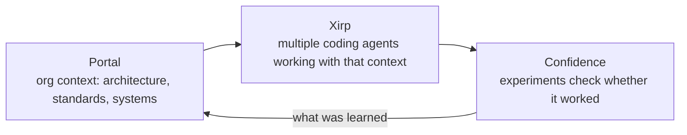

> 🌏 [中文版](/posts/ai/2026-10-11-spotify-technology-rd-tools)

If your team is weighing a tool that lets several coding agents share your company's architecture knowledge, Spotify just put one on the table. On October 7, 2026, SVP Tyson Singer announced [Spotify Technology](https://technology.spotify.com/) on the [engineering blog](https://engineering.atspotify.com/2026/10/introducing-spotify-technology-proven-at-spotify-now-yours), gathering its internal tools under one brand. After this read you can tell what each product does, which ones you can try now, and which claims are the seller's own.

## Why Spotify sells software

Singer opens with the question he gets daily: why is Spotify in the software business? His answer: behind the streaming app are hundreds of cross-functional squads serving 777 million monthly active users, so the tools had to be built in-house; once proven internally, they are shared as open source or commercial products.

None of this is new. Per the announcement and [TechCrunch](https://techcrunch.com/2026/10/08/spotify-is-getting-more-serious-about-selling-enterprise-software/):

- Backstage: open sourced in 2020
- Confidence: sold since 2023
- Portal: sold since 2024
- Xirp: sold since earlier in 2026

Only the brand is new, and Singer says the company is "doubling down rather than dabbling." The name is unrelated to the Luxembourg-listed Spotify Technology S.A., which the post notes explicitly.

The Amazon-to-AWS comparison is tempting, but it is ours, not Spotify's, and it overreaches: TechCrunch notes Spotify does not break out revenue for this business, and the site has no prices, only a contact-sales form. It is too early to say whether this is a new revenue line or a bigger wrapper.

## The bet: execution gets cheap, judgment gets expensive

The post's argument boils down to this line:

> When execution gets cheap, judgment becomes the constraint.

Plus a second point: AI makes forgetting expensive. Without shared memory, teams and agents re-learn what the organization already knows, rebuild what exists and retest what was tested, "now at machine speed."

That premise shapes the product set. The four products map to one loop:

Spotify says Portal and Xirp share one context layer and one agent runtime. That is the vendor's description; I found no independent verification.

## What each product line does

| Product | What it does | Status (per official pages) |
|---|---|---|
| [Backstage](https://backstage.io/) and paid plugins | Open source developer-portal framework; Spotify also sells Insights, Soundcheck, RBAC and Skill Exchange plugins | Framework is open source; plugins are commercial |
| [Portal by Spotify](https://portal.spotify.com/) | Internal developer platform built on Backstage; catalogs systems, ownership and standards as one source of truth for engineers and agents | Sold since 2024; no price in this announcement |
| [Xirp](https://xirp.spotify.com/) | Desktop app for managing multiple coding-agent sessions | Beta, macOS only |
| [Confidence](https://confidence.spotify.com/) | A/B testing, feature flags and experimentation | Site lists "300+ teams shipping daily" (Spotify's own figure) |

One correction to a common summary: the fourth item on the official site is "Plugins for Backstage," not Backstage itself. Backstage is free and open source; what costs money is what Spotify built on top of it.

## Xirp: several agents, one shared memory

Xirp is the product closest to coding agents. Per the [official docs](https://backstage.spotify.com/docs/xirp):

- Runs Claude Code, Codex, Gemini CLI, Pi and Cursor in persistent terminal sessions; switching does not lose state
- One Git worktree per task, so agents in parallel do not edit the same checkout
- It does not replace your agent or source host; you still sign in through each agent's own CLI

The "remembers progress" part mostly comes from Portal. The [Xirp and Portal doc](https://backstage.spotify.com/docs/xirp/xirp-and-portal) is explicit: sessions launched from a Portal catalog entity or Workspace receive wiki pages, technical records, ownership and prior session transcripts over MCP, and the agent pulls details on demand instead of getting everything in the first prompt. Sessions started directly in Xirp do not automatically gain that context.

A concrete flow: an engineer picks a service in the catalog; Xirp resolves its repo from the `backstage.io/source-location` annotation, creates a worktree, and the agent is told to read the project overview before starting. Afterwards the transcript can be uploaded to the Workspace so the next person or agent need not rediscover it.

## Limits and unverified parts

- **Xirp is beta**: the docs warn features and screens may change quickly; macOS only.
- **Memory is manual**: uploading a session to a Workspace is manual in the beta, not automatic accumulation.
- **Portal is the prerequisite**: without it Xirp is a multi-agent desktop manager; the "institutional memory" pitch requires adopting Portal and a Backstage catalog first, which is real work.
- **The numbers are the seller's**: 777M MAU, 300+ teams and "Proven at Spotify" all come from Spotify. I found no third-party evaluation of these tools and have not tried them myself.
- **No price or revenue**: no public pricing; TechCrunch notes revenue is undisclosed.
- **"Judgment is the bottleneck" is an argument, not a measurement**: the post gives no data on how much decision quality improves.

## Takeaway

If you already run Backstage, Spotify's set is the smoothest upgrade path, since Portal and Xirp are built around that catalog's data model. If not, the idea is worth more than the product: let agents look up who owns a service, what it depends on, and why it was designed that way. Start with one step this week: pick the system people most often ask "who owns this and why is it built this way" about, write the answer where agents can read it (`AGENTS.md`, `CLAUDE.md` or a wiki), and see whether agent mistakes drop. It costs nothing and tests the premise Spotify is betting on in your own team.

## References

- [Introducing: Spotify Technology. Proven at Spotify, now yours. (Spotify Engineering, Tyson Singer)](https://engineering.atspotify.com/2026/10/introducing-spotify-technology-proven-at-spotify-now-yours)
- [Spotify Technology site](https://technology.spotify.com/)
- [Spotify is getting more serious about selling enterprise software (TechCrunch, 2026-10-08)](https://techcrunch.com/2026/10/08/spotify-is-getting-more-serious-about-selling-enterprise-software/)
- [Portal by Spotify](https://portal.spotify.com/)
- [Confidence by Spotify](https://confidence.spotify.com/)
- [Xirp](https://xirp.spotify.com/)
- [Xirp docs: overview](https://backstage.spotify.com/docs/xirp)
- [Xirp docs: Xirp and Portal](https://backstage.spotify.com/docs/xirp/xirp-and-portal)
- [Backstage (open source project)](https://backstage.io/)
