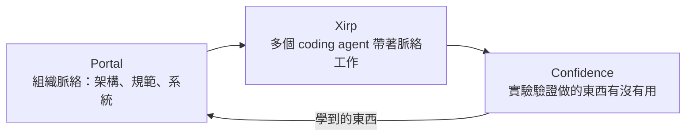

> 🌏 [English version](/en/posts/ai/2026-10-11-spotify-technology-rd-tools-en)

如果你的團隊正在評估「要不要買一套東西，讓多個 coding agent 共用公司的架構知識」，Spotify 剛好端出一套。2026 年 10 月 7 日，Spotify SVP Tyson Singer 在[工程部落格](https://engineering.atspotify.com/2026/10/introducing-spotify-technology-proven-at-spotify-now-yours)宣布 [Spotify Technology](https://technology.spotify.com/)，把原本零散銷售的內部工具放到同一個品牌下。這篇讀完你能判斷：這四個產品各解決什麼、哪些現在就能試、哪些說法只是賣方的主張。

## 為什麼 Spotify 要賣軟體

Singer 在文中先回答了他每天被問的問題：Spotify 為什麼要做軟體生意。他的說法是，消費者看到的串流 App 背後有數百個跨職能小隊，服務 7.77 億月活使用者，所以工具得自己造；造完、在內部驗證後，再用開源或商業產品的形式分享出去。

這件事其實不新。依官方文章與 [TechCrunch 的報導](https://techcrunch.com/2026/10/08/spotify-is-getting-more-serious-about-selling-enterprise-software/)：

- Backstage：2020 年開源
- Confidence：2023 年起對外販售
- Portal：2024 年起對外販售
- Xirp：2026 年稍早開始販售

新的只有品牌。Singer 的說法是「在加碼，不是在試水」。順帶一提，這個品牌名跟盧森堡的上市公司 Spotify Technology S.A. 無關，官方文末特別註明了這點。

這很容易讓人聯想到 Amazon 把內部機房變成 AWS。這個類比是我們的，不是 Spotify 說的，而且差別很大：TechCrunch 指出 Spotify 沒有在財報中揭露這塊業務的營收，官網也沒有價格，只有聯絡業務的表單。所以現在還看不出它是一條新的收入來源，還是一個更大的品牌包裝。

## 賭注：執行變便宜，判斷變貴

官方文章的論點可以濃縮成兩句：

> When execution gets cheap, judgment becomes the constraint.

以及 AI 讓「遺忘」變貴：沒有共用記憶，團隊和 agent 會「以機器的速度」重學組織早就知道的事、重做做過的東西、重測測過的點子。

這是整個產品組合的設計前提。四個產品對應的是同一個循環：

Spotify 稱 Portal 與 Xirp 共用一個脈絡層與 agent runtime，這部分是官方自述，外部尚無獨立驗證。

## 四條產品線各自做什麼

| 產品 | 做什麼 | 現況（依官方頁面） |
|---|---|---|
| [Backstage](https://backstage.io/) 與付費外掛 | 開源的開發者入口框架；Spotify 另賣 Insights、Soundcheck、RBAC、Skill Exchange 四個外掛 | 框架開源；外掛為商業產品 |
| [Portal by Spotify](https://portal.spotify.com/) | 建在 Backstage 上的內部開發者平台，把系統目錄、擁有者與規範整理成工程師和 agent 都能讀的「單一事實來源」 | 2024 年起販售；官方未在本次文章列價格 |
| [Xirp](https://xirp.spotify.com/) | 管理多個 coding agent 工作階段的桌面 App | beta，只支援 macOS |
| [Confidence](https://confidence.spotify.com/) | A/B 測試、feature flag 與實驗平台 | 官網列出「300+ 團隊每天出貨」（Spotify 自述） |

這裡要修正一個常見的說法：官方網站列的第四項是「Plugins for Backstage」，不是 Backstage 本身。Backstage 是免費的開源框架，要付費的是 Spotify 在它之上做的外掛和 Portal。

## Xirp：讓多個 agent 共用同一份記憶

Xirp 是四個產品裡跟 coding agent 最直接相關的一個。依[官方文件](https://backstage.spotify.com/docs/xirp)：

- 可以在持久的終端機工作階段裡同時跑 Claude Code、Codex、Gemini CLI、Pi 與 Cursor，切換時不丟狀態
- 每個任務用獨立的 Git worktree，多個 agent 平行工作時不會改到同一份 checkout
- 它不取代你的 agent 或原始碼託管，你仍然透過各 agent 自己的 CLI 登入

「記得進度」這件事主要靠 Portal。[Xirp 與 Portal 的整合文件](https://backstage.spotify.com/docs/xirp/xirp-and-portal)寫得很清楚：從 Portal 的軟體目錄或 Workspace 啟動工作階段時，Xirp 會透過 MCP 把 wiki、技術決策紀錄、擁有者與先前的工作階段紀錄交給 agent；而且 agent 是「需要時再取」，不是把所有文件塞進一開始的 prompt。直接在 Xirp 裡開的本機工作階段不會自動拿到這些脈絡。

具體流程大概是這樣：工程師在目錄中選一個服務，Xirp 根據目錄裡的 `backstage.io/source-location` 註記找到對應的 repo，開出 worktree，agent 開工前先被指示讀過專案概覽；做完之後，可以把這次的對話紀錄上傳到 Workspace，下一個人或下一個 agent 就不必重新摸索。

## 限制與還沒被驗證的部分

- **Xirp 是 beta**：官方文件有警告說功能與畫面可能快速變動，目前只支援 macOS。
- **記憶要靠手動**：工作階段上傳到 Workspace 在 beta 範圍內是手動的，不是自動累積。
- **Portal 是前提**：沒有 Portal，Xirp 只是一個管理多 agent 的桌面工具；「組織記憶」的賣點得先導入 Portal 與 Backstage 目錄，這本身是一筆不小的成本。
- **數字都是賣方自述**：7.77 億月活、300 多個團隊、「Proven at Spotify」都出自 Spotify 自己。我沒有找到第三方對這些工具效果的評測，也沒有實際試用過。
- **沒有價格與營收**：官網不公開價格，TechCrunch 也提到營收未揭露。
- **「判斷變成瓶頸」是論點，不是量測結果**：官方文章沒有附數據說明導入後決策品質改善多少。

## 整體來說

如果你的公司已經在用 Backstage，Spotify 這套組合是最順的升級路徑，因為 Portal 與 Xirp 是照這個目錄的資料模型設計的。如果沒有，值得先看的不是 Xirp，而是它背後那個想法：讓 agent 能查到服務擁有者、依賴關係與當初為什麼這樣決定。你可以先從一件事開始，這週挑一個最常被問「這個服務誰負責、為什麼這樣設計」的系統，把答案寫進 agent 讀得到的地方（`AGENTS.md`、`CLAUDE.md` 或 wiki），看 agent 犯的錯有沒有變少。這個做法不需要買任何東西，也能檢驗 Spotify 賭的那個前提在你的團隊成不成立。

## 參考資料

- [Introducing: Spotify Technology. Proven at Spotify, now yours.（Spotify Engineering，Tyson Singer）](https://engineering.atspotify.com/2026/10/introducing-spotify-technology-proven-at-spotify-now-yours)
- [Spotify Technology 官網](https://technology.spotify.com/)
- [Spotify is getting more serious about selling enterprise software（TechCrunch，2026-10-08）](https://techcrunch.com/2026/10/08/spotify-is-getting-more-serious-about-selling-enterprise-software/)
- [Portal by Spotify](https://portal.spotify.com/)
- [Confidence by Spotify](https://confidence.spotify.com/)
- [Xirp 官網](https://xirp.spotify.com/)
- [Xirp 文件：總覽](https://backstage.spotify.com/docs/xirp)
- [Xirp 文件：Xirp and Portal](https://backstage.spotify.com/docs/xirp/xirp-and-portal)
- [Backstage（開源專案）](https://backstage.io/)
