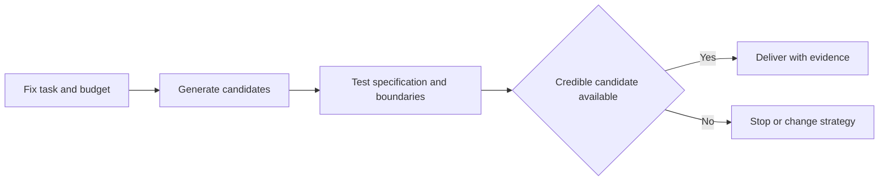

> 🌏 [中文版](/posts/ai/2026-10-11-stanford-cs329a-lecture-02-test-time-compute)

**Video status: Videos included.** This guide follows Lecture 2 of the [official Stanford CS329A Autumn 2025 schedule](https://cs329a.stanford.edu/), using the Stanford Online recording transcript and the assigned reading. The transcript was retrieved through a subtitle service; automatic versus manual provenance is unverified. This is not a complete transcript or a listening report.

If you need the course context first, start with the [series overview](/posts/ai/2026-08-20-stanford-cs329a-self-improving-agents-en).

## Decide where extra compute goes

A model may fail to write a program on its first attempt and succeed on another. Test-time compute scaling spends more computation while answering, without updating model weights. This guide is for developers choosing between a stronger model and more attempts from an existing one. Basic probability and testing are enough to follow the example.

The assigned [Large Language Monkeys](https://arxiv.org/html/2407.21787v3) separates two questions: does the candidate set contain a correct solution, and can a selector identify it? The former is coverage; the latter depends on verification precision. This guide focuses on that distinction rather than presenting every assigned method as an implemented recipe.

## Three directions in this lecture

The recording moves from repeated sampling through parallel versus sequential budget allocation to inference architecture search with [Archon](https://arxiv.org/abs/2409.15254). These increase candidates, choose how to distribute attempts, and combine generation, criticism, ranking, and fusion into workflows. Fusion creates a new answer, so its performance is not bounded by selecting only from the original candidates. The worked example below focuses on the generation-selection gap; the other directions are extensions.


## Parallel attempts and sequential revision

Parallel sampling produces multiple candidates from the same input and then compares or tests them. Sequential revision feeds a previous error into the next attempt. One explores alternative routes; the other adapts to observations. Simply making one answer longer does not establish useful exploration.

Under an illustrative model with independent attempts and fixed success probability p for one problem, the probability that k attempts contain a success is `1-(1-p)^k`. Real problems vary in difficulty, and candidates can repeat mistakes. This formula is a teaching model, not a prediction for an entire benchmark.

## Worked example: the correct answer loses

This is an original teaching example. A purchase of at least 100 receives free shipping; otherwise shipping costs 20. The input amount is 100, so the correct total is 100. Five generated programs include four using `amount > 100` and one using `amount >= 100`. Four return 120; one returns 100.

Majority voting selects the wrong total. Tests using only amounts 120 and 80 accept both implementations. Adding `shipping_total(100) == 100` rejects the four incorrect candidates. Extra generation made the right solution available, but the verification conditions determine whether it is delivered.

Now assume an independent success probability of 0.2 per attempt on this problem. Five attempts contain a success with probability `1-0.8^5 = 0.67232`. That 67.232% describes the presence of a correct solution, not majority-vote accuracy or the fraction of these programs passing tests. The five programs are an observed set; the probability calculation uses a prior assumption. Keep them separate.



## When more attempts stop helping

If correct candidates never appear, the bottleneck may be capability, missing information, or exploration. If they appear but lose selection, verification is the bottleneck. More calls do not automatically solve either problem. Count verification costs too: expensive tests can make a larger candidate set costly.

A common mistake is treating pass@k as product success. It measures whether at least one attempt passes; a product still has to select an answer. Agreement is also insufficient evidence: candidates may share the same mistaken rule. The paper discusses errors in tests themselves, so passing a suite does not prove correctness for every possible case.

## Variation and answer

Change the rule to free shipping only for purchases exceeding 100. With an input of 100, which operator is correct? Use `>` and return 120. The verifier must follow the specification rather than reuse the earlier boundary answer.

With independent success probability 0.1 and three attempts, coverage probability is `1-0.9^3 = 0.271`. If the selector always chooses the first candidate, its success probability remains 0.1. The other attempts are unused. Explaining the difference between those probabilities is the learning check.

## A comparison you can run today

Choose ten tasks with explicit answers. Fix the model, prompt, and tasks, then generate one and five candidates per task. Save every candidate. Record whether the set contains a correct answer separately from whether the selected answer is correct, alongside total time and cost. Do not let the selector see the reference answer used to measure coverage. The gap tells you whether to invest in generation or verification.

## Recording and English practice

```youtube
url: https://www.youtube.com/watch?v=-Ggc37xLj_Y
title: Stanford CS329A Lecture 2
captions: en
```

The official recording is linked here for continuous viewing. The retrieved transcript supports the conceptual guide, but three synchronized caption segments, audio checks, and player checks remain pending. Caption visibility in the player has not been verified. This page does not reproduce the full transcript or provide checked spoken quotations or timestamps. You can read the assigned paper and explain the example inputs and success criteria in your own English; that is an original expression exercise.

## References

- [Stanford CS329A Autumn 2025: official schedule](https://cs329a.stanford.edu/)
- [Large Language Monkeys](https://arxiv.org/html/2407.21787v3)
- [Stanford Online: CS329A Part 2](https://www.youtube.com/watch?v=-Ggc37xLj_Y)
- [Archon](https://arxiv.org/abs/2409.15254)
