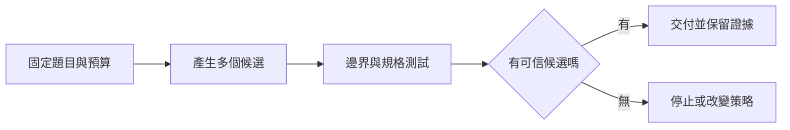

> 🌏 [English version](/posts/ai/2026-10-11-stanford-cs329a-lecture-02-test-time-compute-en)

**影片狀態：已附影片。** 本文依 [Stanford CS329A Autumn 2025 官方課表](https://cs329a.stanford.edu/) 第 2 堂，結合 Stanford Online 錄影字幕與指定閱讀導讀。字幕由字幕服務取得，人工或自動來源尚未確認；本文不是完整逐字稿或親聽筆記。

需要先補課程脈絡，可從[本系列總覽](/posts/ai/2026-08-20-stanford-cs329a-self-improving-agents)開始。

## 多花算力，先問花在哪裡

同一個模型第一次寫錯程式，再叫它產生另一版，可能就過了測試。這種在回答問題時增加運算、沒有更新模型權重的方法，就是推論時計算擴展。適合讀這堂的人，是已經會呼叫模型，正在決定要換更大的模型，還是讓現有模型多試幾次的開發者。先備只需要懂機率與基本測試；本文把容易混淆的成功率拆開說明。

本堂官方閱讀中的 [Large Language Monkeys](https://arxiv.org/html/2407.21787v3) 將重複抽樣拆成兩個問題：候選集合裡是否存在正解，以及選擇器能否找出它。前者是 coverage，後者牽涉驗證精度。本文聚焦這個區分，不把課表上的其他方法一起當成已實作的配方。

## 本堂的三種擴展方向

錄影內容依序從重複抽樣、平行與序列預算分配，走到 [Archon](https://arxiv.org/abs/2409.15254) 的推論架構搜尋。第一條路線增加候選；第二條路線決定要多開分支，還是沿著同一解答修正；第三條路線把生成、批評、排序與融合等元件組成不同流程。融合會產生新答案，因此它的結果不是只能從原候選裡選一個的上限。本文完整例子先處理第一條路線的生成與選擇差距，後兩條保留為延伸方向。


## 平行嘗試與序列修正

增加預算有不同用途。平行抽樣讓模型從相同輸入產生多個候選，再比較或測試；序列修正則把上一輪錯誤回饋送進下一輪。前者嘗試不同路線，後者沿著觀察改進。單純增加同一份回答的文字長度，不等於有效探索。

重複抽樣的理想上限是「至少一個候選正確」。若同一題的每次抽樣獨立，而且成功機率固定為 p，抽 k 次至少成功一次的機率是 `1-(1-p)^k`。這是本文用來建立直覺的機率模型；真實題目難度不同，候選也可能重複犯錯，不能拿它直接預測整個評測集。

## 完整例子：有正解，還是選錯

以下是自擬教學例子。題目要求：購物滿 100 元免運，未滿加 20 元。輸入金額 100，正確輸出應為 100。模型產生五版，其中四版使用 `amount > 100`，一版使用 `amount >= 100`。四版輸出 120，一版輸出 100。

若以多數決選答案，就交出錯的 120。若測試只有輸入 120 與 80，兩種實作都通過，也找不出錯誤。加入邊界測試 `shipping_total(100) == 100`，才能淘汰四個錯誤候選。結果說明：增加候選讓正解出現了，驗證條件卻決定正解能不能成為交付。

再假設同一題每次獨立抽樣有 0.2 的成功機率。五次至少成功一次的機率為 `1-0.8^5 = 0.67232`。這個 67.232% 是存在正解的機率，不是多數決的成功率，更不是目前程式通過測試的比例。實際五版結果是觀察到的集合；機率計算則是事前假設，兩者不要混用。



## 何時該停止多試

如果候選裡一直沒有正解，問題可能是模型能力、缺少資訊或探索方式；如果正解出現了卻選不中，瓶頸在驗證。兩種情況都不能只用更多次呼叫解決。另要把生成與驗證成本一起計算：每版若需要跑耗時測試，候選數翻倍也會增加驗證負擔。

常見誤解是把 pass@k 當成產品成功率。它描述多次嘗試中至少有一個通過的能力；產品最後仍要選一個答案。另一個誤解是「多數答案相同就代表可靠」：模型可能共享同一個錯誤規則。論文也討論測試本身的錯誤，測試通過不能推廣成所有情況都正確。

## 變式練習與答案

把規格改成「超過 100 元免運」，保留金額 100。哪個運算子才對？答案是 `>`，輸出為 120。這說明驗證器必須跟著規格改，不能把前題的邊界答案硬套過來。

再把獨立抽樣成功率改為 0.1，抽三次。存在正解的機率為 `1-0.9^3 = 0.271`。如果選擇器只會挑第一版，成功機率仍是 0.1；多產生兩版沒有被選擇流程使用。能分清這兩個數字，就抓到了本堂核心。

## 今天可以做的比較

找十個有明確答案的題目，固定模型、提示與題目，分別產生一版和五版。保留每個候選，分開記錄「集合含正解」與「最後選對」，再記總時間與總成本。選擇器不准偷看用來計算 coverage 的標準答案。先看兩種成功率差多少，再決定預算應增加在生成還是驗證。

## 原始錄影與英文練習

```youtube
url: https://www.youtube.com/watch?v=-Ggc37xLj_Y
title: Stanford CS329A 第 2 堂
captions: en
```

可從官方錄影連續觀看。取得的字幕用於概念導讀；三段同步字幕跟讀、原音回聽與播放器實測仍待補，尚未確認播放器實際顯示字幕。本站未重刊完整逐字稿，也未提供已核對的口述短引文或時間碼。可以先讀指定論文，再用自己的英文說明例子輸入與成功判準；這是自擬表達練習。

## 參考資料

- [Stanford CS329A Autumn 2025: official schedule](https://cs329a.stanford.edu/)
- [Large Language Monkeys](https://arxiv.org/html/2407.21787v3)
- [Stanford Online: CS329A Part 2](https://www.youtube.com/watch?v=-Ggc37xLj_Y)
- [Archon](https://arxiv.org/abs/2409.15254)
