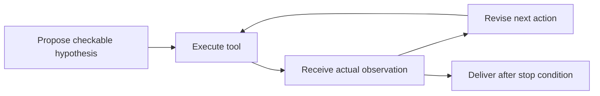

> 🌏 [中文版](/posts/ai/2026-10-11-stanford-cs329a-lecture-04-tool-code-feedback)

**Video status: Videos included.** This guide follows Lecture 4 of the [official Stanford CS329A Autumn 2025 schedule](https://cs329a.stanford.edu/), using the Stanford Online recording transcript and the assigned reading. The transcript was retrieved through a subtitle service; automatic versus manual provenance is unverified. This is not a complete transcript or a listening report.

If you need the course context first, start with the [series overview](/posts/ai/2026-08-20-stanford-cs329a-self-improving-agents-en).

## Observe before choosing what to change

A model saying “this code should work” and an executor reporting a failure are different evidence. One is a prediction; the other is an observation for a particular environment and input. Lecture 4 concerns feedback from tools and code. This guide uses the interleaving mechanism in the assigned [ReAct](https://arxiv.org/html/2210.03629v3), then practices it with an original coding example.

The paper reading scope is the introduction and core mechanism, alongside the recording transcript, not a reproduction of every evaluation. The code is not a lecturer demonstration. Readers should know simple functions and tests. Understanding how feedback changes an action comes before distinguishing revision from training.

## Three sources of feedback

The recording covers environmental observations in ReAct, execution feedback in [RLEF](https://arxiv.org/abs/2410.02089), and principle-based critique in [Constitutional AI](https://arxiv.org/abs/2212.08073). These are different signals: new environmental information, observed program behavior, and conformity to human-written behavioral principles.

RLEF also uses execution feedback in a training loop, unlike the weight-preserving revision illustrated here. Constitutional AI first produces critique and revision data for supervised learning, then uses AI preference feedback to train a preference model and perform reinforcement learning. Its target is response behavior rather than arithmetic correctness. Choose a method by asking whether the task needs factual information, executable tests, or principle-based judgment.


## Three roles in a feedback loop

An agent proposes a checkable hypothesis, calls a tool, receives an observation, and updates its action. Tools may search, read files, or execute code. An observation must come from the tool; a model-written success message is not a substitute.

ReAct interleaves reasoning and actions so external information can affect decisions. This can happen without a weight update. The lecture title includes learning, but testing and revising code does not by itself constitute reinforcement learning. Weight updates and training objectives need separate evidence.



## Worked example: a discount boundary

This original teaching example does not call a model. The specification gives a 20% discount when buying at least three items. Each item costs 50. The initial implementation is:

```python
def total(count, price):
    factor = 0.8 if count > 3 else 1
    return count * price * factor
```

For `count=3, price=50`, the expected total is 120, but the function returns 150. This observation points to the threshold, rather than motivating an unfocused rewrite. The next hypothesis is that “at least three” includes three, so replace `>` with `>=`. Three items now cost 120. Check two items at 100 and four at 160 to validate both sides.

Save and run this Python file. A successful run prints `ok`:

```python
def total(count, price):
    factor = 0.8 if count >= 3 else 1
    return count * price * factor

for count, expected in [(2, 100), (3, 120), (4, 160)]:
    assert abs(total(count, 50) - expected) < 1e-9
print("ok")
```

Floating-point comparison here serves the teaching calculation. A payment system also needs explicit currency precision and rounding rules. These three tests establish the illustrated boundary behavior, not suitability for every payment requirement.

## Classify failures before revising

Returning 150 indicates a logic problem. A missing Python executable indicates an environment problem. A test expecting 110 indicates a possible verifier error. Identify the failing layer before changing code, environment, or specification. Feeding every failure back as “try harder” gives the next action little direction.

Tool access does not guarantee reliability. Tools reveal what they measured; untested cases remain unknown. Multiple conversational turns also do not establish persistent learning. If changes stay only in the current context, a fresh run may repeat the mistake. Memory, prompt updates, and training weights are distinct mechanisms.

Define a stop condition, such as two revision attempts followed by a report of unresolved cases. An unlimited loop can repeatedly change the same line and regress behavior that previously worked.

## Variation and answer

Change the rule to discounts only when buying more than three items. Three items should cost 150, using `>`. The earlier fix is now wrong: feedback has meaning relative to the current specification.

If the three-item test passes but two items return 80, can you deliver? No. The two-item case also received the discount incorrectly, so the threshold condition is still wrong. Keep the three-item test and repair the boundary behavior; do not remove the failing two-item test. Success means satisfying all specification cases.

## An action for today

Choose a pure function. Write tests below, at, and above its threshold. For each failure, save the input, expected result, actual result, and version. Propose one revision hypothesis, then rerun the entire set. The resulting record shows which decision the observation changed, rather than merely showing that a tool was called.

## Recording and English practice

```youtube
url: https://www.youtube.com/watch?v=Lxh9RF5S-K0
title: Stanford CS329A Lecture 4
captions: en
```

The official recording is linked here for continuous viewing. The retrieved transcript supports the conceptual guide, but three synchronized caption segments, audio checks, and player checks remain pending. Caption visibility in the player has not been verified. This page does not reproduce the full transcript or provide checked spoken quotations or timestamps. You can read the assigned paper and explain the example inputs and success criteria in your own English; that is an original expression exercise.

## References

- [Stanford CS329A Autumn 2025: official schedule](https://cs329a.stanford.edu/)
- [ReAct](https://arxiv.org/html/2210.03629v3)
- [Stanford Online: CS329A Part 4](https://www.youtube.com/watch?v=Lxh9RF5S-K0)
- [RLEF](https://arxiv.org/abs/2410.02089)
- [Constitutional AI](https://arxiv.org/abs/2212.08073)
