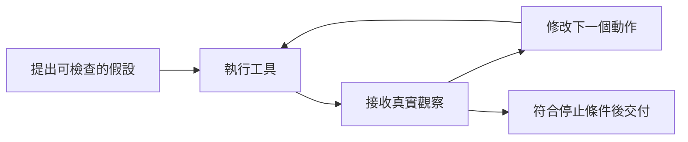

> 🌏 [English version](/posts/ai/2026-10-11-stanford-cs329a-lecture-04-tool-code-feedback-en)

**影片狀態：已附影片。** 本文依 [Stanford CS329A Autumn 2025 官方課表](https://cs329a.stanford.edu/) 第 4 堂，結合 Stanford Online 錄影字幕與指定閱讀導讀。字幕由字幕服務取得，人工或自動來源尚未確認；本文不是完整逐字稿或親聽筆記。

需要先補課程脈絡，可從[本系列總覽](/posts/ai/2026-08-20-stanford-cs329a-self-improving-agents)開始。

## 先觀察，才知道下一步該改什麼

模型說「這段程式應該可以」和執行器回報「這個輸入失敗」，提供的是不同證據。前者是預測，後者是對特定環境與輸入的觀察。第 4 堂談工具與程式回饋，本文從本堂指定閱讀 [ReAct](https://arxiv.org/html/2210.03629v3) 的推理、動作、觀察交錯機制切入，再用自擬程式例子練習。

本文對照字幕並閱讀論文的介紹與核心機制段落，並非重現所有評測，也不宣稱這段程式是講者示範。適合會寫簡單函式與測試的人；先懂「回饋怎麼影響下一步」，才能分清單次修正和真正的訓練。

## 同一堂課，三種回饋來源

錄影依序談 ReAct 的環境觀察、[RLEF](https://arxiv.org/abs/2410.02089) 的程式執行回饋，以及 [Constitutional AI](https://arxiv.org/abs/2212.08073) 的原則導向批評。它們不能混成一種「模型自我反省」：環境觀察提供新資訊；執行測試指出程式行為；原則批評則判斷回覆是否符合人寫的行為要求。

RLEF 還把執行回饋放進訓練迴圈，與本文示範的不更新權重之修正不同。Constitutional AI 先產生批評與修訂資料做監督式訓練，再用 AI 偏好回饋訓練偏好模型並進行強化學習。其目標也不是算術答案，而是回覆行為。要選方法，先問需要事實資訊、可執行測試，還是原則判斷。


## 回饋迴圈的三個角色

代理先根據目前狀態提出可檢查的假設，再呼叫工具取得觀察，最後用觀察更新行動。工具可以是搜尋、讀檔或程式執行器；觀察必須由工具回傳，不能由模型自己寫一段成功訊息替代。

ReAct 將推理與動作交錯，讓外部資訊進入後續決策。這可以在不更新權重的情況下發生。本堂標題雖然包含 learning，不能據此把每次測試後修改都叫成強化學習：權重是否更新、用了什麼訓練目標，必須另外交代。



## 完整例子：折扣邊界出錯

以下是自擬教學例子，沒有呼叫模型。規格為「滿三件，每件打八折」，單價 50 元。初版函式如下：

```python
def total(count, price):
    factor = 0.8 if count > 3 else 1
    return count * price * factor
```

輸入 `count=3, price=50`，預期 120，實際回傳 150。這個觀察將問題縮小到門檻，而不是讓模型泛泛地重寫整個函式。下一步假設是「滿三件包含三件」，因此將 `>` 改成 `>=`。修正後三件為 120；再檢查兩件為 100、四件為 160，確認門檻兩側符合規格。

可以把下面存成 Python 檔案執行，成功時印出 `ok`：

```python
def total(count, price):
    factor = 0.8 if count >= 3 else 1
    return count * price * factor

for count, expected in [(2, 100), (3, 120), (4, 160)]:
    assert abs(total(count, 50) - expected) < 1e-9
print("ok")
```

此處浮點比較只服務教學算術。真正付款系統還需定義貨幣精度與四捨五入。回饋迴圈能修正這個門檻，不能憑三個測試就宣稱函式適合處理所有付款需求。

## 失敗訊息也要分種類

若輸出是 150，回饋指向邏輯；若根本找不到 Python，回饋指向執行環境；若測試把預期值寫成 110，問題在驗證器。代理應先辨認哪一層失敗，再決定改程式、修環境或檢查規格。把所有錯誤都塞回提示要求「再努力一次」，會讓下一步失去方向。

常見誤解是有工具就能保證可靠。工具只提供它實際測量的資訊，測試未涵蓋的情況仍未知。另一個誤解是多輪對話自然累積學習：如果改動只留在當次上下文，下次重開可能仍犯同樣錯。跨任務保存記憶、更新提示和訓練權重，是不同機制。

停止條件也要明確。可設定最多修兩次，還沒通過就回報失敗案例。沒有預算邊界的迴圈可能不停修改同一處，而且讓原本正確的行為退化。

## 變式練習與答案

改成「超過三件才打八折」。三件應付多少？150，條件應使用 `>`。沿用剛才的修正反而錯了：工具觀察的意義必須相對於目前規格。

若三件測試通過，但兩件回傳 80，能交付嗎？不能；這顯示兩件也被錯套折扣，門檻條件仍有錯。下一步應保留三件測試，再修門檻兩側，而不是刪掉失敗的兩件測試。成功判準是所有規格案例成立。

## 今天可以做的動作

拿一個純函式，先寫門檻以下、門檻本身與門檻以上三個測試。每次失敗保存輸入、預期、實際及版本，再只提出一個修正假設。重跑整組測試，保留修正前後的結果。這份紀錄能回答「觀察到底改變了哪個決策」，而不只是證明工具曾被呼叫。

## 原始錄影與英文練習

```youtube
url: https://www.youtube.com/watch?v=Lxh9RF5S-K0
title: Stanford CS329A 第 4 堂
captions: en
```

可從官方錄影連續觀看。取得的字幕用於概念導讀；三段同步字幕跟讀、原音回聽與播放器實測仍待補，尚未確認播放器實際顯示字幕。本站未重刊完整逐字稿，也未提供已核對的口述短引文或時間碼。可以先讀指定論文，再用自己的英文說明例子輸入與成功判準；這是自擬表達練習。

## 參考資料

- [Stanford CS329A Autumn 2025: official schedule](https://cs329a.stanford.edu/)
- [ReAct](https://arxiv.org/html/2210.03629v3)
- [Stanford Online: CS329A Part 4](https://www.youtube.com/watch?v=Lxh9RF5S-K0)
- [RLEF](https://arxiv.org/abs/2410.02089)
- [Constitutional AI](https://arxiv.org/abs/2212.08073)
