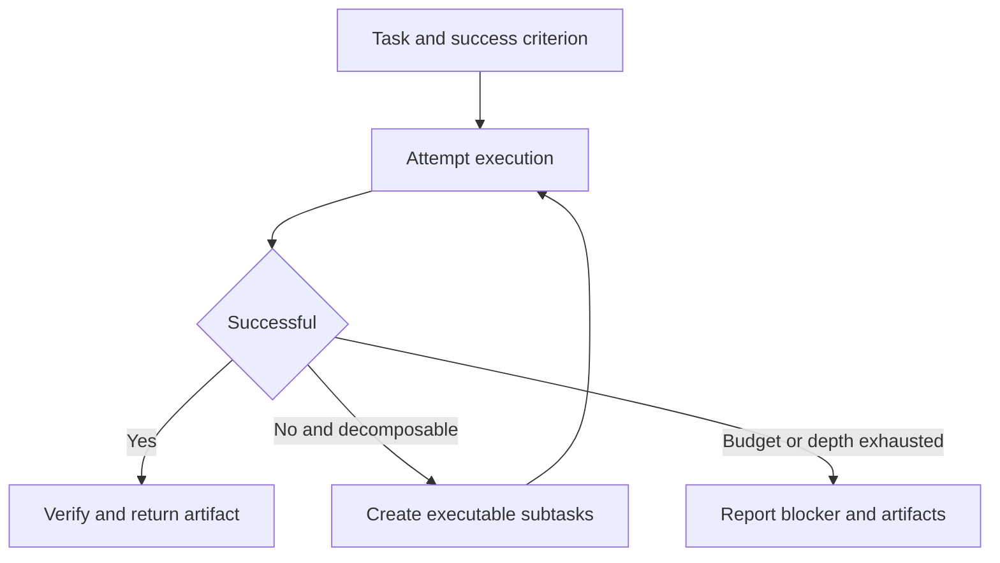

> 🌏 [中文版](/posts/ai/2026-10-11-stanford-cs329a-lecture-05-reasoning-planning)

**Video status: Videos included.** This guide follows Lecture 5 of the [official Stanford CS329A Autumn 2025 schedule](https://cs329a.stanford.edu/), using the Stanford Online recording transcript and the assigned reading. The transcript was retrieved through a subtitle service; automatic versus manual provenance is unverified. This is not a complete transcript or a listening report.

If you need the course context first, start with the [series overview](/posts/ai/2026-08-20-stanford-cs329a-self-improving-agents-en).

## A complete plan can still be impossible to execute

An agent asked to prepare a report may list search, read, compare, and write. Yet “read” can hide missing attachments, incompatible formats, and inconsistent data definitions. A high-level plan can hide difficulty inside a verb.

For Lecture 5, this guide covers search, parallelism, and training, then practices decomposition using the assigned [ADaPT](https://arxiv.org/html/2311.05772v2): decompose a subtask when the executor cannot complete it. The reading scope is the HTML introduction and method discussion, not a reproduction of experiments or coverage of every assigned paper. Readers should understand tool feedback and be preparing multi-step workflows.

## The recording's three threads

[Language Agent Tree Search (LATS)](https://arxiv.org/abs/2310.04406) places actions and observations in a search tree: select a route, expand candidates, attempt an outcome, and update node estimates from success or failure. Less explored branches need opportunities too. Updating tree statistics is not backpropagation through model weights. Cost and irreversible actions remain limitations.

[SPRINT](https://arxiv.org/abs/2506.05745) identifies independent reasoning work and trains models to produce plans that can execute in parallel. Two independent documents can be read together; comparison waits for both. Fewer sequential tokens do not necessarily mean fewer total tokens or measured end-to-end speedup.

[SWiRL](https://arxiv.org/abs/2504.04736) collects multi-step tool trajectories offline, then rewards newly proposed actions during training. Tools run during data collection, rather than for every action in the reinforcement-learning loop. This does not eliminate live tools at deployment or mean the judge observed the real result of a new action. The ADaPT exercise below is supplementary assigned reading; it is not a fourth spoken topic in this recording.


## Execute, decompose, and stop

An iterative agent chooses its next action from observations. A plan-and-execute system first lists subtasks. ADaPT instead uses execution success or failure to decide whether further decomposition is necessary, rather than splitting everything to maximum detail upfront.

This guide organizes subtasks using preconditions, input artifacts, and completion criteria. That is an original workflow aid. A downstream step cannot be complete before its preconditions hold. Decomposed subtasks must jointly fulfill their parent task. Rephrasing one difficulty as three vague verbs does not make execution easier.



## Worked example: compare two quotes

This is an original teaching example. Quote A offers ten accounts for a total of 1000 per month. Quote B charges 80 per account per month, with a minimum purchase of fifteen accounts. The customer needs ten accounts. Compare the actual monthly amount payable.

An initial attempt that directly compares 1000 with 80 mixes units. Decompose the failing price comparison into identifying billing units, reading minimum purchase conditions, calculating total payment, and identifying unused capacity. A costs 1000. B costs `max(10,15) × 80 = 1200`, including five unused accounts. Under these specific conditions, A costs 200 less per month.

The parent task is complete when both quotes use the same quantity: the monthly amount payable for the stated demand. Each intermediate artifact is checkable: A gives a total, B gives a unit price, B's minimum is fifteen, and its total is 1200. Four checked boxes are insufficient unless their outputs actually support the comparison.

If B's minimum purchase quantity is absent from the document, report it as unknown. Splitting the task into reading successive pages cannot create missing information. Obtain another source or stop with a conditional conclusion.

## Dependencies constrain parallel work

Reading A and B can happen independently. Calculating each total depends on its pricing and purchase conditions. Comparing totals depends on both calculations. These dependencies matter more than the order of a to-do list.

More detailed planning does not always improve reliability. Excessive decomposition adds context-transfer cost and can lose the parent requirement. Failure also does not justify endless decomposition. Missing documents, unavailable tool permissions, or an undefined objective require changed information conditions.

The paper uses an executor's failure report to trigger decomposition, and that report can itself be mistaken. Saving checkable completion conditions alongside it is an application design suggestion, not a claim that the paper proves reliability for every real workflow.

## Variation and answer

Increase demand to twenty accounts, while A still specifies only its ten-account package and gives no expansion price. Can you declare B cheaper? No. B costs `20 × 80 = 1600`, but A's capacity and price for twenty users are unknown. Obtain A's expansion conditions first.

Now change A to 100 per account without a minimum purchase. Twenty accounts cost 2000; B costs 1600, so B costs 400 less. The difference between the two questions is whether prerequisites are complete, rather than one more multiplication. Explaining which conclusion depends on which condition is the learning check.

## An action for today

Pick a workflow that often gets stuck. Define success as an observable artifact. Let the executor attempt it, then record what it has and what it lacks when it fails. Decompose only that subtask. Limit decomposition to two levels and preserve an exit for unavailable information. Check the final artifact against the original requirement rather than treating a completed checklist as a completed task.

## Recording and English practice

```youtube
url: https://www.youtube.com/watch?v=Ml_fp9XkB8Y
title: Stanford CS329A Lecture 5
captions: en
```

The official recording is linked here for continuous viewing. The retrieved transcript supports the conceptual guide, but three synchronized caption segments, audio checks, and player checks remain pending. Caption visibility in the player has not been verified. This page does not reproduce the full transcript or provide checked spoken quotations or timestamps. You can read the assigned paper and explain the example inputs and success criteria in your own English; that is an original expression exercise.

## References

- [Stanford CS329A Autumn 2025: official schedule](https://cs329a.stanford.edu/)
- [ADaPT](https://arxiv.org/html/2311.05772v2)
- [Stanford Online: CS329A Part 5](https://www.youtube.com/watch?v=Ml_fp9XkB8Y)
- [Language Agent Tree Search (LATS)](https://arxiv.org/abs/2310.04406)
- [SPRINT](https://arxiv.org/abs/2506.05745)
- [SWiRL](https://arxiv.org/abs/2504.04736)
