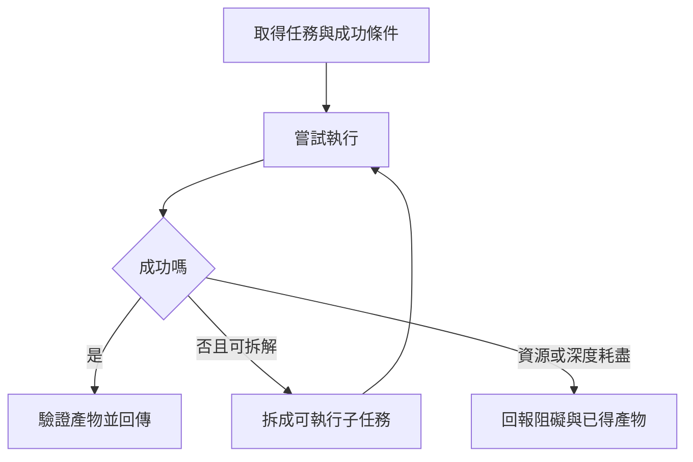

> 🌏 [English version](/posts/ai/2026-10-11-stanford-cs329a-lecture-05-reasoning-planning-en)

**影片狀態：已附影片。** 本文依 [Stanford CS329A Autumn 2025 官方課表](https://cs329a.stanford.edu/) 第 5 堂，結合 Stanford Online 錄影字幕與指定閱讀導讀。字幕由字幕服務取得，人工或自動來源尚未確認；本文不是完整逐字稿或親聽筆記。

需要先補課程脈絡，可從[本系列總覽](/posts/ai/2026-08-20-stanford-cs329a-self-improving-agents)開始。

## 計畫列得完整，仍可能做不下去

代理收到「整理一份報告」，很容易先列出搜尋、閱讀、比較、撰寫四步。但「閱讀」可能包含找不到附件、文件格式不同或數據口徑不一致。高層計畫沒有處理這些困難，只是把困難藏進一個動詞。

第 5 堂的多步驟推理與規劃涵蓋搜尋、平行與訓練；本文另用指定閱讀 [ADaPT](https://arxiv.org/html/2311.05772v2) 的按需拆解：執行器做不下去時，再請規劃器把那個子任務拆小。本文讀取其介紹與方法所在的 HTML 段落，沒有重現實驗或完整涵蓋其他指定論文。適合已理解工具回饋、準備設計多步驟任務的人。

## 錄影的三條主線：搜尋、平行與訓練

[Language Agent Tree Search（LATS）](https://arxiv.org/abs/2310.04406) 把動作與觀察放進搜尋樹：選一條路線、擴展候選、嘗試走到結果，再用成功或失敗更新節點評價。探索較少的分支也要有機會被選，避免只重複目前看起來最好的路線。搜尋回傳的更新是樹的統計，不是模型權重的反向傳播；成本與不可逆動作仍是限制。

[SPRINT](https://arxiv.org/abs/2506.05745) 則找出互不依賴的推理工作，透過訓練讓模型產生可平行執行的計畫。讀兩份獨立文件可以同時做，最後比較必須等兩份資料到齊。減少循序產生的 token 不等於減少總 token，也不能直接當成實測的端到端加速。

[SWiRL](https://arxiv.org/abs/2504.04736) 先離線蒐集多步驟工具使用軌跡，再在訓練時評分模型提出的新動作；工具呼叫留在資料蒐集階段，強化學習迴圈不需每次真的執行工具。這不表示部署時不必執行工具，也不表示 judge 看過新動作的真實結果。以下用課表另列的 ADaPT 作按需拆解練習；它是指定閱讀補充，並非上述錄影的第四個口述主題。


## 執行、拆解與停止

逐步行動的代理依觀察選下一步；先規劃再執行的方法先列子任務。ADaPT 的核心是依執行成敗決定是否需要進一步拆解，而不是一開始把所有任務切到最細。

本文用「前置條件、輸入產物、完成判準」整理每個子任務，這是自擬工作法。前置條件尚未滿足時，就不能把後續步驟標成完成。拆解後的子任務也要共同足以完成父任務；把同一個困難換成三句空泛動詞，不算真正變簡單。



## 完整例子：把兩份報價變成比較表

以下是自擬教學例子。任務輸入是報價 A：10 個帳號、每月總價 1000 元；報價 B：每帳號每月 80 元，最低購買 15 個帳號。需求只有 10 個帳號，目標是比較實際每月應付金額。

第一次嘗試若只抽出 1000 和 80 直接比較，會錯把不同單位放在同欄。將失敗的「比較價格」拆成：確認計價單位、讀取最低購買條件、換算需求下的總價、標註未使用容量。A 的應付金額是 1000；B 為 `max(10,15) × 80 = 1200`，其中 5 個帳號未使用。因此在此需求與價格條件下，A 每月少付 200 元。

父任務的完成判準是兩份報價都換成「需求下的每月應付金額」。每個子步驟產物可檢查：A 是總價、B 是單價；B 的最低量為 15；換算後為 1200。不是因為四個待辦都打勾就完成，而是這些產物真的支撐比較。

如果 B 的最低量在文件裡缺失，應回報條件未知，不能猜 15。再多拆成「讀第一頁、讀第二頁」也不會創造不存在的資訊；此時要取得補充來源或停在有條件結論。

## 拆解與平行的界線

可以分別讀 A、B，因為兩個讀取任務互不依賴；但總價換算要等各自單價與購買條件到齊，比較又要等兩個總價都完成。這個依賴關係比待辦順序更重要。

常見誤解是「規劃越細越可靠」。過度拆解會增加上下文傳遞成本，子任務也可能遺失父任務的需求。另一個誤解是失敗後永遠繼續拆。若阻礙是缺少文件、工具權限或不可判定的目標，應改變資訊條件，而不是無限遞迴。

原論文以執行器回報失敗觸發拆解，這份回報本身也可能誤判。因此本文建議把可檢查的完成條件一併保存；這是應用設計建議，不是論文證明所有真實流程都可靠。

## 變式練習與答案

把需求改成 20 個帳號；假設 A 仍只提供 10 帳號方案，超量價格未知。能直接說 B 更便宜嗎？不能。B 可算為 `20 × 80 = 1600`；A 是否能滿足 20 人及其總價都未知，應取得 A 的擴充條件後再比較。

若 A 改為每帳號 100 元且無最低量，20 個帳號為 2000 元，B 為 1600 元，這時 B 少付 400 元。兩題差別不是多算一次乘法，而是前置資料是否完整。能指出哪個結論需要哪個條件，才算理解規劃的作用。

## 今天可以做的動作

挑一個容易卡住的工作，把成功條件先寫成可觀察的產物。讓執行器先嘗試，失敗時記錄目前得到什麼、缺什麼，再只拆那個子任務。設定最多兩層拆解，並保留無法取得資料時的停止出口。檢查最後產物是否滿足原需求，避免把完成待辦清單當成完成任務。

## 原始錄影與英文練習

```youtube
url: https://www.youtube.com/watch?v=Ml_fp9XkB8Y
title: Stanford CS329A 第 5 堂
captions: en
```

可從官方錄影連續觀看。取得的字幕用於概念導讀；三段同步字幕跟讀、原音回聽與播放器實測仍待補，尚未確認播放器實際顯示字幕。本站未重刊完整逐字稿，也未提供已核對的口述短引文或時間碼。可以先讀指定論文，再用自己的英文說明例子輸入與成功判準；這是自擬表達練習。

## 參考資料

- [Stanford CS329A Autumn 2025: official schedule](https://cs329a.stanford.edu/)
- [ADaPT](https://arxiv.org/html/2311.05772v2)
- [Stanford Online: CS329A Part 5](https://www.youtube.com/watch?v=Ml_fp9XkB8Y)
- [Language Agent Tree Search（LATS）](https://arxiv.org/abs/2310.04406)
- [SPRINT](https://arxiv.org/abs/2506.05745)
- [SWiRL](https://arxiv.org/abs/2504.04736)
