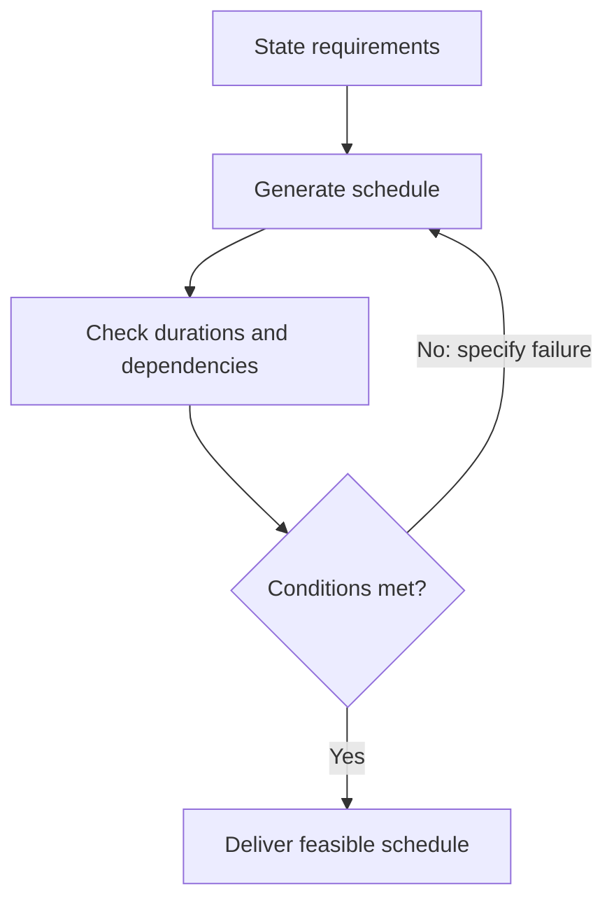

> 🌏 [中文版](/posts/ai/2026-10-12-stanford-cs329a-lecture-01-generation-verification-gap)

**Video status: Videos included.** This guide covers Lecture 1 of the [official Stanford CS329A Autumn 2025 schedule](https://cs329a.stanford.edu/), using the full transcript of [Stanford Online’s Course Overview recording](https://www.youtube.com/watch?v=6YnLB0XbTnI). Whether the captions are human-written or automatic is unconfirmed. Audio and slides have not been checked; this is neither a complete transcript nor a firsthand listening report.

Start with the [course overview](/posts/ai/2026-08-20-stanford-cs329a-self-improving-agents-en) for prerequisites and the reading route. This article teaches the original first lecture’s concepts. Afterward, you should be able to distinguish generating more answers, recognizing answers that satisfy a requirement, and updating model weights.

```youtube
url: https://www.youtube.com/watch?v=6YnLB0XbTnI
title: Stanford CS329A Lecture 1: Course Overview
captions: en
```

## Answering is only part of completing a task

Ask a model to schedule a day’s work. It produces a tidy timetable but assigns the same person to two tasks at once. Fluent prose and complete formatting show that it generated a plausible answer. To establish whether the plan can actually run, you still need to check time, resources, and dependencies.

Lecture 1 places this problem in the development of language models: larger training budgets bring more capabilities, instruction tuning improves responses to requests, and reinforcement learning from human feedback uses preference signals to guide training. When a model starts using tools and performing multistep tasks, however, a good single response does not guarantee a successful final result. This guide is for readers who understand how prompts reach a model and want to know why agents need feedback. No reinforcement learning derivation is required.

## From training scale to workflows

The recording first discusses scaling model parameters, data, and training compute, followed by few-shot prompting and reasoning capabilities. The starting point is that training affects capability, while prompts and problem-solving strategies affect how much of that capability we can access. Increasing scale does not guarantee a correct answer on every task.

Instruction tuning and reinforcement learning from human feedback (RLHF) follow. Instruction tuning supplies instructions and example responses. RLHF builds a reward signal from human preferences and uses it to guide updates to model parameters. Preferences may concern correctness, helpfulness, or safety; a preferred response does not automatically meet every specification. These are high-level introductions in Lecture 1, with training algorithms reserved for later sessions.

The lecture then moves from chat to workflows: breaking tasks into subtasks, routing by circumstance, working in parallel, and coordinating the results. Tools return web pages, execution results, or test signals. The central agent questions become what to do next and what evidence justifies stopping. Whether a person designs the workflow in advance or a model chooses the next step, reliable completion criteria remain necessary.

## Generation and verification are separate problems

A generator proposes candidate answers. A verifier determines whether they satisfy requirements. The lecture’s generator–verifier gap highlights the distinction: a model can produce a great deal of content, while judging its usefulness still requires feedback.

Checking can sometimes be easier than solving. Once you have a schedule, detecting an overlap may be simpler than arranging all the work from scratch. This is not a guarantee for every domain. Creative writing, research quality, and ambiguous user requests rarely reduce to one definitive pass/fail signal. Another model acting as a judge may miss the same errors.

First translate requirements into checkable conditions, then decide which feedback can test them. “Make a reasonable schedule” leaves the generator and evaluator to supply their own interpretations. “One person cannot perform two tasks simultaneously” permits an explicit interval check.

## Worked example: a polished schedule that cannot run

This is an original teaching example, not a demonstration from the lecturer. One person has hours 0 through 8 available. Each of three tasks must run once: A collects data for 3 hours, B analyzes it for 2 hours, and C writes the report for 3 hours. B must wait for A to finish, and C must wait for B. Tasks cannot be interrupted.

The first proposal puts A at 0–3, B at 2–4, and C at 4–7. Their durations are 3, 2, and 3 hours, and everything ends before hour 8. Yet B starts at hour 2, before A finishes at hour 3. It violates the dependency and double-books the person during hours 2–3.

The verifier should return a specific failure: “B.start = 2 is earlier than A.end = 3.” “Bad schedule” provides much less direction. With that feedback, the model proposes A at 0–3, B at 3–5, and C at 5–8. Rechecking confirms the required durations, valid dependencies, no overlap, and completion within the deadline. Total work is `3 + 2 + 3 = 8` hours, leaving no spare time. The schedule is feasible under the stated conditions.

Feasible does not guarantee smooth execution in reality. The problem omits breaks, delayed data, and uncertain task durations; the verifier does not check them either. Completion criteria tell us how far the evidence reaches.



This diagram describes the example’s correction loop. A check of the final finish time alone would accept the first, invalid schedule. Repeatedly asking the model to think again without identifying the dependency conflict leaves the repair direction unclear. More attempts need feedback that distinguishes success from failure.

## Correcting this answer does not mean the model learned

The same model can produce the second schedule: put the failure message into the next prompt, and it responds to the new context without any change to its weights. That is inference-time iteration. A fresh task without this context is not guaranteed to avoid the mistake just because the previous answer was repaired.

Training-time improvement uses data or rewards in training to update model weights. It aims to change behavior on future tasks, but still needs evaluation; success on a just-trained example is insufficient evidence. Feedback in a workflow, stored memory, and weight updates are different kinds of change. They should not all be described as the model learning by itself.

Lecture 1 also introduces inference-time scaling with model parameters fixed. It can involve generating more candidates or using feedback for revision. [Lecture 2](/posts/ai/2026-10-11-stanford-cs329a-lecture-02-test-time-compute-en) separates having a correct candidate from selecting it. Here, the goal is to distinguish those abilities from training updates.

## Check your understanding: a shorter deadline

Keep one worker and the A → B → C dependencies, but require completion before hour 7. The model claims more attempts will find a schedule. How should you assess that claim?

**Answer: the unchanged problem is infeasible.** Work cannot overlap, and the total duration remains 8 hours, exceeding the 7-hour window. Generating more schedules cannot change this lower bound. A satisfactory response identifies the conflict and asks whether the deadline can move or the scope can shrink. It must not silently drop a task. Adding a worker alone may not help: these tasks still have complete sequential dependencies.

Does feeding the error message back and obtaining a repaired schedule update the weights? **No.** The next prompt and its context changed. Unless training also runs, there is no basis for claiming a parameter update.

## English reading practice and original audio

Turn on English captions in the official player above. For continuous reading, open YouTube’s “Show transcript.” Three audio excerpts and their boundaries have not been checked by listening, so the shadowing sections remain pending. No estimated timecodes are supplied.

For now, practice this author-written sentence, which is not a quotation: *Generating a schedule and checking its constraints are different tasks.* It means「產生排程和檢查它的限制條件，是不同的任務」. Replace schedule with plan and constraints with assumptions to describe other generation and checking tasks.

## References

- [Stanford CS329A Autumn 2025 schedule](https://cs329a.stanford.edu/)
- [Stanford Online: CS329A Part 1 — Course Overview](https://www.youtube.com/watch?v=6YnLB0XbTnI)
