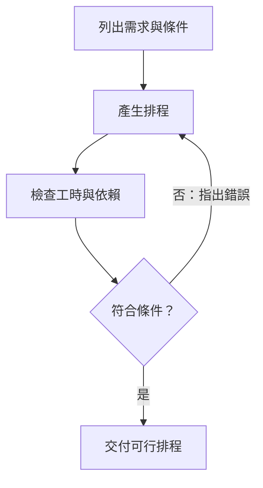

> 🌏 [English version](/posts/ai/2026-10-12-stanford-cs329a-lecture-01-generation-verification-gap-en)

**影片狀態：已附影片。** 本文依 [Stanford CS329A Autumn 2025 官方課表](https://cs329a.stanford.edu/) 第 1 堂與 [Stanford Online 的 Course Overview 錄影](https://www.youtube.com/watch?v=6YnLB0XbTnI)全文字幕導讀。字幕的人工／自動來源尚未確認，未核對原音與投影片；本文不是完整逐字稿或親聽筆記。

若還不確定先備與閱讀順序，先看[課程總覽](/posts/ai/2026-08-20-stanford-cs329a-self-improving-agents)。這篇是原課第一堂的概念導讀：看完應能分辨「多產生幾個答案」「辨認哪個答案符合要求」與「更新模型權重」三件事。

```youtube
url: https://www.youtube.com/watch?v=6YnLB0XbTnI
title: Stanford CS329A 第 1 堂：Course Overview
captions: en
```

## 模型會回答，離完成任務還有多遠

你請模型排一天的工作，它列出整齊的時間表，卻把同一個人安排在同時做兩件事。文字流暢、格式完整，只能證明它產生了一份看起來合理的答案。要知道這份安排能不能執行，還得檢查時間、資源與先後關係。

第一堂把這個問題放進模型發展的脈絡。增加訓練規模帶來更多能力，指令微調讓模型更能依要求回答；人類回饋強化學習則用偏好訊號引導訓練。但當模型開始使用工具、執行多步驟任務，單次回答的品質仍不足以保證最後結果。這堂適合知道模型如何接收提示、想理解 Agent 為什麼需要回饋的人；不需要先會推導強化學習公式。

## 從訓練規模到工作流程

錄影先介紹模型參數、資料與訓練計算量的擴展，再談少樣本提示與推理能力。這建立一個起點：模型能力受訓練影響，但使用時能取出多少能力，也受到提示與解題方式影響。本文不把規模增加解讀成「每個任務一定答對」。

接著是指令微調與人類回饋強化學習（RLHF）。前者提供指令與示範回答，讓模型學習如何回應要求；後者從人類偏好建立獎勵訊號，再用它引導模型參數的更新。偏好可以包含正確性、幫助程度或安全性，因此「較受偏好」不自動等於「符合所有規格」。這裡是第一堂的高層次介紹，訓練演算法留待後面的課。

最後，課堂從聊天轉向工作流程：把任務拆成子任務、依情況選路線、平行處理，再讓協調者統整。工具能帶回網頁、程式執行結果或測試訊號。Agent 的關鍵問題也因此變成：下一步該做什麼，以及拿到什麼證據才知道可以結束。流程圖事先由人安排，或由模型選擇下一步，都仍需要可靠的完成判準。

## 產生與驗證是兩個問題

生成器負責提出候選答案；驗證器負責判斷候選是否符合要求。課堂以 generator–verifier gap 指出兩者的差距：模型可能產生許多內容，但要判斷內容是否有用，仍需要回饋。

驗證有時比完整解題容易。拿到一份排程後，檢查是否重疊，可能比從零安排所有工作簡單。但這不是所有任務都成立的保證。開放式寫作、研究品質或模糊的使用者需求，很難只靠一個通過／失敗訊號決定。即使換另一個模型評分，它也可能漏掉相同錯誤。

因此，要先把需求寫成可以檢查的條件，再決定用什麼回饋。若需求只有「安排得合理」，模型與評分者各有自己的理解；若要求「同一人不能同時做兩個工作」，就能對時間區間做明確檢查。

## 完整例子：一份漂亮但做不完的排程

以下是本文自擬教學例子，不是講者示範。從第 0 小時到第 8 小時，只有一人工作，三個任務各執行一次：A 蒐集資料需要 3 小時，B 分析需要 2 小時，C 寫報告需要 3 小時。B 必須等 A 完成，C 必須等 B 完成；工作不可中斷。

模型先提出 A 在 0–3、B 在 2–4、C 在 4–7。三個區間長度分別是 3、2、3，看起來每項工時都夠，也在第 8 小時以前結束。但 A 到第 3 小時才完成，B 在第 2 小時就開始，既違反先後關係，也把同一人在 2–3 之間重複使用了。

驗證器要回傳具體錯誤：「B.start = 2，小於 A.end = 3」，而不是只說「排程不好」。模型收到回饋後改成 A 在 0–3、B 在 3–5、C 在 5–8。重新檢查：各任務工時正確、依序銜接、沒有重疊、全部在期限內完成。總工時是 `3 + 2 + 3 = 8`，沒有剩餘時間；這份排程對題目所列條件可行。

可行不代表現實中一定順利。題目沒包含休息、資料延遲或任務時間的不確定性，驗證也沒有檢查這些。這正是完成判準的作用：讓我們知道證據支持到哪裡。



這張圖描述本文例子的修正流程。若只檢查最後結束時間，第一個錯誤排程也會通過；若每次都請模型「再想一下」，卻不指出依賴衝突，修正方向仍不明確。更多嘗試要配上能區分好壞的回饋，才有機會改善結果。

## 修正這次答案，不等於模型已學會

上述第二版排程可以由同一個模型產生：把錯誤訊息放入下一輪提示，模型根據新的上下文回答，權重完全不變。這是推論時的迭代。下一次開一個沒有這份上下文的新任務，不能因為前次改對，就保證它不會再犯錯。

訓練時改進則會把資料或獎勵用進訓練，更新模型權重。它希望改變未來任務的行為，但也需要另做評測，不能只拿剛訓練過的例子當證明。記住工作流程中的回饋、保存記憶，以及權重更新，都是不同的改變；不能一概稱作模型自行學會了。

第一堂引入的推論時計算擴展同樣保持模型參數固定。它可以多產生候選，或利用回饋修正；[下一堂](/posts/ai/2026-10-11-stanford-cs329a-lecture-02-test-time-compute)會進一步拆開「候選裡有正解」與「最後能選出正解」。本堂先把這兩項能力與訓練更新分清楚。

## 自我檢查：期限縮短之後

仍用同一人、A → B → C 的先後關係，改成必須在第 7 小時前完成。模型聲稱「再多試幾次就能排好」。你會怎麼判斷？

**答案：在題目條件不變時不可行。** 三個工作不能重疊，總工時仍是 8 小時，大於 7 小時。再多產生幾份排程也無法改變這個下限。合格的回應應指出矛盾，詢問是否延後期限或縮減工作量；不能偷偷省掉一項工作。單純加一個人也不一定有用，因為這三項工作仍受完整的先後依賴限制。

再判斷：把上述錯誤訊息送回模型，得到修正版，是權重更新嗎？**不是。** 只有下一輪提示與上下文改變；除非另外執行訓練，不能宣稱模型參數已更新。

## 英文閱讀練習與原音入口

完整英文字幕請在上方官方影片播放器開啟；若要連續閱讀，可到 YouTube 的「顯示轉錄稿」。本文尚未回聽並核對三段原音的起訖，因此跟讀段落待補，不提供猜測的時間碼。

先練習下面這句本文自擬的表達，不是講者原話：

*Generating a schedule and checking its constraints are different tasks.*

意思是「產生排程和檢查它的限制條件，是不同的任務」。可以把 schedule 換成 plan，constraints 換成 assumptions，練習說明生成與檢查的區別。

## 參考資料

- [Stanford CS329A Autumn 2025 課表](https://cs329a.stanford.edu/)
- [Stanford Online：CS329A Part 1 — Course Overview](https://www.youtube.com/watch?v=6YnLB0XbTnI)
