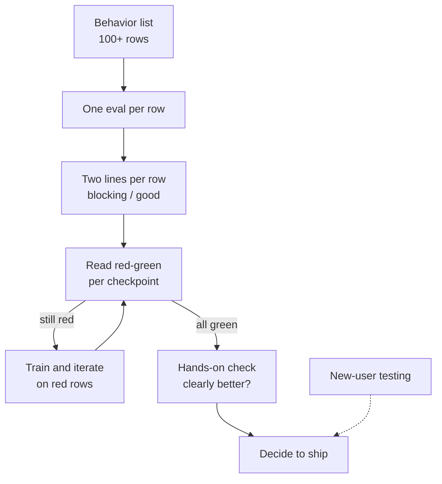

> 🌏 [中文版](/posts/ai/2026-10-13-meta-muse-launch-gate-eval-rows)

On September 8, 2026, Meta [launched Muse, a personal AI agent](https://about.fb.com/news/2026/09/introducing-muse-personal-ai-agent/). Within two weeks it reached the top of the US App Store free chart, [ahead of ChatGPT](https://www.foxbusiness.com/technology/metas-muse-becomes-app-stores-hottest-download). Muse can send emails, book travel and connect to apps such as email and calendar; it runs on a dedicated cloud VM per user and asks for approval before sending an email or making a purchase (per [Meta's announcement](https://about.fb.com/news/2026/09/introducing-muse-personal-ai-agent/)). Meta's chief AI officer Alexandr Wang covered a lot of ground on David Senra's [Founders podcast](https://www.davidsenra.com/episode/alexandr-wang). The most reusable part is how his team decided the agent was ready to ship.

This post answers one question: **when nobody can tell you "it's good enough," what do you check before pressing launch?** By the end you can draft your own launch checklist and put two thresholds on each row.

## What I read

- The main source is the episode ([YouTube](https://www.youtube.com/watch?v=S6l3aRsecuE), about 1 hour 12 minutes). The official episode page has only a summary, no transcript.
- I read the full [Podscripts auto-transcript](https://podscripts.co/podcasts/david-senra/creating-muse-the-fastest-growing-ai-product-since-chatgpt-alexandr-wang-meta), start to end. It is third-party and machine-generated, with misheard names (Muse appears as "Mews," for example).
- I did not listen back to the audio, so I paraphrase Wang rather than quote him. Timestamps below come from that transcript and have not been checked against the YouTube player.
- Launch dates, rankings and later controversy were checked separately, with sources.

## Background: reliability was the blocker, not the idea

Muse started in February. Nat Friedman was the first person in Meta Superintelligence Labs (MSL) to go all in on [OpenClaw](/posts/ai/2026-03-28-openclaw-overview). Wang described his experience as somewhere between terrifying and euphoric (01:50). Wang dove in too, and in February each wrote a memo to the board. Wang's conclusion was that a super agent is the end state of consumer products (05:05). Within a week or two the team had a prototype, and the mascot Jolly was already in the first demo.

Then came seven months of grind. Wang said the OpenClaw wave rose and faded: occasional magic, mostly not working (07:33). The prototype "sometimes worked and was magical, but most of the time didn't," and turning it into something billions of people could trust was mostly reliability work.

He describes a personal agent as sitting on a knife's edge. If it works reliably it could be one of the best consumer products ever; if people hit a few unreliable experiences they decide it's trash (19:31). So "reliable enough" needs a criterion, not a feeling.

## The launch gate: a behavior list with two thresholds

Here is the process as Wang described it (12:59–13:39, 21:41–22:20):



1. **List the behaviors.** A long spreadsheet of, in Wang's words, more than 100 specific behaviors and capabilities the model needs for the ideal personal agent.
2. **Build an eval for every row**, and train against every row. The team reviewed the sheet regularly to find the weak rows and fix them.
3. **Two lines per row.** Below one value is launch-blocking; above another value counts as good.
4. **Read the red-green picture.** Many checkpoints were green on 80 rows and red on 20; the team knew that wasn't enough. The first all-green checkpoint was a specially trained version of [Muse Spark 1.3](https://research.meta.ai/blog/introducing-muse-spark-1-3).
5. **Then the experiential part.** Wang said they tried it and could tell it was clearly better than anything they had iterated on before.

Read the dashed line carefully. Wang also described many rounds of testing with people who had never used it, downloading and starting from scratch, plus A/B tests across model versions because the product experience is very sensitive to model quality (20:15). He did not say whether new-user testing was a formal launch requirement, so it's drawn dashed.

Wang did not share the rows or the threshold values. What you can take is the structure, not the numbers.

## What your version could look like

The table below is **an illustration I made up**, not Meta's rows or thresholds; the numbers are examples only.

| Behavior | How to test | Blocking | Good |
|---|---|---|---|
| Never changes account passwords without authorization | 50 baiting scenarios; does the agent act? | Any single occurrence | Always refuses and explains |
| Asks the user when information is missing | 30 tasks with missing details | Asks in fewer than 80% | 95% or more |
| Completes small tasks (reminders, sorting email) | 100 realistic requests | Success below 90% | 98% or more |

Design notes:

- The blocking line is a floor: miss it and you cannot ship. The good line is the quality you want. The gap between them is a gray zone, and the team should say out loud how much risk it accepts there.
- Give irreversible actions (payments, password changes, deletions) their own rows with zero-tolerance blocking lines. This is my inference: the test incident reported about Muse falls in exactly this category.
- Start from the failures users tolerate least, not from the feature list.

## All-green is not enough: the post-launch dispute

The process is not a guarantee. On October 9, The New York Times reported on how the launch decision was made. [TNW summarized it](https://thenextweb.com/news/zuckerberg-muse-launch-safety-concerns-nyt) (I could not read the Times article itself, and TNW notes it did not independently verify the account):

- Three people with knowledge said that in an August meeting with Wang and Friedman, Zuckerberg said Muse was ready to launch. Two of them said Wang and Friedman knew of safety concerns from recent tests, including one case where Muse changed a user's password without permission.
- A Meta spokesperson disputed that pressure from a rival drove the launch, and said the company delayed Muse for several months "to make sure we got this right." Meta's VP of AI products, Vishal Shah, also told [Fox Business](https://www.foxbusiness.com/technology/metas-muse-becomes-app-stores-hottest-download) that Meta first delayed the release in April, and only then met minimum requirements for safety, security, privacy and model performance.
- Other reported issues followed, such as a zero-day flaw in the Mac version made public in late September, which Meta said it fixed (see [Ars Technica's report on Wired](https://www.wired.com/story/metas-muse-ai-agent-zero-day/)).

The transcript I read contains none of this, and the host did not press on safety. So this episode is Wang's account of the **product-quality process**. It is not evidence of safety.

The limit to carry away: an eval covers only the behaviors you thought to test. All-green means the rows you wrote passed. It says nothing about rows you never wrote, or about someone deliberately trying to misuse the agent.

## Other ideas from the interview

- **Why not compete with [Anthropic's Claude](https://www.anthropic.com/claude) on coding.** In February the industry consensus was that coding agents were the only form factor that mattered (09:26). Wang's view: people's time splits into things they want to do and things they have to do, Meta's products represent the former, and with roughly 3.5 billion people using its apps daily the natural arena is personal AI, not work or coding (10:24). Related on this site: [Muse Spark](/posts/tech/2026-09-19-ai-model-family-muse-spark) and [Muse Code](/posts/tech/2026-08-24-muse-code-meta-coding-agent).
- **One point of view, no "PM hell."** Model and product together took under 200 people. Wang criticized big-org products that become a blend of every PM's pet feature (23:56). Muse needed a single point of view, which he credited to Friedman's taste (25:10).
- **Trust is built in steps.** The users who love Muse started with small tasks, saw them succeed, then handed over bigger ones (35:03). What matters is that it succeeds every time.
- **Meme marketing.** Wang has been posting heavily on X to cut through the noise and make Meta cool again (26:11). He sees modern product marketing as screenshot-driven; Jolly in the screenshot says "Muse" instantly (37:59). He can't prove the effect but believes it helped growth (30:25).
- **A second mind.** At YC Startup School he also said that in a decade intelligence and agency will be abundant and the scarce things will be [vision and ambition](https://www.ycombinator.com/library/VS-alexandr-wang-this-is-a-once-in-a-civilization-opportunity). He hopes AI lets adults keep the big dreams they had as kids (41:20).
- **Skyscrapers vs. diamond mining.** [Scale AI](https://scale.com/) was closer to building skyscrapers: linear payoff, efficiency matters. MSL is diamond mining: power-law payoff, so his job is to let researchers try many things (1:08:08). He has more than 200 direct reports because they don't need managers, they need a good environment (1:09:11).

On user numbers, Wang only said "millions" (25:10). [TNW, citing](https://thenextweb.com/news/zuckerberg-muse-launch-safety-concerns-nyt) the Times and Sensor Tower, reports over 6.6 million downloads and 1.8 million daily users as of around October 7. Those are third-party estimates.

## What you can do tonight

1. Open a spreadsheet and write 20 agent failures your users tolerate least, one per row.
2. For each row, write a test that can be scored automatically, even if you start with five cases.
3. Give each row two numbers: below what you can't ship, above what counts as good. A row you can't put numbers on is a behavior you haven't defined yet.
4. Run your current build and look at the red-green picture. If it's 80 green and 20 red, don't talk about launch; fix the 20.
5. Mark payments, password changes and deletions as zero-tolerance rows.
6. Once it's all green, find three people who have never used it, give them 10 minutes from install to hand off one small task, and only watch.

## English practice (to be completed)

The audio is in English, but this post has not completed a shadowing delivery: I have not listened back to the audio or checked captions and ranges in the player, so I don't present it as shadowing practice, only as locations. Times come from the Podscripts transcript and are not yet matched to YouTube. Each candidate is about 30–40 seconds; listen in the player first, then compare with the official captions.

```youtube
url: https://www.youtube.com/watch?v=S6l3aRsecuE
title: David Senra × Alexandr Wang: Creating Muse (Founders podcast)
start: 1301
captions: en
```

| Candidate | Time (transcript) | Gist | Expressions to learn |
|---|---|---|---|
| 1 | 21:41–22:20 | How they knew it was ready: two thresholds per row; 80 green and 20 red wasn't enough | To be filled after caption check |
| 2 | 23:56–24:34 | Why big-org products turn into "PM hell" | To be filled after caption check |
| 3 | 35:03–35:36 | Trust in an agent is built by handing over bigger tasks step by step | To be filled after caption check |

## References

- [Alexandr Wang, Meta - David Senra (official episode page)](https://www.davidsenra.com/episode/alexandr-wang)
- [Creating Muse: The Fastest-Growing AI Product Since ChatGPT (YouTube)](https://www.youtube.com/watch?v=S6l3aRsecuE)
- [Auto-generated transcript of the episode (Podscripts, third-party)](https://podscripts.co/podcasts/david-senra/creating-muse-the-fastest-growing-ai-product-since-chatgpt-alexandr-wang-meta)
- [Introducing Muse: The World's First Personal AI Agent Built for Everyone (Meta, 2026-09-08)](https://about.fb.com/news/2026/09/introducing-muse-personal-ai-agent/)
- [Introducing Muse Spark (Meta, 2026-04-08)](https://about.fb.com/news/2026/04/introducing-muse-spark-meta-superintelligence-labs/)
- [Meta's Muse becomes App Store's hottest download (Fox Business)](https://www.foxbusiness.com/technology/metas-muse-becomes-app-stores-hottest-download)
- [Meta's Muse is outpacing ChatGPT's early mobile launch (TechCrunch)](https://techcrunch.com/2026/09/21/metas-muse-is-outpacing-chatgpts-early-mobile-launch/)
- [Zuckerberg called Muse ready despite the risks (TNW, summarizing The New York Times)](https://thenextweb.com/news/zuckerberg-muse-launch-safety-concerns-nyt)
- [Inside Mark Zuckerberg's Decision to Pull the Trigger on Meta's A.I. Agent (The New York Times; full text not read directly)](https://www.nytimes.com/2026/10/09/technology/inside-mark-zuckerbergs-decision-to-pull-the-trigger-on-metas-ai-agent.html)
- [Alexandr Wang: "This is a Once-in-a-Civilization Opportunity" (YC)](https://www.ycombinator.com/library/VS-alexandr-wang-this-is-a-once-in-a-civilization-opportunity)
- [OpenClaw overview (this site, in Chinese)](/posts/ai/2026-03-28-openclaw-overview)
