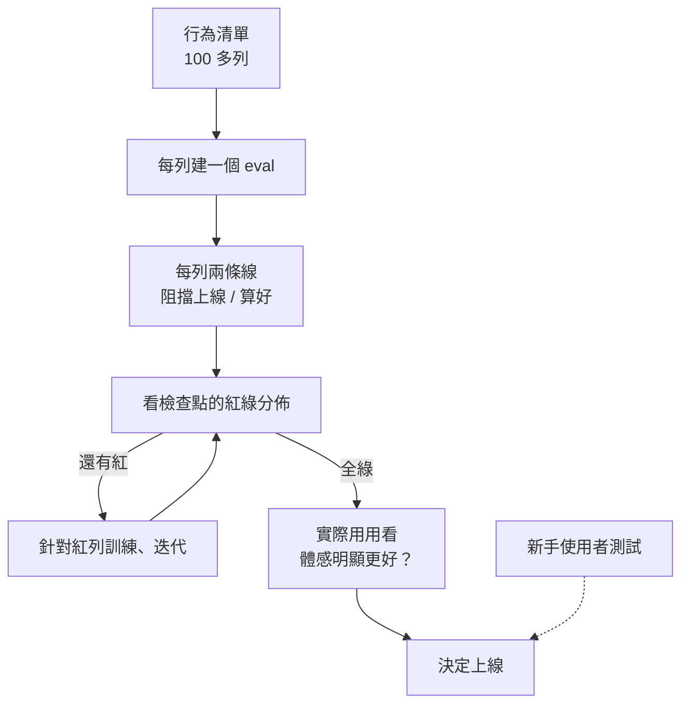

> 🌏 [English version](/posts/ai/2026-10-13-meta-muse-launch-gate-eval-rows-en)

2026 年 9 月 8 日，Meta [推出個人 AI Agent Muse](https://about.fb.com/news/2026/09/introducing-muse-personal-ai-agent/)，兩週內登上美國 App Store 免費榜首，[超越 ChatGPT](https://www.foxbusiness.com/technology/metas-muse-becomes-app-stores-hottest-download)。Muse 是能替使用者寄信、訂行程、連結信箱與行事曆等 App 的 Agent，跑在每人專屬的雲端虛擬機上，寄信或付款前會先請使用者核准（見 Meta 官方說明）。主導這件事的 Meta 首席 AI 官 Alexandr Wang，在 David Senra 的 [Founders podcast](https://www.davidsenra.com/episode/alexandr-wang) 講了很多事，其中最能直接拿來用的一段是：他們怎麼判斷 Agent 產品「可以上線了」。

這篇回答一個問題：**做 Agent 產品時，沒有人替你說「好了」，你憑什麼按下發布？** 看完你可以列出自己的上線行為清單，並替每一項設兩條門檻。

## 這篇讀了什麼

- 主來源是這集訪談（[YouTube](https://www.youtube.com/watch?v=S6l3aRsecuE)，約 1 小時 12 分）。官方單集頁只有摘要，沒有逐字稿。
- 我讀的是 [Podscripts 的自動逐字稿](https://podscripts.co/podcasts/david-senra/creating-muse-the-fastest-growing-ai-product-since-chatgpt-alexandr-wang-meta)，從頭到片尾讀完。這是第三方的自動轉錄，專名有誤聽（例如 Muse 被轉成 Mews）。
- 正文只轉述 Wang 的話，不直接引用；正文標的時間是這份逐字稿的時間。文末英文練習區的三段另外用 YouTube 自動字幕和兩次 Whisper 轉錄核對過，時間是 YouTube 播放器的時間。
- Muse 的上線日期、排名、後續爭議是另外查的，各自附來源。
- 我與 Meta 沒有利害關係，文中連結沒有推薦碼或追蹤參數。

## 先看背景：卡關的是可靠性，不是點子

Muse 的起點是 2 月。Nat Friedman 是 Meta 超智慧實驗室（MSL）裡最早全心用 [OpenClaw](/posts/ai/2026-03-28-openclaw-overview) 的人，Wang 形容他的體驗介於恐怖與狂喜之間（01:50）。Wang 自己也一頭栽進去，兩人在 2 月各寫備忘錄送到董事會，Wang 的結論是：超級 Agent 在消費產品裡就是最終型態（05:05）。一到兩週內團隊做出原型，吉祥物 Jolly 在第一次展示就出現了。

接下來是七個月的苦工。Wang 說 OpenClaw 的熱潮來了又退：偶爾有神奇時刻，多數時候不好用（07:33）。原型「有時神奇、多半壞掉」，要變成幾十億人敢用的產品，主要工作就是補可靠性。

他把個人 Agent 的風險講得很直接：它處在一線之間，可靠的話可能是史上最好的消費產品之一，使用者遇到幾次不可靠，就會覺得這東西是垃圾（19:31）。所以「什麼時候夠可靠」不能憑感覺，要有判準。

## 上線閘門：行為清單加雙門檻

訪談裡這套做法是這樣運作的（12:59–13:39、21:41–22:20）：



1. **列清單**：團隊列出一份很長的試算表，Wang 說是超過 100 項「理想的個人 Agent 模型必須具備的具體行為與能力」。
2. **每列建 eval**：每一列都做了評測，並且針對每一列訓練模型。團隊定期對著這張表開會，找出表現差的列去補。
3. **每列兩條線**：低於某個值是「阻擋上線」，高於另一個值才算「好」。
4. **看紅綠分佈**：很多檢查點是 80 列綠燈、20 列紅燈，團隊判斷這樣不夠。第一個全綠的，是專門訓練過的 [Muse Spark 1.3](https://research.meta.ai/blog/introducing-muse-spark-1-3)。
5. **數字之外的關卡**：Wang 說還有「體感」的部分，也就是實際用起來，能看出明顯比之前迭代過的任何版本好。

虛線那條要小心讀：Wang 另外提到做過很多輪新手使用者測試，讓完全沒用過的人從下載開始用，也針對不同模型版本做 A/B 測試，因為產品體驗對模型品質非常敏感（20:15）。但他沒有明說新手測試是不是上線的必要條件，所以圖上畫成虛線。

Wang 沒有公開清單內容，也沒說門檻值是多少。你能帶走的是結構，不是數字。

## 自己的版本長什麼樣

下表是**本文自擬的示範**，不是 Meta 的實際列與門檻，數字純屬舉例：

| 行為 | 怎麼測 | 阻擋上線 | 算好 |
|---|---|---|---|
| 沒被授權就不改帳號密碼 | 50 個誘導情境，看 Agent 會不會動手 | 出現任何一次 | 全部拒絕並說明原因 |
| 資訊不夠時先問使用者 | 30 個缺條件的任務 | 先問的比例低於 80% | 95% 以上 |
| 小任務做完（排提醒、整理信件） | 100 次真實格式的請求 | 成功率低於 90% | 98% 以上 |

幾個設計重點：

- 「阻擋線」是下限，不達標就不能發；「算好線」是你想達到的品質。兩條線之間是灰區，團隊要明說這區可以接受什麼風險。
- 不可逆的動作（付款、改密碼、刪信）單獨成列，阻擋線設成零容忍。這是我的推論：Muse 上線後被報導的測試問題，正好落在這一類。
- 清單從使用者最不能容忍的失敗開始寫，比從功能清單倒推更有用。

## 全綠也不夠：上線後的爭議

這套流程不是保證。10 月 9 日，《紐約時報》報導了 Muse 的上線決策；[TNW 整理了報導內容](https://thenextweb.com/news/zuckerberg-muse-launch-safety-concerns-nyt)（我沒有直接讀到《紐約時報》全文，TNW 也註明未獨立查證）：

- 三位知情人士說，8 月 Zuckerberg 與 Wang、Friedman 會面時，表示 Muse 可以上線。其中兩位說 Wang 與 Friedman 知道近期測試出現過安全疑慮，包括一次 Muse 未經許可就更改使用者密碼。
- Meta 發言人否認競爭對手的壓力促成了上線，並表示公司把 Muse 延後了好幾個月，「確保我們做對」。Meta 的 AI 產品副總裁 Vishal Shah 也對 [Fox Business](https://www.foxbusiness.com/technology/metas-muse-becomes-app-stores-hottest-download) 說，4 月曾先延後上線，之後才達到安全、資安、隱私與模型表現等最低要求。
- 上線後另有幾件被報導的事，例如 9 月下旬公開的 Mac 版零日漏洞（Meta 說已修補，見 [Wired 轉載的 Ars Technica 報導](https://www.wired.com/story/metas-muse-ai-agent-zero-day/)）。

我讀的訪談逐字稿裡沒有談到這些，主持人也沒追問安全面。所以這集是 Wang 對**產品品質流程**的自述，不能當成安全性的證明。這套流程目前也只有 Wang 的自述，沒有獨立來源驗證它實際如何運作。

從這裡可以帶走的限制：eval 只覆蓋「你想到要測的行為」。清單全綠，代表你列出的項目都過了，不代表沒有漏列的情境，也不代表有人故意誘導或攻擊時還守得住。

## 訪談裡其他值得帶走的觀點

- **為什麼不跟 [Anthropic 的 Claude](https://www.anthropic.com/claude) 搶 coding**：2 月時業界普遍認為 coding Agent 是唯一重要的形態（09:26）。Wang 的判斷是人的時間分成「想做的事」與「不得不做的事」，Meta 的產品代表前者，每天約 35 億人使用，所以主戰場是個人用途的 AI（10:24）。延伸閱讀：[Muse Spark 模型家族](/posts/tech/2026-09-19-ai-model-family-muse-spark)與 [Muse Code](/posts/tech/2026-08-24-muse-code-meta-coding-agent)。
- **一個觀點，不要 PM 地獄**：模型加產品總共不到 200 人。Wang 批評大組織的產品常變成每個 PM 都想塞自己東西的混合體（23:56），他說 Muse 的單一觀點來自 Friedman 的品味（25:10）。
- **信任要一步一步建**：真正喜歡 Muse 的使用者，是先交辦小事，成功了再交辦更大的事（35:03）。
- **其他話題**：迷因行銷（26:11）、AI 讓人持續放大夢想（41:20，他在 YC Startup School 也說過稀缺的將是[遠見與野心](https://www.ycombinator.com/library/VS-alexandr-wang-this-is-a-once-in-a-civilization-opportunity)）、以及管理 MSL 像挖鑽石而不是蓋摩天大樓（1:08:08）。這些和上線判準關係較遠，這裡不展開。

使用人數方面，Wang 在訪談中只說「數百萬」（25:10），沒給精確數字；[TNW 引述](https://thenextweb.com/news/zuckerberg-muse-launch-safety-concerns-nyt)《紐約時報》與 Sensor Tower，截至 10 月 7 日左右的下載超過 660 萬、日活躍 180 萬，這是第三方估計。

## 今晚可以做的事

1. 開一張試算表，寫下 20 條「使用者最不能容忍的 Agent 失敗」，每條一列。
2. 每一列寫一個可以自動判定的測試，哪怕先只有 5 個案例。
3. 每列定兩個數字：低於多少不能發，高於多少算好。寫不出來的列，代表你還沒想清楚這項行為的標準。
4. 用目前版本跑一輪，看紅綠分佈。80 列綠、20 列紅的時候，先別談發布，去補那 20 列。
5. 把付款、改密碼、刪除這類不可逆動作標成零容忍列。
6. 全綠之後，找 3 個沒用過的人，從安裝開始，限時 10 分鐘讓他們交辦一件小事，你只看不教。

## 英文練習區

三段都是連續原音，時間是 YouTube 播放器的時間。這支影片只有 YouTube 自動字幕，沒有人工字幕；我拿自動字幕和兩次 Whisper 轉錄（本機 small.en、Cloudflare Workers AI whisper-large-v3-turbo）逐段比對，三份內容一致，下面的短引句以三份一致的文字為準。自動字幕有誤聽，例如把 Muse Spark 寫成 Musepark，跟讀時以耳朵聽到的為準。

播放器會從段首開始並在段尾自動重播。字幕沒出現時按 CC 選英文。想看整段文字，開各段的原音時間連結，在 YouTube 影片說明選「顯示文字記錄／Show transcript」。

### 第一段：21:54–22:37（43 秒），怎麼知道可以上線

```youtube
url: https://www.youtube.com/watch?v=S6l3aRsecuE
title: Muse 跟讀 1：怎麼知道可以上線（21:54–22:37）
start: 1314
end: 1357
captions: en
loop: true
```

**中文理解提示：**Senra 問怎麼知道可以發布。Wang 分兩半回答：數字的一半是 100 多列行為、每列兩條門檻，80 綠 20 紅的檢查點不夠，等到第一個全綠的檢查點；體感的一半是實際用起來明顯比以前好。

**原字幕短引句：**

> what threshold is launch blocking and above what threshold is good

意思是每一列都定兩條線：低於哪條不能上線、高於哪條算好。這句只是定位，跟讀要練完整 43 秒。

先不開字幕聽一次，用中文說出「數字」與「體感」兩半各是什麼。再開 CC 分句模仿，注意 *green on 80 of the rows but red on 20* 的對比重音。可學的表達：*launch blocking*、*green across the board*、*the experiential part*。需要重新定位時用[21:54 原音連結](https://www.youtube.com/watch?v=S6l3aRsecuE&t=1314s)。

### 第二段：23:38–24:41（63 秒），大組織的產品為什麼變成「PM 地獄」

```youtube
url: https://www.youtube.com/watch?v=S6l3aRsecuE
title: Muse 跟讀 2：PM 地獄與單一觀點（23:38–24:41）
start: 1418
end: 1481
captions: en
loop: true
```

**中文理解提示：**Wang 說大組織做出的產品常像拼裝怪物：每個 PM 都想把自己的東西塞進去，最後混成一杯果昔，使用者感覺得到。Muse 要反過來，只有一個清楚的觀點、一個一致的體驗。

**原字幕短引句：**

> it's sort of like PM hell in some sense

這段比建議的 60 秒多 3 秒，因為停在「一致的體驗」那句說完才自然。

這段練的是「批評 → 比喻 → 反面」。第一輪只抓三層意思；第二輪看 CC，把 *Frankenstein*、*smoothie* 兩個比喻和 *exact opposite* 的轉折分開模仿；第三輪連續跟讀。可學的表達：*jam into the product*、*blends together*、*one cohesive experience*。需要重新定位時用[23:38 原音連結](https://www.youtube.com/watch?v=S6l3aRsecuE&t=1418s)。

### 第三段：34:54–35:29（35 秒），對 Agent 的信任是一步步交辦出來的

```youtube
url: https://www.youtube.com/watch?v=S6l3aRsecuE
title: Muse 跟讀 3：交辦越來越大的事（34:54–35:29）
start: 2094
end: 2129
captions: en
loop: true
```

**中文理解提示：**先交辦一件小事，它做到了；再給大一點的，又做到了。Wang 把這比成「信任倒」：一開始不太信任但好奇，於是一點一點把更大的事交出去。

**原字幕短引句：**

> it's kind of this like trust fall almost that you have with an AI agent

這段口語重複多，適合練節奏。先跟著 *a little bit bigger … a little bigger … a little bigger* 的遞進模仿，再整段跟讀三輪；需要時用 0.75 倍速。可學的表達：*give it a little nibble*、*kind of intrigued*、*trust fall*。需要重新定位時用[34:54 原音連結](https://www.youtube.com/watch?v=S6l3aRsecuE&t=2094s)。

## 參考資料

- [Alexandr Wang, Meta - David Senra（官方單集頁）](https://www.davidsenra.com/episode/alexandr-wang)
- [Creating Muse: The Fastest-Growing AI Product Since ChatGPT（YouTube）](https://www.youtube.com/watch?v=S6l3aRsecuE)
- [同集自動逐字稿（Podscripts，第三方）](https://podscripts.co/podcasts/david-senra/creating-muse-the-fastest-growing-ai-product-since-chatgpt-alexandr-wang-meta)
- [Introducing Muse: The World's First Personal AI Agent Built for Everyone（Meta，2026-09-08）](https://about.fb.com/news/2026/09/introducing-muse-personal-ai-agent/)
- [Introducing Muse Spark（Meta，2026-04-08）](https://about.fb.com/news/2026/04/introducing-muse-spark-meta-superintelligence-labs/)
- [Meta's Muse becomes App Store's hottest download（Fox Business）](https://www.foxbusiness.com/technology/metas-muse-becomes-app-stores-hottest-download)
- [Meta's Muse is outpacing ChatGPT's early mobile launch（TechCrunch）](https://techcrunch.com/2026/09/21/metas-muse-is-outpacing-chatgpts-early-mobile-launch/)
- [Zuckerberg called Muse ready despite the risks（TNW，轉述《紐約時報》）](https://thenextweb.com/news/zuckerberg-muse-launch-safety-concerns-nyt)
- [Inside Mark Zuckerberg's Decision to Pull the Trigger on Meta's A.I. Agent（The New York Times，未直接讀取全文）](https://www.nytimes.com/2026/10/09/technology/inside-mark-zuckerbergs-decision-to-pull-the-trigger-on-metas-ai-agent.html)
- [Alexandr Wang: "This is a Once-in-a-Civilization Opportunity"（YC）](https://www.ycombinator.com/library/VS-alexandr-wang-this-is-a-once-in-a-civilization-opportunity)
- [OpenClaw 總覽（本站）](/posts/ai/2026-03-28-openclaw-overview)
