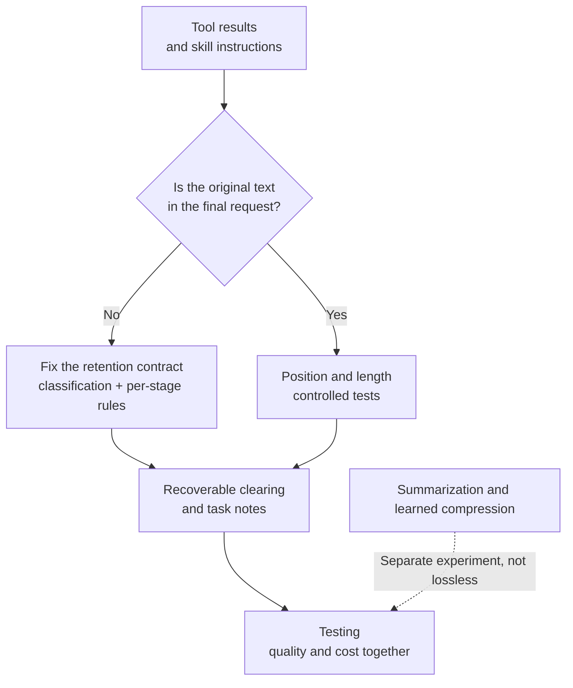

> 🌏 [中文版](/posts/ai/2026-10-16-agent-token-cost-tool-results)

Every turn, an agent resends the whole history to the model, and the biggest share of that history is usually tool results: file contents, search results, API responses. The most direct way to save tokens is to cut old tool results: truncate them when writing history, clear them as the conversation grows, and shorten them again before sending.

The trouble is that tool results aren't all disposable data. Skill instructions are usually loaded through a tool too (for example, reading `SKILL.md`). Receipts from write operations like sending an email or creating an order are tool results. So are error messages and warnings like "only the first page was returned." Cut them all with the same knife and the tokens you save may cost you skipped steps, duplicate writes, or partial results treated as complete. If truncation happens at write time, even short conversations are affected.

This post covers how to keep the cost savings while retaining what the task needs: where content gets lost, how to classify tool results, what can be cleared or reduced at the source, what summaries and caching each solve, and how to put quality and cost into the same test suite. It is aimed at engineers building agent platforms who manage their own conversation history. For the related problem of having too many tool definitions and loading them on demand via search, see [Managing Hundreds of Agent Tools](/posts/ai/2026-10-16-agent-tool-search-at-scale-en).

## Two failures, one symptom

From the user's side, both failures look like "it stopped following the rules":

1. **The content was deleted**: code modified the history at some stage, and the final request no longer contains the rule or the data.
2. **The content is there but ignored**: the rule was sent intact, but it sits in the middle of a long context or is drowned out by tool output.

The fixes are completely different. The first is a code bug; no model, however large, can recover text that was already removed. The second is a model-behavior issue involving position, length, and prompt structure. Treat the first as the second and you will spend a long time tuning prompts while the problem persists.

Content can be lost at five points:

| Stage | How it gets lost |
|---|---|
| Writing history | The model saw the full tool result on that turn, but it was truncated by a size limit when written back |
| Clearing old content | History management clears old tool results in bulk, and skill instructions and write receipts are cleared like any other observation |
| Summarization | The summary keeps the gist and drops negations, exceptions, prohibitions, pending verifications, and exact IDs |
| Position and noise | The original text is still present, but sits mid-context or is buried in noise, so the model doesn't use it |
| Recovery | After clearing, only "please re-read" remains; the model doesn't know which file, which version, or how to fetch it, or never tries |

The first three are data-flow problems, the fourth is a model-behavior problem, and the fifth is both.

## Step one: diff the data flow layer by layer

Figure out which failure you have before choosing a fix. Plant identifiable content in tool results and skill instructions, then check layer by layer whether it was changed.

1. Prepare a test skill with one rule at the start, one in the middle, and one at the end, each carrying a unique ID (for example `RULE-MID-02: check the image before output`). Do the same for ordinary tool results: put required IDs, numbers, negations, and warnings in the middle of a response.
2. Run a conversation with fixed history and tool results that triggers every kind of processing in your system: write truncation, old-result clearing, summarization, pre-send budgeting.
3. Snapshot five checkpoints: raw tool result, written history, history as read back during replay, after budget processing, and the final request sent to the model.
4. Search each snapshot for the IDs and record which layer each disappeared at, which code changed it, and why.

If an ID is missing from the final request, it is a data-flow problem and you can stop suspecting the model. Only when everything is present do you move on to the position experiments later. This step requires no model calls to score; it can be a deterministic unit test that runs every time history-handling code changes. If your system has multiple processing paths (say, an old and a new summarizer), trigger each one separately.

## Tool results are not all the same

### Five kinds of content, five retention approaches

Cutting by length alone is the most common way cost-saving measures lose necessary content. Tool results fall into at least five classes, each with its own retention and recovery approach:

| Class | Examples | How to handle |
|---|---|---|
| Static files and reproducible queries | File reads, fixed-parameter searches, test logs | Head/tail truncation, offloading to files, or bounded clearing are fine; keep the source, query parameters, file version, and an entry point for retrieving the full result |
| Dynamic API state | Inventory, order status, live quotes | Re-querying may return different content; when later decisions depend on that specific observation, keep the timestamp, source, and a necessary snapshot |
| Write operation receipts | Sending email, creating resources, payments | Keep success or failure, resource IDs, operation identifiers, and pending verifications; recover by reading or querying the existing operation, never by redoing the write to get a receipt |
| Skill instructions and reference files | `SKILL.md`, bundled skill files | Keep the exact constraints the current task needs; if moved out of context, they must be retrievable at a pinned version and confirmed reloaded before the relevant action |
| Errors and partial results | Failure messages, pagination, truncation warnings | Keep failure reasons, pagination and total counts, incomplete and retryable conditions; never drop a warning and treat a partial result as complete success |

Classes overlap; an error response from a write operation is both a receipt and an error. Classification should rely on controlled tool metadata and operation semantics, such as "a `read_file` call whose path is inside the skill directory" or "this tool is marked as a write operation." Never trust tool output that claims to be a skill, or any web page could pose as an unclearable rule. When content can't be classified, keep it.

Write, clearing, summarization, and pre-send budgeting should all read the same classification rules. A common bug is that write-time truncation exempts skill content while the clearing stage uses different logic, so the skill result survives the first gate and dies at the second.

### Why skill instructions are especially exposed

[Anthropic's Agent Skills design](https://www.anthropic.com/engineering/equipping-agents-for-the-real-world-with-agent-skills) discloses skills in three levels: at startup only each skill's `name` and `description` go into the system prompt; the model reads the full `SKILL.md` when it judges the skill relevant; and it reads bundled files in the skill directory only as needed. In the article's words:

> Agents with a filesystem and code execution tools don't need to read the entirety of a skill into their context window when working on a particular task.

That is itself a token-saving design, solving "don't stuff everything in up front." But it also means the full instructions arrive mid-conversation as a tool result, looking exactly like any other file read in the history, squarely in range of truncation and clearing logic. And skill rules depend heavily on details ("don't," "unless," "must verify first"), so a half-truncated skill is harder to notice than one that never loaded.

### What existing mechanisms look like

"Retain by type" already exists in several tools:

- [Claude's context editing](https://platform.claude.com/docs/en/build-with-claude/context-editing) clears the oldest tool results server-side in chronological order and replaces them with placeholder text. Tools listed in `exclude_tools` never have their calls or results cleared; `clear_tool_inputs` defaults to `false`, so by default only results are cleared and the model's original tool call parameters stay visible.
- [SWE-agent's `LastNObservations`](https://swe-agent.com/latest/reference/history_processor_config/) keeps only the last n observations and replaces older ones with `Old environment output: (n lines omitted)`. Observations tagged with `always_keep_output_for_tags` are untouched, while `always_remove_output_for_tags` elides an observation even if it falls within the last n.

Both only provide the mechanism; they don't decide which class your content belongs to. Also, retention isn't free: exempted content still occupies tokens and is still billed. When the full text of several skills exceeds the window, you still have to make trade-offs, for example separate budgets for the current skill's must-follow rules, other skills' metadata, and large appendices.

## Safe to clear: observations you can fetch again

### Masking works, but not without regression for every model

[The Complexity Trap](https://arxiv.org/abs/2508.21433) (arXiv:2508.21433, JetBrains Research) runs SWE-agent on the 500 problems of SWE-bench Verified. It compares three approaches: raw history, observation masking (keep the last 10 turns of observations and replace older ones with a placeholder), and LLM summarization. Across five model configurations, masking had the lowest per-instance cost in four, roughly halving cost relative to raw history. Solve rates were broadly on par with summarization.

The same table contains a counterexample. Gemini 2.5 Flash with thinking solved 40.4% with raw history, 36.4% with masking, and 31.4% with summarization. Both approaches cut cost by more than half and both had lower solve rates than raw history; the paper marks both drops as significant under a bootstrap test. So the conclusion is "masking is a strong baseline," not "clearing old content is always safe." The authors' limitations section names three points: a single scaffold; only the software engineering domain, where tool output is long and noisy, which naturally favors masking; and both strategies triggered by fixed heuristics that ignore whether content is stale.

When clearing, keep at least the tool call pairing (`tool_call_id`), tool name, source, and a concrete retrieval entry point. Tests should check that the model actually re-reads successfully after clearing, and count the extra calls toward cost. The dynamic state and write receipts from the table above are not candidates for this approach.

### Clearing breaks prompt caching

Changing old history invalidates the prompt prefix, so the cache has to be rebuilt, and cache write costs can eat into the input tokens you saved:

- The Claude context editing docs say clearing invalidates cached prompt prefixes and recommend `clear_at_least` so each clearing removes enough to make the rebuild worthwhile.
- The SWE-agent docs state outright that the processor breaks prompt caching; the `polling` parameter lets the kept count float between n and n+polling to reduce rebuild frequency.
- [OpenHands' context condensation](https://www.openhands.dev/blog/openhands-context-condensensation-for-more-efficient-ai-agents) only triggers once the context reaches a set size, amortizing rebuild cost across turns.

If your system also uses tool search so that available tools vary by turn, that changes the prompt prefix too, and the two can't be evaluated separately. In experiments, log the timing of every clear, summary, and tool list change along with cache token counts.

## Reduce at the source: keep bulk data out of context

Rather than cutting data after it enters history, you can keep it out from the start. Anthropic's [Programmatic Tool Calling](https://www.anthropic.com/engineering/advanced-tool-use) lets the model write code that calls tools and processes their results, and only the code's final output enters the model's context. The article's example checks a team's travel budget: over 2,000 expense line items are summed and compared inside the code, the model sees only the two or three people who went over budget, and the raw data shrinks from 200KB to 1KB.

The officially listed best fits are large datasets where you only need aggregates or summaries, workflows with three or more dependent tool calls, and data that needs filtering, sorting, or transforming before the model sees it. In terms of the classification above, it is the cleanest way to handle static and reproducible queries, and it reduces the pressure to cut history later.

It is not a way to filter skill rules, and aggregation logic can drop fields needed later. When adopting it, compare task quality before and after aggregation, whether results can be traced back to raw data, and the added cost of code execution.

## Summaries: an index, not a replacement

### Summaries lose detail

[LongMemEval](https://arxiv.org/abs/2410.10813) (arXiv:2410.10813) evaluates long-term memory in chat assistants and compares storing memory as whole sessions, as individual rounds, or further compressed into summaries or user facts. Rounds beat whole sessions; but replacing originals with summaries or extracted facts, while saving tokens, hurts QA performance through information loss. The one exception is multi-session reasoning, where fact extraction helps.

That's chat-memory QA, not skill compliance, but the mechanism is the same. Summaries are good at keeping the gist, while skill rules and write receipts get their value from details; negations and exact IDs are the first to vanish.

The Complexity Trap reports another side effect: with summarization, average trajectories for Gemini 2.5 Flash and Qwen3-Coder 480B got longer. The authors call this trajectory elongation and hypothesize that the smoothed summary masks signs that the task is failing, so the agent keeps going down unproductive paths. The extra turns eat back part of the savings.

### Offload first, summarize second, keep the original

[LangChain Deep Agents](https://www.langchain.com/blog/context-management-for-deepagents) puts three steps in order:

1. When a single tool response exceeds 20,000 tokens, write it to the filesystem and keep only the file path and a 10-line preview in context.
2. When context crosses 85% of the model's window, replace old write/edit tool call arguments with pointers to the files on disk (the content is already persisted there).
3. Only summarize when offloading isn't enough. The summary covers session intent, artifacts created, and next steps, and the complete original messages are written to the filesystem as a searchable canonical record.

OpenHands' summaries likewise focus on the user's goals, progress made, and what remains, and for software tasks also keep critical files and failing tests.

In your own system, a summary can serve as task guidance and an index, but the original must stay retrievable. A task note can fix these fields: goal, current skill and version, rules that must not be violated, completed items, items written but not verified, next step, and where the originals live. Notes carry their own risk: a stale note is harder to notice than forgetting. Test scenarios where the user changes a rule, cancels an old requirement, or resumes after an interruption following a summary.

### Provider compaction

Both major APIs offer server-side summarization:

- The Claude API's [compaction](https://platform.claude.com/docs/en/build-with-claude/compaction) replaces older turns with a summary Claude writes, can keep the most recent turns word for word, and lets you supply your own summarization prompt if the default drops something a later turn needs.
- The OpenAI Responses API's [compaction](https://developers.openai.com/api/docs/guides/compaction) works two ways: set `compact_threshold` in the request so the server compacts automatically, or call the standalone compact endpoint, send the full context, get back a new compacted window, and pass that whole window to your next request. The result includes an encrypted compaction item, which the docs describe as opaque and not intended to be human-interpretable.

Check three things before adopting either. First, your adapter must persist and replay the items the provider returns intact; with an opaque item like OpenAI's, dropping one field breaks continuity. Second, if your local history is already truncated, the provider's summary can't recover that text. Third, if both your platform and the provider do lossy processing, it becomes hard to tell which layer dropped something; pick one layer to own it. The provider saying continuation works doesn't mean every exact skill rule survives; test it with the suite below.

## Saving without deleting: caching

Cutting cost doesn't always mean deleting content. Parts of the prefix that don't change can use prompt caching to reduce the cost of repeated input, and skill text is a good fit for a stable prefix.

But caching saves money, not space. [Gemini's context caching docs](https://ai.google.dev/gemini-api/docs/generate-content/caching.md) state that the model makes no distinction between cached and regular input tokens, and token limits include cached tokens. Caching doesn't enlarge the window and doesn't guarantee rule compliance. Gemini's implicit caching is on by default for 2.5 and newer models but carries no cost-saving guarantee; explicit caching guarantees the discount but bills for storage duration, with a default TTL of one hour.

So experiments should record "capacity savings" and "billing savings" separately: clearing and summarizing save both, caching saves only money. Count cache creation, storage, hits, and misses in the comparison. This Gemini page sits under the Generate Content API (Legacy), so check the current spec of your target API before adopting it.

## Present but ignored: position and length

Only once step one confirms the content reached the model does this section apply.

[Lost in the Middle](https://arxiv.org/abs/2307.03172) (arXiv:2307.03172) moves the position of relevant information in multi-document QA and key-value retrieval and finds a U-shaped curve: performance is best when the information is at the start or end of the input and drops significantly in the middle, even for explicitly long-context models. That supports testing position as an independent variable, but it studies content still in context; it does nothing for a middle section that code already deleted.

[RULER](https://arxiv.org/abs/2404.06654) (arXiv:2404.06654) argues that a single needle-in-a-haystack test reflects only a superficial form of long-context ability. Models score nearly perfectly on vanilla NIAH, yet drop sharply as length grows once multiple needle types, multi-hop tracing, and aggregation are added; of models claiming 32K or more, only half maintain satisfactory performance at 32K.

For regression tests, the lesson is not to ask only "do you still remember that sentence?" Real skill compliance means following several rules at once, with dependencies between them (verify before output), and integrating everything into one acceptable artifact; ordinary tool results bring cross-tool dependencies and paginated aggregation. Test cases should cover these combinations.

A bigger window is a control group here, not a fix: it keeps more content in context at higher cost, which runs directly against the goal of cutting cost, and it does nothing for the first kind of failure.

## A way back: reloading

After clearing, the model needs a way to get back what it needs. Rather than a vague placeholder like "please re-read the skill," the placeholder should state which skill or dataset, which version, and which tool and path to use.

Three things to test:

- **Version**: reloading the "latest" skill mid-task may pick up changed rules, so standards shift partway through. Either pin the version at task start or flag version changes explicitly.
- **Whether the model actually goes back**: being retrievable doesn't mean the model will think to retrieve. LangChain's approach is worth copying: plant a fact early in the conversation, force a summarization, then require that fact later in the task, where it can only be recovered via filesystem search.
- **Interaction with tool exposure**: when tool search varies the available tools by turn, you can hit "the old result was cleared, and the tool that could fetch it isn't exposed this turn." Log the failure point at each stage so you don't misdiagnose lost results as a tool-search failure.

## Testing: measure quality and cost together

Cost-saving measures most often go wrong by measuring only half: declaring success because input tokens went down, or assuming ordinary tool results are fine because the skill cases passed.

### Three layers, measured separately

**Layer one: deterministic data flow.** This is the ID snapshot from step one, written as unit tests, confirming each content class is retained at each stage according to the classification rules.

**Layer two: does the model comply.** Give the same task with the full original and with the processed version, and measure must-follow rule compliance, whether negations and exceptions survive, whether output artifacts pass, and whether the model claims completion without verification. Record "content visibility rate" and "behavioral compliance rate" separately: the former is a layer-one problem, only the latter is a model problem.

**Layer three: recovery and long-task completion.** Work across turns, deliberately trigger clearing, summarization, and budgeting, have the user say "continue," and redo the task after a skill revision. Measure reload success rate, duplicated side effects (such as repeated writes), task completion rate, and latency.

Two research methods can be borrowed directly:

- [ACON](https://arxiv.org/abs/2510.00615) (arXiv:2510.00615, [official implementation](https://github.com/microsoft/acon)) collects trajectories where the full context succeeds but the compressed context fails on the same task, analyzes what compression lost, and iteratively refines natural-language compression guidelines, cutting peak token usage by 26–54% on AppWorld, OfficeBench, and multi-objective QA. You don't have to run the optimization, but these paired trajectories are the most direct material for finding what must be kept. The authors note they mainly tested GPT-family models.
- LangChain recommends establishing a baseline on representative tasks first, then lowering the compression trigger to 10–20% of the window (the default is 85%) so each run produces more compression events, amplifying the signal of individual mechanisms.

### Experiment groups: start with a full-history baseline

| Group | Contents |
|---|---|
| U | Full-history baseline: disable all truncation, clearing, and summarization in scope, and verify the final request is actually complete |
| A | Current behavior: pinned commit, settings, model, and adapter |
| B | Only the existing truncation exemptions (merge with A if identical) |
| C | Cross-stage classified retention rules |
| D | C + recoverable observation clearing |
| E | D + summaries / task notes |

Group U is an experimental control, not a recommended default. When disabling processing, make sure nothing falls into another path, for example turning off the truncation switch only to land in an older summarizer. Tasks that exceed the window so the full history can't run go into a separate stress group; don't count them as ordinary quality failures, and don't quietly truncate them.

Compare first with the same model and fixed history and tool results, then extend to other models and languages (rules in one language with tool output in another should be tested too). Fix cold and warm cache conditions, repeat each task several times, and record sample sizes, variance, and failed trajectories.

### How to count cost

- **Savings**: report each group relative to U.
- **Cost of the fix**: report C, D, and E relative to A, in added cost and recovered quality.
- **What to include**: input/output tokens per turn and per task, cache tokens, summarization calls, tool calls for fetching and re-reading originals, failed retries, and latency, without double counting.
- **Headline metric**: total cost per successful task. Shorter per-turn input doesn't mean costs went down; trajectory elongation and retries can take the money back.

### Set thresholds before rollout

Agree on criteria before running experiments, not after seeing the numbers:

1. **Data flow**: must-follow rules are fully visible when they're needed; with a recovery approach, the pinned version must be reloaded successfully before any constrained action. Every processing entry point is tested on its own.
2. **Quality**: agree in advance on acceptable regression relative to full history and how it will be judged statistically, broken down by model, language, and task type. Lost must-follow rules, duplicate writes, and unsupported completion claims are blocking cases.
3. **Recovery**: the source, version, tool pairing, and retrieval entry point of every original are traceable; when the original can't be recovered, stop the related step or ask the user, and never recover a result by redoing a write.
4. **Cost**: agree in advance on the savings target relative to full history, and on the allowed fix cost and latency relative to the current setup.
5. **Rollout**: confirm required fixes are deployed, then test stacked optimizations against the same scenario set; roll out to a small scope first, and stop expanding and revert settings when a threshold is hit.

## Limitations

None of the research cited here directly tests skill instruction compliance or write receipt retention. The Complexity Trap covers software engineering tasks on a single scaffold; LongMemEval is chat-memory QA; Lost in the Middle and RULER test long-context understanding without history storage, clearing, or tool side effects; ACON is evaluated mainly on GPT models in controlled environments. They provide mechanisms and experimental designs; their numbers are not promises you can carry over to your product. Programmatic Tool Calling's 200KB-to-1KB figure is a single example, not a general result.

Frameworks don't agree either: SWE-agent masks, OpenHands summarizes at thresholds, LangChain offloads before summarizing. What they jointly show is that these mechanisms are buildable, not which one is best for your content types and models. The Complexity Trap authors' small preliminary run on OpenHands actually favored summarization, which they attribute to differences in how scaffolds retain logs.

Finally, classified retention gives back part of the savings. Keeping must-follow rules verbatim trades cost for correctness; whether that's worth it depends on what a rule violation costs you, which is exactly why cost and quality belong in the same table.

## Overall

The order is: use ID snapshots to find where content disappears; classify tool results into static data, dynamic state, write receipts, skill instructions, and errors and partial results, each with its own retention and recovery rules; do bounded, recoverable clearing for data that can be fetched again, and aggregate bulk data before it enters context where possible; use summaries as an index while keeping originals; use caching to lower the cost of keeping originals; and only when the original is present but ignored, run position and length experiments. Test against a full-history baseline and judge by total cost per successful task.

One thing you can do today: add an ID-tagged rule at the start, middle, and end of your most-used skill, pick a tool that returns a write receipt, run a conversation that triggers clearing, and check how many rules survive in the final request and whether the resource ID in the receipt is still there.

For more strategies coding agents use when context fills up, read [Seven Answers to a Full Context Window, and No Consensus](/posts/ai/2026-08-21-context-full-seven-answers-en) and the [AI Agent Memory Engineering series introduction](/posts/ai/2026-09-19-agent-memory-engineering-series-intro-en).

## References

- [Equipping agents for the real world with Agent Skills (Anthropic Engineering)](https://www.anthropic.com/engineering/equipping-agents-for-the-real-world-with-agent-skills)
- [Introducing advanced tool use on the Claude Developer Platform (Anthropic Engineering)](https://www.anthropic.com/engineering/advanced-tool-use)
- [Context editing (Claude Platform Docs)](https://platform.claude.com/docs/en/build-with-claude/context-editing)
- [Compaction overview (Claude Platform Docs)](https://platform.claude.com/docs/en/build-with-claude/compaction)
- [Compaction (OpenAI API Docs)](https://developers.openai.com/api/docs/guides/compaction)
- [Context caching (Gemini API Docs)](https://ai.google.dev/gemini-api/docs/generate-content/caching.md)
- [SWE-agent History processors configuration](https://swe-agent.com/latest/reference/history_processor_config/)
- [OpenHands Context Condensation for More Efficient AI Agents](https://www.openhands.dev/blog/openhands-context-condensensation-for-more-efficient-ai-agents)
- [Context Management for Deep Agents (LangChain Blog)](https://www.langchain.com/blog/context-management-for-deepagents)
- [Lindenbauer et al., The Complexity Trap: Simple Observation Masking Is as Efficient as LLM Summarization for Agent Context Management (arXiv:2508.21433)](https://arxiv.org/abs/2508.21433)
- [Liu et al., Lost in the Middle: How Language Models Use Long Contexts (arXiv:2307.03172)](https://arxiv.org/abs/2307.03172)
- [Wu et al., LongMemEval: Benchmarking Chat Assistants on Long-Term Interactive Memory (arXiv:2410.10813)](https://arxiv.org/abs/2410.10813)
- [ACON: Optimizing Context Compression for Long-horizon LLM Agents (arXiv:2510.00615)](https://arxiv.org/abs/2510.00615), [microsoft/acon](https://github.com/microsoft/acon)
- [Hsieh et al., RULER: What's the Real Context Size of Your Long-Context Language Models? (arXiv:2404.06654)](https://arxiv.org/abs/2404.06654)
- [Managing Hundreds of Agent Tools: Tool Search, Toolset Completeness, Limits, and Caching](/posts/ai/2026-10-16-agent-tool-search-at-scale-en)
- [Seven Answers to a Full Context Window, and No Consensus](/posts/ai/2026-08-21-context-full-seven-answers-en)
