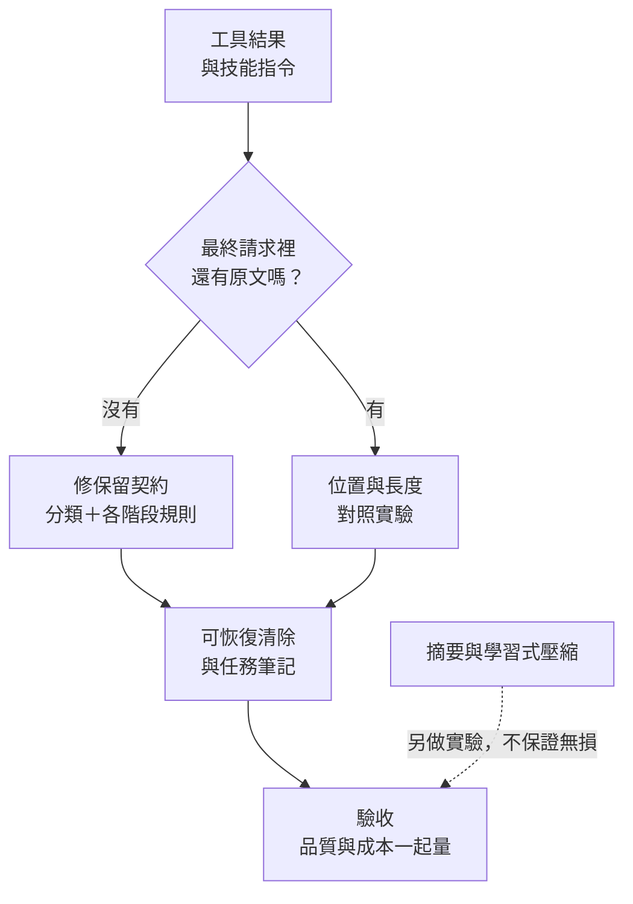

> 🌏 [English version](/posts/ai/2026-10-16-agent-token-cost-tool-results-en)

Agent 每一輪都要把整段歷史重送給模型，而歷史裡佔最多空間的通常是工具結果：讀檔內容、搜尋結果、API 回應。要省 token，最直接的做法就是對舊的工具結果動刀，寫入歷史時截斷、對話變長時清掉、送出前再縮短一次。

問題是工具結果不只有可以丟的資料。技能指令通常也是透過工具載入的（例如讀取 `SKILL.md`），寄信、建立訂單這類寫入操作的回執也是工具結果，錯誤訊息和「只回傳了第一頁」的警告也是。全部用同一把刀砍，省下的 token 可能換來 agent 漏步驟、重複寫入，或把局部結果當成完成。寫入時就截斷的話，連短對話都會中招。

這篇整理怎麼在保住降本效果的同時，留下任務需要的內容：遺失發生在哪幾個環節、工具結果該怎麼分類、哪些可以清或從源頭減量、摘要和快取各解決什麼，以及怎麼把品質和成本放在同一套驗收裡。適合自己管對話歷史的 agent 平台工程師。工具定義本身太多、要靠搜尋按需載入的問題，另見[Agent 工具上百支怎麼管](/posts/ai/2026-10-16-agent-tool-search-at-scale)。

## 兩種故障，症狀一樣

從使用者那端看，兩種故障都是「它不照規則做了」：

1. **內容被刪掉**：程式在某個階段改動了歷史，最後送給模型的請求裡已經沒有那條規則或那筆資料。
2. **內容還在、沒被遵守**：規則完整送出，但埋在長 context 中段，或被大量工具輸出稀釋。

修法完全不同。第一種是程式錯誤，換多大的模型都救不回已經刪掉的字；第二種才是模型行為問題，位置、長度、提示結構有關。把第一種當第二種處理，會花很多力氣調 prompt，問題卻還在。

內容可能在五個環節遺失：

| 環節 | 怎麼遺失 |
|---|---|
| 寫入歷史 | 當輪模型拿到完整工具結果，但寫回歷史時因大小上限被截斷 |
| 清除舊內容 | 歷史管理把舊的工具結果整批清掉，技能指令與寫入回執也被當成一般觀察清掉 |
| 摘要 | 摘要保留了大意，丟了否定句、例外、禁止事項、未完成的驗證與精確 ID |
| 位置與干擾 | 原文還在，但位在中段或淹沒在雜訊裡，模型沒用上 |
| 恢復 | 清除後只留「請重讀」，模型不知道要讀哪份、哪個版本、怎麼取得，或根本沒去讀 |

前三個是資料流問題，第四個是模型行為問題，第五個兩者都有。

## 第一步：沿資料流逐層比對

先確定是哪一種故障，再談修法。做法是在工具結果與技能指令裡放可辨識的內容，逐層比對有沒有被改。

1. 準備一份測試技能，在開頭、中段、結尾各放一條帶唯一識別碼的規則（例如 `RULE-MID-02：輸出前必須驗圖`）。一般工具結果也一樣，在回應中段放必要的 ID、數值、否定句和警告。
2. 用固定的歷史和工具結果跑對話，觸發系統裡每一種處理：寫入截斷、舊結果清除、摘要、送出前預算。
3. 在五個檢查點各存一份快照：原始工具結果、寫入的歷史、重播時讀出的歷史、預算處理之後、最終送給模型的請求。
4. 對每份快照搜尋識別碼，記錄「在哪一層消失、被哪段程式改掉、原因是什麼」。

識別碼在最終請求裡找不到，就是資料流問題，不用再懷疑模型。都在，才進入後面的位置實驗。這一步不需要呼叫模型評分，可以寫成確定性的單元測試，每次改動歷史處理程式都跑。系統裡如果有多條處理路徑（例如新舊兩套摘要），每一條都要單獨觸發。

## 工具結果不是同一種東西

### 五種內容，五種保留方式

依長度一刀切，是降本措施弄丟必要內容最常見的原因。工具結果至少可以分成五類，各自有不同的保留與恢復方式：

| 類別 | 例子 | 怎麼處理 |
|---|---|---|
| 靜態檔案與可重現查詢 | 讀檔、固定條件的搜尋、測試 log | 可以截斷頭尾、卸載到檔案或有界清除；保留來源、查詢參數、檔案版本與完整結果的取回入口 |
| 動態 API 狀態 | 庫存、訂單狀態、即時報價 | 重查可能得到不同內容；後續判斷要依據原本那次觀察時，保留時間、來源與必要快照 |
| 寫入操作回執 | 寄信、建立資源、付款 | 保留成功或失敗、資源 ID、操作識別碼與未完成的驗證；恢復時改用讀取或查詢既有操作，不能重做一次寫入來拿回執 |
| 技能指令與參考檔 | `SKILL.md`、技能附檔 | 保留當下任務需要的精確約束；移出 context 的話，要能按固定版本取回，並在相關動作前確認已重新載入 |
| 錯誤與部分結果 | 失敗訊息、分頁、截斷警告 | 保留失敗原因、分頁與總筆數、未完成與可重試條件；不能刪掉警告後把局部結果當成完整成功 |

類別會重疊，例如一個寫入操作的錯誤回應同時是回執也是錯誤。判定要依據受控的工具資訊與操作語意，例如「呼叫 `read_file` 且路徑在技能目錄下」或「這支工具標記為寫入操作」；不能相信工具輸出內容自稱是技能，否則任何網頁內容都能偽裝成不可清除的規則。分類不出來的內容先保留。

寫入、清除、摘要、送出前預算這幾個階段要讀同一份分類規則。常見的錯誤是寫入階段的截斷豁免了技能內容，清除階段卻用另一套邏輯，技能結果撐過了第一關、死在第二關。

### 技能指令為什麼特別容易中招

[Anthropic 的 Agent Skills 設計](https://www.anthropic.com/engineering/equipping-agents-for-the-real-world-with-agent-skills)把技能分三層揭露：啟動時只把每個技能的 `name` 和 `description` 放進系統提示，模型判斷相關時才讀完整的 `SKILL.md`，需要時再讀技能目錄裡的附檔。文章原話是：

> Agents with a filesystem and code execution tools don't need to read the entirety of a skill into their context window when working on a particular task.

這本身就是省 token 的設計，解決「一開始不要全部塞進來」。但它也讓完整指令在對話中途以工具結果的形式進來，在歷史裡跟讀一般檔案長得一模一樣，正好落在截斷與清除邏輯的射程內。技能規則又特別依賴細節（「不要」「除非」「必須先驗證」），砍掉一半的技能比整個沒載入還難察覺。

### 現成機制長什麼樣

「依類型決定保留」在既有工具裡都找得到：

- [Claude 的 context editing](https://platform.claude.com/docs/en/build-with-claude/context-editing) 在伺服器端依時間順序清除最舊的工具結果，並以佔位文字取代。`exclude_tools` 列出的工具，其呼叫與結果永遠不清；`clear_tool_inputs` 預設為 `false`，也就是預設只清結果、保留模型原本的工具呼叫參數。
- [SWE-agent 的 `LastNObservations`](https://swe-agent.com/latest/reference/history_processor_config/) 只保留最後 n 個觀察，舊的換成 `Old environment output: (n lines omitted)`；帶有 `always_keep_output_for_tags` 標籤的觀察不受影響，`always_remove_output_for_tags` 則即使在最後 n 個之內也會清掉。

兩者都只提供機制，沒有替你決定哪些內容屬於哪一類。另外，保留不等於免費：豁免的內容一樣佔 token、一樣計費。多個技能的全文加起來超過窗口時，還是得取捨，可以讓目前技能的必守規則、其他技能的 metadata、大型附錄各有不同預算。

## 可以清的：能重新取得的觀察

### 遮罩夠用，但不是每個模型都不退步

[The Complexity Trap](https://arxiv.org/abs/2508.21433)（arXiv:2508.21433，JetBrains Research）在 SWE-agent 上跑 SWE-bench Verified 的 500 題。它比較三種做法：原始歷史、觀察遮罩（保留最近 10 輪觀察，更舊的換成佔位文字）、LLM 摘要。五種模型設定裡，遮罩在四種的單題成本最低，相對原始歷史省了約一半。完成率則大致和摘要相當。

但同一張表裡有反例。Gemini 2.5 Flash 開啟 thinking 時，完成率是原始歷史 40.4%、遮罩 36.4%、摘要 31.4%。兩種做法都省了一半以上的成本，完成率也都比原始歷史差，論文以 bootstrap 檢定標註這兩個差距顯著。所以這篇的結論是「遮罩是很強的基線」，不是「清掉舊內容一定安全」。作者也在限制一節寫明三點：只測了單一 scaffold；只在軟體工程領域，那裡的工具輸出又長又雜，本來就對遮罩有利；兩種策略都用固定的啟發式觸發，不看內容是否過時。

清除時至少保留工具呼叫的配對（`tool_call_id`）、工具名稱、來源，以及一條具體的取回入口。驗收時要測「清除後模型真的重讀成功」，並把重讀產生的額外呼叫算進成本。上一節表格裡的動態狀態與寫入回執，不適合用這招。

### 清除會打斷提示快取

改動舊歷史會讓提示前綴失效，快取要重建，省下的輸入 token 可能被快取寫入費用吃掉一部分：

- Claude context editing 文件說清除會使快取的提示前綴失效，建議用 `clear_at_least` 確保每次清得夠多，讓快取重建值得。
- SWE-agent 文件直接寫明這個處理器會打斷提示快取，`polling` 參數讓保留數在 n 到 n+polling 之間浮動，降低重建頻率。
- [OpenHands 的 context condensation](https://www.openhands.dev/blog/openhands-context-condensensation-for-more-efficient-ai-agents) 只在 context 到達特定大小才觸發，把重建成本攤到多輪。

如果系統同時用工具搜尋讓可用工具隨輪次變動，那也會改到提示前綴，兩件事不能分開評估。實驗時記錄每次清除、摘要、工具清單變動的時間點與快取 token 數。

## 從源頭減量：大量資料不進 context

與其等資料進了歷史再砍，可以讓它一開始就不進來。Anthropic 的 [Programmatic Tool Calling](https://www.anthropic.com/engineering/advanced-tool-use) 讓模型寫程式去呼叫工具、處理回傳，只有程式的最終輸出進入模型的 context。文章的例子是查團隊差旅預算：2,000 多筆費用明細在程式裡加總比對，模型只看到超支的兩三個人，原始資料從 200KB 降到 1KB。

官方列出最適合的情境是：只需要彙總或摘要的大型資料集、三個以上相依的工具呼叫，以及進模型前要先過濾、排序、轉換的資料。對應到上面的分類，這是處理「靜態與可重現查詢」最乾淨的方式，可以降低之後必須砍歷史的壓力。

它不適合拿來過濾技能規則，聚合邏輯也可能漏掉後續需要的欄位。導入時比較聚合前後的任務品質、能不能追溯回原始資料，以及多出來的程式執行成本。

## 摘要：當索引，不當原文

### 摘要會丟細節

[LongMemEval](https://arxiv.org/abs/2410.10813)（arXiv:2410.10813）評估聊天助理的長期記憶，比較記憶要存整段 session、拆成單輪，還是再壓成摘要或使用者事實。結果是拆成單輪比整段好；但用摘要或抽取的事實取代原文，雖然省 token，問答表現會因資訊遺失而下降。唯一例外是跨 session 推理題，事實抽取反而有幫助。

這是聊天記憶的問答，不是技能遵循，但機制相同。摘要擅長保留「大意」，技能規則和寫入回執的價值偏偏在細節，否定句和精確 ID 最容易在摘要裡消失。

The Complexity Trap 還觀察到另一個副作用：用摘要時，Gemini 2.5 Flash 和 Qwen3-Coder 480B 的平均軌跡變長，作者稱為 trajectory elongation，推測是平滑的摘要掩蓋了任務正在失敗的跡象，讓 agent 繼續在沒有進展的路徑上打轉。多跑的輪次會吃掉一部分省下的成本。

### 先卸載、後摘要、保原文

[LangChain Deep Agents](https://www.langchain.com/blog/context-management-for-deepagents) 的做法把三件事排了順序：

1. 單一工具回應超過 20,000 tokens，就寫到檔案系統，context 裡只留檔案路徑和前 10 行預覽。
2. context 超過模型窗口的 85%，把舊的寫入／編輯工具呼叫參數換成指向磁碟檔案的指標（內容本來就已經寫進檔案）。
3. 卸載不夠時才摘要；摘要涵蓋 session 意圖、已產出的檔案與下一步，同時把完整原始訊息寫進檔案系統，作為可搜尋的正本。

OpenHands 的摘要同樣聚焦使用者目標、已完成的進度和待辦，軟體任務另外保留關鍵檔案與失敗中的測試。

套到自己的系統，摘要可以當任務導引和索引，但要讓原文可以取回。一份任務筆記可以固定這些欄位：目標、目前技能與版本、不可違反的規則、已完成事項、已寫入但未驗證的事項、下一步、原文位置。筆記本身也有風險：過時的筆記比忘記更難察覺，要測「使用者改了規則」「取消舊要求」「摘要後中斷再續作」這幾種情境。

### 供應商的 compaction

兩家主要 API 都提供伺服器端摘要：

- Claude API 的 [compaction](https://platform.claude.com/docs/en/build-with-claude/compaction) 把較舊的輪次換成 Claude 寫的摘要，可以保留最近幾輪逐字不動；預設摘要漏掉後續需要的東西時，可以換成自己的摘要 prompt。
- OpenAI Responses API 的 [compaction](https://developers.openai.com/api/docs/guides/compaction) 有兩種用法：在請求裡設 `compact_threshold` 讓伺服器端自動壓縮，或呼叫獨立的 compact 端點，送出完整 context、拿回一份壓縮後的新窗口，再整份傳給下一次請求。壓縮結果包含一個加密的 compaction 項目，官方說明它不透明、不是給人讀的。

採用前要確認三件事。第一，你的 adapter 要完整保存並重播供應商回傳的項目，尤其是 OpenAI 那種不透明項目，少存一個欄位就接不上。第二，你這端保存的歷史如果已經截斷，供應商的摘要救不回那些原文。第三，平台和供應商各做一次有損處理，出問題時很難知道是哪一層丟的，選一層負責就好。官方說續作沒問題，不代表技能的每條精確規則都無損，一樣要用下面的驗收測。

## 不刪也能省：快取

降本不一定要刪內容。前綴不變的部分可以靠提示快取降低重複輸入的費用，技能原文就很適合放在穩定的前綴裡。

但快取省的是錢，不是空間。[Gemini 的 context caching 文件](https://ai.google.dev/gemini-api/docs/generate-content/caching.md)寫明：模型不區分快取 token 和一般輸入 token，token 上限也包含快取的部分。快取不會讓窗口變大，也不保證模型遵守規則。Gemini 的隱式快取在 2.5 以後的模型預設開啟，但不保證省錢；顯式快取保證折扣，要另付儲存費，TTL 預設一小時。

所以實驗要把「容量節省」和「計費節省」分開記：清除和摘要省容量也省錢，快取只省錢。比較時把快取建立、儲存、命中與未命中的費用都算進去。這份 Gemini 文件掛在 Generate Content API（Legacy）底下，導入前要查目標 API 當前版本的規格。

## 原文還在卻沒遵守：位置與長度

第一步確認內容有送到模型，才輪到這一節。

[Lost in the Middle](https://arxiv.org/abs/2307.03172)（arXiv:2307.03172）在多文件問答和 key-value 取回上，移動相關資訊的位置，得到 U 形曲線：資訊在輸入開頭或結尾時表現最好，在中段時顯著下降，連標榜長 context 的模型也一樣。這支持把「位置」當成獨立變因來測，但它研究的是仍在 context 裡的內容，對已經被程式刪掉的中段沒有幫助。

[RULER](https://arxiv.org/abs/2404.06654)（arXiv:2404.06654）指出，單一 needle-in-a-haystack 測試只反映很表面的長 context 能力：受測模型在基本 NIAH 幾乎全對，加入多種 needle、多跳追蹤和聚合任務後，隨長度增加大幅退步；宣稱支援 32K 以上的模型，只有一半在 32K 時維持令人滿意的表現。

對回歸測試的啟示是，不要只問「還記得那一句嗎」。真實的技能遵循是同時守多條規則、規則之間有依賴（先驗證才能輸出）、最後整合成一個合格產物；一般工具結果則有跨工具依賴與分頁聚合。測試題要涵蓋這些組合。

加大窗口在這裡是控制組，不是修法：它讓更多內容留在 context，成本跟著上升，跟降本的目標正好相反，而且對第一種故障完全無效。

## 給模型回去的路：重新載入

清除之後，要讓模型能拿回需要的東西。比起「請重新閱讀技能」這種模糊佔位，佔位文字應該寫清楚：哪個技能或哪份資料、哪個版本、用什麼工具與路徑取得。

三個要測的地方：

- **版本**：長任務中途重新載入「最新版」技能，規則可能已經改了，任務前後標準不一致。可以固定任務開始時的版本，或在版本變動時明確提示。
- **會不會去讀**：可以取回不等於模型會想到要取。LangChain 的做法值得照抄：在對話早期埋一個事實，強制觸發摘要，之後的任務必須用到那個事實，而它只能從檔案系統搜回來。
- **跟工具曝光的交叉**：工具搜尋讓可用工具隨輪次變動時，可能出現「舊結果被清掉、能取回它的工具這一輪又沒曝光」。逐段記錄故障點，才不會把結果遺失誤判成工具搜尋失敗。

## 驗收：品質與成本一起量

降本措施最容易出事的地方，是只量了一半：輸入 token 變少就宣告成功，或只看技能案例過了就以為一般工具結果也沒事。

### 三層分開量

**第一層：確定性資料流。** 就是第一步的識別碼快照，寫成單元測試，確認每類內容在每個階段的保留行為符合分類規則。

**第二層：模型是否遵守。** 同一題分別給完整原文與處理後的版本，測必守規則的遵循、否定與例外是否保留、輸出產物是否合格、有沒有在沒驗證的情況下宣稱完成。「內容可見率」和「行為遵循率」分開記，前者是第一層的問題，後者才是模型的問題。

**第三層：恢復與長任務完成。** 跨輪次、刻意觸發清除／摘要／預算處理、使用者說「繼續」、技能改版後再做任務。量重新載入成功率、重複的副作用（例如重複寫入）、任務完成率與延遲。

兩個研究的方法可以直接借用：

- [ACON](https://arxiv.org/abs/2510.00615)（arXiv:2510.00615，[官方實作](https://github.com/microsoft/acon)）收集「完整 context 成功、壓縮後失敗」的同題軌跡，分析壓縮丟了什麼，再迭代自然語言的壓縮指南，在 AppWorld、OfficeBench 和多目標 QA 上把峰值 token 用量降低 26–54%。你不一定要做最佳化，但這種成對軌跡是找出「必須保留什麼」最直接的材料。作者也寫明主要只測了 GPT 系列模型。
- LangChain 建議先在代表性任務上建立基線，再把壓縮觸發點調低到窗口的 10–20%（預設是 85%），讓每次執行產生更多壓縮事件，放大單一機制的訊號。

### 實驗組：先有一組完整歷史

| 組別 | 內容 |
|---|---|
| U | 完整歷史基準：關掉研究範圍內所有截斷、清除與摘要，並檢查最終請求確實完整 |
| A | 現況：固定 commit、設定、模型與 adapter |
| B | 只有既有的截斷豁免（如果跟 A 一樣就合併） |
| C | 跨階段的分類保留規則 |
| D | C ＋ 可恢復的觀察清除 |
| E | D ＋ 摘要／任務筆記 |

U 組是實驗控制，不是建議的預設值。關掉時要確認沒有掉進另一條處理路徑，例如關了截斷開關，系統卻改走舊的摘要邏輯。超過窗口、完整歷史根本跑不了的題目另列壓力組，不算成一般品質失敗，也不要偷偷截斷。

先用同一個模型、固定歷史和工具結果比較，再擴到其他模型與語言（中文規則搭英文工具輸出也要測）。固定冷／熱快取，每題重複多次，記錄樣本數、變異與失敗軌跡。

### 成本怎麼算

- **省了多少**：各組相對 U 報告。
- **修正花了多少**：C、D、E 相對 A 報告增加的成本，以及換回多少品質。
- **算進去的費用**：每輪與整項任務的輸入／輸出 token、快取 token、摘要呼叫、原文存取與重讀的工具呼叫、失敗重試與延遲，注意不要重複計算。
- **主要指標**：每個成功任務的總費用。單輪輸入變短不代表降本成功，trajectory elongation 和重試都會把錢吃回去。

### 放量前先定門檻

開始實驗前就先約定判準，不要看了數字才決定標準：

1. **資料流**：必守規則在需要用到的時點完整可見；採恢復方案的話，要在執行受約束的動作前成功重載固定版本。每個處理入口各自驗收。
2. **品質**：預先約定相對完整歷史可接受的退步幅度與統計判讀方式，分模型、語言與任務類別驗。必守規則遺失、重複寫入、沒有依據就宣稱完成，直接列為阻擋案例。
3. **恢復**：原文的來源、版本、工具配對與取回入口都可追溯；拿不回原文時，明確停下相關步驟或請使用者補充，不能用重做寫入來恢復結果。
4. **成本**：預先約定相對完整歷史的降本目標，以及相對現況允許的修正成本與延遲上限。
5. **放量**：先確認必要的修正已經部署，再用同一組情境驗多項優化疊加的效果；先小範圍上線，碰到預設門檻就停止擴大並回復設定。

## 限制

這篇引用的研究沒有一篇直接測「技能指令遵循」或「寫入回執保留」。The Complexity Trap 是軟體工程任務、單一 scaffold；LongMemEval 是聊天記憶問答；Lost in the Middle 和 RULER 測的是長 context 理解，不含歷史儲存、清除與工具副作用；ACON 主要在 GPT 模型與受控環境中評估。它們提供的是機制與實驗設計，數字不能搬到你的產品當承諾。Programmatic Tool Calling 的 200KB 降到 1KB 是單一示例，不是一般效益。

各家框架也沒有共識：SWE-agent 走遮罩、OpenHands 走門檻式摘要、LangChain 先卸載再摘要。它們共同證明的是「這些機制做得出來」，沒有證明哪一種在你的內容類型與模型上最好。The Complexity Trap 的作者在 OpenHands 上做的初步小規模實驗，結果反而偏向摘要，他們推測是不同 scaffold 對 log 的保留方式不同。

最後，分類保留會吃掉一部分降本效果。必守規則保留原文是用成本換正確性，值不值得要看規則被違反的代價，這也是為什麼成本和品質要放在同一張表上看。

## 整體來說

順序是：先用識別碼快照確認內容在哪一層消失；把工具結果分成靜態資料、動態狀態、寫入回執、技能指令、錯誤與部分結果，各給一套保留與恢復規則；可重新取得的資料做有界、可恢復的清除，大型資料盡量在進 context 前就聚合；摘要當索引並保留原文；快取用來降低保留原文的費用；原文還在卻沒遵守，才做位置與長度實驗。驗收時以完整歷史為基準，看每個成功任務的總費用。

今天就能做的一件事：在你最常用的技能頭、中、尾各加一條帶識別碼的規則，再找一支會回傳寫入回執的工具，跑一段會觸發清除的對話，看最終請求裡還剩幾條、回執裡的資源 ID 還在不在。

想看各家 coding agent 處理 context 滿載的更多策略，可以接著讀[Context 滿了怎麼辦：七種答案，沒有一種是共識](/posts/ai/2026-08-21-context-full-seven-answers)，以及[AI Agent 記憶工程系列導讀](/posts/ai/2026-09-19-agent-memory-engineering-series-intro)。

## 參考資料

- [Equipping agents for the real world with Agent Skills（Anthropic Engineering）](https://www.anthropic.com/engineering/equipping-agents-for-the-real-world-with-agent-skills)
- [Introducing advanced tool use on the Claude Developer Platform（Anthropic Engineering）](https://www.anthropic.com/engineering/advanced-tool-use)
- [Context editing（Claude Platform Docs）](https://platform.claude.com/docs/en/build-with-claude/context-editing)
- [Compaction overview（Claude Platform Docs）](https://platform.claude.com/docs/en/build-with-claude/compaction)
- [Compaction（OpenAI API Docs）](https://developers.openai.com/api/docs/guides/compaction)
- [Context caching（Gemini API Docs）](https://ai.google.dev/gemini-api/docs/generate-content/caching.md)
- [SWE-agent History processors 設定](https://swe-agent.com/latest/reference/history_processor_config/)
- [OpenHands Context Condensation for More Efficient AI Agents](https://www.openhands.dev/blog/openhands-context-condensensation-for-more-efficient-ai-agents)
- [Context Management for Deep Agents（LangChain Blog）](https://www.langchain.com/blog/context-management-for-deepagents)
- [Lindenbauer et al., The Complexity Trap: Simple Observation Masking Is as Efficient as LLM Summarization for Agent Context Management（arXiv:2508.21433）](https://arxiv.org/abs/2508.21433)
- [Liu et al., Lost in the Middle: How Language Models Use Long Contexts（arXiv:2307.03172）](https://arxiv.org/abs/2307.03172)
- [Wu et al., LongMemEval: Benchmarking Chat Assistants on Long-Term Interactive Memory（arXiv:2410.10813）](https://arxiv.org/abs/2410.10813)
- [ACON: Optimizing Context Compression for Long-horizon LLM Agents（arXiv:2510.00615）](https://arxiv.org/abs/2510.00615)、[microsoft/acon](https://github.com/microsoft/acon)
- [Hsieh et al., RULER: What's the Real Context Size of Your Long-Context Language Models?（arXiv:2404.06654）](https://arxiv.org/abs/2404.06654)
- [Agent 工具上百支怎麼管：工具搜尋、工具組完整性、上限與快取](/posts/ai/2026-10-16-agent-tool-search-at-scale)
- [Context 滿了怎麼辦：七種答案，沒有一種是共識](/posts/ai/2026-08-21-context-full-seven-answers)
