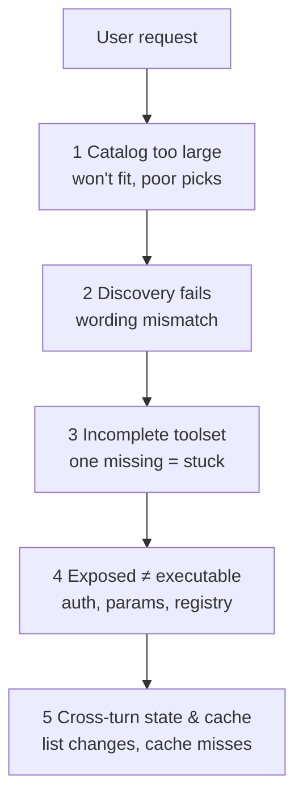

> 🌏 [中文版](/posts/ai/2026-10-16-agent-tool-search-at-scale)

When an agent gets a lot of tools, the obvious move is to send every tool definition to the model. That costs you twice, and [Claude's tool search docs](https://platform.claude.com/docs/en/agents-and-tools/tool-use/tool-search-tool) state both plainly: Claude's ability to pick the right tool degrades once more than 30–50 tools are available, and a typical setup with GitHub, Slack, Sentry, Grafana, and Splunk spends about 55k tokens on tool definitions alone.

So Claude and [OpenAI](https://developers.openai.com/api/docs/guides/tools-tool-search) both ship on-demand loading: tools stay out of context until the model searches for and loads them. That only solves "it doesn't fit." Tools that can't be found, toolsets missing one piece, tools that are found but can't run, and tool lists that shift every turn and break the cache all need separate handling.

This post is for people wiring an agent to many MCP servers or connectors. By the end you should be able to tell which layer your problem sits in, which approach to try first, and which numbers tell you whether a change helped. It comes from research we did while working on tool-loading strategy at [MaiAgent](https://maiagent.ai). How to write the tool descriptions themselves is covered in [LLM Agent Tool Discovery](/posts/ai/2026-09-18-llm-tool-discovery-en) and isn't repeated here.

## Five failure points: "too many tools" is really five problems



1. **Catalog too large**: sending every schema fills context with tool definitions, raises input cost, and makes selection harder. If your deployment has a tool-count cap, you hit it outright.
2. **Discovery fails**: the user says "send yesterday's meeting notes to my colleague," the tools are called `gmail_send_message` and `drive_search_files`. Natural language and tool names don't line up, and general document retrievers don't necessarily bridge the gap.
3. **Incomplete toolset**: many tasks need several tools in sequence. The top five by relevance may all be "search" tools, crowding out the read and send tools.
4. **Found doesn't mean executable**: a retrieved tool still needs a registered executor, user authorization, and arguments that match its contract. High retrieval recall doesn't guarantee task success.
5. **Cross-turn state and caching**: if the tool set and its order change every turn, the prompt cache keeps missing. Under a cap, tools loaded in earlier turns can't pile up forever either.

The seven approaches below each address only some of these points.

## Approach A: Keep frequent tools resident, search the long tail

This is the design of Claude's and OpenAI's native tool search. In Claude's version, you still put every definition in `tools` and mark the ones you don't want loaded up front with `defer_loading: true`:

```json
{
  "tools": [
    { "type": "tool_search_tool_bm25_20251119", "name": "tool_search_tool_bm25" },
    { "name": "get_weather", "description": "...", "input_schema": { "...": "..." } },
    { "name": "search_files", "description": "...", "input_schema": { "...": "..." }, "defer_loading": true }
  ]
}
```

The model initially sees only the search tool and non-deferred tools. When it needs more, it searches by regex or BM25 (5 results by default), and the API expands the hits into full definitions. Claude's docs recommend keeping your 3–5 most-used tools non-deferred, and say that with fewer than 10 tools, or definitions under 10k tokens total, plain tool calling is the better fit.

OpenAI's version differs in two ways worth noting. First, it recommends grouping tools into namespaces or MCP servers, each with fewer than 10 functions; for an individually deferred function, the model still sees its name and description up front, so what's really deferred is the parameter schema. Second, it offers hosted search (OpenAI searches for you) and client-executed search (the model emits a `tool_search_call` and your code does the lookup). The latter fits cases where tool availability depends on tenant or project state.

**Good fit**: tens to thousands of tools, on a supported model (for OpenAI, gpt-5.4 and later on the Responses API).
**Watch out**: resident tools still count against any cap. If you have your own "final request may not exceed N tools" check, count resident, discovered, and built-in tools together. "Most used" also isn't "required": low-frequency tools that break things when missing, like authorization links or handoffs, should be chosen by task category, not usage count.

## Approach B: Improve retrieval itself

If you run your own search, the first thing to know is that general-purpose retrievers are bad at finding tools. [ToolRet](https://arxiv.org/abs/2503.01763) (arXiv:2503.01763) assembles 7.6k retrieval tasks and 43k tools from 30+ datasets and tests BM25, dense models, rerankers, and LLM rerankers. Given only the query, every retriever put all required tools in its top 10 (Completeness@10) less than 35% of the time. ColBERT, strong on conventional IR benchmarks, lost to BM25. Rerankers helped little, and MonoT5 actually lowered NDCG@10. The authors attribute this to low lexical overlap between queries and tool docs, which calls for reasoning about user intent.

Worse retrieval directly drags down tasks. When ToolRet swapped ToolBench's hand-annotated tools for retrieved ones, GPT-3.5's pass rate on the G1 subset fell by 11.40 points.

You can improve without training a model. [Re-Invoke](https://arxiv.org/abs/2408.01875) (arXiv:2408.01875) has an LLM generate many "how a user might ask for this" queries per tool offline and indexes them with the tool doc; online, it extracts the core intents from the request, matches each separately, and merges the rankings. The paper reports relative nDCG@5 gains of 20% for single-tool and 39% for multi-tool retrieval on ToolE. Its limitation is stated clearly: if a tool doc lacks parameter descriptions, the LLM can only guess usage from the name, and the generated queries drift from real use.

**What I'd try first**: build a tool document from the tool name, owning service, action, description, and parameters, then compare name search, BM25, dense, hybrid, and reranking on the same questions. Treat service and environment as hard filters so that same-named tools in `prod` and `staging` can't swap places on semantic similarity. For Chinese requests against English tool names, Re-Invoke-style query expansion belongs in the experiment set; ToolRet is English-only, so there are no ready-made numbers for that case.

## Approach C: Retrieve a toolset, not a tool

[COLT](https://arxiv.org/abs/2405.16089) (arXiv:2405.16089) gives an easy example: "what are 5 ounces of gold plus 1 million AMZN shares worth in CNY" needs a gold-price tool, a stock-price tool, and an exchange-rate tool, and missing any one leaves the answer incomplete. Dense retrieval that only looks at semantic similarity tends to return several stock-price tools and miss the other two.

COLT therefore introduces COMP@K: a query counts only if all required tools are in the top K. ToolRet later adopts the same metric. COLT's own fix fine-tunes the retriever and then learns tool co-usage from query–scene–tool bipartite graphs, which takes labeled data and training; you don't get that effect by swapping a ranking formula.

For most teams, what transfers directly from COLT is the **evaluation**: label each question with its acceptable toolsets and dependency order, and measure complete recall instead of whether one relevant tool showed up. Take "find yesterday's meeting notes, summarize them, and email them to a colleague": it needs search, read, and send. If the top five are all search endpoints, Recall looks fine and the task still can't finish.

## Approach D: Pre-select tools with a model

[LangChain's `LLMToolSelectorMiddleware`](https://github.com/langchain-ai/langchain/blob/master/libs/langchain_v1/langchain/agents/middleware/tool_selection.py) makes one extra model call (optionally a smaller model) before the main model to pick relevant tools from the full list. Two parameters matter: `max_tools` caps the selection, and tools in `always_include` are always added and **do not count** against `max_tools`. If you have a tool-count cap, the number actually sent is the sum of the two, and you have to do that math yourself. When the selector returns malformed output, `on_parsing_failure` can raise, select none, select all, or fall back to a list.

**Cost**: an extra model call and latency per turn, and the selector can miss tools. It belongs in the experiment set, compared against native and self-built search on the same tasks by total calls, p95 latency, and completion rate.

## Approach E: Hierarchical search with retry on failure

[AnyTool](https://arxiv.org/abs/2402.04253) (arXiv:2402.04253) works over the 16,000+ RapidAPI APIs collected by ToolLLM, dispatching agents down a category → tool → API hierarchy to build a candidate pool; when the solver fails, it restarts discovery with the failure reason. For products with large connectors, this raises two comparable questions: is "pick the service, then the API" better than one flat search, and should a failed search get a bounded retry?

AnyTool also exposes an evaluation trap. [ToolLLM](https://arxiv.org/abs/2307.16789)'s original protocol first has GPT-4 judge whether the candidate tools can solve the query, and unsolvable queries don't count as failures. With randomly chosen candidates, GPT-4 mostly judged queries unsolvable, inflating the pass rate to 99.0%. In other words, pass-rate percentages from different papers can't be ranked against each other. Cost matters too: AnyTool averages 43.3 OpenAI API calls per query.

## Approach F: Stable order and cross-turn retention

Caching has three layers that are easy to conflate:

| Layer | Who caches | How to keep it |
|---|---|---|
| MCP tool catalog | Client caches the server's `tools/list` | The [MCP 2026-07-28 spec](https://github.com/modelcontextprotocol/modelcontextprotocol/blob/main/docs/specification/2026-07-28/server/tools.mdx) says servers should return tools in the same order when the set hasn't changed |
| LLM prompt cache | Provider caches the request prefix | Claude keeps deferred tools out of the system-prompt prefix and appends discovered ones inline as `tool_reference`; OpenAI injects new tools at the end of context |
| Your exposed set | You decide which tools go out this turn | Fixed order, rule-based additions and removals |

Providers and the spec handle the first two layers; you design the third. Candidate strategies to compare: keep only tools found in recent searches this turn; keep previously loaded tools while capacity allows; or a bounded set of required tools plus recent or frequent ones. There's no ready answer for which wins; measure on your own tasks.

One acceptance scenario I'd always run: turn 1 finds A; turn 2 uses A without searching; turn 3 searches for B; then push the tool count near the cap. Check whether A is still exposed, whether it can be found again if not, and the tool order in every turn.

One more detail from Claude's docs: a tool marked `defer_loading` can't also carry `cache_control`. Put the cache breakpoint on a non-deferred tool.

## Approach G: Train the tools into the model

[ToolGen](https://arxiv.org/abs/2410.03439) (arXiv:2410.03439) goes furthest. It adds 46,985 tool tokens to Llama-3-8B's vocabulary and trains in three stages (tool memorization, retrieval training, agent-trajectory tuning) so the model directly "generates" the tool to use, then fetches its documentation to fill arguments, with constrained beam search keeping outputs to real tools. It shows retrieval and calling can merge into one step, but it requires training your own model, so it's out of reach with closed APIs. The paper's appendix also shows ToolGen trailing ToolLlama on tools unseen during training. For platforms where tools are added dynamically, treat this as a long-term reference.

## After retrieval: executability and "when to call"

Everything above is about finding. After a tool is found, there are separate failure points, and evaluation should log them separately:

- **A retrieved tool has no executor.** Claude's docs require every discoverable tool to have a full definition in `tools`; a `tool_reference` to a missing tool returns a 400. Self-built search works the same way: if a tool is in the index but not registered in the execution layer, or the user hasn't authorized it, the model gets a tool it can't call.
- **Tool docs change.** [Gorilla](https://arxiv.org/abs/2305.15334) (arXiv:2305.15334) studies API docs changing at test time and also finds that retrieval can sometimes hurt: retrieving docs with BM25 at evaluation cut accuracy by 52.27% compared with the ground-truth docs. Put "same tool name, changed parameters" into your test set.
- **The model decides whether to use a tool.** [Toolformer](https://arxiv.org/abs/2302.04761) (arXiv:2302.04761) notes in its limitations that the model's decision to call an API is sensitive to the exact input wording, and that it can't chain tools. "Didn't call a tool" and "search didn't find the tool" are different failures; log them apart.

## How to evaluate: a tool-retrieval golden set

External research uses specific tool libraries and models, so it can't pick thresholds for you. What you actually need is your own golden set.

**Fixed conditions**: freeze the tool snapshot, model version, API, cold/warm cache state, and task set, then compare "load everything, current search, hybrid loading, model pre-selection." If loading everything exceeds a provider cap, mark it infeasible; don't average a 400 error in as a low score.

**Question design**: label each question with acceptable toolsets and dependency order. [BFCL](https://gorilla.cs.berkeley.edu/leaderboard)'s v3 multi-turn categories are a useful reference, especially [Missing Functions](https://gorilla.cs.berkeley.edu/blogs/13_bfcl_v3_multi_turn.html), which withholds some functions at the start to see whether the model notices it needs more. BFCL measures function calling, not retrieval over a large catalog, so use the two together.

**Metrics**:

- Retrieval: Recall@k, complete-toolset recall (COMP@k), wrong-service/wrong-environment rate
- Execution: executable rate, task completion rate
- Cost: number of searches, p50/p95 latency, total tokens, spend

[Anthropic's engineering post on writing tools](https://www.anthropic.com/engineering/writing-tools-for-agents) likewise recommends tracking tool-call counts, token consumption, and tool errors alongside accuracy, and notes that prefix- versus suffix-based namespacing had non-trivial effects on their evaluations that "vary by LLM," so choose by your own evals.

**Slices**: break results down by Chinese vs. English descriptions, tool count, schema tokens, and strong vs. weak models. Run multiple times and keep per-question differences rather than only the overall average.

## Limitations

- All numbers here come from the papers' own datasets and models. ToolRet is English-only and only tests "retrieve once, then call"; COLT's ToolLens has 1–3 tools per query with known tool relationships; AnyTool relies on RapidAPI's existing category hierarchy. On your own tool library, the ordering may come out completely different.
- [LlamaIndex's ObjectIndex](https://developers.llamaindex.ai/python/examples/objects/object_index/) and [Retrieval-Augmented Agents example](https://developers.llamaindex.ai/python/examples/agent/openai_agent_retrieval/) show how to index Tool objects, retrieve them at query time, and add a reranker, but the example uses 2 arithmetic tools plus 28 dummy ones, so it says nothing about retrieval quality over a large catalog.
- Taken together, the provider, framework, and protocol sources all support layered, on-demand loading as workable, but none shows that any particular tool-count or token threshold is optimal.

## Overall

Here's the order I'd follow. First get three things right: hybrid loading (resident plus search), cap accounting, and stable ordering. They're small changes, and things break outright without them. Next, compare retrieval and ranking on your own golden set, focusing on toolset completeness and task completion rather than hit rate alone. Put native provider search, model pre-selection, and hierarchical search in the experiment set and compare costs on the same tasks. Evaluate training-based approaches like COLT and ToolGen only after the baseline exists and you've confirmed the bottleneck is the retrieval model itself.

## References

- [Claude Docs: Tool search tool](https://platform.claude.com/docs/en/agents-and-tools/tool-use/tool-search-tool)
- [OpenAI API: Tool search](https://developers.openai.com/api/docs/guides/tools-tool-search)
- [LangChain: LLMToolSelectorMiddleware source](https://github.com/langchain-ai/langchain/blob/master/libs/langchain_v1/langchain/agents/middleware/tool_selection.py)
- [Model Context Protocol: Tools specification (2026-07-28)](https://github.com/modelcontextprotocol/modelcontextprotocol/blob/main/docs/specification/2026-07-28/server/tools.mdx)
- [Retrieval Models Aren't Tool-Savvy: Benchmarking Tool Retrieval for Large Language Models (ToolRet)](https://arxiv.org/abs/2503.01763)
- [Towards Completeness-Oriented Tool Retrieval for Large Language Models (COLT)](https://arxiv.org/abs/2405.16089)
- [Re-Invoke: Tool Invocation Rewriting for Zero-Shot Tool Retrieval](https://arxiv.org/abs/2408.01875)
- [AnyTool: Self-Reflective, Hierarchical Agents for Large-Scale API Calls](https://arxiv.org/abs/2402.04253)
- [ToolLLM: Facilitating Large Language Models to Master 16000+ Real-world APIs](https://arxiv.org/abs/2307.16789)
- [ToolGen: Unified Tool Retrieval and Calling via Generation](https://arxiv.org/abs/2410.03439)
- [Gorilla: Large Language Model Connected with Massive APIs](https://arxiv.org/abs/2305.15334)
- [Toolformer: Language Models Can Teach Themselves to Use Tools](https://arxiv.org/abs/2302.04761)
- [Berkeley Function Calling Leaderboard](https://gorilla.cs.berkeley.edu/leaderboard)
- [BFCL V3: Multi-Turn & Multi-Step Function Calling](https://gorilla.cs.berkeley.edu/blogs/13_bfcl_v3_multi_turn.html)
- [Anthropic: Writing effective tools for AI agents](https://www.anthropic.com/engineering/writing-tools-for-agents)
- [LlamaIndex: Retrieval-Augmented Agents](https://developers.llamaindex.ai/python/examples/agent/openai_agent_retrieval/)
- [LlamaIndex: ObjectIndex](https://developers.llamaindex.ai/python/examples/objects/object_index/)
- [LLM Agent Tool Discovery: Why Agents Don't Use Available Tools, and How to Fix It](/posts/ai/2026-09-18-llm-tool-discovery-en)
