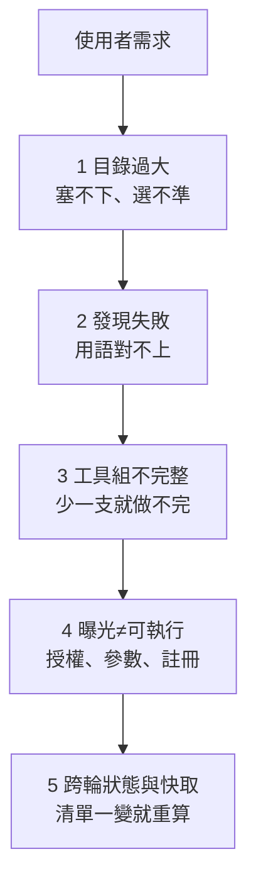

> 🌏 [English version](/posts/ai/2026-10-16-agent-tool-search-at-scale-en)

Agent 接的工具一多，最直覺的做法是把全部工具定義都送給模型。這樣做有兩個代價，[Claude 的 tool search 文件](https://platform.claude.com/docs/en/agents-and-tools/tool-use/tool-search-tool)寫得很直接。第一，同時可用的工具超過 30–50 支，Claude 挑對工具的能力就會下降。第二，context 被吃掉：接了 GitHub、Slack、Sentry、Grafana、Splunk 的典型設定，光工具定義就約 55k tokens。

所以 Claude 與 [OpenAI](https://developers.openai.com/api/docs/guides/tools-tool-search) 都推出了「按需載入」：工具先不進 context，模型需要時再搜尋、載入。問題是，這只解決了「塞不下」。工具找不到、找到了卻少一支、找到了卻不能執行、每輪工具清單變來變去讓快取失效，這幾件事要另外處理。

這篇寫給正在幫 agent 接大量 MCP server 或 Connector 的人。讀完你應該能判斷：自己的問題卡在哪一層、該先試哪一種做法、要量哪些數字才知道改得有沒有用。內容來自我們在 [MaiAgent](https://maiagent.ai) 處理工具載入策略時整理的研究；工具描述本身怎麼寫，另一篇〈[LLM Agent 工具發現](/posts/ai/2026-09-18-llm-tool-discovery)〉已經談過，這裡不重複。

## 五個失敗點：「工具太多」其實是五件事



1. **目錄過大**：所有 schema 一次送出，context 被工具定義佔掉、輸入成本變高，模型也更難選；部署上若有工具數上限，還會直接被擋。
2. **發現失敗**：使用者說「把昨天的會議記錄寄給同事」，工具叫 `gmail_send_message`、`drive_search_files`。自然語言和工具名稱、描述對不上，一般的文件檢索器未必處理得好。
3. **工具組不完整**：很多任務要連續好幾支工具。相關性最高的前五名可能全是「搜尋」類，讀取和寄信的工具都排不進來。
4. **搜到不等於能執行**：搜尋命中的工具，還要有對應的執行器、使用者已授權、參數符合契約。取回率高，任務成功率不一定高。
5. **跨輪狀態與快取**：工具集合和順序每輪都在變，提示快取就一直失效；有上限的情況下，前幾輪載入的工具也不能無限累積。

下面七種做法，各自只處理其中幾個點。

## 做法 A：常用工具常駐，長尾工具搜尋

這是 Claude 和 OpenAI 原生 tool search 的設計。以 Claude 為例，工具定義照樣全部放進 `tools`，不想一開始載入的標上 `defer_loading: true`：

```json
{
  "tools": [
    { "type": "tool_search_tool_bm25_20251119", "name": "tool_search_tool_bm25" },
    { "name": "get_weather", "description": "...", "input_schema": { "...": "..." } },
    { "name": "search_files", "description": "...", "input_schema": { "...": "..." }, "defer_loading": true }
  ]
}
```

模型一開始只看到搜尋工具和沒延後的工具，需要時用 regex 或 BM25 搜尋（預設回傳 5 支），API 再把結果展開成完整定義。Claude 文件建議把最常用的 3–5 支保持不延後，並說明工具少於 10 支、或定義總共不到 10k tokens 時，直接全部載入比較合適。

OpenAI 的版本有兩個值得注意的差異。第一，它建議把工具分進 namespace 或 MCP server，每個 namespace 少於 10 個函式；單獨延後的函式，模型一開始仍看得到名稱和描述，實際延後的主要是參數 schema。第二，它分成 hosted（OpenAI 幫你搜）和 client-executed（模型發出 `tool_search_call`，你的程式自己查）兩種，後者適合「哪些工具可用」取決於租戶狀態或專案狀態的情況。

**適合**：工具數在數十到數千、用的是有支援的模型（OpenAI 限 Responses API 的 gpt-5.4 以後）。
**要注意**：常駐工具也佔上限名額。如果你自己還有一道「最終請求不能超過 N 支」的檢查，要把常駐、搜到的、系統內建的全部算進去。「最常用」也不等於「必要」，授權連結、交接這類低頻但缺了就壞的工具，要用任務類別判斷，不是看使用次數。

## 做法 B：改善檢索本身

如果搜尋是你自己做的，第一個要知道的是：一般的檢索模型不太會找工具。[ToolRet](https://arxiv.org/abs/2503.01763)（arXiv:2503.01763）把 30 多個資料集整理成 7.6k 個檢索任務、43k 支工具，測了 BM25、dense、reranker 與 LLM 重排序。結果有三點：

- 只給查詢時，沒有一個檢索器能在前 10 名湊齊全部必要工具超過 35%（Completeness@10）。
- 在一般檢索基準表現好的 ColBERT，輸給最簡單的 BM25。
- 加 reranker 的改善有限，MonoT5 甚至讓排序品質變差。

作者把原因歸於查詢和工具文件的字面重疊很低，需要推理使用者意圖。

檢索變差會直接拖累任務。ToolRet 把 ToolBench 的人工標註工具換成檢索結果後，GPT-3.5 在 G1 子集的 pass rate 掉了 11.40 分。

不訓練模型也有改善空間。[Re-Invoke](https://arxiv.org/abs/2408.01875)（arXiv:2408.01875）分兩段做。離線時，讓 LLM 替每支工具生成多種「使用者可能怎麼問」，和工具文件一起建索引。線上時，先從需求抽出核心意圖，每個意圖分別比對，再合併排序。論文在 ToolE 上報告單工具 nDCG@5 相對提升 20%、多工具 39%。它的限制寫得很清楚：工具文件如果缺參數說明，LLM 只能從名稱猜用途，生成的查詢會偏離實際用法。

**我會先試的做法**：把工具名稱、所屬服務、動作、描述、參數整理成工具文件，用同一批題目比較名稱搜尋、BM25、dense、hybrid、加 rerank。服務與環境一定要當硬邊界過濾，不能讓 `prod` 和 `staging` 的同名工具因為語意相似而互換。中文需求對英文工具名的情況，Re-Invoke 式的用例擴展值得放進實驗組；ToolRet 只測英文，這部分沒有現成數字可以參考。

## 做法 C：找的是工具組，不是一支工具

[COLT](https://arxiv.org/abs/2405.16089)（arXiv:2405.16089）的例子很好懂：「把 5 盎司黃金加上 100 萬股 AMZN 換算成人民幣」，需要金價、股價、匯率三支工具，缺一支答案就不完整。只看語意相似度的 dense 檢索，容易撈回好幾支股價工具，漏掉其他兩支。

COLT 因此提出 COMP@K：只有所有必要工具都在前 K 名才算成功。這個指標後來被 ToolRet 沿用。COLT 本身的解法是先微調檢索模型，再用查詢、情境、工具三種二分圖學工具之間的協作關係，需要標註資料和訓練，不是換個排序公式就能得到的效果。

對多數團隊，COLT 最直接能借的是**評估方式**：每道題標「可接受的工具組」和依賴順序，量完整召回率，而不是只看有沒有搜到一支相關工具。以「找到昨天的會議記錄並摘要寄給同事」為例，至少要搜尋、讀內容、寄信三種能力；前五名全是搜尋介面時，Recall 看起來不差，任務還是做不完。

## 做法 D：先用模型預選工具

[LangChain 的 `LLMToolSelectorMiddleware`](https://github.com/langchain-ai/langchain/blob/master/libs/langchain_v1/langchain/agents/middleware/tool_selection.py) 在主模型之前多呼叫一次模型（可以是較小的模型），從完整清單挑出相關工具。兩個參數值得看：`max_tools` 限制挑選數量；`always_include` 列出的工具一定帶上，而且**不計入** `max_tools`。所以如果你有工具數上限，實際送出的數量是兩者相加，要自己算。選擇模型回傳格式錯誤時，`on_parsing_failure` 可以設成報錯、全不選、全選或指定清單。

**代價**：每輪多一次模型呼叫和延遲，預選模型也可能漏選。適合放進實驗組，和原生搜尋、自建搜尋在同一批任務上比總呼叫數、p95 延遲與完成率。

## 做法 E：分層搜尋，失敗了再找

[AnyTool](https://arxiv.org/abs/2402.04253)（arXiv:2402.04253）面對 ToolLLM 收集的 16,000 多支 RapidAPI，照「類別 → 工具 → API」三層分派 agent 去找候選，solver 解不出來時帶著失敗原因重新啟動搜尋。對有大型 Connector 的產品，這給了兩個可比較的問題：先選服務再選 API，是否比一次平面搜尋好；搜尋失敗後要不要允許有上限的重試。

AnyTool 也指出一個評估陷阱。原本 [ToolLLM](https://arxiv.org/abs/2307.16789) 的協定會先讓 GPT-4 判斷候選工具「能不能解」，判為不能解的題目不算失敗；隨機選候選工具時，GPT-4 大多判為不能解，pass rate 被灌到 99.0%。換句話說，不同論文的通過率百分比不能直接拿來排名。成本也要算：AnyTool 平均每題呼叫 43.3 次 OpenAI API。

## 做法 F：穩定順序與跨輪保留

快取這件事有三層，容易混在一起：

| 層 | 誰在快取 | 怎麼保住 |
|---|---|---|
| MCP 工具目錄 | client 快取 server 的 `tools/list` | [MCP 2026-07-28 規格](https://github.com/modelcontextprotocol/modelcontextprotocol/blob/main/docs/specification/2026-07-28/server/tools.mdx)要求 server 在工具集合不變時應回傳相同順序 |
| LLM 提示快取 | 供應商快取請求前綴 | Claude 把延後工具排除在 system prompt 前綴外，搜到的工具以 `tool_reference` 接在對話中；OpenAI 把新工具注入 context 尾端 |
| 你的曝光集合 | 你決定這輪送哪些工具 | 順序固定、增減有規則 |

前兩層供應商和規格已經處理，第三層要自己設計。可以比較的策略有：只保留本輪近期搜到的工具；容量內保留前幾輪已載入的工具；必要工具加上近期或高頻工具組成有上限的集合。哪一組最好沒有現成答案，要用自己的任務量。

有一個驗收情境我會一定跑：第 1 輪搜到 A；第 2 輪不搜尋直接用 A；第 3 輪搜 B；再把工具數推到上限附近。確認 A 還在不在、不在的話能不能再找回來，以及每一輪工具清單的順序。

Claude 文件還有一個細節：標了 `defer_loading` 的工具不能同時帶 `cache_control`，快取斷點要放在沒延後的工具上。

## 做法 G：把工具訓練進模型

[ToolGen](https://arxiv.org/abs/2410.03439)（arXiv:2410.03439）走得最遠：在 Llama-3-8B 的詞表加入 46,985 個工具 token，經過工具記憶、檢索訓練、agent 軌跡微調三階段，讓模型直接「生成」要用的工具，再取工具文件填參數，推論時用 constrained beam search 限制只能輸出存在的工具。這證明檢索與呼叫可以合成一步，但它需要自己訓練模型，閉源 API 用不了；論文附錄也顯示，遇到訓練時沒看過的工具，ToolGen 的表現輸給 ToolLlama。工具會動態新增的平台，這條路先當長期參考。

## 搜到之後：可執行性與「何時呼叫」

前面都在談「找」。找到之後還有兩個獨立的失敗點，驗收時要分開記：

- **搜到的工具沒有執行器**。Claude 的文件規定，每個可能被搜到的工具都要在 `tools` 裡有完整定義，`tool_reference` 指向不存在的工具會回 400。自建搜尋也是一樣的道理：索引裡有、執行層沒註冊、使用者沒授權，模型就會拿到一支叫不動的工具。
- **工具文件會改版**。[Gorilla](https://arxiv.org/abs/2305.15334)（arXiv:2305.15334）研究 API 文件在測試時改變的情況，也發現檢索有時反而傷表現：評估時用 BM25 取文件，準確度比用標準答案文件低了 52.27%。驗收時要把「工具名稱沒變、參數改了」列進題目。
- **模型決定要不要用工具**。[Toolformer](https://arxiv.org/abs/2302.04761)（arXiv:2302.04761）的限制段指出，模型決定是否呼叫 API 時對輸入措辭很敏感，也無法串接多支工具。「沒有呼叫工具」和「搜尋器沒找到工具」是兩種失敗，紀錄時要分開。

## 怎麼驗收：一套工具檢索黃金集

外部研究都是在特定工具庫、特定模型上做的，不能替你決定門檻。實際要做的是一份自己的黃金集。

**固定條件**：工具快照、模型版本、API、快取冷／暖狀態、任務集合都固定，再比較「全部載入、目前的搜尋、混合載入、模型預選」。如果全部載入超過供應商上限，就標成「不可行」，不要把 400 錯誤當成低分平均進去。

**題目設計**：每題標可接受的工具組與依賴順序。可以參考 [BFCL](https://gorilla.cs.berkeley.edu/leaderboard) 第三版的多輪題型，其中 [Missing Functions 類別](https://gorilla.cs.berkeley.edu/blogs/13_bfcl_v3_multi_turn.html)一開始刻意不給部分函式，看模型能不能察覺缺工具；不過 BFCL 量的是函式呼叫，不是大型目錄的檢索，兩者要搭配。

**指標**：

- 檢索：Recall@k、工具組完整召回率（COMP@k）、錯服務／錯環境率
- 執行：可執行率、任務完成率
- 成本：搜尋次數、p50／p95 延遲、總 token、費用

[Anthropic 寫工具的工程文章](https://www.anthropic.com/engineering/writing-tools-for-agents)也建議在準確度之外收集工具呼叫次數、token 消耗與工具錯誤，並提到工具名稱用前綴還是後綴做 namespace，對評估結果的影響「因模型而異」，要用自己的評估決定。

**切片**：依中文／英文描述、工具數、schema token 數、強／弱模型分開看。多跑幾次，保留每題差異，不只看整體平均。

## 限制

- 文中的數字都來自論文自己的資料集與模型：ToolRet 只測英文，而且只測「先檢索一次再呼叫」；COLT 的 ToolLens 每題 1–3 支工具、工具關係已知；AnyTool 依賴 RapidAPI 現成的分類階層。換到自己的工具庫，順序可能完全不同。
- [LlamaIndex 的 ObjectIndex](https://developers.llamaindex.ai/python/examples/objects/object_index/) 與 [Retrieval-Augmented Agents 範例](https://developers.llamaindex.ai/python/examples/agent/openai_agent_retrieval/)示範了「對 Tool 物件建索引、查詢時取回、可接 reranker」的實作方式，但範例只有 2 支算術工具加 28 支假工具，看不出大目錄的檢索品質。
- 供應商、框架與協定三層的資料交叉起來，都支持「分層、按需載入」可行，但沒有一份證明某個工具數或 token 門檻是最佳值。

## 整體來說

我會照這個順序做：先把常駐加搜尋的混合載入、硬上限計算、穩定順序這三件事做對，因為它們改動小、不改就會直接壞。接著用自己的黃金集比較檢索與排序，重點量工具組完整率和任務完成率，不只量命中率。供應商原生搜尋、模型預選、分層搜尋放進實驗組，用同一批任務比成本。需要訓練的 COLT、ToolGen，等前面的基準建好、確定瓶頸在檢索模型本身時再評估。

## 參考資料

- [Claude Docs：Tool search tool](https://platform.claude.com/docs/en/agents-and-tools/tool-use/tool-search-tool)
- [OpenAI API：Tool search](https://developers.openai.com/api/docs/guides/tools-tool-search)
- [LangChain：LLMToolSelectorMiddleware 原始碼](https://github.com/langchain-ai/langchain/blob/master/libs/langchain_v1/langchain/agents/middleware/tool_selection.py)
- [Model Context Protocol：Tools 規格（2026-07-28）](https://github.com/modelcontextprotocol/modelcontextprotocol/blob/main/docs/specification/2026-07-28/server/tools.mdx)
- [Retrieval Models Aren't Tool-Savvy: Benchmarking Tool Retrieval for Large Language Models（ToolRet）](https://arxiv.org/abs/2503.01763)
- [Towards Completeness-Oriented Tool Retrieval for Large Language Models（COLT）](https://arxiv.org/abs/2405.16089)
- [Re-Invoke: Tool Invocation Rewriting for Zero-Shot Tool Retrieval](https://arxiv.org/abs/2408.01875)
- [AnyTool: Self-Reflective, Hierarchical Agents for Large-Scale API Calls](https://arxiv.org/abs/2402.04253)
- [ToolLLM: Facilitating Large Language Models to Master 16000+ Real-world APIs](https://arxiv.org/abs/2307.16789)
- [ToolGen: Unified Tool Retrieval and Calling via Generation](https://arxiv.org/abs/2410.03439)
- [Gorilla: Large Language Model Connected with Massive APIs](https://arxiv.org/abs/2305.15334)
- [Toolformer: Language Models Can Teach Themselves to Use Tools](https://arxiv.org/abs/2302.04761)
- [Berkeley Function Calling Leaderboard](https://gorilla.cs.berkeley.edu/leaderboard)
- [BFCL V3：Multi-Turn & Multi-Step Function Calling](https://gorilla.cs.berkeley.edu/blogs/13_bfcl_v3_multi_turn.html)
- [Anthropic：Writing effective tools for AI agents](https://www.anthropic.com/engineering/writing-tools-for-agents)
- [LlamaIndex：Retrieval-Augmented Agents](https://developers.llamaindex.ai/python/examples/agent/openai_agent_retrieval/)
- [LlamaIndex：ObjectIndex](https://developers.llamaindex.ai/python/examples/objects/object_index/)
- [LLM Agent 工具發現：為什麼 Agent 有工具卻不用，以及怎麼修](/posts/ai/2026-09-18-llm-tool-discovery)
