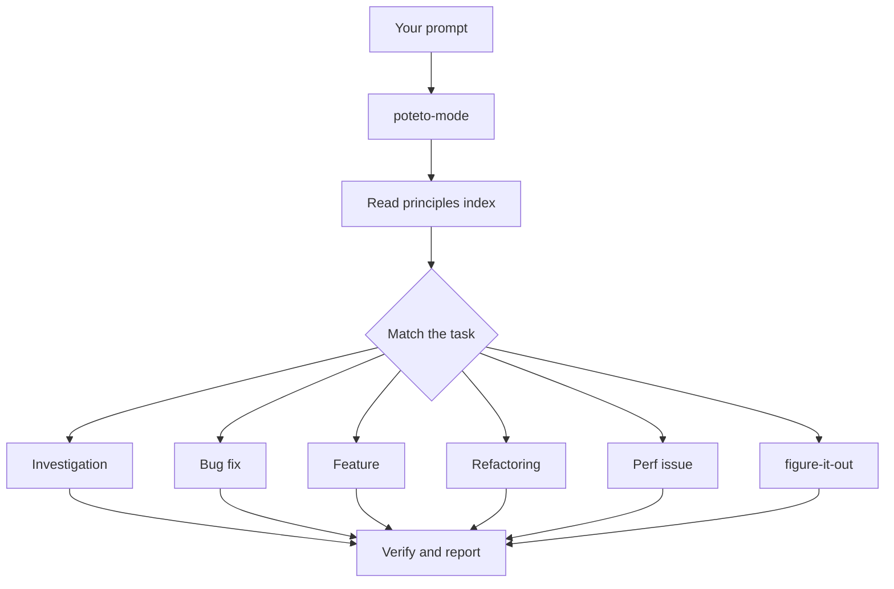

> 🌏 [中文版](/posts/ai/2026-10-16-pstack-cursor-agent-skills-guide)

If you use Cursor and want to know what pstack adds once installed, which command to start with, and whether the extra tokens are worth it, this guide follows the order you would use it: the entry point, playbooks, standalone skills, principles, model roles, then cost and limits.

## What it is

pstack is a plugin in [cursor/plugins](https://github.com/cursor/plugins/tree/main/pstack) by Lauren Tan (online as poteto) of Cursor, under the MIT license. The README opens with one claim:

> if you want to go fast, go deep first.

The aim is not more code from the agent but "write less, but higher quality code." The reasoning: once one agent can produce verifiable work, you can safely run many in parallel. For her thinking on trust and verification, see our [guide to her conversation with Matt Pocock](/posts/ai/2026-10-07-poteto-trust-ladder-verification-first). This post covers pstack itself.

The package contains five things:

- One entry skill: `/poteto-mode`.
- 23 playbooks the entry skill chooses from.
- 30 standalone skills (including the entry), such as `/how`, `/interrogate`, `/correct`.
- 24 principles, each a very short skill.
- Two subagents: `poteto-agent` and `comment-sicko`.

This post is based on version 0.15.25 in `plugin.json`. The plugin changes fast, so default models and the playbook list may differ by the time you read it.

## Who it is for and what you need

It fits people who already do serious work with Cursor's agent and want a fixed process every time. Prerequisites:

- **Platform**: the install command is Cursor's `/add-plugin pstack`, and model settings live under `~/.cursor/rules/`. The official docs describe Cursor only.
- **Always on**: use Custom Mode, which needs the Agents Window or the CLI.
- **Companion plugin**: the entry skill references `/deslop`, `control-cli`, and `control-ui`, which are not in pstack. Install `cursor-team-kit` for them.
- **A project that can prove right from wrong**: the guide says the verification skill, which lets the agent drive your app, pays off most.
- **Skip it for small edits**: the guide suggests saving `/poteto-mode` for work that needs rigor.

## Content map

### Entry point: /poteto-mode

Pick `/poteto-mode` from the `/` menu before you type the task, then state the goal in plain language. It does three things: match a playbook, copy its steps into the todo list, and call other skills as each step fires.



The chart shows the common routes from the official guide. Large work with no matching playbook goes to `/figure-it-out`, which designs a bespoke procedure.

### The 23 playbooks

The README lists 23. Grouped by purpose:

| Purpose | Playbooks |
|---|---|
| Understand and diagnose | investigation, runtime forensics, trace forensics |
| Change code | bug fix, perf, hillclimb, feature, refactoring, prototype, visual parity |
| Deliver | opening a PR, babysit, shipping |
| Long-running work | autonomous run, orchestrate, autopilot-full, autopilot-stack, session pickup, pause safely, multi-phase plan |
| Maintenance | authoring a skill, eval, worktree cleanup |

A few easy-to-confuse pairs. Hillclimb improves one metric by looping hypotheses, measuring before and after, and making one commit per accepted win; perf is a one-off fix. Babysit drives a PR to merge-ready; shipping is the other half, independently verifying a green stack and then landing it bottom-up. Orchestrate hands a standing project to one coordinator; autonomous run drives one task to completion.

### The 30 standalone skills

The entry skill calls most of these itself. You type one directly only to force a choice:

| You want to | Skill |
|---|---|
| Understand a subsystem | `/how` (mechanics), `/why` (history; discovers available MCPs at run time and queries them in parallel), `/teach` (how plus why woven into one explanation with diagrams) |
| Explore before designing | `/architect` (settle caller usage, types, and module shape first), `/arena` (N parallel attempts, then graft the best parts) |
| Check in parallel | `/swarm` (N workers on separate slices, one aggregated report) |
| Break a change | `/interrogate` (different models try to break a diff) |
| Verify | `/create-verification-skill`, `/maintain-verification-skill`, `/tdd`, `/benchmark-checklist` (vet a measured number before reporting it) |
| Writing | `/unslop` (remove AI tells), `/no-comments`, `/technical-writing`, `/bro` (restate the last message in plain words) |
| Tuning | `/setup-pstack`, `/correct`, `/reflect`, `/automate-me`, `/show-me-your-work` |
| Help | `/poteto-help` (answers which skill fits and hands you a prompt to send; it does not start the work) |

The rest are `/recall`, `/ketchup`, `/blast-radius`, `/sharpen`, `/in-your-own-words`, `/figure-it-out`, `/typescript-best-practices`, and `/make-bot-ui`; the README's full table covers them.

### The 24 principles

Each principle is a short skill. At the start of a task the entry skill reads the principles index and requires the reply to name which principles shaped which decision. They fall into five groups: 10 core (for example laziness-protocol, which biases toward deletion and the smallest change), 6 architecture, 5 verification, 2 delegation, and 1 meta.

Principles double as steering vocabulary. When an agent drifts, the guide's fix is one line naming the rule:

```text
apply prove it works. show me the real output, not the build log.
```

In the verification group, prove-it-works requires checking against the real artifact instead of "it compiles," and fix-root-causes traces a symptom to the first place the system went wrong. The meta principle, encode-lessons-in-structure, says that when you write the same instruction a second time, encode it as a lint, runtime check, or script instead.

### Subagents and model roles

The entry chat runs the playbook itself, but every subagent it spawns uses `poteto-agent`. That wrapper reads `poteto-mode` in full first; the README says substituting `generalPurpose` skips that read and drifts. `comment-sicko` is a read-only comment reviewer, usually called through `/no-comments`.

Models are assigned by role. By default, code delegates (feature, refactoring, bug fix, perf, hillclimb) go to `grok-4.7-xhigh-fast`, while the hardest changes, prose, and judgment go to `claude-opus-5-5-xhigh`; review panels use both. `/setup-pstack` detects the models you can use and asks for a reasoning budget:

- `unlimited`: maximum reasoning, Opus at max.
- `large`: xhigh, also the default.
- `medium`: high.
- `small`: medium.

The result is written to `~/.cursor/rules/pstack-models.mdc`. Set a role to `inherit-parent` or `auto` to run it on the current chat's model. Panel roles take a list, and one subagent runs per entry.

### Reading order of the official guide

The [guide](https://github.com/cursor/plugins/blob/main/pstack/docs/guide/README.md) has ten pages. Read in order the first time; afterward each page stands alone:

1. Setup: install and pick models.
2. Route work through `/poteto-mode`.
3. Understand the code: `/how`, `/why`, `/teach`, `/recall`.
4. Design the change: `/architect`, `/arena`, `/swarm`, `/interrogate`.
5. Build and clean: `/tdd`, `/unslop`, `/no-comments`.
6. Verify and ship.
7. Run work overnight.
8. Steer with principle names.
9. Make it yours.
10. Recipes and pitfalls.

## A concrete example

The guide says a good prompt carries up to five things, one sentence each: the goal, a done check that can pass or fail, the proof you want to see, what you already know, and the real constraints. Its example:

```text
/poteto-mode the csv export drops its last row since yesterday's deploy. failing job id is 4812. repro first, then fix. done means the 60k-row fixture exports every row. show me the row counts before and after.
```

After sending, watch the todo list. Its first items are the matched playbook's steps (Bug fix here), copied in verbatim. A step the agent chooses not to run stays in the list as `skip: <reason>`, so you can see what it left out.

The guide names two things to avoid. Don't list skills in the prompt ("use /how, then /architect…"); the playbook already sequences them, and a hand-written order usually scrambles it. And don't open with your theory of the cause, because the agent will search only where you point. For a noisy report, ask it to restate the problem in its own words before touching code.

## Limits

- **Cost**: the guide says plainly that pstack spends extra tokens on subagents and review panels, the price of rigor. To spend less, rerun `/setup-pstack` with a smaller budget, set some roles to `auto`, shorten panel lists, or reserve it for work that needs rigor.
- **One person's style**: the README says `poteto-mode` is her way of working. For different routing, `/automate-me` drafts a `<your-name>-mode` from your own transcripts, still built on pstack.
- **Defaults move**: after a default model changes, an older rules file still pins the old one. Delete those lines or the file, then rerun `/setup-pstack`.
- **No planning skills**: the author's stance is "the best spec is code," and she relies on Cursor's plan mode. `/poteto-mode` can produce a plan, but it is not the default.
- **Automation pack is dormant**: `automations/benny` triages Slack bug reports, then reproduces and fixes confirmed bugs. Its files are not registered as slash skills; set it up by following `FOR_AGENTS.md`.
- **Results are self-reported**: this post summarizes the official docs and skill text. We did not measure outcomes before and after using pstack in a real project.

## How to use it: three steps tonight

1. Run `/add-plugin pstack`, then `/setup-pstack`. Keep the default budget or pick `small` to limit cost, and accept the offer to run `/create-verification-skill` at the end.
2. Pick a small, real task, such as the guide's `/poteto-mode add a --json flag to this command. text output stays byte-identical. verify both.` Watch only the todo list and the evidence it returns.
3. When the same mistake appears twice, stop correcting it in chat and run `/correct`. It mines history for mistake classes and fixes each at the highest level that works: architecture, then types, lint and CI, then tests, with docs last.

When stuck, ask `/poteto-help` which skill fits.

## Bottom line

The trade is clear: more tokens and a fixed process in exchange for work that arrives with evidence. It suits Cursor users who already have a way to verify results and are willing to let agents run for long stretches. If you mostly make small fixes, or you don't use Cursor, the lasting value is the principles and playbook list rather than installing it.

## References

- [pstack (cursor/plugins, MIT)](https://github.com/cursor/plugins/tree/main/pstack)
- [pstack README](https://github.com/cursor/plugins/blob/main/pstack/README.md)
- [pstack guide home](https://github.com/cursor/plugins/blob/main/pstack/docs/guide/README.md)
- [Guide: Set up pstack](https://github.com/cursor/plugins/blob/main/pstack/docs/guide/01-setup.md)
- [Guide: Route work through /poteto-mode](https://github.com/cursor/plugins/blob/main/pstack/docs/guide/02-poteto-mode.md)
- [Guide: Recipes and pitfalls](https://github.com/cursor/plugins/blob/main/pstack/docs/guide/10-recipes-and-pitfalls.md)
- [poteto-mode SKILL.md](https://github.com/cursor/plugins/blob/main/pstack/skills/poteto-mode/SKILL.md)
- [setup-pstack SKILL.md](https://github.com/cursor/plugins/blob/main/pstack/skills/setup-pstack/SKILL.md)
- [plugin.json (version 0.15.25)](https://github.com/cursor/plugins/blob/main/pstack/plugin.json)
- [LICENSE (MIT)](https://github.com/cursor/plugins/blob/main/pstack/LICENSE)
- [Poteto's trust ladder: let the agent verify first, then let go (on this site)](/posts/ai/2026-10-07-poteto-trust-ladder-verification-first-en)
