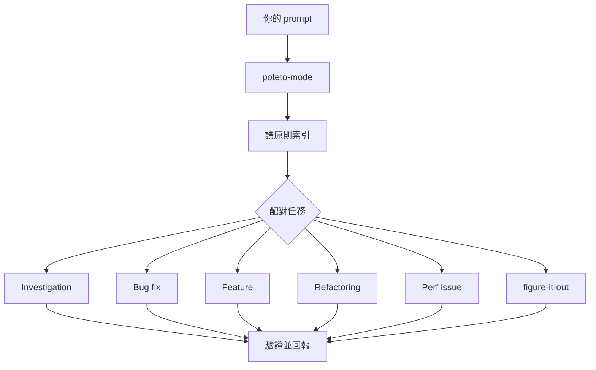

> 🌏 [English version](/posts/ai/2026-10-16-pstack-cursor-agent-skills-guide-en)

如果你用 Cursor 寫程式，想知道 pstack 裝了之後到底多了什麼、該從哪個指令開始、值不值得多花 token，這篇照使用順序走一遍：入口、playbook、可單獨呼叫的 skill、原則、模型分工，最後是成本與限制。

## 這是什麼

pstack 是 [cursor/plugins](https://github.com/cursor/plugins/tree/main/pstack) 裡的一個外掛，作者是 Cursor 的 Lauren Tan（網名 poteto），授權為 MIT。README 開頭的主張只有一句：

> if you want to go fast, go deep first.

它的目標不是讓 agent 多寫程式碼，而是「write less, but higher quality code」。作者的邏輯是：只要一個 agent 能做出可驗證的好成果，你才敢同時開很多個。至於她怎麼談信任與驗證，另一篇[導讀](/posts/ai/2026-10-07-poteto-trust-ladder-verification-first)整理過她與 Matt Pocock 的對談，這篇只談 pstack 本身。

套件裡有五樣東西：

- 一個入口 skill：`/poteto-mode`。
- 23 個 playbook，由入口依任務挑選。
- 30 個可單獨呼叫的 skill（含入口），例如 `/how`、`/interrogate`、`/correct`。
- 24 條原則，每條是一個很短的 skill。
- 兩個 subagent：`poteto-agent` 與 `comment-sicko`。

本文以 `plugin.json` 的 0.15.25 版為準。這個套件迭代很快，預設模型與 playbook 清單可能在你讀到時已經變動。

## 給誰、需要什麼前提

適合已經用 Cursor 的 agent 做正經工作，而且希望每次都有固定流程的人。幾個前提：

- **平台**：安裝指令是 Cursor 的 `/add-plugin pstack`，模型設定寫在 `~/.cursor/rules/`。官方文件只描述 Cursor 的用法。
- **要持續生效**：用 Custom Mode，需要 Agents Window 或 CLI。
- **搭配外掛**：入口 skill 引用的 `/deslop`、`control-cli`、`control-ui` 不在 pstack 裡，要另外裝 `cursor-team-kit`。
- **專案要驗得出對錯**：官方 guide 認為整份文件裡最划算的一步，是替專案做一個能讓 agent 自己操作 app 的驗證 skill。
- **小改動不必用**：guide 建議把 `/poteto-mode` 留給需要嚴謹度的工作，小而明顯的修改不需要。

## 內容地圖

### 入口：/poteto-mode

使用方式是在任務前先從 `/` 選單選 `/poteto-mode`，再用自然語言說目標。它做三件事：配對 playbook、把步驟複製進 todo list、依步驟呼叫其他 skill。



圖是官方 guide 畫的常見路徑；沒有對應 playbook 的大型任務，會交給 `/figure-it-out` 設計一份專用程序。

### 23 個 playbook

README 列了 23 個，可以照用途分五組：

| 用途 | playbook |
|---|---|
| 理解與診斷 | investigation、runtime forensics、trace forensics |
| 修改程式 | bug fix、perf、hillclimb、feature、refactoring、prototype、visual parity |
| 交付 | opening a PR、babysit、shipping |
| 長時間作業 | autonomous run、orchestrate、autopilot-full、autopilot-stack、session pickup、pause safely、multi-phase plan |
| 維護 | authoring a skill、eval、worktree cleanup |

幾個容易混淆的差別：hillclimb 是針對單一指標反覆「提假設、量前後、接受一個改進就 commit 一次」，perf 則是一次性的效能修正。babysit 負責把 PR 推到可合併，shipping 是它之後的另一半：獨立驗證一疊綠燈的 PR，再從最底層依序合併。orchestrate 是交給單一協調者的長期專案，autonomous run 則是一個任務跑到完成。

### 30 個可單獨呼叫的 skill

入口會在步驟需要時自動呼叫其中大部分，你只在想直接指定時才輸入：

| 想做的事 | skill |
|---|---|
| 讀懂一個子系統 | `/how`（運作方式）、`/why`（為什麼這樣設計，會在執行時找出可用的 MCP 並行查詢）、`/teach`（how 加 why 組成一份有圖的解說） |
| 設計前先探索 | `/architect`（先定呼叫端用法、型別與模組形狀）、`/arena`（同一件事跑 N 個平行版本再取各家之長） |
| 平行檢查 | `/swarm`（N 個 worker 各負責一個切片，最後只回一份彙總報告） |
| 找碴 | `/interrogate`（不同模型輪流嘗試弄壞一份 diff） |
| 驗證 | `/create-verification-skill`、`/maintain-verification-skill`、`/tdd`、`/benchmark-checklist`（測到數字先檢查再報告） |
| 文字 | `/unslop`（去掉 AI 腔）、`/no-comments`、`/technical-writing`、`/bro`（把上一則訊息改成白話） |
| 調校 | `/setup-pstack`、`/correct`、`/reflect`、`/automate-me`、`/show-me-your-work` |
| 求助 | `/poteto-help`（不知道該用哪個時問它，它只回答並給你一段可送出的 prompt，不會自己開工） |

其餘幾個是 `/recall`、`/ketchup`、`/blast-radius`、`/sharpen`、`/in-your-own-words`、`/figure-it-out`、`/typescript-best-practices`、`/make-bot-ui`，用途見 README 的完整表。

### 24 條原則

每條原則是一個短 skill，入口在任務開始時讀原則索引，並要求回覆說明哪些原則影響了哪個決定。分五組：core 10 條（例如 laziness-protocol：偏向刪除與最小改動）、architecture 6 條、verification 5 條、delegation 2 條、meta 1 條。

原則的另一個用途是當作指令名稱。agent 跑偏時，官方 guide 的做法是一行話點名：

```text
apply prove it works. show me the real output, not the build log.
```

verification 組裡的 prove-it-works 規定要對真實成品驗證，不能用「編譯過了」代替；fix-root-causes 要求追到系統第一次出錯的地方；meta 組的 encode-lessons-in-structure 則說，同一句叮嚀寫第二次時，應改成 lint、執行期檢查或腳本。

### subagent 與模型分工

入口自己跑 playbook，但它派出的 subagent 一律用 `poteto-agent`：這個包裝會先完整讀過 `poteto-mode`，README 說改用 `generalPurpose` 會跳過這一步而逐漸跑偏。`comment-sicko` 是唯讀的註解審查者，通常透過 `/no-comments` 呼叫。

模型依角色分配。預設是程式碼類的委派（feature、refactoring、bug fix、perf、hillclimb）交給 `grok-4.7-xhigh-fast`，最難的修改、文字與判斷交給 `claude-opus-5-5-xhigh`，審查小組預設兩者並用。`/setup-pstack` 會偵測你可用的模型，問你要哪一檔推理預算：

- `unlimited`：最高推理，Opus 拉到 max。
- `large`：xhigh，也是預設。
- `medium`：high。
- `small`：medium。

結果寫進 `~/.cursor/rules/pstack-models.mdc`。某個角色填 `inherit-parent` 或 `auto`，就改用目前對話的模型；小組類的角色填的是清單，清單有幾個項目就開幾個 subagent。

### 官方 guide 的閱讀順序

[guide](https://github.com/cursor/plugins/blob/main/pstack/docs/guide/README.md) 共十頁，第一次建議照順序讀，之後每頁都可以單獨查：

1. 設定：安裝與選模型。
2. 用 `/poteto-mode` 派工。
3. 理解程式碼：`/how`、`/why`、`/teach`、`/recall`。
4. 設計變更：`/architect`、`/arena`、`/swarm`、`/interrogate`。
5. 實作與清理：`/tdd`、`/unslop`、`/no-comments`。
6. 驗證與交付。
7. 夜間長時間作業。
8. 用原則名稱導正 agent。
9. 客製化。
10. 範例與常見錯誤。

## 一個具體範例

官方 guide 說一個好的 prompt 最多帶五樣東西，每樣一句話：目標、能通過或失敗的完成條件、你想看到的證據、你已知的線索、真正的限制。它給的範例：

```text
/poteto-mode the csv export drops its last row since yesterday's deploy. failing job id is 4812. repro first, then fix. done means the 60k-row fixture exports every row. show me the row counts before and after.
```

送出後看 todo list。前幾項是配對到的 playbook（這個例子是 Bug fix）的步驟，原文複製；入口選擇不做的步驟不會消失，會標成 `skip: <原因>`，所以你看得到它省略了什麼。

guide 也列了兩件不要做的事：一是別在 prompt 裡列 skill 順序（「先 /how 再 /architect…」），因為 playbook 已經排好順序，手寫的通常會打亂；二是一開始先別說你猜的原因，否則 agent 只會往你指的方向找。吵雜的回報可以先請它「用自己的話重述問題，先不要改程式碼」。

## 限制

- **成本**：guide 直說 pstack 會在 subagent 與審查小組上多花 token，這是嚴謹度的價格。想省，可以重跑 `/setup-pstack` 降低預算、把部分角色設成 `auto`、縮短小組清單，或只在需要嚴謹的任務才啟用。
- **作者的風格**：README 寫明 `poteto-mode` 是她自己的做法。想要不同的路由，用 `/automate-me` 從你自己的對話紀錄生出一份 `<名字>-mode`，底層仍走 pstack。
- **預設會變**：預設模型改版後，舊的 rules 檔仍會釘在舊預設；要刪掉那幾行或整個檔案，再重跑 `/setup-pstack`。
- **沒有規劃類 skill**：作者的立場是「the best spec is code」，認為 Cursor 內建的 plan mode 已夠用；需要計畫時 `/poteto-mode` 可以產出，但不是預設做法。
- **自動化包預設休眠**：`automations/benny` 會從 Slack 的問題回報分流，再重現並修復確認的 bug，檔案不註冊為 slash skill，要照 `FOR_AGENTS.md` 手動設定。
- **成效是作者自述**：本文整理的是官方文件與 skill 原文，沒有在實際專案上量測用 pstack 前後的差異。

## 怎麼用：今晚三步

1. 輸入 `/add-plugin pstack`，再跑 `/setup-pstack`。預算先照預設或選 `small` 控制成本，並在結尾接受它提議的 `/create-verification-skill`。
2. 挑一個小而真實的任務，例如 guide 的 `/poteto-mode add a --json flag to this command. text output stays byte-identical. verify both.`，只看 todo list 與它交出的證據。
3. 同一個錯第二次出現時，別再在對話裡叮嚀，改用 `/correct`：它會從歷史找出錯誤類型，把修正放在能擋住錯誤的最高一層（架構、型別、lint 與 CI、測試，文件最後）。

卡住時用 `/poteto-help` 問該用哪個 skill。

## 整體來說

pstack 的取捨很清楚：用較多的 token 與一套固定流程，換每個 agent 交出的東西都附證據。它最適合已經有驗證手段、願意讓 agent 長時間獨立跑的 Cursor 使用者；如果你多半做零碎小修，或不用 Cursor，這份文件的價值會落在它整理出的原則與 playbook 清單，而不是直接安裝。

## 參考資料

- [pstack（cursor/plugins，MIT）](https://github.com/cursor/plugins/tree/main/pstack)
- [pstack README](https://github.com/cursor/plugins/blob/main/pstack/README.md)
- [pstack guide 首頁](https://github.com/cursor/plugins/blob/main/pstack/docs/guide/README.md)
- [guide：Set up pstack](https://github.com/cursor/plugins/blob/main/pstack/docs/guide/01-setup.md)
- [guide：Route work through /poteto-mode](https://github.com/cursor/plugins/blob/main/pstack/docs/guide/02-poteto-mode.md)
- [guide：Recipes and pitfalls](https://github.com/cursor/plugins/blob/main/pstack/docs/guide/10-recipes-and-pitfalls.md)
- [poteto-mode SKILL.md](https://github.com/cursor/plugins/blob/main/pstack/skills/poteto-mode/SKILL.md)
- [setup-pstack SKILL.md](https://github.com/cursor/plugins/blob/main/pstack/skills/setup-pstack/SKILL.md)
- [plugin.json（版本 0.15.25）](https://github.com/cursor/plugins/blob/main/pstack/plugin.json)
- [LICENSE（MIT）](https://github.com/cursor/plugins/blob/main/pstack/LICENSE)
- [Poteto 的信任階梯：先讓 agent 能自己驗證，再談放手（站內）](/posts/ai/2026-10-07-poteto-trust-ladder-verification-first)
