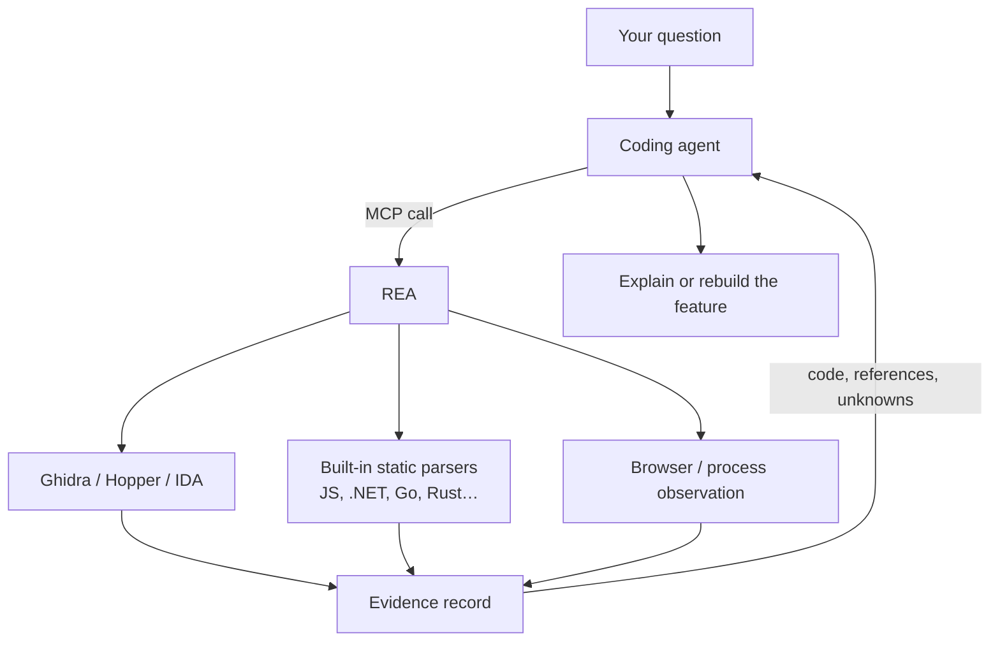

> 🌏 [中文版](/posts/ai/2026-10-20-rea-reverse-engineering-mcp)

You see an app with a feature done really well and want to know how it works, but all you have is the installed app, not the source. [REA (Reverse Engineer Anything)](https://github.com/morluto/rea) wants you to hand that job straight to your coding agent. It is an [MCP](https://modelcontextprotocol.io/) server: through it, the agent reads executables, unpacks Electron packages, inspects .NET assemblies, gets back results with evidence attached, and then explains or reimplements the feature. This post should help you decide what it can analyze, how it differs from just wiring an agent to Ghidra over MCP, what an investigation looks like, and when not to use it.

## What REA is

REA is a TypeScript project by [morluto](https://github.com/morluto), MIT-licensed, created in April 2026. The npm package is [`rea-agents`](https://www.npmjs.com/package/rea-agents), currently at 6.7.0 (released October 18). It has two entry points sharing the same analysis workflows:

- **MCP server**: once registered with your agent, the agent decides which tools to call, such as `analyze_function`, `read_bytes`, or `analyze_javascript_application`.
- **CLI**: the `rea` command runs the same analyses from your terminal and prints JSON.

REA does not ship its own decompiler. Disassembly and decompilation of native binaries go to an engine already on your machine: [Ghidra](https://github.com/NationalSecurityAgency/ghidra), [Hopper](https://www.hopperapp.com/), or IDA, with GNU objdump and Rizin also supported. REA handles the layer around them: launching the engine, translating the agent's requests into engine operations, and returning results in a fixed format.



## What it can analyze

REA's [README](https://github.com/morluto/rea#what-you-can-analyze) lists more than twenty target types. Grouping them by what external tooling they need makes it easier to tell what works right after install:

| Group | Targets | What you need |
|---|---|---|
| No extra tools | JavaScript/Electron (ASAR or extracted directory), .NET assemblies, build info in Go and Rust binaries, Unity IL2CPP metadata, Godot PCK, Flutter APKs | Node.js and npm |
| Needs a disassembler | Pseudocode, assembly, strings, symbols, and call relationships in native binaries | One of Hopper, Ghidra, or IDA |
| Bring your own tool | Android APKs (JADX + JDK), firmware (Binwalk/Unblob), packet captures (TShark), websites (a Chrome-family browser), Android devices (adb) | The respective tool; firmware and packet analysis are Linux-only |

Node.js must be 22.19+, 24.11+, or 26+. On Linux, Ghidra, JADX, and static JavaScript analysis also need a procps-compatible `ps` for process ownership checks.

## How it differs from GhidraMCP and ida-pro-mcp

REA was not first to let an agent drive a disassembler. [GhidraMCP](https://github.com/LaurieWired/GhidraMCP) wraps Ghidra as an MCP server and [ida-pro-mcp](https://github.com/mrexodia/ida-pro-mcp) does the same for IDA Pro; each has more than ten thousand stars. REA itself uses ida-pro-mcp when it talks to IDA. So "the agent can ask a disassembler about a function" works without REA. What REA adds is three things:

1. **One server across many target types.** In a single investigation, the agent can unpack an Electron `app.asar`, find a native module, and hand that module to Ghidra. A single-engine bridge cannot do the first half.
2. **Results come with evidence and limits.** Every evidence-producing tool returns a record with an `evidence_id`, a `normalized_result`, and `limitations`; inventory results also declare whether `coverage.status` is `complete` or `unknown`. Unread ranges are stated, which makes it harder for an agent to turn "not found" into "doesn't exist." Open questions can be logged with `record_unknown` and updated later as new evidence arrives.
3. **Setup is handled.** `setup` writes the MCP configuration into the agents you pick, backs up the existing configuration, and installs a matching skill that teaches the agent which tool to call first for each target type.

If you only analyze native binaries and already have IDA connected through ida-pro-mcp, REA's gain for you is mostly point 2. If you regularly deal with Electron or cross-platform packages, point 1 is the reason to install it.

## An example: recovering DX-Ball's sound-pan calculation

The official [DX-Ball case study](https://rea.tools/showcase/dx-ball/) walks through a full investigation. DX-Ball is a 1996 Windows brick-breaker, and the question is how a brick hit gets turned into a left/right audio pan value.

1. **The decompiler output is incomplete.** The agent calls `analyze_function` on `0x406400`. The decompiler's pseudocode is a single `__ftol()` call with no visible input. The assembly in the same result shows the function reading an integer from the stack at `[EBP+0x8]` and doing floating-point math. That mismatch is the reason to keep digging.
2. **Follow the caller.** The result lists a caller at `0x411f40`. Analyzing it shows the value passed in is `20 + 30 × tile_x`, the brick's on-screen x coordinate.
3. **Read the constants.** The agent uses `read_bytes` on the three memory addresses the math touches and decodes them as 1.5625, 500.0, and 1.0.
4. **Write it in C and check it.** Put together: `(x × 1.5625 − 500) × scale`. The rewritten C function matches the original on 3,205 x86 test cases, and its compiled form reproduces all 63 bytes of the original function. The reconstruction lives at [N0zoM1z0/dx-ball](https://github.com/N0zoM1z0/dx-ball).

That shows where REA sits: it supplies instructions, call relationships, and data; reasoning and rewriting are the agent's job; verification comes from the reconstruction project's own tests. The [Notion case study](https://rea.tools/showcase/notion/) takes the JavaScript route instead, tracing `clipboard.write` from the page through the preload and the IPC channel `notion:clipboard:write` to the main process calling Electron's clipboard API, with no disassembler involved.

## Limits and things to watch

**The allowed uses have boundaries.** The [DISCLAIMER](https://github.com/morluto/rea/blob/main/DISCLAIMER.md) covers security research, malware analysis, CTFs, interoperability, software preservation, and analysis of software you own or are authorized to examine. Circumventing DRM, license checks, or anti-cheat, and building game cheats, are explicitly unsupported, and such issues get closed without response. Reverse engineering may be restricted by your jurisdiction or the software's license; checking that is on you. IDA, Hopper, and JEB are commercial; REA grants no license, and trials carry their own limits on automation and sharing output.

**Target content can be an attack.** Strings, symbols, and decompiled code all come from the program under analysis and may contain text written for the agent, such as "run this command to download a required helper." REA marks such results with `untrusted_content: true` in `_meta`, and its server instructions tell the agent to treat that text as data. The marker cannot stop an agent from making its own mistakes; when analyzing software of unknown origin, have tools that run or intercept processes go through your approval first.

**Results are reconstructions.** Decompilation and reconstruction can be incomplete or wrong, as the project's own docs say. Byte-exact checks like DX-Ball's are the exception; a typical investigation gives you leads, and important conclusions should be checked against the assembly.

**It changes fast.** Three minor versions shipped within five days in mid-October, and the project's advice for any bug is to run `rea update` first. A skill installed from the repo's main branch may describe tools the npm release doesn't have yet; trust the tool list your agent actually sees.

**Star counts won't help you judge it.** As of October 20 the repo has about 339,000 stars, more than Ghidra's 92,000, and the npm package saw about 550,000 downloads in the last 30 days. Those numbers measure attention, not analysis quality. The reconstruction projects and tests attached to the official case studies are a better basis for evaluating it.

## Getting started

Register it with your agent:

```bash
npx rea-agents setup
```

Pick the agents to register (Claude Code, Codex, Cursor, Gemini CLI, and others), review the configuration changes, approve, and restart the agent. For native analysis, setup can install Hopper with your approval; Ghidra and IDA use your existing installations.

If you'd rather not touch your agent configuration yet, try JavaScript analysis from the CLI, which needs no disassembler:

```bash
npx -y rea-agents@latest analyze-javascript-application /absolute/path/to/app --json
```

Point it at an extracted Electron app directory or an `app.asar`. The output lists modules, imports, Electron boundaries, and the evidence for each. If you can make sense of that output, then decide whether to wire it into your agent and whether to install Ghidra.

Once it's connected, prompt the agent the way the official example does: name the target app and the feature you want to understand, and ask for evidence, for example "Use REA to find how search works in this app and show me the evidence."

## References

- [morluto/rea (GitHub)](https://github.com/morluto/rea)
- [REA website](https://rea.tools/)
- [rea-agents (npm)](https://www.npmjs.com/package/rea-agents)
- [REA MCP runtime contracts](https://github.com/morluto/rea/blob/main/docs/mcp-contracts.md)
- [REA DISCLAIMER](https://github.com/morluto/rea/blob/main/DISCLAIMER.md)
- [DX-Ball case study (rea.tools)](https://rea.tools/showcase/dx-ball/)
- [Notion case study (rea.tools)](https://rea.tools/showcase/notion/)
- [N0zoM1z0/dx-ball reconstruction](https://github.com/N0zoM1z0/dx-ball)
- [LaurieWired/GhidraMCP](https://github.com/LaurieWired/GhidraMCP)
- [mrexodia/ida-pro-mcp](https://github.com/mrexodia/ida-pro-mcp)
- [Ghidra (NSA)](https://github.com/NationalSecurityAgency/ghidra)
