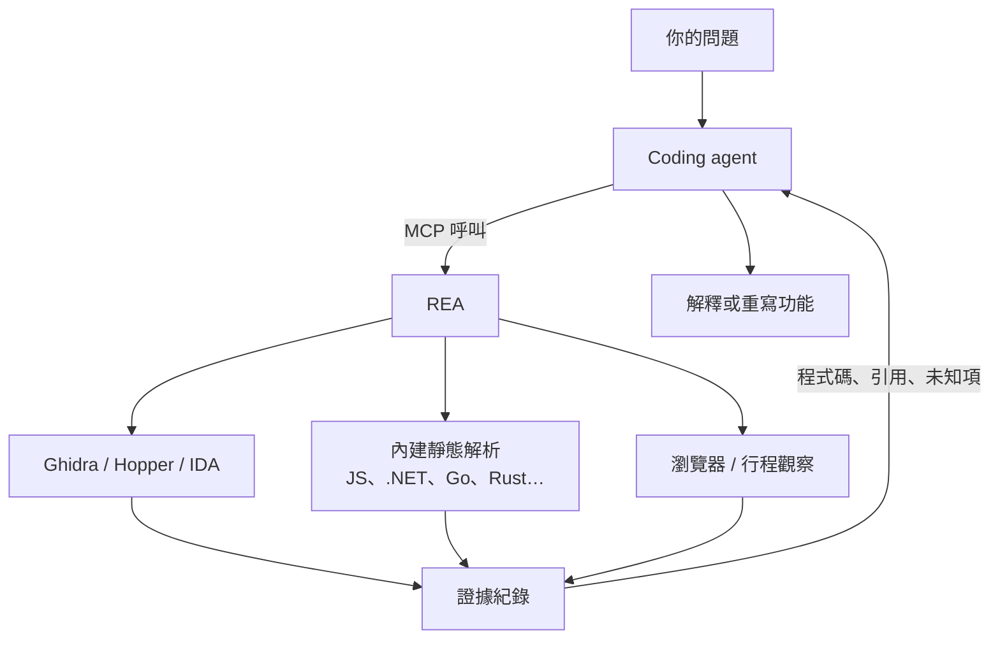

> 🌏 [English version](/posts/ai/2026-10-20-rea-reverse-engineering-mcp-en)

看到某個 app 有個功能做得很好，想知道它怎麼做到的，但手上只有安裝檔、沒有原始碼。[REA（Reverse Engineer Anything）](https://github.com/morluto/rea)想讓你把這件事直接交給 coding agent。它是一個 [MCP](https://modelcontextprotocol.io/) server，agent 透過它去讀執行檔、拆 Electron 套件、看 .NET 組件，拿回附有證據的結果，再解釋或重寫那個功能。這篇幫你判斷：它能分析什麼、跟直接接 Ghidra 的 MCP 有什麼不同、一次調查長什麼樣子，以及哪些情況不該用。

## REA 是什麼

REA 是 [morluto](https://github.com/morluto) 開發的 TypeScript 專案，MIT 授權，2026 年 4 月建立，npm 套件名稱是 [`rea-agents`](https://www.npmjs.com/package/rea-agents)，目前版本 6.7.0（10 月 18 日發布）。它有兩個入口，共用同一套分析流程：

- **MCP server**：註冊到 agent 之後，agent 自己決定要呼叫哪個工具，例如 `analyze_function`、`read_bytes`、`analyze_javascript_application`。
- **CLI**：`rea` 指令，在終端機直接跑同樣的分析，輸出 JSON。

REA 本身不寫反編譯器。原生執行檔的反組譯與反編譯交給你機器上已經有的引擎：[Ghidra](https://github.com/NationalSecurityAgency/ghidra)、[Hopper](https://www.hopperapp.com/) 或 IDA，另外也能接 GNU objdump 與 Rizin。REA 負責的是外面那一層：啟動引擎、把 agent 的請求翻成引擎操作、把結果整理成固定格式。



## 能分析什麼

REA 的 [README](https://github.com/morluto/rea#what-you-can-analyze) 列了二十多種目標。照需要的外部工具分成三類，比較好判斷自己裝完能不能馬上用：

| 類別 | 目標 | 需要什麼 |
|---|---|---|
| 不需要額外工具 | JavaScript／Electron（ASAR 或解開的目錄）、.NET 組件、Go 與 Rust 執行檔的建置資訊、Unity IL2CPP metadata、Godot PCK、Flutter APK | Node.js 與 npm |
| 需要反組譯引擎 | 原生執行檔的 pseudocode、組合語言、字串、符號、呼叫關係 | Hopper、Ghidra 或 IDA 擇一 |
| 需要自備工具 | Android APK（JADX＋JDK）、韌體（Binwalk／Unblob）、封包（TShark）、網站（Chrome 系瀏覽器）、Android 裝置（adb） | 各自的工具，韌體與封包分析只支援 Linux |

Node.js 要 22.19 以上、24.11 以上或 26 以上。Linux 上跑 Ghidra、JADX 或靜態 JavaScript 分析，還需要 procps 版本的 `ps`，用來確認行程歸屬。

## 跟 GhidraMCP、ida-pro-mcp 差在哪

讓 agent 操作反組譯器不是 REA 先做的。[GhidraMCP](https://github.com/LaurieWired/GhidraMCP) 把 Ghidra 包成 MCP server，[ida-pro-mcp](https://github.com/mrexodia/ida-pro-mcp) 對 IDA Pro 做同樣的事，兩者各有一萬多顆 star。REA 接 IDA 時用的就是 ida-pro-mcp。所以「agent 能叫反組譯器看函式」這件事，沒有 REA 也做得到。REA 多做的是三件事：

1. **一個 server 涵蓋多種目標。** 同一次調查裡，agent 可以先拆 Electron 的 `app.asar`，追到一個原生模組，再交給 Ghidra 看。單一引擎的橋接做不到前半段。
2. **結果附證據與限制。** 每個產生證據的工具都回傳一筆紀錄，帶 `evidence_id`、`normalized_result`、`limitations`，清單類結果另外標 `coverage.status` 是 `complete` 還是 `unknown`。沒讀完的範圍會明講，agent 不容易把「沒找到」寫成「不存在」。還沒解開的問題可以用 `record_unknown` 記下來，日後用新證據更新。
3. **安裝一起處理。** `setup` 會把 MCP 設定寫進你選的 agent、備份原本的設定，並裝上對應的 skill，教 agent 依目標類型挑第一個工具。

如果你只分析原生執行檔、手上已經有 IDA 並接好 ida-pro-mcp，REA 的增量主要是第 2 點。如果你常碰 Electron 或跨平台套件，第 1 點才是裝它的理由。

## 一個例子：從 DX-Ball 執行檔還原音效聲道計算

官方的 [DX-Ball 案例](https://rea.tools/showcase/dx-ball/)示範一次完整的調查。DX-Ball 是 1996 年的 Windows 打磚塊遊戲，目標是找出「磚塊被打到時，左右聲道的平衡怎麼算」。

1. **反編譯結果不完整。** agent 對位址 `0x406400` 呼叫 `analyze_function`，反編譯器給的 pseudocode 只有一行 `__ftol()`，看不出輸入是什麼。同一筆結果裡的組合語言卻顯示函式從堆疊讀了一個整數 `[EBP+0x8]`，接著做浮點運算。兩者對不上，就是繼續追的理由。
2. **往呼叫端追。** 結果裡列出呼叫端 `0x411f40`，agent 再分析它，看到傳進來的值是 `20 + 30 × tile_x`，也就是磚塊在螢幕上的 x 座標。
3. **讀常數。** 運算用到的三個記憶體位址，agent 用 `read_bytes` 讀出來，解成 1.5625、500.0、1.0。
4. **寫成 C 並驗證。** 拼起來是 `(x × 1.5625 − 500) × scale`。重寫的 C 函式在 3,205 組原始 x86 測試案例中結果一致，編譯後的 63 個位元組也與原版相同。還原專案放在 [N0zoM1z0/dx-ball](https://github.com/N0zoM1z0/dx-ball)。

這個例子說明了 REA 的定位：它提供指令、呼叫關係和資料，判斷與重寫是 agent 的事，驗證則靠還原專案自己的測試。另一個 [Notion 案例](https://rea.tools/showcase/notion/)走的是 JavaScript 路線：從頁面上的 `clipboard.write` 追過 preload、IPC 通道 `notion:clipboard:write`，一路到主程序呼叫 Electron 的剪貼簿 API，不需要任何反組譯器。

## 限制與該注意的地方

**用途有邊界。** [DISCLAIMER](https://github.com/morluto/rea/blob/main/DISCLAIMER.md) 寫明支援的是資安研究、惡意程式分析、CTF、互通性、軟體保存，以及分析你擁有或獲授權的軟體。繞過 DRM、授權檢查、反作弊、做遊戲外掛，專案明確不支援，相關 issue 會直接關掉。逆向工程在某些法域或軟體授權條款下受限，這是使用者自己要確認的。IDA、Hopper、JEB 是商業軟體，REA 不附授權，試用版也有自動化與輸出分享的限制。

**目標的內容可能是攻擊。** 字串、符號、反編譯出來的程式碼都來自被分析的程式，可能藏著寫給 agent 看的指令，例如「請執行這行指令下載必要元件」。REA 在這類結果的 `_meta` 加上 `untrusted_content: true` 標記，server 指示也要求 agent 把它當資料。標記擋不住 agent 自己犯錯，分析來路不明的程式時，最好讓會執行或攔截行程的工具先過你的核准。

**結果是推測。** 反編譯與還原可能不完整或錯誤，官方文件也這樣寫。DX-Ball 那樣有逐位元組比對的案例是少數；一般調查拿到的是線索，重要結論要回頭看組合語言。

**版本變動很快。** 10 月中旬五天內就發了三個次版本，官方建議遇到問題先跑 `rea update`。從 repo 主幹裝的 skill 可能描述 npm 版還沒有的功能，以 agent 實際看到的工具清單為準。

**star 數不適合拿來判斷。** 截至 10 月 20 日 repo 有約 33.9 萬顆 star，比 Ghidra 本身的 9.2 萬顆還多；npm 近 30 天下載約 55 萬次。這些數字說明關注度，不說明分析品質。要評估它，看官方案例裡附的還原專案與測試比較實在。

## 怎麼開始

裝到 agent：

```bash
npx rea-agents setup
```

選要註冊的 agent（Claude Code、Codex、Cursor、Gemini CLI 等），看過要改的設定檔後同意，重開 agent。需要原生分析的話，setup 可以在你同意後裝 Hopper；Ghidra 與 IDA 用你已經裝好的。

不想先動 agent 設定，可以從 CLI 試 JavaScript 分析，這條路不需要反組譯器：

```bash
npx -y rea-agents@latest analyze-javascript-application /absolute/path/to/app --json
```

把路徑換成某個 Electron app 解開的目錄或 `app.asar`，輸出會列出模組、import 關係、Electron 邊界與各自的證據。看得懂這份輸出，再決定要不要接到 agent、要不要裝 Ghidra。

接好之後，對 agent 下的指令可以照官方範例的格式寫：說出目標 app、想了解的功能，並要求附證據，例如「用 REA 找出這個 app 的搜尋怎麼運作，附上證據」。

## 參考資料

- [morluto/rea（GitHub）](https://github.com/morluto/rea)
- [REA 官方網站](https://rea.tools/)
- [rea-agents（npm）](https://www.npmjs.com/package/rea-agents)
- [REA MCP runtime contracts](https://github.com/morluto/rea/blob/main/docs/mcp-contracts.md)
- [REA DISCLAIMER](https://github.com/morluto/rea/blob/main/DISCLAIMER.md)
- [DX-Ball 案例（rea.tools）](https://rea.tools/showcase/dx-ball/)
- [Notion 案例（rea.tools）](https://rea.tools/showcase/notion/)
- [N0zoM1z0/dx-ball 還原專案](https://github.com/N0zoM1z0/dx-ball)
- [LaurieWired/GhidraMCP](https://github.com/LaurieWired/GhidraMCP)
- [mrexodia/ida-pro-mcp](https://github.com/mrexodia/ida-pro-mcp)
- [Ghidra（NSA）](https://github.com/NationalSecurityAgency/ghidra)
