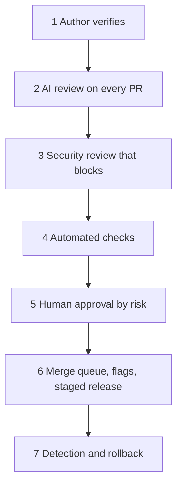

> 🌏 [中文版](/posts/ai/2026-10-21-claude-code-team-code-review)

In October 2026 the Claude Code team published a post on how they review code that Claude wrote. [The original](https://claude.dev/blog/solving-code-review-at-anthropic/) starts from a simple fact: Anthropic says Claude writes about 90% of Claude Code's code, and PR volume is too high to read line by line. So what is left of review? Their answer is to hand most of the reading to machines, keep humans for the places where risk is high, and make undoing mistakes cheap.

This guide covers their seven layers, the approval rules, how they make the AI reviewer accurate, and the first steps a team can take.

## What it is and who it's for

The original is a process write-up by Addy Osmani and two co-authors, not a product launch. Their reported result: from June to September 2026, merged PRs to the Claude Code repo more than doubled while the share that had to be reverted fell by more than 40%.

It fits teams whose agents already open PRs and whose reviewers are starting to buckle. For a solo project with modest PR volume, layers one and two are enough.

## The core idea: review the risk, not "did a human read it"

The post splits code review into two jobs: finding and fixing issues before they ship, and spreading understanding of the codebase across the team. Most of the text handles the first; the second comes at the end.

They treat "did a human read the diff?" as an imprecise proxy for "what could go wrong here, and which check, automated or human, is right to catch it?" Two consequences follow:

- Review stops being a gate at the end and runs continuously, like spellcheck while you write. Most changes have been reviewed and fixed by Claude at least once before a person sees them.
- The scarce resource is human time and attention, counted on both sides: time spent reviewing plus time spent fixing what bad code breaks. Cutting only the first just moves the cost.

They track human approvals per PR (median and 95th percentile), human comments, and how long a PR waits on a person. Revert and incident rates are the guardrail: if they rise, time was moved, not saved.

## The seven layers

**1. The work is verified first.** Most review happens before a PR exists. Claude gets something it can run (tests, a build, a screenshot to compare with the design) and must show the output instead of saying it's done; then a subagent with fresh context reviews the diff. Many engineers also run internal skills that hunt for bugs, simplify the diff, and check behavior end to end. When the automated reviewer keeps flagging the same thing, they fix it at the source: in a skill, a lint rule, `CLAUDE.md`, or `REVIEW.md`. Code owners write `REVIEW.md` to say what matters in their part of the code. Good ones are short: they describe what failure looks like in that repo (for docs it's "it lies", for config it's "it misroutes"), cap nits, list paths to skip, and ask for a file and line as evidence.

**2. AI review on every PR.** The reviewer reads the diff against the whole repo and the PR's stated intent: does it solve its problem, fit the system, break something else? On bug fixes it looks for the root cause. After the research preview launched, the share of internal PRs getting substantive comments went from 16% to 54%. The key design is that **findings are verified by other agents first**: several agents hunt for bugs at once, a separate group votes, and a finding posts only if enough agree. Style-only, diagnostic and cleanup findings are dropped. What remains is tagged Important, Nit or Pre-existing, so an old bug isn't blamed on the author. Every finding must be answered: fix it or resolve the thread with a reason.

**3. Security review that can block.** Security has its own automated review. A PR can't merge while any finding from the bug or security review is open; if a later commit fixes the issue, the finding clears on its own.

**4. Automated checks.** Lint, type checks, tests on every platform, a build. The PR template asks how the change was tested and how to undo it; Claude can fill it in, but the person who asked for the change signs off.

**5. Human approval, scaled by risk.**

| Risk | Examples | Human approvals |
|---|---|---|
| Low | Docs, copy, internal-only features, additive changes behind a flag | None once automated review and security checks are green |
| Medium | Ordinary product changes, and sensitive areas such as caching, the auto-updater, system prompts | One person |
| High | The highest-risk code, plus a small set of paths that always need two people | Two people |

The rules matter more than the table. A classifier reads the change and picks its tier, regardless of author. A second classifier asks whether this particular change needs another person even when its tier says it doesn't. Only trusted authors, mostly the owning team, get the lighter paths. An agent's approval never counts as a human's. On an agent-written PR, the person directing the agent counts as a required reviewer. An approval covers one specific commit: if new commits land that the system can't vouch for (an agent's push, a hand-resolved merge), approval must be given again.

**6. Merge queue, flags and gradual release.** The queue re-runs every check against main with the change applied, so two PRs that pass separately can't combine into a broken main. New behavior usually ships behind a flag to Anthropic employees first, whose heavy use often surfaces regressions before users do. Public releases go to the `latest` channel first; `stable` trails it.

**7. Fast detection, fast rollback.** Flags turn off without a deploy. There is a weekly on-call rotation, and incident reviews ask which layer should have caught the issue. They also say what's missing: no circuit breakers yet that tighten approval when revert or incident numbers move, and engineers want them before more code moves to zero-human merges.

## How they make the AI reviewer better

This is the part I found most useful, because it answers how AI review avoids becoming a noise machine.

- **Incidents become the eval.** They collected past PRs that caused incidents, with their fix-forwards and reverts, and had engineers who know the code confirm each bug and where it lived. The reviewer runs against that set daily, and any change to it is scored against all of it.
- **Noise is measured by what people do with comments.** Each comment is sorted by the response: fixed, said wrong, said intentional, or decided it didn't matter. They also run the reviewer on known-clean PRs and count how often it reports something that would lead to a harmful change. The written priority: catch real bugs first, cut review rounds second.
- **Review has to converge.** An agent author and an agent reviewer can keep each other busy indefinitely; one CLI PR went through more than fifty rounds overnight before its author stopped it. Running git blame on what the reviewer kept flagging, about 59% was code present since the first pass: it was rarely finding new bugs, just a few more old ones each round. Their fixes: a three-round cap after which the reviewer asks the author to reconsider the approach, diff-only re-review after the first few passes, flagging the whole class of bug so the author fixes every instance, and no repeats of posted findings.

## Where humans stay

The post lists five responsibilities: deciding whether to build it (direction, taste, scope; changes from outside the team still get human review), reviewing risky code (billing, the auto-updater, CI workflows), reviewing architecture others will copy, reading the evidence (test output, the command that ran and what it returned, a screenshot, the reviewer's findings; if you can't say what the checks would miss, ask for a real review), and owning the outcome.

For the second job, sharing context, there is no formal process. When someone wants to understand a slice of the codebase, they ask Claude for an explainer, which takes minutes and reflects the code as it is today. The team works in open Slack channels by default. "You land it, you own it" is the norm: changes are small, everything is reversible, blast radius sets the bar, regressions surface fast, and it isn't blame, since whoever owns the fix usually has the most context.

## A concrete start: three steps for your team

The original ends with a staged adoption checklist. These three are the cheapest starting points:

1. List checks the agent can run itself in a short `CLAUDE.md` (tests, lint, build), and require it to show the output before calling work done.
2. Add an AI reviewer on one repo and tune `REVIEW.md` for a few weeks before widening. Require every review thread to be resolved before merge, and cap rounds, reviewing only the new diff after the first few.
3. Add "Testing", "Risk" and "How to revert" to the PR template, then write approval rules by risk, **strict at first and loosened with evidence**.

## Limits

- This is Anthropic describing its own practice, with no published experimental design or control group. "PRs doubled, reverts down 40%" is self-reported and doesn't prove the process is the cause.
- It assumes strong infrastructure: a merge queue, flags, staged releases, weekly on-call, curated incident data. Dropping approvals to zero without these carries far more risk than it does for them.
- Zero-human merging is still being tried. The post admits the missing circuit breakers, and says the public Code Review product posts findings, not approvals.
- The "fifty rounds", "59%" and "16% to 54%" figures come from one team; measure your own repo.

## Takeaway

The trade-off: keep human time for what only humans can decide, give the rest to verifiable automated checks, and make rollback cheap enough to tolerate the occasional miss. Two things are worth taking away: evaluate the reviewer with incidents and human reactions, and limit review rounds from day one. For related approaches on this site, see [giving Claude a feedback loop](/posts/ai/2026-09-12-ai-native-sdlc-playbook-08-feedback-loop), [multi-engine code review](/posts/ai/2026-04-20-multi-model-ai-code-review-pipeline), and [OpenAI's harness engineering](/posts/ai/2026-04-21-openai-harness-engineering-codex-agent-first), which uses linters to enforce architecture.

## References

- [How the Claude Code team does code review (original)](https://claude.dev/blog/solving-code-review-at-anthropic/)
- [Claude Code best practices](https://code.claude.com/docs/en/best-practices)
- [Code Review for Claude Code docs](https://code.claude.com/docs/en/code-review)
- [Code Review research preview announcement](https://claude.com/resources/articles/code-review)
- [Automated security reviews in Claude Code](https://support.claude.com/en/articles/11932705-automated-security-reviews-in-claude-code)
- [Anthropic: Redesigning source control](https://www.anthropic.com/engineering/redesigning-source-control)
- [Agentic coding is straining CI: how Anthropic scaled test impact analysis](https://claude.com/resources/articles/agentic-coding-is-straining-ci-heres-how-we-scaled-test-impact-analysis-at-anthropic)
