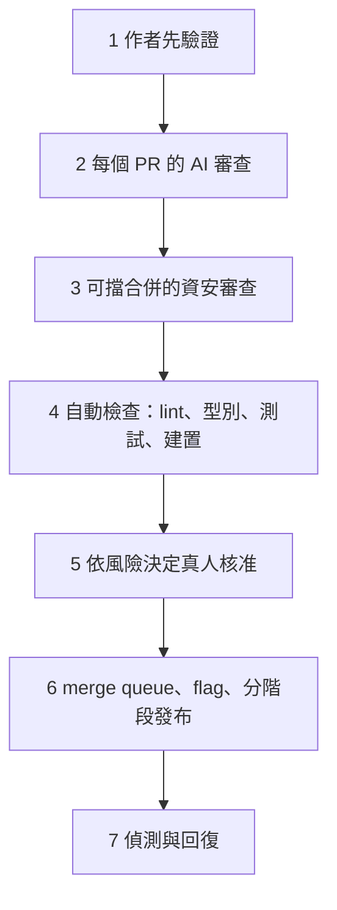

> 🌏 [English version](/posts/ai/2026-10-21-claude-code-team-code-review-en)

Claude Code 團隊在 2026 年 10 月發表了一篇文章，說明他們怎麼審查 Claude 寫出來的程式碼。[原文](https://claude.dev/blog/solving-code-review-at-anthropic/)的出發點是：Anthropic 自己說 Claude 寫了 Claude Code 約 90% 的程式碼，PR 量大到逐行閱讀做不到，那審查還剩什麼？他們的答案是把大部分閱讀交給機器，人類只在風險高的地方出手，再把回復的成本壓到很低。

這篇導讀整理他們的七層檢查、人力配置規則、讓 AI 審查者變準的方法，以及團隊可以先做哪幾件事。

## 是什麼，給誰看

原文是 Addy Osmani 等三位作者寫的流程說明，不是產品發表。作者給的結果是：2026 年 6 月到 9 月，Claude Code repo 合併的 PR 增加一倍以上，被 revert 的比例下降超過 40%。

適合已經讓 agent 開 PR、開始覺得 reviewer 撐不住的團隊。只有一個人、PR 量不大的專案，不用照搬七層，挑第一、二層就夠。

## 核心想法：審查的對象是風險，不是「有沒有人讀過」

原文把 code review 拆成兩個工作：在上線前找出並修掉問題，以及在團隊內傳遞對程式碼的理解。多數篇幅處理第一個，第二個放到最後。

他們認為「有沒有人讀過 diff」只是代理指標，真正的問題是「這個變更可能出什麼錯，哪一種檢查（自動或人工）最適合抓它」。這個換法帶來兩個結果：

- 審查從 PR 開完才開始的關卡，變成寫的當下持續進行，像寫字時的拼字檢查。多數變更在真人看到之前，已經被 Claude 審過、修過至少一次。
- 稀缺資源是人的時間與注意力。成本要算兩邊：花在審查的時間，加上壞程式碼出事後花在修的時間。只壓低前者，時間只是搬到後者。

他們追蹤每個 PR 的真人核准數（中位數與 P95）、真人留言數、PR 等人的時間；revert 率與 incident 率當護欄，這兩個數字一升，就代表省下的時間只是被搬走。

## 七層檢查

**1. 作者先驗證。** 大部分審查發生在 PR 開出來之前。給 Claude 能執行的驗證手段（測試、建置、與設計稿比對的截圖），要求它貼出輸出而不是回報「完成」，再讓一個 context 乾淨的 subagent 審 diff。開 PR 前很多人還會跑內部 skill：找 bug、簡化 diff、端到端檢查行為。自動審查者反覆抓到同一類問題時，修在源頭：改 skill、加 lint 規則，或更新 `CLAUDE.md`、`REVIEW.md`。`REVIEW.md` 由 code owner 寫，告訴審查者這個區塊在乎什麼；好的版本很短，寫明這個 repo 的「失敗長什麼樣」（文件是「說謊」，設定是「路由錯」）、限制 nit 數量、列出要跳過的路徑、要求用檔案與行號當證據。

**2. 每個 PR 都有 AI 審查。** 審查者讀整個 repo 加上 PR 說明的意圖，判斷這個變更是否解決問題、符合系統、會不會弄壞別的東西；bug fix 還會找根因。研究預覽版推出後，內部 PR 收到實質審查意見的比例從 16% 升到 54%。關鍵設計是**發現要先被別的 agent 驗證**：多個 agent 同時找 bug，另一組投票，夠多票才發出來；純風格、診斷、清理類的發現直接丟掉。留下的意見標 Important、Nit 或 Pre-existing，前人留下的 bug 不會被算在作者頭上。每個發現都要回應，修掉，或附理由關閉。

**3. 能擋合併的資安審查。** 資安審查獨立運作，bug 或資安審查任何一個發現還開著，PR 就不能合併。後續 commit 修好了，發現會自動關閉。

**4. 自動檢查。** lint、型別、各平台測試、建置。PR 範本要填「怎麼測的、怎麼還原」，Claude 可以代填，但要由請 agent 做這件事的人簽收。

**5. 依風險決定真人核准。**

| 風險 | 例子 | 真人核准 |
|---|---|---|
| 低 | 文件、文案、內部功能、flag 後的加法變更 | 不需要，自動審查與資安檢查綠燈即可 |
| 中 | 一般產品變更，以及快取、自動更新、system prompt 等敏感區 | 1 人 |
| 高 | 最高風險的程式碼，以及少數永遠要兩人的路徑 | 2 人 |

幾條規則比表格更重要：由分類器讀變更內容決定風險等級，不看是誰寫的；第二個分類器判斷「這個變更即使等級低，是否仍需要另一個人」；只有信任名單上的作者（主要是 repo 的負責團隊）才走較輕的路徑；agent 的核准不能算成真人的核准；在 agent 寫的 PR 上，下指令的那個人算一位必要審查者；核准只對特定 commit 有效，之後有系統無法擔保的新 commit（例如 agent 的推送、手動解衝突的 merge），核准要重給。

**6. Merge queue、flag、分階段發布。** merge queue 在套用變更後的 main 上重跑所有檢查，兩個各自通過的 PR 不會合成壞掉的 main。新行為先對 Anthropic 員工開 flag，自己人的重度使用常常比使用者更早撞到回歸。公開版先上 `latest` 頻道，`stable` 落後一段。

**7. 偵測與回復。** flag 不用部署就能關。有每週輪值的 on-call，incident review 要問「哪一層本來該抓到它」。他們也直說還缺一塊：目前沒有「revert／incident 數字上升就自動收緊核准」的斷路器，團隊工程師希望先有這個，才把更多程式碼放到零真人合併。

## 讓 AI 審查者變準的方法

這段是原文對我最有參考價值的部分，因為它回答「AI 審查怎麼不變成噪音製造機」。

- **把 incident 做成 eval。** 收集過去造成事故的 PR，連同 fix-forward 與 revert，請熟悉那段程式碼的工程師確認每個 bug 與位置；審查者每天對這組資料跑一次，改審查者就用全部資料重新評分。
- **用人的反應量測噪音。** 把每則意見按作者的反應分類：修了、說它錯、說是刻意的、認為不重要。再拿已知乾淨的 PR 跑審查者，計算它多常報出會讓人做出有害修改的東西。優先序寫明：先抓到真 bug，再減少審查輪數。
- **讓審查收斂。** agent 作者加 agent 審查者可以無限互相忙下去：有一個 CLI PR 一夜之間跑了五十幾輪審查與修復才被作者叫停。對審查者持續標記的內容做 git blame，約 59% 是第一輪審查就已存在的舊程式碼，審查者很少找到新 bug，只是每輪多挖出幾個舊的。對策有四個：三輪後請作者退一步重想做法、前幾輪之後只審新 diff、標出一整類問題讓作者一次修完所有實例、不重複已發過的發現。

## 人類留在哪裡

原文列了五件事：決定要不要做這件事（方向、品味、範圍，外部團隊來的變更仍保留人工審查）、審高風險程式碼（計費、自動更新、CI workflow）、審會被別人照抄的架構、讀證據（測試輸出、執行過的指令與回傳、截圖、審查者的發現；說不出檢查會漏什麼，就該要求真審而不是快速核准）、對結果負責。

第二個工作，也就是傳遞程式碼理解，他們沒有正式流程，做法是需要時請 Claude 為那一塊寫 explainer，幾分鐘完成而且反映現在的程式碼。團隊預設在公開 Slack 頻道工作，也讓大家看得到彼此在做什麼。「你合併的你負責」是團隊規範：變更要小、一切可回復、爆炸半徑決定門檻、回歸要快速浮現，而且這不是追究責任，擁有修復的人通常最有脈絡。

## 一個具體範例：你的團隊可以先做的三步

原文結尾給了一份依階段排序的採用清單，我挑成本最低的三步當起點：

1. 在 `CLAUDE.md` 寫下 agent 能自己跑的檢查（測試、lint、建置），讓它貼輸出才算完成。
2. 在一個 repo 加上 AI 審查者，調 `REVIEW.md` 幾週再擴大；同時要求所有 review thread 解決才能合併，並限制輪數，前幾輪後只審新 diff。
3. 把 PR 範本加上「Testing」「Risk」「How to revert」三欄，再依風險寫下核准規則，**一開始從嚴，有證據再放寬**。

## 限制

- 這是 Anthropic 描述自己的做法，沒有公開實驗設計，也沒有對照組。「PR 增加一倍、revert 比例降 40%」是作者自報的結果，不能直接當成「這套流程就是原因」。
- 他們的前提是強大的自家基礎建設：merge queue、flag、分階段發布、每週 on-call、有人整理的 incident 資料。沒有這些就把核准降到零人，風險比他們高得多。
- 零真人合併仍在試驗。原文自己承認缺斷路器，也說公開版的 Code Review 只發出發現、不代人核准。
- 「五十幾輪」「59%」「16% 到 54%」都是單一團隊的數字，換成別的 repo 要自己量。

## 整體來說

這篇的取捨是：把人的時間留給「只有人能決定的事」，其餘交給可驗證的自動檢查，並讓回復便宜到容許偶爾出錯。最值得帶走的是兩件事：用 incident 與人的反應來評估審查者，以及從一開始就限制審查輪數。想接著看站內相關的做法，可以讀[給 Claude 一個回饋迴圈](/posts/ai/2026-09-12-ai-native-sdlc-playbook-08-feedback-loop)與[多引擎 Code Review 的原理與實作](/posts/ai/2026-04-20-multi-model-ai-code-review-pipeline)，以及 [OpenAI 的 Harness Engineering](/posts/ai/2026-04-21-openai-harness-engineering-codex-agent-first) 如何用 linter 強制架構規則。

## 參考資料

- [How the Claude Code team does code review（原文）](https://claude.dev/blog/solving-code-review-at-anthropic/)
- [Claude Code best practices](https://code.claude.com/docs/en/best-practices)
- [Code Review for Claude Code 文件](https://code.claude.com/docs/en/code-review)
- [Code Review 研究預覽發表文](https://claude.com/resources/articles/code-review)
- [Automated security reviews in Claude Code](https://support.claude.com/en/articles/11932705-automated-security-reviews-in-claude-code)
- [Anthropic：Redesigning source control](https://www.anthropic.com/engineering/redesigning-source-control)
- [Agentic coding is straining CI：Anthropic 如何擴充 test impact analysis](https://claude.com/resources/articles/agentic-coding-is-straining-ci-heres-how-we-scaled-test-impact-analysis-at-anthropic)
