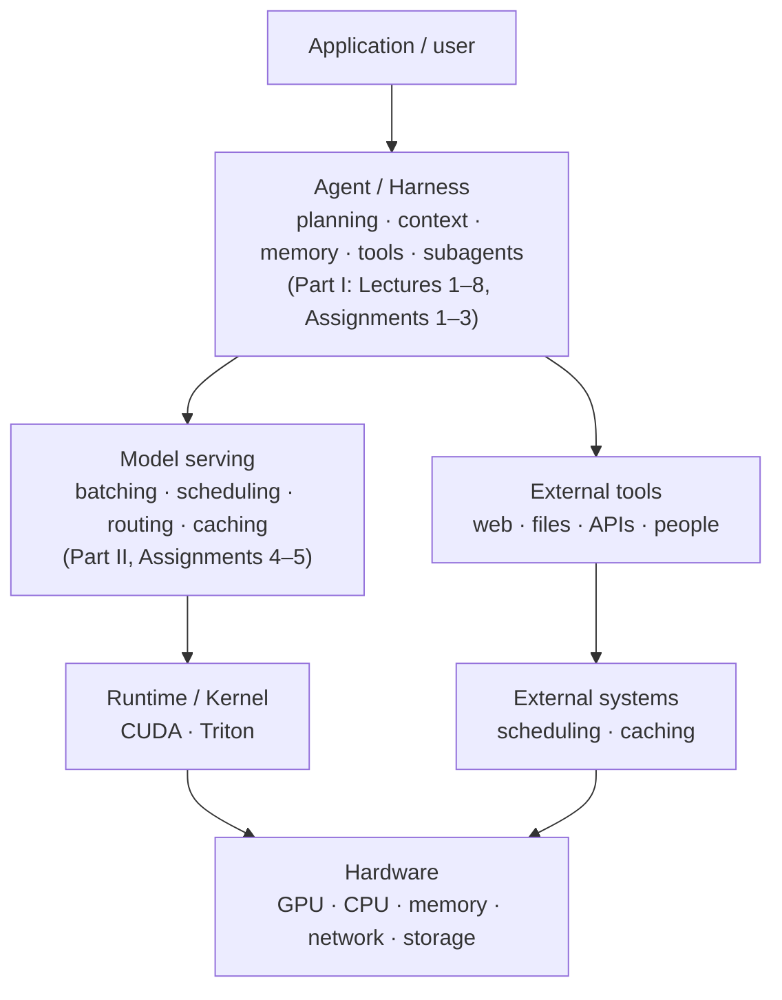

> 🌏 [中文版](/posts/ai/2026-10-21-cs2680-course-overview)

**Video status: The course is not recorded.** This post is based on the public slides and course website. [Source notes](#course-video-sources)

[CS2680 Modern AI Systems: Agents and System Optimizations](https://cs2680.com/) is a graduate systems course at Harvard taught by [Juncheng Yang](https://juncheng.seas.harvard.edu) and supported by his MaDSys (Measurement and Design of Systems) research group. It runs for the first time in Fall 2026. The course website describes it as following one agent system from the agent loop all the way down to the serving stack.

In practice, the first half of the term starts with an off-the-shelf coding agent ([Claude Code](https://code.claude.com/docs/en/overview)), then has you design your own agent on a course-provided API, measure it, and optimize it. In the second half you serve open-weight models yourself and take responsibility for batching, KV cache, routing, quantization, and speculative decoding. The course calls this path Mads (Modern Agent Design and Systems), and its five assignments, Mads-Lens, Mads-Loop, Mads-Opt, Mads-Serve, and Mads-Stack, are the five steps along it.

This series is for you if you already use a coding agent every day, are starting to think about building one, and care about the API bill. It covers Part I first (the course calls it Introduction to LLMs and agents; September to mid-October): eight lectures and three assignments. This post gives you the whole map.

## The arc: one agent, taken apart from the top down

[Lecture 1](/posts/ai/2026-10-21-cs2680-lecture-01-agents-systems-problem-en) places the course on a layered diagram ([Lecture 1 slides p40](https://cs2680.com/slides/1_intro.pdf#page=40)). At the top are applications and users. Below that is the agent/harness layer, which handles planning, context, memory, tools, and subagents. Under the harness the diagram splits into two columns: one for how the model gets run (serving, runtime, kernels), one for tools and the outside world (web, files, APIs, people). Shared hardware sits at the bottom.

Part I stays at the harness layer. The model is an API you call, and every optimization happens inside the harness. Part II goes further down and deals with how the model is run.



The whole course keeps returning to one question: under constraints on latency, cost, reliability, and safety, how do you get more tasks to succeed? The Lecture 1 slides say outright that throughput is the wrong target for agents ([p41](https://cs2680.com/slides/1_intro.pdf#page=41)). The four numbers that matter are task success rate, end-to-end latency, tokens used per task, and cost per completed task.

## What each part of Part I teaches

### Using agents first: Lectures 1–3 and Assignment 1

**[Lecture 1](https://cs2680.com/slides/1_intro.pdf)** (9/2) explains why agents are a systems problem. A typical LLM service is "request → inference → response". An agent is a long chain of "inference → tool → inference → tool → retrieval → inference…" where each step depends on the one before, latency swings widely, state keeps growing, and any link can fail ([p39](https://cs2680.com/slides/1_intro.pdf#page=39)). The slides compare the agent to a new kind of computer: the LLM is the CPU, the context window is memory, tools are peripherals, and the harness is the operating system ([p38](https://cs2680.com/slides/1_intro.pdf#page=38)).

**[Lecture 2](https://cs2680.com/slides/2_agent_use_1.pdf)** (9/9) takes Claude Code apart. After you type a request, the harness builds the opening context from the system prompt, CLAUDE.md, and the tool list. The model only *proposes* which tool to run; the harness checks permissions, actually runs it, and puts the result back into context. One conversation calls the model many times, the context keeps growing, and when it fills up it gets compacted. The second half covers memory (CLAUDE.md and auto memory) and four kinds of extensions: skills, MCP, hooks, and plugins.

**Assignment 1, Mads-Lens**, has you use Claude Code to build a web interface that shows Claude Code's own execution trace live: every tool call, its result, any subagents, and at the end how much money, how many seconds, and how many turns it took ([Assignment 1](https://cs2680.com/assignments/assignment1)).

**[Lecture 3](https://cs2680.com/slides/3_agent_use_2.pdf)** (9/14) is about one person running several agents. The first half covers three ways to scale up: running agents in parallel (with git worktrees keeping their working directories apart), handing work to subagents, and letting an agent run for a long time until it reaches a goal, with two plugins as case studies. The second half covers what the speaker calls Programming 3.0: writing software with natural language plus agents. Output goes up, but uncertainty leaks in from four places: semantics, context, model sampling, and the tool environment.

### Designing your own agent: Lecture 4 and Assignment 2

**[Lecture 4](https://cs2680.com/slides/4_agent_design_1.pdf)** (9/16) switches from user to designer. It writes ReAct (think → act → look at the result) as a twenty-line loop, then covers two things. First, tool design: should search use grep or a semantic index, should edits rewrite the whole file or replace one span, and how much power should the shell get? Second, context management: what goes in, what moves out to files, what gets transformed or compressed. The conclusion is that the same model with a different harness can perform very differently.

**Assignment 2, Mads-Loop**, has you write a minimal coding agent harness on a course-provided open model and test it on tasks from [SWE-bench Pro](https://github.com/scaleapi/SWE-bench_Pro-os) ([Assignment 2](https://cs2680.com/assignments/assignment2)). The assignments overview page stresses that when the model emits malformed output or a tool breaks, the harness has to handle it without crashing ([assignments overview](https://cs2680.com/assignments/)).

### Scaling up and staying stable: Lectures 5–6

**[Lecture 5](https://cs2680.com/slides/5_agent_design_2.pdf)** (9/23) covers multi-agent architectures. The slides lay out eight topologies (supervisor–worker, hierarchical, pipeline, market, blackboard, debate, swarm, dynamic), each suited to certain tasks and each with its own weakness. A single planner becomes a bottleneck, for example, and a swarm with no coordinator generates messages that grow with the square of the number of agents ([p18](https://cs2680.com/slides/5_agent_design_2.pdf#page=18)). It also points out that communication between agents is a distributed-systems problem: messages get lost, resent, and reordered. The first design principle is "do you really need multiple agents?"

**[Lecture 6](https://cs2680.com/slides/6_agent_design_3.pdf)** (9/28) starts with memory, which it breaks into a series of decisions: whether to write, how to store, when to retrieve, when to forget. The second half is about reliability. If steps are independent and each succeeds 95% of the time, the chance of getting all 20 steps right is only 36% ([p22](https://cs2680.com/slides/6_agent_design_3.pdf#page=22)). So when something fails, the first job is to find which layer it failed in: the task spec, the harness, the model, the tools, or the environment.

### Measuring it and making it cheap: Lectures 7–8 and Assignment 3

**[Lecture 7](https://cs2680.com/slides/7_agent_design_4.pdf)** (9/30) covers evaluation. pass@k (at least one success in k tries) measures "can do it"; pass^k (all k tries succeed) measures "does it every time". For something like customer support, where every user needs to succeed, the second one is what counts. It then looks at what eight representative benchmarks measure ([p23](https://cs2680.com/slides/7_agent_design_4.pdf#page=23)) and how scores get distorted by data leakage, single-turn-only testing, and nondeterminism.

**[Lecture 8](https://cs2680.com/slides/8_agent_design_5.pdf)** (10/7) first breaks agent cost into a product: users × sessions per user × turns per session × steps per turn × tokens per step × price per token. The last four are the ones to cut ([p7](https://cs2680.com/slides/8_agent_design_5.pdf#page=7)). It then covers shortening the critical path to make agents faster. The second half presents three harness architectures and looks at how eight harnesses, including Claude Code, Codex CLI, and OpenCode, make their trade-offs ([p46](https://cs2680.com/slides/8_agent_design_5.pdf#page=46)).

**Assignment 3, Mads-Opt**, is a leaderboard competition. The model is still a black-box API. Without solving fewer tasks, you push down cost and time per solved task, and all three metrics count toward the ranking ([Assignment 3](https://cs2680.com/assignments/assignment3)).

Part I also has three sessions without slides, which this series doesn't cover separately: a Snowflake guest talk (10/5), Assignment 1 show-and-tell (9/21), and student presentations on agent safety and self-improving harnesses (10/14).

## A look ahead at Part II

Part II starts 10/19: LLM serving fundamentals, speculative decoding, agent scheduling and prefix caching, pruning and quantization, KV cache optimization, and routing and load balancing.

Assignment 4 removes the commercial API: you serve a 7–8B model yourself and use the harness to win back quality. Assignment 5 opens the whole stack to optimization. As of 2026-10-21, neither assignment page nor the Part II slides are public; this series will add them once they are.

## Worked by hand: every extra step re-reads everything

This is a teaching example written for this post. The numbers are made up; the point is to make sense of something Lectures 2 and 8 keep coming back to.

Say you ask an agent to "fix this failing test". The opening context (system prompt, CLAUDE.md, tool descriptions) is 10,000 tokens; the Lecture 2 slides mention that Claude Code starts with more than ten thousand tokens ([Lecture 2 p7](https://cs2680.com/slides/2_agent_use_1.pdf#page=7)). The agent takes 5 steps: search, read a file, edit it, run the tests, report back. Each step's tool result adds about 1,000 tokens to the context.

The model doesn't remember the previous call, so every step has to send the entire current context again ([Assignment 2](https://cs2680.com/assignments/assignment2) puts it as "the model is stateless"). Counting input only, not model output:

| Model call | Context read on this call |
|---|---|
| 1 | 10,000 |
| 2 | 11,000 |
| 3 | 12,000 |
| 4 | 13,000 |
| 5 | 14,000 |
| Total | 60,000 |

The final context is only 14,000 tokens, but 60,000 tokens were read in total, more than four times the final length. Double the steps and the total more than doubles, because every later step carries all the earlier results.

How does this get cheaper? Each call starts with the same content as the previous one, so the serving side can reuse the part it has already computed (a prefix cache), and the repeated prefix is billed at a discount. Lecture 2 notes that most of Claude Code's spend goes to these cache-hit re-reads ([Lecture 2 p12](https://cs2680.com/slides/2_agent_use_1.pdf#page=12)). Context management in Lecture 4 is about deciding what doesn't need to be carried along. Lecture 8 lists tokens per step and price per token as two factors you can cut, and notes that cached input costs a tenth of the base input price ([Lecture 8 p21](https://cs2680.com/slides/8_agent_design_5.pdf#page=21)). How the serving side actually reuses prefixes is a Part II topic.

## Prerequisites and self-check

The course homepage lists Harvard CS61 plus one graduate systems course as prerequisites, along with familiarity with Python and PyTorch ([course homepage](https://cs2680.com/)). The [policy page](https://cs2680.com/policy) also gives a long list of systems terms (latency, tail latency, Amdahl's law, mutex, page fault, RDMA…) and says that if most are unfamiliar, the course isn't a good fit. Anyone planning to read Part II can use that list to check themselves.

Reading only the Part I guides takes less:

- You have used an LLM API or some coding agent, and roughly know what tokens and a context window are.
- You can read a few dozen lines of Python.
- You have used git and a shell.

If the agent loop is new to you, start with [Inside a coding agent](/posts/ai/2026-08-16-cs146s-agent-internals-en) on this site.

Self-check:

1. In the example above, if the agent takes 10 steps and each step still adds 1,000 tokens, how many tokens are read in total?
   Answer: add up the 10 values from 10,000 to 19,000: (10,000 + 19,000) × 10 ÷ 2 = 145,000. Going from 5 to 10 steps takes the total from 60,000 to 145,000, more than double.
2. Your agent always finishes but costs too much. Which post should you read first?
   Answer: [Lecture 8](/posts/ai/2026-10-21-cs2680-lecture-08-cost-latency-harness-en) (the cost breakdown), with [Assignment 3](/posts/ai/2026-10-21-cs2680-assignment-3-mads-opt-en) for practice.
3. "If the model generates more tokens per second, the agent gets faster." True?
   What to look for: you should say not necessarily. An agent's time goes into a chain of steps that wait on each other, including tool execution; tokens per second only measures one part of that.

## How to read it: order and materials

Read in the course's own order, because the course itself moves from "use" to "design" to "optimize":

1. [Lecture 1](/posts/ai/2026-10-21-cs2680-lecture-01-agents-systems-problem-en): get the full map and what you are optimizing for.
2. [Lecture 2](/posts/ai/2026-10-21-cs2680-lecture-02-how-claude-code-works-en) and [Assignment 1](/posts/ai/2026-10-21-cs2680-assignment-1-mads-lens-en): see clearly what a mature agent does at each step.
3. [Lecture 3](/posts/ai/2026-10-21-cs2680-lecture-03-scaling-yourself-multi-agent-en): learn to run several agents at once.
4. [Lecture 4](/posts/ai/2026-10-21-cs2680-lecture-04-tool-design-context-engineering-en) and [Assignment 2](/posts/ai/2026-10-21-cs2680-assignment-2-mads-loop-en): write one yourself.
5. [Lecture 5](/posts/ai/2026-10-21-cs2680-lecture-05-multi-agent-architecture-en) and [Lecture 6](/posts/ai/2026-10-21-cs2680-lecture-06-memory-reliability-en): grow it into multiple agents, and add memory and reliability.
6. [Lecture 7](/posts/ai/2026-10-21-cs2680-lecture-07-agent-evaluation-en), [Lecture 8](/posts/ai/2026-10-21-cs2680-lecture-08-cost-latency-harness-en), and [Assignment 3](/posts/ai/2026-10-21-cs2680-assignment-3-mads-opt-en): learn to measure, then learn to save.

If you just want to solve the problem in front of you, skip around: to write your own agent, start at [Lecture 4](/posts/ai/2026-10-21-cs2680-lecture-04-tool-design-context-engineering-en); if your agent is too expensive, read [Lecture 8](/posts/ai/2026-10-21-cs2680-lecture-08-cost-latency-harness-en); if you can't tell whether a change made things better, read [Lecture 7](/posts/ai/2026-10-21-cs2680-lecture-07-agent-evaluation-en).

On materials: the course isn't recorded, so this series is built on the slides, the reading pages on the course website, and two course notes ([agent evaluation](https://cs2680.com/notes/agent-evaluation), [cost-effective agents](https://cs2680.com/notes/cost-effective-agents)). Where a slide covers something in a single line, the posts add an explanation and mark it as this site's. The "LLM basics" lecture originally on the schedule was postponed, so the Lecture 2 guide opens with a minimal API-call example; readers who want to look inside the LLM can use the course's [transformers reading notes](https://cs2680.com/notes/transformers), which aren't linked from the homepage. The slides describe a fair amount of Claude Code product behavior; each post goes by the official documentation at the time of writing.

## Something to try tonight

Open Claude Code and give it a small task that needs tools, for example:

```bash
claude -p "Read main.py and add a --help flag to it" --output-format stream-json --verbose
```

Each line of output is one event. Count the `assistant` events whose `content` contains `tool_use` and you have the number of tool calls; the `total_cost_usd`, `duration_ms`, and `num_turns` in the final `result` event tell you how much it cost, how many milliseconds it took, and how many turns it ran ([Assignment 1](https://cs2680.com/assignments/assignment1)). This is also where Assignment 1 starts.

## Further reading on this site

- [CMU 11-768 AI Agents Course Overview](/posts/ai/2026-09-29-cmu-11768-course-overview-en): another agents course, leaning toward agent design and research; it partly overlaps with CS2680 Part I.
- [CMU 11-868 LLM Systems Overview](/posts/ai/2026-09-30-cmu11868-llm-systems-overview-en): background for the serving topics in Part II.
- [How Claude Code works](/posts/tech/deep-dive/2026-08-26-claude-code-how-it-works-en): the product side of Lecture 2.

## Course video sources

- The course policy page says plainly that "the lectures will not be recorded", so there is no recording to embed ([policy page](https://cs2680.com/policy)).
- Sources for this post: [the course homepage and schedule](https://cs2680.com/), the slides for Lectures 1–8 (see References), and the assignments overview and Assignment 1–3 pages, read on 2026-10-21. Page numbers always follow the PDF page order.

## Changelog

- 2026-10-23: Added links to the Lecture 6, 7, and 8 and Assignment 3 posts in the reading order, the skip-ahead tips, and a self-check answer.
- 2026-10-22: Added links to the Lecture 2–5 and Assignment 1–2 posts in the reading order.

## References

- [CS2680 Modern AI Systems: Agents and System Optimizations course homepage](https://cs2680.com/)
- [CS2680 course policy and background](https://cs2680.com/policy)
- [Lecture 1 slides: Course overview](https://cs2680.com/slides/1_intro.pdf)
- [Lecture 2 slides: How Claude Code works](https://cs2680.com/slides/2_agent_use_1.pdf)
- [Lecture 3 slides: 100x engineer with multi-agents](https://cs2680.com/slides/3_agent_use_2.pdf)
- [Lecture 4 slides: Context management and tool design](https://cs2680.com/slides/4_agent_design_1.pdf)
- [Lecture 5 slides: Multi-agent architecture, coordination, and communication](https://cs2680.com/slides/5_agent_design_2.pdf)
- [Lecture 6 slides: Agent memory and reliability](https://cs2680.com/slides/6_agent_design_3.pdf)
- [Lecture 7 slides: Agent evaluation](https://cs2680.com/slides/7_agent_design_4.pdf)
- [Lecture 8 slides: Cost and performance](https://cs2680.com/slides/8_agent_design_5.pdf)
- [Assignments overview](https://cs2680.com/assignments/)
- [Assignment 1: Mads-Lens](https://cs2680.com/assignments/assignment1)
- [Assignment 2: Build an agent harness](https://cs2680.com/assignments/assignment2)
- [Assignment 3: Mads-Opt](https://cs2680.com/assignments/assignment3)
- [Course notes: Agent evaluation](https://cs2680.com/notes/agent-evaluation)
- [Course notes: Cost-effective agents](https://cs2680.com/notes/cost-effective-agents)
- [Juncheng Yang's homepage](https://juncheng.seas.harvard.edu)
