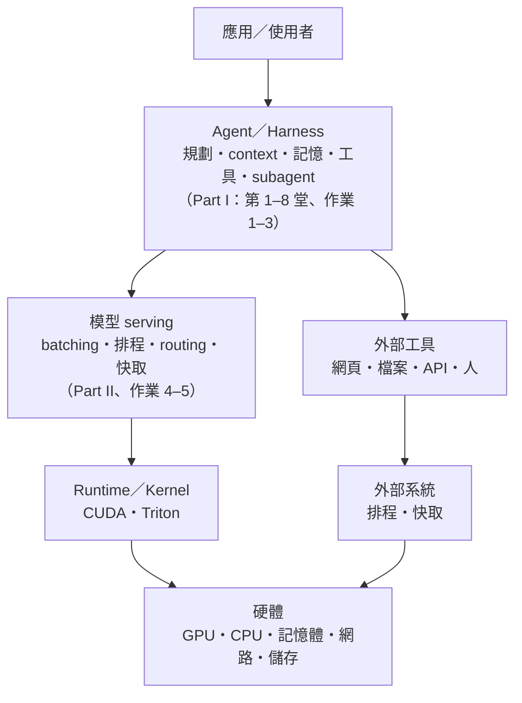

> 🌏 [English version](/posts/ai/2026-10-21-cs2680-course-overview-en)

**影片狀態：課程不錄影。** 本文依公開投影片與課程網站整理。[來源說明](#課程影片來源)

[CS2680 Modern AI Systems: Agents and System Optimizations](https://cs2680.com/) 是 Harvard 的研究所系統課，授課者是 [Juncheng Yang](https://juncheng.seas.harvard.edu)，由他的 MaDSys（Measurement and Design of Systems）研究組支援，2026 年秋季開課。課程網站對它的描述是：跟著一個 agent 系統，從 agent loop 一路往下拆到 serving stack。

具體來說，前半學期先用現成的 coding agent（[Claude Code](https://code.claude.com/docs/en/overview)），再用課程提供的 API 自己設計一個 agent，量它、優化它。下半學期換成自己 serve 開源權重模型，底下的 batching、KV cache、routing、量化與 speculative decoding 都要自己負責。課程把這條路叫 Mads（Modern Agent Design and Systems），五份作業 Mads-Lens、Mads-Loop、Mads-Opt、Mads-Serve、Mads-Stack 就是五步。

如果你已經天天用 coding agent，開始想自己做一個，又在意 API 帳單，這個系列就是為你寫的。系列先寫 Part I（課程原名 Introduction to LLMs and agents，9 月到 10 月中）：八堂講課加三份作業。這篇先給整張地圖。

## 主線：同一個 agent，由上往下拆

[第 1 堂](/posts/ai/2026-10-21-cs2680-lecture-01-agents-systems-problem)用一張分層圖定位這門課（[第 1 堂投影片 p40](https://cs2680.com/slides/1_intro.pdf#page=40)）。最上面是應用與使用者，下一層是 agent／harness，負責規劃、context、記憶、工具與 subagent。harness 底下分兩欄：一欄是模型怎麼被跑起來（serving、runtime、kernel），一欄是工具與外部環境（網頁、檔案、API、人）；最底層是共用的硬體。

Part I 停在 harness 這層：把模型當成一個會呼叫的 API，所有優化都發生在 harness 裡。Part II 才往下走，處理模型怎麼被跑起來。



整門課反覆回到同一個問題：在延遲、成本、可靠度、安全的限制下，怎麼讓任務成功的比例變高。第 1 堂投影片直接說，throughput 對 agent 是錯的目標（[p41](https://cs2680.com/slides/1_intro.pdf#page=41)）。真正要看的是四個數：任務成功率、端到端延遲、每個任務用掉多少 token、每完成一個任務花多少錢。

## Part I 每一段在學什麼

### 先用 agent：第 1–3 堂與作業 1

**[第 1 堂](https://cs2680.com/slides/1_intro.pdf)**（9/2）說明 agent 為什麼是系統問題。一般的 LLM 服務是「請求 → 推論 → 回應」；agent 是「推論 → 工具 → 推論 → 工具 → 檢索 → 推論……」的長鏈，每步依賴上一步，延遲忽長忽短，狀態一路變大，任何一環都可能失敗（[p39](https://cs2680.com/slides/1_intro.pdf#page=39)）。投影片把 agent 比作新型電腦：LLM 是 CPU、context window 是記憶體、工具是周邊、harness 是作業系統（[p38](https://cs2680.com/slides/1_intro.pdf#page=38)）。

**[第 2 堂](https://cs2680.com/slides/2_agent_use_1.pdf)**（9/9）拆開 Claude Code。你打一句話之後，harness 先把 system prompt、CLAUDE.md 和工具清單組成開場 context。模型只「提出」要跑哪個工具，harness 檢查權限後才真的執行，再把結果放回 context。一次對話裡模型會被呼叫很多次，context 一路長大，滿了就壓縮。後半講記憶（CLAUDE.md 與 auto memory），以及四種擴充：skill、MCP、hook、plugin。

**作業 1 Mads-Lens** 讓你用 Claude Code 寫一個網頁介面，即時顯示 Claude Code 自己的執行軌跡：每次工具呼叫、結果、subagent，以及最後花了多少錢、幾秒、幾輪（[作業 1](https://cs2680.com/assignments/assignment1)）。

**[第 3 堂](https://cs2680.com/slides/3_agent_use_2.pdf)**（9/14）講怎麼一個人帶多個 agent。前半是三種放大方式：平行開多個 agent（用 git worktree 分開工作目錄）、派 subagent 分工、讓 agent 長時間跑到目標達成，並用兩個 plugin 當案例。後半講講者所說的 Programming 3.0：用自然語言加 agent 寫程式，產出變多，但不確定性也從語意、context、模型取樣、工具環境四個地方滲進來。

### 自己設計 agent：第 4 堂與作業 2

**[第 4 堂](https://cs2680.com/slides/4_agent_design_1.pdf)**（9/16）從使用者轉成設計者，先把 ReAct（想 → 做 → 看結果）寫成二十行的 loop，再講兩件事。第一是工具怎麼設計：搜尋用 grep 還是語意索引，改檔要整檔重寫還是只換一段，shell 要給多大的權力。第二是 context 怎麼管：什麼該放進來、什麼搬到檔案、什麼轉換或壓縮。結論是同一個模型換一個 harness，表現可以差很多。

**作業 2 Mads-Loop** 要你用課程提供的開源模型，自己寫一個最小的 coding agent harness，拿 [SWE-bench Pro](https://github.com/scaleapi/SWE-bench_Pro-os) 的題目測（[作業 2](https://cs2680.com/assignments/assignment2)）。作業總覽頁特別寫明，模型吐出壞格式、工具壞掉時，harness 要能不崩潰地處理（[作業總覽](https://cs2680.com/assignments/)）。

### 擴大與穩定：第 5–6 堂

**[第 5 堂](https://cs2680.com/slides/5_agent_design_2.pdf)**（9/23）講多 agent 架構。投影片整理了八種拓撲（supervisor–worker、階層、pipeline、市場、黑板、辯論、swarm、動態拓撲），每種各有適合的任務與弱點：例如單一 planner 會變成瓶頸，沒有指揮者的 swarm 訊息量隨 agent 數的平方成長（[p18](https://cs2680.com/slides/5_agent_design_2.pdf#page=18)）。它也指出 agent 之間的通訊就是分散式系統問題，訊息會遺失、重送、亂序。第一條設計原則是「真的需要多 agent 嗎」。

**[第 6 堂](https://cs2680.com/slides/6_agent_design_3.pdf)**（9/28）前半講記憶，把它拆成一串決定：寫不寫、怎麼存、何時取、何時忘。後半講可靠度。假設每步獨立、每步成功率 95%，走 20 步全部做對的機率只剩 36%（[p22](https://cs2680.com/slides/6_agent_design_3.pdf#page=22)）。所以出錯時要先找出錯在哪一層：任務規格、harness、模型、工具還是環境。

### 量它、讓它便宜：第 7–8 堂與作業 3

**[第 7 堂](https://cs2680.com/slides/7_agent_design_4.pdf)**（9/30）講評估。pass@k（試 k 次至少成功一次）量的是「做得到」，pass^k（試 k 次全部成功）量的是「每次都做得到」，客服這種每位使用者都要成功的場景要看後者。接著看八個代表性 benchmark 各量什麼（[p23](https://cs2680.com/slides/7_agent_design_4.pdf#page=23)），以及分數會因為資料洩漏、只測單輪對話、非決定性而失真。

**[第 8 堂](https://cs2680.com/slides/8_agent_design_5.pdf)**（10/7）前半把 agent 成本拆成一條乘式：使用者數 × 每人 session 數 × 每 session 輪數 × 每輪步數 × 每步 token 數 × 每 token 價格，後四項是要砍的（[p7](https://cs2680.com/slides/8_agent_design_5.pdf#page=7)）；再講怎麼縮短關鍵路徑讓 agent 變快。後半介紹三種 harness 架構，再看 Claude Code、Codex CLI、OpenCode 等八個 harness 各自怎麼取捨（[p46](https://cs2680.com/slides/8_agent_design_5.pdf#page=46)）。

**作業 3 Mads-Opt** 是排行榜競賽：模型還是黑盒 API，在解題數不掉的前提下，壓低每解出一題的成本與時間，三個指標一起排名（[作業 3](https://cs2680.com/assignments/assignment3)）。

Part I 另有三場沒有投影片的場次，本系列不另寫（Snowflake 客座 10/5、作業 1 心得分享 9/21、學生主講 agent 安全與會自我改進的 harness 10/14）。

## Part II 預告

10/19 起是 Part II：LLM serving 的基礎、speculative decoding、agent 的排程與 prefix caching、剪枝與量化、KV cache 優化、routing 與負載平衡。

作業 4 要拿掉商用 API、自己 serve 一個 7–8B 的模型並靠 harness 補回品質；作業 5 把整條 stack 都開放優化。截至 2026-10-21，這兩份作業的頁面和 Part II 的投影片還沒公開，公開後本系列再補。

## 手算一次：agent 每多一步，就多讀一次全部

這是本文的教學例子，數字是假設的，用來看懂第 2 堂與第 8 堂反覆提到的一件事。

假設你請 agent「修好這個失敗的測試」。開場 context（system prompt、CLAUDE.md、工具說明）有 10,000 token；第 2 堂投影片提到 Claude Code 開場就有一萬多 token（[第 2 堂 p7](https://cs2680.com/slides/2_agent_use_1.pdf#page=7)）。agent 走了 5 步：搜尋、讀檔、改檔、跑測試、回報。每一步的工具結果平均讓 context 多 1,000 token。

模型本身不記得上一次呼叫，每一步都要把當下整份 context 重新送一次（[作業 2](https://cs2680.com/assignments/assignment2) 的說法是「the model is stateless」）。只算輸入、不算模型輸出：

| 第幾次呼叫模型 | 這次要讀的 context |
|---|---|
| 1 | 10,000 |
| 2 | 11,000 |
| 3 | 12,000 |
| 4 | 13,000 |
| 5 | 14,000 |
| 合計 | 60,000 |

最後的 context 只有 14,000 token，但總共讀了 60,000 token，是最終長度的四倍多。步數加倍，總量會比加倍更多，因為後面每一步都背著前面所有的結果。

這個帳怎麼變便宜？每一次呼叫的開頭都跟上一次一樣，serving 端可以重用已經算好的那段（prefix cache），重複的開頭就以折扣價計費。第 2 堂提到，Claude Code 的花費大部分落在這種命中快取的重讀上（[第 2 堂 p12](https://cs2680.com/slides/2_agent_use_1.pdf#page=12)）。第 4 堂的 context 管理，是在決定哪些東西不必一直背著。第 8 堂則把每步 token 數和每 token 價格列為兩個可以砍的因子，並列出命中快取的輸入只要一般輸入價格的十分之一（[第 8 堂 p21](https://cs2680.com/slides/8_agent_design_5.pdf#page=21)）。serving 端怎麼做到前綴重用，Part II 才講。

## 先備與自我檢查

課程首頁寫的先修是 Harvard CS61 加一門研究所系統課，並熟悉 Python 與 PyTorch（[課程首頁](https://cs2680.com/)）。[policy 頁](https://cs2680.com/policy)另外列了一長串系統名詞（latency、tail latency、Amdahl's law、mutex、page fault、RDMA……），說大多不認識就不適合修；要讀 Part II 的人可以拿它自我檢查。

只讀 Part I 的導讀，需要的比較少：

- 用過 LLM API 或任一個 coding agent，知道 token、context window 大概是什麼。
- 看得懂幾十行 Python。
- 用過 git 和 shell。

不熟 agent loop 的話，可以先讀站內的 [coding agent 的內部構造](/posts/ai/2026-08-16-cs146s-agent-internals)。

自我檢查：

1. 上面的例子如果 agent 走 10 步、每步一樣多 1,000 token，總共要讀多少 token？
   答：10,000 到 19,000 的 10 項相加，(10,000 + 19,000) × 10 ÷ 2 ＝ 145,000。步數從 5 變 10，總量從 60,000 變 145,000，超過兩倍。
2. 你的 agent 每次都能跑完但太貴，該先讀哪篇？
   答：第 8 堂（成本拆解），練習看作業 3。
3. 「每秒產生的 token 數變多，agent 就變快」對嗎？
   判準：要能答出不一定，因為 agent 的時間花在一串互相等待的步驟上，還包括工具執行；每秒 token 數只量到其中一段。

## 怎麼讀：順序與材料

建議照原課順序讀，因為這門課本身就是從「用」走到「設計」再到「優化」：

1. [第 1 堂](/posts/ai/2026-10-21-cs2680-lecture-01-agents-systems-problem)：先拿到整張地圖和「要最佳化什麼」。
2. [第 2 堂](/posts/ai/2026-10-21-cs2680-lecture-02-how-claude-code-works)與[作業 1](/posts/ai/2026-10-21-cs2680-assignment-1-mads-lens)：看清楚一個成熟的 agent 每一步在做什麼。
3. [第 3 堂](/posts/ai/2026-10-21-cs2680-lecture-03-scaling-yourself-multi-agent)：學會同時用多個 agent。
4. [第 4 堂](/posts/ai/2026-10-21-cs2680-lecture-04-tool-design-context-engineering)與[作業 2](/posts/ai/2026-10-21-cs2680-assignment-2-mads-loop)：自己寫一個。
5. [第 5 堂](/posts/ai/2026-10-21-cs2680-lecture-05-multi-agent-architecture)、第 6 堂：擴成多 agent、加上記憶與可靠度。
6. 第 7–8 堂與作業 3：學會量，再學會省。

只想解決手上問題的讀者可以跳讀：想自己寫 agent 從[第 4 堂](/posts/ai/2026-10-21-cs2680-lecture-04-tool-design-context-engineering)開始；agent 太貴看第 8 堂；不知道改動有沒有變好看第 7 堂。

材料方面：課程不錄影，所以本系列的底本是投影片、課程網站的閱讀頁與兩份課程筆記（[agent evaluation](https://cs2680.com/notes/agent-evaluation)、[cost-effective agents](https://cs2680.com/notes/cost-effective-agents)）。投影片上只有一句話帶過的地方，文章會補上說明並標明是本站的說明。課程原本預告的「LLM 基礎」那堂延後了，所以第 2 堂導讀開頭會補一段 API 呼叫的最小範例；想看 LLM 內部的讀者，課程另有一份沒列在首頁的 [transformers 閱讀筆記](https://cs2680.com/notes/transformers)。投影片裡有不少 Claude Code 產品行為，各篇以撰寫當時的官方文件為準。

## 今晚可以做的事

打開 Claude Code，丟一個會用到工具的小任務，例如：

```bash
claude -p "讀 main.py，幫它加一個 --help 參數" --output-format stream-json --verbose
```

輸出的每一行是一個事件。數 `assistant` 事件裡 `content` 含 `tool_use` 的次數，就是工具呼叫次數；最後一行 `result` 事件的 `total_cost_usd`、`duration_ms`、`num_turns`，就是這次花了多少錢、幾毫秒、幾輪（[作業 1](https://cs2680.com/assignments/assignment1)）。這也是作業 1 的起點。

## 站內延伸閱讀

- [CMU 11-768 AI Agents 課程總覽](/posts/ai/2026-09-29-cmu-11768-course-overview)：另一門 agent 課，偏 agent 設計與研究，範圍和 CS2680 Part I 部分重疊。
- [CMU 11-868 LLM Systems 總覽](/posts/ai/2026-09-30-cmu11868-llm-systems-overview)：Part II serving 主題的背景。
- [Claude Code 是怎麼運作的](/posts/tech/deep-dive/2026-08-26-claude-code-how-it-works)：第 2 堂的產品面補充。

## 課程影片來源

- 課程 policy 頁明寫「the lectures will not be recorded」，所以沒有錄影可嵌入（[policy 頁](https://cs2680.com/policy)）。
- 本文底本：[課程首頁與課表](https://cs2680.com/)、第 1–8 堂投影片（見參考資料）、作業總覽與作業 1–3 頁面，2026-10-21 讀取。頁碼一律用 PDF 頁序。

## 更新紀錄

- 2026-10-22：閱讀順序補上第 2–5 堂與作業 1、2 的站內連結。

## 參考資料

- [CS2680 Modern AI Systems: Agents and System Optimizations 課程首頁](https://cs2680.com/)
- [CS2680 課程政策與先備背景](https://cs2680.com/policy)
- [第 1 堂投影片：Course overview](https://cs2680.com/slides/1_intro.pdf)
- [第 2 堂投影片：How Claude Code works](https://cs2680.com/slides/2_agent_use_1.pdf)
- [第 3 堂投影片：100x engineer with multi-agents](https://cs2680.com/slides/3_agent_use_2.pdf)
- [第 4 堂投影片：Context management and tool design](https://cs2680.com/slides/4_agent_design_1.pdf)
- [第 5 堂投影片：Multi-agent architecture, coordination, and communication](https://cs2680.com/slides/5_agent_design_2.pdf)
- [第 6 堂投影片：Agent memory and reliability](https://cs2680.com/slides/6_agent_design_3.pdf)
- [第 7 堂投影片：Agent evaluation](https://cs2680.com/slides/7_agent_design_4.pdf)
- [第 8 堂投影片：Cost and performance](https://cs2680.com/slides/8_agent_design_5.pdf)
- [作業總覽](https://cs2680.com/assignments/)
- [作業 1：Mads-Lens](https://cs2680.com/assignments/assignment1)
- [作業 2：Build an agent harness](https://cs2680.com/assignments/assignment2)
- [作業 3：Mads-Opt](https://cs2680.com/assignments/assignment3)
- [課程筆記：Agent evaluation](https://cs2680.com/notes/agent-evaluation)
- [課程筆記：Cost-effective agents](https://cs2680.com/notes/cost-effective-agents)
- [Juncheng Yang 個人頁](https://juncheng.seas.harvard.edu)
