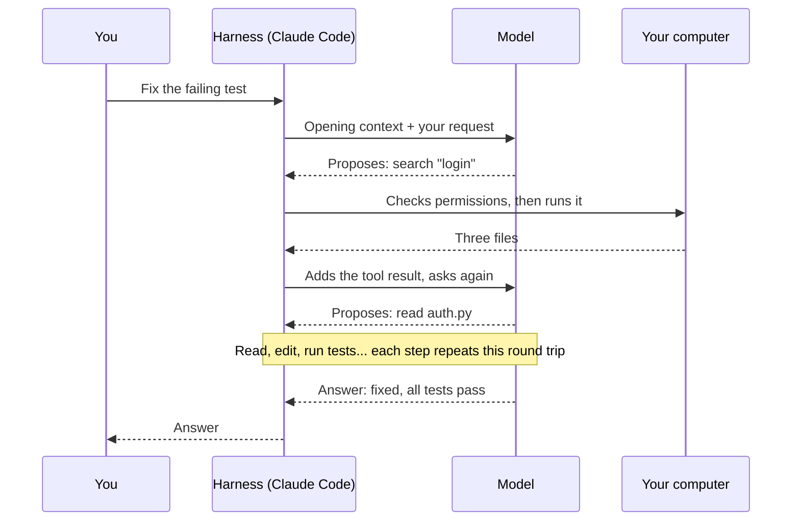

> 🌏 [中文版](/posts/ai/2026-10-21-cs2680-lecture-02-how-claude-code-works)

**Video status: The course is not recorded.** This post is based on the public slides; the numerical examples are this site's additions. [Source notes](#course-video-sources)

Lecture 2 of [CS2680](https://cs2680.com/) met on September 9, 2026, under the title "How Claude Code works" ([slides](https://cs2680.com/slides/2_agent_use_1.pdf)). [Lecture 1](/posts/ai/2026-10-21-cs2680-lecture-01-agents-systems-problem-en) said an agent is a long chain of inference → tool → inference. This lecture takes a mature coding agent, [Claude Code](https://code.claude.com/docs/en/overview), and looks at how that chain actually runs.

The lecture answers one question: after you send Claude Code a request, how many times does it call the model, what does it read, and what does it remember? By the end you should be able to sketch the full trace of "fix this test" and decide whether a rule belongs in CLAUDE.md, a skill, or a hook. The bill you get for using a coding agent is computed from that trace.

The slides have three parts: Claude Code's loop (p5–13), memory (p14–26), and tools and extensions (p27–42). From p44 on is optional MCP material, which this post only points to. The slides include many Claude Code product details; this post goes by the official docs as of October 2026 and flags each place they differ.

## First, a gap to fill: what one model call looks like

The course originally had an LLM basics lecture before this one. It was postponed, and slide 2 asks you to treat the LLM as a "black box that reasons" for now. To follow what the harness does, you only need to know what goes in and out of that box. Here is a minimal example added by this post, in the [Anthropic Messages API](https://platform.claude.com/docs/en/api/messages) format:

```json
{
  "model": "<model>",
  "max_tokens": 1024,
  "system": "You are a coding agent. Use tools to inspect and edit the repo.",
  "tools": [
    {
      "name": "read_file",
      "description": "Read a file from the repository.",
      "input_schema": {"type": "object", "properties": {"path": {"type": "string"}}, "required": ["path"]}
    }
  ],
  "messages": [{"role": "user", "content": "Fix the failing auth test."}]
}
```

Besides a sentence, the model's reply carries a request saying "I want to run this tool" (excerpt; id, usage, and other fields omitted):

```json
{
  "stop_reason": "tool_use",
  "content": [
    {"type": "text", "text": "I'll look at the test first."},
    {"type": "tool_use", "id": "toolu_01", "name": "read_file", "input": {"path": "tests/test_auth.py"}}
  ]
}
```

Three things are enough to remember:

- **The model doesn't remember the previous call.** The next request has to resend the whole `messages` list, plus the reply just received and the tool result. That is the context: everything the model can see on this call.
- **The model doesn't run tools itself.** It only outputs a structured request. The program calling it is what actually reads the file.
- **A token** is the unit the model splits text into. One English word is roughly one to two tokens (it varies by model and language). The context window is the most tokens one request can hold, and billing is per token too.

The layer of code wrapped around the model, which builds requests, runs tools, and feeds results back, is the harness. Claude Code is a harness. To see what harness code looks like, start with [Inside a coding agent](/posts/ai/2026-08-16-cs146s-agent-internals-en).

> **Self-check**: After the model reply above, how many messages must the harness's next `messages` list contain at minimum?
> Answer: Three. The original user message, the model's reply (including the tool_use), and a message carrying a `tool_result` (matching `toolu_01`). That tool_result goes in a message whose role is user, which is where people writing their first harness most often get it wrong. Drop the first two and the model no longer knows why it was reading that file.

## Claude Code's loop

### One request becomes many model calls

The slides draw Claude Code as a three-step cycle: gather context → generate an action → run a tool, with each step deciding the next based on the previous result (p6). The official docs describe three phases, gather context, take action, and verify results, which blend into each other ([How Claude Code works](https://code.claude.com/docs/en/how-claude-code-works)).

The slides write one conversational turn as a string of symbols (p10): U M₁ T₁ M₂ T₂ … Mₙ A. U is your input, M is a model inference, T is a tool execution, and A is the final answer. One input means many model calls and many tool runs, and every M sees all the Ms and Ts before it (until compaction).



### The context is already full before you type

Before you type your first character, the context already holds (p7):

- **System instructions**: Claude Code's own instructions.
- **Project environment**: working directory, git status, and so on.
- **Memory**: CLAUDE.md and auto memory.
- **Tool list**: each tool's name, description, and parameter schema.
- **Skills and MCP**: the slides say only names and descriptions go in at first, with full content loaded on use. In the current version, skills start with their name and description; MCP tools are deferred by default, so the opening context has only the tool names and the server's instructions ([How Claude Code works](https://code.claude.com/docs/en/how-claude-code-works)).

The slides say the opening context is already more than ten thousand tokens. The docs list the same opening contents but give no number ([context window](https://code.claude.com/docs/en/context-window)). The real figure depends on how much you have installed; run `/context` in a session to see it.

### It doesn't send the whole repo

The repo stays on disk, and the model pulls in only what it needs (p8): it searches for a keyword first, and only the matching lines enter the context. The slides' example is `Grep("authentication")`. On macOS, Linux, and WSL today, Claude Code doesn't ship separate Glob and Grep tools by default; it runs `find` and `grep` through Bash instead ([tools reference](https://code.claude.com/docs/en/tools-reference)). The tool changed; the idea of pulling slices on demand didn't.

### The model proposes, the harness executes, permissions sit in between

The model only outputs a request like `Bash("pytest")`. The harness parses it, checks permissions, actually runs it on your computer, then wraps stdout and stderr into a tool_result and puts it back into context (p9).

The permission layer sorts each request into one of three outcomes: allow (run it), ask (wait for your confirmation), or deny (nothing happens) (p11). The slides list four modes: manual, auto-accept edits, allow everything, and Auto. The docs currently list six, adding plan and dontAsk ([permission modes](https://code.claude.com/docs/en/permission-modes)). The slides say Auto mode is reviewed by "a small model." The docs say a separate classifier model reviews each action before it runs, Claude Sonnet 5 by default. So it's more accurate to think of it as "another model taking a look for you" than as a cheap little filter.

### The context keeps growing, and gets compacted when full

Every step adds tokens: the model's replies, files read in, command output (p12). The slides put it this way: context isn't free, and prefix-cache reads make up most of the cost. In plain terms, every request resends the whole history. The part that matches the start of the previous request doesn't need recomputing on the serving side, but you still pay for it, just at the cheaper cache price. The docs don't say what share of cost this is, only that Claude Code re-reads the conversation history at the cache price ([costs](https://code.claude.com/docs/en/costs)).

When it's nearly full, Claude Code compacts: it clears old tool outputs first, then summarizes older conversation if needed ([How Claude Code works](https://code.claude.com/docs/en/how-claude-code-works)). The slides say CLAUDE.md and memory are re-injected after compaction (p12). The docs are more specific: the project-root CLAUDE.md, rules without `paths:`, and auto memory are reloaded from disk, while subdirectory CLAUDE.md files and rules with `paths:` load again only when the agent next touches a matching file ([memory](https://code.claude.com/docs/en/memory)). This is an important design point: what's written in those files survives compaction, and what exists only in the conversation may not.

### A walkthrough: "fix test_login"

This is a teaching example with assumed numbers. The opening context is 10,000 tokens, and you type "test_login keeps failing, please fix it." To keep the math simple, ignore your request and the tokens the model outputs on each call:

| Step | Read on this call | Model proposes | Harness runs it and adds to context |
|---|---|---|---|
| M₁ | 10,000 | Search `login` | 3 files, 12 matching lines (+400) |
| M₂ | 10,400 | Read `auth.py` | File contents (+2,500) |
| M₃ | 12,900 | Read `tests/test_login.py` | File contents (+1,200) |
| M₄ | 14,100 | Edit line 42 of `auth.py` | Edit succeeded (+300) |
| M₅ | 14,400 | Run `pytest tests/test_login.py` | Test output (+600) |
| M₆ | 15,000 | Answer: "Fixed; the cause was..." | — |

One request, six model calls, five tool runs. The last call reads 15,000 tokens of context, but the six together read 10,000 + 10,400 + 12,900 + 14,100 + 14,400 + 15,000 = 76,800 tokens. Each call starts with the same content as the one before, which is where the slides' point about cache reads dominating cost comes from. It also explains why `pytest` output or a large file read in directly affects cost and speed: once it's in the context, every later step carries it.

> **Self-check**: If M₂ instead read a 20,000-token file, how much more would each of the later four calls read? How much more in total?
> Answer: 17,500 more tokens each (20,000 minus the original 2,500). M₃, M₄, M₅, and M₆ all carry it, for 70,000 extra tokens in total. This is why [Lecture 4](/posts/ai/2026-10-21-cs2680-lecture-04-tool-design-context-engineering-en) talks about keeping tool output lean on tokens.

## Memory: turning instructions into conventions

### Context is a kind of memory, but it disappears

An agent has no state between runs; every session starts from zero. In practice, "memory" means the files loaded at session start (p16). The slides split memory into two kinds: context is working memory and vanishes when the session ends; persistent memory is what survives and gets reloaded next time.

Without persistent memory, four problems show up (p17):

- You re-explain the same setup every time.
- The agent re-reads the same files every time to figure out the structure.
- The reasons behind decisions vanish after compaction.
- Different sessions make different choices.

The slides sum it up in one line: memory turns instructions into conventions.

### CLAUDE.md and auto memory

Claude Code has two memory systems, both loaded at the start of every session (p18):

| | CLAUDE.md | auto memory |
|---|---|---|
| Who writes it | You | Claude |
| Contents | Instructions and rules | Things learned and patterns |
| Scope | Project, user, or organization | Per repository, shared across worktrees |
| Loading | Every session | First 200 lines or 25KB of MEMORY.md, every session |
| Good for | Standards, workflows, architecture | Your preferences, corrections you've given, project context |

CLAUDE.md lives in four places, read from the broadest scope first to the one closest to you last (p20): the organization's managed policy (which can't be excluded), the user's `~/.claude/CLAUDE.md`, the project's `./CLAUDE.md` or `./.claude/CLAUDE.md`, and the personal, untracked `./CLAUDE.local.md`. The docs add that these files are concatenated into the context in order; later ones don't override earlier ones ([memory](https://code.claude.com/docs/en/memory)).

What belongs in CLAUDE.md (p21):

- Commands to run tests, builds, and linters.
- Hard limits like "never commit to main" or "never edit generated files."
- Facts the agent can't cheaply work out, such as directory layout, who owns what, and where the traps are.

What doesn't:

- Language or framework knowledge the model already has.
- Style that a linter or formatter already checks.
- Long explanations, changelogs, and any secrets.

Keep each file under 200 lines, which the docs also recommend.

If it gets too long, split it into `.claude/rules/`, one topic per file. A rule with `paths:` frontmatter loads only when Claude touches a file matching those paths; rules without `paths:` load every session (p22).

Auto memory is Claude's own notes, stored in `~/.claude/projects/<project>/memory/` (p23). Each file is tagged with a `type`, one of four:

- User: your role, expertise, and preferences.
- Feedback: corrections you've given and approaches you've confirmed.
- Project: ongoing work and decisions.
- Reference: where information outside the project lives.

MEMORY.md is the index and is loaded every time; topic files are read only when needed (p24).

Four commands let you view and control memory (p25): `/memory` to browse, edit, or turn off memory; `/context` to see which instruction files are loaded; `/init` to generate a starter CLAUDE.md; and `/doctor` to find content that shouldn't be in CLAUDE.md (the newer instruction-file audit lives under `/doctor prompt-audit`).

### Remembering has a cost too

Every always-loaded token is rent: you pay it once at the start of every session, and it competes with the task for the same context window (p26). Stale memory is worse than none, because it actively misleads. The slides' advice is to manage memory like code: review it, prune it, and keep it in version control. The practice can be simple: scan through it with `/memory` once a week and delete notes that no longer hold. Another slide puts it more bluntly: context is rented, memory is bought, so think about what you buy (p21).

> **Self-check**: Where should "this repo's tests use `pnpm test:unit`, not `npm test`" go? What about "I like to look at the diff before deciding whether to commit"?
> Answer: The first goes in the project CLAUDE.md, since it's a shared team command and belongs in version control. The second is a personal preference, so it goes in the user-level `~/.claude/CLAUDE.md`, or auto memory can record it as a feedback note.

## Tools and four kinds of extensions

### The core tools

The slides group an agent's core tools into six categories (p28):

| Category | What it does | The slides' caveat |
|---|---|---|
| Read | Open files, check status | The most-used tool |
| Search | grep, glob | Find things without reading everything |
| Fetch | Read web pages or documents | What it brings in is untrusted text |
| Edit / write | Change files | The first tool with consequences |
| Shell | Build, test, git | Without a sandbox, it's the whole machine |
| Delegate | Dispatch a subagent | What comes back is a summary |

That's the lecturer's grouping. The docs use five categories, file operations, search, execution, web, and code intelligence, with subagents filed separately under orchestration tools ([How Claude Code works](https://code.claude.com/docs/en/how-claude-code-works)). The docs add code intelligence (seeing type errors, jumping to definitions, finding references), which the slides don't list.

The slides say the model mostly decides which tool to use, so you don't need to worry much about it; in Assignment 2 you build these tools yourself.

### Skills, MCP, hooks, plugins: four different problems

This is the most practical part of the lecture. The four extension mechanisms solve four different problems and can't stand in for each other (p30–31):

| Mechanism | What it solves | Where it attaches to the loop |
|---|---|---|
| Skill | How the agent should do something (knowledge and steps) | During model reasoning |
| MCP | Which outside data and actions the agent can reach | When choosing tools |
| Hook | What must happen automatically at a given point | Any event in the loop |
| Plugin | How to package the other three and share them | Not attached to the loop; it's a unit of installation |

The slides' one-liner: skills decide how, MCP reaches outward, hooks enforce, plugins distribute (p30–31).

**A skill** is a folder: a `SKILL.md` (its description decides when it gets found; its body holds the steps), plus reference material and scripts (p34). Only the description is loaded at session start; the body loads when the skill is actually used (p35; [skills](https://code.claude.com/docs/en/skills)). The model can invoke it on its own when the description matches the task, or you can invoke it by typing `/<skill-name>`. Workflows with side effects (publishing, say) should usually be invoked only explicitly by a person; the official way is to add `disable-model-invocation: true` to the frontmatter.

**MCP** (Model Context Protocol) connects outside services through one standard protocol: GitHub, databases, monitoring, Figma, Slack, browsers (p36). To the model, an MCP tool looks almost the same as a local tool: it has a name, description, and parameter schema, and works call-and-response, except it runs in another process (p37). The protocol carries the call; whether to call is still the agent's decision.

**A hook** binds to lifecycle events: session start, when you submit a prompt, before a tool runs, after a tool runs, and when the agent is about to stop (p38). A pre-tool hook can inspect or block a call; a post-tool hook can format, run tests, or log. The slides call out one point in particular: model reasoning isn't an event, so a hook can't attach to it. A hook can run a command, an HTTP request, an MCP tool, a prompt, or a subagent. The docs currently list about thirty other events as well, such as before compaction and when a subagent finishes ([hooks](https://code.claude.com/docs/en/hooks)).

**A plugin** is an installable unit that can contain `skills/`, `hooks/`, `agents/`, `.mcp.json`, `.lsp.json`, and `.claude-plugin/plugin.json` (p39). What it gives you is one-step install, versions, namespaces, team sharing, and distribution through a marketplace.

The slides tie all four together with a release workflow (p32): following the release steps is a skill, creating a release on GitHub is MCP, "no release unless tests pass" is a hook, and sharing the whole setup with teammates is a plugin.

All of these live in `.claude/`: CLAUDE.md and `rules/` are memory; `settings.json` covers permissions, hooks, and environment variables; `skills/` and `commands/` are workflows; `agents/` and `hooks/` cover delegation and guardrails. The user-level `~/.claude/` has the same structure, and project settings take precedence over user settings (p41).

### Skill vs. hook: available vs. guaranteed

The slides only cover this with a single table in this lecture; the next lecture makes it concrete with cases. A skill is only "available": the model reads it when it judges it relevant. A hook is bound to an event and always runs when that event fires. So "how it should be done" goes in a skill, and "must happen every time" goes in a hook.

> **Self-check** (adapted from the in-class exercise on slide p42): Which mechanism fits each of these?
> 1. Follow the company's API naming conventions
> 2. Read a Jira ticket
> 3. Run the formatter after every file edit
> 4. Walk through a deployment step by step
> 5. Send a notification when done
> 6. Block writes to production
> 7. Share the whole setup across every repo
>
> Answers (the slides' answers; the reasons are this post's):
> 1. Skill: it's know-how and convention the model consults when writing APIs.
> 2. MCP: Jira is an outside system, so you need a way to reach it.
> 3. Hook: it has to happen "every time," and can't depend on the model remembering.
> 4. Skill: a multi-step workflow with judgment calls.
> 5. Hook plus MCP: the hook decides the "when done" moment, and MCP delivers the message to an outside service like Slack.
> 6. Hook or permission policy: it has to block every time, and a skill that relies on the model's self-discipline isn't enough.
> 7. Plugin: sharing across repos is a packaging and distribution problem.

## Final self-check

1. You wrote "always run lint after editing" in CLAUDE.md, but the agent still sometimes forgets. Why, and what should you change?
   Answer: CLAUDE.md is an instruction placed in the context, and the model may not follow it, especially when the context is long. To guarantee it happens, use a post-tool hook that runs lint automatically.
2. After a long session that has been compacted twice, the agent seems to have forgotten a constraint you set at the start. Which way of writing it survives compaction better?
   What a good answer covers: things written in the project-root CLAUDE.md (or in rules without `paths:`) are reloaded after compaction; things you only said in the conversation may get summarized away. Things in a subdirectory CLAUDE.md come back only when the agent next touches a file in that directory.
3. Why do the slides say the fetch tool brings in "untrusted text"?
   What a good answer covers: web content is written by outsiders and may carry instructions (such as "ignore previous instructions"), which the model might follow once it reads them; so treat it as data, never as instructions.

## Further reading

- [Assignment 1: Drawing the execution trace from stream-json](/posts/ai/2026-10-21-cs2680-assignment-1-mads-lens-en): draws this lecture's loop on a web page.
- [How Claude Code works](/posts/tech/deep-dive/2026-08-26-claude-code-how-it-works-en): the same topic from a product user's angle.
- [Claude Code prompt caching](/posts/tech/deep-dive/2026-08-26-claude-code-prompt-caching-en): why resending the context isn't billed at full price.
- [CLAUDE.md and AGENTS.md guide](/posts/tech/deep-dive/2026-03-28-claude-code-claude-md-agents-md-guide-en): how to write memory files.
- [CMU 11-768 Lecture 4: Skills and memory](/posts/ai/2026-09-29-cmu-11768-lecture-04-skills-memory-en): another course's take on the same set of ideas.
- [Inside a coding agent](/posts/ai/2026-08-16-cs146s-agent-internals-en): what a harness's while loop looks like; worth reading before Assignment 2.

## Course video sources

- The course is not recorded ([policy page](https://cs2680.com/policy)).
- Source: [Lecture 2 slides](https://cs2680.com/slides/2_agent_use_1.pdf) (PDF pages p4–42), read on 2026-10-21. Page numbers always follow PDF page order.
- Product behavior was checked against the [Claude Code docs](https://code.claude.com/docs/en/overview) as of 2026-10-21; places that differ from the slides are flagged in the text.
- The API example in "First, a gap to fill" and the numbers in "fix test_login" are this site's additions, not lecture content.

## Changelog

- 2026-10-22: Added a link to the Lecture 4 post in a self-check answer.

## References

- [CS2680 Lecture 2 slides: How Claude Code works](https://cs2680.com/slides/2_agent_use_1.pdf)
- [Claude Code docs: How Claude Code works](https://code.claude.com/docs/en/how-claude-code-works)
- [Claude Code docs: Explore the context window](https://code.claude.com/docs/en/context-window)
- [Claude Code docs: Memory (CLAUDE.md and auto memory)](https://code.claude.com/docs/en/memory)
- [Claude Code docs: Permission modes](https://code.claude.com/docs/en/permission-modes)
- [Claude Code docs: Tools reference](https://code.claude.com/docs/en/tools-reference)
- [Claude Code docs: Skills](https://code.claude.com/docs/en/skills)
- [Claude Code docs: Hooks](https://code.claude.com/docs/en/hooks)
- [Claude Code docs: Plugins reference](https://code.claude.com/docs/en/plugins-reference)
- [Claude Code docs: Costs](https://code.claude.com/docs/en/costs)
- [Anthropic Messages API](https://platform.claude.com/docs/en/api/messages)
