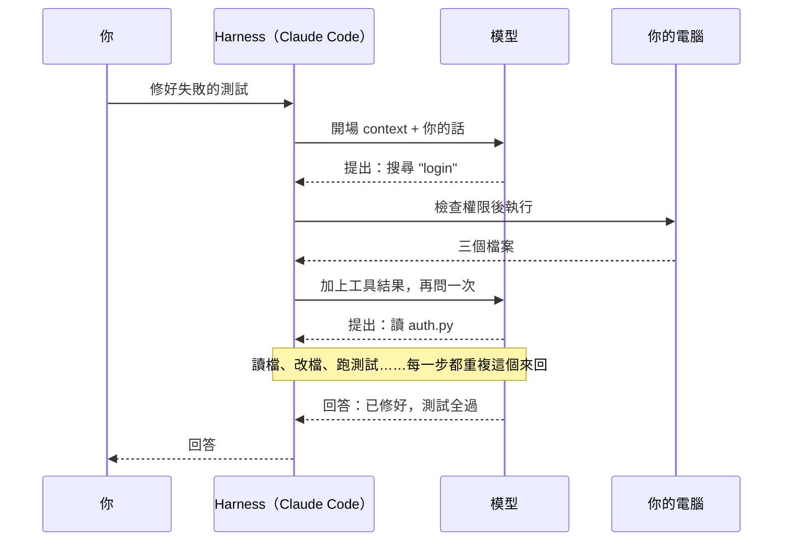

> 🌏 [English version](/posts/ai/2026-10-21-cs2680-lecture-02-how-claude-code-works-en)

**影片狀態：課程不錄影。** 本文依公開投影片整理，數值例子為本站補充。[來源說明](#課程影片來源)

[CS2680](https://cs2680.com/) 第 2 堂在 2026 年 9 月 9 日上課，題目是〈How Claude Code works〉（[投影片](https://cs2680.com/slides/2_agent_use_1.pdf)）。[第 1 堂](/posts/ai/2026-10-21-cs2680-lecture-01-agents-systems-problem)說 agent 是一串「推論 → 工具 → 推論」的長鏈；這堂拿一個成熟的 coding agent [Claude Code](https://code.claude.com/docs/en/overview) 來看，這條鏈實際上怎麼跑。

這堂要回答的問題是：你在 Claude Code 送出一句話之後，它呼叫了幾次模型、讀了什麼、記住了什麼？讀完之後，你應該能畫出一次「修好這個測試」的完整軌跡，也能判斷一條規則該寫進 CLAUDE.md、skill 還是 hook。你用 coding agent 時收到的帳單，就是這條軌跡算出來的。

投影片分三段：Claude Code 的 loop（p5–13）、記憶（p14–26）、工具與擴充（p27–42）。p44 之後是 MCP 的選讀，本文只放延伸。投影片裡有不少 Claude Code 的產品細節，本文以 2026 年 10 月的官方文件為準，不同處直接標出。

## 先補一塊：一次模型呼叫長什麼樣

原本這門課在這堂之前要上一堂 LLM 基礎，後來延後了，投影片第 2 頁請大家先把 LLM 當成一個「會推理的黑盒」。要看懂 harness 在做什麼，只需要知道黑盒的輸入輸出長什麼樣。以下是本文補充的最小範例，用 [Anthropic Messages API](https://platform.claude.com/docs/en/api/messages) 的格式：

```json
{
  "model": "<model>",
  "max_tokens": 1024,
  "system": "You are a coding agent. Use tools to inspect and edit the repo.",
  "tools": [
    {
      "name": "read_file",
      "description": "Read a file from the repository.",
      "input_schema": {"type": "object", "properties": {"path": {"type": "string"}}, "required": ["path"]}
    }
  ],
  "messages": [{"role": "user", "content": "Fix the failing auth test."}]
}
```

模型回來的除了一句話，還附了一個「我想跑這個工具」的請求（節錄，省略 id、usage 等欄位）：

```json
{
  "stop_reason": "tool_use",
  "content": [
    {"type": "text", "text": "I'll look at the test first."},
    {"type": "tool_use", "id": "toolu_01", "name": "read_file", "input": {"path": "tests/test_auth.py"}}
  ]
}
```

三件事記住就夠了：

- **模型本身不記得上一次呼叫。** 下一次請求要把整段 `messages` 連同剛才的回覆、工具結果重新送一次。這就是 context：模型這一次看得到的全部東西。
- **模型不會自己跑工具。** 它只輸出一個結構化的請求，真正去讀檔的是呼叫它的程式。
- **token** 是模型切文字的單位，一個英文單字大約是一到兩個 token（依模型與語言而異）；context window 是一次請求最多能放多少 token，計費也按 token 算。

包在模型外面、負責組請求、跑工具、把結果接回去的那層程式，就是 harness。Claude Code 是一個 harness；想看 harness 的程式長什麼樣，可以先讀[coding agent 的內部構造](/posts/ai/2026-08-16-cs146s-agent-internals)。

> **自我檢查**：上面的模型回覆之後，harness 下一次送給模型的 `messages` 至少要有幾則？
> 答：三則。原本的使用者訊息、模型這次的回覆（含 tool_use），以及一則帶 `tool_result`（對應 `toolu_01`）的訊息；這則 tool_result 要放在 role 為 user 的訊息裡，第一次寫 harness 的人最常在這裡出錯。少了前兩則，模型就不知道自己為什麼要讀這個檔。

## Claude Code 的 loop

### 一句話會變成很多次模型呼叫

投影片把 Claude Code 的運作畫成三步循環：蒐集 context → 產生動作 → 執行工具，每一步都依上一步的結果決定下一步（p6）。官方文件的說法是 gather context、take action、verify results 三個階段，而且彼此交織（[How Claude Code works](https://code.claude.com/docs/en/how-claude-code-works)）。

投影片用一串符號表示一輪對話（p10）：U M₁ T₁ M₂ T₂ … Mₙ A。U 是你的輸入，M 是模型推論，T 是工具執行，A 是最後的回答。一次輸入等於很多次模型呼叫、很多次工具執行；每一次 M 都看得到前面所有的 M 和 T（壓縮之前）。



### 打字之前，context 已經很滿

在你打第一個字之前，context 裡已經有（p7）：

- **系統指示**：Claude Code 自己的說明。
- **專案環境**：工作目錄、git 狀態等。
- **記憶**：CLAUDE.md 與 auto memory。
- **工具清單**：每個工具的名稱、說明與參數格式。
- **skill 與 MCP**：投影片寫一開始只放名稱與描述，用到才載入全文。目前的版本裡，skill 開場放名稱與 description；MCP 工具則預設延後載入，開場只放工具名稱與 server 的說明（[How Claude Code works](https://code.claude.com/docs/en/how-claude-code-works)）。

投影片說開場就有一萬多 token。官方文件列出同樣的開場內容，但沒有給具體數字（[context window](https://code.claude.com/docs/en/context-window)）；實際多少要看你裝了多少東西，可以在 session 裡用 `/context` 看。

### 它不會把整個 repo 送出去

repo 留在磁碟上，模型需要什麼才拉什麼（p8）：先搜尋關鍵字，只有搜到的幾行進到 context。投影片的例子是 `Grep("authentication")`。現在在 macOS、Linux、WSL 上，Claude Code 預設不提供獨立的 Glob、Grep 工具，改用 Bash 跑 `find`、`grep`（[tools reference](https://code.claude.com/docs/en/tools-reference)）。工具換了，按需拉切片的道理沒變。

### 模型提出，harness 執行，中間隔著權限

模型只會輸出 `Bash("pytest")` 這樣的請求；harness 解析它、檢查權限、在你的電腦上真的執行，再把 stdout、stderr 包成 tool_result 放回 context（p9）。

權限層把每個請求分成三種結果：允許（直接跑）、詢問（等你確認）、拒絕（什麼都不發生）（p11）。投影片列了四種模式：手動、自動接受編輯、全部放行、Auto。目前官方文件列的是六種，多了 plan 與 dontAsk（[permission modes](https://code.claude.com/docs/en/permission-modes)）。投影片說 Auto 模式由「一個小模型」審查。官方文件的說法是另一個分類模型在執行前審查，預設是 Claude Sonnet 5。所以把它想成「另一個模型替你看一眼」比較準，它不是便宜的小過濾器。

### context 一直長大，滿了就壓縮

每一步都在加 token：模型的回覆、讀進來的檔案、指令的輸出（p12）。投影片的說法是：context 不是免費的，前綴快取的讀取佔了大部分成本。白話講：每次請求都要把整段歷史重送一次；開頭跟上一次一樣的部分，serving 端不用重算，但仍要付費，只是用比較便宜的快取價。官方文件沒有說它佔多少，只說 Claude Code 會以快取價重讀對話歷史（[costs](https://code.claude.com/docs/en/costs)）。

快滿時 Claude Code 會壓縮：先清掉舊的工具輸出，需要時再把舊對話摘要起來（[How Claude Code works](https://code.claude.com/docs/en/how-claude-code-works)）。投影片說壓縮後會重新注入 CLAUDE.md 與記憶（p12）；官方文件說得更細：專案根目錄的 CLAUDE.md、沒有 `paths:` 的規則與 auto memory 會從磁碟重新載入，子目錄的 CLAUDE.md 與有 `paths:` 的規則，要等再碰到對應檔案才載入（[memory](https://code.claude.com/docs/en/memory)）。這是一個重要的設計：寫在這些檔案裡的東西撐得過壓縮，只存在對話裡的東西不一定。

### 走一次：「修好 test_login」

以下是本文的教學例子，數字是假設的。開場 context 10,000 token，你輸入「test_login 一直失敗，幫我修好」。為了好算，忽略你那句話和模型每次自己輸出的 token：

| 步驟 | 這次呼叫讀入 | 模型提出 | harness 執行後放回 context |
|---|---|---|---|
| M₁ | 10,000 | 搜尋 `login` | 3 個檔案、12 行結果（+400） |
| M₂ | 10,400 | 讀 `auth.py` | 檔案內容（+2,500） |
| M₃ | 12,900 | 讀 `tests/test_login.py` | 檔案內容（+1,200） |
| M₄ | 14,100 | 改 `auth.py` 第 42 行 | 修改成功（+300） |
| M₅ | 14,400 | 跑 `pytest tests/test_login.py` | 測試輸出（+600） |
| M₆ | 15,000 | 回答：「已修好，原因是……」 | — |

一句話，六次模型呼叫、五次工具執行。最後一次讀的 context 是 15,000 token，但六次加起來讀了 10,000 + 10,400 + 12,900 + 14,100 + 14,400 + 15,000 ＝ 76,800 token。其中每一次的開頭都和上一次一樣，這就是投影片說快取讀取佔大部分成本的來源。這也說明為什麼 `pytest` 的輸出、讀進來的大檔案會直接影響成本與速度：它們一旦進了 context，後面每一步都要背著。

> **自我檢查**：如果 M₂ 改成讀一個 20,000 token 的大檔案，後面四次呼叫各要多讀多少？總共多讀多少？
> 答：每次多 17,500 token（20,000 減原本的 2,500），M₂ 之後的 M₃、M₄、M₅、M₆ 四次都要背著，共多讀 70,000 token。這就是[第 4 堂](/posts/ai/2026-10-21-cs2680-lecture-04-tool-design-context-engineering)要談「工具輸出要省 token」的原因。

## 記憶：怎麼把指示變成慣例

### context 是一種記憶，但會消失

agent 在兩次 run 之間沒有狀態，每個 session 都從零開始；實務上，「記憶」就是 session 開始時載入的檔案（p16）。投影片把記憶分成兩種：context 是工作記憶，session 結束就消失；持久記憶是存活下來、下次重新載入的部分。

沒有持久記憶，會出現四個問題（p17）：

- 每次都要重新交代同樣的設定。
- agent 每次重讀同樣的檔案來搞懂結構。
- 決策理由在壓縮後消失。
- 不同 session 做出不同選擇。

投影片的一句話是：記憶讓指示變成慣例。

### CLAUDE.md 與 auto memory

Claude Code 有兩套記憶，都在每個 session 開始時載入（p18）：

| | CLAUDE.md | auto memory |
|---|---|---|
| 誰寫 | 你 | Claude |
| 內容 | 指示與規則 | 學到的事與模式 |
| 範圍 | 專案、使用者或組織 | 每個 repository，worktree 之間共用 |
| 載入 | 每個 session | 每個 session 載入 MEMORY.md 的前 200 行或 25KB |
| 適合放 | 標準、流程、架構 | 你的偏好、你給過的糾正、專案脈絡 |

CLAUDE.md 有四個位置，從範圍最大的先讀，離你最近的最後讀（p20）：組織的 managed policy（不能被排除）、使用者的 `~/.claude/CLAUDE.md`、專案的 `./CLAUDE.md` 或 `./.claude/CLAUDE.md`、個人不進版控的 `./CLAUDE.local.md`。官方文件補充，這些檔案是依序串接進 context，不是後面的覆蓋前面的（[memory](https://code.claude.com/docs/en/memory)）。

CLAUDE.md 該放什麼（p21）：

- 怎麼跑測試、build、linter 的指令。
- 「不准 commit 到 main」「不准改生成的檔案」這類硬限制。
- agent 沒辦法便宜推得出來的事實，例如目錄結構、誰負責什麼、哪裡有坑。

不該放的：

- 模型本來就知道的語言或框架知識。
- linter 或 formatter 已經在檢查的風格。
- 長篇說明、changelog，以及任何秘密。

每份控制在 200 行以內，官方文件也這樣建議。

太長就拆到 `.claude/rules/`，一個主題一個檔；加上 `paths:` frontmatter 的規則，只有 Claude 碰到符合路徑的檔案時才載入，沒有 `paths:` 的每個 session 都載入（p22）。

auto memory 是 Claude 自己的筆記，存在 `~/.claude/projects/<project>/memory/`（p23）。每個檔案用 `type` 標成四種之一：

- 使用者：你的角色、專長與偏好。
- 回饋：你給過的糾正與確認過的做法。
- 專案：進行中的工作與決定。
- 參考：專案外的資訊在哪裡。

MEMORY.md 是索引，每次都載入；主題檔只有用得到時才讀（p24）。

四個指令可以看和控制記憶（p25）：`/memory` 瀏覽、編輯或關閉記憶；`/context` 看哪些指示檔被載入；`/init` 產生一份入門版 CLAUDE.md；`/doctor` 找出不該放在 CLAUDE.md 的內容（新版的指示檔審查在 `/doctor prompt-audit`）。

### 記住也有成本

每一個常駐的 token 都是租金：每個 session 開始時都要付一次，而且和任務搶同一個 context window（p26）。過期的記憶比沒有更糟，因為它會主動誤導。投影片的建議是把記憶當程式碼管：審查、修剪、放進版控。實際的做法可以很簡單：每週用 `/memory` 掃一遍，刪掉已經不成立的筆記。另一頁的說法更直接：context 是租來的，記憶是買下來的，買什麼要想清楚（p21）。

> **自我檢查**：「這個 repo 的測試要用 `pnpm test:unit`，不要用 `npm test`」該寫在哪裡？「我習慣先看 diff 再決定要不要 commit」呢？
> 答：前者寫進專案 CLAUDE.md，它是團隊共用的指令，要進版控；後者是個人偏好，放使用者層的 `~/.claude/CLAUDE.md`，或讓 auto memory 記成回饋類筆記。

## 工具與四種擴充

### 核心工具

投影片把 agent 的核心工具分成六類（p28）：

| 類別 | 做什麼 | 投影片的提醒 |
|---|---|---|
| 讀 | 開檔案、看狀態 | 最常用的工具 |
| 搜尋 | grep、glob | 不用全部讀就找得到 |
| 抓取 | 讀網頁或文件 | 帶進來的是不可信的文字 |
| 編輯／寫入 | 改檔案 | 第一個會造成後果的工具 |
| shell | build、測試、git | 沒有沙箱的話，等於整台機器 |
| 委派 | 派一個 subagent | 回來的是一份摘要 |

這是講者的分法。官方文件分成檔案操作、搜尋、執行、網路、程式碼智慧五類，subagent 另外歸在協調工具（[How Claude Code works](https://code.claude.com/docs/en/how-claude-code-works)）；官方多了程式碼智慧（看型別錯誤、跳到定義、找參照），投影片沒有列。

投影片說用哪個工具大多由模型決定，你不太需要操心；作業 2 你會自己把這些工具做出來。

### skill、MCP、hook、plugin：四個不同的問題

這是這堂最實用的一段。四種擴充機制解決四個不同的問題，不能互相替代（p30–31）：

| 機制 | 解決什麼 | 掛在 loop 的哪裡 |
|---|---|---|
| skill | agent 該怎麼做一件事（知識與步驟） | 模型推理時 |
| MCP | agent 能碰到哪些外部資料與動作 | 選擇工具時 |
| hook | 某個時間點一定要自動發生的事 | loop 的任何事件 |
| plugin | 前三者怎麼打包、分享給別人 | 不掛在 loop 上，是一個安裝單位 |

投影片的一句話：skill 決定怎麼做，MCP 伸到外面，hook 強制執行，plugin 負責發佈（p30–31）。

**skill** 是一個資料夾：一份 `SKILL.md`（description 決定什麼時候被找到，body 寫步驟），加上參考資料和腳本（p34）。session 開始時只載入 description，真的用到才載入 body（p35；[skills](https://code.claude.com/docs/en/skills)）。它可以由模型在描述符合任務時自己叫用，也可以由你打 `/<skill 名稱>` 叫用；會造成副作用的流程（例如發佈）通常應該只讓人明確叫用，官方的做法是在 frontmatter 加 `disable-model-invocation: true`。

**MCP**（Model Context Protocol）用一個標準協定把外部服務接進來：GitHub、資料庫、監控、Figma、Slack、瀏覽器（p36）。對模型來說，MCP 工具和本機工具幾乎一樣：同樣有名稱、描述、參數格式，同樣一呼一應，只是跑在另一個行程裡（p37）。協定負責傳遞呼叫，要不要呼叫還是 agent 決定。

**hook** 綁在生命週期事件上：session 開始、你送出提示、工具執行前、工具執行後、agent 準備停下（p38）。執行前的 hook 可以檢查或擋下一個呼叫，執行後的可以格式化、跑測試、記錄。投影片特別標出一點：模型的推理不是事件，hook 掛不上去。hook 可以跑指令、HTTP 請求、MCP 工具、prompt 或 subagent。官方文件目前還有約三十種其他事件，例如壓縮前、subagent 結束時（[hooks](https://code.claude.com/docs/en/hooks)）。

**plugin** 是一個可安裝的單位，裡面可以有 `skills/`、`hooks/`、`agents/`、`.mcp.json`、`.lsp.json` 與 `.claude-plugin/plugin.json`（p39）。它帶來的是一鍵安裝、版本、命名空間、團隊共用，以及透過 marketplace 分享。

投影片用一個發佈流程串起四者（p32）：照著發佈步驟走是 skill，在 GitHub 建 release 是 MCP，測試沒過就不准發佈是 hook，把整套設定分享給同事是 plugin。

這幾個東西都住在 `.claude/` 裡：CLAUDE.md 與 `rules/` 是記憶，`settings.json` 管權限、hook 與環境變數，`skills/`、`commands/` 是工作流程，`agents/` 與 `hooks/` 管委派與防護；使用者層的 `~/.claude/` 是同樣的結構，專案設定優先於使用者設定（p41）。

### skill 與 hook 的差別：可用 vs 保證

這一點投影片在這堂只用一張表帶過，下一堂才用案例講清楚：skill 只是「可用」，模型覺得相關才會去讀；hook 綁在事件上，事件發生就一定執行。所以「應該怎麼做」寫成 skill，「每次都必須發生」寫成 hook。

> **自我檢查**（改編自投影片 p42 的課堂練習）：下面每一項各用哪種機制？
> 1. 遵守公司的 API 命名慣例
> 2. 讀一張 Jira 單
> 3. 每次改完檔就跑格式化
> 4. 一步一步帶完一次部署
> 5. 做完時送一則通知
> 6. 禁止寫入正式環境
> 7. 把整套設定分享到所有 repo
>
> 答（投影片的答案，理由為本文補充）：
> 1. skill：是做事的知識與慣例，模型寫 API 時參考。
> 2. MCP：Jira 是外部系統，要有連過去的能力。
> 3. hook：「每次」都要發生，不能靠模型記得。
> 4. skill：多步驟的流程與判斷。
> 5. hook 加 MCP：hook 決定「做完時」這個時機，MCP 負責把訊息送到 Slack 之類的外部服務。
> 6. hook 或權限政策：每次都要擋，靠模型自律的 skill 不夠。
> 7. plugin：跨 repo 分享，就是打包與發佈的問題。

## 綜合自我檢查

1. 你在 CLAUDE.md 寫了「改完一定要跑 lint」，但 agent 有時候還是忘記。為什麼？該怎麼改？
   答：CLAUDE.md 是放進 context 的指示，模型可能沒照做，尤其 context 很長時；要保證發生，改用工具執行後的 hook 自動跑 lint。
2. 一個 session 跑了很久、壓縮過兩次之後，agent 好像忘了你一開始交代的某個限制。哪種寫法比較撐得過壓縮？
   判準：答出寫進專案根目錄的 CLAUDE.md（或沒有 `paths:` 的 rules）會在壓縮後重新載入；只在對話裡口頭交代的，可能被摘要掉。寫在子目錄 CLAUDE.md 的，要等 agent 再碰到那個目錄的檔案才會回來。
3. 為什麼投影片說抓取工具帶進來的是「不可信的文字」？
   判準：答出網頁內容是外人寫的，可能夾帶指示（例如「忽略之前的指令」），模型讀進來後可能照做；所以要把它當資料，不能當指示。

## 延伸閱讀

- [作業 1：用 stream-json 畫出執行軌跡](/posts/ai/2026-10-21-cs2680-assignment-1-mads-lens)：把這堂的 loop 畫在網頁上。
- [Claude Code 是怎麼運作的](/posts/tech/deep-dive/2026-08-26-claude-code-how-it-works)：同一個主題，從產品使用者的角度。
- [Claude Code 的 prompt caching](/posts/tech/deep-dive/2026-08-26-claude-code-prompt-caching)：為什麼重送 context 不會照全價計費。
- [CLAUDE.md 與 AGENTS.md 指南](/posts/tech/deep-dive/2026-03-28-claude-code-claude-md-agents-md-guide)：記憶檔的寫法。
- [CMU 11-768 第 4 堂：skill 與記憶](/posts/ai/2026-09-29-cmu-11768-lecture-04-skills-memory)：另一門課對同一組概念的講法。
- [coding agent 的內部構造](/posts/ai/2026-08-16-cs146s-agent-internals)：harness 的 while 迴圈長什麼樣，作業 2 之前值得先讀。

## 課程影片來源

- 課程不錄影（[policy 頁](https://cs2680.com/policy)）。
- 底本：[第 2 堂投影片](https://cs2680.com/slides/2_agent_use_1.pdf)（PDF 頁序 p4–42），2026-10-21 讀取。頁碼一律用 PDF 頁序。
- 產品行為依 2026-10-21 的 [Claude Code 官方文件](https://code.claude.com/docs/en/overview)核對；與投影片不同之處已在正文標出。
- 「先補一塊」的 API 範例、「修好 test_login」的數字是本站補充，不是課堂內容。

## 更新紀錄

- 2026-10-22：自我檢查答案補上第 4 堂的站內連結。

## 參考資料

- [CS2680 第 2 堂投影片：How Claude Code works](https://cs2680.com/slides/2_agent_use_1.pdf)
- [Claude Code 文件：How Claude Code works](https://code.claude.com/docs/en/how-claude-code-works)
- [Claude Code 文件：Explore the context window](https://code.claude.com/docs/en/context-window)
- [Claude Code 文件：Memory（CLAUDE.md 與 auto memory）](https://code.claude.com/docs/en/memory)
- [Claude Code 文件：Permission modes](https://code.claude.com/docs/en/permission-modes)
- [Claude Code 文件：Tools reference](https://code.claude.com/docs/en/tools-reference)
- [Claude Code 文件：Skills](https://code.claude.com/docs/en/skills)
- [Claude Code 文件：Hooks](https://code.claude.com/docs/en/hooks)
- [Claude Code 文件：Plugins reference](https://code.claude.com/docs/en/plugins-reference)
- [Claude Code 文件：Costs](https://code.claude.com/docs/en/costs)
- [Anthropic Messages API](https://platform.claude.com/docs/en/api/messages)
