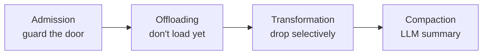

> 🌏 [中文版](/posts/ai/2026-10-21-cs2680-lecture-04-tool-design-context-engineering)

**Video status: The course is not recorded.** This post is based on the public slides; the code and numerical examples are this site's additions. [Source notes](#course-video-sources)

Lecture 4 of [CS2680](https://cs2680.com/) met on September 16, 2026, under the title "Agent Design I: context management and tool design" ([slides](https://cs2680.com/slides/4_agent_design_1.pdf)). The earlier lectures looked at [Claude Code](https://code.claude.com/docs/en/overview) from the user's side. From this lecture on, you are the one writing the agent.

The lecture answers two questions: when you write your own agent, which tools should it get, and what should the model see at each step? By the end you should be able to pick a tool set for a new agent and explain why. You should also be able to place a context problem in one of five failure types and choose the right fix. Those are exactly the two things [Assignment 2](https://cs2680.com/assignments/assignment2) has you do by hand.

The slides have three parts: the agent loop (p4–7), tool design (p8–26), and context management (p27–53). From p55 on is optional material on loops beyond ReAct, such as Reflexion, which this post only points to.

## From user to designer: turning the trace into a loop

### ReAct: think a step, act a step, look

The slides start from [ReAct](https://arxiv.org/abs/2210.03629) (p4). In each round the model does three things: think (what do I know, what is missing, what next), act (emit a structured call the environment can run), and observe (the environment answers with facts).

Reasoning without acting has nothing to check it, so small errors compound into confident hallucination. Acting without reasoning has no plan behind the tool calls, so the model repeats itself. When the two alternate, thoughts steer the next action and observations correct the next thought. The ReAct paper puts it this way: letting the model look things up in a real source reduces the hallucination and error propagation you get from reasoning alone.

### Lecture 2's trace as twenty-odd lines of code

[Lecture 2](/posts/ai/2026-10-21-cs2680-lecture-02-how-claude-code-works-en) wrote one run of Claude Code as a string of symbols: U M₁ T₁ M₂ T₂ … Mₙ A. U is your input, M is one model call, T is one tool execution, and A is the final answer. Slide p5 writes the same thing as pseudo-code. Below is a runnable version added by this post, with comments marking which symbol in the trace each line corresponds to:

```python
def run_agent(user_request, tools, call_model, max_steps=20):
    messages = [
        {"role": "system", "content": "Solve the task using the tools."},
        {"role": "user", "content": user_request},                    # U
    ]
    for step in range(max_steps):
        response = call_model(messages, list(tools))                  # M₁, M₂, …
        messages.append(response["message"])
        if response.get("final_answer"):
            return response["final_answer"]                           # A
        for call in response.get("tool_calls", []):                   # T₁, T₂, …
            if call["name"] not in tools:
                result = f"Unknown tool {call['name']}. Available: {', '.join(tools)}"
            else:
                try:  # the validate step from slide p5; bad arguments go back to the model too
                    result = tools[call["name"]](**call["arguments"])
                except Exception as e:
                    result = f"Error: {e}"
            messages.append({
                "role": "tool",
                "tool_call_id": call["id"],
                "content": str(result),
            })
    raise RuntimeError("Agent exceeded its step limit")
```

Compared with Lecture 2, three things are worth noticing:

- **The whole `messages` list is resent every time.** `call_model` always receives the full history from the start. That is why, in Lecture 2's table, the tokens read on each call keep growing.
- **The format of tool results depends on the API.** The slides use the OpenAI-style `"role": "tool"` with a `tool_call_id`. The Anthropic Messages API from Lecture 2 instead puts a `tool_result` inside a message whose role is user. Assignment 2 uses an OpenAI-compatible endpoint, so it follows the slides' style.
- **There has to be a stopping rule.** When `max_steps` runs out the loop raises an exception; otherwise a stuck model keeps burning money.

<details>
<summary>Run it with a fake model that follows a script</summary>

Append the code below to the code above and run it. The fake `call_model` proposes the five tool calls from Lecture 2's "fix test_login" example in order, then answers on the sixth call:

```python
script = [
    ("grep", {"pattern": "login"}),
    ("read_file", {"path": "auth.py"}),
    ("read_file", {"path": "tests/test_login.py"}),
    ("edit_file", {"path": "auth.py", "old_string": "timeout=1", "new_string": "timeout=5"}),
    ("bash", {"command": "pytest tests/test_login.py"}),
]
calls = []

def call_model(messages, tool_names):
    calls.append(len(messages))
    n = len(calls) - 1
    if n == len(script):
        return {"message": {"role": "assistant", "content": "Fixed."},
                "final_answer": "Fixed: timeout was too short."}
    name, args = script[n]
    tc = {"id": f"call_{n+1}", "name": name, "arguments": args}
    return {"message": {"role": "assistant", "tool_calls": [tc]}, "tool_calls": [tc]}

tools = {
    "grep": lambda pattern: "auth.py:42: login(...)",
    "read_file": lambda path: f"<contents of {path}>",
    "edit_file": lambda path, old_string, new_string: "ok",
    "bash": lambda command: "1 passed",
}
print(run_agent("test_login keeps failing, fix it", tools, call_model))
print("model calls:", len(calls), "messages seen per call:", calls)
```

Output:

```text
Fixed: timeout was too short.
model calls: 6 messages seen per call: [2, 4, 6, 8, 10, 12]
```

Six model calls and five tool executions, the same as Lecture 2's table; the number of messages each call sees keeps going up.

</details>

### Four jobs of a harness designer

The loop itself is short. The hard part is everything around it. The slides list four jobs that fall to whoever writes the harness (p6):

1. **Write the tool definitions**: names, descriptions, parameter formats. This is the only way the model learns which tools exist.
2. **Assemble the context**: before every call, decide what goes into `messages`.
3. **Validate and run the request**: check the arguments and the permissions, then actually run it.
4. **Process the result and manage context** (as needed): trim tool output that is too long, clear history that has grown too long.

The slides then split a coding agent into three components (p7): model plus loop, tools plus guardrails, and state (context and memory). All three share one context window, so they have to be designed together: tool output that is too verbose eats the space state needs. The rest of the lecture covers jobs 1 and 3 (tools and guardrails) and jobs 2 and 4 (context).

> **Self-check**: in the loop above, what happens if the model calls a tool that doesn't exist? Why not just raise an exception?
> Answer: the code puts "Unknown tool …. Available: …" back into context as the tool result, so the model can correct itself on the next step. Raising an exception would kill the whole task; a clear error message usually lets the model fix the problem on its own. This is the "errors that teach" principle that comes up later.

## Tool design

### Finding code: four approaches

The slides open with "How should an agent find relevant code?" (p9) and list four approaches:

| Approach | Finds code by | Best when | Main cost |
|---|---|---|---|
| glob / grep | file names and literal strings | the name is known or guessable | turns and context per search |
| semantic index | the meaning of code chunks | your wording won't match the code | building the index and keeping it in sync |
| extrinsic signals | stack traces, failing tests, git history | a report already points at the code | only exists for some tasks |
| language server | the compiler's symbol graph | edits must follow references | a live server per language |

(Summarized from p10–14)

The last three each need a bit of background:

- **A semantic index** relies on embeddings: a piece of text is turned into a list of numbers (a vector), and text with similar meaning gets similar vectors. So asking "where do we rate-limit?" can find `throttle.ts` directly, even if the code never says "rate-limit" (p11). A structural alternative is [Aider's repo map](https://aider.chat/docs/repomap.html): it lists the files in the repo along with the most important classes and function signatures. It then ranks them by the dependencies between files and sends only the most relevant part.
- **Extrinsic signals** are evidence outside the source code. When checkout crashes, the stack trace starts at `cart.ts:88` and names 3 frames; following them to lines 20–60 of `tax.ts` turns up the rounding bug without any search at all (p12).
- **A language server** ([LSP](https://microsoft.github.io/language-server-protocol/)) is the standard protocol between editors and language tooling; VS Code's "Go to Definition" and "Find All References" come from it. It queries the compiler's index, so it handles aliased imports and same-named functions that grep can only guess at. The slides' example renames `charge()` to `capture()`: 42 call sites across 7 files, all correct in one go (p13).

The slides' bottom line: start with grep, and reach for an index or LSP when names run out (p14).

### Editing code: four approaches

Once the code is found, it has to be changed. The slides compare four ways to edit (p17–21):

- **Whole-file rewrite**: the model outputs the entire file again and the tool overwrites it. There is no patch syntax to get wrong, but output grows with file size, and the model may quietly change code it was not supposed to touch.
- **Unified diff**: the model outputs a patch like `@@ -41,3 +41,3 @@` and a separate tool applies it. It is compact and readable by both humans and CI, but it fails to apply once line numbers or surrounding lines drift.
- **Search and replace**: the model gives an exact snippet to find plus its replacement. Output is proportional to the change, but it fails when the snippet is missing, not unique, or off by whitespace.
- **Structured (AST) edits**: the model says "add a `timeout` parameter to `fetchUser`" and the tool rewrites the signature and all 18 call sites (p20). An AST (abstract syntax tree) is the tree a compiler parses code into, with one node per function, parameter, or expression; edits made on the tree cannot produce a syntax error. The cost is that every language needs its own tooling, and the set of expressible edits is limited.

p21 places the four on two axes: token cost, and whether the edit lands where it was meant to. None of them wins on both.

Here is a teaching example that extends the one on p19; the token estimates are this post's additions. In a 500-line file, you only need to change `retries = 3` on line 41 to `retries = 5`. Assume an average of 10 tokens per line:

| Approach | What the model must output | Rough token count |
|---|---|---|
| Whole-file rewrite | the entire file | about 5,000 |
| Search and replace | the file name, `retries = 3`, `retries = 5` | about 30 |

That is a gap of more than a hundredfold, and output tokens are generated one at a time, so a longer output makes the step slower too. The risk of search and replace sits on the other side: if line 88 also contains `retries = 3`, the tool cannot tell which one to change. What error the tool returns then matters a lot:

```text
✗ invalid argument
✓ old_string matches 2 locations (lines 41 and 88).
  Include 2–3 surrounding lines so it matches exactly one.
```

With the first error the model can only guess; the second tells it how to fix the call, and the next attempt usually succeeds. The editing tool Assignment 2 provides, `edit_file(path, old_string, new_string)`, is exactly this search-and-replace kind ([Assignment 2](https://cs2680.com/assignments/assignment2)).

> **Self-check**: in the same 500-line file, you now need to rename a function that appears 30 times. Is search and replace still the best choice?
> Criterion: you note that search and replace means either 30 calls or a long `old_string` with enough context each time, so cost grows with the number of places to change; edits that "follow references" like this are what an LSP rename or an AST edit is good at. If search and replace is all you have, the tool should at least support something like a "replace all" option.

### Execution: the shell is the most powerful and most dangerous tool

The slides say the execution tool is effectively a shell (p22). Its power comes from four things:

- One call can chain, filter, loop, and retry.
- It reaches the file system, the network, and package managers.
- Files and processes outlive the individual call.
- Whatever the shell can do, the agent can do.

That last point is also the risk. The slides list five things to think through when designing a shell tool (p23):

- **Isolation**: where the code runs and what it can reach.
- **Failure signal**: errors the agent can actually understand and act on.
- **Output**: enough, but not too much. One `npm test` can print hundreds of lines; all of it goes into context, and every later step carries it.
- **Duration**: what to do about long-running or background processes.
- **Budgets**: how many retries before stopping and handing back to a person.

Beyond search, edit, and execute, the slides list five more commonly used tools (p24):

- **Notes**: write findings to a file, so the plan survives compaction.
- **Subagents**: send one out to explore; it comes back with a shortlist instead of 40 file reads.
- **Web search and fetch**: read the installed source first, then go to the web.
- **Browser and screenshots**: capture the rendered page and feed it back to the model.
- **Asking the user**: one cheap question beats a confident wrong patch.

### Five principles of tool design

p25 boils the trade-offs down to five rules:

1. **Few, orthogonal tools**: overlapping tools make the model dither between them.
2. **Purpose-built over generic**: `search_orders(customer_id)` beats a `run_sql` tool that runs raw SQL.
3. **Token-cheap output**: truncate, paginate, summarize. In the slides' words, tool design is context design.
4. **Errors that teach**: return a hint about the fix, not just "invalid argument".
5. **Idempotent by default**: sending the same call twice gives the same result, so a failed call is safe to retry.

The first four match Anthropic's tool design advice ([Writing effective tools for agents](https://www.anthropic.com/engineering/writing-tools-for-agents)). That post's example is to build `search_contacts` rather than `list_contacts`, and it notes that Claude Code limits tool responses to 25,000 tokens by default.

> **Self-check**: why is `search_orders(customer_id)` better than `run_sql`? Give at least three reasons.
> Criterion: you name (1) a narrow scope, so the model can't delete data or scan a whole table by mistake; (2) output whose format and size you control, so it never returns a hundred thousand rows at once; (3) predictable errors (such as "customer not found") that can be written as messages that teach; (4) the model doesn't have to write correct SQL first, and each call uses fewer tokens.

### Can we just provide the shell?

p26 leaves a question open: why not give the agent a single shell tool and nothing else? The slides show an ablation chart from the [SWE-agent](https://arxiv.org/abs/2405.15793) paper (remove one component at a time and see how much the score drops), with "No on GPT-4" stamped across it in red.

The conditions behind this chart matter: a 2024 paper, GPT-4 Turbo as the model, and SWE-bench Lite as the task set. SWE-bench is a benchmark that asks an agent to fix real GitHub issues and judges the fix by running tests. Lite and Verified are subsets of SWE-bench; [SWE-Bench Pro](https://arxiv.org/abs/2509.16941) is a separate, harder benchmark of the same kind built by Scale AI. Scores across the three can't be compared directly.

Under those conditions, the purpose-built interface solved 18.0%, shell only solved 11.0%, and removing the specialized editor left 10.3% ([SWE-agent paper](https://arxiv.org/html/2405.15793v3), Tables 1 and 3). The paper concludes that an interface designed for language models beats a plain shell.

With newer models the answer may change. The same team later built [mini-swe-agent](https://github.com/SWE-agent/mini-swe-agent), which uses nothing but bash and, with current models, scores above 74% on SWE-bench Verified. That doesn't mean purpose-built tools are useless; it means how many of them to provide depends on how capable the model is. The slides don't settle it either; they say "find out when you work on the assignment." Assignment 2 gives four tools (shell, read file, search-and-replace edit, and declare done), which sits right between the two.

## Context management

### A shift in vocabulary: prompt, context, harness, goal

The slides first put up a timeline of terms (p28):

| Period | Name | The question it asks |
|---|---|---|
| 2023–24 | prompt engineering | How should we instruct the model? |
| 2025–26 | context engineering | What should the model see? |
| 2026 | harness engineering | How should the agent operate? |
| Next | goal engineering | What counts as success? |

On the same slide the lecturer writes that people love coining terms, and that he uses them so you'll recognize them, not because he agrees with them. Read it as a map of the same job widening over time: from the wording of one sentence, to the whole context, to the loop, tools, sandbox, retries, and stopping rules.

### Prompt techniques: vocabulary and history

p29–38 cover eight prompt techniques, and p39–40 are the lecturer's comments and advice. Read this part as vocabulary and history: on p28 the lecturer labels prompt engineering as the 2023–24 framing, and p39 says outright that some of the techniques have already expired, and that you should find out which ones in the assignment. So this post only lists the names and when the slides say to use them, so you recognize the terms when you see them:

| Technique | What it does | When the slides say to use it |
|---|---|---|
| zero-shot | instruction only | common tasks whose format fits in words |
| few-shot | instruction plus a few examples | unusual output shape, or a rule that's easier shown than said |
| role | assign an identity and audience | tone or judgment matters |
| chain-of-thought | steps first, answer last | the task genuinely has steps and errors come from skipped work |
| tree-of-thought | branch, score, prune | several routes are plausible and cheap to score |
| self-consistency | ask several times and take a majority vote | one right answer exists and a wrong call is expensive |
| prompt chaining | one job per call, validated hand-offs | the work splits into stages whose outputs can be checked |
| meta prompting | the model rewrites its own prompt | you have a set of test cases to score against |

(Summarized from p30–38)

p40 gives four pieces of advice that still hold:

1. Start simple, then iterate.
2. Write in sections: context, instructions, tools, output spec.
3. Be specific and concise; clever phrasing buys nothing.
4. Split big tasks into subtasks.

The last line of p40 is the most useful: prompting advice is tied to the model, so re-tune whenever you switch.

### Context is a finite resource

p41 quotes Andrej Karpathy's definition: context engineering is "the delicate art and science of filling the context window with just the right information for the next step" ([original post](https://x.com/karpathy/status/1937902205765607626)).

Why "just the right" information? The slides give three reasons (p42):

- **Cost**: every step resends the whole window, so every turn pays again.
- **Latency**: the longer the prompt, the longer prefill and decode take. Prefill is the model reading the whole input once and computing the intermediate results it needs later; decode is generating the output one token at a time. A longer input makes prefill take longer, and since decode looks back over the whole input for every token it generates, a longer input slows it down too. Every turn of the loop gets slower as a result. Part II of the course covers these two terms in depth; for a head start, see [CMU 11-868's post on prefill and decode](/posts/ai/2026-09-30-cmu11868-serving-at-scale-kv-cache-en).
- **Attention**: the fuller the window, the more the model misses, and content in the middle is especially easy to overlook. More context does not mean better answers.

p43 backs the third point with two studies. [Chroma's Context Rot report](https://research.trychroma.com/context-rot) tested 18 models and found accuracy falls as input grows; adding distractors that are on topic but don't answer the question hurts more as the input gets longer.

[Lost in the Middle](https://arxiv.org/abs/2307.03172) found that where the answer sits matters too. The researchers gave GPT-3.5-Turbo 20 documents, only one of which contained the answer ([Table 6 of the paper](https://arxiv.org/html/2307.03172v3)):

| Position of the document with the answer | Accuracy |
|---|---|
| 1st | 75.8% |
| 10th | 53.8% |
| 20th | 63.2% |

The five percentages on the slide don't match the paper's tables, but the trend is the same: the beginning and end do better than the middle.

### Four ways to manage context

p44 uses an illustrative token budget to show what fills the context: about 2K for the system prompt, 6K for tool definitions, 25K for retrieved content, 8K for the project environment, and about 80K of message history that is still growing. The slide states that these are illustrative, not measured.

What do you do when the context gets too big? The slides line up the options from preventive and lossless to lossy and irreversible (p45):



The slides pair each one with an illustrative before-and-after number:

- **Admission (guard the door)**: query only the fields you need, shape tool output before it comes in, truncate only when shaping isn't possible, and hand raw payloads to a subagent. Example: a raw DOM fetched from a page is 48,000 tokens; keeping only prices and headings brings it down to 900 tokens (p46).
- **Offloading (don't load yet)**: load tool definitions only when needed, use tool search to find tools, have tool output return a handle (a reference such as a file path or ID) that can be read when needed, and keep plans and notes in files. Example: keeping 60 tool schemas resident costs 42,000 tokens; an index plus the 3 schemas actually needed costs 3,100 tokens, and all 60 tools are still reachable (p47).
- **Transformation (drop selectively)**: keep only the newest state of each object, strip tool results older than N steps, keep only the recent turns and the head. Example: keeping every result costs 96,000 tokens; keeping only the newest state costs 24,000 tokens, with nothing summarized (p48).
- **Compaction (LLM summary)**: summarize old tool results as you go, rewrite the whole history at the limit, and persist key facts outside the window. The slides treat this as the last resort and give three warnings: reserve room for output, preserve the system prefix, and re-inject critical facts after summarizing (p49).

The further right you go, the more space you save, but the harder it is to get dropped information back. So the order is: whatever you can stop at the door, don't wait to summarize once the window is full. Anthropic's [post on context engineering](https://www.anthropic.com/engineering/effective-context-engineering-for-ai-agents) slices this a little differently: it counts clearing old tool results as a form of compaction, and calls it the safest and lightest kind. The labels differ; the direction is the same.

### Five ways context fails

p50 sorts the ways context goes wrong into five types, with the slide's note that once you can name the failure, the fix becomes obvious.

| Failure | What happens |
|---|---|
| Poisoning | a hallucination enters the window and is later cited as fact |
| Distraction | history grows until the agent imitates its own past actions |
| Confusion | irrelevant tools and documents steer the answer off course |
| Clash | new information contradicts old, and both stay unresolved |
| Drift | the real goal gets buried and swapped for a nearby subgoal |

The slide credits Drew Breunig's "[How Contexts Fail and How to Fix Them](https://www.dbreunig.com/2025/06/22/how-contexts-fail-and-how-to-fix-them.html)". The original has only the first four; Drift is a fifth type the slides added.

The slides only give definitions. The mapping below from each failure to the techniques in the previous section is this post's own:

- **Confusion** usually comes from too many tools or documents; use Offloading to load only what's needed.
- **Distraction** comes from history that's too long; use Transformation to clear old results.
- **Poisoning** means finding the wrong piece of information and removing it; a summary alone may carry the error forward.
- **Clash** means old and new information both stay in the window; use Transformation's deduplication and keep only the newest state of each object (p48).
- **Drift** means the goal got buried; keep the plan in a file (Offloading's externalized task list, p47) and put the key goal back after compaction (the warning on p49).

> **Self-check**: which failure is each of these, and which technique fits?
> 1. Early on, the agent writes the function name `get_user` into its notes file as `fetch_user`; from then on it keeps looking for `fetch_user` because the notes say so.
> 2. You've connected 60 MCP tools, and when the agent needs to read a file it often picks a tool with a similar name that does the wrong thing.
>
> Answer: 1 is Poisoning: wrong information was saved and keeps getting treated as fact. Correct or delete that note; summarizing alone carries the error along. 2 is Confusion: irrelevant tools interfere with the choice. Use Offloading so only a tool index and the schemas needed for this step are loaded, or cut the overlapping tools altogether (few, orthogonal tools).

## Agent = Model × Harness

The last three slides sum up the lecture in one line: model capability sets the ceiling, and the harness determines the performance you actually get (p51).

p52 cites Sydney Lewis's paper "[Same Model, Different Harness](https://arxiv.org/abs/2608.26218)": the model and the tasks stay fixed, and only two things in the harness change (the slide breaks them into four points). First, as the context fills, older tool outputs are mechanically shortened; second, repeated or stalled work is detected and the harness intervenes. On SWE-bench Verified, solved tasks went from 43 to 72 out of 169; on SWE-bench Pro, from 31 to 72 out of 316 (about 1.7× on Verified and 2.3× on Pro; the slide title says 2×).

These numbers come with a condition the slides leave out: the model was Qwen3.6-35B-A3B, and the context window was deliberately capped at 20,480 tokens. The paper itself says that with a wider window, the two configurations end up close on Verified and Pro ([full paper](https://arxiv.org/html/2608.26218)). So the more accurate reading is: the tighter the context, the more it matters how the harness manages it. This bears directly on the assignment, since the model Assignment 2 specifies is that same `qwen3.6-35b-a3b`.

The slides close with this: some apparent "model failures" are really failures of context and of the control loop (p52). Try it yourself in the assignment; the loop, the prompt, the tools, context management, and failure handling all matter (p53).

## Final self-check

1. You're writing an agent that looks up orders for customer support. Option A gives it only `run_sql`; option B gives it only `search_orders(customer_id)` and `get_order(order_id)`. What are the risks of each?
   Criterion: you note that option A's scope is too wide (it may change data by mistake, return huge results, and produce hard-to-read errors); option B has a narrow scope and controlled output, at the cost of being unable to handle queries the tools don't cover, in which case you add a tool or hand off to a person.
2. An agent does poorly with a small-context-window model and much better with a large-window version of the same model. Based on this lecture, what could you try before switching models?
   Criterion: you name at least two harness-level fixes, such as shortening or clearing old tool outputs (Transformation), shaping tool output at the door (Admission), or detecting repeated actions and intervening; and you note that Lewis's results are strongest exactly when context is tight.
3. Why is "tool design is context design"?
   Criterion: you note that tool output goes straight into context and gets re-read at every later step, and that the tool definitions themselves sit in context permanently. So what a tool returns, how much it returns, and how many tools there are all determine what's in the context and how big it is.

## Further reading

- [Lecture 2: How Claude Code works](/posts/ai/2026-10-21-cs2680-lecture-02-how-claude-code-works-en): the user's-eye view of this lecture's loop.
- [CMU 11-768 Lecture 2: Tool Use](/posts/ai/2026-09-29-cmu-11768-lecture-02-tool-use-en): how a tool call goes from tokens to an action, told from the model's side.
- [CMU 11-768 Lecture 3: managing long context](/posts/ai/2026-09-29-cmu-11768-lecture-03-context-management-en): how prompt caching and compaction work.
- [Context Engineering: the problem is information, not the model](/posts/ai/2026-03-24-context-engineering-guide-en): a practical guide to context engineering.
- [Inside a coding agent](/posts/ai/2026-08-16-cs146s-agent-internals-en): how another course takes apart the harness's while loop.
- Optional slides (p56): Reflexion, plan-and-execute, and tree search, three loops that differ from ReAct.

## Course video sources

- The course is not recorded ([policy page](https://cs2680.com/policy)).
- Source: [Lecture 4 slides](https://cs2680.com/slides/4_agent_design_1.pdf) (PDF pages p4–53), read on 2026-10-22. Page numbers always follow PDF page order.
- Numbers the slides cite from papers were checked against the originals: SWE-agent (Tables 1 and 3), Lost in the Middle (Table 6), Lewis (abstract and Table 2), and Breunig's original post; places that differ from the slides are flagged in the text.
- The runnable loop, the fake-model example, and the token estimates for "change one line in a 500-line file" are this site's additions, not lecture content (the `retries` scenario comes from p19).

## References

- [CS2680 Lecture 4 slides: Agent Design I](https://cs2680.com/slides/4_agent_design_1.pdf)
- [CS2680 Assignment 2: Mads-Loop](https://cs2680.com/assignments/assignment2)
- [Yao et al., ReAct: Synergizing Reasoning and Acting in Language Models (2022)](https://arxiv.org/abs/2210.03629)
- [Yang et al., SWE-agent: Agent-Computer Interfaces Enable Automated Software Engineering (2024)](https://arxiv.org/abs/2405.15793)
- [mini-swe-agent (GitHub)](https://github.com/SWE-agent/mini-swe-agent)
- [Aider docs: Repository map](https://aider.chat/docs/repomap.html)
- [Language Server Protocol](https://microsoft.github.io/language-server-protocol/)
- [Anthropic: Writing effective tools for agents — with agents (2025)](https://www.anthropic.com/engineering/writing-tools-for-agents)
- [Anthropic: Effective context engineering for AI agents (2025)](https://www.anthropic.com/engineering/effective-context-engineering-for-ai-agents)
- [Andrej Karpathy on context engineering (X, 2025-06-25)](https://x.com/karpathy/status/1937902205765607626)
- [Hong, Troynikov, Huber, Context Rot (Chroma, 2025)](https://research.trychroma.com/context-rot)
- [Liu et al., Lost in the Middle: How Language Models Use Long Contexts (TACL 2024)](https://arxiv.org/abs/2307.03172)
- [Drew Breunig, How Contexts Fail and How to Fix Them (2025)](https://www.dbreunig.com/2025/06/22/how-contexts-fail-and-how-to-fix-them.html)
- [Sydney Lewis, Same Model, Different Harness: Different Coding-Agent Results (2026)](https://arxiv.org/abs/2608.26218)
