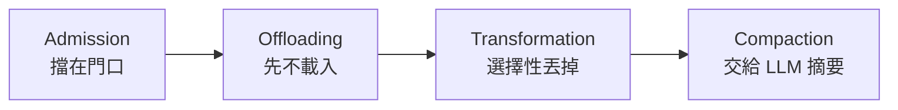

> 🌏 [English version](/posts/ai/2026-10-21-cs2680-lecture-04-tool-design-context-engineering-en)

**影片狀態：課程不錄影。** 本文依公開投影片整理，程式與數值例子為本站補充。[來源說明](#課程影片來源)

[CS2680](https://cs2680.com/) 第 4 堂在 2026 年 9 月 16 日上課，題目是〈Agent Design I: context management and tool design〉（[投影片](https://cs2680.com/slides/4_agent_design_1.pdf)）。前面幾堂都站在使用者這邊看 [Claude Code](https://code.claude.com/docs/en/overview)；從這堂開始，你是寫 agent 的人。

這堂要回答的問題是：自己寫一個 agent 時，該給它哪些工具？每一步要讓模型看到什麼？讀完之後，你應該能替一個新 agent 挑一組工具並說出理由。你也能把一個 context 問題歸到五種失敗之一，再選對處理手段。這兩件事就是[作業 2](https://cs2680.com/assignments/assignment2) 要你動手做的。

投影片分三段：agent loop（p4–7）、工具設計（p8–26）、context 管理（p27–53）。p55 之後的 Reflexion 等進階 loop 是選讀，本文只放延伸。

## 從使用者到設計者：把軌跡寫成 loop

### ReAct：想一步、做一步、看一眼

投影片從 [ReAct](https://arxiv.org/abs/2210.03629) 開始（p4）。模型每一輪做三件事：想（我知道什麼、缺什麼、下一步做什麼）、動（輸出一個環境能執行的結構化呼叫）、看（環境回傳事實）。

只想不動，推理沒有東西檢查，小錯會累積成很有自信的幻覺。只動不想，工具呼叫背後沒有計畫，模型會一直重複自己。交錯進行時，想法決定下一個動作，觀察結果修正下一個想法。ReAct 論文的說法是：讓模型去查真實資料，可以減少只靠推理時的幻覺與錯誤擴散。

### 第 2 堂的軌跡，寫成 20 多行程式

[第 2 堂](/posts/ai/2026-10-21-cs2680-lecture-02-how-claude-code-works)用一串符號表示 Claude Code 跑一次的過程：U M₁ T₁ M₂ T₂ … Mₙ A。U 是你的輸入，M 是一次模型呼叫，T 是一次工具執行，A 是最後回答。投影片 p5 把同一件事寫成 pseudo-code，以下是本文補成能跑的版本，註解標出每一行對應軌跡的哪個符號：

```python
def run_agent(user_request, tools, call_model, max_steps=20):
    messages = [
        {"role": "system", "content": "Solve the task using the tools."},
        {"role": "user", "content": user_request},                    # U
    ]
    for step in range(max_steps):
        response = call_model(messages, list(tools))                  # M₁, M₂, …
        messages.append(response["message"])
        if response.get("final_answer"):
            return response["final_answer"]                           # A
        for call in response.get("tool_calls", []):                   # T₁, T₂, …
            if call["name"] not in tools:
                result = f"Unknown tool {call['name']}. Available: {', '.join(tools)}"
            else:
                try:  # 投影片 p5 的 validate；參數錯也回給模型
                    result = tools[call["name"]](**call["arguments"])
                except Exception as e:
                    result = f"Error: {e}"
            messages.append({
                "role": "tool",
                "tool_call_id": call["id"],
                "content": str(result),
            })
    raise RuntimeError("Agent exceeded its step limit")
```

對照第 2 堂，有三個地方值得注意：

- **整段 `messages` 每次都重送。** `call_model` 收到的永遠是從頭到現在的全部歷史，這就是第 2 堂那張表裡，每次呼叫讀入的 token 一路變多的原因。
- **工具結果的格式依 API 而定。** 投影片用 OpenAI 式的 `"role": "tool"` 加 `tool_call_id`；第 2 堂的 Anthropic Messages API 則把 `tool_result` 放在 role 為 user 的訊息裡。[作業 2](/posts/ai/2026-10-21-cs2680-assignment-2-mads-loop)用的是 OpenAI 相容端點，所以照投影片這種寫法。
- **一定要有停止條件。** `max_steps` 用完就丟例外，不然模型卡住時會一直燒錢。

<details>
<summary>用一個照劇本回覆的假模型跑跑看</summary>

把下面這段接在上面的程式後面執行。假的 `call_model` 照第 2 堂「修好 test_login」的五個步驟依序提出工具呼叫，第六次回答：

```python
script = [
    ("grep", {"pattern": "login"}),
    ("read_file", {"path": "auth.py"}),
    ("read_file", {"path": "tests/test_login.py"}),
    ("edit_file", {"path": "auth.py", "old_string": "timeout=1", "new_string": "timeout=5"}),
    ("bash", {"command": "pytest tests/test_login.py"}),
]
calls = []

def call_model(messages, tool_names):
    calls.append(len(messages))
    n = len(calls) - 1
    if n == len(script):
        return {"message": {"role": "assistant", "content": "Fixed."},
                "final_answer": "Fixed: timeout was too short."}
    name, args = script[n]
    tc = {"id": f"call_{n+1}", "name": name, "arguments": args}
    return {"message": {"role": "assistant", "tool_calls": [tc]}, "tool_calls": [tc]}

tools = {
    "grep": lambda pattern: "auth.py:42: login(...)",
    "read_file": lambda path: f"<contents of {path}>",
    "edit_file": lambda path, old_string, new_string: "ok",
    "bash": lambda command: "1 passed",
}
print(run_agent("test_login keeps failing, fix it", tools, call_model))
print("model calls:", len(calls), "messages seen per call:", calls)
```

輸出：

```text
Fixed: timeout was too short.
model calls: 6 messages seen per call: [2, 4, 6, 8, 10, 12]
```

六次模型呼叫、五次工具執行，跟第 2 堂的表一樣；每次呼叫看到的訊息數一路增加。

</details>

### 寫 harness 的人要做的四件事

loop 本身很短，難的是 loop 周圍的事。投影片列出寫 harness 的人要負責的四件事（p6）：

1. **寫工具定義**：名稱、說明、參數格式。模型只能從這裡知道有什麼工具。
2. **組 context**：每次呼叫前決定 `messages` 裡放什麼。
3. **驗證並執行請求**：檢查參數、檢查權限，再真的去跑。
4. **處理結果、管理 context**（視需要）：工具輸出太長要裁，歷史太長要清。

投影片接著把 coding agent 拆成三個元件（p7）：模型加 loop、工具加防護、狀態（context 與記憶）。三者共用同一個 context window，所以要一起設計：工具輸出寫得太長，吃掉的就是狀態的空間。這堂接下來的兩大段，就是在講第 1、3 件事（工具與防護）和第 2、4 件事（context）。

> **自我檢查**：上面的 loop 裡，如果模型呼叫了一個不存在的工具，會發生什麼？為什麼不直接丟例外？
> 答：程式把「Unknown tool …，可用的有 …」當成工具結果放回 context，讓模型下一步自己改正。直接丟例外會讓整個任務中斷；回一個說明清楚的錯誤，模型通常能自己修好。這就是後面「錯誤要教得會」的原則。

## 工具設計

### 找程式碼：四種方法

投影片用「agent 該怎麼找到相關的程式碼？」開場（p9），列了四種做法：

| 方法 | 怎麼找 | 適合 | 主要成本 |
|---|---|---|---|
| glob／grep | 檔名與字面字串 | 名稱已知或猜得到 | 每次搜尋都花輪數與 context |
| 語意索引 | 程式碼片段的意思 | 你的說法跟程式碼用字不同 | 建索引、保持同步 |
| 外部訊號 | stack trace、失敗的測試、git 歷史 | 已經有報告指向某段程式 | 只有部分任務有 |
| language server | 編譯器的符號圖 | 改動要跟著參照走 | 每種語言要一個常駐 server |

（整理自 p10–14）

後三種各需要一點背景：

- **語意索引**靠 embedding：把一段文字轉成一串數字（向量），意思相近的文字，向量也相近。所以問「我們在哪裡做限流？」能直接找到 `throttle.ts`，即使程式裡沒有「限流」兩個字（p11）。另一種結構式做法是 [Aider 的 repo map](https://aider.chat/docs/repomap.html)：列出整個 repo 的檔案和最重要的類別、函式簽名。它再依檔案之間的依賴關係排序，只送最相關的一部分。
- **外部訊號**是程式碼以外的證據。checkout 當掉時，stack trace 從 `cart.ts:88` 往下列出 3 個 frame；照著打開 `tax.ts` 第 20–60 行，就找到四捨五入的錯，全程不用搜尋（p12）。
- **language server**（[LSP](https://microsoft.github.io/language-server-protocol/)）是編輯器跟語言工具溝通的標準，VS Code 的「跳到定義」「找所有參照」就是它提供的。它查的是編譯器的索引，所以能處理 grep 只能猜的別名匯入與同名函式。投影片的例子是把 `charge()` 改名成 `capture()`：42 個呼叫點、7 個檔案一次改對（p13）。

投影片的結論是：先用 grep，名稱不夠用時再上索引或 LSP（p14）。

### 改程式碼：四種方法

找到之後要改。投影片比較四種編輯方式（p17–21）：

- **整檔重寫**：模型重新輸出整個檔案，工具直接覆蓋。不會有格式錯誤，但輸出量跟檔案大小成正比，沒要改的地方也可能被模型順手改掉。
- **unified diff**：模型輸出 `@@ -41,3 +41,3 @@` 這種 patch，另一個工具套用。精簡、人和 CI 都看得懂，但行號或上下文一變就套不上。
- **搜尋取代**：模型給一段要找的原文和取代後的文字。輸出量跟改動大小成正比，但原文找不到、不唯一、空白不對就失敗。
- **結構化（AST）編輯**：模型說「替 `fetchUser` 加一個 `timeout` 參數」，工具負責改簽名和 18 個呼叫點（p20）。AST（抽象語法樹）是編譯器把程式碼解析成的樹狀結構，每個節點是一個函式、參數或運算式；在樹上改，不會改出語法錯誤。代價是每種語言都要有工具，能表達的改動種類也有限。

p21 把四者畫在兩個軸上：token 成本，以及改動會不會準確落在想改的地方。沒有一種兩邊都贏。

以下是延伸 p19 例子的教學例子，token 估算是本文加的。一個 500 行的檔案，你只要把第 41 行的 `retries = 3` 改成 `retries = 5`。假設平均一行 10 個 token：

| 方法 | 模型要輸出 | 大約 token 數 |
|---|---|---|
| 整檔重寫 | 整個檔案 | 約 5,000 |
| 搜尋取代 | 檔名、`retries = 3`、`retries = 5` | 約 30 |

兩者差了上百倍，而且輸出 token 是一個一個生成的，輸出越長，這一步就越慢。搜尋取代的風險在另一邊：如果第 88 行也有一個 `retries = 3`，工具不知道要改哪一個。這時候工具回什麼錯誤很重要：

```text
✗ invalid argument
✓ old_string matches 2 locations (lines 41 and 88).
  Include 2–3 surrounding lines so it matches exactly one.
```

第一種錯誤，模型只能亂猜；第二種告訴它怎麼修，下一步通常就成功。作業 2 給的編輯工具 `edit_file(path, old_string, new_string)` 正是搜尋取代這一型（[作業 2](https://cs2680.com/assignments/assignment2)）。

> **自我檢查**：同一個 500 行的檔案，這次要把一個函式改名，它在檔案裡出現 30 次。搜尋取代還是最好的選擇嗎？
> 判準：答出搜尋取代要嘛呼叫 30 次、要嘛 `old_string` 每次都要帶足上下文，成本跟著改動處數量變大；這種「跟著參照走」的改動是 LSP 改名或 AST 編輯的強項。如果只能用搜尋取代，至少要讓工具支援「全部取代」這類選項。

### 執行：shell 是最強也最危險的工具

投影片說執行工具實際上就是一個 shell（p22）。它強在四件事：

- 一次呼叫能串接、過濾、重試。
- 碰得到檔案系統、網路、套件管理器。
- 檔案和程序在呼叫結束後還在。
- shell 能做的事，agent 都能做。

最後一點也是風險。投影片列出設計 shell 工具時要想清楚的五件事（p23）：

- **隔離**：程式在哪裡跑、碰得到什麼。
- **失敗訊號**：錯誤要是 agent 看得懂、能採取行動的。
- **輸出量**：夠用就好。一次 `npm test` 印出幾百行，全部進 context，後面每一步都要背著。
- **執行時間**：跑很久或背景執行的程序怎麼處理。
- **預算**：重試幾次就該停手、交還給人。

除了搜尋、編輯、執行，投影片還列了五種常見工具（p24）：

- **筆記**：把發現寫進檔案，計畫撐得過壓縮。
- **subagent**：派出去探索，回一份清單，而不是 40 次讀檔。
- **網路搜尋與抓取**：先讀已安裝的原始碼，再上網查。
- **瀏覽器與截圖**：把畫面截下來回饋給模型。
- **問使用者**：一個便宜的問題，勝過一個很有自信的錯誤 patch。

### 工具設計的五個原則

p25 把前面的取捨收成五條：

1. **少而正交**：功能重疊的工具會讓模型在兩者之間猶豫。
2. **專用勝過通用**：`search_orders(customer_id)` 勝過一個直接跑 SQL 的 `run_sql`。
3. **輸出省 token**：截斷、分頁、摘要。投影片的說法是「工具設計就是 context 設計」。
4. **錯誤要教得會**：回修正提示，不要只回「參數無效」。
5. **預設冪等**：同一個呼叫重送一次，結果不變，所以出錯時可以放心重試。

前四條跟 Anthropic 的工具設計建議一致（[Writing effective tools for agents](https://www.anthropic.com/engineering/writing-tools-for-agents)）。那篇文章的例子是：與其做 `list_contacts`，不如做 `search_contacts`；它也提到 Claude Code 預設把工具回應限制在 25,000 token 以內。

> **自我檢查**：為什麼 `search_orders(customer_id)` 比 `run_sql` 好？至少說出三個理由。
> 判準：答出（1）能做的事範圍小，模型不會誤刪資料或掃全表；（2）輸出格式與大小由你控制，不會一次回傳十萬列；（3）可能的錯誤是可預期的（例如「查無此客戶」），能寫成教得會的訊息；（4）模型不必先寫對 SQL，每次呼叫用的 token 也更少。

### 只給 shell 行不行？

p26 留了一個問題：乾脆只給一個 shell 工具，行不行？投影片放了一張 [SWE-agent](https://arxiv.org/abs/2405.15793) 論文的消融圖（一次拿掉一個元件，看分數掉多少），紅字寫「在 GPT-4 上不行」。

這張圖的條件要講清楚：2024 年的論文，模型是 GPT-4 Turbo，題目是 SWE-bench Lite。SWE-bench 是拿真實 GitHub issue 讓 agent 修、用測試判對錯的題庫；Lite、Verified 是 SWE-bench 的子集，[SWE-Bench Pro](https://arxiv.org/abs/2509.16941) 是 Scale AI 另做的一份更難的同類題庫，三者的分數不能直接互比。

在這個條件下，專門設計的介面解出 18.0%，只給 shell 是 11.0%，拿掉專用的編輯器剩 10.3%（[SWE-agent 論文](https://arxiv.org/html/2405.15793v3) 表 1、表 3）。論文的結論是：替語言模型設計的介面，比單純的 shell 好。

模型換代之後，答案可能不同。同一個團隊後來做的 [mini-swe-agent](https://github.com/SWE-agent/mini-swe-agent) 只用 bash，沒有任何其他工具，配上現行模型在 SWE-bench Verified 超過 74%。這不代表專用工具沒用，而是「該給多少專用工具」會隨模型能力變。投影片也沒有下結論，而是說「做作業的時候自己找答案」。作業 2 給的是 shell、讀檔、搜尋取代編輯、宣告完成四個工具，正好夾在兩者之間。

## Context 管理

### 用語演進：prompt、context、harness、goal

投影片先放了一條用語的時間線（p28）：

| 時期 | 名稱 | 問的問題 |
|---|---|---|
| 2023–24 | prompt engineering | 該怎麼對模型下指示？ |
| 2025–26 | context engineering | 模型該看到什麼？ |
| 2026 | harness engineering | agent 該怎麼運作？ |
| 接下來 | goal engineering | 怎樣才算成功？ |

講者在同一頁寫：大家喜歡發明新詞，他用這些詞是讓你遇到時看得懂，不代表他認同。把它當成一張「同一個工作的範圍一直往外擴」的地圖就好：從一句話的措辭，擴到整個 context，再擴到 loop、工具、沙盒、重試與停止條件。

### prompt 技巧：詞彙與歷史

p29–38 是八種 prompt 技巧，p39–40 是講者的評語與建議。這一段要當成詞彙與歷史讀：講者在 p28 把 prompt engineering 標成 2023–24 的說法，p39 直接說「有些技巧已經過期了，在作業裡自己找出來」。所以這裡只列名稱和投影片說的使用時機，方便你看到這些詞時認得：

| 技巧 | 做法 | 投影片說何時用 |
|---|---|---|
| zero-shot | 只給指示 | 常見任務、格式用文字說得清楚 |
| few-shot | 指示加幾個範例 | 輸出格式特別、規則用示範比用說的清楚 |
| 角色 | 指定身分與讀者 | 語氣或判斷很重要 |
| chain-of-thought | 先寫步驟再給答案 | 任務真的有步驟、錯誤來自跳步 |
| tree-of-thought | 分支、打分、剪枝 | 有幾條路都可能、能便宜地打分 |
| self-consistency | 同一題問多次、多數決 | 有唯一正解、答錯代價高 |
| prompt chaining | 一次呼叫只做一件事，中間驗證 | 工作能拆成幾段、每段輸出能驗證 |
| meta prompting | 讓模型改寫自己的 prompt | 有一組測試題可以打分 |

（整理自 p30–38）

p40 給了四條至今仍適用的建議：

1. 從簡單開始，再迭代。
2. 分段寫：context、指示、工具、輸出格式各一段。
3. 具體而簡潔，花俏的措辭沒有用。
4. 大任務拆成小任務。

p40 最後一句最實用：prompt 建議跟模型綁在一起，換模型就要重新調。

### context 是有限資源

p41 引了 Andrej Karpathy 的定義：context engineering 是「在 context window 裡放進下一步剛好需要的資訊」的藝術與科學（[原貼文](https://x.com/karpathy/status/1937902205765607626)）。

為什麼要「剛好」？投影片給了三個理由（p42）：

- **成本**：每一步都把整個 window 重送一次，每一輪都要再付一次。
- **延遲**：prompt 越長，prefill 和 decode 越久。prefill 是模型先把整段輸入讀過、算好後面要用的中間結果；decode 是一個 token 一個 token 生出輸出。輸入越長，prefill 越久；decode 每生一個 token 都要回頭看整段輸入，輸入越長也越慢。每一輪 loop 都會因此變慢。這兩個詞在 Part II 才會細講，想先看可讀 [CMU 11-868 的 prefill／decode 篇](/posts/ai/2026-09-30-cmu11868-serving-at-scale-kv-cache)。
- **注意力**：window 越滿，模型越容易漏看，中間的內容尤其容易被忽略。放越多不等於答得越好。

p43 用兩份研究支持第三點。[Chroma 的 Context Rot 報告](https://research.trychroma.com/context-rot)測了 18 個模型，輸入越長準確率越低；加進主題相近、但答不了問題的干擾內容，影響會隨長度變得更明顯。

[Lost in the Middle](https://arxiv.org/abs/2307.03172) 則發現，答案放在哪裡也有影響。研究者給 GPT-3.5-Turbo 20 份文件，只有一份含答案（[論文表 6](https://arxiv.org/html/2307.03172v3)）：

| 含答案的文件放在 | 答對率 |
|---|---|
| 第 1 份 | 75.8% |
| 第 10 份 | 53.8% |
| 第 20 份 | 63.2% |

投影片圖上的五個百分比跟論文的表格對不上，趨勢則一致：頭尾比中間好。

### 四種管理手段

p44 用一份示意的 token 預算說明 context 被什麼佔滿：系統指示約 2K、工具定義約 6K、檢索進來的內容約 25K、專案環境約 8K，對話歷史約 80K 而且還在長。投影片明說這是示意，不是量測值。

context 太大時怎麼辦？投影片把手段排成一條線，從「事前預防、不丟資訊」到「事後補救、丟了就回不來」（p45）：



每一種投影片都配了一個前後對照的示意數字：

- **Admission（擋在門口）**：只查需要的欄位，工具輸出先整理再放進來，整理不了才截斷，原始資料交給 subagent 處理。例子：網頁抓下來的原始 DOM 有 48,000 token，只留價格和標題後剩 900 token（p46）。
- **Offloading（先不載入）**：工具定義用到才載入、用工具搜尋找工具、工具輸出回一個 handle（一個代號，例如檔案路徑或 ID），需要時再讀；計畫和筆記存在檔案裡。例子：60 個工具的 schema 全部常駐要 42,000 token，改成一個索引加 3 個用得到的 schema 是 3,100 token，60 個工具仍然都找得到（p47）。
- **Transformation（選擇性丟掉）**：同一個物件只留最新狀態、清掉 N 步以前的工具結果、只保留最近幾輪和開頭。例子：每個結果都保留是 96,000 token，只留最新狀態是 24,000 token，而且完全沒有做摘要（p48）。
- **Compaction（交給 LLM 摘要）**：邊做邊摘要舊工具結果、到上限時整段重寫、把關鍵事實存到 window 外面。投影片把它當最後手段，並提醒三件事：替輸出留空間、保留系統指示那段開頭、摘要之後把關鍵事實再放回去（p49）。

越往右越省空間，但丟掉的資訊越難找回來。所以順序是：能在門口擋的就不要等到滿了才摘要。Anthropic 的 [context engineering 文章](https://www.anthropic.com/engineering/effective-context-engineering-for-ai-agents)切法略有不同：它把「清掉舊工具結果」也算成 compaction，並說這是最安全、最輕的一種。名稱歸類不同，方向一致。

### 五種 context 失敗

p50 把 context 出問題的方式分成五種，投影片的說法是：叫得出名字，修法就很明顯。

| 失敗 | 發生什麼事 |
|---|---|
| Poisoning（中毒） | 一個幻覺進了 window，之後被當成事實引用 |
| Distraction（分心） | 歷史長到 agent 開始模仿自己過去的動作 |
| Confusion（混淆） | 不相關的工具和文件把答案帶偏 |
| Clash（衝突） | 新資訊跟舊資訊矛盾，兩者都留著沒處理 |
| Drift（漂移） | 真正的目標被埋掉，換成一個附近的子目標 |

投影片標註出處是 Drew Breunig 的〈[How Contexts Fail and How to Fix Them](https://www.dbreunig.com/2025/06/22/how-contexts-fail-and-how-to-fix-them.html)〉。原文只有前四種，Drift 是投影片加上的第五種。

投影片只給定義，下面把失敗和前一節的手段對起來，是本文的整理：

- **Confusion** 多半是工具或文件放太多，用 Offloading 只載入用得到的。
- **Distraction** 是歷史太長，用 Transformation 清掉舊結果。
- **Poisoning** 要找到那條錯的資訊並移除；光做摘要，可能把錯誤一起保留下來。
- **Clash** 是新舊資訊都留著。用 Transformation 的去重：同一個物件只留最新狀態（p48）。
- **Drift** 是目標被埋掉。把計畫存在檔案裡（Offloading 的外部任務清單，p47），壓縮後把關鍵目標重新放回（p49 的提醒）。

> **自我檢查**：下面兩個情況各是哪一種失敗？該用哪種手段？
> 1. agent 一開始把函式名 `get_user` 記錯成 `fetch_user`，寫進筆記檔；之後每次都照筆記去找 `fetch_user`。
> 2. 你接了 60 個 MCP 工具，agent 要讀檔時，常常選到一個名稱相近、功能不對的工具。
>
> 答：1 是 Poisoning：錯誤資訊被存下來、反覆當成事實。要修正或刪掉那條筆記；只做摘要會把錯誤一起帶走。2 是 Confusion：不相關的工具干擾選擇。用 Offloading，只放一個工具索引和這一步用得到的 schema，或乾脆砍掉重疊的工具（少而正交）。

## Agent = Model × Harness

最後三頁把整堂收成一句話：模型能力決定上限，harness 決定實際表現（p51）。

p52 引了 Sydney Lewis 的論文〈[Same Model, Different Harness](https://arxiv.org/abs/2608.26218)〉：模型和題目都不變，只改 harness 的兩件事（投影片拆成四點）。一是 context 快滿時，把舊的工具輸出機械式地縮短；二是偵測重複或停滯的動作並介入。結果在 SWE-bench Verified 從 169 題解出 43 題變成 72 題，在 SWE-bench Pro 從 316 題的 31 題變成 72 題（Verified 約 1.7 倍、Pro 約 2.3 倍；投影片標題寫 2×）。

這組數字有前提，投影片沒寫：測試用的是 Qwen3.6-35B-A3B，而且故意把 context window 限制在 20,480 token。論文自己也說，window 放寬之後，兩種設定在 Verified 和 Pro 上的結果很接近（[論文全文](https://arxiv.org/html/2608.26218)）。所以比較準確的讀法是：context 越緊，harness 怎麼管 context 越重要。這條結論跟作業直接相關：作業 2 指定的模型正是 `qwen3.6-35b-a3b`。

投影片的結語是：有些看起來像「模型不夠聰明」的失敗，其實是 context 和 loop 控制的失敗（p52）。在作業裡自己試：loop、prompt、工具、context 管理、失敗處理，每一個都有影響（p53）。

## 綜合自我檢查

1. 你要寫一個幫客服查訂單的 agent。方案 A 只給 `run_sql`；方案 B 只給 `search_orders(customer_id)` 和 `get_order(order_id)`。兩個方案各有什麼風險？
   判準：答出方案 A 範圍太大（可能誤改資料、回傳巨量結果、錯誤訊息難懂）；方案 B 範圍小、輸出可控，代價是遇到工具沒涵蓋的查詢就做不到，需要時再加工具或交給人。
2. 一個 agent 在小 context window 的模型上表現很差，換成大 window 的同一個模型就好很多。依這堂的內容，在換模型之前可以先試什麼？
   判準：答出至少兩個 harness 層的做法，例如縮短或清掉舊的工具輸出（Transformation）、工具輸出在門口就整理過（Admission）、偵測重複動作並介入；並說明 Lewis 的結果正是在緊 context 下最明顯。
3. 為什麼說「工具設計就是 context 設計」？
   判準：答出工具的輸出會直接進 context，之後每一步都要重讀；工具定義本身也常駐在 context 裡。所以工具回什麼、回多少、有幾個工具，都決定了 context 的內容與大小。

## 延伸閱讀

- [第 2 堂：Claude Code 怎麼運作](/posts/ai/2026-10-21-cs2680-lecture-02-how-claude-code-works)：本堂 loop 的使用者視角版本。
- [CMU 11-768 第 2 堂：Tool Use](/posts/ai/2026-09-29-cmu-11768-lecture-02-tool-use)：工具呼叫怎麼從 token 變成動作，從模型這一側講。
- [CMU 11-768 第 3 堂：長 context 的管理](/posts/ai/2026-09-29-cmu-11768-lecture-03-context-management)：prompt cache 與 compaction 的機制。
- [Context Engineering：問題出在資訊，不在模型](/posts/ai/2026-03-24-context-engineering-guide)：context 工程的實務整理。
- [coding agent 的內部構造](/posts/ai/2026-08-16-cs146s-agent-internals)：另一門課怎麼拆 harness 的 while 迴圈。
- 投影片選讀（p56）：Reflexion、plan-and-execute、tree search 三種不同於 ReAct 的 loop。

## 課程影片來源

- 課程不錄影（[policy 頁](https://cs2680.com/policy)）。
- 底本：[第 4 堂投影片](https://cs2680.com/slides/4_agent_design_1.pdf)（PDF 頁序 p4–53），2026-10-22 讀取。頁碼一律用 PDF 頁序。
- 投影片引用的論文數字回原文核對：SWE-agent（表 1、表 3）、Lost in the Middle（表 6）、Lewis（摘要與表 2）、Breunig 原文；與投影片不同之處已在正文標出。
- loop 的可執行版本、假模型範例、「改 500 行檔案的一行」的 token 估算是本站補充，不是課堂內容（`retries` 的場景取自 p19）。

## 更新紀錄

- 2026-10-22：補上作業 2 的站內連結。

## 參考資料

- [CS2680 第 4 堂投影片：Agent Design I](https://cs2680.com/slides/4_agent_design_1.pdf)
- [CS2680 作業 2：Mads-Loop](https://cs2680.com/assignments/assignment2)
- [Yao et al., ReAct: Synergizing Reasoning and Acting in Language Models (2022)](https://arxiv.org/abs/2210.03629)
- [Yang et al., SWE-agent: Agent-Computer Interfaces Enable Automated Software Engineering (2024)](https://arxiv.org/abs/2405.15793)
- [mini-swe-agent（GitHub）](https://github.com/SWE-agent/mini-swe-agent)
- [Aider 文件：Repository map](https://aider.chat/docs/repomap.html)
- [Language Server Protocol](https://microsoft.github.io/language-server-protocol/)
- [Anthropic：Writing effective tools for agents — with agents (2025)](https://www.anthropic.com/engineering/writing-tools-for-agents)
- [Anthropic：Effective context engineering for AI agents (2025)](https://www.anthropic.com/engineering/effective-context-engineering-for-ai-agents)
- [Andrej Karpathy 談 context engineering（X，2025-06-25）](https://x.com/karpathy/status/1937902205765607626)
- [Hong, Troynikov, Huber, Context Rot (Chroma, 2025)](https://research.trychroma.com/context-rot)
- [Liu et al., Lost in the Middle: How Language Models Use Long Contexts (TACL 2024)](https://arxiv.org/abs/2307.03172)
- [Drew Breunig, How Contexts Fail and How to Fix Them (2025)](https://www.dbreunig.com/2025/06/22/how-contexts-fail-and-how-to-fix-them.html)
- [Sydney Lewis, Same Model, Different Harness: Different Coding-Agent Results (2026)](https://arxiv.org/abs/2608.26218)
