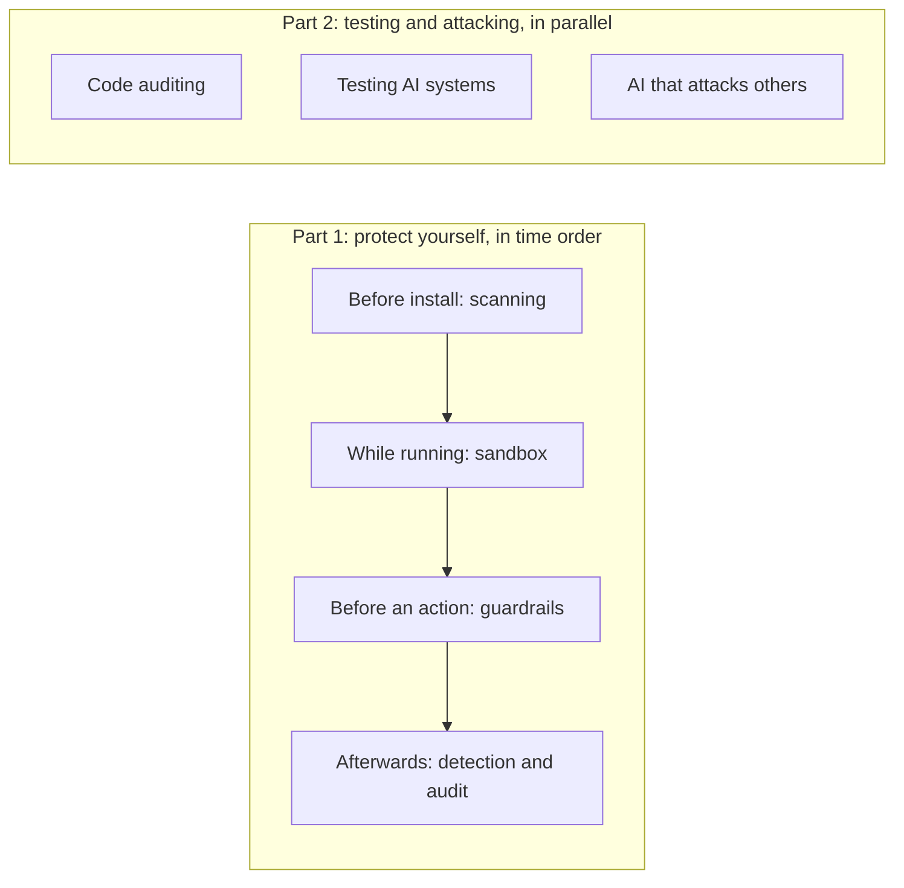

> 🌏 [中文版](/posts/ai/2026-10-24-ai-agent-security-tooling-map)

There is probably a directory on your machine full of skills somebody else wrote, and a few MCP servers in your config. Every one of them can read your files, run commands and reach the network, and your agent will do what their descriptions tell it to.

A batch of open-source tools now claims to scan them before install, limit what the agent can touch, intercept actions before they happen, leave a record afterwards, or help you test your own product. This series sorts them into seven kinds (nine posts planned, published over time) and looks at what each one does, what it does not, and whether its published numbers hold up. This post is the map: where risk comes in, and which kind of tool covers which stage.

It is written for developers who already use Claude Code, Codex or Cursor; no security background is needed. The material comes from official documentation, source code and published research. None of the tools were installed or tested hands-on.

## I split the risk into four entry points

First, map the four entry points onto your own machine: skills live in `~/.claude/skills/`, MCP config is in `.mcp.json` or Claude Code's settings, and the code you write is in your repo.

| Entry point | Example | Tool in this series |
|---|---|---|
| Things you install | Skills, MCP servers and plugins written by others; both their instructions and their code can be the problem | Pre-install scanning |
| Content returned by tools and web pages | Instructions hidden in a page, issue or document the agent reads (prompt injection) | Guardrails; a sandbox limits the damage; scanners cannot see it |
| Commands the agent runs | Shell commands, file reads and writes, network requests | Sandbox, guardrails, detection and audit |
| Your own product | The code you write and the AI features you ship | Code auditing, testing AI systems |

That mapping is this series' own grouping, not any standard's wording. Why the second entry point cannot be fixed at the model layer is covered in two earlier posts: [the common crack under agent security](/posts/ai/2026-06-04-agent-security-prompt-injection-trust-boundaries-en) explains the mechanism, and [prompt injection can only be damage-controlled at the harness layer](/posts/ai/2026-08-10-agent-security-harness-layer-en) covers the controls. This series does not repeat the theory. It covers which tools you actually have.

## Seven kinds of tool, in time order

First the baseline: by default Claude Code asks before running most Bash commands and before modifying files. That built-in permission prompt is the layer underneath; the tools below sit on top of it and cover what it does not.

The first four are ordered by when they act on a skill, from arriving on your machine to being used, and all protect your development environment. The last three change the target: the first two test what you build, and the seventh is an extension of the same idea whose active attacks can be aimed at others, so it comes last and is the most sensitive.

1. **[Pre-install scanning](/posts/ai/2026-10-24-skill-mcp-pre-install-scanners-en)** (post 1): before you add a skill or MCP server, check it for malicious patterns with rules or a model.
2. **[Sandbox](/posts/ai/2026-10-24-agent-sandboxes-en)** (post 2): assume the agent has already been fooled, and limit which files and network it can reach.
3. **[Guardrails and gateways](/posts/ai/2026-10-24-agent-guardrails-hooks-gateways-en)** (post 3): intercept an action before the agent carries it out.
4. **[Detection and audit](/posts/ai/2026-10-24-agent-detection-audit-en)** (post 4): see afterwards what the agent did, and keep a record you can query.
5. **[Code auditing](/posts/ai/2026-10-24-audit-skills-cloudflare-trail-of-bits-en)** (post 5): use AI to read your source code for vulnerabilities.
6. **[Testing AI systems](/posts/ai/2026-10-24-ai-red-teaming-llm-tools-en)** (post 6): send attack prompts at your LLM application and see whether it holds.
7. **[AI that attacks others](/posts/ai/2026-10-24-ai-pentest-agents-dual-use-en)** (post 7): autonomous penetration-testing agents, which are a tool for defenders and a tool for attackers at once.

[Post 8](/posts/ai/2026-10-24-judging-security-tool-claims-en) builds a checklist for taking vendor claims apart.

## A weekend example

Over the weekend you install a useful-looking skill from GitHub and connect an MCP server. Later the agent reads a web page that hides a line telling it to download a URL with `curl` and run it through `sh`.

Think first: for that command, which kind of tool should stop it first? Which can only limit the damage? Which cannot see it at all?

A guardrail should stop it first, because it can intercept the command before it runs. A sandbox limits what the command can reach if it does run. Pre-install scanning cannot see it, because the command is not something you installed. Afterwards, an audit record tells you what the agent actually did. The same risk is handled by different kinds of tool at different moments.

## Three limits that keep recurring

**First, no single tool works as the only line of defense.** Pre-install scanners have been bypassed on record, and a sandbox does not address being fooled in the first place. Adversa tested eight open-source skill scanners, and every one let at least one malicious skill through: six were bypassed, one barely inspects content, and the pure-LLM one can be swayed by the text inside the skill file. Adversa builds a scanner of its own, which is worth remembering when reading its conclusions. For sandboxes, the example is the AI penetration-testing tool Strix: researchers at Baldur Security used a prompt injection placed on a web page to make it run arbitrary commands inside its own sandbox container. The sandbox did not stop that; it only limited how far it could reach (details in [post 2](/posts/ai/2026-10-24-agent-sandboxes-en) and [post 7](/posts/ai/2026-10-24-ai-pentest-agents-dual-use-en)).

**Second, defaults often work against you.** Claude Code can run a check script you write before each action (called a hook). Its documentation says that on most events, if that script errors or times out, the action still goes ahead; to make it block on failure you must configure that separately. Claude Code's sandbox is also off by default, and when it is on it wraps only shell commands.

**Third, published detection numbers lack independent evaluation.** Vendor-published accuracy is mostly measured on the vendor's own data. Public evaluations such as [AgentDojo](https://arxiv.org/abs/2406.13352) measure how often a whole agent is successfully attacked under injection, and its task usability, not how accurately a scanner or guardrail catches things on its own. The few independent datasets show that the same detector's recall (how many of a hundred bad samples it catches) swings widely with the sample mix: in [MalSkillBench](https://arxiv.org/abs/2606.07131), VirusTotal's recall is 21.6% over all samples and 87.9% on the subset collected in the wild.

## How to read this series

- If you only use agents and do not build products, you can stop after post 4. Posts 5 to 7 are for people testing their own products.
- Every kind of tool gets the same three questions: where it intercepts, what happens when it fails, and who can change its rules.
- Every number is labeled as a vendor claim, independent research or official documentation.
- Post 8 uses the cases from earlier posts to build a checklist for taking vendor claims apart, and lines it up with [OWASP's Top 10 for Agentic Applications](https://genai.owasp.org/resource/owasp-top-10-for-agentic-applications-for-2026/).

## Where this leaves you

Each of the seven kinds covers one stage, and none covers all of it. One thing to do tonight: run `ls ~/.claude/skills` to see which skills you have installed, open your MCP settings to see which servers are connected, then draw the four entry points on a sheet of paper and write one line beside each: "what stops this right now". Whichever box you cannot fill in is the post to read next.

Post 1 starts with the most direct stage: before you install a skill or MCP server, what a scanner can and cannot tell you.

## References

- [The common crack under agent security: from prompt injection and trust boundaries to multi-agent worms](/posts/ai/2026-06-04-agent-security-prompt-injection-trust-boundaries-en)
- [Security: prompt injection can only be damage-controlled at the harness layer](/posts/ai/2026-08-10-agent-security-harness-layer-en)
- [Claude Code docs: Hooks](https://code.claude.com/docs/en/hooks)
- [Claude Code docs: Sandboxing](https://code.claude.com/docs/en/sandboxing)
- [Adversa AI: eight agent skill scanners tested for bypasses](https://adversa.ai/blog/agent-skill-scanners-bypass-eight-tested/)
- [Baldur Security: RCE in Strix Agent](https://baldur.dk/blog/strix-ai-pentester-rce/)
- [MalSkillBench (arXiv:2606.07131)](https://arxiv.org/abs/2606.07131)
- [AgentDojo (arXiv:2406.13352)](https://arxiv.org/abs/2406.13352)
- [OWASP Top 10 for Agentic Applications for 2026](https://genai.owasp.org/resource/owasp-top-10-for-agentic-applications-for-2026/)
