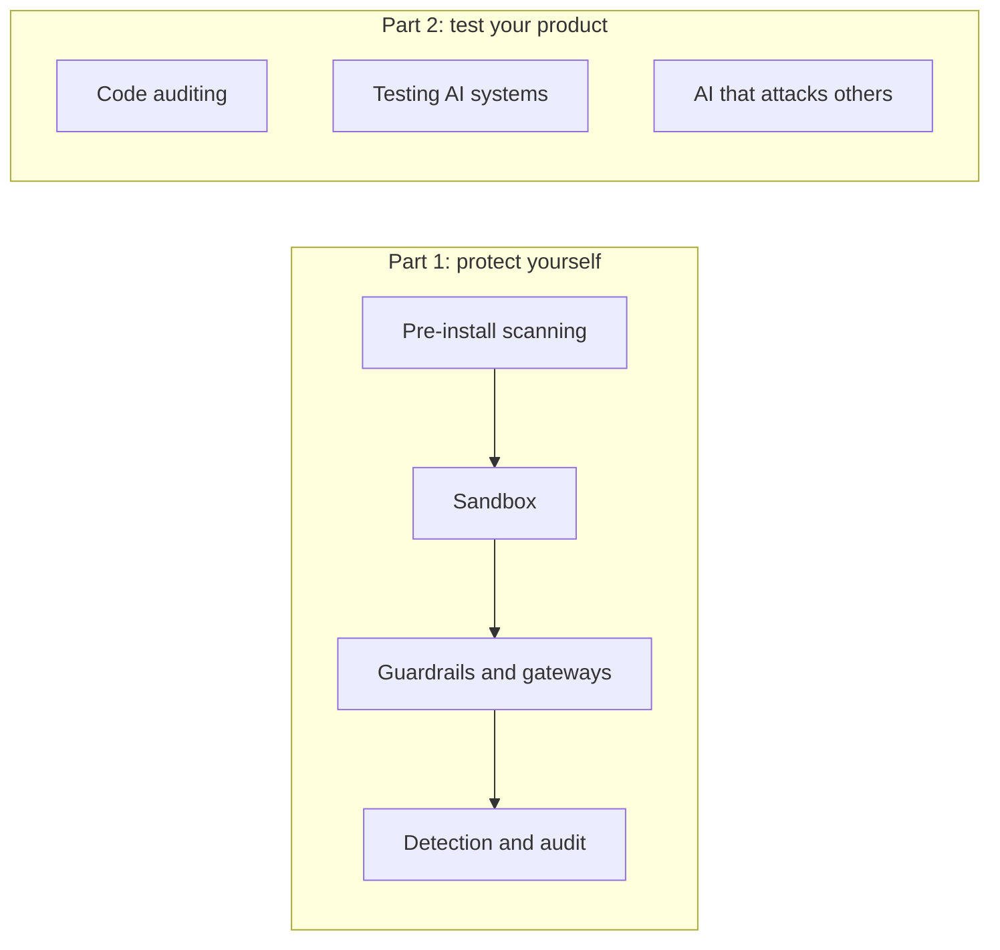

> 🌏 [中文版](/posts/ai/2026-10-24-ai-agent-security-tooling-map)

There is probably a directory on your machine full of skills somebody else wrote, and a few MCP servers in your config. Every one of them can read your files, run commands and reach the network, and your agent will do what their descriptions tell it to.

A batch of open-source tools now claims to scan them before install, limit what the agent can touch, intercept actions before they happen, leave a record afterwards, or help you test your own product. This series sorts them into seven kinds and looks at what each one does, what it does not, and whether its published numbers hold up. This post is the map: where risk comes in, and which kind of tool covers which stretch.

It is written for developers who already use Claude Code, Codex or Cursor; no security background is needed. The material comes from official documentation, source code and published research. None of the tools were installed or tested hands-on.

## Risk comes in through four entry points

| Entry point | Example |
|---|---|
| Things you install | Skills, MCP servers and plugins written by others; both their instructions and their code can be the problem |
| Content returned by tools and web pages | Instructions hidden in a page, issue or document the agent reads (prompt injection) |
| Commands the agent runs | Shell commands, file reads and writes, network requests |
| Your own product | The code you write and the AI features you ship |

Why the second entry point cannot be fixed at the model layer is covered in two earlier posts: [the common crack under agent security](/posts/ai/2026-06-04-agent-security-prompt-injection-trust-boundaries-en) explains the mechanism, and [prompt injection can only be damage-controlled at the harness layer](/posts/ai/2026-08-10-agent-security-harness-layer-en) covers the controls. This series does not repeat the theory. It covers which tools you actually have.

## Seven kinds of tool, in time order

The first four follow one skill from arriving on your machine to being used, and all protect your development environment. The last three change the target: they test what you build.

1. **Pre-install scanning**: before you add a skill or MCP server, check it for malicious patterns with rules or a model.
2. **Sandbox**: assume the agent has already been fooled, and limit which files and network it can reach.
3. **Guardrails and gateways**: intercept an action before the agent carries it out.
4. **Detection and audit**: see afterwards what the agent did, and keep a record you can query.
5. **Code auditing**: use AI to read your source code for vulnerabilities.
6. **Testing AI systems**: send attack prompts at your LLM application and see whether it holds.
7. **AI that attacks others**: autonomous penetration-testing agents, which are a tool for defenders and a tool for attackers at once.

## One concrete scenario

Over the weekend you install a useful-looking skill from GitHub and connect an MCP server.

Before installing, a scanner can tell you whether it matches known malicious patterns. Once it is running, the agent reads a web page that hides a line telling it to fetch a URL with `curl` and pipe it into `sh`. That command is not something you installed, so the scanner cannot see it. A guardrail can stop it before it runs; a sandbox limits what the command can reach if it does run. Afterwards, an audit record tells you what the agent actually did.

The same risk is handled by different kinds of tool at different moments. So the question is rarely which one to pick; it is what you have at each stretch.

## Three limits they all share

**First, no kind of tool works as the only line of defense.** Adversa tested eight open-source skill scanners, and every one let at least one malicious skill through (with the LLM judgment turned off). Sandboxes are not a cure either: researchers got the AI penetration-testing tool Strix to run arbitrary commands inside its own sandbox through indirect prompt injection. The sandbox limited the blast radius but did not stop it from happening.

**Second, defaults often let things through.** Claude Code's documentation says that on most events, when a hook fails or times out, the action still goes ahead; to block instead you must set `onFailure: "block"` (v2.1.295 or later). Claude Code's sandbox is off by default, and when it is on it wraps only shell commands.

**Third, there is no neutral benchmark of detection power.** Vendor-published accuracy is mostly measured on the vendor's own data. Public benchmarks such as [AgentDojo](https://arxiv.org/abs/2406.13352) measure whether a model or agent resists injection, not how accurately a scanner or guardrail catches things. The few independent studies show that the same detector's recall swings widely with the sample mix: in [MalSkillBench](https://arxiv.org/abs/2606.07131), VirusTotal's recall is 21.6% over all samples and 87.9% on the in-the-wild subset.

## How to read this series

- If you only use agents and do not build products, you can stop after post 4. Posts 5 to 7 are for people testing their own products.
- Every kind of tool gets the same three questions: where it intercepts, what happens when it fails, and who can change its rules.
- Every number is labeled as a vendor claim, independent research or official documentation.
- Post 8 uses the cases from earlier posts to build a checklist for taking vendor claims apart, and lines it up with [OWASP's Top 10 for Agentic Applications](https://genai.owasp.org/resource/owasp-top-10-for-agentic-applications-for-2026/).

## Where this leaves you

Each of the seven kinds covers one stretch, and none covers all of it. Rather than hunting for the strongest tool, work out what your own agent has at each stretch and what it lacks, then look at the options for the missing one. The next post starts with the most direct stretch: before you install a skill or MCP server, what a scanner can and cannot tell you.

## References

- [The common crack under agent security: from prompt injection and trust boundaries to multi-agent worms](/posts/ai/2026-06-04-agent-security-prompt-injection-trust-boundaries-en)
- [Security: prompt injection can only be damage-controlled at the harness layer](/posts/ai/2026-08-10-agent-security-harness-layer-en)
- [Claude Code docs: Hooks](https://code.claude.com/docs/en/hooks)
- [Claude Code docs: Sandboxing](https://code.claude.com/docs/en/sandboxing)
- [Adversa AI: eight agent skill scanners tested for bypasses](https://adversa.ai/blog/agent-skill-scanners-bypass-eight-tested/)
- [Baldur Security: RCE in Strix Agent](https://baldur.dk/blog/strix-ai-pentester-rce/)
- [MalSkillBench (arXiv:2606.07131)](https://arxiv.org/abs/2606.07131)
- [AgentDojo (arXiv:2406.13352)](https://arxiv.org/abs/2406.13352)
- [OWASP Top 10 for Agentic Applications for 2026](https://genai.owasp.org/resource/owasp-top-10-for-agentic-applications-for-2026/)
