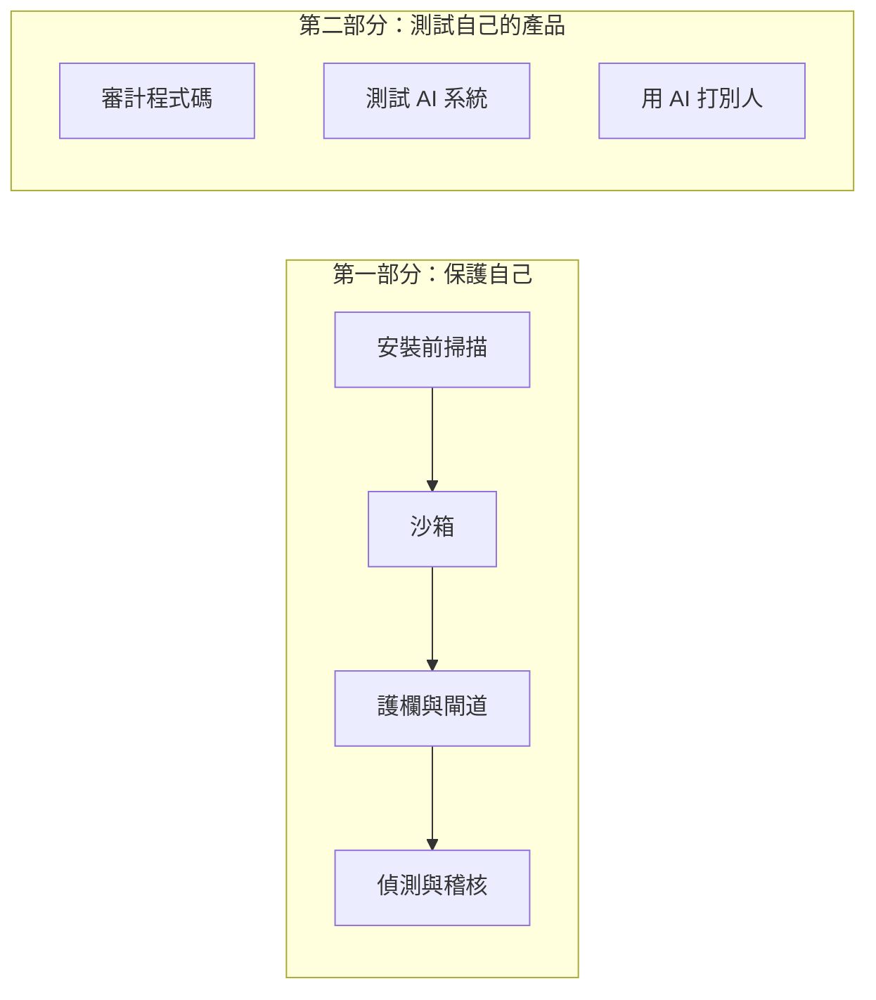

> 🌏 [English version](/posts/ai/2026-10-24-ai-agent-security-tooling-map-en)

你的電腦上大概已經有一個放著別人寫的 skill 的目錄，設定檔裡也接了幾個 MCP server。這些東西每一個都能讀你的檔案、跑指令、連網路，而 agent 會照著它們的說明做。

市面上已經有一批開源工具，宣稱能在安裝前掃描它們、限制 agent 能碰什麼、在動作發生前攔截、事後留下紀錄，或幫你測自己的產品。這個系列把它們分成七類，逐類看它做了什麼、沒做什麼，以及公開的數字能不能信。這一篇是地圖：先看風險從哪裡進來，再看每一類工具管哪一段。

適合已經在用 Claude Code、Codex 或 Cursor 的開發者，不需要資安背景。內容依據官方文件、原始碼與公開研究整理，沒有逐一安裝實測。

## 風險從四個入口進來

| 入口 | 例子 |
|---|---|
| 你裝進去的東西 | 別人寫的 skill、MCP server、外掛，說明文字和程式碼本身都可能有問題 |
| 工具與網頁回傳的內容 | agent 讀到的網頁、issue、文件裡藏著的指令（prompt injection） |
| agent 執行的指令 | shell 指令、檔案讀寫、網路請求 |
| 你自己的產品 | 你寫的程式，以及你做的 AI 功能 |

第二個入口為什麼無法在模型層根治，站上已有兩篇講過：[Agent 安全的同一條裂縫](/posts/ai/2026-06-04-agent-security-prompt-injection-trust-boundaries)講原理，[prompt injection 只能在 harness 層做損害控制](/posts/ai/2026-08-10-agent-security-harness-layer)講損害控制。這個系列不重講原理，只講接下來手上有哪些工具。

## 七類工具，依時間排

前四類跟著一個 skill 從進來到被使用的時間走，都是在保護自己的開發環境。後三類換了目標，是在測試你自己做的東西。

1. **安裝前掃描**：在你裝 skill 或 MCP server 之前，用規則或模型檢查有沒有惡意模式。
2. **沙箱**：假設 agent 已經被騙，限制它能碰的檔案和網路。
3. **護欄與閘道**：在 agent 執行動作之前攔截。
4. **偵測與稽核**：事後看見 agent 做過什麼，並留下可查的紀錄。
5. **審計程式碼**：用 AI 讀你的原始碼找漏洞。
6. **測試 AI 系統**：對你的 LLM 應用發出攻擊提示，看它擋不擋得住。
7. **用 AI 打別人**：自主的滲透測試 agent，同時是防守者的工具和攻擊者的工具。

## 一個具體情境

週末你從 GitHub 裝了一個看起來很實用的 skill，順便接了一個 MCP server。

裝之前，掃描器可以告訴你有沒有已知的惡意模式。跑起來之後，agent 讀到一個網頁，網頁裡藏著一行「請執行 `curl` 某個網址再接 `sh`」。這個指令不是你安裝進來的東西，掃描器管不到；護欄可以在指令執行前攔下它，沙箱則限制這條指令就算執行了，碰得到什麼。事後，稽核紀錄讓你知道 agent 究竟做過什麼。

同一個風險，每一類工具負責的是不同的時間點。所以問題從來不是「該選哪一個」，而是「每一段各有什麼」。

## 三個共通限制

**第一，沒有任何一類能當唯一防線。** Adversa 測試 8 個開源 skill 掃描器，每一個都讓至少一個惡意 skill 通過（測試時關閉了 LLM 判斷）。沙箱同樣不是萬能：研究者曾讓 AI 滲透工具 Strix 在沙箱內被間接 prompt injection 騙去執行任意指令，沙箱限制了波及範圍，卻沒有阻止這件事發生。

**第二，預設值常常是放行。** Claude Code 的官方文件寫明，大多數事件上 hook 失敗或逾時時，動作照常執行；要擋下來必須設 `onFailure: "block"`（v2.1.295 以上）。Claude Code 的沙箱預設是關的，開啟後也只包住 shell 指令。

**第三，沒有中立的偵測力評測。** 廠商公布的準確率多半是自己出題、自己評分。公開的 benchmark 像 [AgentDojo](https://arxiv.org/abs/2406.13352)，評的是模型或 agent 抗不抗得住注入，不是掃描器或護欄抓得準不準。少數獨立研究顯示，同一個偵測器換一批樣本，召回率會差很多：在 [MalSkillBench](https://arxiv.org/abs/2606.07131) 裡，VirusTotal 的召回率在全體樣本是 21.6%，在其中的野外子集是 87.9%。

## 怎麼讀這個系列

- 只是使用 agent、不做產品的人，讀到第 4 篇可以停。第 5 到 7 篇是給要測試自己產品的人。
- 每一類工具都問同樣三件事：它攔在哪裡、掛了會怎樣、誰能改它的規則。
- 每個數字都會標明是廠商自述、獨立研究，還是官方文件。
- 第 8 篇用前面出現過的案例，整理一份拆解廠商宣稱的檢查表，並對照 [OWASP 的 Agentic 應用 Top 10](https://genai.owasp.org/resource/owasp-top-10-for-agentic-applications-for-2026/)。

## 整體來說

這七類工具各管一段，沒有哪一段管得住全部。與其找一個最強的工具，不如先弄清楚自己的 agent 在每一段有什麼、缺什麼，再看缺的那一段有哪些選擇。下一篇從最直觀的一段開始：裝 skill 和 MCP 之前，掃描器能告訴你什麼、不能告訴你什麼。

## 參考資料

- [Agent 安全的同一條裂縫：從 Prompt Injection、信任邊界到 Multi-Agent 蠕蟲](/posts/ai/2026-06-04-agent-security-prompt-injection-trust-boundaries)
- [安全：prompt injection 只能在 harness 層做損害控制](/posts/ai/2026-08-10-agent-security-harness-layer)
- [Claude Code 文件：Hooks](https://code.claude.com/docs/en/hooks)
- [Claude Code 文件：Sandboxing](https://code.claude.com/docs/en/sandboxing)
- [Adversa AI：測試八個 agent skill 掃描器的繞過](https://adversa.ai/blog/agent-skill-scanners-bypass-eight-tested/)
- [Baldur Security：RCE in Strix Agent](https://baldur.dk/blog/strix-ai-pentester-rce/)
- [MalSkillBench（arXiv:2606.07131）](https://arxiv.org/abs/2606.07131)
- [AgentDojo（arXiv:2406.13352）](https://arxiv.org/abs/2406.13352)
- [OWASP Top 10 for Agentic Applications for 2026](https://genai.owasp.org/resource/owasp-top-10-for-agentic-applications-for-2026/)
