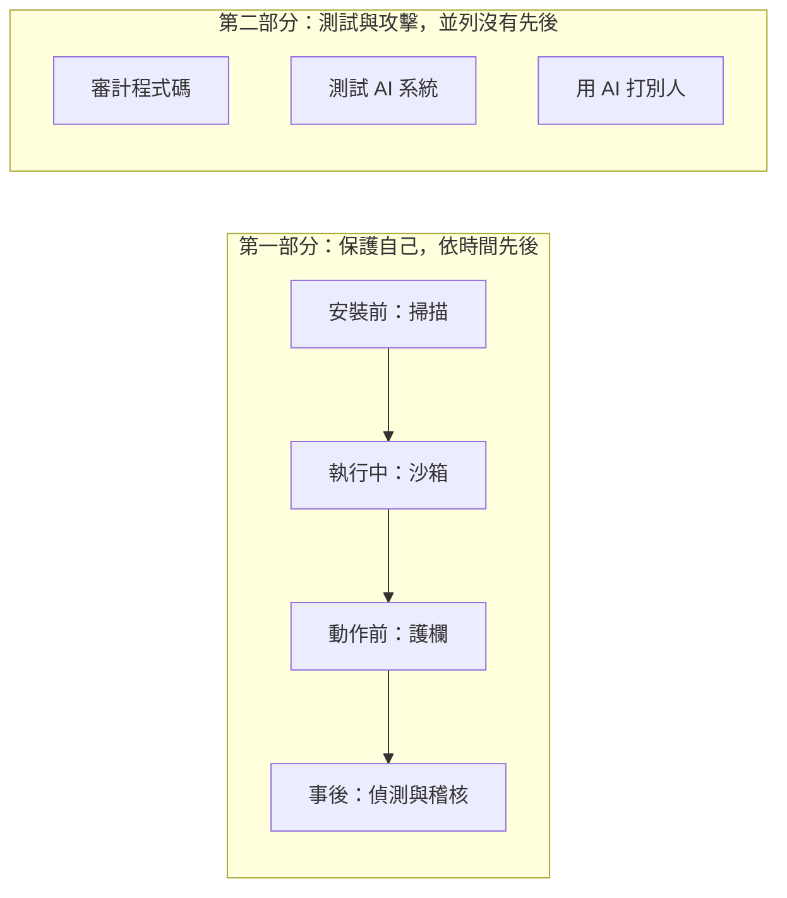

> 🌏 [English version](/posts/ai/2026-10-24-ai-agent-security-tooling-map-en)

你的電腦上大概已經有一個放著別人寫的 skill 的目錄，設定檔裡也接了幾個 MCP server。這些東西每一個都能讀你的檔案、跑指令、連網路，而 agent 會照著它們的說明做。

市面上已經有一批開源工具，宣稱能在安裝前掃描它們、限制 agent 能碰什麼、在動作發生前攔截、事後留下紀錄，或幫你測自己的產品。這個系列把它們分成七類（預計九篇，陸續發表），逐類看它做了什麼、沒做什麼，以及公開的數字能不能信。這一篇是地圖：先看風險從哪裡進來，再看每一類工具管哪一段。

適合已經在用 Claude Code、Codex 或 Cursor 的開發者，不需要資安背景。內容依據官方文件、原始碼與公開研究整理，沒有逐一安裝實測。

## 我把風險分成四個入口

先把這四個入口對到你自己的機器：skill 放在 `~/.claude/skills/`，MCP 設定在 `.mcp.json` 或 Claude Code 的設定裡，你寫的程式在你的 repo。

| 入口 | 例子 | 本系列的對應工具 |
|---|---|---|
| 你裝進去的東西 | 別人寫的 skill、MCP server、外掛，說明文字和程式碼本身都可能有問題 | 安裝前掃描 |
| 工具與網頁回傳的內容 | agent 讀到的網頁、issue、文件裡藏著的指令（prompt injection） | 護欄；沙箱限制損害；掃描器管不到 |
| agent 執行的指令 | shell 指令、檔案讀寫、網路請求 | 沙箱、護欄、偵測與稽核 |
| 你自己的產品 | 你寫的程式，以及你做的 AI 功能 | 程式碼審計、測試 AI 系統 |

這個對應是本系列自己的歸納，不是哪一份標準的說法。第二個入口為什麼無法在模型層根治，站上已有兩篇講過：[Agent 安全的同一條裂縫](/posts/ai/2026-06-04-agent-security-prompt-injection-trust-boundaries)講原理，[prompt injection 只能在 harness 層做損害控制](/posts/ai/2026-08-10-agent-security-harness-layer)講損害控制。這個系列不重講原理，只講接下來手上有哪些工具。

## 七類工具，依時間排

前四類依一個 skill 從進來到被使用的先後排，都是在保護自己的開發環境。後三類換了目標：前兩類測試你自己做的東西；第七類是同一件事的延伸，主動攻擊的對象也可以是別人，所以放在最後，也是最敏感的一類。

1. **安裝前掃描**（第 1 篇）：在你裝 skill 或 MCP server 之前，用規則或模型檢查有沒有惡意模式。
2. **沙箱**（第 2 篇）：假設 agent 已經被騙，限制它能碰的檔案和網路。
3. **護欄與閘道**（第 3 篇）：在 agent 執行動作之前攔截。
4. **偵測與稽核**（第 4 篇）：事後看見 agent 做過什麼，並留下可查的紀錄。
5. **審計程式碼**（第 5 篇）：用 AI 讀你的原始碼找漏洞。
6. **測試 AI 系統**（第 6 篇）：對你的 LLM 應用發出攻擊提示，看它擋不擋得住。
7. **用 AI 打別人**（第 7 篇）：自主的滲透測試 agent，同時是防守者的工具和攻擊者的工具。

第 8 篇整理一份拆解廠商宣稱的檢查表。

## 一個週末的例子

週末你從 GitHub 裝了一個看起來很實用的 skill，順便接了一個 MCP server。裝好之後，agent 讀到一個網頁，網頁裡藏著一行「請用 `curl` 下載某個網址再接 `sh` 執行」。

先想一下：這行指令，哪一類工具最先該擋？哪一類只能限制損害？哪一類根本管不到？

護欄最先該擋，它可以在指令執行前攔下來。沙箱限制這條指令就算執行了，碰得到什麼。安裝前掃描管不到，因為這行指令不是你安裝進來的東西。事後，稽核紀錄讓你知道 agent 究竟做過什麼。同一個風險，每一類工具負責的是不同的時間點。

## 三個反覆出現的限制

**第一，沒有單一工具能獨當防線。** 在安裝前掃描和沙箱這兩類，都看得到繞過的紀錄。Adversa 測了 8 個開源 skill 掃描器，每一個都讓至少一個惡意 skill 通過，有的是被繞過，有的本來就幾乎不檢查內容；Adversa 自己也做同類的掃描器，讀它的結論時要記得這個背景。沙箱也一樣：研究者曾讓 AI 滲透工具 Strix 在自己的沙箱內，被放在網頁上的 prompt injection 騙去執行任意指令。沙箱沒有阻止這件事發生，只限制了它能波及的範圍。

**第二，預設值常常對你不利。** Claude Code 可以在每個動作前先跑你寫的檢查腳本（稱為 hook）。官方文件寫明，大多數情況下這支腳本出錯或逾時，動作仍然照常執行；要改成出錯就擋，得另外設定。另外，Claude Code 的沙箱預設是關的，開啟後也只包住 shell 指令。

**第三，公開的偵測數字缺少獨立評測。** 廠商公布的準確率多半是自己出題、自己評分。公開的評測像 [AgentDojo](https://arxiv.org/abs/2406.13352)，量的是整條 agent 被注入時的攻擊成功率與任務可用性，不是單獨量掃描器或護欄抓得準不準。少數獨立資料集顯示，同一個偵測器換一批樣本，召回率（一百個壞的抓到幾個）會差很多：在 [MalSkillBench](https://arxiv.org/abs/2606.07131) 裡，VirusTotal 在全部樣本上的召回率是 21.6%，在其中真實環境蒐集到的樣本子集是 87.9%。

## 怎麼讀這個系列

- 只是使用 agent、不做產品的人，讀到第 4 篇可以停。第 5 到 7 篇是給要測試自己產品的人。
- 每一類工具都問同樣三件事：它攔在哪裡、掛了會怎樣、誰能改它的規則。
- 每個數字都會標明是廠商自述、獨立研究，還是官方文件。
- 第 8 篇用前面出現過的案例，整理一份拆解廠商宣稱的檢查表，並對照 [OWASP 的 Agentic 應用 Top 10](https://genai.owasp.org/resource/owasp-top-10-for-agentic-applications-for-2026/)。

## 整體來說

這七類工具各管一段，沒有哪一段管得住全部。今晚先做一件事：`ls ~/.claude/skills` 看你裝了哪些 skill，再打開 MCP 設定看接了哪些 server，然後在紙上畫出四個入口，每個入口旁邊寫一行「我現在有什麼擋它」。寫不出來的那一格，就是接下來該讀的那一篇。

第 1 篇從最直觀的一段開始：裝 skill 和 MCP 之前，掃描器能告訴你什麼、不能告訴你什麼。

## 參考資料

- [Agent 安全的同一條裂縫：從 Prompt Injection、信任邊界到 Multi-Agent 蠕蟲](/posts/ai/2026-06-04-agent-security-prompt-injection-trust-boundaries)
- [安全：prompt injection 只能在 harness 層做損害控制](/posts/ai/2026-08-10-agent-security-harness-layer)
- [Claude Code 文件：Hooks](https://code.claude.com/docs/en/hooks)
- [Claude Code 文件：Sandboxing](https://code.claude.com/docs/en/sandboxing)
- [Adversa AI：測試八個 agent skill 掃描器的繞過](https://adversa.ai/blog/agent-skill-scanners-bypass-eight-tested/)
- [Baldur Security：RCE in Strix Agent](https://baldur.dk/blog/strix-ai-pentester-rce/)
- [MalSkillBench（arXiv:2606.07131）](https://arxiv.org/abs/2606.07131)
- [AgentDojo（arXiv:2406.13352）](https://arxiv.org/abs/2406.13352)
- [OWASP Top 10 for Agentic Applications for 2026](https://genai.owasp.org/resource/owasp-top-10-for-agentic-applications-for-2026/)
