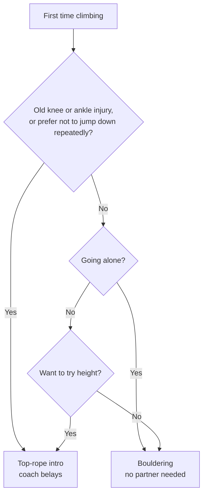

> 🌏 [中文版](/posts/climbing/2026-10-08-climbing-beginner-guide)

People walking into a climbing gym for the first time tend to get stuck at the same spot. The walls are covered in colored holds, some climbers are tied to ropes and some are not, the tags say V2 or 5.9, and it is unclear which wall is meant for you. This post breaks climbing into the choices you will face right away: which styles exist, how to read difficulty, what a first visit costs, and how likely you are to get hurt.

## What climbing is

Climbing means moving up a rock face or an artificial wall using your hands and feet. Each set path on the wall is a route; in bouldering, routes are usually called problems. The goal is to get from the start to the finish on the assigned holds without falling off.

Climbing first appeared at the Olympics at Tokyo 2020. According to [World Climbing's LA28 page](https://www.worldclimbing.com/olympics/2028-los-angeles), the number of Olympic golds in climbing goes from two in Tokyo and four in Paris to six in Los Angeles in 2028. The [LA28 press release](https://la28.org/en/newsroom/los-angeles-2028-medal-event-program-and-athlete-quota.html) describes the change as separating the combined boulder and lead event into "three distinct medal events: speed, boulder and lead." Those three match the three kinds of wall you see in a gym.

## Who it suits

You do not need an exercise habit or strong arms to start. [REI's guide to gym climbing](https://www.rei.com/learn/expert-advice/indoor-climbing.html) includes this among its first tips for new climbers: "Remember that your legs are stronger than your arms." Early on, most falls come from poor foot placement, and arm strength is rarely the limit.

Two groups should think a little harder about where to begin:

- **Old knee or ankle injuries, or older climbers.** Every bouldering attempt ends with a drop onto the mat. Taipei's [T-UP Climbing Gym](https://www.tup-goclimb.tw/) says in its intro-session FAQ that bouldering puts more load on the knees because you jump down to the mat, and it recommends the top-rope session for older visitors.
- **Fear of heights.** Bouldering walls are three to four meters tall. Top-rope walls run eight to ten meters, but a rope holds you the whole way. If height itself bothers you, pick bouldering. If the fear is about falling, pick top-rope.

## Five styles at a glance

Gyms offer three styles, and the outdoors adds two more. They differ in whether a rope is used and who placed the protection.

| Style | Rope | Height | Partner needed | Barrier for beginners |
|---|---|---|---|---|
| Bouldering | None; thick mats on the floor | About 4 m | No | Lowest; rent shoes and climb |
| Top-rope | Pre-hung from the top of the wall | About 8–10 m in gyms | A belayer, or an auto belay | Low; a coach belays in intro sessions |
| Lead | Clipped into quickdraws as you climb | 15 m on competition walls | A belayer | Get comfortable on top-rope first |
| Sport (outdoor) | Same as lead, on bolts fixed in the rock | Depends on the crag | A belayer | Learn indoor lead first |
| Trad (outdoor) | You place and remove your own protection in cracks | Depends on the crag | A belayer | Highest; needs full training |

The indoor definitions come from the REI article above. Bouldering is "Requiring neither a harness nor a rope." In top-rope, the rope is secured to an overhead anchor. In lead, a slip drops you back to your last clipped point, "a farther, harder fall than you'd have when top-roping." The same article notes that indoor lead is much like outdoor sport climbing, except the quickdraws are already hanging. [REI's getting-started guide](https://www.rei.com/learn/expert-advice/getting-started-rock-climbing.html) suggests beginners start with top-rope or bouldering and leave lead and trad for later.

The competition disciplines are the same styles in race form. Per World Climbing's rule pages, [Boulder](https://www.worldclimbing.com/boulder/index) takes place on 4-meter walls, and whoever solves the most problems in the fewest attempts wins. [Lead](https://www.worldclimbing.com/lead/index) gives each athlete six minutes on a 15-meter wall, and the highest point reached wins. [Speed](https://www.worldclimbing.com/speed/index) is a head-to-head race up a standardized 15-meter route that never changes.

## How to read difficulty

The number next to a route is its difficulty. Bouldering and roped climbing use two separate systems. The following is based on [REI's guide to rating systems](https://www.rei.com/learn/expert-advice/climbing-bouldering-rating.html):

- **Bouldering uses the V Scale.** It starts at V0 and gets harder as the number rises, with no upper limit, plus a VB rating below V0 for beginners. [REI's bouldering guide](https://www.rei.com/learn/expert-advice/bouldering.html) puts the current top at V17, a grade only a couple of problems carry. The scale is named after John "Vermin" Sherman, who rated problems with his friends at Hueco Tanks in Texas. Bouldering areas in Europe use the Font Scale instead.
- **Roped climbing uses the Yosemite Decimal System (YDS).** Technical climbing runs from 5.0 to 5.15, and a larger number after the decimal point means a harder route. From 5.10 up, the letters a through d split each rating further, so 5.10a is easier than 5.10d. REI's gym article says many novices start in the 5.3 to 5.5 range.

Ratings are a reference. In REI's words, "Ratings are guidelines, not Gospel." The same number feels different in another gym or outdoors. In a new gym, ask the front desk whether the ratings run soft or stiff, and begin on the two lowest levels.

## A first gym visit: T-UP as an example

Here is a concrete case from [T-UP Climbing Gym](https://www.tup-goclimb.tw/) in Taipei. Prices were checked on the official site on 2026-10-08, and other gyms and branches differ.

**Booking an intro session.** A solo bouldering intro is NT$1,200 for 40 minutes. A solo top-rope intro is NT$1,500, lasting one hour at the Zhonghe and Xindian branches. According to the [Wanhua branch price list](https://tupclimbing.tw/pricing/84), the intro fee covers entry, a coach, and gear rental, and comes with a free entry pass. Online booking has to be made three days ahead.

**Walking in on your own.** An adult day pass at Wanhua is NT$450 on weekdays and NT$500 on weekends. Shoe rental is NT$100 and a chalk bag is NT$80, and rental shoes require socks. That adds up to roughly NT$630–680 per visit.

The gym's own FAQ says a first-timer does not have to book an intro, but a coach teaches basic technique and goes over safety. If nobody experienced is taking you, the intro fee pays for one lesson in particular: how to come off the wall.

You need to bring very little:

- Clothes you can move in and do not mind getting chalky or scuffed (REI suggests stretchy and loose, but not so baggy that they catch on holds)
- A pair of socks for the rental shoes
- Water

Rent shoes, chalk bag, and harness at first. REI's advice is to find out what your gym provides and rents for the first few visits, and buy your own once you know you will keep climbing.

## Will you get hurt

The acute injury rate for indoor climbing is very low, though the number comes with conditions.

A [prospective study by Schöffl and colleagues](http://paci.com.au/downloads_public/risk/Risk_indoor-climbing_2013.pdf) tracked 515,337 visits over five years at a gym in Stuttgart, Germany, with both bouldering and lead walls. It concluded that "The overall injury rate was 0.02 injuries per 1000 hours of climbing activities," with no fatalities in that period.

Read that figure alongside three things:

1. **It counts only acute injuries that needed medical attention on site.** The paper states that chronic overuse injuries were not analyzed. REI's bouldering guide, for its part, warns that experienced boulderers hurt ankles and strain arms, shoulders, and finger tendons.
2. **It covers one gym.** The authors list this as a limitation in their conclusions: the gym may be particularly well run and have a better safety record than others.
3. **The causes cluster.** Of the 30 injuries, the most frequent cause was a belay mistake, in 10 cases. Bouldering injuries were mostly the result of falls onto the mat.

Turned into things you can do tonight:

- **Bouldering.** Warm up, and ask a coach or the front desk to show you how to land before you get on the wall. T-UP's bouldering courses list safe falling technique first in their course content. Climb down from the top when you can, and avoid dropping from the highest point.
- **Roped climbing.** Do a partner check every time before leaving the ground. The paper cites the German Alpine Club's four steps: harness fastenings locked, your partner's knot, the belay carabiner and device locked and used properly, and the free end of the rope tied off. Both climbers check each other.
- **Fingers.** Stop when a finger or elbow hurts. Do not push through one last problem that day.

## Before you go outdoors

Once the gym feels familiar, most people want to try real rock. Taiwan's best-known crag is [Long Dong](https://www.necoast-nsa.gov.tw/Attraction-Content.aspx?a=186&l=1) on the northeast coast. The Northeast and Yilan Coast National Scenic Area's page calls it the largest and best natural crag in Taiwan, made of Szeleng sandstone, open all year, and free to visit. According to [Chinese Wikipedia](https://zh.wikipedia.org/zh-hant/%E9%BE%8D%E6%B4%9E%E6%94%80%E5%B2%A9%E5%A0%B4), citing the guidebook *Rock Climbing Taiwan*, Long Dong has nine areas and about 600 routes from 5.4 to 5.14a, with both trad and sport climbing.

Outdoor climbing is a different activity from gym climbing. REI puts it bluntly: to make the move from gym to crag, "you absolutely need to go with a certified guide or instructor." Its getting-started guide lists some of the differences: there are no pre-set, color-coded routes, an experienced climber has to build the top-rope anchor, and risks like rock fall come into play. For a first trip to Long Dong, go with a gym or coach that runs outdoor courses.

Watch the season as well. The same scenic-area page warns that long-period swells are common during the northeast monsoon from October to March and asks visitors to stay away from the shore. Long Dong's walls stand right at the water, so check the sea conditions before an autumn or winter trip.

## References

- [LA28 Reveals Medal Event Program and Athlete Quota (LA28 press release)](https://la28.org/en/newsroom/los-angeles-2028-medal-event-program-and-athlete-quota.html)
- [Olympic Games LA28 (World Climbing)](https://www.worldclimbing.com/olympics/2028-los-angeles)
- [Boulder rules overview (World Climbing)](https://www.worldclimbing.com/boulder/index)
- [Lead rules overview (World Climbing)](https://www.worldclimbing.com/lead/index)
- [Speed rules overview (World Climbing)](https://www.worldclimbing.com/speed/index)
- [Gym Climbing Basics: Indoor Climbing for Beginners (REI Expert Advice)](https://www.rei.com/learn/expert-advice/indoor-climbing.html)
- [Climbing and Bouldering Rating Systems (REI Expert Advice)](https://www.rei.com/learn/expert-advice/climbing-bouldering-rating.html)
- [How to Boulder: Bouldering Basics (REI Expert Advice)](https://www.rei.com/learn/expert-advice/bouldering.html)
- [Rock Climbing Basics: Getting Started (REI Expert Advice)](https://www.rei.com/learn/expert-advice/getting-started-rock-climbing.html)
- [Schöffl, Hoffmann, Küpper: Acute Injury Risk and Severity in Indoor Climbing (2013)](http://paci.com.au/downloads_public/risk/Risk_indoor-climbing_2013.pdf)
- [T-UP Climbing Gym intro-session booking (in Chinese)](https://www.tup-goclimb.tw/)
- [T-UP Wanhua branch price list (in Chinese)](https://tupclimbing.tw/pricing/84)
- [Long Dong crag, Northeast and Yilan Coast National Scenic Area (in Chinese)](https://www.necoast-nsa.gov.tw/Attraction-Content.aspx?a=186&l=1)
- [Long Dong climbing area, Chinese Wikipedia (in Chinese)](https://zh.wikipedia.org/zh-hant/%E9%BE%8D%E6%B4%9E%E6%94%80%E5%B2%A9%E5%A0%B4)
- [A Knowledge Map of Climbing Books](/posts/climbing/2026-06-20-climbing-books-knowledge-map-en)
