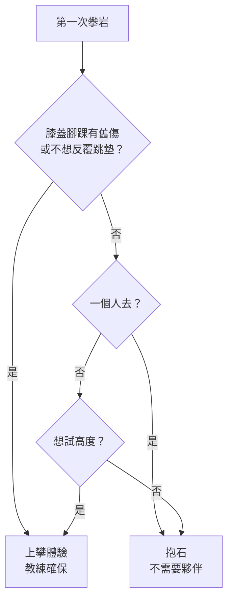

> 🌏 [English version](/posts/climbing/2026-10-08-climbing-beginner-guide-en)

第一次走進岩館的人，通常卡在同一個地方：牆上五顏六色的岩點、有人綁繩有人沒綁、標籤上寫著 V2 或 5.9，不知道自己該排哪一面牆。這篇把攀岩拆成幾個你馬上會遇到的選擇：有哪幾種爬法、難度怎麼看、第一次要花多少錢、會不會受傷。

## 攀岩是什麼

攀岩是用手腳沿著岩壁或人工牆往上爬的運動。牆上每一條設定好的路徑叫「路線」，抱石的路線習慣叫「題目」（problem）。目標是照著指定的岩點從起點爬到終點，中途不掉下來。

它在 2020 東京奧運第一次列入比賽。依 [World Climbing 的 LA28 頁面](https://www.worldclimbing.com/olympics/2028-los-angeles)，奧運攀岩金牌數從東京的 2 面、巴黎的 4 面，增加到 2028 洛杉磯的 6 面；[LA28 官方新聞稿](https://la28.org/en/newsroom/los-angeles-2028-medal-event-program-and-athlete-quota.html)的說法是把原本合併的抱石與先鋒拆開，變成「three distinct medal events: speed, boulder and lead」。這三項剛好對應一般人在岩館會看到的三種牆。

## 適合誰

不需要先有運動習慣，也不需要先練臂力。[REI 的室內攀岩入門](https://www.rei.com/learn/expert-advice/indoor-climbing.html)給新手的第一批提醒裡有一句：「Remember that your legs are stronger than your arms」——腿比手有力，初學階段多半是腳沒踩好，不是手不夠壯。

兩種人要多想一下：

- **膝蓋或腳踝有舊傷、年紀較長**：抱石每一趟都要跳回軟墊。[原岩攀岩館的體驗說明](https://www.tup-goclimb.tw/)直接寫「抱石需從牆上跳落回地面軟墊，膝蓋需承受較大負擔，因此年長者建議選擇上攀體驗」。
- **怕高**：抱石牆只有三、四公尺，上攀有八到十公尺，但上攀全程有繩子拉著。怕的是「高度」選抱石，怕的是「掉下去」選上攀。

## 五種爬法一次看

室內岩館有三種，戶外再多兩種。差別在「用不用繩」和「保護點是誰放的」。

| 爬法 | 繩索 | 高度 | 需要夥伴 | 新手門檻 |
|---|---|---|---|---|
| 抱石（bouldering） | 不用，地上鋪厚墊 | 約 4 公尺 | 不用 | 最低，租鞋就能爬 |
| 上方確保（top-rope，俗稱上攀） | 繩子預先掛在牆頂 | 岩館約 8–10 公尺 | 要確保者，或用自動確保器 | 低，體驗課由教練確保 |
| 先鋒（lead） | 邊爬邊把繩子扣進快扣 | 比賽牆 15 公尺 | 要確保者 | 先把上攀爬熟再學 |
| 運動攀登（sport） | 同先鋒，岩壁上有預先打好的固定點 | 依岩場 | 要確保者 | 先會室內先鋒 |
| 傳統攀登（trad） | 自己在岩縫放置、回收保護裝備 | 依岩場 | 要確保者 | 最高，需完整訓練 |

室內三種的定義出自上面那篇 REI 文章：抱石「Requiring neither a harness nor a rope」；上方確保是繩子固定在頭頂的錨點；先鋒則是墜落時會掉回上一個扣好的點，「a farther, harder fall than you'd have when top-roping」。同一篇也說，室內先鋒和戶外的運動攀登很像，差別是室內的快扣已經掛好。[REI 的攀岩入門](https://www.rei.com/learn/expert-advice/getting-started-rock-climbing.html)建議新手從上方確保或抱石開始，先鋒與傳統攀登留到後面。

比賽項目是同一批爬法的競技版。依 World Climbing 的規則頁，[抱石賽](https://www.worldclimbing.com/boulder/index)在 4 公尺高的牆上比誰用最少次嘗試解開最多題；[先鋒賽](https://www.worldclimbing.com/lead/index)在 15 公尺的牆上限時 6 分鐘，比誰爬得高；[速度賽](https://www.worldclimbing.com/speed/index)是兩人在固定不變的 15 公尺標準路線上比誰先拍到頂。

## 難度怎麼讀

路線旁的數字是難度，抱石和繩索攀登用兩套不同的系統。以下依 [REI 的難度系統說明](https://www.rei.com/learn/expert-advice/climbing-bouldering-rating.html)：

- **抱石用 V 級**：從 V0 起跳、數字越大越難，量表沒有上限，V0 之前還有給初學者的 VB。[REI 的抱石入門](https://www.rei.com/learn/expert-advice/bouldering.html)寫目前最難到 V17，而且只有少數幾題。名稱來自 John "Vermin" Sherman，他和朋友在德州 Hueco Tanks 替題目分級。歐洲的抱石場會看到另一套 Font 級。
- **繩索攀登用優勝美地十進制（YDS）**：技術攀登落在 5.0 到 5.15，小數點後的數字越大越難；5.10 以上再用 a、b、c、d 細分，5.10a 比 5.10d 簡單。REI 的室內攀岩文章提到多數新手從 5.3 到 5.5 起步。

難度是參考值。REI 的原話是「Ratings are guidelines, not Gospel」，同一個數字換一間岩館、換到戶外，體感都會不同。進新的岩館先問櫃檯這裡的標示偏鬆還是偏緊，從最低兩級開始爬。

## 第一次去岩館：以原岩為例

用台北的[原岩攀岩館](https://www.tup-goclimb.tw/)當實際例子，價格為 2026-10-08 查詢官網所得，其他岩館與分店各有不同。

**報體驗**：抱石體驗單人 NT$1,200，40 分鐘；上攀體驗單人 NT$1,500，中和店與新店店為 1 小時。依[萬華店價目表](https://tupclimbing.tw/pricing/84)，體驗費用「包含入場費、教練、攀岩裝備租用」，並送一張免費入場券。官網預約需在 3 天前。

**自己入場**：萬華店成人平日全天 NT$450、假日 NT$500，岩鞋租借 NT$100、粉袋 NT$80，租鞋要穿襪子。算下來一次約 NT$630–680。

官網對「一定要報體驗嗎」的回答是不一定，但教練會教基礎技巧，也會提醒安全事項。沒有熟人帶的話，第一次花體驗的錢，買到的是「怎麼掉下來」這一課。

要帶的東西很少：

- 好活動、不怕磨也不怕沾粉的衣褲（REI 的建議是有彈性、寬鬆但不會勾到岩點）
- 一雙襪子（租岩鞋用）
- 水

岩鞋、粉袋、吊帶都先用租的。REI 的說法是前幾次先弄清楚岩館提供和出租什麼，確定會繼續爬再買自己的。

## 會不會受傷

室內攀岩的急性受傷率很低，但數字背後有但書。

Schöffl 等人的[前瞻性研究](http://paci.com.au/downloads_public/risk/Risk_indoor-climbing_2013.pdf)，在德國斯圖加特一間同時有抱石與先鋒牆的岩館記錄了五年、515,337 人次入館，結論是「The overall injury rate was 0.02 injuries per 1000 hours of climbing activities」，期間沒有死亡個案。

這個數字要搭配三件事一起讀：

1. **只算需要現場醫療處置的急性傷害**。論文明寫慢性過度使用的傷害不在分析範圍。REI 的抱石入門則提醒，有經驗的抱石者會傷到腳踝，也會拉傷手臂、肩膀和手指肌腱。
2. **只有一間岩館**。作者自己在結論列為限制：這間岩館可能管理得特別好，安全紀錄優於其他場館。
3. **受傷的原因很集中**。30 件傷害裡最常見的原因是確保失誤，占 10 件；抱石的傷害則大多來自摔到墊子上。

換成今晚就能做的動作：

- **抱石**：先暖身，上牆前請教練或櫃檯示範一次怎麼落地。原岩的抱石課程把「安全墜落姿勢教學」排在課程內容的最前面。爬到頂之後能爬下來就爬下來，少從最高點往下跳。
- **繩索攀登**：每次離地前做一次夥伴互檢。論文引用德國山岳協會的四步驟：吊帶扣環是否鎖好、對方的繩結、確保器與有鎖鉤環是否正確鎖上、繩尾是否打結。兩個人都要檢查對方。
- **手指**：手指或手肘痛就停，當天不要硬撐完最後一題。

## 走到戶外之前

室內爬熟了，多數人會想去真的岩壁。台灣最具代表性的是東北角的[龍洞岩場](https://www.necoast-nsa.gov.tw/Attraction-Content.aspx?a=186&l=1)，東北角風景區管理處的介紹稱它是「全台灣最大最棒的天然岩場」，岩壁由四稜砂岩構成，全年開放、不收費。依[中文維基百科](https://zh.wikipedia.org/zh-hant/%E9%BE%8D%E6%B4%9E%E6%94%80%E5%B2%A9%E5%A0%B4)引述《台灣龍洞攀岩指南》的整理，龍洞分九區、約 600 條路線，難度從 5.4 到 5.14a，傳統攀登與運動攀登都有。

戶外和室內是兩回事。REI 的說法很直接：要從室內轉到戶外，「you absolutely need to go with a certified guide or instructor」。REI 的攀岩入門列了幾個差別：戶外沒有預先設定、用顏色標好的路線，上方確保的固定點要由有經驗的人架設，還多了落石這類風險。第一次去龍洞，請跟有帶戶外課程的岩館或教練去。

另外留意季節。管理處在同一頁提醒：東北季風盛行的 10 月到 3 月容易有長浪，請勿前往海邊活動。龍洞的岩壁就在海邊，秋冬去之前先看浪況。

## 參考資料

- [LA28 Reveals Medal Event Program and Athlete Quota（LA28 官方新聞稿）](https://la28.org/en/newsroom/los-angeles-2028-medal-event-program-and-athlete-quota.html)
- [Olympic Games LA28（World Climbing）](https://www.worldclimbing.com/olympics/2028-los-angeles)
- [Boulder 規則說明（World Climbing）](https://www.worldclimbing.com/boulder/index)
- [Lead 規則說明（World Climbing）](https://www.worldclimbing.com/lead/index)
- [Speed 規則說明（World Climbing）](https://www.worldclimbing.com/speed/index)
- [Gym Climbing Basics: Indoor Climbing for Beginners（REI Expert Advice）](https://www.rei.com/learn/expert-advice/indoor-climbing.html)
- [Climbing and Bouldering Rating Systems（REI Expert Advice）](https://www.rei.com/learn/expert-advice/climbing-bouldering-rating.html)
- [How to Boulder: Bouldering Basics（REI Expert Advice）](https://www.rei.com/learn/expert-advice/bouldering.html)
- [Rock Climbing Basics: Getting Started（REI Expert Advice）](https://www.rei.com/learn/expert-advice/getting-started-rock-climbing.html)
- [Schöffl, Hoffmann, Küpper：Acute Injury Risk and Severity in Indoor Climbing（2013）](http://paci.com.au/downloads_public/risk/Risk_indoor-climbing_2013.pdf)
- [原岩攀岩館體驗預約](https://www.tup-goclimb.tw/)
- [原岩萬華店價目表](https://tupclimbing.tw/pricing/84)
- [龍洞岩場（東北角及宜蘭海岸國家風景區觀光資訊網）](https://www.necoast-nsa.gov.tw/Attraction-Content.aspx?a=186&l=1)
- [龍洞攀岩場（中文維基百科）](https://zh.wikipedia.org/zh-hant/%E9%BE%8D%E6%B4%9E%E6%94%80%E5%B2%A9%E5%A0%B4)
- [攀岩書籍知識版圖：60+ 本書的完整導覽](/posts/climbing/2026-06-20-climbing-books-knowledge-map)
