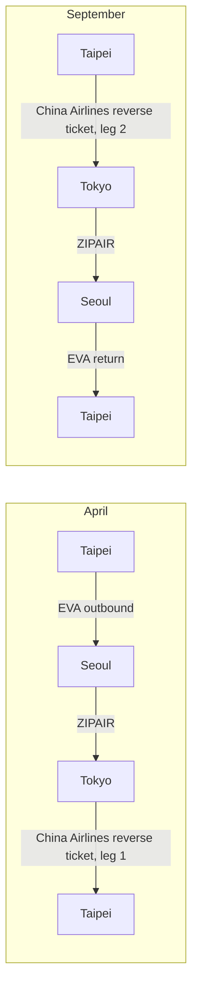

> 🌏 [中文版](/posts/climbing/2026-10-08-seoul-tokyo-climbing-trip-april)

In 2027 Taiwan's Children's Day and Tomb Sweeping holiday runs four days, from Saturday 4/3 to Tuesday 4/6. Add a few days of leave on either side and it becomes a 14-day trip: the first half on the granite multi-pitch of Bukhansan in Seoul, the second half at the crags around Tokyo, then home from Tokyo. This post covers three things: how to buy the flights cheaply, which crags you can really get to in early April, and how to buy two trips together if you plan to go again in September.

Fares were checked on 2026-10-07 for one adult, tax included, economy, and will change. Conversions use NT$1 ≈ ¥5 ≈ ₩44.6.

## The short answer

| Item | Detail | Price |
|---|---|---|
| Dates | Wed 3/31 – Tue 4/13, 14 days, 8 days of leave | — |
| Out and back | EVA Air open-jaw: Songshan 15:45→Gimpo 19:15, Haneda 10:50 or 12:40→Songshan | [NT$15,994](https://www.tw.kayak.com/flights/TSA-GMP/2027-03-31/HND-TSA/2027-04-13?sort=price_a&fs=stops=0) |
| Middle leg (cheaper) | ZIPAIR Incheon 12:55→Narita, one prepaid checked bag | NT$4,257 |
| Middle leg (faster) | Japan Airlines Gimpo→Haneda 08:00 or 19:15, bag included | [NT$8,892](https://www.google.com/travel/flights?q=Flights%20from%20GMP%20to%20HND%20on%202027-04-06%20one%20way&hl=zh-TW&curr=TWD) |

Counting airport transfers at both ends of the middle leg, the whole trip is about NT$21,060 with ZIPAIR and about NT$24,990 with Japan Airlines.

The leave works out like this: of the 14 days, four are the holiday and two are the 4/10–4/11 weekend, leaving eight days to take off (3/31, 4/1, 4/2, 4/7, 4/8, 4/9, 4/12, 4/13). Japan's Golden Week is 4/29 to 5/5, so there is no overlap.

## Flights: an open-jaw plus one middle leg

The frame is an **open-jaw ticket**: Taipei to Seoul out, Tokyo to Taipei back, with the Seoul–Tokyo leg bought separately.

**Which open-jaw to pick.** The cheapest for [these dates](https://www.tw.kayak.com/flights/TPE-SEL/2027-03-31/TYO-TPE/2027-04-13?sort=price_a&fs=airlines=BR,CI,JX,KE,OZ;stops=0) is China Airlines, Taoyuan→Incheon and Narita→Taoyuan, at NT$14,593. EVA Air's Songshan→Gimpo and Haneda→Songshan costs NT$1,401 more and buys you Songshan, Gimpo, and Haneda, all close to their city centers. Shifting the dates a few days either way changes little, but cutting the trip to ten days, 4/2 to 4/11, pushes the fare to NT$21,678.

Korean Air and Asiana have no nonstop from Tokyo to Taipei, and STARLUX serves only Busan in Korea, so none of the three can build this open-jaw. Korean Air and Asiana are also merging and [will operate under the Korean Air brand from 2026/12/17](https://www.koreatimes.co.kr/business/companies/20260812/korean-air-asiana-merger-enters-final-phase).

**Choosing the middle leg.** Only four airlines fly Gimpo–Haneda (Korean Air, Asiana, Japan Airlines, All Nippon Airways), and none is a low-cost carrier. The cheap option is Incheon to Narita:

| Option | Fare | Checked bag | Airport transfers, both ends | Total |
|---|---|---|---|---|
| Japan Airlines Gimpo→Haneda | NT$8,892 | Included | Subway + Keikyu, about NT$100 | NT$8,993 |
| Korean Air Incheon→Narita | NT$7,135 | Included | AREX + Skyliner, about NT$807 | NT$7,942 |
| ZIPAIR Incheon→Narita | NT$3,404 | ₩38,100 (about NT$853) | About NT$807 | NT$5,064 |

ZIPAIR saves about NT$3,900 over Japan Airlines. The cost is about 50 more minutes of ground travel across the two ends: Gimpo to Jongno is about 20 minutes by subway and Haneda to Shinagawa about 13, while the AREX express from Seoul Station to Incheon takes 43 minutes and the Skyliner from Narita to Ueno about 41.

**Checked bags.** [EVA Air's](https://www.evaair.com/zh-tw/plan-and-book/fare-family/introducing-fare-family/) Discount and Basic fares on short-haul Asian routes include one 23 kg bag, and two bags start at Standard. [ZIPAIR](https://www.zipair.net/en/service/baggage) includes none. A prepaid bag from Seoul to Narita is ₩38,100 online, up to 30 kg. Its special sports-equipment rules cover only bicycles, golf bags, snowboards, and surfboards, so climbing gear counts as ordinary checked baggage. Put carabiners and quickdraws in the checked bag.

**A flight to avoid.** Tigerair's 05:25 from Haneda to Taoyuan is only NT$3,677, but the first Keikyu train from Shinagawa to Haneda leaves at 05:15, too late to make it.

## Seoul: granite multi-pitch on Bukhansan

| Venue | What it is | Getting there |
|---|---|---|
| Insubong (인수봉) | Granite rising more than 200 m above the slope, multi-pitch routes of 1 to 8 pitches, mostly slab and crack; classic routes are crowded at weekends | Ui–Sinseol line to Bukhansan Ui station, then about 1 km on foot to the Doseonsa trailhead |
| Seoninbong, Dobongsan (선인봉) | Granite multi-pitch, 4 to 6 pitches, 5.7 to 5.12; quieter than Insubong; a full rack of cams is recommended | Subway Line 1 to Dobong station, then a taxi |
| The Climb | Seoul's largest gym chain, with branches in Hongdae, Gangnam, Yangjae, Magok and elsewhere on one membership | In the city |

Insubong details come from [theCrag](https://www.thecrag.com/en/climbing/south-korea/insubong/route/272143716) and [Seoul Tourism's Bukhansan guide](https://www.seoultourism.org/bukhansan-hiking-guide/), and Seoninbong from [Mountain Project](https://mountainproject.com/area/119848026/senin-bong-dobongsan?print=1). Climbing on Bukhansan needs no advance registration. That comes from my own visits; I did not look for an official source.

The plan for the seven days in Seoul is three to four days on Insubong, one on Dobongsan, and one or two for rest or a gym.

**One entry point to watch.** The K-ETA exemption for Taiwanese visitors [runs only through 2026/12/31](https://creatrip.com/blog/10447). Whether it will be extended into 2027 has not been announced, so check again early in the year.

## Around Tokyo: crags you can reach by train in early April

Kanto has many crags, but an early-April visit has to clear three checks: whether public transport gets there, whether the mountain roads and campsites have opened, and whether climbing is allowed at all.

### Worth putting on the schedule

| Crag | Rock and routes | Public transport | Notes |
|---|---|---|---|
| Mitake (Tokyo) | Chert; riverbed bouldering on the Tama River, 271 problems | JR Ome Line to Mitake station, then down to the river; about 1.5 hours from Shinjuku | Bouldering only, so you need a pad |
| Tennoiwa (Tokyo) | Chert; about 50 routes, 5.7–5.12, good for beginners | Bus from Musashi-Itsukaichi station to Sorigobashi, then a 5-minute walk | Heavy shade; takes days to dry after rain |
| Gozen-iwa (Okutama) | Limestone; 57 routes, 6b–9b, mostly intermediate to advanced | Bus from Okutama station to Osawa, then about 10 minutes across the bridge | Register at the Okutama climbing center first and pay ¥500 |
| Kawamata (Saitama) | Limestone; 101 routes, 5.2–5.13b, season includes March–June | About 45 minutes by bus from Hanno station to Kawamata Naguriko Iriguchi, then a 20-minute walk | Two sources disagree on whether the main wall, Komori-iwa, may be climbed |
| Futagoyama (Chichibu) | Limestone; walls 40–50 m high, about 160 routes mostly 5.11 and up, season March–November | No public transport information I could verify | Check the Ogano climbing association's notices before going |
| Yugawara Makuiwa (Kanagawa) | Andesite; mostly 5.9–5.11 | About 15 minutes by bus from JR Yugawara station to Makuyama Park | Winter is peak season; too hot in summer |
| Joyama (Izu) | Tuff; more than 300 routes, 5.7–5.14, single and multi-pitch | 25-minute walk from Ohito station on the Izuhakone Railway | Many routes face south |
| Mitsutoge Byobu-iwa (Yamanashi) | Agglomerate; many easy multi-pitch routes | About 30 minutes by bus from Kawaguchiko station, then a 100–120 minute walk | The bridge before the wall is at risk of collapse and must be bypassed |

Route counts are from the area pages on [ROCKTOPO](https://www.rocktopo.net/) and transport from the crag pages on [CLIMBING-net](https://www.climbing-net.com/iwaba/). These two sites are the main databases for Japanese crags, and the latter covers every crag in the guidebook series *Nihon 100 Iwaba*. I did not find bus frequencies, so check current timetables before you leave.

I am bringing a rope, quickdraws, shoes, and a harness but no bouldering pad, so Mitake will not make my own schedule.

### Not yet open in early April

| Crag | Status |
|---|---|
| Mizugaki (Yamanashi) | A famous granite area. [ROCKTOPO](https://www.rocktopo.net/areas/5) gives the season as April–November, but the road into the nature park is closed in winter, and sources give both "mid-April" and "late April" for reopening. In 2026 the trailhead bus started running on 4/4; 2027 dates are not out |
| Ogawayama (Nagano) | Granite; the campsite sits at about 1,600 m and [opens in late April](https://mawarime-daira.com/mawarime-daira-camp/) |
| Kofu Makuiwa (Yamanashi) | The forest road is closed in winter until mid-April, and I found no public transport at all |

If Japanese granite is the goal, this trip is timed wrong. Wait until after late April, or go in autumn.

### Closed to climbing or under special rules

| Crag | Status |
|---|---|
| Hiwadayama (Saitama) | The [Hidaka city website](https://www.city.hidaka.lg.jp/soshiki/shiminseikatsu/kankyo/seikatsukankyo/kankyohozen/27182.html) says fatal climbing accidents have occurred on Otoko-iwa and Onna-iwa and tells people never to climb there |
| Takatoriyama (Kanagawa) | The walls are closed to the general public; climbers must first register with the Takatoriyama safe-climbing council |
| Shirotae-bashi (Okutama) | The Japan Free Climbing Association has asked climbers to stay away voluntarily since 2007; I could not find the current status |
| Parking opposite Tennoiwa | The Akigawa trout-fishing car park no longer admits climbers; drivers must park at Jurigi and walk about 30 minutes |
| Kogashiyama (Tochigi) | By agreement with the landowner: stay out of the Medaki area, cut no trees, light no fires, always wear a helmet |

Older sources often describe Hiwadayama as a beginners' practice crag. The first draft of my own notes did too, until I read the city's page. Mitake's rock type is another common error: it is chert, though it is frequently called granite.

**Is Jogasaki worth it?** [Mountain Project](https://mountainproject.com/area/107001454/jogasaki) describes about 500 routes on dark, mostly south-facing rock that is best in the colder months, with a season starting in November. Bolts by the sea rust quickly and should be checked before use. April is out of season.

### Rainy days and rest days

Tokyo has plenty of gyms. The [PUMP chain](https://pump-climbing.com/) says it has seven gyms across greater Tokyo and Osaka. B-PUMP Akihabara and Ogikubo are bouldering gyms, and the Kawaguchi and Kawasaki gyms have both bouldering and roped climbing. If you have registered at another PUMP branch, the first-visit fee at Ogikubo drops from ¥2,200 to ¥1,100. The four former T-WALL gyms were taken over by Base Camp and reopened under the new name in late 2023.

### The seven days in Tokyo

Fly to Tokyo on 4/6 or 4/7 and stay in Kanto from 4/7 to 4/13. Tennoiwa, Kawamata, Yugawara, and Joyama are convenient by train, as are Gozen-iwa, where routes start at 6b, and Futagoyama, which is mostly 5.11 and up. Kofu Makuiwa and Komochiyama in Gunma are only practical with a car.

## Going again in September: buy it with a reverse ticket

If you plan a second Japan–Korea trip in September, the two trips can form a loop: Taipei→Seoul→Tokyo→Taipei in April, then Taipei→Tokyo→Seoul→Taipei in September.

That breaks down into three kinds of ticket:

| Ticket | Detail | Price |
|---|---|---|
| Return from Taiwan | EVA Air Taoyuan⇄Incheon, out 3/31, back 9/19 | [NT$10,994](https://www.tw.kayak.com/flights/TPE-SEL/2027-03-31/2027-09-19?sort=price_a&fs=airlines=BR,CI,KE,OZ;stops=0) |
| Reverse ticket from Tokyo | China Airlines Haneda⇄Songshan, to Taipei 4/13, back to Tokyo 9/10 | [NT$12,111](https://www.tw.kayak.com/flights/HND-TSA/2027-04-13/2027-09-10?sort=price_a&fs=stops=0) |
| Two middle legs | ZIPAIR Seoul→Tokyo (April) and Tokyo→Seoul (September), one bag each | NT$4,257 + NT$4,507 |

The four items add up to NT$31,869, with checked bags on both trips. For comparison, putting all four long legs on a single ticket costs [NT$49,787](https://www.tw.kayak.com/flights/TSA-GMP/2027-03-31/HND-TSA/2027-04-13/TSA-HND/2027-09-10/HND-TSA/2027-09-19?sort=price_a&fs=stops=0). Switching to low-cost carriers throughout (Scoot out, Eastar Jet back) brings it down to NT$29,308, but the return bag allowance is only 15 kg and I could not verify Eastar's bag fee on Taiwan routes.

Low-cost carriers give no discount for a return: two Tigerair one-ways between Tokyo and Taipei total NT$7,762, against NT$7,744 for the return. The saving from a reverse ticket only appears on full-service airlines.

Confirm two rules before buying:

1. **Segments must be flown in order.** [EVA Air's conditions of carriage](https://www.evaair.com/zh-tw/website-disclaimer/conditions-of-carriage/default.html) state in 3.3.1 that coupons are accepted only in sequence, and in 3.3.2 that a ticket becomes invalid if the first international coupon is unused and travel starts elsewhere. I did not check China Airlines' conditions.
2. **Maximum stay.** Neither airline's fare-family table lists a maximum stay. KAYAK returns a price for both of these five-month date pairs, so at least one fare class allows it, though not necessarily the cheapest. Look for "Maximum stay" in the fare rules when booking.

In September you can build around Mid-Autumn Festival (Wednesday 9/15) and travel from the evening of 9/10 to 9/19, or around Teachers' Day (Tuesday 9/28) and travel from the evening of 9/24 to 10/3. Either takes four days of leave. Flights for the October National Day and Retrocession Day weekends were not yet on sale when I checked.

## What is still unconfirmed

- Maximum stay and change fees on the EVA Air and China Airlines tickets, to be read in the fare rules at booking.
- Eastar Jet's bag fee for promotional fares on Taiwan routes.
- Airport security rules on carabiners in Japan and Korea, which I could not find; check them in.
- Whether the K-ETA exemption continues in 2027.
- The 2027 road-opening and bus dates for Mizugaki.

## References

- [KAYAK: Songshan→Gimpo, Haneda→Songshan open-jaw, 3/31–4/13](https://www.tw.kayak.com/flights/TSA-GMP/2027-03-31/HND-TSA/2027-04-13?sort=price_a&fs=stops=0)
- [KAYAK: Taipei→Seoul, Tokyo→Taipei open-jaw, 3/31–4/13](https://www.tw.kayak.com/flights/TPE-SEL/2027-03-31/TYO-TPE/2027-04-13?sort=price_a&fs=airlines=BR,CI,JX,KE,OZ;stops=0)
- [Google Flights: Gimpo→Haneda, 4/6](https://www.google.com/travel/flights?q=Flights%20from%20GMP%20to%20HND%20on%202027-04-06%20one%20way&hl=zh-TW&curr=TWD)
- [EVA Air: fare families (in Chinese)](https://www.evaair.com/zh-tw/plan-and-book/fare-family/introducing-fare-family/)
- [EVA Air: conditions of carriage (in Chinese)](https://www.evaair.com/zh-tw/website-disclaimer/conditions-of-carriage/default.html)
- [ZIPAIR: baggage](https://www.zipair.net/en/service/baggage)
- [Korea Times: Korean Air–Asiana merger enters final phase](https://www.koreatimes.co.kr/business/companies/20260812/korean-air-asiana-merger-enters-final-phase)
- [Creatrip: K-ETA exemption period (in Chinese)](https://creatrip.com/blog/10447)
- [theCrag: Insubong](https://www.thecrag.com/en/climbing/south-korea/insubong/route/272143716)
- [Seoul Tourism: Bukhansan hiking guide](https://www.seoultourism.org/bukhansan-hiking-guide/)
- [Mountain Project: Seoninbong, Dobongsan](https://mountainproject.com/area/119848026/senin-bong-dobongsan?print=1)
- [ROCKTOPO (in Japanese)](https://www.rocktopo.net/)
- [ROCKTOPO: Mizugaki (in Japanese)](https://www.rocktopo.net/areas/5)
- [CLIMBING-net: crag database (in Japanese)](https://www.climbing-net.com/iwaba/)
- [Mawarime-daira campsite, Ogawayama (in Japanese)](https://mawarime-daira.com/mawarime-daira-camp/)
- [Hidaka City: notice on the Hiwadayama crags (in Japanese)](https://www.city.hidaka.lg.jp/soshiki/shiminseikatsu/kankyo/seikatsukankyo/kankyohozen/27182.html)
- [Mountain Project: Jogasaki](https://mountainproject.com/area/107001454/jogasaki)
- [PUMP Climbing (in Japanese)](https://pump-climbing.com/)
- [KAYAK: EVA Air Taoyuan⇄Incheon, 3/31–9/19](https://www.tw.kayak.com/flights/TPE-SEL/2027-03-31/2027-09-19?sort=price_a&fs=airlines=BR,CI,KE,OZ;stops=0)
- [KAYAK: China Airlines Haneda⇄Songshan, 4/13–9/10](https://www.tw.kayak.com/flights/HND-TSA/2027-04-13/2027-09-10?sort=price_a&fs=stops=0)
