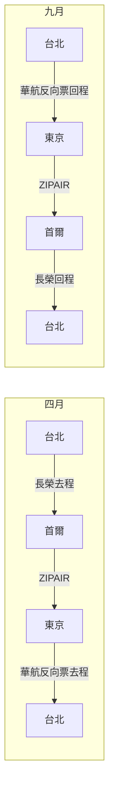

> 🌏 [English version](/posts/climbing/2026-10-08-seoul-tokyo-climbing-trip-april-en)

2027 年的兒童節加清明連假是 4/3（六）到 4/6（二）四天。往前後各請幾天假，可以排出一趟 14 天的行程：前半在首爾爬北漢山的花崗岩多段，後半飛東京爬關東周邊的岩場，最後從東京回台北。這篇整理三件事：機票怎麼買最划算、4 月初哪些岩場真的能去、以及如果 9 月還想再去一次，兩趟怎麼合買。

票價都是 2026-10-07 查詢，一位成人、含稅、經濟艙，會隨時間變動。換算用 1 台幣約 5 日圓、約 44.6 韓元。

## 結論

| 項目 | 內容 | 價格 |
|---|---|---|
| 日期 | 3/31（三）–4/13（二），14 天，請 8 天假 | — |
| 去回程 | 長榮開口票：松山 15:45→金浦 19:15，羽田 10:50 或 12:40→松山 | [NT$15,994](https://www.tw.kayak.com/flights/TSA-GMP/2027-03-31/HND-TSA/2027-04-13?sort=price_a&fs=stops=0) |
| 中段（省錢） | ZIPAIR 仁川 12:55→成田，預購一件託運 | NT$4,257 |
| 中段（省時） | 日航 金浦→羽田 08:00 或 19:15，含託運 | [NT$8,892](https://www.google.com/travel/flights?q=Flights%20from%20GMP%20to%20HND%20on%202027-04-06%20one%20way&hl=zh-TW&curr=TWD) |

把中段兩端的機場交通算進去，搭 ZIPAIR 全程約 NT$21,060，搭日航約 NT$24,990。

請假的算法：14 天扣掉清明連假四天和 4/10、4/11 週末，要請 3/31、4/1、4/2、4/7、4/8、4/9、4/12、4/13 共 8 天。日本黃金週是 4/29 到 5/5，不會撞到。

## 機票：開口票加一段中段

骨架是一張**開口票**：去程台北飛首爾，回程東京飛台北，中間首爾到東京那一段另外買。

**開口票挑哪一張。** [同一組日期](https://www.tw.kayak.com/flights/TPE-SEL/2027-03-31/TYO-TPE/2027-04-13?sort=price_a&fs=airlines=BR,CI,JX,KE,OZ;stops=0)最便宜的是華航桃園→仁川、成田→桃園 NT$14,593。長榮松山→金浦、羽田→松山貴 NT$1,401，換到的是松山、金浦、羽田這三個離市區近的機場。日期往前後挪幾天價差不大，但縮成 4/2 到 4/11 的 10 天行程會跳到 NT$21,678。

大韓和韓亞沒有東京直飛台北，星宇在韓國只飛釜山，這三家都組不出開口票。另外大韓與韓亞正在合併，[2026/12/17 起以大韓品牌營運](https://www.koreatimes.co.kr/business/companies/20260812/korean-air-asiana-merger-enters-final-phase)。

**中段怎麼選。** 金浦到羽田只有大韓、韓亞、日航、全日空四家在飛，沒有廉航。要便宜就得走仁川到成田：

| 方案 | 機票 | 託運 | 兩端機場交通 | 合計 |
|---|---|---|---|---|
| 日航 金浦→羽田 | NT$8,892 | 含 | 地鐵＋京急，約 NT$100 | NT$8,993 |
| 大韓 仁川→成田 | NT$7,135 | 含 | 機場快線＋Skyliner，約 NT$807 | NT$7,942 |
| ZIPAIR 仁川→成田 | NT$3,404 | ₩38,100（約 NT$853） | 約 NT$807 | NT$5,064 |

ZIPAIR 比日航省約 NT$3,900，代價是兩端的車程合計多約 50 分鐘：金浦到鍾路搭地鐵約 20 分鐘、羽田到品川約 13 分鐘；首爾站到仁川的直達車要 43 分鐘、成田到上野的 Skyliner 約 41 分鐘。

**託運行李。** [長榮](https://www.evaair.com/zh-tw/plan-and-book/fare-family/introducing-fare-family/)亞洲短程線的輕省、基本票種是 1 件 23 公斤，經典以上才有 2 件。[ZIPAIR](https://www.zipair.net/en/service/baggage) 不含託運，首爾飛成田網路預購每件 ₩38,100、上限 30 公斤；它的運動器材特別規定只列了自行車、高爾夫、雪板、衝浪板，攀岩裝備以一般託運行李計。鉤環和快扣建議放託運。

**不要買的班次。** 虎航羽田 05:25 回桃園只要 NT$3,677，但京急從品川往羽田的首班車 05:15 才發車，搭不上。

## 首爾：北漢山的花崗岩多段

| 地點 | 內容 | 交通 |
|---|---|---|
| 仁壽峰（인수봉） | 花崗岩，高出山坡 200 公尺以上，1 到 8 段的多段路線，以斜板和裂隙為主；週末經典路線人很多 | 牛耳新設線到北漢山牛耳站，走約 1 公里到道詵寺登山口 |
| 道峰山仙人峰（선인봉） | 花崗岩多段 4 到 6 段，5.7 到 5.12；人比仁壽峰少；建議帶整套 cam | 地鐵 1 號線道峰站轉計程車 |
| The Climb | 首爾最大的連鎖岩館，弘大、江南、良才、麻谷等分店會員通用 | 市區 |

仁壽峰的資訊來自 [theCrag](https://www.thecrag.com/en/climbing/south-korea/insubong/route/272143716) 與 [Seoul Tourism 的北漢山指南](https://www.seoultourism.org/bukhansan-hiking-guide/)，仙人峰來自 [Mountain Project](https://mountainproject.com/area/119848026/senin-bong-dobongsan?print=1)。北漢山攀岩不需要事先登記，這一點是我自己去爬的經驗，沒有另外找官方來源。

首爾這七天的排法是仁壽峰 3 到 4 天、道峰山 1 天，剩下 1 到 2 天休息或去岩館。

**入境要注意一件事。** 台灣旅客免申請 K-ETA 的措施[只到 2026/12/31](https://creatrip.com/blog/10447)，2027 年是否延長還沒公布，年初要再查一次。

## 東京周邊：4 月初搭電車到得了的岩場

關東的岩場很多，但 4 月初去要過三關：大眾運輸到不到得了、山上的林道和營地開了沒、岩場本身准不准爬。

### 可以排進行程的

| 岩場 | 岩質與路線 | 大眾運輸 | 要注意 |
|---|---|---|---|
| 御岳（東京） | 燧石，多摩川河床抱石，271 題 | JR 青梅線御嶽站下到河原，新宿出發約 1.5 小時 | 只有抱石，要帶墊子 |
| 天王岩（東京） | 燧石，約 50 條、5.7–5.12，適合初學 | 武蔵五日市站搭巴士到「曽利郷橋」，走約 5 分鐘 | 樹蔭濃，雨後要乾好幾天 |
| 御前岩（奧多摩） | 石灰岩，57 條、6b–9b，中高階為主 | 奧多摩站搭巴士到「大沢」，過橋約 10 分鐘 | 先到奧多摩攀岩中心登記並付 ¥500 |
| 河又（埼玉） | 石灰岩，101 條、5.2–5.13b，適期含 3–6 月 | 飯能站搭巴士約 45 分鐘到「河又名栗湖入口」，走約 20 分鐘 | 主岩壁コウモリ岩能不能爬，兩個來源說法不同 |
| 二子山（秩父） | 石灰岩，牆高 40–50 公尺，約 160 條、多在 5.11 以上，適期 3–11 月 | 沒有查到可核對的大眾運輸資料 | 去之前看小鹿野攀岩協會的公告 |
| 湯河原幕岩（神奈川） | 安山岩，多為 5.9–5.11 | JR 湯河原站搭巴士約 15 分鐘到「幕山公園」 | 冬季是旺季，夏天太熱 |
| 城山（伊豆） | 凝灰岩，300 條以上、5.7–5.14，單段與多段都有 | 伊豆箱根鐵道大仁站走 25 分鐘 | 許多路線朝南 |
| 三ツ峠屏風岩（山梨） | 集塊岩，簡單的多段路線多 | 河口湖站搭巴士約 30 分鐘，再走 100–120 分鐘 | 屏風岩前的橋有崩塌風險，要繞道 |

路線數取自 [ROCKTOPO](https://www.rocktopo.net/) 各岩場頁，交通取自 [CLIMBING-net](https://www.climbing-net.com/iwaba/) 各岩場頁；這兩個站是查日本岩場最主要的資料庫，後者收錄了《日本100岩場》的全部岩場。巴士班次我沒有查到具體數量，出發前要自己看最新時刻表。

我這趟帶繩子、快扣、岩鞋和吊帶，不帶抱石墊，所以御岳實際上不會排。

### 4 月初還沒開的

| 岩場 | 狀況 |
|---|---|
| 瑞牆山（山梨） | 花崗岩名場。[ROCKTOPO](https://www.rocktopo.net/areas/5) 寫適期 4–11 月，但進自然公園的林道冬季封閉，解除時間有「4 月中旬」和「4 月下旬」兩種說法；2026 年的登山巴士 4/4 才開始行駛，2027 年還沒公告 |
| 小川山（長野） | 花崗岩，營地海拔約 1,600 公尺，[營地](https://mawarime-daira.com/mawarime-daira-camp/) 4 月下旬才開 |
| 甲府幕岩（山梨） | 林道冬季封閉到 4 月中旬，而且查不到任何大眾運輸 |

想爬日本花崗岩的話，這趟的時間點不對，要等 4 月下旬以後或秋天。

### 不能爬或有特別規定的

| 岩場 | 狀況 |
|---|---|
| 日和田山（埼玉） | [日高市官網](https://www.city.hidaka.lg.jp/soshiki/shiminseikatsu/kankyo/seikatsukankyo/kankyohozen/27182.html)寫男岩、女岩發生過攀岩死亡事故，絕對不要攀登 |
| 鷹取山（神奈川） | 一般人禁止攀登岩壁，要先向鷹取山安全登山協議會登錄 |
| 白妙橋（奧多摩） | 日本自由攀登協會 2007 年起呼籲自主停止使用，目前狀態沒查到 |
| 天王岩對面的停車場 | 秋川マス釣場的停車場已禁止攀岩者使用，開車要停十里木再走約 30 分鐘 |
| 古賀志山（栃木） | 和地主有約定：不進雌滝區、不砍樹、不生火、一定戴頭盔 |

日和田山常被舊資料寫成「初學者的練習岩場」，我自己的筆記第一版也這樣寫，查了市公所的頁面才改掉。同樣容易寫錯的還有御岳的岩質，它是燧石，不是花崗岩。

**城崎海岸（城ヶ崎）要不要去。** [Mountain Project](https://mountainproject.com/area/107001454/jogasaki) 寫這裡有約 500 條路線，岩石顏色深、多朝南，偏好較冷的月份，季節從 11 月開始；海邊的岩栓鏽得快，使用前要檢查。4 月去不算當季。

### 下雨天與休息日

東京的岩館選擇很多。[PUMP 連鎖](https://pump-climbing.com/)官網稱在首都圈與大阪共 7 家，B-PUMP 秋葉原、荻窪是抱石館，川口、川崎可以抱石也可以上攀；在其他分店註冊過，荻窪的首次入場費從 ¥2,200 降為 ¥1,100。原本的 T-WALL 四家分店已由 Base Camp 接手，2023 年底改名重新開幕。

### 東京這七天的排法

4/6 或 4/7 飛東京，4/7 到 4/13 留在關東。搭電車方便的是天王岩、河又、湯河原、城山，以及路線從 6b 起跳的御前岩、多在 5.11 以上的二子山。甲府幕岩、群馬的子持山要開車才實際。

## 9 月還想再去：和反向票一起買

如果 9 月打算再去一次日韓，兩趟可以拼成一個環：4 月走台北→首爾→東京→台北，9 月反過來走台北→東京→首爾→台北。

拆開來是三種票：

| 票 | 內容 | 價格 |
|---|---|---|
| 台灣出發的來回票 | 長榮桃園⇄仁川，3/31 去、9/19 回 | [NT$10,994](https://www.tw.kayak.com/flights/TPE-SEL/2027-03-31/2027-09-19?sort=price_a&fs=airlines=BR,CI,KE,OZ;stops=0) |
| 東京出發的反向票 | 華航羽田⇄松山，4/13 回台、9/10 再去 | [NT$12,111](https://www.tw.kayak.com/flights/HND-TSA/2027-04-13/2027-09-10?sort=price_a&fs=stops=0) |
| 兩段中段 | ZIPAIR 首爾→東京（4 月）、東京→首爾（9 月），各含一件託運 | NT$4,257＋NT$4,507 |

四項相加是 NT$31,869，兩趟都含託運。對照組：把四段機票放在同一張票上要 [NT$49,787](https://www.tw.kayak.com/flights/TSA-GMP/2027-03-31/HND-TSA/2027-04-13/TSA-HND/2027-09-10/HND-TSA/2027-09-19?sort=price_a&fs=stops=0)。全部改搭廉航（酷航去、易斯達回）可以再壓到 NT$29,308，但回程行李只有 15 公斤，易斯達台灣線的加購價也沒查證到。

廉航的來回票沒有折扣：虎航東京到台北兩張單程加起來 NT$7,762，來回票 NT$7,744，幾乎一樣。所以反向票的好處只出現在全服務航空上。

買之前要確認兩條規則：

1. **要照順序搭。** [長榮運送條款](https://www.evaair.com/zh-tw/website-disclaimer/conditions-of-carriage/default.html) 3.3.1 寫只接受按機票行程依序搭乘，3.3.2 寫國際線第一段沒搭就從別的點開始，機票失效。華航的條款我沒有查證。
2. **最長停留。** 長榮、華航官網的票種總表都沒有列最長停留。KAYAK 對這兩組跨五個月的日期都報得出來回價，表示至少有一個票種允許，但不保證是最便宜的那個，訂票時要在票價規則裡看「Maximum stay」。

9 月可以配中秋（9/15 週三）排 9/10 晚上到 9/19，或配教師節（9/28 週二）排 9/24 晚上到 10/3，兩種都是請 4 天。10 月的國慶和光復節連假，查詢當下機票還沒開賣。

## 還沒查清楚的事

- 長榮、華航這兩張票的最長停留與改票費，要在訂票時看票價規則。
- 易斯達台灣航線促銷票的託運加購價。
- 日本、韓國機場安檢對鉤環的規定，沒有查到；先放託運。
- K-ETA 免申請 2027 年是否延長。
- 瑞牆山 2027 年的林道開放日與巴士行駛日。

## 參考資料

- [KAYAK：松山→金浦、羽田→松山開口票 3/31–4/13](https://www.tw.kayak.com/flights/TSA-GMP/2027-03-31/HND-TSA/2027-04-13?sort=price_a&fs=stops=0)
- [KAYAK：台北→首爾、東京→台北開口票 3/31–4/13](https://www.tw.kayak.com/flights/TPE-SEL/2027-03-31/TYO-TPE/2027-04-13?sort=price_a&fs=airlines=BR,CI,JX,KE,OZ;stops=0)
- [Google Flights：金浦→羽田 4/6](https://www.google.com/travel/flights?q=Flights%20from%20GMP%20to%20HND%20on%202027-04-06%20one%20way&hl=zh-TW&curr=TWD)
- [長榮航空：票價產品介紹](https://www.evaair.com/zh-tw/plan-and-book/fare-family/introducing-fare-family/)
- [長榮航空：運送條款](https://www.evaair.com/zh-tw/website-disclaimer/conditions-of-carriage/default.html)
- [ZIPAIR：行李規定](https://www.zipair.net/en/service/baggage)
- [Korea Times：大韓航空與韓亞航空合併進度](https://www.koreatimes.co.kr/business/companies/20260812/korean-air-asiana-merger-enters-final-phase)
- [Creatrip：K-ETA 免申請期限](https://creatrip.com/blog/10447)
- [theCrag：仁壽峰](https://www.thecrag.com/en/climbing/south-korea/insubong/route/272143716)
- [Seoul Tourism：北漢山健行指南](https://www.seoultourism.org/bukhansan-hiking-guide/)
- [Mountain Project：道峰山仙人峰](https://mountainproject.com/area/119848026/senin-bong-dobongsan?print=1)
- [ROCKTOPO](https://www.rocktopo.net/)
- [ROCKTOPO：瑞牆山](https://www.rocktopo.net/areas/5)
- [CLIMBING-net：岩場資料庫](https://www.climbing-net.com/iwaba/)
- [廻り目平營地（小川山）](https://mawarime-daira.com/mawarime-daira-camp/)
- [日高市：日和田山岩場注意事項](https://www.city.hidaka.lg.jp/soshiki/shiminseikatsu/kankyo/seikatsukankyo/kankyohozen/27182.html)
- [Mountain Project：城ヶ崎](https://mountainproject.com/area/107001454/jogasaki)
- [PUMP Climbing 官網](https://pump-climbing.com/)
- [KAYAK：長榮桃園⇄仁川 3/31–9/19](https://www.tw.kayak.com/flights/TPE-SEL/2027-03-31/2027-09-19?sort=price_a&fs=airlines=BR,CI,KE,OZ;stops=0)
- [KAYAK：華航羽田⇄松山 4/13–9/10](https://www.tw.kayak.com/flights/HND-TSA/2027-04-13/2027-09-10?sort=price_a&fs=stops=0)
