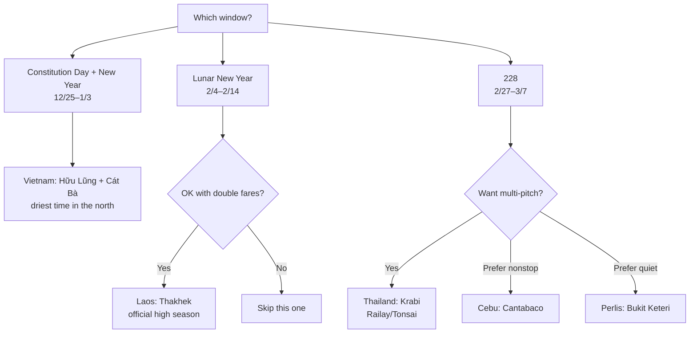

> 🌏 [中文版](/posts/climbing/2026-10-08-southeast-asia-climbing-holiday-windows)

Taiwan has three long weekends between late 2026 and early March 2027 that can be stretched into a climbing trip abroad: Constitution Day running into New Year, Lunar New Year, and the 228 Peace Memorial holiday. Most Southeast Asian limestone is in its dry season then, but the five countries differ a lot in rainfall, fares, and local holidays, and the same crag can cost twice as much to reach in a different window. This post works out which country fits which window, comparing season, airfare, entry rules, and bolt condition in Thailand, Vietnam, Malaysia, Laos, and the Philippines.

All fares were checked on 2026-10-07 for one adult, tax included, economy, return from Taipei, and exclude low-cost-carrier checked bags unless stated. Most prices were pulled automatically from KAYAK and Google Flights, so open the links and check again before booking.

## The short answer: where to go in each window

| Window | Dates and leave | Destination | Airfare (no bag) | Climbing days |
|---|---|---|---|---|
| Constitution Day + New Year | Fri 12/25 – Sun 1/3, 4 days of leave, 10 days off | Vietnam: Hữu Lũng + Cát Bà | VietJet NT$10,148; Vietnam Airlines NT$12,774 | About 7 |
| Lunar New Year | Thu 2/4 – Sun 2/14, 2 days of leave, 11 days off | Laos: Thakhek | About NT$20,689 total | 7 |
| 228 | Sat 2/27 – Sun 3/7, 4 days of leave, 9 days off | Thailand: Railay/Tonsai, Krabi | About NT$9,735 total | 5 full days + 2 half days |

If you only take two trips, take the first and the third. Lunar New Year is the most expensive window in all five countries, with fares roughly double the usual.

Taiwan's 2027 calendar has been [published by the Directorate-General of Personnel Administration](https://www.dgpa.gov.tw/information?uid=30&pid=12982). The Lunar New Year holiday runs seven days from 2/4 to 2/10, with New Year's Eve on 2/5 and New Year's Day on 2/6.

## The five countries side by side

| Country | Main area | Style | December–February | Getting there from Taipei | Entry (Taiwan passport) |
|---|---|---|---|---|---|
| Thailand | Railay/Tonsai, Krabi | Limestone sport, lots of multi-pitch | Dry season, though December is still wet | Fly to Bangkok and connect; overnight in Bangkok on the way out | Visa-free 30 days + TDAC |
| Vietnam | Hữu Lũng (Lạng Sơn), Cát Bà | Limestone sport, almost no multi-pitch | Low rainfall but frequent drizzle; December is driest | Nonstop to Hanoi, then 2 hours by car | E-visa, USD 25 |
| Malaysia | Bukit Keteri (Perlis), Batu Caves | Limestone sport, a few multi-pitch | Northwest coast is driest in January–February | Nonstop to Kuala Lumpur or Penang | Visa-free 30 days + MDAC |
| Laos | Thakhek, Green Climbers Home | Limestone sport, 4 multi-pitch routes | Official high season, 22–28°C by day | No nonstop; about 28 hours one way | Visa on arrival USD 40; land crossing unconfirmed |
| Philippines | Cantabaco + Poog, Cebu | Limestone sport, almost all single pitch | Cool dry season, with tail-end typhoon risk | Nonstop to Cebu in under 3 hours | Visa-free 14 days + eTravel |

Total airfare to each main area is below. Bold marks the recommended combination.

| Route | Xmas–New Year | Lunar New Year | 228 |
|---|---|---|---|
| Thailand: Taipei⇄Bangkok + Bangkok⇄Krabi | NT$19,971 | NT$21,530 | **NT$9,735** |
| Vietnam: Taipei⇄Hanoi nonstop (VietJet) | **NT$10,148** | NT$24,456 | NT$9,890 |
| Malaysia: Taipei⇄Kuala Lumpur nonstop | NT$11,257 | NT$18,710 | NT$14,276 |
| Malaysia: Taipei⇄Penang nonstop (China Airlines) | NT$26,853 | NT$31,849 | NT$14,817 |
| Laos: Taipei⇄Bangkok Don Mueang + Don Mueang⇄Nakhon Phanom | NT$16,440 | **NT$20,689** | NT$9,131 |
| Philippines: Taipei⇄Cebu nonstop | NT$18,472 | NT$20,601 | NT$8,524 |

Query links for each figure appear in the country sections below.

## Christmas to New Year: Hữu Lũng and Cát Bà, Vietnam

**Why this window.** Using [Hanoi's 1991–2020 climate data](https://en.wikipedia.org/wiki/Hanoi) as a stand-in, northern Vietnam gets only about 20 mm of rain a month from December to February. The difference is in rainy days: 5.1 in December and 12.4 in February, with sunshine falling from 124 hours to 45. The rain is light, but the rock dries slowly, so this is the driest of the three windows. Vietnam's own New Year break is only three days and winter is low season in the north, so fares carry no New Year premium.

**Do not move it to Lunar New Year.** The Vietnamese government has confirmed [Tết runs 2/4 to 2/10](https://thanhnien.vn/lich-nghi-tet-dinh-mui-2027-chinh-thuc-theo-lich-am-co-gi-dac-biet-185261002192622786.htm), which overlaps Taiwan's holiday exactly. The same VietJet flights cost NT$24,456 then, 2.4 times the Christmas fare, and most family-run businesses close for the first three days of the new year.

**Flights.** [KAYAK shows](https://www.tw.kayak.com/flights/TPE-HAN/2026-12-25/2027-01-03?sort=price_a&fs=stops=0) VietJet at NT$10,148 return, leaving at 12:10 and landing in Hanoi at 14:10, returning 07:35 to arrive in Taoyuan at 11:10. Vietnam Airlines is NT$12,774. With a 20 kg bag added, VietJet comes to about NT$11,540, only a little over a thousand less than Vietnam Airlines.

**The crag.** [theCrag's Hữu Lũng page](https://www.thecrag.com/en/climbing/vietnam/area/2279523057) lists 267 routes from 4c to 9a, mostly 6b to 7c, averaging about 27 m. It recommends 20 quickdraws, and long routes such as those on Cobra Wall need a 70 m rope. Most walls sit in private orchards, and landowners collect 20,000 to 25,000 VND (about NT$24–30) per visit, so carry small notes. The nearest ATM is 40 minutes away by car.

In winter you can pick sectors by sun and shelter:

- Rainy days: Dragon Wall, Infinity Cave, Passe-Muraille, Squirrel Wall
- Cold days when you want sun: La Conche, Thánh Gióng and Drone Wall (morning), Dragon Wall (afternoon)
- Avoid after rain: L'Ile Noire, Thánh Gióng, and the approach to The Arch

**Bolts.** theCrag's overview says the whole area is 316 stainless, but individual routes carry warnings: Sắc! on Head Wall is reported as having "some bolts look very rusty," and a few other routes have loose nuts or missing hangers. Look before you commit.

**Transport and lodging.** A private car from Hanoi takes about 2 hours and costs 1,500,000 VND for a four-seater. A shuttle leaves at 09:00 and 16:00 daily for 250,000 VND. [Mao Homestay](https://vietclimb.vn/homestays/mao-homestay) charges 370,000 VND per person per night with dinner and breakfast. The website does not say whether it is open over New Year or what scooters cost, so write to info@vietclimb.vn.

**The two days on Cát Bà.** The well-known Butterfly Valley still carries rusty-bolt and loose-bolt warnings on [theCrag](https://www.thecrag.com/en/climbing/vietnam/cat-ba-island/area/12484483), with no record of rebolting. Rebolting and new routes are concentrated in Fisher Valley and Hidden Valley, the two areas [Cat Ba Climbing](https://catbaclimbing.com/) manages itself, with passes at 30,000 and 50,000 VND. Those two are the safer plan. There is no scheduled direct transport from Hữu Lũng to Cát Bà; a private car is 2,580,000 VND (about NT$3,096).

**Entry.** Taiwan passport holders need a visa. Per the [Bureau of Consular Affairs](https://www.boca.gov.tw/sp-foof-countrycp-01-8-f4a19-1.html), the e-visa is applied for at [evisa.gov.vn](https://evisa.gov.vn/), costs USD 25 for single entry, and takes about 3 to 7 working days. Apply by early December.

## 228: Railay and Tonsai, Krabi, Thailand

**Why this window.** [Krabi's ten-year averages](https://thailand-weather.org/en/krabi/climate) are 154 mm over 19 rainy days in December, dropping to 52 mm over 9 days in February. The week from Christmas to New Year is the busiest of the year, with the highest room rates. By late February the peak has passed and Thai schools are not yet on summer break. The whole window falls inside Ramadan. Krabi has a large Muslim population, but most hotels and restaurants operate as usual. I could not find out whether shops in Tonsai shorten their hours.

**Flights.** [Thai Lion Air](https://www.tw.kayak.com/flights/TPE-BKK/2027-02-27/2027-03-07?sort=price_a&fs=stops=0) leaves Taoyuan at 16:40 for Bangkok Don Mueang at 19:35 and returns at 06:20 to arrive at 11:10, for NT$6,689. The [domestic return between Bangkok and Krabi](https://www.tw.kayak.com/flights/BKK-KBV/2027-02-28/2027-03-06?sort=price_a&fs=stops=0) is NT$3,046. Together that is NT$9,735, or about NT$12,468 with bags on both legs. The same routing over Christmas costs NT$19,971.

The outline: fly to Don Mueang on 2/27 and stay the night; take the early flight to Krabi on 2/28 and a longtail boat to reach Tonsai before noon; five full days from 3/1 to 3/5; climb the morning of 3/6, leave the peninsula, and spend another night at Don Mueang; land in Taipei before noon on 3/7.

**The crag.** This is the only place among the five countries with a full range of multi-pitch. [Mountain Project](https://www.mountainproject.com/area/105894664/laem-phra-nang-railay-tonsai) lists 381 routes, 200 of them at Tonsai. The classic multi-pitches include Humanality (6b+, 5 pitches), The Wave (6b, 4 pitches), and Lord of the Thai's (7b, 5 pitches).

**Bolts matter more here than anything else.** The same Mountain Project page carries a warning that stainless bolts near the coast cannot be trusted. The [local climbing site](http://www.railay.com/railay/climbing/climbing_rebolting.shtml) is blunter: if it is not titanium, do not climb it. No official rebolting list is public. The most current information is in the guidebooks and on a printed list at local climbing shops. Here is what theCrag's route-by-route descriptions show:

| Route or sector | Bolt status |
|---|---|
| The Wave, Lord of the Thais | All pitches fully titanium |
| Humanality | Titanium mixed with threads; pitch 7 is a traverse on old threads that nobody climbs |
| Crystal Flame | Pitches 1 and 2 fully titanium; pitch 3 has a single thread |
| Fire Wall, Dum's Kitchen, Tonsai Wall | Mostly titanium, each with a few routes to avoid |
| Generator Wall | Not yet rebolted; the whole wall is not recommended |

Many routes rely on threads as well as titanium bolts, and you have to judge the age of the threads yourself.

**Guidebook.** [The Pocket Guide, 10th edition](https://justclimbthailand.com/krabi-climbing-guidebook), was fully updated in January 2026 and costs 1,000 THB. Buying it at The Rock Shop in Tonsai is easiest. It includes warnings on specific bolts.

**Lodging and cash.** Tonsai is off-grid with no power during the day, and most rooms have no air conditioning. [Basecamp Tonsai](https://basecamptonsai.com/bungalows) charges 700 to 950 THB a night, takes direct bookings only, and requires a five-night minimum. Tonsai has no ATM, so bring cash over from Railay.

**Entry.** Per the [Bureau of Consular Affairs](https://www.boca.gov.tw/sp-foof-countrycp-03-24-dec45-02-1.html), Taiwan passport holders have entered Thailand visa-free since 2026-09-15 for stays of up to 30 days. You need a return ticket, a hotel booking, and at least 20,000 THB in cash or the equivalent per person. Fill in the free TDAC digital arrival card online within 72 hours before arrival.

## Lunar New Year: Thakhek, Laos, the best conditions and the most hassle

**Why it is worth it.** [Green Climbers Home](https://greenclimbershome.com/blog/green-climbers-ultimate-travel-guide) (GCH below) is a climbers' camp in a valley outside Thakhek, with most routes 5 to 10 minutes' walk away. It describes November to February as high season, dry and 22 to 28°C by day, occasionally dropping to around 10°C at night. Laos has no public holiday at Lunar New Year, and the holiday crowds concentrate in Luang Prabang. [theCrag's Thakhek page](https://www.thecrag.com/en/climbing/laos/thakhek) lists 636 routes, mostly 5c to 7a. An eleven-day break also spreads the two travel days at each end over the most climbing.

**Where the hassle is.** There are four parts to it:

1. **No nonstop flight.** GCH's recommended route is to fly to Bangkok Don Mueang, connect to Nakhon Phanom, and cross the Third Thai–Lao Friendship Bridge to Thakhek. With a night at Don Mueang, an early flight, and the 11:30 international bus, you reach camp around 2 pm, about 28 hours after leaving home.
2. **The visa on arrival is uncertain.** It costs USD 40, but the [official e-visa site](https://laoevisa.gov.la/faq) does not list this bridge among its checkpoints, while the Lao immigration page for the crossing says visas are available. The two official sources contradict each other. I searched Chinese-language forums and social media and found no record of a Taiwan passport holder entering by this bridge. GCH itself states that Indian passport holders cannot use this crossing, so "most nationalities can" does not extend to Taiwan by default. Write to GCH before you go, and keep Vientiane as the fallback.
3. **Fewer beds this season.** GCH's [season notice](https://greenclimbershome.com/blog/What-is-changing-in-2026-27-season) says the Camp 2 restaurant burned down and has not been rebuilt, capping the camp at 70 people against about 120 in earlier years.
4. **Two fatal accidents in the past two seasons.** [GCH's accident reports](https://greenclimbershome.com/blog/accident-reports-and-lessons-learned) record deaths on 2025-01-30 and 2026-02-14, both while cleaning an anchor. On 2025-12-27 a hanger nut on a second bolt came loose after repeated falls. There is no ambulance service. After the 2025 death, police ordered climbing to stop and more than ninety percent of guests left, so be prepared for a sudden closure.

**Flights.** The cheapest Taipei–Don Mueang return is Thai AirAsia at [NT$17,934](https://www.google.com/travel/flights?q=Flights%20from%20TPE%20to%20DMK%20on%202027-02-04%20through%202027-02-14&hl=zh-TW&curr=TWD), and Don Mueang–Nakhon Phanom is [NT$2,755 return](https://www.google.com/travel/flights?q=Flights%20from%20DMK%20to%20KOP%20on%202027-02-05%20through%202027-02-13&hl=zh-TW&curr=TWD). That totals NT$20,689, or about NT$25,123 with bags.

What you can do beforehand: walk through the anchor-cleaning sequence with your partner, bring a spanner to check hanger nuts, buy travel insurance that covers medical evacuation, and carry more than USD 40 in clean new notes plus three photos.

## Two alternatives: Cebu and Perlis

**If you want a nonstop flight: Cantabaco, Cebu.** For the 228 week, [STARLUX flies nonstop to Cebu for NT$8,524](https://www.tw.kayak.com/flights/TPE-CEB/2027-02-27/2027-03-07?sort=price_a&fs=stops=0), leaving at 06:55 and landing at 09:50. You can be at the crag shortly after noon, which leaves seven full days. [Cantabaco](https://www.thecrag.com/en/climbing/philippines/area/558640974) and neighboring Poog have about 140 routes between them, almost all single pitch. The local community says most bolts date from the 1990s and only some have been replaced, and no route-by-route rebolting list exists. Avoid any route protected by threads. Taiwan passport holders get 14 days visa-free and must complete [eTravel](https://etravel.gov.ph) registration before boarding.

**If you want quiet: Bukit Keteri, Perlis, Malaysia.** [theCrag](https://www.thecrag.com/en/climbing/malaysia/area/415519470) lists 77 routes on public land, free, with parking at the base. The best season in Perlis is January to April. For the 228 week, [China Airlines flies nonstop to Penang for NT$14,817](https://www.google.com/travel/flights?q=Flights%20from%20TPE%20to%20PEN%20on%202027-02-27%20through%202027-03-07%20nonstop&hl=zh-TW&curr=TWD). From there the northern commuter line runs to Bukit Ketri station, within walking distance of the crag. The whole window is inside Ramadan, so daytime meals mean Chinese restaurants or your own food. Nothing public says what the original 2007 bolts are made of or whether they have been replaced, so message the local Perlis Climbers group on WhatsApp before you go.

## Places to skip

| Place | Reason |
|---|---|
| Vietnam at Lunar New Year | Coincides with Tết; fares are 2.4 times higher and family-run homestays may close |
| Malaysia's east coast, Tioman, Sarawak in December–February | Northeast monsoon; [Tioman ferries](https://my.trip.com/guide/info/ferry-to-tioman.html) are often reduced or suspended |
| Chiang Mai and northern Laos in the 228 window | Burning season; [Chiang Mai's AQI passed 150](https://www.iqair.com/newsroom/chiang-mai-ranks-among-the-top-10-most-polluted-cities-during-thailand-s-burning-season-3-4-2026) on 2026-03-04 |
| Bukit Takun, Malaysia | [theCrag](https://www.thecrag.com/en/climbing/malaysia/bukit-takun-crags) marks it as not permitted; the forestry department has repeatedly refused entry |
| Koh Yao Noi, Thailand | Climbing officially banned since 2017 |
| Crazy Horse, Chiang Mai | Reopened in 2022, then a new prohibition notice appeared in June 2024 with no official reopening since; ask CMRCA first |
| Wawa, near Manila | Reopened 2026-09-19, but the notice does not mention climbing and the permitted area is unclear |

## What is still unconfirmed

Several points in this comparison came back as "not found," and you need to fill them in before booking:

- **Fares.** Most were scraped automatically, some from pages that had not finished loading.
- **Checked bags on full-service carriers.** I did not verify whether the lowest fare class on Vietnam Airlines, STARLUX, Philippine Airlines, or China Airlines includes a bag.
- **Thai Lion Air bag fees.** Two tables on the official site disagree: one says 775 THB, the other 2,000 THB.
- **Bolts.** Krabi, Cantabaco, and Bukit Keteri have no official route-by-route list, only scattered route notes.
- **Lunar New Year operations.** The GCH website does not say whether February is full or what the deposit and cancellation rules are.

A week before departure, check the theCrag forum for each area once more for new warnings.

## References

- [Directorate-General of Personnel Administration: 2027 government office calendar (in Chinese)](https://www.dgpa.gov.tw/information?uid=30&pid=12982)
- [Thanh Niên: 2027 Tết holiday confirmed (in Vietnamese)](https://thanhnien.vn/lich-nghi-tet-dinh-mui-2027-chinh-thuc-theo-lich-am-co-gi-dac-biet-185261002192622786.htm)
- [Wikipedia: Hanoi climate data](https://en.wikipedia.org/wiki/Hanoi)
- [theCrag: Hữu Lũng](https://www.thecrag.com/en/climbing/vietnam/area/2279523057)
- [theCrag: Butterfly Valley, Cát Bà](https://www.thecrag.com/en/climbing/vietnam/cat-ba-island/area/12484483)
- [VietClimb: Mao Homestay](https://vietclimb.vn/homestays/mao-homestay)
- [Cat Ba Climbing](https://catbaclimbing.com/)
- [Bureau of Consular Affairs: Vietnam visa and entry information (in Chinese)](https://www.boca.gov.tw/sp-foof-countrycp-01-8-f4a19-1.html)
- [thailand-weather.org: Krabi climate](https://thailand-weather.org/en/krabi/climate)
- [Mountain Project: Laem Phra Nang (Railay/Tonsai)](https://www.mountainproject.com/area/105894664/laem-phra-nang-railay-tonsai)
- [railay.com: rebolting](http://www.railay.com/railay/climbing/climbing_rebolting.shtml)
- [Just Climb Thailand: The Pocket Guide](https://justclimbthailand.com/krabi-climbing-guidebook)
- [Basecamp Tonsai](https://basecamptonsai.com/bungalows)
- [Bureau of Consular Affairs: Thailand visa and entry information (in Chinese)](https://www.boca.gov.tw/sp-foof-countrycp-03-24-dec45-02-1.html)
- [Green Climbers Home: travel guide](https://greenclimbershome.com/blog/green-climbers-ultimate-travel-guide)
- [Green Climbers Home: changes for the 2026/27 season](https://greenclimbershome.com/blog/What-is-changing-in-2026-27-season)
- [Green Climbers Home: accident reports](https://greenclimbershome.com/blog/accident-reports-and-lessons-learned)
- [theCrag: Thakhek](https://www.thecrag.com/en/climbing/laos/thakhek)
- [Lao eVisa FAQ](https://laoevisa.gov.la/faq)
- [theCrag: Cantabaco](https://www.thecrag.com/en/climbing/philippines/area/558640974)
- [theCrag: Bukit Keteri](https://www.thecrag.com/en/climbing/malaysia/area/415519470)
- [theCrag: Bukit Takun](https://www.thecrag.com/en/climbing/malaysia/bukit-takun-crags)
- [IQAir: Chiang Mai air quality in the 2026 burning season](https://www.iqair.com/newsroom/chiang-mai-ranks-among-the-top-10-most-polluted-cities-during-thailand-s-burning-season-3-4-2026)
