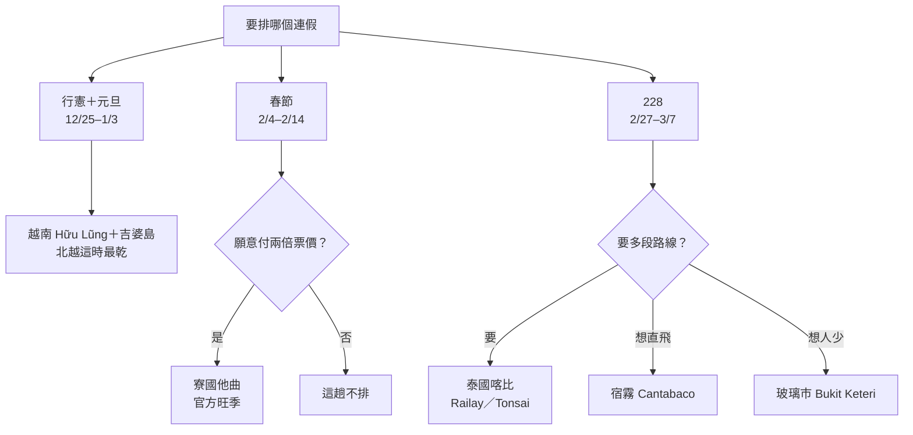

> 🌏 [English version](/posts/climbing/2026-10-08-southeast-asia-climbing-holiday-windows-en)

2026 年底到 2027 年 3 月初有三個連假可以排出國攀岩：行憲紀念日接元旦、春節、228。東南亞的石灰岩岩場這段時間多半在乾季，但五個國家的乾濕、票價和當地假期差很多，同一個岩場換一個連假去，機票可以差到兩倍。這篇整理的是「每個連假去哪一國」，比較了泰國、越南、馬來西亞、寮國、菲律賓的季節、機票、入境規定和岩栓狀況。

所有票價都是 2026-10-07 查詢，一位成人、含稅、經濟艙、台北來回，除非另外註明都不含廉航的託運行李。多數價格取自 KAYAK 與 Google Flights 的自動擷取，下單前請點連結再看一次。

## 結論：三個連假各去哪裡

| 連假 | 日期與請假 | 去哪裡 | 機票（不含行李） | 可爬天數 |
|---|---|---|---|---|
| 行憲＋元旦 | 12/25（五）–1/3（日），請 4 天，連休 10 天 | 越南 Hữu Lũng＋吉婆島 | 越捷 NT$10,148；越南航空 NT$12,774 | 約 7 天 |
| 春節 | 2/4（四）–2/14（日），請 2 天，連休 11 天 | 寮國他曲 | 全程約 NT$20,689 | 7 天 |
| 228 | 2/27（六）–3/7（日），請 4 天，連休 9 天 | 泰國喀比 Railay／Tonsai | 全程約 NT$9,735 | 5 整天＋2 個半天 |

只排兩趟的話，選行憲元旦和 228。春節是五國都最貴的時段，機票大約是平日的兩倍。

2027 年的行事曆已由[人事行政總處公告](https://www.dgpa.gov.tw/information?uid=30&pid=12982)，春節是 2/4 到 2/10 共 7 天，除夕 2/5、初一 2/6。

## 五國放在一起看

| 國家 | 主要岩區 | 型態 | 12–2 月條件 | 從台北怎麼去 | 入境（台灣護照） |
|---|---|---|---|---|---|
| 泰國 | 喀比 Railay／Tonsai | 石灰岩運動攀登，多段多 | 乾季，但 12 月仍偏濕 | 飛曼谷轉國內線，去程在曼谷過一夜 | 免簽 30 天＋TDAC |
| 越南 | 諒山 Hữu Lũng、吉婆島 | 石灰岩運動攀登，幾乎沒有多段 | 雨量少但常毛毛雨，12 月最乾 | 直飛河內，包車 2 小時 | 電子簽 25 美元 |
| 馬來西亞 | 玻璃市 Bukit Keteri、黑風洞 | 石灰岩運動攀登，少量多段 | 西岸北部 1–2 月最乾 | 直飛吉隆坡或檳城 | 免簽 30 天＋MDAC |
| 寮國 | 他曲 Green Climbers Home | 石灰岩運動攀登，多段 4 條 | 官方旺季，白天 22–28°C | 沒有直飛，單程約 28 小時 | 落地簽 40 美元，陸路口岸未確認 |
| 菲律賓 | 宿霧 Cantabaco＋Poog | 石灰岩運動攀登，幾乎都是單段 | 涼乾季，颱風尾季仍有風險 | 直飛宿霧不到 3 小時 | 免簽 14 天＋eTravel |

到主要岩區的全程機票如下，粗體是推薦組合：

| 路線 | 行憲元旦 | 春節 | 228 |
|---|---|---|---|
| 泰國：台北⇄曼谷＋曼谷⇄喀比 | NT$19,971 | NT$21,530 | **NT$9,735** |
| 越南：台北⇄河內直飛（越捷） | **NT$10,148** | NT$24,456 | NT$9,890 |
| 馬來西亞：台北⇄吉隆坡直飛 | NT$11,257 | NT$18,710 | NT$14,276 |
| 馬來西亞：台北⇄檳城直飛（華航） | NT$26,853 | NT$31,849 | NT$14,817 |
| 寮國：台北⇄曼谷廊曼＋廊曼⇄那空帕農 | NT$16,440 | **NT$20,689** | NT$9,131 |
| 菲律賓：台北⇄宿霧直飛 | NT$18,472 | NT$20,601 | NT$8,524 |

各格的查詢連結在下面各國段落。

## 行憲＋元旦：越南 Hữu Lũng 加吉婆島

**為什麼是這個連假。** 以[河內 1991–2020 年的氣候資料](https://en.wikipedia.org/wiki/Hanoi)當代表，北越 12 月到 2 月每月雨量都只有 20 公釐左右，差別在雨日：12 月 5.1 天，2 月變成 12.4 天，日照時數從 124 小時掉到 45 小時。雨下不大，但岩壁不容易乾，所以三個連假裡這個最乾。越南的元旦連休只有 3 天，北越冬天又是觀光淡季，票價沒有跨年加成。

**不要放到春節去。** 越南政府已定案 [Tết 連假是 2/4 到 2/10](https://thanhnien.vn/lich-nghi-tet-dinh-mui-2027-chinh-thuc-theo-lich-am-co-gi-dac-biet-185261002192622786.htm)，和台灣春節完全重疊。同一班越捷，春節要 NT$24,456，是行憲元旦的 2.4 倍，初一到初三家庭經營的店多半不開。

**機票。** [KAYAK 查到](https://www.tw.kayak.com/flights/TPE-HAN/2026-12-25/2027-01-03?sort=price_a&fs=stops=0)越捷來回 NT$10,148，去程 12:10 到河內 14:10，回程 07:35 到桃園 11:10；越南航空 NT$12,774。越捷加購 20 公斤託運後約 NT$11,540，只比越南航空便宜一千多。

**岩場。** [theCrag 的 Hữu Lũng 頁面](https://www.thecrag.com/en/climbing/vietnam/area/2279523057)列了 267 條路線，難度 4c 到 9a，主力在 6b 到 7c，平均約 27 公尺，建議帶 20 支快扣，Cobra Wall 這類長路線要 70 公尺繩。岩壁多在私人果園裡，地主每次收 20,000 到 25,000 越南盾（約 NT$24–30），要備零錢，最近的提款機在 40 分鐘車程外。

冬天選區可以照日照與擋雨來排：

- 下雨天：Dragon Wall、Infinity Cave、Passe-Muraille、Squirrel Wall
- 冷天想曬太陽：La Conche、Thánh Gióng 與 Drone Wall（上午）、Dragon Wall（下午）
- 雨後避開：L'Ile Noire、Thánh Gióng，以及 The Arch 的進場路

**岩栓。** theCrag 總頁寫全區是 316 不鏽鋼，但個別路線有警告：Head Wall 的 Sắc! 被回報「部分岩栓看起來很鏽」，另有幾條路線有螺帽鬆動或缺掛片。上去前自己看一眼。

**交通與住宿。** 從河內包車約 2 小時、四人座 1,500,000 越南盾；每天 09:00、16:00 有接駁車 250,000 越南盾。[Mao Homestay](https://vietclimb.vn/homestays/mao-homestay) 每人每晚 370,000 越南盾含晚餐與早餐。跨年是否營業、機車租金官網都沒寫，要寫信到 info@vietclimb.vn 問。

**吉婆島那兩天。** 知名的 Butterfly Valley 在 [theCrag](https://www.thecrag.com/en/climbing/vietnam/cat-ba-island/area/12484483) 上仍掛著鏽栓與鬆栓警告，沒有換栓紀錄。換栓與新路線集中在 [Cat Ba Climbing](https://catbaclimbing.com/) 自己管的 Fisher Valley 和 Hidden Valley，通行證分別是 30,000 與 50,000 越南盾，排這兩區比較有保障。Hữu Lũng 到吉婆島沒有固定班次的直達車，包車 2,580,000 越南盾（約 NT$3,096）。

**入境。** 台灣護照要簽證。依[領事事務局](https://www.boca.gov.tw/sp-foof-countrycp-01-8-f4a19-1.html)，電子簽在 [evisa.gov.vn](https://evisa.gov.vn/) 申請，單次 25 美元，約 3 到 7 個工作天。最晚 12 月初送件。

## 228：泰國喀比 Railay／Tonsai

**為什麼是這個連假。** [喀比的十年平均](https://thailand-weather.org/en/krabi/climate)是 12 月 154 公釐、19 個雨日，2 月降到 52 公釐、9 個雨日。耶誕到元旦那一週是全年最擠，房價最高；到 2 月底尖峰已過，泰國學校也還沒放暑假。這段時間整個落在齋戒月內，喀比穆斯林人口多，但多數飯店餐廳照常營業；Tonsai 的店家是否縮短營業沒有查到。

**機票。** [泰獅航](https://www.tw.kayak.com/flights/TPE-BKK/2027-02-27/2027-03-07?sort=price_a&fs=stops=0)桃園 16:40 到曼谷廊曼 19:35、回程 06:20 到桃園 11:10，NT$6,689；[曼谷到喀比的國內線](https://www.tw.kayak.com/flights/BKK-KBV/2027-02-28/2027-03-06?sort=price_a&fs=stops=0)來回 NT$3,046。兩段相加 NT$9,735，加上兩段的託運後約 NT$12,468。同樣的走法在行憲元旦要 NT$19,971。

行程大致是 2/27 飛到廊曼住一晚，2/28 早班機到喀比、搭長尾船中午前到 Tonsai；3/1 到 3/5 五個整天；3/6 上午爬完出島，回廊曼再住一晚，3/7 中午前到台北。

**岩場。** 五國裡只有這裡的多段路線算完整。[Mountain Project](https://www.mountainproject.com/area/105894664/laem-phra-nang-railay-tonsai) 收錄 381 條，其中 Tonsai 占 200 條；經典多段有 Humanality（6b+，5 段）、The Wave（6b，4 段）、Lord of the Thai's（7b，5 段）。

**岩栓是這裡最重要的事。** Mountain Project 在同一頁掛著警告：海岸附近的不鏽鋼栓不可信。[當地攀岩網站](http://www.railay.com/railay/climbing/climbing_rebolting.shtml)的說法更直接，不是鈦栓就不要爬。目前沒有公開的官方重打清單，最新資料在指南書和當地攀岩店的列印清單裡。從 theCrag 逐條路線描述整理出來的狀況：

| 路線或分區 | 岩栓狀態 |
|---|---|
| The Wave、Lord of the Thais | 各段全鈦栓 |
| Humanality | 鈦栓加繩環混合；第 7 段是舊繩環橫渡，沒人爬 |
| Crystal Flame | 第 1、2 段全鈦栓；第 3 段只有 1 個繩環 |
| Fire Wall、Dum's Kitchen、Tonsai Wall | 多數全鈦栓，各有幾條要避開 |
| Generator Wall | 尚未重打，整面不建議 |

很多路線除了鈦栓還靠繩環保護，繩環的新舊要自己判斷。

**指南書。** [The Pocket Guide 第 10 版](https://justclimbthailand.com/krabi-climbing-guidebook)在 2026 年 1 月全面更新，1,000 泰銖，到 Tonsai 的 The Rock Shop 買最省事，書裡有特定岩栓的警告。

**住宿與現金。** Tonsai 全區離網、白天沒電，多數房間沒冷氣。[Basecamp Tonsai](https://basecamptonsai.com/bungalows) 每晚 700 到 950 泰銖，只接受直接訂、至少住 5 晚。Tonsai 沒有提款機，現金要從 Railay 帶過去。

**入境。** 依[領事事務局](https://www.boca.gov.tw/sp-foof-countrycp-03-24-dec45-02-1.html)，2026-09-15 起台灣護照免簽入境泰國，每次停留不超過 30 日；要備回程機票、訂房紀錄，以及每人至少 2 萬泰銖現金或等值貨幣。抵達前 72 小時內線上填 TDAC 電子入境卡，免費。

## 春節：寮國他曲，條件最好也最麻煩

**為什麼值得。** [Green Climbers Home](https://greenclimbershome.com/blog/green-climbers-ultimate-travel-guide)（以下簡稱 GCH）是他曲郊外山谷裡的攀岩營地，多數路線在營地步行 5 到 10 分鐘內。官方寫 11 月到 2 月是旺季，白天 22 到 28°C、乾燥，夜裡偶爾降到 10°C 左右。寮國春節沒有法定假日，農曆新年的人潮集中在龍坡邦。[theCrag 的他曲頁面](https://www.thecrag.com/en/climbing/laos/thakhek)列了 636 條路線，主力在 5c 到 7a。11 天的假期也最能攤掉兩頭的轉機。

**麻煩在哪。** 總共四件：

1. **沒有直飛。** GCH 推薦的走法是飛曼谷廊曼、轉國內線到那空帕農、過第三泰寮友誼大橋到他曲。廊曼住一晚，隔天早班機、搭 11:30 的國際巴士，下午兩點左右到營地，出門到營地約 28 小時。
2. **落地簽沒有把握。** 寮國落地簽 40 美元，但[官方電子簽網站](https://laoevisa.gov.la/faq)列的口岸沒有這座橋，寮國移民局的口岸頁面卻標示可辦，兩個官方來源互相矛盾。我翻遍中文論壇和社群，沒有找到任何一筆台灣護照從這座橋入境的紀錄。GCH 自己寫明印度護照不能走這個口岸，所以不能從「多數國籍可辦」推到台灣。出發前要寫信問 GCH，備案是改走永珍。
3. **本季床位少。** GCH [本季公告](https://greenclimbershome.com/blog/What-is-changing-in-2026-27-season)寫 Camp 2 的餐廳燒毀後沒有重建，全營上限 70 人，往年約 120 人。
4. **近兩季有兩起死亡事故。** [GCH 的事故報告](https://greenclimbershome.com/blog/accident-reports-and-lessons-learned)記錄了 2025-01-30 與 2026-02-14 兩起，都發生在清確保站的時候；2025-12-27 還有一起是反覆衝墜後第二支岩栓的掛片螺帽鬆脫。當地沒有救護車。2025 年那次事故後警方下令停攀，九成以上的客人離開，行程要有臨時被封場的心理準備。

**機票。** 台北到廊曼最便宜是泰國亞航 [NT$17,934](https://www.google.com/travel/flights?q=Flights%20from%20TPE%20to%20DMK%20on%202027-02-04%20through%202027-02-14&hl=zh-TW&curr=TWD)，廊曼到那空帕農[來回 NT$2,755](https://www.google.com/travel/flights?q=Flights%20from%20DMK%20to%20KOP%20on%202027-02-05%20through%202027-02-13&hl=zh-TW&curr=TWD)，合計 NT$20,689，含行李約 NT$25,123。

去之前能做的事：把清確保站的流程和繩伴對過一遍、帶一支扳手檢查掛片螺帽、買含醫療後送的旅遊險、帶 40 美元以上的新鈔與 3 張照片。

## 兩個備選：宿霧和玻璃市

**想直飛：宿霧 Cantabaco。** 228 那週[星宇直飛宿霧 NT$8,524](https://www.tw.kayak.com/flights/TPE-CEB/2027-02-27/2027-03-07?sort=price_a&fs=stops=0)，06:55 起飛、09:50 到，中午過後就能到岩場，扣掉頭尾有 7 個整天。[Cantabaco](https://www.thecrag.com/en/climbing/philippines/area/558640974) 加隔壁的 Poog 合計約 140 條，幾乎全是單段。當地社團說多數岩栓是 90 年代打的、只換了一部分，沒有逐條的重打清單，凡是用繩環當保護點的路線都避開。台灣護照免簽 14 天，登機前要完成 [eTravel](https://etravel.gov.ph) 登記。

**想人少：馬來西亞玻璃市 Bukit Keteri。** [theCrag](https://www.thecrag.com/en/climbing/malaysia/area/415519470) 列了 77 條，公有地、停車就到岩壁、免費，玻璃市的最佳季節是 1 月到 4 月。228 那週[華航直飛檳城 NT$14,817](https://www.google.com/travel/flights?q=Flights%20from%20TPE%20to%20PEN%20on%202027-02-27%20through%202027-03-07%20nonstop&hl=zh-TW&curr=TWD)，再搭北線區間車到 Bukit Ketri 站，走得到岩場。要留意整段在齋戒月內，白天吃飯得找華人餐館或自備。2007 年那批舊岩栓的材質與是否換過沒有公開資料，出發前先用 WhatsApp 問當地的 Perlis Climbers。

## 不建議去的地方

| 地方 | 原因 |
|---|---|
| 春節去越南 | 撞 Tết，票價 2.4 倍，家庭經營的 homestay 可能休息 |
| 12–2 月去馬來西亞東岸、刁曼島、砂拉越 | 東北季風雨季，[刁曼島渡輪](https://my.trip.com/guide/info/ferry-to-tioman.html)常減班或停航 |
| 228 去清邁、寮國北部 | 燒山季；2026-03-04 [清邁 AQI 超過 150](https://www.iqair.com/newsroom/chiang-mai-ranks-among-the-top-10-most-polluted-cities-during-thailand-s-burning-season-3-4-2026) |
| 馬來西亞 Bukit Takun | [theCrag](https://www.thecrag.com/en/climbing/malaysia/bukit-takun-crags) 標示不允許攀登，森林局多次拒絕入山 |
| 泰國 Koh Yao Noi | 2017 年起官方禁止攀岩 |
| 清邁 Crazy Horse | 2022 年重開後，2024 年 6 月又出現禁止告示，沒有官方重開公告；要去先問 CMRCA |
| 馬尼拉 Wawa | 2026-09-19 重開，但公告沒有點名攀岩，範圍不明 |

## 還沒查清楚的事

這份比較有幾處是「沒查到」，訂票前要自己補：

- **票價**：多數是自動擷取，部分頁面擷取時還沒載入完。
- **全服務航空的託運**：越南航空、星宇、菲航、華航的最低票種含不含託運，沒有逐一查證。
- **泰獅航行李價**：官網兩張表不一致，一張 775 泰銖、一張 2,000 泰銖。
- **各地岩栓**：喀比、Cantabaco、Bukit Keteri 都沒有官方的逐條清單，只有零星路線註記。
- **春節營業**：GCH 2 月是否客滿、訂金與取消規定，官網沒寫。

出發前一週，再看一次 theCrag 各區論壇的最新警告。

## 參考資料

- [人事行政總處：中華民國 116 年政府行政機關辦公日曆表](https://www.dgpa.gov.tw/information?uid=30&pid=12982)
- [Thanh Niên：2027 年 Tết 連假定案](https://thanhnien.vn/lich-nghi-tet-dinh-mui-2027-chinh-thuc-theo-lich-am-co-gi-dac-biet-185261002192622786.htm)
- [Wikipedia：Hanoi 氣候資料](https://en.wikipedia.org/wiki/Hanoi)
- [theCrag：Hữu Lũng](https://www.thecrag.com/en/climbing/vietnam/area/2279523057)
- [theCrag：吉婆島 Butterfly Valley](https://www.thecrag.com/en/climbing/vietnam/cat-ba-island/area/12484483)
- [VietClimb：Mao Homestay](https://vietclimb.vn/homestays/mao-homestay)
- [Cat Ba Climbing](https://catbaclimbing.com/)
- [領事事務局：越南簽證與入境須知](https://www.boca.gov.tw/sp-foof-countrycp-01-8-f4a19-1.html)
- [thailand-weather.org：喀比氣候](https://thailand-weather.org/en/krabi/climate)
- [Mountain Project：Laem Phra Nang（Railay／Tonsai）](https://www.mountainproject.com/area/105894664/laem-phra-nang-railay-tonsai)
- [railay.com：換栓說明](http://www.railay.com/railay/climbing/climbing_rebolting.shtml)
- [Just Climb Thailand：The Pocket Guide](https://justclimbthailand.com/krabi-climbing-guidebook)
- [Basecamp Tonsai](https://basecamptonsai.com/bungalows)
- [領事事務局：泰國簽證與入境須知](https://www.boca.gov.tw/sp-foof-countrycp-03-24-dec45-02-1.html)
- [Green Climbers Home：旅遊指南](https://greenclimbershome.com/blog/green-climbers-ultimate-travel-guide)
- [Green Climbers Home：2026/27 季變動公告](https://greenclimbershome.com/blog/What-is-changing-in-2026-27-season)
- [Green Climbers Home：事故報告](https://greenclimbershome.com/blog/accident-reports-and-lessons-learned)
- [theCrag：Thakhek](https://www.thecrag.com/en/climbing/laos/thakhek)
- [Lao eVisa FAQ](https://laoevisa.gov.la/faq)
- [theCrag：Cantabaco](https://www.thecrag.com/en/climbing/philippines/area/558640974)
- [theCrag：Bukit Keteri](https://www.thecrag.com/en/climbing/malaysia/area/415519470)
- [theCrag：Bukit Takun](https://www.thecrag.com/en/climbing/malaysia/bukit-takun-crags)
- [IQAir：2026 年清邁燒山季空氣品質](https://www.iqair.com/newsroom/chiang-mai-ranks-among-the-top-10-most-polluted-cities-during-thailand-s-burning-season-3-4-2026)
