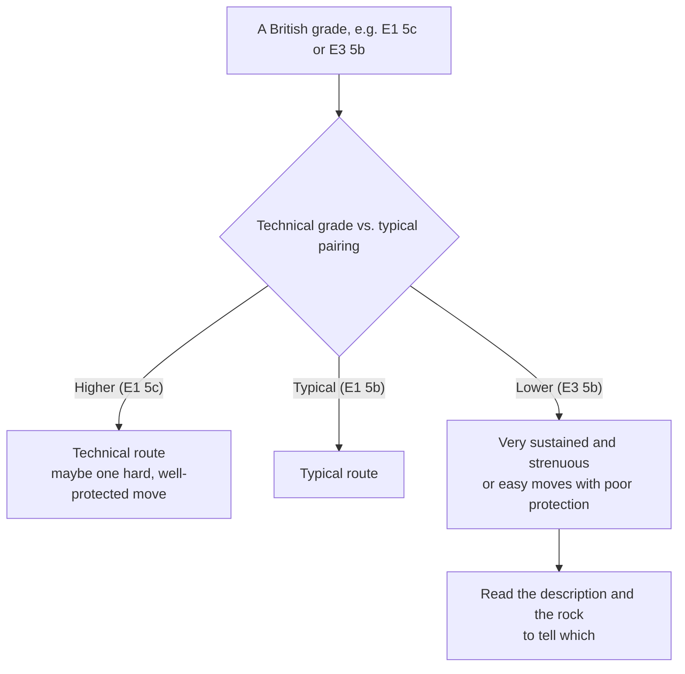

> 🌏 [中文版](/posts/climbing/2026-10-17-grades-and-protection-ratings)

In the Long Dong route database you find a line marked "5.10? R". A British guidebook lists "E1 5b". A Spanish crag says "6a+", and a German friend tells you he climbs "VII". Are these numbers describing the same thing?

This post is for climbers who can read gym grades and are about to head outdoors or abroad. It answers two questions: what each grading system actually measures, and what protection ratings like R and X mean. By the end, you should be able to convert a route abroad into the system you know, and spot when a conversion is misleading.

The basics of V grades and YDS are covered in the [beginner's guide to climbing](/posts/climbing/2026-10-08-climbing-beginner-guide-en), so this post doesn't repeat them. It follows [Lower or Rappel](/posts/climbing/2026-10-17-lower-or-rappel-en) and serves as the bridge from sport to trad: learn to read how well a route protects first, then start placing your own gear in the next post.

## Two questions: how hard, and what happens if you fall

Every grading system answers one of these questions:

- **How hard**: how difficult the hardest move is, or how difficult the route is overall.
- **What happens if you fall**: whether there is enough protection, whether a fall will be long, whether you might hit the ground or a ledge.

Sport routes have pre-placed bolts at regular intervals, so the answer to the second question is roughly fixed, and sport grades only need to answer the first. In trad climbing the leader places the protection, and whether that is possible depends on the rock offering usable cracks ([Wikipedia: Traditional climbing](https://en.wikipedia.org/wiki/Traditional_climbing)). At the same difficulty, protection can be excellent or nearly absent. That is why trad needs a second piece of information.

Of the four systems below, the first three answer only "how hard". The British system answers both questions at once. The American system adds R/X letters to answer the second.

## YDS: the 5.x used in Taiwan, the US, and Japan

The Yosemite Decimal System was refined in the 1950s by climbers at Tahquitz in Southern California into 5.0 through 5.9. It later grew to 5.10 and beyond, with a, b, c, and d subdividing each level from 5.10 up. According to [Wikipedia's YDS article](https://en.wikipedia.org/wiki/Yosemite_Decimal_System), the number reflects the hardest move on the route, and the top grade today is 5.15d.

In Taiwan this is the system you'll see most. The [TOCC Long Dong route database](https://docs.google.com/spreadsheets/d/1QHFNQSPgKgQrTNnYn246wfotOYqOkzHjLltZ26keBgg/edit?usp=sharing) labels every route in 5.x, and [Japanese crags](/posts/climbing/2026-10-12-japan-crags-overview-en) mostly use 5.x too.

The same 5.8 can feel very different from crag to crag. The [Chinese Wikipedia article on Dapao Rock](https://zh.wikipedia.org/zh-tw/%E5%A4%A7%E7%A0%B2%E5%B2%A9) (in Chinese) notes that its grades were set against an early benchmark route, "Sunshine Overhang" (陽光懸岩) at 5.8. Compared with later sport crags and gyms, they run stiff: the same number feels harder there.

**Something you can do tonight**: open the TOCC Long Dong database, pick a sector, and look at the "route type" and "grade" columns. Find three routes at grades you can lead in the gym and check whether they are sport or trad.

## French: the common language of European sport climbing

French grades look like 5c, 6a, 6a+, 7b+. According to [Wikipedia's article on climbing grades](https://en.wikipedia.org/wiki/Grade_(climbing)), the system developed from the UIAA scale in the 1980s, switching to Arabic numerals and adding a, b, c, and "+" for finer steps. It lines up closely with UIAA up to UIAA V+ (roughly French 5a), then diverges.

French grades make no allowance for risk, which is why they are also called the "sport grade". To avoid confusion with British E grades, a lowercase f is sometimes added, as in f6a+.

A French grade measures the overall difficulty of the route, not a single move. [Rockfax's grade page](https://rockfax.com/climbing-guides/grades/) points out one consequence: a route with one short hard section and a longer, sustained route with easier moves can end up with the same grade.

Rockfax also describes a convention: below about 6b+, grades are almost always onsight grades; above about 7b, they are almost always [redpoint](https://en.wikipedia.org/wiki/Redpoint_(climbing)) grades, meaning the difficulty once you have rehearsed the moves. In between is a grey area, and practice varies by location.

**Something you can do tonight**: use the conversion table below to find the French equivalent of the YDS grade you most often lead in the gym, and save it on your phone. When you see a French grade abroad, compare against that line first.

## UIAA: Roman numerals in Germany and Eastern Europe

UIAA grades use Roman numerals with "+" and "−", such as VI+ or VII−. The scale descends from the grading German mountaineer Willo Welzenbach compiled in 1923. It formally became the UIAA scale in 1967, and grade VII was added in 1978, making the scale open-ended ([Wikipedia: Grade (climbing)](https://en.wikipedia.org/wiki/Grade_(climbing))).

According to [Rockfax](https://rockfax.com/climbing-guides/grades/), UIAA grades are used mainly in Germany and Eastern Europe, work much like French grades, and usually apply to fully bolted routes.

**Something you can do tonight**: if you have a friend who has climbed in Germany or Austria, ask which UIAA grade they usually climb, convert it to YDS with the table, and compare it with your own level.

## British: one grade, two pieces of information

British trad grades come in two parts, like "E1 5b" or "VS 4c". The [British Mountaineering Council (BMC) explainer](https://www.thebmc.co.uk/en/a-brief-explanation-of-uk-traditional-climbing-grades) separates them clearly:

- **The first part is the adjectival grade**: the overall difficulty of the route, shaped by seriousness, sustainedness, technical difficulty, exposure, strenuousness, and rock quality. In ascending order: M, D, HD, VD, HVD, S, HS, VS, HVS, then E1, E2, E3, currently up to E11.
- **The second part is the technical grade**: the hardest single move, regardless of how many such moves there are, how strenuous the route is, or how frightened you are. It runs from 4a, 4b, 4c, 5a up to 7b.

The BMC gives a set of typical pairings: S 4a, HS 4b, VS 4c, HVS 5a, E1 5b, E2 5c. The key to reading a British grade is whether the technical grade is higher or lower than the typical pairing:

The BMC's example: an overhanging hand crack is likely sustained but well protected; a blank slab is likely serious. [Rockfax](https://rockfax.com/climbing-guides/grades/) is more direct: a route with a high E grade and a comparatively low technical grade is likely to be badly protected, with run-out sections, committing moves, or high first gear, and possible ground falls.

The reverse doesn't always hold. Rockfax also warns that a route can have one very hard, well-protected move and a separate dangerous, unprotected section. Both parts of the grade will be high, and the route is still dangerous. The BMC itself says these rules are broken more often than obeyed.

**Something you can do tonight**: memorize one reference pairing, "E1 5b". Whenever you see an E grade, ask whether the technical grade is above or below that reference, then read the route description.

## R and X: one letter after the number

The American system handles protection differently. The number still rates only the climbing, and protection gets a separate letter. According to [Wikipedia's YDS article](https://en.wikipedia.org/wiki/Yosemite_Decimal_System), Jim Erickson introduced these letters for trad routes in 1980, borrowing them from the US film ratings of the time:

| Letter | Meaning |
|---|---|
| G | Good, solid protection |
| PG | Adequate protection; falls will not be long |
| R | Inadequate protection; potential for a long fall, and the leader will likely be injured |
| X | Protection is unavailable or so sparse that any fall is likely to result in death or serious injury |

The letter goes right after the number, as in "5.9 R". [Rockfax](https://rockfax.com/climbing-guides/grades/) also lists "R/X", where a fall could cause serious injury or possibly death.

At Long Dong, exactly one route in the TOCC database carries a protection rating: the trad route "King Lightning" (王者雷電) in the Grand Auditorium, marked "5.10? R" (checked 2026-10-17). The database also has a "safety rating" column, but every route currently shows the same value, so it can't tell you anything about protection. No R doesn't mean good protection. On trad routes, read the description and ask people who have climbed it.

**Something you can do tonight**: when you read up on an outdoor route, look for an R or X first. If there is one, ask yourself whether you are certain you won't fall on the worst-protected section. If not, don't lead it yet.

## Conversion tables: approximate at best

The table below is an excerpt from [Mountain Project's international grade comparison chart](https://www.mountainproject.com/international-climbing-grades). It maps each YDS grade to one French, UIAA, and British grade, which makes it handy, but every cell is an approximation.

| YDS | French | UIAA | British (MP's mapping) |
|---|---|---|---|
| 5.6 | 4c | V | S 4b |
| 5.8 | 5b | VI- | HVS 4c |
| 5.9 | 5c | VI | HVS 5a |
| 5.10a | 6a | VI+ | E1 5a |
| 5.10c | 6b | VII | E2 5b |
| 5.11a | 6c | VII+ | E3 5c |
| 5.11d | 7a | VIII | E5 6a |
| 5.12a | 7a+ | VIII+ | E5 6a |
| 5.12c | 7b+ | IX- | E6 6b |
| 5.13a | 7c+ | IX+ | E6 6c |
| 5.14a | 8b+ | X+ | E8 7a |

The YDS, French, and UIAA columns are fairly stable: Wikipedia notes that beyond the easiest grades, YDS and French can be aligned almost exactly.

The British column is the least reliable. MP pairs 5.10a with "E1 5a", but the BMC says E1 most often goes with 5b. That half-step gap isn't a typo: the E grade includes protection, so the same climbing difficulty gets a different E grade depending on how well it protects. The British column only works for routes with normal protection.

Rockfax's advice works as a safety margin across systems: being able to lead sport 5c doesn't mean you can climb E1 trad, even if the technical difficulty is similar. You should at least be comfortable on sport 6b before transferring to E1 trad. Rockfax's reasoning is that sport routes are, on the whole, less serious undertakings, so at the same ability level sport routes can have harder moves.

**Something you can do tonight**: write down the sport grade you can lead reliably and convert it to French. If you're not yet at 6b, pick your first trad lead below E1, on a well-protected route.

## Practice: five scenarios

Answers are folded under each question. Think first, then check.

**1. You lead 5.10c reliably in the gym. At a Spanish sport crag, the guidebook says "6a+". How hard is that?**

Answer

According to MP's chart, 6a+ is about 5.10b, slightly below your level. French grades ignore risk, and sport crags have regularly spaced bolts, so treat it as a normal lead. Grading still varies between crags, so warm up on something a grade or two easier first.

**2. A British guidebook lists two routes: "E1 5c" and "E3 5b". You only want well-protected routes. Which should you consider first?**

Answer

E1 5c. Following the BMC, a technical grade above the typical pairing (E1 5b) suggests a technical route, perhaps one hard but well-protected move. E3 5b has a low technical grade, suggesting either very sustained climbing or easy moves with poor protection. Read the route description before deciding; the BMC itself says these rules are often broken.

**3. A friend says: "This 5.9 R is easy, you climb 5.10."**

Answer

R means inadequate protection, a potentially long fall, and a likely injured leader. 5.9 isn't hard for you, but the question isn't whether you can get up it; it's what happens if you fall. Unless you are certain you won't fall on the worst-protected section, second it or top-rope it instead of leading.

**4. In the Long Dong database, a trad route has no R and its safety rating column shows "●●●". Can you lead it with confidence?**

Answer

No. Only one route in the database is marked R, and the safety rating column is identical for every route, so neither tells you the protection is good. Read the route description, look at whether the rock has usable cracks, and ideally ask someone who has climbed it.

**5. You can lead sport 6a and want to try your first trad route in the UK. Should you start at E1?**

Answer

Not recommended. Rockfax suggests being comfortable on sport 6b before moving to E1 trad. Start on well-protected routes at a lower grade (such as VS 4c or HVS 5a) and get your gear placements dialed first.

## Next steps

Once you can read protection ratings, the next step is placing your own gear: [Trad Protection: Nuts and Cams](/posts/climbing/2026-10-17-trad-protection-nuts-cams-en) covers what makes a good placement. To see which Taiwanese crags are trad and which are sport, jump ahead to [Taiwan's Crags: Rock Type Decides How You Climb](/posts/climbing/2026-10-17-taiwan-crags-rock-type-en).

The map of the whole series is in [Sport vs. Trad: What's the Difference](/posts/climbing/2026-10-17-sport-vs-trad-overview-en).

## References

- [International Climbing Grade Comparison Chart (Mountain Project)](https://www.mountainproject.com/international-climbing-grades)
- [A brief explanation of UK traditional climbing grades (British Mountaineering Council)](https://www.thebmc.co.uk/en/a-brief-explanation-of-uk-traditional-climbing-grades)
- [Grade Conversions (Rockfax)](https://rockfax.com/climbing-guides/grades/)
- [Yosemite Decimal System (Wikipedia)](https://en.wikipedia.org/wiki/Yosemite_Decimal_System)
- [Grade (climbing) (Wikipedia)](https://en.wikipedia.org/wiki/Grade_(climbing))
- [Traditional climbing (Wikipedia)](https://en.wikipedia.org/wiki/Traditional_climbing)
- [Redpoint (climbing) (Wikipedia)](https://en.wikipedia.org/wiki/Redpoint_(climbing))
- [Dapao Rock (Chinese Wikipedia, in Chinese)](https://zh.wikipedia.org/zh-tw/%E5%A4%A7%E7%A0%B2%E5%B2%A9)
- [Long Dong route database (TOCC, Google Sheets, in Chinese; checked 2026-10-17)](https://docs.google.com/spreadsheets/d/1QHFNQSPgKgQrTNnYn246wfotOYqOkzHjLltZ26keBgg/edit?usp=sharing)
- [A Beginner's Guide to Climbing](/posts/climbing/2026-10-08-climbing-beginner-guide-en)
- [Japan Crags Overview](/posts/climbing/2026-10-12-japan-crags-overview-en)
