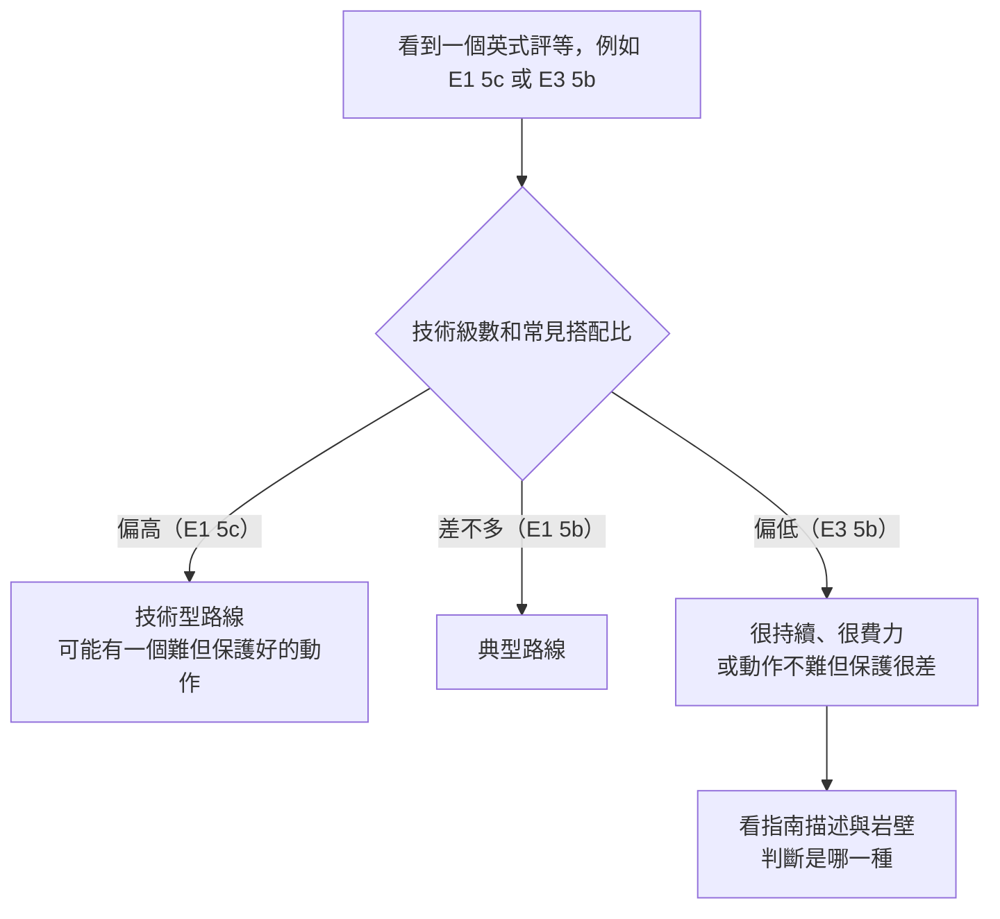

> 🌏 [English version](/posts/climbing/2026-10-17-grades-and-protection-ratings-en)

你在龍洞的路線資料庫裡看到一條「5.10? R」，在英國的指南書裡看到「E1 5b」，西班牙的岩場寫「6a+」，德國朋友說他在爬「VII」。這些數字說的是同一件事嗎？

這篇寫給會讀岩館標籤、準備到戶外或出國的人。它回答兩件事：每套評等系統在量什麼、R 和 X 這種保護評等代表什麼。讀完之後，你可以把一條國外路線換算成自己熟悉的系統，也知道哪一種情況換算會騙人。

V 級和 YDS 的基本讀法，[攀岩入門](/posts/climbing/2026-10-08-climbing-beginner-guide)的「難度怎麼讀」已經講過，這裡不再重複。這篇接在[下放還是垂降](/posts/climbing/2026-10-17-lower-or-rappel)之後，是運攀進入傳攀前的橋：先學會讀「保護好不好」，下一篇才開始自己放保護。

## 先分兩件事：多難，和掉下去會怎樣

所有評等系統都在回答下面兩個問題之一：

- **多難**：路線上最難的動作有多難，或整條路線整體有多難。
- **掉下去會怎樣**：保護點夠不夠、墜落會不會很長、會不會撞到地面或岩階。

運動攀登的保護點是預先打好、間距規律的 bolt，第二個問題的答案大致固定，所以運攀的評等只需要回答第一個問題。傳統攀登的保護是先鋒者自己放的，能不能放、放得好不好，要看岩壁有沒有可用的裂隙（[Wikipedia：Traditional climbing](https://en.wikipedia.org/wiki/Traditional_climbing)）。同一個難度，保護可能很好，也可能幾乎沒有。這就是為什麼傳攀需要第二種資訊。

下面四套系統，前三套只回答「多難」；英式把兩個問題合在一起回答；美式另外加了 R／X 字母回答第二個問題。

## YDS：台灣、美國、日本都用的 5.x

優勝美地十進制系統（YDS）在 1950 年代由南加州 Tahquitz 的攀岩者細分出 5.0 到 5.9，後來往上加到 5.10、5.11，並從 5.10 起用 a、b、c、d 再細分。依 [Wikipedia 的 YDS 條目](https://en.wikipedia.org/wiki/Yosemite_Decimal_System)，數字以路線上最難的一步為準，目前最高是 5.15d。

在台灣，你最常看到的就是這套。[TOCC 的龍洞路線資料庫](https://docs.google.com/spreadsheets/d/1QHFNQSPgKgQrTNnYn246wfotOYqOkzHjLltZ26keBgg/edit?usp=sharing)用 5.x 標示每條路線，[日本岩場](/posts/climbing/2026-10-12-japan-crags-overview)也多用 5.x。

要注意的是，同一個 5.8，在不同岩場的體感可能差很多。[中文維基百科的大砲岩條目](https://zh.wikipedia.org/zh-tw/%E5%A4%A7%E7%A0%B2%E5%B2%A9)寫到，大砲岩的難度以早年的標竿路線「陽光懸岩」5.8 為基準陸續訂出。跟後來的運攀岩場和岩館比起來，這裡的評等偏硬，同一個數字爬起來比較難。

**今晚就能做的動作**：打開 TOCC 的龍洞資料庫，挑一個分區，看「路線種類」和「難度」兩欄。找出三條你在岩館能先鋒的難度，看看它們是運攀還是傳攀。

## 法式：歐洲運攀的共同語言

法式級數長得像 5c、6a、6a+、7b+。依 [Wikipedia 的評等條目](https://en.wikipedia.org/wiki/Grade_(climbing))，它在 1980 年代從 UIAA 級數發展出來，改用阿拉伯數字，再加 a、b、c 和「+」細分。到 UIAA 的 V+（約等於法式 5a）以前，兩套系統大致對齊，之後開始分開。

法式級數完全不計風險，所以也叫「運攀評等」（sport grade）。為了不跟英式的 E 級混淆，有時會在前面加小寫 f，例如 f6a+。

法式級數量的是整條路線的整體難度，不是單一動作。[Rockfax 的評等說明](https://rockfax.com/climbing-guides/grades/)舉了一個後果：一條路線只有一小段很難，另一條很長、很持續但每一步都比較簡單，兩者可能拿到同一個級數。

Rockfax 也提到另一個慣例。約 6b+ 以下的路線，評等幾乎都以「現場第一次就爬上」（onsight）的難度來定；約 7b 以上則多以[紅點](https://en.wikipedia.org/wiki/Redpoint_(climbing))的難度來定，也就是反覆練過之後的難度。兩者之間是灰色地帶，各地做法不同。

**今晚就能做的動作**：把你在岩館最常先鋒的 YDS 級數，用下面的換算表找出對應的法式級數，寫在手機備忘錄裡。出國時看到法式級數，先跟這一行比。

## UIAA：德國與東歐的羅馬數字

UIAA 級數用羅馬數字加上「+」「-」，例如 VI+、VII-。它的前身是德國登山家 Willo Welzenbach 在 1923 年整理的分級，1967 年正式成為 UIAA 級數，1978 年加上 VII 級，代表這套系統沒有上限（[Wikipedia：Grade (climbing)](https://en.wikipedia.org/wiki/Grade_(climbing))）。

依 [Rockfax](https://rockfax.com/climbing-guides/grades/)，UIAA 級數主要用在德國與東歐，用法跟法式級數相同，多半標在全程有 bolt 的路線上。

**今晚就能做的動作**：如果你有朋友在德國或奧地利爬過，問他最常爬的 UIAA 級數，用換算表換成 YDS，跟你自己的程度比一比。

## 英式：一個評等，兩段資訊

英式傳攀評等寫成「E1 5b」「VS 4c」這種兩段式。[英國登山協會（BMC）的說明](https://www.thebmc.co.uk/en/a-brief-explanation-of-uk-traditional-climbing-grades)把兩段分得很清楚：

- **第一段是形容詞級數**：衡量整條路線的整體難度，會受到嚴重性、持續性、技術難度、暴露感、費力程度、岩質影響。由易到難是 M、D、HD、VD、HVD、S、HS、VS、HVS，再往上是 E1、E2、E3……，目前到 E11。
- **第二段是技術級數**：只看最難的一步，不管這種動作有幾個、多累、你有多害怕。從 4a、4b、4c、5a 一路到 7b。

BMC 給了一組常見搭配：S 4a、HS 4b、VS 4c、HVS 5a、E1 5b、E2 5c。讀英式評等的關鍵，就是看技術級數比這個常見搭配高還是低：

BMC 的例子是：手掌寬、往外傾的裂隙，通常是持續但保護好；一片沒有裂隙的光滑斜板，通常是嚴重、保護差。[Rockfax](https://rockfax.com/climbing-guides/grades/) 講得更直接：E 級高、技術級數相對低的路線，很可能保護差、有長距離沒保護的段落，或要爬很高才放得到第一個保護點，有墜地的可能。

反過來不一定成立。Rockfax 也提醒，一條路線可能有一步很難但保護好、另一段很危險但沒保護，這時兩段評等都高，路線還是危險。BMC 自己也說，這些規則常常被打破，只能當參考。

**今晚就能做的動作**：記住一組基準搭配「E1 5b」。以後看到 E 級，先問自己技術級數比基準高還是低，再去讀路線描述。

## R 和 X：在數字後面加一個字母

美式系統的做法不一樣：難度數字照舊只量動作，保護好壞另外用字母標在後面。依 [Wikipedia 的 YDS 條目](https://en.wikipedia.org/wiki/Yosemite_Decimal_System)，這套字母是 Jim Erickson 在 1980 年為傳攀路線提出的，字母借自當時美國的電影分級：

| 字母 | 意思 |
|---|---|
| G | 保護很好、很穩固 |
| PG | 保護足夠，墜落不會太長 |
| R | 保護不足，可能長距離墜落，先鋒者很可能受傷 |
| X | 沒有保護或非常稀少，任何墜落都可能造成死亡或重傷 |

寫法是直接接在數字後面，例如「5.9 R」。[Rockfax](https://rockfax.com/climbing-guides/grades/) 的版本還多了一個「R/X」，意思是墜落可能重傷甚至死亡。

在龍洞，TOCC 資料庫裡標了保護評等的路線只有一條：大禮堂的傳攀路線「王者雷電」，標「5.10? R」（2026-10-17 查詢）。資料庫另有一欄「安全評級」，但目前每條路線都是同一個值，不能拿來判斷保護好壞。沒標 R 不代表保護好，傳攀路線的保護還是要看路線描述、問爬過的人。

**今晚就能做的動作**：讀一條戶外路線的資料時，先找有沒有 R 或 X。有的話，先問自己：在保護最差的那一段，你能不能用「絕對不掉」的把握爬過去？不能，就先不要先鋒。

## 換算表：只能當近似值

下表節錄自 [Mountain Project 的國際評等對照表](https://www.mountainproject.com/international-climbing-grades)。它把每個 YDS 級數對到一個法式、UIAA 和英式級數，方便查，但每一格都是近似值。

| YDS | 法式 | UIAA | 英式（MP 的對照） |
|---|---|---|---|
| 5.6 | 4c | V | S 4b |
| 5.8 | 5b | VI- | HVS 4c |
| 5.9 | 5c | VI | HVS 5a |
| 5.10a | 6a | VI+ | E1 5a |
| 5.10c | 6b | VII | E2 5b |
| 5.11a | 6c | VII+ | E3 5c |
| 5.11d | 7a | VIII | E5 6a |
| 5.12a | 7a+ | VIII+ | E5 6a |
| 5.12c | 7b+ | IX- | E6 6b |
| 5.13a | 7c+ | IX+ | E6 6c |
| 5.14a | 8b+ | X+ | E8 7a |

YDS、法式、UIAA 三欄之間比較穩：Wikipedia 寫到，YDS 和法式在最簡單的幾級以外，幾乎可以一對一排齊。

英式那一欄最不可靠。MP 把 5.10a 對到「E1 5a」，但 BMC 說 E1 最常搭的技術級數是 5b。差半格不是誰抄錯：E 級把保護算進去了，同樣的動作難度，保護好壞不同，E 級就不同。英式那一欄只適用在保護正常的路線上。

Rockfax 的建議可以當跨系統的安全邊界：能先鋒運攀 5c，不代表能爬 E1 傳攀，即使兩者的技術難度差不多。至少要能穩定爬運攀 6b，再把技巧轉到 E1 傳攀。Rockfax 的理由是：整體來說，運攀沒有傳攀那麼嚴重，所以同一個程度帶裡，運攀路線的動作可以比較難。

**今晚就能做的動作**：寫下你能穩定先鋒的運攀級數，換成法式。還沒到 6b，第一條傳攀就選 E1 以下、保護好的路線。

## 練習題：五個情境

答案在每題下方，先自己想再看。

**1. 你在岩館能穩定先鋒 5.10c。到西班牙的運攀岩場，指南書寫「6a+」。大概是什麼程度？**

答案

依 MP 對照表，6a+ 約等於 5.10b，比你的程度低一點。法式級數不計風險，運攀岩場的 bolt 間距規律，可以把它當成一般的先鋒路線。仍要記得換到新岩場，評等鬆緊會不同，先從低一兩級的路線熱身。

**2. 英國指南書上有兩條路線：「E1 5c」和「E3 5b」。你只想要保護好的路線，該先考慮哪一條？**

答案

E1 5c。依 BMC 的說明，技術級數比常見搭配（E1 5b）高，代表技術型、可能有一步難但保護好；E3 5b 的技術級數偏低，代表很持續，或動作不難但保護差。決定前仍要讀路線描述，BMC 自己也說這些規則常被打破。

**3. 朋友說：「這條 5.9 R 很簡單，你 5.10 都爬得上去。」**

答案

R 代表保護不足，可能長距離墜落，先鋒者很可能受傷。5.9 對你不難，但問題不在能不能爬上去，而在掉下來的後果。除非你能確定在保護最差的那段絕對不掉，否則先跟攀或頂繩，不要先鋒。

**4. 你查龍洞資料庫，一條傳攀路線沒有標 R，安全評級欄是「●●●」。可以放心先鋒嗎？**

答案

不行。龍洞資料庫目前只有一條路線標 R，安全評級欄每條都一樣，兩者都不能當作「保護好」的證明。要讀路線描述、看岩壁有沒有可用的裂隙，最好問爬過的人。

**5. 你能先鋒運攀 6a，想去英國爬第一條傳攀。該從 E1 開始嗎？**

答案

不建議。Rockfax 的建議是至少要能穩定先鋒運攀 6b，再轉到 E1 傳攀。從保護好、等級更低的路線開始（例如 VS 4c、HVS 5a），先把放保護練熟。

## 下一步

會讀保護評等之後，下一步是自己放保護：[傳攀保護：岩楔與活動岩楔](/posts/climbing/2026-10-17-trad-protection-nuts-cams)講一個好的放置要符合哪些條件。想知道台灣哪些岩場是傳攀、哪些是運攀，可以先跳到[台灣岩場：岩質決定爬法](/posts/climbing/2026-10-17-taiwan-crags-rock-type)。

整個系列的地圖在[運動攀登與傳統攀登差在哪](/posts/climbing/2026-10-17-sport-vs-trad-overview)。

## 參考資料

- [International Climbing Grade Comparison Chart（Mountain Project）](https://www.mountainproject.com/international-climbing-grades)
- [A brief explanation of UK traditional climbing grades（British Mountaineering Council）](https://www.thebmc.co.uk/en/a-brief-explanation-of-uk-traditional-climbing-grades)
- [Grade Conversions（Rockfax）](https://rockfax.com/climbing-guides/grades/)
- [Yosemite Decimal System（Wikipedia）](https://en.wikipedia.org/wiki/Yosemite_Decimal_System)
- [Grade (climbing)（Wikipedia）](https://en.wikipedia.org/wiki/Grade_(climbing))
- [Traditional climbing（Wikipedia）](https://en.wikipedia.org/wiki/Traditional_climbing)
- [Redpoint (climbing)（Wikipedia）](https://en.wikipedia.org/wiki/Redpoint_(climbing))
- [大砲岩（中文維基百科）](https://zh.wikipedia.org/zh-tw/%E5%A4%A7%E7%A0%B2%E5%B2%A9)
- [龍洞岩場攀登路線資料庫（TOCC，Google 試算表，2026-10-17 查詢）](https://docs.google.com/spreadsheets/d/1QHFNQSPgKgQrTNnYn246wfotOYqOkzHjLltZ26keBgg/edit?usp=sharing)
- [攀岩入門：抱石、上攀、先鋒差在哪](/posts/climbing/2026-10-08-climbing-beginner-guide)
- [日本岩場總覽](/posts/climbing/2026-10-12-japan-crags-overview)
