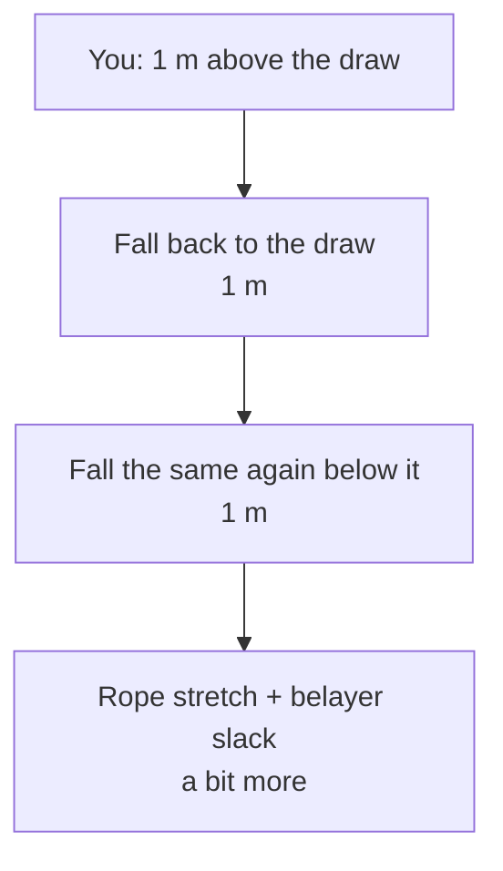

> 🌏 [中文版](/posts/climbing/2026-10-17-gym-lead-climbing)

Once top-roping feels routine, you notice the climber next to you trailing a rope from their harness and clipping it into quickdraws on the way up. That is lead climbing. When you want to try it, the front desk asks a familiar question: "Do you have a lead belay card?"

This post is for people who can already belay top-rope. If that is not solid yet, read [Learning to Top-Rope Belay at the Gym](/posts/climbing/2026-10-17-gym-top-rope-belay-en) first. Here we cover what lead adds: how the climber clips, how the belayer pays out slack and where to stand, why falls are longer, how to practice, and how testing works in Taiwan. Once you can do this and want to go outside, continue with [Your First Outdoor Sport Lead](/posts/climbing/2026-10-17-first-outdoor-sport-lead-en).

**This post does not replace a class either.** [REI's lead belay guide](https://www.rei.com/learn/expert-advice/belay-lead-climber.html) opens by saying gyms require you to pass a lead belay test, and the article is only a supplement.

## How lead differs from top-rope

On top-rope, the rope runs up to the top anchor and back down to you. Wherever you let go, you only drop a short way.

On lead, the rope runs straight from the belayer to you and gets clipped into quickdraws as you go. [REI's lead climbing basics](https://www.rei.com/learn/expert-advice/lead-climbing-basics.html) gives an example: let go three feet above your last clip and you fall at least six feet, plus rope stretch.

So lead adds two jobs:

- The **climber** has to clip at the right moment and in the right direction.
- The **belayer** spends most of the time paying out rope, fast enough but never too much.

## The climber: clipping

### When to clip

The [German Alpine Club (DAV) indoor climbing course booklet](https://alpenverein.de/files/2409-indoor-klettern-basics-english_ol.pdf) is blunt about clipping on lead:

- **Always clip from a stable position.** Find a good foothold first and hold on securely with your non-clipping hand.
- **The clipping window is between hip and forehead.** REI says between head and waist, which puts the least slack into the system.
- **Avoid overstretched clipping.** Stretching too far can make your feet lose friction and slip.
- **Do not fall while clipping the first five quickdraws.** A failed clip in that zone, with an armful of rope, can put you on the ground.
- **Clip every quickdraw.** The DAV reminds you that a fall is always possible, for example from a loose hold.

You can call "Rope!" when you need a big armful of slack for a clip.

### Direction: in from the wall side

The DAV asks for quickdraws clipped "in line" and "untwisted": the rope runs from the wall through the carabiner toward you. [REI's clipping guide](https://www.rei.com/learn/expert-advice/clip-quickdraws.html) and [Petzl's quickdraw tech tip](https://www.petzl.com/us/en/sport/tech-tips/basic-techniques/positioning-the-quickdraw-and-clipping-the-rope/Escalade-falaise-Positionnement-de-la-degaine-et-C_SPO_a77w0000000Kyn8AAC.html) add one more rule: the gate of the rope-end carabiner faces away from your direction of travel. In a fall the rope then runs over the spine, not the gate.

### Three common errors

| Error | What it looks like | Consequence |
|---|---|---|
| Back-clip | Rope runs from outside toward the wall through the carabiner | In a fall the rope can force the gate open and unclip |
| Z-clip | You grab rope from below the previous draw to clip the next one | Heavy rope drag; the draw you just clipped will not catch you, so you fall farther |
| Rope behind the leg | Rope runs behind your calf or thigh | DAV: a fall can flip you upside down so you hit your head, plus rope burns |

REI notes that a Z-clip is usually noticed quickly because of rope drag; if you keep climbing anyway, the draw below is the one that catches you and the fall is longer than it needs to be. When the rope gets behind your leg, [REI's falling guide](https://www.rei.com/learn/expert-advice/climbing-how-to-fall.html) says to step back over it so the rope stays between you and the wall.

### Two clipping techniques

REI teaches two methods; which one you use depends on the gate direction and which hand is clipping:

- **Pinch clip**: run the rope over your index finger, stabilize the carabiner spine with your thumb, and push the rope through the gate with your finger.
- **Snap clip**: hook your middle finger in the carabiner to steady it, pinch the rope between thumb and index finger, and push it through the gate.

You do not need both to be fast. Get one smooth with either hand first.

**One thing to do tonight**: hang a quickdraw from a door handle and clip it twenty times each way: left hand, right hand, gate facing left, gate facing right. After every clip, check that the rope comes out from the "wall" side.

### One more check before you start

The DAV requires that you **always tie directly into your harness on lead**. Its booklet says a self-locking carabiner may be accepted for top-rope under certain conditions, but it is prohibited on lead.

## The belayer: paying out, positioning, catching

### The same principles as top-rope

REI's four principles hold for both top-rope and lead:

- Always keep your brake hand on the rope.
- Only slide a hand when the rope is firmly held in the braking position.
- Keep your brake hand in its strongest natural position.
- Keep your attention on the climber and watch for hazards around you.

### Before the first clip: spot

Until the first quickdraw is clipped, the rope cannot catch anything. The belayer's job here is to spot:

- [Petzl's tip on spotting at the start of a route](https://www.petzl.com/us/en/sport/tech-tips/basic-techniques/spotting-and-belaying-at-the-start-of-the-route/Escalade-parer-en-debut-de-voie_SPO_a77w0000000GnbDAAS.html): spotting is not about catching the climber, it is about guiding them to land on their feet and not flip backwards. Aim your hands at the pelvis and upper back.
- Have the belay device set up already, with enough slack for the climber to reach the first clip.
- DAV: clear the fall zone first, and agree on which side the climber will clip so you can stand accordingly.

### After the first clip: where to stand

The DAV's position is **close to the wall and slightly to the side, under the first quickdraw**. Three reasons:

- **Close to the wall means less rope out.** Petzl says the belayer should be close enough to minimize rope between belayer and climber, which lowers ground-fall risk.
- **Not directly under the climber.** So they do not land on you.
- **Stay mobile.** [Petzl's lead belaying tip](https://www.petzl.com/us/en/sport/tech-tips/basic-techniques/belaying-a-leader-climber--vigilance-anticipation-and-mobility/Escalade---vigilance-et-anticipation_SPO_a77w0000000GnbIAAS.html) suggests stepping toward the wall while the climber clips and returning afterwards; few situations need you more than 2 m from the wall.

REI adds that standing too far back gets you swung into the wall when you catch, which can sprain an ankle, and that you should realign with the direction of pull after each clip.

### The paying-out rhythm

REI's lead belay motion:

1. Grip the rope just above the device with your guide hand.
2. Feed rope up with the guide hand; your brake hand is pulled in toward the device.
3. Slide the guide hand back down to just above the device and regrip.
4. Slide the brake hand back out from the device and regrip.

When the climber calls "Clipping!", pull up a length of rope quickly. You can step forward at the same time, but watch your footing.

### How much slack

This is the hardest part of lead belaying. REI's rule of thumb:

- Rope coming out of the device wire-straight: **too little**. It slows the climber and can pull them off.
- Rope drooping below the device: **too much**. The fall will be long and painful.

The DAV is more specific, and these items are on its lead belay test protocol:

- **No extra slack near the ground, at least until the fifth quickdraw.**
- **Once there is no ground-fall risk, about 20–50 cm of slack.**
- When the climber needs rope to clip, hand it out quickly.

**One thing to do tonight**: next time you are at the gym, watch someone lead belay and look at the rope below the device. Estimate the droop when the climber is at the third draw and again at the eighth, and compare it with 20–50 cm.

### Catching: hard or soft

[Petzl's tip on stopping a fall](https://www.petzl.com/us/en/sport/tech-tips/basic-techniques/stopping-a-climbing-fall/Escalade-arreter-une-chute_SPO_a77w0000000GnayAAC.html) starts the same way as top-rope: grip the brake strand firmly and pull it down. Never grab the climber's side of the rope, and never let go of the brake side.

Then comes a choice that only lead gives you. REI splits it into two:

| | Hard catch | Soft catch |
|---|---|---|
| When | A ledge or big feature is in the fall line, or the climber could still hit the ground | Free space below, e.g. under a roof or high on a vertical wall |
| What the belayer does | Step one or two steps toward the wall and brake hard, like a top-rope catch | Stay put or step back to your original position to leave room to move |
| During the fall | You get pulled toward the wall; bend your knees and brace with your feet | Hop toward the wall and let the pull lift you; meet the wall with your feet |

Petzl says a good belayer knows when to give a dynamic belay and when to stop a fall hard. There is no time to decide when the fall happens, so keep asking yourself what the climber would hit if they came off right now.

A soft catch has its own conditions. Petzl notes the belayer gets pulled toward the wall, so the area must be clear, you should not be barefoot, and there must be no knots in the rope.

### Weight difference

The DAV recommends lead partners of similar weight. If the climber is more than 10 kg heavier than the belayer, you should take appropriate measures. Ask your instructor which ones. REI mentions one option: when the climber is much heavier, the belayer ties in to a ground anchor.

## Why lead falls are longer

[The British Mountaineering Council's (BMC) falling article](https://services.thebmc.co.uk/climb-skills-falling-down) puts it in one line. With rope stretch and slack in the system, you may fall twice as far below your last protection as you were above it.

A lead fall is made of four pieces:

1. Your height above the last draw.
2. The same distance again below it.
3. Rope stretch.
4. The 20–50 cm the belayer leaves, plus the extra movement of a soft catch.

The climber controls the first two: clip within the clipping window and do not climb high above a draw before clipping. The belayer controls the last two. As the BMC puts it: "you'll always fall further than you think."

## How to practice lead falls

Lead falls are worth practicing: the climber learns how to fall and the belayer learns how to catch. [REI's lead climbing basics](https://www.rei.com/learn/expert-advice/lead-climbing-basics.html) says controlled falls in low-consequence spots build confidence and give the belayer practice managing slack and catching.

### Where

- **BMC**: choose a belayer you fully trust and a place where you will not hit anything and the anchors are solid; a climbing wall works, but talk to the staff first.
- **REI**: at least 30 feet (about 9 m) off the ground, high enough for rope stretch to absorb force and to be sure you cannot hit the ground.
- **Petzl**: train yourself to stop falls in different situations, or get professional training.

### Small to big

The BMC progression:

1. Sag onto the rope from below a quickdraw.
2. Let go right above the quickdraw.
3. Let go about a meter above it.

Stay at each stage until it feels calm before moving up.

### How to fall

The DAV, REI and BMC broadly agree:

- **Call it.** Shout "Falling!" if you can, so your belayer reacts faster.
- **Don't grab.** Not the rope, not the quickdraws; you risk serious finger injuries.
- **Don't push off hard.** The DAV says push off lightly and fall "flat"; REI says don't push off unless you need to clear an obstacle, because you swing back into the wall harder.
- **Get your limbs ready.** Stay upright with your core engaged, and bring your feet and hands forward just before you reach the wall.
- **Breathe out.** REI says exhaling makes you relax reflexively.

**One thing to do tonight**: next time you are at the gym, find someone with a lead belay card whom you trust. Ask an instructor or the staff first, then do only step one: climb high enough and sag onto the rope below a quickdraw three times.

## Learning and testing in Taiwan

Like top-rope cards, lead belay cards in Taiwan are **run by each gym**, and whether another gym accepts yours is up to that gym. Two examples, checked on the official sites on 2026-10-17 (pages in Chinese):

- **[T-UP Zhonghe lead belay course (lead belay and lead climbing)](https://tupclimbing.tw/course/zhonghe/360)**: 18 and over, 6 sessions for NT$7,500. Your top-rope belay is tested before the course starts; if it is not good enough, you take a top-rope refresher session first. The course ends with a lead belay test, and passing earns T-UP's lead belay card.
- **[Adventure Taiwan lead climbing course](https://www.adventuretaiwan.com/product/lead-climbing/)**: held at the Camp 4 gym in Beitou Sports Center, two sessions for NT$4,500. The prerequisite is Adventure Taiwan's top-rope course, and climbing 5.8 or harder is preferred. It covers clipping, lead falls, spotting and dynamic belaying. A week after the course you can take Camp 4's lead climbing test.

The closest thing to a cross-gym credential is the CBT (Climbing Belay Test) run by the Chinese Taipei Alpine Association. According to [T-UP's 2023 CBT announcement](https://tupclimbing.tw/news/announcement/232), the CBT tests top-rope belaying, lead belaying, and leading a 5.7–5.8 route yourself. The route is set in advance and you can practice on it before the test. The lead part of the CBT is exactly what this post covers.

**One thing to do tonight**: ask your usual gym two questions. Does the lead belay course require passing a top-rope belay check first? Does it accept lead cards from other gyms?

For comparison, [the DAV's lead belay test protocol](https://alpenverein.de/files/2409-indoor-klettern-basics-english_ol.pdf) ticks off items you can use directly as a self-check:

- Weight difference considered
- Position checked after the first clip
- No slack near the ground; about 20–50 cm once above ground-fall risk
- Quickdraws clipped from a stable position, every one of them
- No rope behind the leg

## Practice: five scenarios

Answers are under each question; think first, then open. For more questions, try [nobodyclimb's rope system practice: sport lead](https://nobodyclimb.cc/games/rope-system/learn/sport-lead) (in Chinese).

**1. You are at the third draw. The next one is just beyond full arm's reach above your head, and the footholds are small.**

Answer

Don't stretch for it. The DAV says clip from a stable position, avoid overstretched clipping, and a failed clip within the first five draws can put you on the ground. Move up to a better foothold so the draw sits between hip and forehead; if you cannot, step back down and ask for a tight rope while you work it out.

**2. After clipping the sixth draw, you notice the rope runs from the outside toward the wall through the carabiner.**

Answer

That is a back-clip. In a fall the rope can force the gate open and unclip. From a stable position, take the rope out and clip again so it runs from the wall side out toward you.

**3. Your partner is at the second draw, and about half a meter of rope droops below your device.**

Answer

Too much. The DAV says no extra slack near the ground, at least until the fifth quickdraw, because a fall at this height can reach the ground. Take in the extra and move toward the wall; 20–50 cm is for once the climber is well above ground-fall range.

**4. Your partner is at the lip of a big roof with nothing but air below, and calls "Falling!" How do you catch?**

Answer

This is a soft-catch situation: nothing in the fall line. Following REI and Petzl, pull the brake hand down, grip hard, and hop toward the wall with the pull so the stop is gentler, meeting the wall with your feet. If there were a ledge below, or the climber were only at the second or third draw, you would switch to a hard catch.

**5. You weigh 55 kg and want to lead belay a friend who weighs 72 kg.**

Answer

That is 17 kg, more than the 10 kg at which the DAV says to take measures. Ask the gym or an instructor, for example about anchoring yourself to a ground anchor, or find a belayer closer in weight. If no one has taught you how, don't improvise.

## What's next

Once you have a lead card and lead comfortably at the gym, you can prepare to climb outside. Outdoors you hang your own draws, use a stick clip before the first bolt, and deal with rope length and the anchor; that is covered in [Your First Outdoor Sport Lead](/posts/climbing/2026-10-17-first-outdoor-sport-lead-en). For the big picture of outdoor climbing, read the [Sport and Trad Climbing overview](/posts/climbing/2026-10-17-sport-vs-trad-overview-en).

## References

- [Indoor-Climbing Basics: DAV belay certificate booklet, English edition (Deutscher Alpenverein, 2024)](https://alpenverein.de/files/2409-indoor-klettern-basics-english_ol.pdf)
- [How to Belay a Lead Climber (REI Expert Advice)](https://www.rei.com/learn/expert-advice/belay-lead-climber.html)
- [Lead Climbing Basics (REI Expert Advice)](https://www.rei.com/learn/expert-advice/lead-climbing-basics.html)
- [Lead Climbing: How to Clip Quickdraws (REI Expert Advice)](https://www.rei.com/learn/expert-advice/clip-quickdraws.html)
- [Lead Climbing: How to Fall (REI Expert Advice)](https://www.rei.com/learn/expert-advice/climbing-how-to-fall.html)
- [Climb skills: Falling down (BMC)](https://services.thebmc.co.uk/climb-skills-falling-down)
- [Stopping a climbing fall (Petzl)](https://www.petzl.com/us/en/sport/tech-tips/basic-techniques/stopping-a-climbing-fall/Escalade-arreter-une-chute_SPO_a77w0000000GnayAAC.html)
- [Belaying a leader climber: vigilance, anticipation and mobility (Petzl)](https://www.petzl.com/us/en/sport/tech-tips/basic-techniques/belaying-a-leader-climber--vigilance-anticipation-and-mobility/Escalade---vigilance-et-anticipation_SPO_a77w0000000GnbIAAS.html)
- [Spotting and belaying at the start of the route (Petzl)](https://www.petzl.com/us/en/sport/tech-tips/basic-techniques/spotting-and-belaying-at-the-start-of-the-route/Escalade-parer-en-debut-de-voie_SPO_a77w0000000GnbDAAS.html)
- [Positioning the quickdraw and clipping the rope (Petzl)](https://www.petzl.com/us/en/sport/tech-tips/basic-techniques/positioning-the-quickdraw-and-clipping-the-rope/Escalade-falaise-Positionnement-de-la-degaine-et-C_SPO_a77w0000000Kyn8AAC.html)
- [T-UP Zhonghe: lead belay course (lead belay and lead climbing)](https://tupclimbing.tw/course/zhonghe/360) (in Chinese)
- [Adventure Taiwan: lead climbing course](https://www.adventuretaiwan.com/product/lead-climbing/) (in Chinese)
- [T-UP Zhonghe: CTAA Climbing Belay Test announcement (2023)](https://tupclimbing.tw/news/announcement/232) (in Chinese)
- [nobodyclimb rope system practice: sport lead](https://nobodyclimb.cc/games/rope-system/learn/sport-lead) (in Chinese)
- [Learning to Top-Rope Belay at the Gym](/posts/climbing/2026-10-17-gym-top-rope-belay-en)
